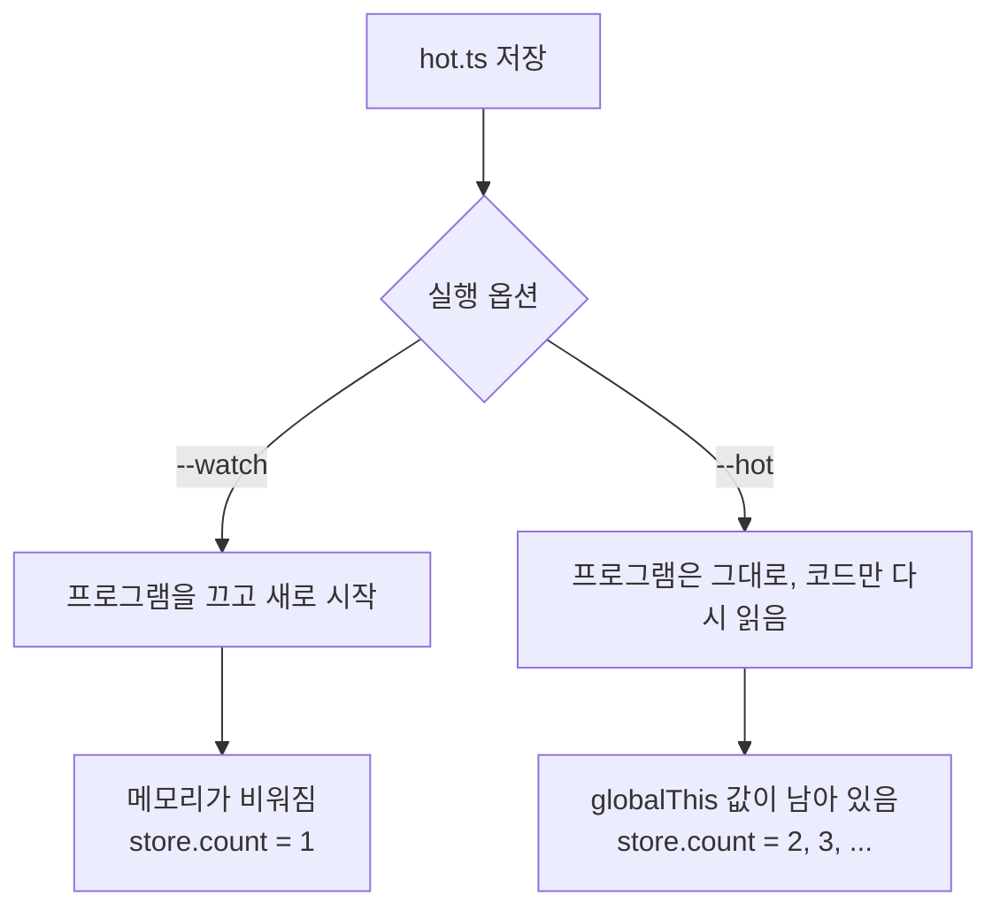
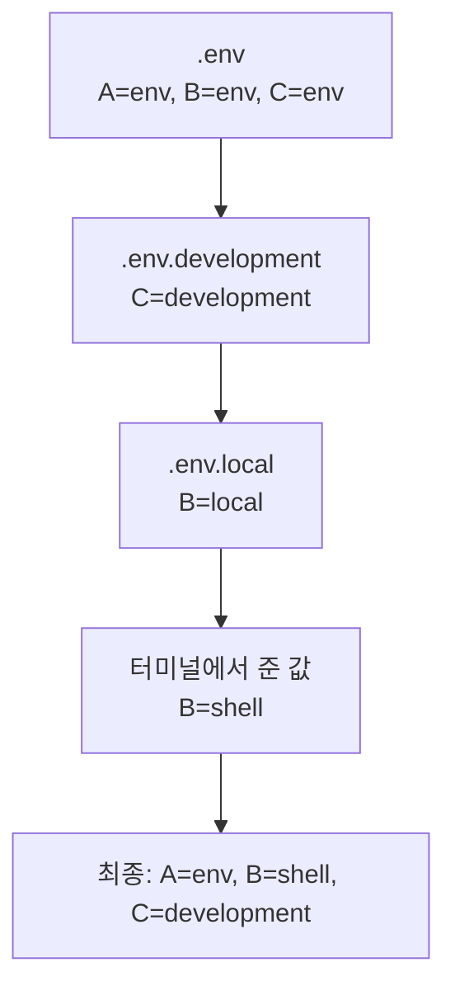

# 4. 코드 실행과 자동 재실행

## 파일 실행

```bash
bun index.ts        # TypeScript
bun script.js       # JavaScript
bun app.tsx         # JSX/TSX도 바로 실행
```

## 저장할 때마다 자동으로 다시 실행하기

코드를 고칠 때마다 명령을 다시 입력하지 않아도 됩니다. Bun에는 두 가지 방식이 있습니다.

| 옵션 | 동작 | 언제 쓰나 |
|---|---|---|
| `--watch` | 파일이 바뀌면 **프로그램을 껐다가 새로 시작**합니다. | 대부분의 경우. 동작이 단순하고 예측하기 쉽습니다. |
| `--hot` | 프로그램을 **끄지 않고 코드만 바꿔 끼웁니다.** 메모리에 있던 값이 유지됩니다. | 웹 서버를 띄워 둔 채 빠르게 고칠 때 |

```bash
bun --watch index.ts
bun --hot server.ts
```

> 옵션은 `bun`과 파일 이름 **사이**에 씁니다. `bun index.ts --watch`처럼 뒤에 쓰면 프로그램에 전달되는 인자가 되어 동작하지 않습니다.

### 차이를 직접 확인해 보기

`hot.ts`를 만듭니다. `globalThis`는 프로그램 전체에서 하나뿐인 객체라서, 여기에 넣은 값은 코드가 교체되어도 프로그램이 살아 있는 동안 유지됩니다.

```ts
const store = globalThis as { count?: number };
store.count = (store.count ?? 0) + 1;
Bun.serve({ port: 3101, fetch: () => new Response(`버전 1 / 로드 횟수 ${store.count}`) });
```

> `globalThis as { count?: number }`는 "`globalThis`에 `count`라는 숫자 값이 있을 수도 있다"고 TypeScript에 알려 주는 표기입니다. 이 표기 없이 `globalThis.count`라고 쓰면 실행은 되지만 [9장](./09_%ED%83%80%EC%9E%85_%EA%B2%80%EC%82%AC.md)의 타입 검사에서 오류가 납니다.

1. `bun --hot hot.ts`로 실행하고 브라우저에서 `http://localhost:3101`을 엽니다.
2. 코드의 `버전 1`을 `버전 2`로 고치고 저장한 뒤 새로고침합니다.

| 실행 방법 | 고친 뒤 화면 |
|---|---|
| `bun --hot hot.ts` | `버전 2 / 로드 횟수 2` (프로그램이 유지되어 횟수가 쌓임) |
| `bun --watch hot.ts` | `버전 2 / 로드 횟수 1` (프로그램이 새로 시작됨) |



멈출 때는 터미널에서 `Ctrl + C`를 누릅니다.

## package.json 스크립트

자주 쓰는 명령은 `package.json`의 `scripts`에 이름을 붙여 둡니다.

```json
{
  "scripts": {
    "start": "bun run index.ts",
    "dev": "bun --watch index.ts",
    "typecheck": "bun check"
  }
}
```

```bash
bun run start
```

```text
$ bun run index.ts
Hello via Bun!
```

첫 줄의 `$ ...`는 Bun이 실제로 실행한 명령을 보여 주는 것입니다. 이 줄을 숨기려면 `bun run --silent start`를 씁니다.

Bun 자체 명령과 이름이 겹치지 않으면 `run`도 생략할 수 있습니다.

```bash
bun start
bun dev
```

> `test`, `build`, `install`처럼 Bun 명령과 이름이 같은 스크립트는 반드시 `bun run test`처럼 `run`을 붙여야 합니다. `bun test`는 Bun의 테스트 실행기를 부릅니다.

어떤 스크립트가 있는지 잊었다면 `bun run`만 입력하세요. 사용법 아래에 스크립트 목록이 나옵니다.

```bash
bun run
```

```text
...
package.json scripts (3 found):
  $ bun run start
    bun run index.ts

  $ bun run dev
    bun --watch index.ts

  $ bun run typecheck
    bun check
```

## 파일 없이 코드 한 줄 실행하기

간단히 확인할 때는 파일을 만들지 않고 바로 실행할 수 있습니다.

```bash
bun -e 'console.log(Bun.version)'   # -e (--eval): 코드 실행
bun -p '1 + 2'                      # -p (--print): 실행하고 결과값 출력
```

```text
1.4.3
3
```

## 명령줄 인자 받기와 종료 코드

파일 이름 뒤에 적은 값은 프로그램에 **인자**로 전달됩니다. `process.argv`(또는 `Bun.argv`)로 꺼냅니다.

`args.ts`:

```ts
const [name, count] = process.argv.slice(2);

if (!name) {
  console.error("사용법: bun args.ts <이름> [횟수]");
  process.exit(1);
}

for (let i = 0; i < Number(count ?? 1); i++) {
  console.log(`안녕, ${name}!`);
}
```

```bash
bun args.ts 철수 2
echo $?
bun args.ts
echo $?
```

```text
안녕, 철수!
안녕, 철수!
0
사용법: bun args.ts <이름> [횟수]
1
```

- `process.argv`는 `[bun 경로, 파일 경로, 인자1, 인자2, ...]`입니다. 그래서 `.slice(2)`로 앞의 두 개를 버립니다. 인자는 항상 **문자열**입니다.
- **종료 코드**는 프로그램이 끝나면서 남기는 숫자입니다. `0`은 성공, 그 밖의 숫자는 실패라는 약속입니다. 끝까지 문제없이 실행되면 `0`, `process.exit(1)`처럼 직접 정할 수도 있습니다. 바로 앞 명령의 종료 코드는 `echo $?`로 봅니다.
- `bun test`, `bun check`, `&&`(앞 명령이 성공했을 때만 뒤 명령 실행)가 모두 이 종료 코드로 성공과 실패를 판단합니다.
- `console.log`는 일반 출력, `console.error`는 **오류 출력**으로 나갑니다. 화면에는 둘 다 보이지만, `bun args.ts > out.txt`처럼 결과를 파일로 저장할 때 오류 메시지는 파일에 섞이지 않고 화면에 남습니다.

더 많은 예는 [12장 예제 1](./12_%EC%98%88%EC%A0%9C_%EC%8A%A4%ED%81%AC%EB%A6%BD%ED%8A%B8%EC%99%80_%ED%8C%8C%EC%9D%BC.md#예제-1-명령줄-인자와-환경-변수)에 있습니다.

## 지금 실행 중인 파일 정보: import.meta

| 값 | 뜻 | 예 |
|---|---|---|
| `import.meta.dir` | 이 파일이 있는 폴더 | `/Users/you/my-app` |
| `import.meta.file` | 이 파일 이름 | `index.ts` |
| `import.meta.path` | 이 파일의 전체 경로 | `/Users/you/my-app/index.ts` |
| `import.meta.main` | 이 파일을 **직접 실행했으면** `true`, 다른 파일이 import했으면 `false` | `true` |

`import.meta.dir`를 쓰면 **어느 폴더에서 실행하든** 이 파일 옆의 파일을 찾을 수 있습니다. `Bun.file("data.json")`처럼 쓰면 실행한 위치(현재 폴더)를 기준으로 찾기 때문에, 다른 폴더에서 실행하면 파일을 못 찾습니다.

```ts
const data = Bun.file(`${import.meta.dir}/data.json`); // 항상 이 파일 옆의 data.json
```

## bunx: 패키지를 설치하지 않고 바로 실행

npm에 올라온 명령줄 도구를 한 번만 써 보고 싶을 때 씁니다. (`npx`와 같은 역할)

```bash
bunx cowsay "안녕 Bun"
```

```text
 __________
< 안녕 Bun >
 ----------
        \   ^__^
         \  (oo)\_______
            (__)\       )\/\
                ||----w |
                ||     ||
```

`bunx`는 `bun x`와 같습니다.

- 처음 실행할 때 패키지를 내려받아 캐시에 저장하고, 다음부터는 캐시를 씁니다. 프로젝트의 `package.json`에는 추가되지 않습니다.
- 프로젝트에 이미 설치된 패키지가 있으면 그것을 먼저 씁니다.
- 많은 명령줄 도구는 "Node.js로 실행하라"고 표시되어 있어서, `bunx`로 실행해도 컴퓨터에 Node.js가 있으면 Node.js로 돌아갑니다. **Bun으로 실행하게 하려면** `bunx --bun 도구`처럼 `--bun`을 붙입니다.

## 환경 변수와 .env 파일

비밀번호, 포트 번호처럼 코드에 직접 쓰지 않을 값은 `.env` 파일에 둡니다. **Bun은 `.env`를 자동으로 읽습니다.** (`dotenv` 패키지가 필요 없습니다.)

`.env`:

```text
GREETING=안녕하세요
PORT=4000
```

`env.ts`:

```ts
console.log(process.env.GREETING);
console.log(Bun.env.PORT);
```

```bash
bun env.ts
```

```text
안녕하세요
4000
```

- `process.env`(Node.js 방식)와 `Bun.env`(Bun 방식) 둘 다 쓸 수 있습니다.
- 값은 항상 **문자열**입니다. 숫자로 쓰려면 `Number(Bun.env.PORT)`처럼 바꿔야 합니다.
- `.env`에는 비밀 값이 들어가므로 **Git에 올리지 마세요.** (`bun init`이 만든 `.gitignore`에 이미 포함되어 있습니다.)

### 여러 개의 .env 파일과 우선순위

Bun은 `.env` 말고도 다음 파일을 자동으로 읽습니다. 같은 이름의 변수가 여러 곳에 있으면 **아래 표에서 순서 번호가 큰 쪽의 값이 쓰입니다.**

| 순서 | 파일 | 언제 읽나 |
|---|---|---|
| 1 | `.env` | 항상 |
| 2 | `.env.development` / `.env.production` / `.env.test` | `NODE_ENV` 값에 맞는 것 하나. `NODE_ENV`가 없으면 `development`, `bun test`에서는 `test` |
| 3 | `.env.local` | 항상 (`bun test`에서는 읽지 않음) |
| 4 | 터미널에서 직접 준 값 | `PORT=4000 bun index.ts`처럼 실행할 때 |

직접 확인해 본 결과입니다. `.env`에 `A=env, B=env, C=env`, `.env.local`에 `B=local`, `.env.development`에 `C=development`, `.env.production`에 `C=production`을 넣었습니다.

| 실행 | A | B | C |
|---|---|---|---|
| `bun env.ts` | env | local | development |
| `NODE_ENV=production bun env.ts` | env | local | production |
| `B=shell bun env.ts` | env | shell | development |

위 결과를 그림으로 보면, 아래로 갈수록 나중에 적용되어 앞의 값을 덮어씁니다.



- 내 컴퓨터에서만 쓰는 값은 `.env.local`에 둡니다. 팀이 함께 쓰는 기본값은 `.env`에 둡니다.
- 다른 파일을 쓰려면 `bun --env-file=.env.staging index.ts`처럼 지정합니다. 이렇게 하면 **기본 `.env` 파일들은 읽지 않고** 지정한 파일만 읽습니다.
