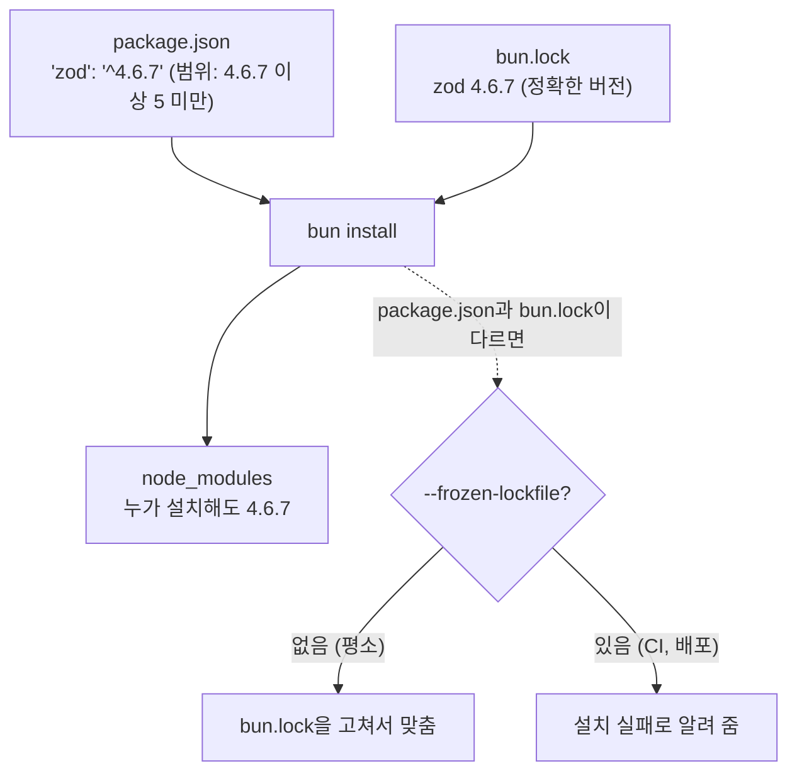

# 5. 패키지 관리

Bun은 npm 저장소의 패키지를 그대로 설치합니다. `npm install` 대신 `bun install`, `npm install 패키지` 대신 `bun add 패키지`를 쓴다고 생각하면 됩니다.

## 패키지 추가

```bash
bun add zod
```

```text
installed zod@4.6.7

1 package installed [656.00ms]
```

`package.json`에 다음이 추가됩니다. (버전 숫자는 설치 시점에 따라 다릅니다.)

```json
"dependencies": {
  "zod": "^4.6.7"
}
```

### 버전 범위 읽는 법

`"zod": "^4.6.7"`의 `^`는 "이 버전 **이상**, 다음 주(major) 버전 **미만**"이라는 뜻입니다. 나중에 `bun install`이나 `bun update`를 할 때 이 범위 안에서 버전이 정해집니다.

| 적힌 값 | 허용되는 버전 | 언제 쓰나 |
|---|---|---|
| `^4.6.7` | `4.6.7` 이상 `5.0.0` 미만 | 기본값. 기능 추가와 버그 수정은 받음 |
| `~4.6.7` | `4.6.7` 이상 `4.7.0` 미만 | 버그 수정만 받음 |
| `4.6.7` | 정확히 `4.6.7` | 절대 바뀌면 안 될 때 (`bun add -E`) |
| `^0.3.2` | `0.3.2` 이상 `0.4.0` 미만 | 주 버전이 0이면 부(minor) 버전 변경도 큰 변경으로 봄 |

> 범위가 있어도 실제 설치되는 버전은 `bun.lock`에 고정됩니다. 그래서 누가 언제 `bun install`을 해도 같은 버전이 설치됩니다.

설치한 패키지는 `import`로 불러 씁니다.

```ts
import { z } from "zod";

const User = z.object({ name: z.string(), age: z.number().min(0) });

console.log(User.safeParse({ name: "영희", age: 15 }).success); // true
console.log(User.safeParse({ name: "영희", age: -1 }).success); // false
```

## 개발할 때만 쓰는 패키지

테스트 도구, 코드 정리 도구처럼 **배포한 프로그램에는 필요 없는** 패키지는 `-d`를 붙여 `devDependencies`에 넣습니다.

```bash
bun add -d prettier
```

## 자주 쓰는 옵션

| 명령 | 설명 |
|---|---|
| `bun add zod` | 일반 의존성으로 추가 (`dependencies`) |
| `bun add -d prettier` | 개발용으로 추가 (`devDependencies`) |
| `bun add -E zod` | `^` 없이 정확한 버전으로 고정 |
| `bun add zod@3` | 특정 버전(여기서는 3.x)으로 추가 |
| `bun add -g cowsay` | 컴퓨터 전체에서 쓰는 전역 설치 |

## 패키지 삭제

```bash
bun remove prettier
```

```text
- prettier
1 package removed [1.00ms]
```

## 다른 사람의 프로젝트를 받았을 때

`package.json`과 `bun.lock`만 있고 `node_modules`가 없다면 한 번에 설치합니다.

```bash
bun install
```

`bun i`로 줄여 쓸 수 있습니다. `bun.lock`에 기록된 버전 그대로 설치되므로 모두가 같은 버전을 쓰게 됩니다.



| 명령 | 언제 쓰나 |
|---|---|
| `bun install` | 평소 개발할 때 |
| `bun install --frozen-lockfile` | 자동 빌드(CI)나 배포 서버. `bun.lock`과 `package.json`이 맞지 않으면 고치지 않고 **실패**해서 실수를 알려 줌 |
| `bun install --production` | 배포 서버. `devDependencies`는 설치하지 않음 |

## 설치된 패키지 확인

```bash
bun pm ls
```

```text
/Users/you/my-app node_modules (28 installed)
├── @types/bun@1.4.3
├── typescript@7.0.2
└── zod@4.6.7
```

## 업데이트

| 명령 | 설명 |
|---|---|
| `bun outdated` | 새 버전이 나온 패키지 목록 보기 |
| `bun update` | `package.json`에 적힌 범위 안에서 최신으로 업데이트 |
| `bun update zod` | 특정 패키지만 업데이트 |
| `bun update --latest` | 범위를 무시하고 최신 버전으로 (`^4.x` → `^5.x`처럼 주 버전도 올라감. 코드가 깨질 수 있으니 확인 필요) |
| `bun update -i` | 업데이트할 패키지를 목록에서 골라서 업데이트 |

## 패키지가 왜 설치되어 있는지 확인하기

직접 설치하지 않은 패키지가 `node_modules`에 있다면, 다른 패키지가 필요로 해서 같이 설치된 것입니다.

```bash
bun why typescript
```

```text
typescript@7.0.2
  └─ peer my-app (requires ^7)
```

어떤 패키지 때문에 설치되었는지 경로를 보여 줍니다. 위 결과는 "`my-app`의 `peerDependencies`가 `^7`을 요구해서 설치되었다"는 뜻입니다. Bun은 `peerDependencies`에 적힌 패키지도 자동으로 설치합니다.

## 설치 스크립트는 기본으로 실행되지 않습니다

일부 패키지는 설치될 때 `postinstall` 같은 스크립트를 실행해서 추가 파일을 내려받거나 프로그램을 빌드합니다. 그런데 이 스크립트는 **아무 코드나 실행할 수 있어서 보안 위험**이 됩니다. 그래서 Bun은 npm과 달리:

- 널리 쓰이는 패키지 목록(`bun pm default-trusted`로 확인, 300여 개)에 있는 패키지의 스크립트만 실행하고,
- 나머지는 **실행하지 않습니다.**

패키지를 설치했는데 "모듈을 찾을 수 없다"거나 "빌드된 파일이 없다"는 오류가 나면 이 경우일 수 있습니다.

```bash
bun pm untrusted        # 스크립트가 막힌 패키지 목록 보기
bun pm trust 패키지이름  # 이 패키지를 믿고 스크립트 실행 (package.json의 trustedDependencies에 기록됨)
```

> 믿을 수 있는 패키지인지 확인한 뒤에만 `trust` 하세요.

## 알아 두면 좋은 것

- **`bun.lock`은 Git에 올리세요.** 팀원과 배포 서버가 똑같은 버전을 설치하게 해 줍니다.
- **`node_modules`는 올리지 마세요.** 언제든 `bun install`로 다시 만들 수 있습니다.
- **npm으로 만든 프로젝트도 됩니다.** `package-lock.json`(npm), `yarn.lock`, `pnpm-lock.yaml`이 있는 프로젝트에서 `bun install`을 실행하면 그 버전을 읽어 `bun.lock`을 새로 만듭니다.
- **`bun.lockb`는 예전 형식입니다.** Bun 1.2 이전에는 사람이 읽을 수 없는 이진 파일 `bun.lockb`를 썼고, 지금은 텍스트 파일 `bun.lock`을 씁니다. 오래된 프로젝트에서 `bun.lockb`를 보면 `bun install --save-text-lockfile`로 `bun.lock`을 만든 뒤 `bun.lockb`를 지우면 됩니다.
- **한 프로젝트에서 여러 패키지 관리자를 섞지 마세요.** `npm install`과 `bun install`을 번갈아 쓰면 잠금 파일이 두 개가 되어 버전이 어긋납니다.
- **이상하게 설치가 꼬였을 때:** `node_modules`를 지우고 다시 설치합니다. 그래도 안 되면 Bun의 다운로드 캐시를 비웁니다(`bun pm cache rm`).
