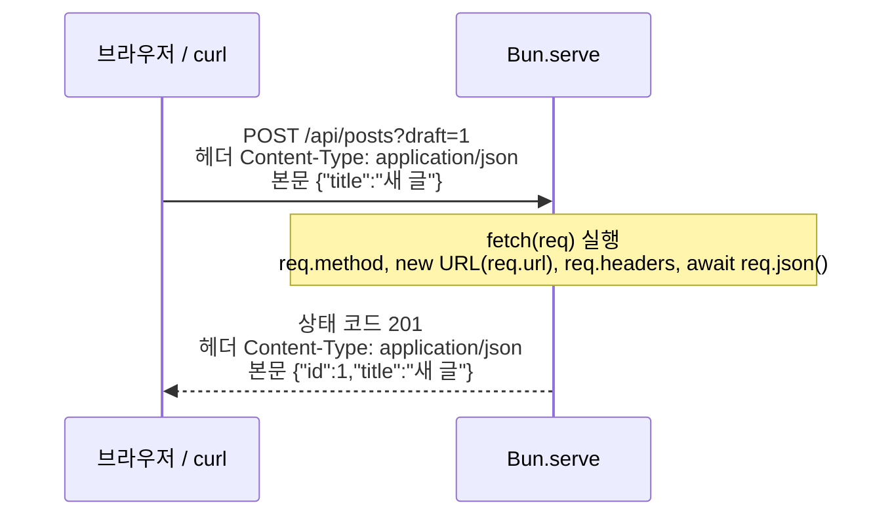

# 7. 웹 서버 만들기

Bun에는 웹 서버 기능(`Bun.serve`)이 들어 있어서 Express 같은 패키지 없이 서버를 만들 수 있습니다.

## 가장 간단한 서버

`server.ts`:

```ts
const server = Bun.serve({
  port: 3100,
  fetch() {
    return new Response("안녕하세요!");
  },
});

console.log(`서버 실행 중: ${server.url}`);
```

```bash
bun server.ts
```

```text
서버 실행 중: http://localhost:3100/
```

브라우저에서 `http://localhost:3100`을 열면 "안녕하세요!"가 보입니다. 멈출 때는 `Ctrl + C`를 누릅니다.

- `fetch`는 요청이 올 때마다 실행되는 함수입니다.
- `Response`는 돌려줄 응답입니다. 웹 브라우저의 `fetch` API에서 쓰는 것과 같은 표준 객체입니다.
- `port`를 빼면 환경 변수 `PORT`(또는 `BUN_PORT`) 값을, 그것도 없으면 **3000번**을 씁니다. 3000번은 다른 프로그램이 자주 쓰는 번호라서 겹치면 `EADDRINUSE` 오류가 납니다([11장](./11_%EB%AA%85%EB%A0%B9%EC%96%B4_%EC%9A%94%EC%95%BD%EA%B3%BC_%EB%AC%B8%EC%A0%9C_%ED%95%B4%EA%B2%B0.md#포트가-이미-사용-중이에요-eaddrinuse)).
- `localhost`는 "**내 컴퓨터**"라는 뜻입니다. 기본 설정에서는 방화벽이 막지 않는 한 같은 와이파이의 다른 기기에서도 내 컴퓨터의 IP 주소(예: `http://192.168.0.10:3100`)로 접속할 수 있습니다. 내 컴퓨터에서만 열려면 `hostname: "127.0.0.1"`을 추가합니다.

### 요청과 응답의 기본 개념

| 용어 | 뜻 | 예 |
|---|---|---|
| 메서드 | 요청의 종류 | `GET`(가져오기), `POST`(만들기), `PATCH`/`PUT`(고치기), `DELETE`(지우기) |
| 경로 | 주소에서 도메인 뒤 부분 | `/api/posts` |
| 쿼리 문자열 | 주소의 `?` 뒤 값 | `?q=bun&page=2` |
| 헤더 | 본문 외의 부가 정보 | `Content-Type: application/json` |
| 본문(body) | 보내는 실제 데이터 | `{"title":"새 글"}` |
| 상태 코드 | 결과를 나타내는 숫자 | 아래 표 |

| 상태 코드 | 뜻 |
|---|---|
| `200` | 성공 (기본값) |
| `201` | 새로 만들었음 |
| `204` | 성공했지만 돌려줄 본문 없음 |
| `301` / `302` / `303` | 다른 주소로 이동 |
| `400` | 요청이 잘못됨 (빠진 값, 잘못된 형식) |
| `401` / `403` | 로그인 필요 / 권한 없음 |
| `404` | 없는 주소 |
| `500` | 서버 코드에서 오류 |

위 용어가 요청 하나에서 어디에 들어가는지 보면 이렇습니다.



## 주소마다 다른 응답: routes

`routes`에 주소와 응답을 짝지어 적습니다.

```ts
const server = Bun.serve({
  port: 3100,
  routes: {
    "/": new Response("홈 화면입니다"),
    "/api/hello": () => Response.json({ message: "안녕하세요" }),
    "/users/:id": (req) => new Response(`사용자 번호: ${req.params.id}`),
    "/api/posts": {
      GET: () => Response.json([{ id: 1, title: "첫 글" }]),
      POST: async (req) => {
        const body = await req.json();
        return Response.json({ created: body }, { status: 201 });
      },
    },
  },
  fetch() {
    return new Response("페이지를 찾을 수 없습니다", { status: 404 });
  },
});

console.log(`서버 실행 중: ${server.url}`);
```

| 요청 | 응답 |
|---|---|
| `GET /` | `홈 화면입니다` |
| `GET /api/hello` | `{"message":"안녕하세요"}` |
| `GET /users/42` | `사용자 번호: 42` |
| `GET /api/posts` | `[{"id":1,"title":"첫 글"}]` |
| `POST /api/posts` (본문 `{"title":"새 글"}`) | `{"created":{"title":"새 글"}}`, 상태 코드 201 |
| `GET /nope` (없는 주소) | `페이지를 찾을 수 없습니다`, 상태 코드 404 |

알아 둘 점:

- **고정 응답:** `"/": new Response(...)`처럼 함수 없이 응답을 바로 적을 수 있습니다.
- **JSON 응답:** `Response.json(값)`을 쓰면 JSON 형식과 헤더가 자동으로 설정됩니다.
- **주소의 일부를 값으로:** `:id`처럼 콜론으로 시작하는 부분은 `req.params.id`로 꺼냅니다.
- **요청 방식별 처리:** `GET`, `POST`처럼 방식마다 다른 함수를 줄 수 있습니다.
- **나머지 주소:** `routes`에 없는 주소는 `fetch`가 처리합니다. 404 페이지를 여기서 돌려주면 됩니다. `fetch`를 아예 빼면 Bun이 빈 404 응답을 돌려줍니다.
- **적지 않은 방식:** `/api/posts`처럼 방식별로 적은 주소에 `DELETE` 같은 다른 방식으로 요청하면, 그 요청도 `fetch`로 넘어갑니다. 위 코드에서는 404가 됩니다.

## 쿼리 문자열, 헤더, 상태 코드, 이동

```ts
const server = Bun.serve({
  port: 3100,
  routes: {
    "/search": (req) => {
      const url = new URL(req.url);
      const keyword = url.searchParams.get("q") ?? "";
      const page = Number(url.searchParams.get("page") ?? "1");
      return Response.json({ keyword, page });
    },
    "/whoami": (req) => {
      const agent = req.headers.get("user-agent") ?? "알 수 없음";
      return new Response(`${req.method} 요청, 브라우저: ${agent}`, {
        headers: { "Content-Type": "text/plain; charset=utf-8", "X-Powered-By": "Bun" },
      });
    },
    "/admin": () => new Response("권한이 없습니다", { status: 403 }),
    "/old-page": Response.redirect("/new-page", 301),
    "/new-page": new Response("새 페이지입니다"),
  },
  fetch() {
    return new Response("페이지를 찾을 수 없습니다", { status: 404 });
  },
});

console.log(`서버 실행 중: ${server.url}`);
```

| 요청 | 응답 |
|---|---|
| `GET /search?q=번&page=2` | `{"keyword":"번","page":2}` |
| `GET /whoami` (curl로) | `GET 요청, 브라우저: curl/8.x`, 헤더에 `X-Powered-By: Bun` |
| `GET /admin` | `권한이 없습니다`, 상태 코드 403 |
| `GET /old-page` | 상태 코드 301, `Location: /new-page` → 브라우저가 `/new-page`로 이동 |

- **쿼리 문자열:** `req.url`은 전체 주소 문자열입니다. `new URL(req.url).searchParams.get("이름")`으로 값을 꺼냅니다. 값이 없으면 `null`이고, 값은 항상 **문자열**이라 숫자가 필요하면 `Number()`로 바꿉니다.
- **헤더 읽기/쓰기:** `req.headers.get("이름")`으로 읽고, `new Response(본문, { headers: {...} })`로 붙입니다. 헤더 이름은 대소문자를 가리지 않습니다.
- **한글 응답:** 문자열 응답에 한글이 들어가면 `Content-Type`에 `charset=utf-8`을 적어 두는 것이 안전합니다. `Response.json()`은 알아서 설정합니다.
- **이동:** `Response.redirect(주소, 상태코드)`를 씁니다. 301은 "영구 이동", 302/303은 "이번만 이동"입니다.

## 요청 본문 읽기: JSON, 글자, 폼

`POST`로 보낸 데이터(본문)는 형식에 맞는 메서드로 꺼냅니다. 본문은 **한 번만** 읽을 수 있으니 하나만 고르세요.

| 메서드 | 보내는 쪽 | 결과 |
|---|---|---|
| `await req.json()` | `fetch`나 `curl`로 보낸 JSON (`Content-Type: application/json`) | 객체 |
| `await req.text()` | 아무 글자 | 문자열 |
| `await req.formData()` | HTML `<form>` 전송, `curl -d 'a=1&b=2'` 또는 `curl -F` | `form.get("이름")`으로 꺼내는 값 (문자열 또는 파일) |

```ts
const server = Bun.serve({
  port: 3100,
  routes: {
    "/echo/json": {
      POST: async (req) => {
        try {
          const body = await req.json();
          return Response.json({ received: body });
        } catch {
          return Response.json({ error: "JSON 형식이 아닙니다" }, { status: 400 });
        }
      },
    },
    "/echo/text": {
      POST: async (req) => new Response(`받은 글: ${await req.text()}`),
    },
    "/echo/form": {
      POST: async (req) => {
        const form = await req.formData();
        return Response.json({ name: form.get("name"), age: form.get("age") });
      },
    },
  },
});

console.log(`서버 실행 중: ${server.url}`);
```

```bash
curl -X POST -H "Content-Type: application/json" -d '{"title":"새 글"}' localhost:3100/echo/json
curl -X POST -H "Content-Type: application/json" -d '{title:' localhost:3100/echo/json
curl -X POST -d '그냥 글자' localhost:3100/echo/text
curl -X POST -d 'name=영희&age=15' localhost:3100/echo/form
```

```text
{"received":{"title":"새 글"}}
{"error":"JSON 형식이 아닙니다"}
받은 글: 그냥 글자
{"name":"영희","age":"15"}
```

- **형식이 틀린 본문은 오류가 납니다.** 깨진 JSON을 `req.json()`으로 읽거나, JSON을 `req.formData()`로 읽으면 오류가 납니다. 그대로 두면 500이 되므로, 위처럼 `try/catch`로 잡아 **400(요청이 잘못됨)**을 돌려주는 것이 좋습니다.
- 폼으로 받은 값도 쿼리 문자열처럼 **항상 문자열**입니다(`"15"`).
- 받은 JSON의 내용이 맞는지(필수 값이 있는지 등)는 직접 확인해야 합니다. 예는 [13장 예제 10](./13_%EC%98%88%EC%A0%9C_%EC%9B%B9_%EC%84%9C%EB%B2%84.md#예제-10-메모-rest-api)에 있습니다.

## 다른 서버에 요청 보내기: fetch

서버가 요청을 받는 쪽이라면, `fetch`는 요청을 **보내는** 쪽입니다. 브라우저와 같은 함수를 Bun에서도 그대로 씁니다. 위 서버를 띄워 둔 채 다른 터미널에서 실행해 보세요.

`client.ts`:

```ts
const res = await fetch("http://localhost:3100/echo/json", {
  method: "POST",
  headers: { "Content-Type": "application/json" },
  body: JSON.stringify({ title: "새 글" }),
});

console.log(res.status, res.ok);
console.log(await res.json());

const missing = await fetch("http://localhost:3100/nope");
console.log(missing.status, missing.ok);
```

```text
200 true
{
  received: {
    title: "새 글",
  },
}
404 false
```

- `method`를 빼면 `GET`입니다. 객체를 보낼 때는 `JSON.stringify`로 문자열로 바꾸고 `Content-Type`을 적습니다.
- **404나 500이어도 오류가 나지 않습니다.** `res.ok`(200~299이면 `true`)로 성공인지 확인하세요. 시간 제한, 동시 요청 같은 예는 [13장 예제 12](./13_%EC%98%88%EC%A0%9C_%EC%9B%B9_%EC%84%9C%EB%B2%84.md#예제-12-fetch로-다른-서버에-요청하기)에 있습니다.

## 터미널에서 시험해 보기

브라우저 대신 `curl`로도 확인할 수 있습니다.

```bash
curl localhost:3100/api/hello
curl -X POST -H "Content-Type: application/json" -d '{"title":"새 글"}' localhost:3100/api/posts
```

## 파일 내려주기

`Bun.file()`을 그대로 `Response`에 넣으면 파일 종류(Content-Type)까지 자동으로 설정됩니다.

```ts
Bun.serve({
  port: 3100,
  routes: {
    "/logo": new Response(Bun.file("./logo.png")),
  },
  fetch() {
    return new Response("Not Found", { status: 404 });
  },
});
```

## 개발할 때는 자동 재실행과 함께

서버 코드를 고칠 때마다 껐다 켜지 않도록 `--hot`이나 `--watch`로 실행하세요([4장](./04_%EC%BD%94%EB%93%9C_%EC%8B%A4%ED%96%89%EA%B3%BC_%EC%9E%90%EB%8F%99_%EC%9E%AC%EC%8B%A4%ED%96%89.md)).

```bash
bun --hot server.ts
```

## 오류가 나면 어떻게 되나요?

요청을 처리하다 코드에서 오류가 나면 Bun은 상태 코드 500을 돌려주고 터미널에 오류를 출력합니다. 서버는 꺼지지 않고 다음 요청을 계속 받습니다. 브라우저에 보이는 화면은 실행 방식에 따라 다릅니다.

| 실행 | 브라우저가 받는 500 응답 |
|---|---|
| `bun server.ts` (개발 모드, 기본) | 오류 메시지와 코드 위치를 보여 주는 HTML 페이지 |
| `NODE_ENV=production bun server.ts` | `Something went wrong!` 한 줄 |

개발 모드의 오류 화면은 고칠 때 편하지만 코드 내용이 드러납니다. **실제로 서비스할 때는 `NODE_ENV=production`으로 실행하세요.** 사용자에게 보여 줄 오류 화면을 직접 정하려면 `error` 함수를 추가합니다.

```ts
Bun.serve({
  port: 3100,
  fetch() {
    throw new Error("뭔가 잘못됨");
  },
  error(err) {
    console.error(err);
    return new Response("잠시 후 다시 시도해 주세요", { status: 500 });
  },
});
```

> 지금 보고 있는 이 설명서 사이트도 `Bun.serve`로 만든 서버입니다. Markdown 파일을 읽어 HTML로 바꿔 보여 줍니다.
