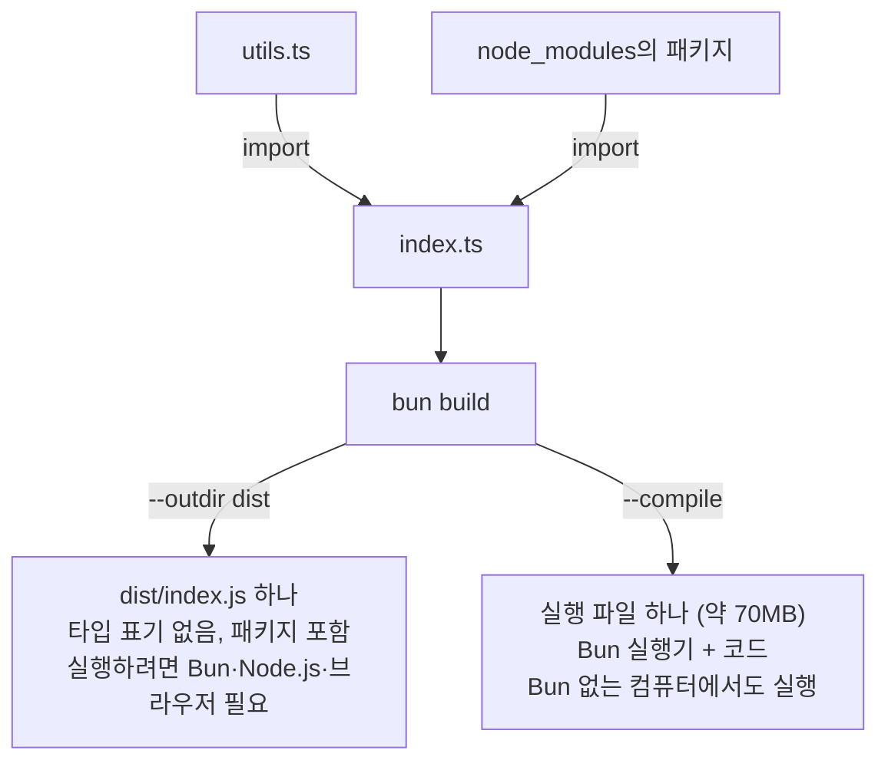

# 10. 빌드와 실행 파일 만들기

## 빌드(번들링)가 뭔가요?

여러 파일과 패키지로 나뉜 코드를 **하나의 JavaScript 파일로 합치는 작업**입니다. 브라우저에 올리거나, 다른 환경에 배포할 때 씁니다.



## 기본 빌드

```bash
bun build ./index.ts --outdir ./dist
```

```text
Bundled 1 module in 3ms

  index.js  43 bytes  (entry point)
```

`dist/index.js`가 만들어집니다. TypeScript 타입 표기는 빠지고, 불러온 패키지는 함께 합쳐집니다.

## 자주 쓰는 옵션

| 옵션 | 설명 |
|---|---|
| `--outdir=dist` | 결과를 넣을 폴더 |
| `--outfile=app.js` | 결과 파일 이름을 직접 지정 |
| `--target=browser` | 브라우저용 (기본값) |
| `--target=bun` | Bun에서 실행할 용도. **서버 코드를 빌드할 때는 이것을 쓰세요.** 기본값인 `browser`로 빌드하면 오류 없이 빌드되지만 `node:fs` 같은 서버 기능이 빈 값으로 바뀌어, 실행할 때 `readFileSync is not a function` 같은 오류가 납니다 |
| `--target=node` | Node.js에서 실행할 용도 |
| `--production` | `--minify`를 켜고 `NODE_ENV`를 `production`으로 설정 |
| `--minify` | 공백과 이름을 줄여 파일 크기를 작게 |
| `--sourcemap=linked` | 오류가 났을 때 원래 코드 위치를 찾을 수 있는 정보 추가 |
| `--watch` | 파일이 바뀔 때마다 다시 빌드 |

예: 브라우저용으로 작게 빌드하기

```bash
bun build ./src/main.ts --outdir ./dist --minify
```

## 실행 파일 하나로 만들기: --compile

`--compile`을 쓰면 **Bun이 설치되지 않은 컴퓨터에서도 실행되는 프로그램 파일**이 만들어집니다. Bun 실행기와 코드가 파일 하나에 함께 들어갑니다.

```bash
bun build ./index.ts --compile --outfile hello
```

```text
   [1ms]  bundle  1 modules
 [193ms] compile  hello
```

```bash
./hello
```

```text
Hello via Bun!
```

알아 둘 점:

- **크기:** 실행기가 들어 있어서 한 줄짜리 코드도 약 70MB가 됩니다(1.4.3, macOS Apple Silicon 기준 약 71MB).
- **운영체제:** 아무 옵션이 없으면 **지금 쓰는 컴퓨터와 같은** 운영체제·CPU용 파일이 만들어집니다. 다른 운영체제용은 아래 "다른 운영체제용으로 만들기"를 보세요.
- **자동 최적화:** `--compile`은 `--production`을 함께 켭니다. 코드가 압축(minify)되고 `NODE_ENV`가 `production`이 됩니다.
- **.env:** 실행 파일도 기본으로 실행 위치의 `.env` 파일을 읽습니다. 끄려면 `--no-compile-autoload-dotenv`를 붙입니다.

### 다른 운영체제용으로 만들기

Mac에서 Windows나 Linux용 실행 파일을 만들 수 있습니다. `--target`에 `bun-운영체제-CPU`를 적습니다. 처음 한 번은 그 운영체제용 Bun 실행기를 내려받습니다.

```bash
bun build ./index.ts --compile --target=bun-linux-x64 --outfile hello-linux
bun build ./index.ts --compile --target=bun-windows-x64 --outfile hello
```

```text
   [2ms]  bundle  1 modules
Downloading [462529]
...
[4.274s] compile  hello-linux bun-linux-x64-v1.4.3
   [3ms]  bundle  1 modules
Downloading [449999]
...
[4.576s] compile  hello.exe bun-windows-x64-v1.4.3
```

`Downloading [숫자]`는 그 운영체제용 Bun 실행기를 내려받는 진행 상황(바이트)입니다. 한 번 받으면 저장해 두므로 다음부터는 나오지 않습니다.

| `--target` | 대상 |
|---|---|
| `bun-darwin-arm64` | macOS (Apple Silicon: M1 이후) |
| `bun-darwin-x64` | macOS (Intel) |
| `bun-linux-x64` | Linux (일반 PC, 대부분의 서버) |
| `bun-linux-arm64` | Linux (ARM 서버, 라즈베리파이 64비트) |
| `bun-windows-x64` | Windows |

Windows용은 이름에 `.exe`가 자동으로 붙습니다.

## 빌드를 꼭 해야 하나요?

서버나 명령줄 도구를 **Bun으로 실행**한다면 빌드하지 않고 `bun index.ts`로 바로 실행해도 됩니다. 빌드는 다음 경우에 필요합니다.

- 브라우저에서 돌아갈 코드를 만들 때
- Node.js 환경에 배포할 때
- Bun이 없는 컴퓨터에 프로그램을 나눠 줄 때 (`--compile`)
