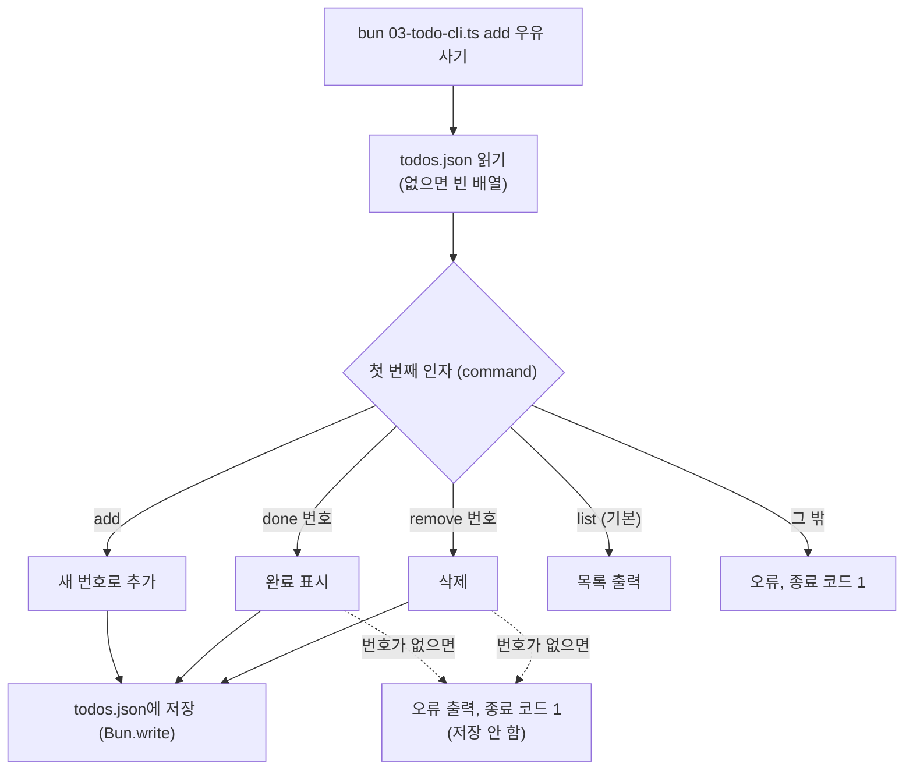
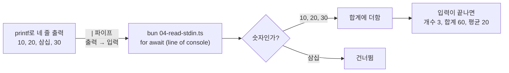
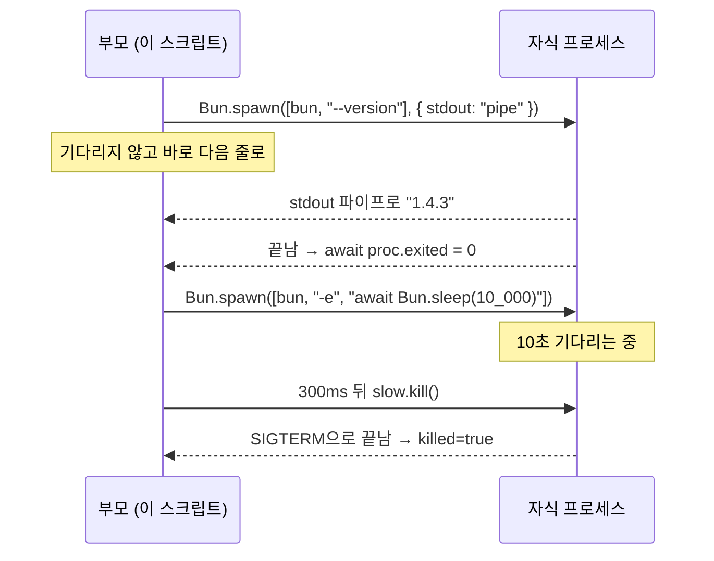
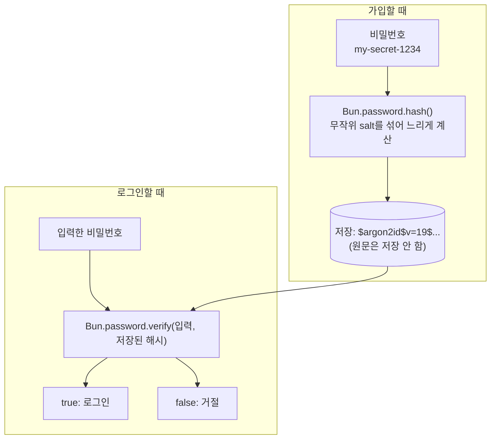

# 12. 초급 예제: 스크립트와 파일

12~14장은 앞에서 배운 내용을 실제로 써 보는 **초급 예제 모음**입니다. 모든 예제는 이 프로젝트의 `examples/` 폴더에 파일로 들어 있어서 바로 실행할 수 있습니다.

| 장 | 예제 |
|---|---|
| 12장 (이 장) | 명령줄 인자, 글자 수 세기, 할 일 관리 CLI, 입력 읽기, 파일 찾기, 셸, 자식 프로세스, 비동기, 해시 |
| [13장](./13_%EC%98%88%EC%A0%9C_%EC%9B%B9_%EC%84%9C%EB%B2%84.md) | REST API, HTML 폼, fetch, WebSocket 채팅, 실시간 스트림 |
| [14장](./14_%EC%98%88%EC%A0%9C_%EB%8D%B0%EC%9D%B4%ED%84%B0%EB%B2%A0%EC%9D%B4%EC%8A%A4_%ED%85%8C%EC%8A%A4%ED%8A%B8_%EB%B9%8C%EB%93%9C.md) | SQLite, SQLite API 서버, 테스트, 브라우저용 빌드, 풀스택 |

> **실행 위치:** 예제는 이 프로젝트 폴더(`261015_1610_bun_report`)에서 `bun examples/파일.ts`로 실행합니다. 3장의 `my-app`에서 해 보려면 파일을 복사한 뒤 경로만 바꾸면 됩니다.
>
> **확인 환경:** 12~14장의 출력은 Bun 1.4.3(macOS)에서 직접 실행한 결과입니다. 시간, 경로, 무작위 값은 실행할 때마다 다릅니다.

## 예제 1. 명령줄 인자와 환경 변수

`examples/01-args-env.ts`

```ts
const [name = "방문자", age] = Bun.argv.slice(2);

console.log(`${Bun.env.GREETING ?? "안녕하세요"}, ${name}님!`);
if (age) console.log(`내년에는 ${Number(age) + 1}살이 되시네요.`);

console.log("Bun 버전:", Bun.version);
console.log("실행한 파일:", import.meta.file);
console.log("전체 인자:", Bun.argv.slice(2));
```

```bash
GREETING=반가워요 bun examples/01-args-env.ts 철수 20
```

```text
반가워요, 철수님!
내년에는 21살이 되시네요.
Bun 버전: 1.4.3
실행한 파일: 01-args-env.ts
전체 인자: [ "철수", "20" ]
```

인자 없이 `bun examples/01-args-env.ts`로 실행하면 `안녕하세요, 방문자님!`이 나옵니다.

- `Bun.argv`는 `[bun 경로, 파일 경로, 인자1, 인자2, ...]`입니다. 그래서 `.slice(2)`로 앞의 두 개를 버립니다.
- `const [name = "방문자"] = ...`는 값이 없을 때 쓸 **기본값**입니다.
- 명령 앞에 `이름=값`을 붙이면 그 명령에서만 쓰는 환경 변수가 됩니다.

## 예제 2. 파일의 줄·단어·글자 수 세기

`examples/02-word-count.ts`

```ts
const path = Bun.argv[2];
if (!path) {
  console.error("사용법: bun examples/02-word-count.ts <파일 경로>");
  process.exit(1);
}

const file = Bun.file(path);
if (!(await file.exists())) {
  console.error(`파일이 없습니다: ${path}`);
  process.exit(1);
}

const text = await file.text();
const lines = text === "" ? 0 : text.replace(/\n$/, "").split("\n").length;
const words = text.split(/\s+/).filter(Boolean).length;
const chars = [...text.replace(/\s/g, "")].length;

console.log(`파일: ${path}`);
console.log(`줄 수:   ${lines}`);
console.log(`단어 수: ${words}`);
console.log(`글자 수: ${chars} (공백 제외)`);
console.log(`바이트:  ${file.size}`);
```

```bash
bun examples/02-word-count.ts examples/data/poem.txt
```

```text
파일: examples/data/poem.txt
줄 수:   4
단어 수: 13
글자 수: 38 (공백 제외)
바이트:  123
```

- `console.error`는 오류 메시지용 출력입니다. `process.exit(1)`은 "실패로 끝남"을 알리는 종료 코드 1로 프로그램을 끝냅니다.
- `[...text]`는 문자열을 **글자 단위**로 나눕니다. 한글 38글자가 123바이트인 이유는 한글 한 글자가 3바이트이기 때문입니다.

## 예제 3. 할 일 관리 프로그램 (JSON 파일 저장)

`examples/03-todo-cli.ts` — 명령에 따라 할 일을 추가·완료·삭제하고 `examples/data/todos.json`에 저장합니다.

실행할 때마다 파일을 읽고, 명령을 처리한 뒤, 바뀐 것이 있으면 파일에 다시 씁니다.



```ts
type Todo = { id: number; title: string; done: boolean };

const db = Bun.file(`${import.meta.dir}/data/todos.json`);
const todos: Todo[] = (await db.exists()) ? await db.json() : [];
const [command = "list", ...args] = Bun.argv.slice(2);

async function save() {
  await Bun.write(db, JSON.stringify(todos, null, 2));
}

function findTodo(): Todo | undefined {
  const todo = todos.find((t) => t.id === Number(args[0]));
  if (!todo) {
    console.error(`${args[0] ?? "(번호 없음)"}번 할 일이 없습니다.`);
    process.exitCode = 1;
  }
  return todo;
}

switch (command) {
  case "add": {
    const title = args.join(" ").trim();
    if (!title) {
      console.error("할 일 내용을 적어 주세요. 예: add 우유 사기");
      process.exit(1);
    }
    const id = Math.max(0, ...todos.map((t) => t.id)) + 1;
    todos.push({ id, title, done: false });
    await save();
    console.log(`추가했습니다: ${id}. ${title}`);
    break;
  }
  case "done": {
    const todo = findTodo();
    if (todo) {
      todo.done = true;
      await save();
      console.log(`완료했습니다: ${todo.id}. ${todo.title}`);
    }
    break;
  }
  case "remove": {
    const todo = findTodo();
    if (todo) {
      todos.splice(todos.indexOf(todo), 1);
      await save();
      console.log(`삭제했습니다: ${todo.id}. ${todo.title}`);
    }
    break;
  }
  case "list": {
    if (!todos.length) console.log("할 일이 없습니다.");
    for (const t of todos) console.log(`${t.done ? "[x]" : "[ ]"} ${t.id}. ${t.title}`);
    break;
  }
  default:
    console.error(`모르는 명령입니다: ${command} (add, list, done, remove 중 하나)`);
    process.exit(1);
}
```

```bash
bun examples/03-todo-cli.ts add 우유 사기
bun examples/03-todo-cli.ts add 책 반납하기
bun examples/03-todo-cli.ts done 1
bun examples/03-todo-cli.ts list
bun examples/03-todo-cli.ts remove 2
bun examples/03-todo-cli.ts done 9
```

```text
추가했습니다: 1. 우유 사기
추가했습니다: 2. 책 반납하기
완료했습니다: 1. 우유 사기
[x] 1. 우유 사기
[ ] 2. 책 반납하기
삭제했습니다: 2. 책 반납하기
9번 할 일이 없습니다.
```

- `import.meta.dir`는 **이 파일이 있는 폴더**입니다. 어느 위치에서 실행해도 같은 `data/todos.json`을 씁니다.
- `Bun.write(db, ...)`는 `Bun.file`로 만든 객체에 바로 쓸 수 있고, 폴더가 없으면 만들어 줍니다.
- `process.exitCode = 1`은 프로그램을 바로 끝내지 않고 **종료 코드만 실패로 정해 둡니다.**

## 예제 4. 입력을 한 줄씩 읽기

`examples/04-read-stdin.ts` — 다른 명령의 출력이나 키보드 입력을 받아 숫자의 합계를 냅니다.

```ts
let sum = 0;
let count = 0;

for await (const line of console) {
  const value = line.trim();
  if (!value) continue;
  const n = Number(value);
  if (Number.isNaN(n)) {
    console.log(`숫자가 아니라서 건너뜁니다: ${value}`);
    continue;
  }
  sum += n;
  count++;
}

console.log(`개수: ${count}, 합계: ${sum}, 평균: ${count ? sum / count : 0}`);
```

```bash
printf '10\n20\n삼십\n30\n' | bun examples/04-read-stdin.ts
```

```text
숫자가 아니라서 건너뜁니다: 삼십
개수: 3, 합계: 60, 평균: 20
```

- `for await ... of`는 JavaScript 표준 문법이고, 여기에 `console`을 넣으면 표준 입력을 **한 줄씩** 꺼내 주는 것은 Bun 전용 기능입니다. Node.js에서는 `node:readline`을 써야 합니다.
- `|`(파이프)는 앞 명령의 출력을 뒤 명령의 입력으로 넘깁니다. 키보드로 직접 입력할 때는 다 입력한 뒤 `Ctrl + D`를 누르면 끝납니다.



## 예제 5. 패턴으로 파일 찾기: Bun.Glob

`examples/05-glob.ts`

```ts
import { Glob } from "bun";

const pattern = Bun.argv[2] ?? "docs/*.md";
const glob = new Glob(pattern);

const rows: { file: string; kb: string }[] = [];
let totalBytes = 0;

for await (const path of glob.scan({ cwd: ".", onlyFiles: true })) {
  const size = Bun.file(path).size;
  totalBytes += size;
  rows.push({ file: path.normalize("NFC"), kb: (size / 1024).toFixed(1) });
}

rows.sort((a, b) => a.file.localeCompare(b.file, "ko", { numeric: true }));
for (const row of rows) console.log(`${row.kb.padStart(6)} KB  ${row.file}`);
console.log(`${rows.length}개 파일, 합계 ${(totalBytes / 1024).toFixed(1)} KB`);

const md = new Glob("*.md");
console.log("\nREADME.md는 *.md에 맞나요?", md.match("README.md"));
console.log("server.ts는 *.md에 맞나요?", md.match("server.ts"));
```

```bash
bun examples/05-glob.ts "docs/*.md"
```

```text
   2.7 KB  docs/01_Bun_소개.md
   2.2 KB  docs/02_설치와_업그레이드.md
   ...
   3.6 KB  docs/11_명령어_요약과_문제_해결.md
11개 파일, 합계 30.3 KB

README.md는 *.md에 맞나요? true
server.ts는 *.md에 맞나요? false
```

| 패턴 | 뜻 |
|---|---|
| `*.md` | 현재 폴더의 `.md` 파일 |
| `docs/*.md` | `docs` 폴더 바로 안의 `.md` 파일 |
| `src/**/*.ts` | `src` 아래 **모든 하위 폴더**의 `.ts` 파일 |
| `*.{js,ts}` | `.js` 또는 `.ts` 파일 |

- 패턴은 **따옴표로 감싸서** 넘기세요. 감싸지 않으면 셸이 먼저 패턴을 풀어 버립니다.
- `**/*.md`처럼 넓게 찾으면 `node_modules` 안의 파일까지 나옵니다. 범위를 좁혀서 쓰세요.
- `.normalize("NFC")`는 macOS가 한글 파일 이름을 자모 단위로 나눠 저장하는 경우를 대비해 글자를 합쳐 주는 처리입니다.

## 예제 6. Bun Shell 더 써 보기

`examples/06-shell.ts` — [6장](./06_%ED%8C%8C%EC%9D%BC%EA%B3%BC_%EC%85%B8_%EB%8B%A4%EB%A3%A8%EA%B8%B0.md)의 `$`를 더 다양하게 씁니다.

```ts
import { $ } from "bun";
import { tmpdir } from "node:os";
import { join } from "node:path";

// 1. 결과를 문자열로 받기
const version = (await $`bun --version`.text()).trim();
console.log("1) bun 버전:", version);

// 2. 변수 넣기: 공백이 있어도 하나의 인자로 안전하게 전달됩니다
const work = join(tmpdir(), "bun 셸 예제");
await $`rm -rf ${work} && mkdir -p ${work}`;
await $`echo "첫 줄" > ${join(work, "a.txt")}`;
await Bun.write(join(work, "b.txt"), "둘째 파일");
console.log("2) 만든 폴더:", work);

// 3. 줄 단위로 읽기
console.log("3) 폴더 안의 파일:");
for await (const line of $`ls ${work}`.lines()) {
  if (line) console.log("   -", line);
}

// 4. JavaScript 값을 명령의 입력으로 넘기기
const fruits = new Response("사과\n바나나\n사과\n포도\n사과\n");
const counted = await $`sort < ${fruits} | uniq -c | sort -rn`.text();
console.log("4) 과일 개수:\n" + counted.trimEnd());

// 5. 실패한 명령 다루기: 기본은 오류를 던지고, .nothrow()를 붙이면 종료 코드만 받습니다
const result = await $`ls ${join(work, "없는파일")}`.nothrow().quiet();
console.log("5) 종료 코드:", result.exitCode);

try {
  await $`ls ${join(work, "없는파일")}`.quiet();
} catch (err) {
  console.log("   오류로 잡힘:", (err as $.ShellError).exitCode);
}

// 6. 다른 폴더에서 실행하기
const here = (await $`pwd`.cwd(work).text()).trim();
console.log("6) cwd:", here.endsWith("bun 셸 예제"));

await $`rm -rf ${work}`;
console.log("정리 완료");
```

```bash
bun examples/06-shell.ts
```

```text
1) bun 버전: 1.4.3
2) 만든 폴더: /var/folders/.../T/bun 셸 예제
3) 폴더 안의 파일:
   - b.txt
   - a.txt
4) 과일 개수:
   3 사과
   1 포도
   1 바나나
5) 종료 코드: 1
   오류로 잡힘: 1
6) cwd: true
정리 완료
```

| 붙이는 것 | 하는 일 |
|---|---|
| `.text()` | 출력을 화면에 보여 주지 않고 문자열로 받기 |
| `.lines()` | 출력을 한 줄씩 받기 (`for await`와 함께) |
| `.quiet()` | 화면에 출력하지 않기 |
| `.nothrow()` | 명령이 실패해도 오류를 던지지 않기 (`exitCode`로 확인) |
| `.cwd(폴더)` | 다른 폴더에서 실행하기 |

> `ls`, `echo`, `rm`, `mkdir`, `pwd`는 Bun Shell에 내장되어 Windows에서도 동작합니다. `sort`, `uniq`는 운영체제의 프로그램이라 macOS/Linux에서만 됩니다.

## 예제 7. 다른 프로그램 실행하기: Bun.spawn

`examples/07-spawn.ts` — 셸 문법이 필요 없고 프로그램과 인자를 정확히 지정하고 싶을 때 씁니다.

```ts
// 1. 다른 프로그램을 실행하고 출력 받기 (process.execPath = 지금 실행 중인 bun)
const proc = Bun.spawn([process.execPath, "--version"], { stdout: "pipe" });
const output = await new Response(proc.stdout).text();
const exitCode = await proc.exited;
console.log(`1) bun --version → ${output.trim()} (종료 코드 ${exitCode})`);

// 2. 끝날 때까지 기다리는 동기 방식
const sync = Bun.spawnSync(["ls", "examples/data"]);
console.log("2) examples/data 목록:", sync.stdout.toString().trim().split("\n"));

// 3. 환경 변수를 넘겨서 자식 프로세스 실행
const child = Bun.spawn([process.execPath, "-e", "console.log('자식이 받은 값:', process.env.MESSAGE)"], {
  env: { ...process.env, MESSAGE: "안녕, 자식 프로세스" },
  stdout: "pipe",
});
console.log("3)", (await new Response(child.stdout).text()).trim());

// 4. 오래 걸리는 프로세스 중간에 멈추기
const slow = Bun.spawn([process.execPath, "-e", "await Bun.sleep(10_000)"]);
setTimeout(() => slow.kill(), 300);
await slow.exited;
console.log(`4) 강제 종료됨: signal=${slow.signalCode}, killed=${slow.killed}`);
```

```bash
bun examples/07-spawn.ts
```

```text
1) bun --version → 1.4.3 (종료 코드 0)
2) examples/data 목록: [ "poem.txt", "todos.json" ]
3) 자식이 받은 값: 안녕, 자식 프로세스
4) 강제 종료됨: signal=SIGTERM, killed=true
```

- 2번 결과의 `todos.json`은 예제 3을 실행했을 때 생긴 파일입니다. 예제 3을 건너뛰었다면 `poem.txt`만 나옵니다.
1번과 4번을 그림으로 보면 이렇습니다. 실행한 쪽(부모)과 실행된 프로그램(자식)은 따로 돌고, 출력은 파이프로 받습니다.



- `Bun.spawn`은 기다리지 않고 바로 다음 줄로 넘어갑니다. 끝나기를 기다릴 때는 `await proc.exited`를 씁니다.
- `Bun.spawnSync`는 끝날 때까지 기다린 뒤 결과를 한꺼번에 돌려줍니다.
- `bun -e "코드"`는 파일 없이 코드 한 줄을 바로 실행합니다.

| 상황 | 쓰는 것 |
|---|---|
| 파이프(`\|`), 리디렉션(`>`)처럼 셸 문법이 필요할 때 | `$` (예제 6) |
| 프로그램 하나를 정확한 인자로 실행할 때, 중간에 멈출 때 | `Bun.spawn` |

## 예제 8. 비동기 작업과 시간 재기

`examples/08-async-timing.ts` — 여러 작업을 **차례로** 할 때와 **동시에** 할 때의 차이를 봅니다.

```ts
async function download(name: string, ms: number, broken = false): Promise<string> {
  await Bun.sleep(ms);
  if (broken) throw new Error(`${name} 다운로드 실패`);
  return `${name}(${ms}ms)`;
}

const jobs: [string, number][] = [
  ["사진", 300],
  ["영상", 500],
  ["문서", 200],
];

// 1. 하나씩 차례로: 걸리는 시간이 더해집니다
let start = performance.now();
for (const [name, ms] of jobs) await download(name, ms);
console.log(`1) 하나씩:   ${Math.round(performance.now() - start)}ms`);

// 2. 동시에: 가장 오래 걸리는 작업 시간만큼 걸립니다
start = performance.now();
const results = await Promise.all(jobs.map(([name, ms]) => download(name, ms)));
console.log(`2) 동시에:   ${Math.round(performance.now() - start)}ms`, results);

// 3. 일부가 실패해도 나머지 결과 받기
const settled = await Promise.allSettled([download("사진", 100), download("음악", 100, true)]);
for (const r of settled) {
  console.log("3)", r.status === "fulfilled" ? `성공: ${r.value}` : `실패: ${r.reason.message}`);
}

// 4. 제한 시간 걸기
function withTimeout<T>(promise: Promise<T>, ms: number): Promise<T> {
  return Promise.race([
    promise,
    Bun.sleep(ms).then(() => {
      throw new Error(`${ms}ms 안에 끝나지 않음`);
    }),
  ]);
}

try {
  await withTimeout(download("큰 파일", 1000), 300);
} catch (err) {
  console.log("4) 시간 초과:", (err as Error).message);
}
```

```bash
bun examples/08-async-timing.ts
```

```text
1) 하나씩:   1003ms
2) 동시에:   501ms [ "사진(300ms)", "영상(500ms)", "문서(200ms)" ]
3) 성공: 사진(100ms)
3) 실패: 음악 다운로드 실패
4) 시간 초과: 300ms 안에 끝나지 않음
```

1번과 2번을 시간 축에 놓아 보면 차이가 분명합니다. 하나씩 하면 앞 작업이 끝나야 다음 작업이 시작되어 약 1초가 걸리고, `Promise.all`은 셋을 한꺼번에 시작해서 가장 긴 작업(500ms)만큼만 걸립니다.

```mermaid
gantt
    dateFormat x
    axisFormat %S.%L초
    tickInterval 100millisecond
    section 하나씩
    사진 300ms :0, 300
    영상 500ms :300, 800
    문서 200ms :800, 1000
    section Promise.all
    사진 300ms :0, 300
    영상 500ms :0, 500
    문서 200ms :0, 200
```



| 함수 | 동작 |
|---|---|
| `Bun.sleep(ms)` | 정해진 시간만큼 기다리기 |
| `Promise.all([...])` | 모두 동시에 시작해서 **모두 성공**하면 결과 배열. 하나라도 실패하면 바로 실패 |
| `Promise.allSettled([...])` | 성공·실패와 관계없이 **모두 끝날 때까지** 기다려서 각각의 결과 |
| `Promise.race([...])` | **가장 먼저 끝난 것**의 결과 |
| `performance.now()` | 시간 재기용 현재 시각(밀리초) |

## 예제 9. 비밀번호 저장과 해시

`examples/09-hash-password.ts`

```ts
// 1. 비밀번호 저장: 원문 대신 해시를 저장하고, 로그인할 때 verify로 비교합니다
const password = "my-secret-1234";
const hash = await Bun.password.hash(password);
console.log("1) 저장할 해시:", hash.slice(0, 32) + "...");
console.log("   맞는 비밀번호:", await Bun.password.verify(password, hash));
console.log("   틀린 비밀번호:", await Bun.password.verify("wrong-password", hash));

// 같은 비밀번호도 해시할 때마다 결과가 다릅니다 (salt가 섞이기 때문)
console.log("   다시 해시하면 같은가요?", hash === (await Bun.password.hash(password)));

// 2. 파일이나 문자열의 지문(SHA-256)
const sha = new Bun.CryptoHasher("sha256").update("안녕하세요").digest("hex");
console.log("2) SHA-256:", sha);

const fileSha = new Bun.CryptoHasher("sha256")
  .update(await Bun.file(`${import.meta.dir}/data/poem.txt`).arrayBuffer())
  .digest("hex");
console.log("   poem.txt:", fileSha);

// 3. 빠른 일반 해시 (보안용 아님, 캐시 키 등에 사용)
console.log("3) Bun.hash:", Bun.hash("안녕하세요"));

// 4. 고유 ID 만들기
console.log("4) UUID v4:", crypto.randomUUID());
console.log("   UUID v7:", Bun.randomUUIDv7(), "(시간 순서대로 정렬됨)");
```

```bash
bun examples/09-hash-password.ts
```

```text
1) 저장할 해시: $argon2id$v=19$m=65536,t=2,p=1$w...
   맞는 비밀번호: true
   틀린 비밀번호: false
   다시 해시하면 같은가요? false
2) SHA-256: 2c68318e352971113645cbc72861e1ec23f48d5baa5f9b405fed9dddca893eb4
   poem.txt: af33f2d19645aa2b06be4592758098524c95778d436c4d3d28625c376fb6563f
3) Bun.hash: 12455854087619405981n
4) UUID v4: 66aaac47-95f8-492e-b4af-a53deb34835b
   UUID v7: 01a13e79-ee74-7473-837e-01476e663569 (시간 순서대로 정렬됨)
```

| 기능 | 언제 쓰나 |
|---|---|
| `Bun.password.hash` / `verify` | **비밀번호 저장.** 일부러 느리게 계산해서 무차별 대입 공격을 어렵게 합니다 (기본 argon2id) |
| `Bun.CryptoHasher("sha256")` | 파일이 바뀌었는지 확인하는 지문, 다운로드 검증 |
| `Bun.hash` | 아주 빠른 일반 해시. 보안용으로 쓰면 안 됩니다 |
| `crypto.randomUUID()` / `Bun.randomUUIDv7()` | 겹치지 않는 ID. v7은 만든 시간 순서대로 정렬됩니다 |

비밀번호는 원문을 저장하지 않습니다. 가입할 때 해시만 저장하고, 로그인할 때는 입력값과 저장된 해시를 `verify`로 비교합니다.



> 비밀번호를 SHA-256으로 저장하지 마세요. 너무 빨라서 대입 공격에 약합니다. 비밀번호에는 `Bun.password`를 씁니다.

다음 장에서는 웹 서버 예제를 만들어 봅니다. → [13장](./13_%EC%98%88%EC%A0%9C_%EC%9B%B9_%EC%84%9C%EB%B2%84.md)
