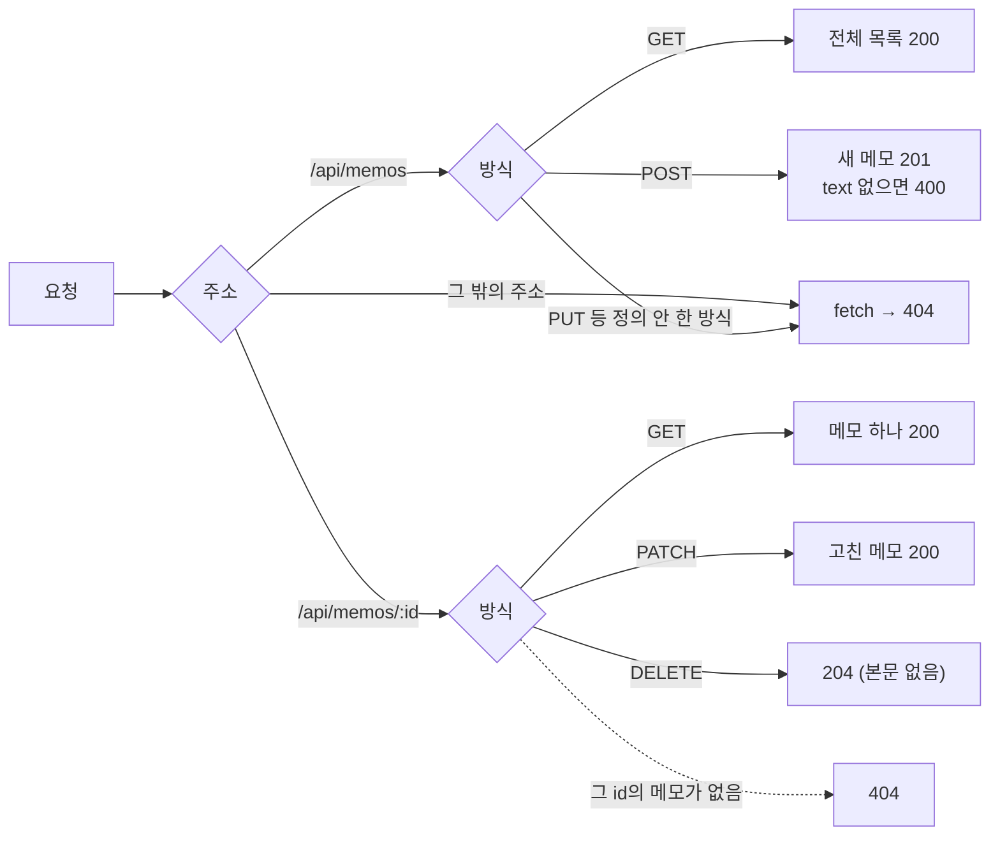
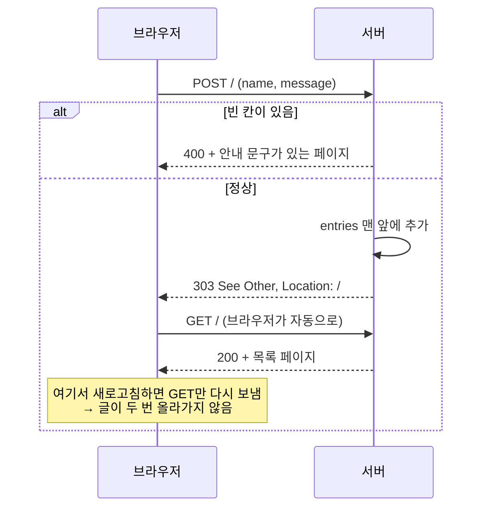
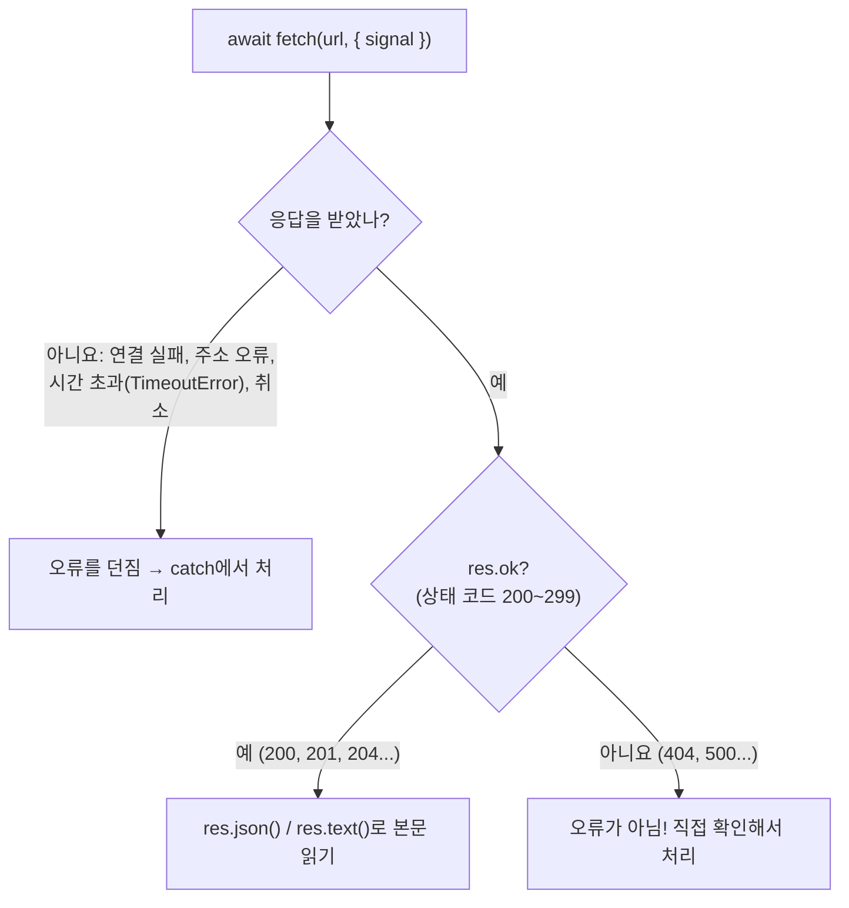
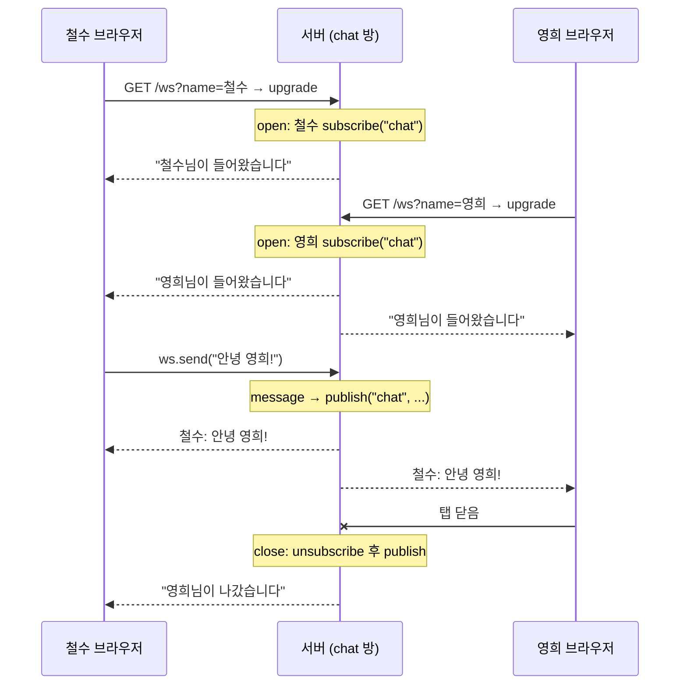
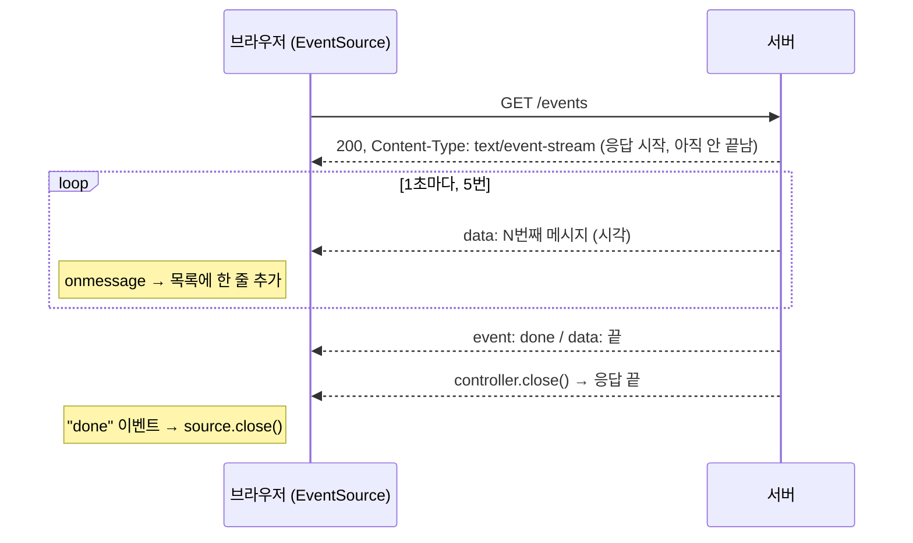

# 13. 초급 예제: 웹 서버

[7장](./07_%EC%9B%B9_%EC%84%9C%EB%B2%84_%EB%A7%8C%EB%93%A4%EA%B8%B0.md)의 `Bun.serve`로 조금 더 실제에 가까운 서버를 만들어 봅니다. 예제마다 포트가 달라서 여러 개를 동시에 띄워도 됩니다.

| 예제 | 파일 | 주소 |
|---|---|---|
| 10. 메모 REST API | `examples/10-rest-api.ts` | `http://localhost:3110/api/memos` |
| 11. HTML 폼 방명록 | `examples/11-form-html.ts` | `http://localhost:3111` |
| 12. fetch로 요청 보내기 | `examples/12-fetch-client.ts` | (실행하면 스스로 끝남) |
| 13. WebSocket 채팅 | `examples/13-websocket-chat.ts` | `http://localhost:3113` |
| 14. 실시간 스트림(SSE) | `examples/14-sse-stream.ts` | `http://localhost:3114` |

- 포트를 바꾸려면 `PORT=4000 bun examples/10-rest-api.ts`처럼 실행합니다.
- 서버는 `Ctrl + C`로 멈춥니다. 코드를 고치면서 할 때는 `bun --watch examples/10-rest-api.ts`로 실행하세요.
- 이 사이트(3000번)와 포트가 겹치지 않으니 설명서를 띄워 둔 채로 실행해도 됩니다.

## 예제 10. 메모 REST API

`examples/10-rest-api.ts` — 메모를 만들고(POST), 읽고(GET), 고치고(PATCH), 지우는(DELETE) API입니다. 데이터는 메모리에만 있어서 서버를 끄면 사라집니다. (파일에 저장하는 버전은 [14장 예제 16](./14_%EC%98%88%EC%A0%9C_%EB%8D%B0%EC%9D%B4%ED%84%B0%EB%B2%A0%EC%9D%B4%EC%8A%A4_%ED%85%8C%EC%8A%A4%ED%8A%B8_%EB%B9%8C%EB%93%9C.md#예제-16-sqlite에-저장하는-할-일-api))

요청은 주소와 방식(GET, POST 등)에 따라 `routes`의 함수 하나로 갑니다. 어디에도 맞지 않으면 `fetch`가 받습니다.



```ts
type Memo = { id: number; text: string; done: boolean };

const memos = new Map<number, Memo>();
let nextId = 1;

const notFound = () => Response.json({ error: "메모를 찾을 수 없습니다" }, { status: 404 });
const badRequest = (message: string) => Response.json({ error: message }, { status: 400 });

async function readBody(req: Request): Promise<Partial<Memo> | null> {
  try {
    const body = await req.json();
    return body && typeof body === "object" ? body : null;
  } catch {
    return null;
  }
}

const server = Bun.serve({
  port: Number(Bun.env.PORT ?? 3110),
  routes: {
    "/api/memos": {
      GET: () => Response.json([...memos.values()]),
      POST: async (req) => {
        const body = await readBody(req);
        const text = typeof body?.text === "string" ? body.text.trim() : "";
        if (!text) return badRequest('본문에 {"text": "내용"}이 필요합니다');
        const memo: Memo = { id: nextId++, text, done: false };
        memos.set(memo.id, memo);
        return Response.json(memo, { status: 201 });
      },
    },
    "/api/memos/:id": {
      GET: (req) => {
        const memo = memos.get(Number(req.params.id));
        return memo ? Response.json(memo) : notFound();
      },
      PATCH: async (req) => {
        const memo = memos.get(Number(req.params.id));
        if (!memo) return notFound();
        const body = await readBody(req);
        if (!body) return badRequest("JSON 본문이 필요합니다");
        if (typeof body.text === "string" && body.text.trim()) memo.text = body.text.trim();
        if (typeof body.done === "boolean") memo.done = body.done;
        return Response.json(memo);
      },
      DELETE: (req) => (memos.delete(Number(req.params.id)) ? new Response(null, { status: 204 }) : notFound()),
    },
  },
  fetch: () => Response.json({ error: "없는 주소입니다" }, { status: 404 }),
});

console.log(`메모 API 실행 중: ${server.url}api/memos`);
```

서버를 띄운 뒤 다른 터미널에서 `curl`로 시험합니다.

```bash
bun examples/10-rest-api.ts
```

```bash
curl -X POST -H "Content-Type: application/json" -d '{"text":"우유 사기"}' localhost:3110/api/memos
curl -X POST -H "Content-Type: application/json" -d '{"text":"운동하기"}' localhost:3110/api/memos
curl -X PATCH -H "Content-Type: application/json" -d '{"done":true}' localhost:3110/api/memos/1
curl -X DELETE localhost:3110/api/memos/2
curl localhost:3110/api/memos
```

| 요청 | 응답 | 상태 코드 |
|---|---|---|
| `POST /api/memos` `{"text":"우유 사기"}` | `{"id":1,"text":"우유 사기","done":false}` | 201 |
| `POST /api/memos` 본문이 JSON이 아님 | `{"error":"본문에 {\"text\": \"내용\"}이 필요합니다"}` | 400 |
| `PATCH /api/memos/1` `{"done":true}` | `{"id":1,"text":"우유 사기","done":true}` | 200 |
| `DELETE /api/memos/2` | (본문 없음) | 204 |
| `GET /api/memos/2` (지운 뒤) | `{"error":"메모를 찾을 수 없습니다"}` | 404 |
| `GET /api/memos` | `[{"id":1,"text":"우유 사기","done":true}]` | 200 |
| `PUT /api/memos` (정의하지 않은 방식) | `{"error":"없는 주소입니다"}` | 404 |

알아 둘 점:

- **들어온 값은 항상 확인합니다.** `req.json()`은 본문이 JSON이 아니면 오류를 던지므로 `try/catch`로 감쌌고, `text`가 문자열인지도 검사합니다.
- **상태 코드로 결과를 알립니다.** 만들었으면 201, 지웠으면 204(본문 없음), 잘못된 요청은 400, 없으면 404입니다.
- `routes`에 정의하지 않은 요청 방식(`PUT`)은 `fetch`로 넘어갑니다.

## 예제 11. HTML 폼으로 글 받기 (방명록)

`examples/11-form-html.ts` — JSON이 아니라 브라우저의 `<form>`으로 값을 받습니다.

```ts
type Entry = { name: string; message: string; at: string };
const entries: Entry[] = [];

function escapeHtml(text: string): string {
  return text.replace(/[&<>"']/g, (c) => `&#${c.charCodeAt(0)};`);
}

function page(error = ""): Response {
  const list = entries
    .map((e) => `<li><b>${escapeHtml(e.name)}</b> <small>${e.at}</small><br>${escapeHtml(e.message)}</li>`)
    .join("");
  const html = `<!doctype html>
<html lang="ko">
<head><meta charset="utf-8"><title>방명록</title>
<style>body{font-family:sans-serif;max-width:560px;margin:40px auto} input,textarea{width:100%;margin:4px 0} .error{color:crimson}</style>
</head>
<body>
  <h1>방명록</h1>
  ${error ? `<p class="error">${escapeHtml(error)}</p>` : ""}
  <form method="post" action="/">
    <input name="name" placeholder="이름" maxlength="20">
    <textarea name="message" placeholder="남길 말" rows="3" maxlength="200"></textarea>
    <button>남기기</button>
  </form>
  <ul>${list || "<li>아직 글이 없습니다.</li>"}</ul>
</body>
</html>`;
  return new Response(html, {
    status: error ? 400 : 200,
    headers: { "Content-Type": "text/html; charset=utf-8" },
  });
}

const server = Bun.serve({
  port: Number(Bun.env.PORT ?? 3111),
  routes: {
    "/": {
      GET: () => page(),
      POST: async (req) => {
        const form = await req.formData();
        const name = String(form.get("name") ?? "").trim();
        const message = String(form.get("message") ?? "").trim();
        if (!name || !message) return page("이름과 남길 말을 모두 적어 주세요.");
        entries.unshift({ name, message, at: new Date().toLocaleString("ko-KR") });
        // 새로고침해도 글이 다시 제출되지 않도록 GET 페이지로 보냅니다
        return Response.redirect("/", 303);
      },
    },
  },
  fetch: () => new Response("페이지를 찾을 수 없습니다", { status: 404 }),
});

console.log(`방명록 실행 중: ${server.url}`);
```

```bash
bun examples/11-form-html.ts
```

브라우저에서 `http://localhost:3111`을 열고 이름과 남길 말을 입력해 보세요. 이름에 `<b>안녕</b>`처럼 HTML을 넣어도 굵은 글씨가 되지 않고 글자 그대로 보입니다.

| 확인한 것 | 결과 |
|---|---|
| 이름·남길 말을 채워 제출 | 303 응답 후 `/`로 이동, 목록 맨 위에 글이 추가됨 |
| 빈 칸으로 제출 | 400 응답, 빨간 안내 문구 |
| `<b>안녕</b>` 입력 | 화면에 `<b>안녕</b>` 글자가 그대로 표시됨 (`&#60;b&#62;`로 바뀜) |

- `req.formData()`는 폼이 보낸 값을 꺼냅니다. `form.get("name")`의 `"name"`은 `<input name="name">`의 이름입니다.
- **사용자가 입력한 값은 반드시 `escapeHtml`로 바꿔서 HTML에 넣습니다.** 그러지 않으면 다른 사람이 `<script>`를 심을 수 있습니다(XSS 공격).
- POST를 처리한 뒤 페이지를 바로 보여 주지 않고 `Response.redirect("/", 303)`으로 다시 GET하게 만들면, 새로고침해도 같은 글이 두 번 올라가지 않습니다.



## 예제 12. fetch로 다른 서버에 요청하기

`examples/12-fetch-client.ts` — 서버가 아니라 **요청하는 쪽** 예제입니다. 인터넷 연결 없이 해 볼 수 있도록 연습용 서버를 같은 파일 안에서 띄운 뒤 요청하고, 끝나면 서버를 끕니다.

```ts
const server = Bun.serve({
  port: 0, // 0이면 비어 있는 포트를 자동으로 고릅니다
  routes: {
    "/api/hello": (req) => {
      const name = new URL(req.url).searchParams.get("name") ?? "손님";
      return Response.json({ message: `안녕하세요, ${name}` });
    },
    "/api/echo": {
      POST: async (req) => Response.json({ youSent: await req.json(), token: req.headers.get("authorization") }),
    },
    "/api/slow": async () => {
      await Bun.sleep(2000);
      return new Response("늦은 응답");
    },
  },
  fetch: () => new Response("Not Found", { status: 404 }),
});
const base = server.url;

// 1. GET + 쿼리 문자열
const url = new URL("/api/hello", base);
url.searchParams.set("name", "영희");
const hello = await fetch(url);
console.log("1) GET:", hello.status, await hello.json());

// 2. POST + JSON 본문 + 헤더
const echo = await fetch(new URL("/api/echo", base), {
  method: "POST",
  headers: { "Content-Type": "application/json", Authorization: "Bearer abc123" },
  body: JSON.stringify({ title: "새 글", tags: ["bun", "fetch"] }),
});
console.log("2) POST:", await echo.json());

// 3. 실패 응답 확인: fetch는 404여도 오류를 던지지 않으므로 res.ok를 직접 확인합니다
const missing = await fetch(new URL("/nope", base));
console.log("3) 없는 주소:", missing.status, missing.ok);

// 4. 제한 시간: 0.5초 안에 응답이 없으면 취소
try {
  await fetch(new URL("/api/slow", base), { signal: AbortSignal.timeout(500) });
} catch (err) {
  console.log("4) 시간 초과:", (err as Error).name);
}

// 5. 여러 요청 동시에 보내기
const names = ["철수", "영희", "민수"];
const replies = await Promise.all(
  names.map((n) => fetch(new URL(`/api/hello?name=${encodeURIComponent(n)}`, base)).then((r) => r.json())),
);
console.log("5) 동시 요청:", replies.map((r) => r.message));

server.stop(true);
```

```bash
bun examples/12-fetch-client.ts
```

```text
1) GET: 200 {
  message: "안녕하세요, 영희",
}
2) POST: {
  youSent: {
    title: "새 글",
    tags: [ "bun", "fetch" ],
  },
  token: "Bearer abc123",
}
3) 없는 주소: 404 false
4) 시간 초과: TimeoutError
5) 동시 요청: [ "안녕하세요, 철수", "안녕하세요, 영희", "안녕하세요, 민수" ]
```

- **`fetch`는 404나 500이어도 오류를 던지지 않습니다.** 오류는 서버에 연결하지 못했거나 요청이 취소되는 등 **응답을 아예 받지 못했을 때만** 납니다. 그래서 `res.ok`(상태 코드 200~299이면 `true`)를 직접 확인해야 합니다.


- `AbortSignal.timeout(ms)`로 너무 오래 걸리는 요청을 취소합니다. 취소되면 `TimeoutError`가 납니다.
- 실제 인터넷 주소도 똑같이 씁니다. 예: `await fetch("https://api.github.com/repos/oven-sh/bun")`
- `server.stop(true)`는 서버를 끄면서 남아 있는 연결도 모두 끊습니다. 서버가 켜져 있으면 프로그램이 끝나지 않습니다.

## 예제 13. WebSocket 채팅

`examples/13-websocket-chat.ts` — 서버와 브라우저가 연결을 유지한 채 메시지를 **양쪽에서** 주고받습니다.

```ts
const html = `<!doctype html>
<html lang="ko">
<head><meta charset="utf-8"><title>채팅</title>
<style>body{font-family:sans-serif;max-width:560px;margin:40px auto} #log{border:1px solid #ccc;height:300px;overflow:auto;padding:8px} .sys{color:gray}</style>
</head>
<body>
  <h1>Bun 채팅</h1>
  <div id="log"></div>
  <form id="form"><input id="text" placeholder="메시지" autocomplete="off"><button>보내기</button></form>
  <script>
    const name = prompt("이름을 입력하세요") || "익명";
    const ws = new WebSocket("ws://" + location.host + "/ws?name=" + encodeURIComponent(name));
    const log = document.getElementById("log");
    ws.onmessage = (e) => {
      const { type, name, text } = JSON.parse(e.data);
      const p = document.createElement("p");
      if (type === "system") { p.className = "sys"; p.textContent = text; }
      else p.textContent = name + ": " + text;
      log.append(p);
      log.scrollTop = log.scrollHeight;
    };
    document.getElementById("form").onsubmit = (e) => {
      e.preventDefault();
      const input = document.getElementById("text");
      if (input.value) ws.send(input.value);
      input.value = "";
    };
  </script>
</body>
</html>`;

const server = Bun.serve({
  port: Number(Bun.env.PORT ?? 3113),
  routes: {
    "/": new Response(html, { headers: { "Content-Type": "text/html; charset=utf-8" } }),
  },
  fetch(req, server) {
    const url = new URL(req.url);
    if (url.pathname === "/ws") {
      const name = url.searchParams.get("name")?.slice(0, 20) || "익명";
      if (server.upgrade(req, { data: { name } })) return;
      return new Response("WebSocket 연결만 받습니다", { status: 400 });
    }
    return new Response("Not Found", { status: 404 });
  },
  websocket: {
    data: {} as { name: string },
    open(ws) {
      ws.subscribe("chat");
      server.publish("chat", JSON.stringify({ type: "system", text: `${ws.data.name}님이 들어왔습니다` }));
    },
    message(ws, message) {
      server.publish("chat", JSON.stringify({ type: "chat", name: ws.data.name, text: String(message) }));
    },
    close(ws) {
      ws.unsubscribe("chat");
      server.publish("chat", JSON.stringify({ type: "system", text: `${ws.data.name}님이 나갔습니다` }));
    },
  },
});

console.log(`채팅 서버 실행 중: ${server.url}`);
```

```bash
bun examples/13-websocket-chat.ts
```

브라우저 탭 두 개에서 `http://localhost:3113`을 열고 서로 다른 이름을 입력한 뒤 대화해 보세요. 철수와 영희가 접속해 철수가 말하고 영희가 나갔을 때, 각자 받은 메시지는 다음과 같습니다.

```text
철수 받음: {"type":"system","text":"철수님이 들어왔습니다"}
영희 받음: {"type":"system","text":"영희님이 들어왔습니다"}
철수 받음: {"type":"system","text":"영희님이 들어왔습니다"}
철수 받음: {"type":"chat","name":"철수","text":"안녕 영희!"}
영희 받음: {"type":"chat","name":"철수","text":"안녕 영희!"}
철수 받음: {"type":"system","text":"영희님이 나갔습니다"}
```

같은 흐름을 그림으로 보면, 서버는 메시지를 받을 때마다 `chat` 방 전체에 `publish`합니다. 보낸 사람도 방에 있으므로 자기 메시지를 돌려받습니다.



| 코드 | 하는 일 |
|---|---|
| `server.upgrade(req, { data })` | 일반 HTTP 요청을 WebSocket 연결로 바꿈. `data`는 이 연결에 붙여 둘 정보 |
| `websocket.data: {} as { name: string }` | `ws.data`의 타입을 알려 주는 표시 (실행에는 영향 없음) |
| `ws.subscribe("chat")` | `chat`이라는 방에 들어감 |
| `server.publish("chat", 메시지)` | `chat` 방에 있는 모든 연결에 보냄 |
| `open` / `message` / `close` | 연결됨 / 메시지 받음 / 연결 끊김 때 실행 |

- 일반 `fetch` 요청은 "요청 하나 → 응답 하나"로 끝나지만, WebSocket은 연결을 유지해서 **서버가 먼저** 메시지를 보낼 수 있습니다.
- 이 설명서 사이트의 자동 새로고침도 같은 방식입니다. 문서를 저장하면 서버가 `publish("reload")`로 브라우저에 알립니다.

## 예제 14. 실시간 스트림: Server-Sent Events

`examples/14-sse-stream.ts` — 서버에서 브라우저로 **한쪽 방향으로만** 계속 데이터를 보낼 때는 WebSocket보다 간단한 SSE를 씁니다. 알림, 진행 상황, AI 답변을 글자 단위로 보여 주는 화면이 이 방식입니다.

```ts
const html = `<!doctype html>
<html lang="ko">
<head><meta charset="utf-8"><title>실시간 시계</title></head>
<body style="font-family:sans-serif;max-width:560px;margin:40px auto">
  <h1>서버에서 오는 시간</h1>
  <ol id="list"></ol>
  <script>
    const source = new EventSource("/events");
    source.onmessage = (e) => {
      const li = document.createElement("li");
      li.textContent = e.data;
      document.getElementById("list").append(li);
    };
    source.addEventListener("done", () => source.close());
  </script>
</body>
</html>`;

const server = Bun.serve({
  port: Number(Bun.env.PORT ?? 3114),
  routes: {
    "/": new Response(html, { headers: { "Content-Type": "text/html; charset=utf-8" } }),
    "/events": (req) => {
      let timer: ReturnType<typeof setInterval>;
      const stream = new ReadableStream({
        start(controller) {
          const encoder = new TextEncoder();
          let count = 0;
          timer = setInterval(() => {
            count++;
            const time = new Date().toLocaleTimeString("ko-KR");
            controller.enqueue(encoder.encode(`data: ${count}번째 메시지 (${time})\n\n`));
            if (count === 5) {
              controller.enqueue(encoder.encode("event: done\ndata: 끝\n\n"));
              clearInterval(timer);
              controller.close();
            }
          }, 1000);
          req.signal.addEventListener("abort", () => clearInterval(timer));
        },
        cancel() {
          clearInterval(timer);
        },
      });
      return new Response(stream, {
        headers: { "Content-Type": "text/event-stream", "Cache-Control": "no-cache" },
      });
    },
  },
  fetch: () => new Response("Not Found", { status: 404 }),
});

console.log(`실시간 시계 실행 중: ${server.url}`);
```

```bash
bun examples/14-sse-stream.ts
```

브라우저에서 `http://localhost:3114`를 열면 1초마다 한 줄씩 늘어납니다. 터미널에서는 `curl -N`(받는 대로 바로 출력)으로 볼 수 있습니다.

```bash
curl -N localhost:3114/events
```

```text
data: 1번째 메시지 (오후 4:33:26)

data: 2번째 메시지 (오후 4:33:27)

data: 3번째 메시지 (오후 4:33:28)

data: 4번째 메시지 (오후 4:33:29)

data: 5번째 메시지 (오후 4:33:30)

event: done
data: 끝
```

요청은 한 번이고, 서버가 응답을 끝내지 않은 채 조각을 계속 보냅니다.



- SSE 형식은 `data: 내용` 다음에 **빈 줄 하나**(`\n\n`)입니다. `event: 이름`을 붙이면 브라우저에서 `addEventListener("이름")`으로 따로 받습니다.
- `ReadableStream`의 `controller.enqueue()`로 보낼 때마다 브라우저에 바로 전달되고, `controller.close()`로 끝냅니다.
- 브라우저 탭을 닫으면 `req.signal`의 `abort`가 발생합니다. 이때 타이머를 멈춰야 서버에 쓸모없는 작업이 남지 않습니다.

| 구분 | WebSocket (예제 13) | SSE (예제 14) |
|---|---|---|
| 방향 | 양쪽 | 서버 → 브라우저만 |
| 브라우저 코드 | `new WebSocket(...)` | `new EventSource(...)` |
| 끊기면 | 직접 다시 연결 | 브라우저가 자동으로 다시 연결 |
| 어울리는 곳 | 채팅, 게임 | 알림, 진행률, 로그 보기 |

다음 장에서는 데이터베이스, 테스트, 빌드 예제를 다룹니다. → [14장](./14_%EC%98%88%EC%A0%9C_%EB%8D%B0%EC%9D%B4%ED%84%B0%EB%B2%A0%EC%9D%B4%EC%8A%A4_%ED%85%8C%EC%8A%A4%ED%8A%B8_%EB%B9%8C%EB%93%9C.md)
