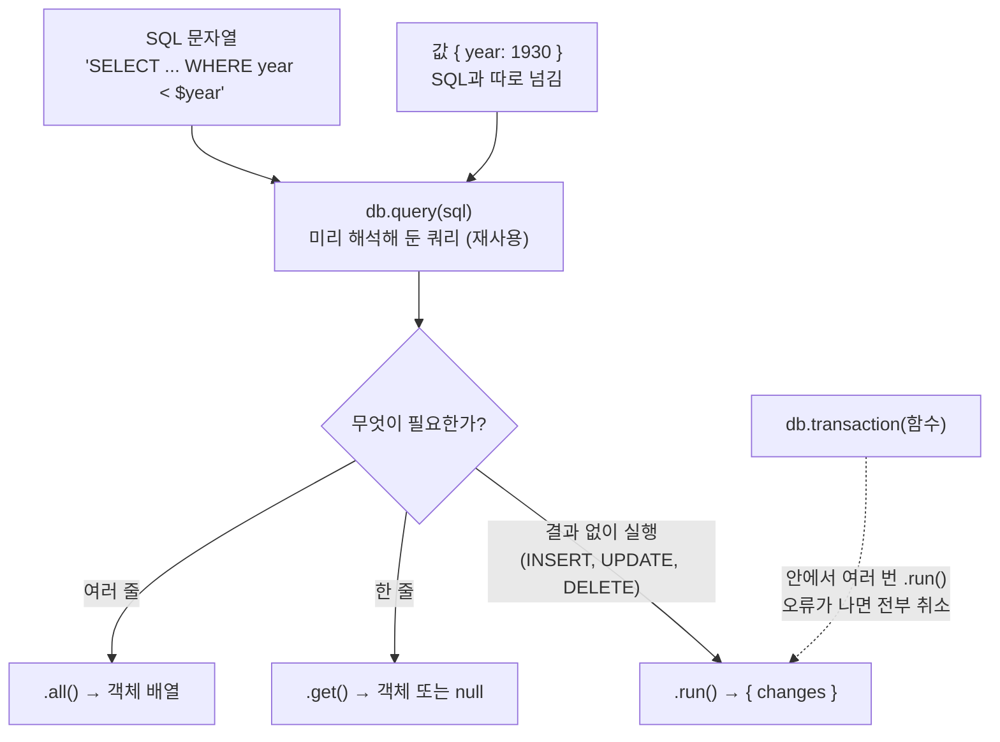
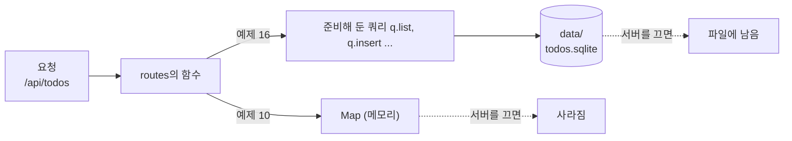
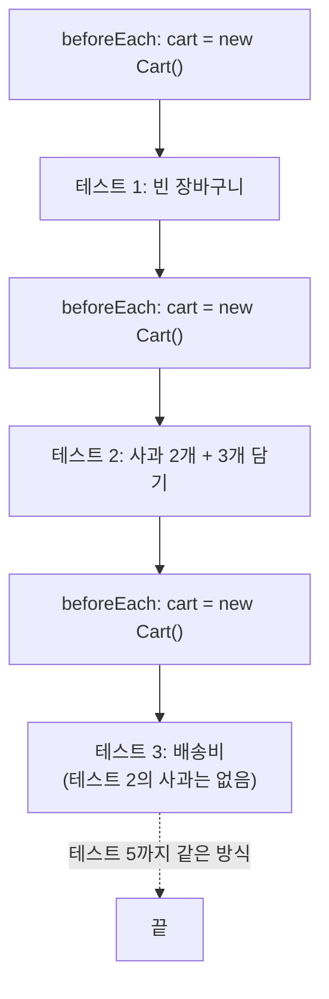
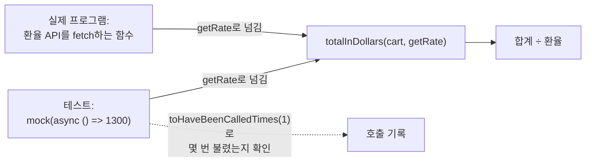
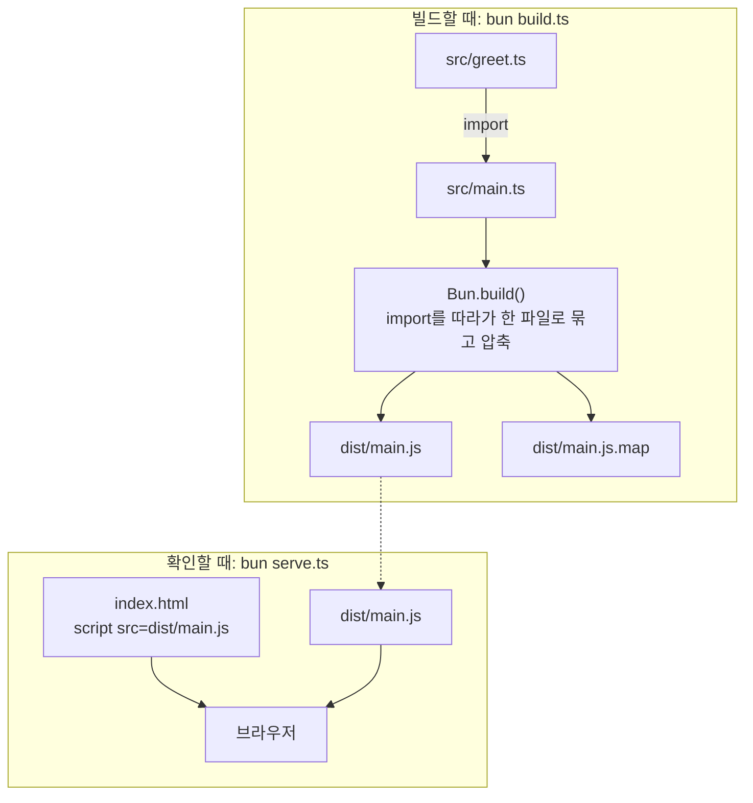
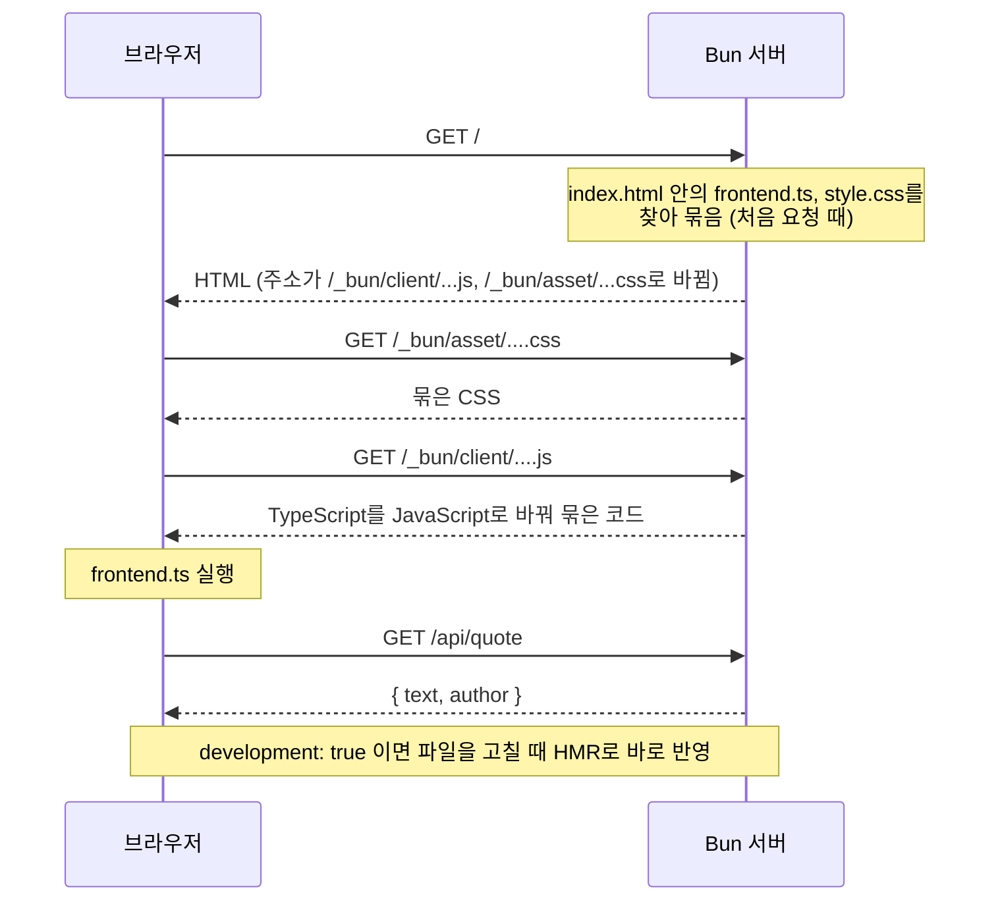

# 14. 초급 예제: 데이터베이스, 테스트, 빌드

| 예제 | 파일 | 실행 |
|---|---|---|
| 15. SQLite 기초 | `examples/15-sqlite.ts` | `bun examples/15-sqlite.ts` |
| 16. SQLite에 저장하는 할 일 API | `examples/16-sqlite-api.ts` | `http://localhost:3116/api/todos` |
| 17. 장바구니 테스트 | `examples/17-testing/` | `bun test examples/17-testing` |
| 18. 브라우저용 빌드 | `examples/18-build/` | `bun examples/18-build/build.ts` |
| 19. 풀스택 (HTML 가져오기) | `examples/19-fullstack/` | `http://localhost:3119` |

## 예제 15. SQLite 기초

`examples/15-sqlite.ts` — Bun에는 SQLite 데이터베이스가 들어 있어서(`bun:sqlite`) 설치 없이 표를 만들고 데이터를 넣고 꺼낼 수 있습니다.

```ts
import { Database } from "bun:sqlite";

// ":memory:"는 메모리에만 저장합니다. 파일에 저장하려면 "books.sqlite"처럼 파일 이름을 줍니다.
// strict: true 이면 매개변수 이름 앞에 $를 붙이지 않아도 됩니다.
const db = new Database(":memory:", { strict: true });

db.run(`
  CREATE TABLE books (
    id     INTEGER PRIMARY KEY AUTOINCREMENT,
    title  TEXT    NOT NULL,
    author TEXT    NOT NULL,
    year   INTEGER NOT NULL
  )
`);

type Book = { id: number; title: string; author: string; year: number };

// 1. 여러 줄 넣기: prepare로 한 번 준비하고, transaction으로 묶어서 빠르고 안전하게
const insert = db.prepare("INSERT INTO books (title, author, year) VALUES ($title, $author, $year)");
const insertAll = db.transaction((rows: Omit<Book, "id">[]) => {
  for (const row of rows) insert.run(row);
  return rows.length;
});

const added = insertAll([
  { title: "하늘과 바람과 별과 시", author: "윤동주", year: 1948 },
  { title: "진달래꽃", author: "김소월", year: 1925 },
  { title: "님의 침묵", author: "한용운", year: 1926 },
  { title: "사슴", author: "백석", year: 1936 },
]);
console.log(`1) ${added}권 추가`);

// 2. 여러 줄 조회
const oldBooks = db.query("SELECT title, year FROM books WHERE year < $year ORDER BY year").all({ year: 1930 });
console.log("2) 1930년 이전 책:");
console.table(oldBooks);

// 3. 한 줄 조회: 결과가 없으면 null
const byAuthor = db.query("SELECT * FROM books WHERE author = $author").get({ author: "백석" }) as Book | null;
console.log("3) 백석의 책:", byAuthor);

// 4. 수정과 삭제: run()은 바뀐 줄 수(changes)를 돌려줍니다
const updated = db.query("UPDATE books SET year = $year WHERE title = $title").run({ year: 1925, title: "님의 침묵" });
const deleted = db.query("DELETE FROM books WHERE author = $author").run({ author: "윤동주" });
console.log(`4) 수정 ${updated.changes}줄, 삭제 ${deleted.changes}줄`);

// 5. 집계
const stats = db.query("SELECT COUNT(*) AS count, MIN(year) AS oldest FROM books").get() as { count: number; oldest: number };
console.log(`5) 남은 책 ${stats.count}권, 가장 오래된 해 ${stats.oldest}`);

db.close();
```

```bash
bun examples/15-sqlite.ts
```

```text
1) 4권 추가
2) 1930년 이전 책:
┌───┬───────────┬──────┐
│   │ title     │ year │
├───┼───────────┼──────┤
│ 0 │ 진달래꽃  │ 1925 │
│ 1 │ 님의 침묵 │ 1926 │
└───┴───────────┴──────┘
3) 백석의 책: {
  id: 4,
  title: "사슴",
  author: "백석",
  year: 1936,
}
4) 수정 1줄, 삭제 1줄
5) 남은 책 3권, 가장 오래된 해 1925
```

| 메서드 | 돌려주는 것 |
|---|---|
| `db.run(sql)` | 표 만들기처럼 결과가 필요 없는 SQL 실행 |
| `db.query(sql).all(값)` | 모든 결과 줄의 배열 |
| `db.query(sql).get(값)` | 첫 번째 줄 하나 (없으면 `null`) |
| `db.query(sql).run(값)` | 바뀐 줄 수 `changes` 등 |
| `db.transaction(함수)` | 함수 안의 작업을 한 묶음으로. 중간에 오류가 나면 전부 취소 |
| `db.prepare(sql)` / `db.query(sql)` | SQL을 미리 해석해 둔 객체. `query`는 같은 SQL을 다시 부르면 저장해 둔 것을 재사용하고, `prepare`는 매번 새로 만듦 |

어떤 메서드를 고를지는 "결과가 몇 줄 필요한가"로 정하면 됩니다.



> **SQL에 값을 문자열로 이어 붙이지 마세요.** `` `... WHERE author = '${name}'` ``처럼 쓰면 SQL 인젝션 공격에 뚫립니다. 항상 `$author` 같은 자리 표시를 쓰고 값은 따로 넘깁니다.

## 예제 16. SQLite에 저장하는 할 일 API

`examples/16-sqlite-api.ts` — [13장 예제 10](./13_%EC%98%88%EC%A0%9C_%EC%9B%B9_%EC%84%9C%EB%B2%84.md#예제-10-메모-rest-api)의 API를 SQLite 파일(`examples/data/todos.sqlite`)에 저장하도록 바꿨습니다. 서버를 껐다 켜도 데이터가 남습니다.

주소별 처리는 예제 10과 같고, 데이터를 두는 곳만 바뀝니다.



```ts
import { Database } from "bun:sqlite";
import { mkdirSync } from "node:fs";

type Todo = { id: number; title: string; done: number };

mkdirSync(`${import.meta.dir}/data`, { recursive: true });
const db = new Database(`${import.meta.dir}/data/todos.sqlite`, { create: true, strict: true });
db.run("PRAGMA journal_mode = WAL");
db.run(`CREATE TABLE IF NOT EXISTS todos (
  id    INTEGER PRIMARY KEY AUTOINCREMENT,
  title TEXT    NOT NULL,
  done  INTEGER NOT NULL DEFAULT 0
)`);

const q = {
  list: db.query("SELECT * FROM todos ORDER BY id"),
  get: db.query("SELECT * FROM todos WHERE id = $id"),
  insert: db.query("INSERT INTO todos (title) VALUES ($title) RETURNING *"),
  setDone: db.query("UPDATE todos SET done = $done WHERE id = $id RETURNING *"),
  remove: db.query("DELETE FROM todos WHERE id = $id"),
};

// SQLite에는 true/false가 없어서 0/1로 저장하고, 응답할 때 다시 바꿉니다
const toJson = (row: Todo) => ({ ...row, done: row.done === 1 });
const notFound = () => Response.json({ error: "할 일을 찾을 수 없습니다" }, { status: 404 });

const server = Bun.serve({
  port: Number(Bun.env.PORT ?? 3116),
  routes: {
    "/api/todos": {
      GET: () => Response.json((q.list.all() as Todo[]).map(toJson)),
      POST: async (req) => {
        const body = (await req.json().catch(() => null)) as { title?: unknown } | null;
        const title = typeof body?.title === "string" ? body.title.trim() : "";
        if (!title) return Response.json({ error: '본문에 {"title": "내용"}이 필요합니다' }, { status: 400 });
        return Response.json(toJson(q.insert.get({ title }) as Todo), { status: 201 });
      },
    },
    "/api/todos/:id": {
      GET: (req) => {
        const row = q.get.get({ id: Number(req.params.id) }) as Todo | null;
        return row ? Response.json(toJson(row)) : notFound();
      },
      PATCH: async (req) => {
        const body = (await req.json().catch(() => null)) as { done?: unknown } | null;
        if (typeof body?.done !== "boolean") return Response.json({ error: '{"done": true}처럼 보내 주세요' }, { status: 400 });
        const row = q.setDone.get({ id: Number(req.params.id), done: body.done ? 1 : 0 }) as Todo | null;
        return row ? Response.json(toJson(row)) : notFound();
      },
      DELETE: (req) => (q.remove.run({ id: Number(req.params.id) }).changes ? new Response(null, { status: 204 }) : notFound()),
    },
  },
  fetch: () => Response.json({ error: "없는 주소입니다" }, { status: 404 }),
});

console.log(`할 일 API(SQLite) 실행 중: ${server.url}api/todos`);
```

```bash
bun examples/16-sqlite-api.ts
```

```bash
curl -X POST -H "Content-Type: application/json" -d '{"title":"우유 사기"}' localhost:3116/api/todos
curl -X POST -H "Content-Type: application/json" -d '{"title":"운동하기"}' localhost:3116/api/todos
curl -X PATCH -H "Content-Type: application/json" -d '{"done":true}' localhost:3116/api/todos/1
curl -X DELETE localhost:3116/api/todos/2
```

서버를 `Ctrl + C`로 끄고 다시 켠 뒤 목록을 보면 데이터가 그대로 있습니다.

```bash
curl localhost:3116/api/todos
```

```text
[{"id":1,"title":"우유 사기","done":true}]
```

- `db.query()`로 만든 쿼리는 **미리 준비해 두고 재사용**합니다. 요청마다 SQL을 다시 해석하지 않아서 빠릅니다.
- `RETURNING *`은 넣거나 고친 줄을 바로 돌려받는 SQLite 문법입니다. 따로 SELECT를 하지 않아도 됩니다.
- `PRAGMA journal_mode = WAL`은 읽기와 쓰기가 동시에 일어나도 잘 버티게 하는 설정입니다. 서버에서 SQLite를 쓸 때 보통 켭니다.
- 처음부터 다시 하려면 서버를 끄고 `examples/data/todos.sqlite*` 파일을 지우세요.

## 예제 17. 장바구니 테스트

`examples/17-testing/` — [8장](./08_%ED%85%8C%EC%8A%A4%ED%8A%B8%ED%95%98%EA%B8%B0.md)보다 한 단계 나아가서 **여러 경우를 한 번에 시험하기**, **테스트마다 새로 준비하기**, **가짜 함수(mock)** 를 써 봅니다.

테스트할 코드 `examples/17-testing/cart.ts`:

```ts
export type Item = { name: string; price: number; quantity: number };

export function formatWon(amount: number): string {
  return `${amount.toLocaleString("ko-KR")}원`;
}

export class Cart {
  items: Item[] = [];

  add(name: string, price: number, quantity = 1): void {
    if (price < 0) throw new Error("가격은 0 이상이어야 합니다");
    if (!Number.isInteger(quantity) || quantity < 1) throw new Error("수량은 1 이상의 정수여야 합니다");
    const existing = this.items.find((i) => i.name === name);
    if (existing) existing.quantity += quantity;
    else this.items.push({ name, price, quantity });
  }

  remove(name: string): void {
    this.items = this.items.filter((i) => i.name !== name);
  }

  total(): number {
    return this.items.reduce((sum, i) => sum + i.price * i.quantity, 0);
  }

  /** 5만 원 이상이면 배송비 무료, 아니면 3,000원 */
  shippingFee(): number {
    return this.total() >= 50_000 || this.items.length === 0 ? 0 : 3_000;
  }
}

/** 환율을 가져오는 함수를 밖에서 받아서, 테스트할 때 가짜 함수로 바꿀 수 있게 합니다 */
export async function totalInDollars(cart: Cart, getRate: () => Promise<number>): Promise<number> {
  const rate = await getRate();
  return Math.round((cart.total() / rate) * 100) / 100;
}
```

테스트 `examples/17-testing/cart.test.ts`:

```ts
import { beforeEach, describe, expect, mock, test } from "bun:test";
import { Cart, formatWon, totalInDollars } from "./cart";

describe("formatWon", () => {
  test.each([
    [0, "0원"],
    [1000, "1,000원"],
    [1234567, "1,234,567원"],
  ])("%p → %p", (amount, expected) => {
    expect(formatWon(amount)).toBe(expected);
  });
});

describe("Cart", () => {
  let cart: Cart;

  // 테스트마다 새 장바구니로 시작합니다
  beforeEach(() => {
    cart = new Cart();
  });

  test("빈 장바구니는 합계 0원, 배송비 0원", () => {
    expect(cart.total()).toBe(0);
    expect(cart.shippingFee()).toBe(0);
  });

  test("같은 상품을 다시 담으면 수량이 늘어난다", () => {
    cart.add("사과", 1000, 2);
    cart.add("사과", 1000, 3);
    expect(cart.items).toEqual([{ name: "사과", price: 1000, quantity: 5 }]);
    expect(cart.total()).toBe(5000);
  });

  test("5만 원 미만이면 배송비 3,000원, 이상이면 무료", () => {
    cart.add("책", 15000, 3);
    expect(cart.shippingFee()).toBe(3000);
    cart.add("책", 15000);
    expect(cart.shippingFee()).toBe(0);
  });

  test("상품을 빼면 합계에서 빠진다", () => {
    cart.add("우유", 2500);
    cart.add("빵", 3000);
    cart.remove("우유");
    expect(cart.items.map((i) => i.name)).toEqual(["빵"]);
    expect(cart.total()).toBe(3000);
  });

  test("잘못된 가격이나 수량은 오류", () => {
    expect(() => cart.add("이상한 상품", -100)).toThrow("가격은 0 이상");
    expect(() => cart.add("사과", 1000, 0)).toThrow("수량은 1 이상");
    expect(() => cart.add("사과", 1000, 1.5)).toThrow();
  });
});

describe("totalInDollars", () => {
  test("가짜 환율 함수(mock)로 계산을 확인한다", async () => {
    const cart = new Cart();
    cart.add("노트북", 1_300_000);
    const getRate = mock(async () => 1300);

    expect(await totalInDollars(cart, getRate)).toBe(1000);
    expect(getRate).toHaveBeenCalledTimes(1);
  });

  test("환율을 못 가져오면 오류가 그대로 전달된다", async () => {
    const getRate = mock(() => Promise.reject(new Error("네트워크 오류")));
    await expect(totalInDollars(new Cart(), getRate)).rejects.toThrow("네트워크 오류");
  });
});
```

```bash
bun test examples/17-testing
```

```text
bun test v1.4.3 (c6da4a4d3)

examples/17-testing/cart.test.ts:
(pass) formatWon > 0 → "0원" [1.62ms]
(pass) formatWon > 1000 → "1,000원" [0.03ms]
(pass) formatWon > 1234567 → "1,234,567원" [0.02ms]
(pass) Cart > 빈 장바구니는 합계 0원, 배송비 0원 [0.11ms]
(pass) Cart > 같은 상품을 다시 담으면 수량이 늘어난다 [0.12ms]
(pass) Cart > 5만 원 미만이면 배송비 3,000원, 이상이면 무료 [0.02ms]
(pass) Cart > 상품을 빼면 합계에서 빠진다 [0.06ms]
(pass) Cart > 잘못된 가격이나 수량은 오류 [0.08ms]
(pass) totalInDollars > 가짜 환율 함수(mock)로 계산을 확인한다 [0.21ms]
(pass) totalInDollars > 환율을 못 가져오면 오류가 그대로 전달된다 [0.05ms]

 10 pass
 0 fail
 17 expect() calls
Ran 10 tests across 1 file. [6.00ms]
```

| 새로 쓴 것 | 하는 일 |
|---|---|
| `test.each([...])("이름", fn)` | 입력과 기대값 목록으로 같은 테스트를 여러 번 실행. `%p`는 값으로 바뀜 |
| `beforeEach(fn)` | 각 테스트 **직전마다** 실행. 테스트끼리 서로 영향을 주지 않게 새로 준비 |
| `mock(fn)` | 호출 기록이 남는 가짜 함수 |
| `toHaveBeenCalledTimes(n)` | 가짜 함수가 n번 불렸는지 확인 |
| `toThrow("문구")` | 오류 메시지에 그 문구가 들어 있는지 확인 |
| `await expect(promise).rejects.toThrow()` | 비동기 함수가 실패하는지 확인 |

`Cart` 묶음 안의 테스트는 이런 순서로 실행됩니다. 매번 새 장바구니에서 시작하므로 앞 테스트에서 담은 상품이 다음 테스트에 남지 않습니다.



- `totalInDollars`는 환율을 직접 인터넷에서 가져오지 않고 **가져오는 함수를 인자로 받습니다.** 덕분에 테스트에서는 `mock`으로 바꿔 끼워 인터넷 없이, 항상 같은 결과로 시험할 수 있습니다.


- 이 프로젝트 폴더에서 그냥 `bun test`를 실행해도 이 테스트를 찾아 실행합니다.

## 예제 18. 브라우저용 코드 빌드하기

`examples/18-build/` — 브라우저는 TypeScript를 바로 실행하지 못하고, 여러 파일의 `import`도 그대로는 불편합니다. `Bun.build`로 하나의 JavaScript 파일로 묶습니다. ([10장](./10_%EB%B9%8C%EB%93%9C%EC%99%80_%EC%8B%A4%ED%96%89_%ED%8C%8C%EC%9D%BC.md)의 `bun build` 명령을 코드로 하는 방법입니다.)

| 파일 | 내용 |
|---|---|
| `src/greet.ts` | 시간대에 맞는 인사말을 만드는 함수 |
| `src/main.ts` | 버튼을 누르면 이름을 묻고 인사말을 보여 줌 (`greet.ts`를 import) |
| `index.html` | `dist/main.js`를 불러오는 페이지 |
| `build.ts` | 빌드 스크립트 |
| `serve.ts` | 결과를 확인하는 정적 파일 서버 |



`src/main.ts`:

```ts
import { greet } from "./greet";

const button = document.querySelector<HTMLButtonElement>("#hello")!;
const output = document.querySelector<HTMLParagraphElement>("#output")!;

button.addEventListener("click", () => {
  const name = prompt("이름이 뭐예요?") || "방문자";
  output.textContent = greet(name);
});
```

`build.ts`:

```ts
const result = await Bun.build({
  entrypoints: [`${import.meta.dir}/src/main.ts`],
  outdir: `${import.meta.dir}/dist`,
  target: "browser",
  minify: true,
  sourcemap: "linked",
});

if (!result.success) {
  for (const log of result.logs) console.error(log);
  process.exit(1);
}

for (const output of result.outputs) {
  const name = output.path.slice(import.meta.dir.length + 1);
  console.log(`${name.padEnd(20)} ${output.size.toLocaleString()} bytes (${output.kind})`);
}
console.log("\n확인: index.html을 브라우저로 열거나, 아래 명령으로 서버를 띄우세요.");
console.log("bun examples/18-build/serve.ts  →  http://localhost:3118");
```

```bash
bun examples/18-build/build.ts
```

```text
dist/main.js         403 bytes (entry-point)
dist/main.js.map     1,044 bytes (sourcemap)

확인: index.html을 브라우저로 열거나, 아래 명령으로 서버를 띄우세요.
bun examples/18-build/serve.ts  →  http://localhost:3118
```

`serve.ts`는 폴더 안의 파일을 그대로 내려주는 작은 서버입니다. `../`로 폴더 밖 파일을 요청하면 막습니다.

```ts
import { join, normalize, sep } from "node:path";

const root = import.meta.dir;

const server = Bun.serve({
  port: Number(Bun.env.PORT ?? 3118),
  async fetch(req) {
    const pathname = new URL(req.url).pathname;
    const path = normalize(join(root, pathname === "/" ? "index.html" : pathname));
    if (!path.startsWith(root + sep)) return new Response("Forbidden", { status: 403 });
    const file = Bun.file(path);
    return (await file.exists()) ? new Response(file) : new Response("Not Found", { status: 404 });
  },
});

console.log(`정적 파일 서버 실행 중: ${server.url}`);
```

| 옵션 | 뜻 |
|---|---|
| `entrypoints` | 시작 파일. 여기서 import한 파일들이 모두 따라 들어감 |
| `outdir` | 결과를 저장할 폴더 |
| `target: "browser"` | 브라우저에서 실행할 코드로 만들기 (`"bun"`, `"node"`도 가능) |
| `minify: true` | 공백·긴 이름을 줄여 파일 크기를 작게 |
| `sourcemap: "linked"` | 브라우저 개발자 도구에서 원래 TypeScript 코드로 오류 위치를 보여 주는 지도 파일 |

같은 빌드를 명령 한 줄로 하면 다음과 같습니다.

```bash
bun build examples/18-build/src/main.ts --outdir examples/18-build/dist --minify
```

## 예제 19. 풀스택: HTML을 import 해서 서버 만들기

`examples/19-fullstack/` — 예제 18처럼 빌드 단계를 따로 두지 않고, **서버가 HTML을 import 하면 Bun이 그 안의 TypeScript와 CSS를 자동으로 묶어서** 내려주는 방식입니다.

| 파일 | 내용 |
|---|---|
| `index.html` | 화면. `./style.css`와 `./frontend.ts`를 그대로 적어 둠 |
| `style.css` | 스타일 |
| `frontend.ts` | 브라우저 코드. `/api/quote`에서 명언을 가져와 표시 |
| `server.ts` | 서버. HTML 페이지와 API를 함께 제공 |

`index.html`:

```html
<!doctype html>
<html lang="ko">
<head>
  <meta charset="utf-8">
  <title>풀스택 예제</title>
  <link rel="stylesheet" href="./style.css">
</head>
<body>
  <h1>오늘의 명언</h1>
  <blockquote id="quote">불러오는 중...</blockquote>
  <button id="next">다른 명언 보기</button>
  <p class="hint">이 페이지의 TypeScript와 CSS는 Bun이 자동으로 묶어서 보내 줍니다.</p>
  <script type="module" src="./frontend.ts"></script>
</body>
</html>
```

`frontend.ts`:

```ts
type Quote = { text: string; author: string };

const quoteEl = document.querySelector<HTMLQuoteElement>("#quote")!;

async function loadQuote(): Promise<void> {
  const res = await fetch("/api/quote");
  const quote: Quote = await res.json();
  quoteEl.textContent = `"${quote.text}" — ${quote.author}`;
}

document.querySelector("#next")!.addEventListener("click", loadQuote);
loadQuote();
```

`server.ts`:

```ts
import homepage from "./index.html";

const quotes = [
  { text: "천 리 길도 한 걸음부터", author: "속담" },
  { text: "배움에는 끝이 없다", author: "속담" },
  { text: "시작이 반이다", author: "속담" },
  { text: "아는 것이 힘이다", author: "프랜시스 베이컨" },
];

const server = Bun.serve({
  port: Number(Bun.env.PORT ?? 3119),
  routes: {
    "/": homepage,
    "/api/quote": () => Response.json(quotes[Math.floor(Math.random() * quotes.length)]),
  },
  // 개발 모드: 오류를 브라우저에 자세히 보여 주고, 파일을 고치면 화면이 바로 바뀝니다(HMR)
  development: true,
});

console.log(`풀스택 예제 실행 중: ${server.url}`);
```

```bash
bun examples/19-fullstack/server.ts
```

```text
풀스택 예제 실행 중: http://localhost:3119/
Bundled page in 1ms: examples/19-fullstack/index.html
```

브라우저에서 `http://localhost:3119`를 열면 명언이 나오고, 버튼을 누를 때마다 바뀝니다. 실제로 브라우저가 받은 HTML을 보면 `./frontend.ts`와 `./style.css`가 Bun이 만든 주소로 바뀌어 있습니다.

```text
<link rel="stylesheet" href="/_bun/asset/6f514790032d9b9d.css">
<script type="module" crossorigin src="/_bun/client/index-00000000eaee8d1d.js" ...></script>
```

브라우저가 페이지를 열 때 일어나는 일입니다.



- `import homepage from "./index.html"`은 Bun 전용 기능입니다. `routes`에 넣으면 HTML 안의 `<script>`, `<link>`를 찾아 **요청이 올 때 자동으로 빌드**합니다.
- `development: true`이면 `frontend.ts`나 `style.css`를 저장했을 때 브라우저를 직접 새로고침하지 않아도 바뀐 내용이 바로 반영됩니다(HMR, Hot Module Replacement).
- 배포할 때는 `development: false`로 바꿉니다. 그러면 HMR 없이 압축(minify)된 JavaScript를 만들어 두고 재사용합니다. 예: `var o=document.querySelector("#quote");async function e(){...`

| 방식 | 예제 18 (`Bun.build`) | 예제 19 (HTML import) |
|---|---|---|
| 빌드 | 직접 실행해서 `dist/`에 파일 생성 | 서버가 알아서 처리, 파일 생성 없음 |
| 서버 | 아무 정적 파일 서버나 가능 | Bun 서버 필요 |
| 어울리는 곳 | 다른 서버나 CDN에 올릴 결과물 | API와 화면을 Bun 하나로 같이 만들 때 |

## 다음에 해 볼 것

- 예제 16의 할 일 API에 예제 19의 방식으로 화면을 붙여 보세요. `routes`에 `"/": homepage`를 추가하고 `frontend.ts`에서 `/api/todos`를 부르면 됩니다.
- 예제 17처럼 예제 10의 메모 API에도 테스트를 써 보세요. `port: 0`으로 서버를 띄우고 `fetch`로 요청하면 됩니다(예제 12 참고).
- 완성한 서버는 [10장](./10_%EB%B9%8C%EB%93%9C%EC%99%80_%EC%8B%A4%ED%96%89_%ED%8C%8C%EC%9D%BC.md)의 `bun build --compile`로 실행 파일 하나로 만들 수 있습니다.
- 여기까지 익숙해졌다면 [15장](./15_%EC%A4%91%EA%B8%89_%EC%98%88%EC%A0%9C_%EB%8D%B0%EC%9D%B4%ED%84%B0%EC%99%80_%EC%9C%A0%ED%8B%B8%EB%A6%AC%ED%8B%B0.md)부터 이어지는 중급 예제로 넘어가세요. YAML·압축·이미지·쿠키·cron·WebView처럼 Node.js에서는 패키지를 설치해야 하는 기능을 Bun 내장 기능만으로 다룹니다.
