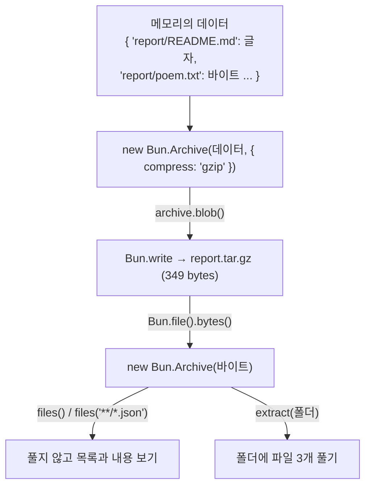
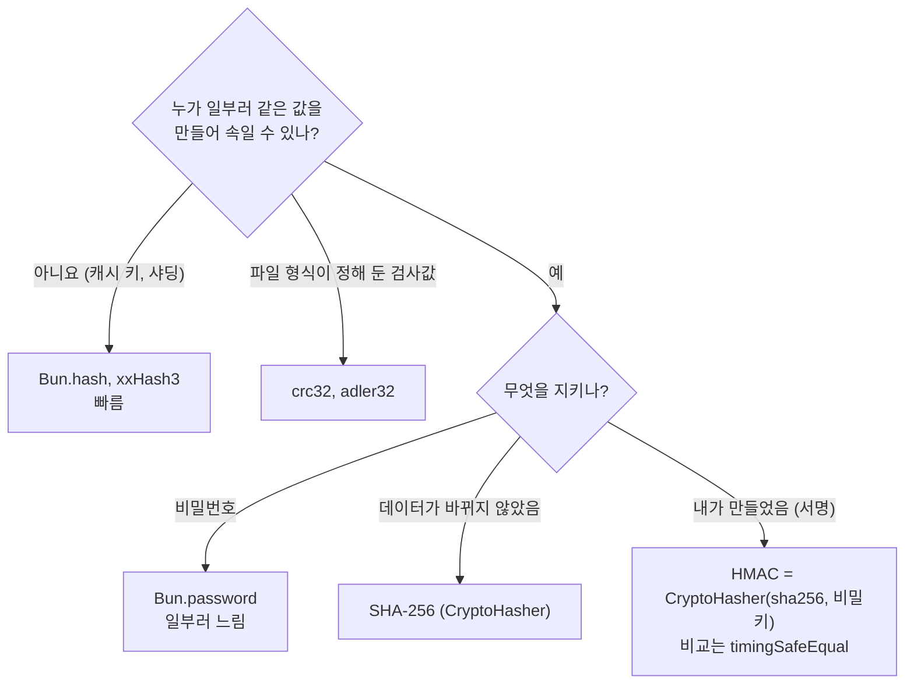
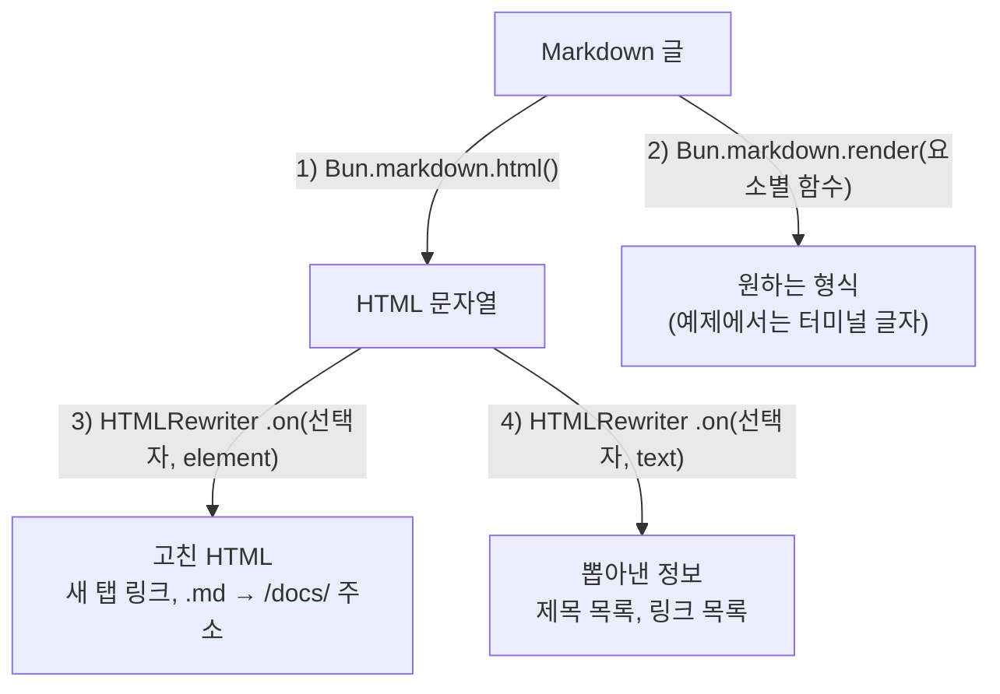
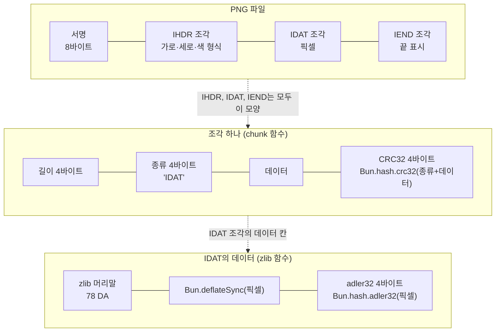
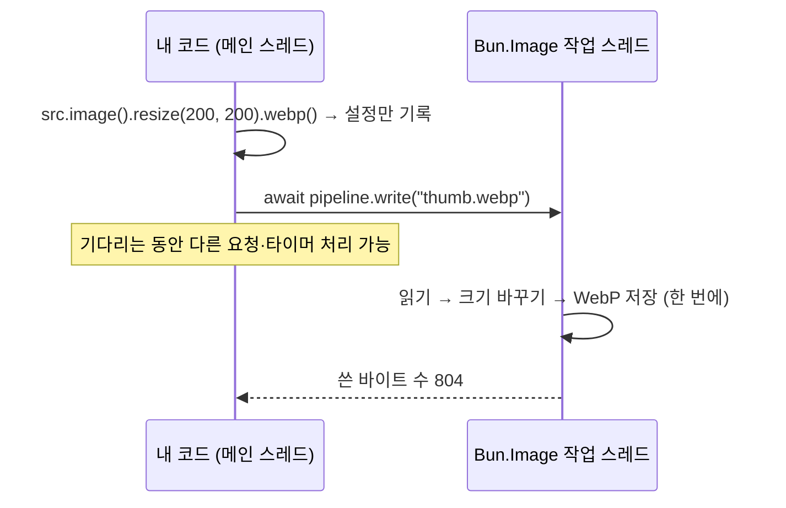
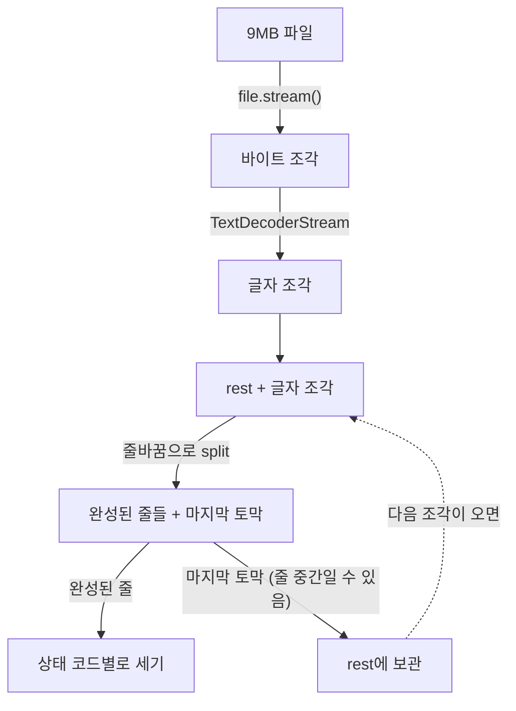

# 15. 중급 예제: 데이터와 유틸리티

12~14장 예제는 "Bun으로 프로그램을 만드는 방법"을 다뤘습니다. 15~17장은 한 단계 올라가서 **Bun에 들어 있는 기능을 최대한 많이** 써 봅니다. 대부분 Node.js에서는 패키지를 설치해야 하는 기능(YAML 읽기, 이미지 변환, 압축 묶음, 쿠키, cron 등)이고, Bun에서는 `bun add` 없이 바로 쓸 수 있습니다.

모든 출력은 Bun 1.4.3(macOS Apple Silicon)에서 실제로 실행한 결과입니다. 시간, 무작위 값(UUID 등), 포트 번호는 실행할 때마다 달라집니다. 어떤 기능이 어느 예제에 있는지는 [0장 내장 API 지도](./00_%EB%82%B4%EC%9E%A5_API_%EC%A7%80%EB%8F%84.md)에서 한눈에 볼 수 있습니다.

| 예제 | 파일 | 실행 |
|---|---|---|
| 20. 데이터 형식 6가지 | `examples/20-data-formats.ts` | `bun examples/20-data-formats.ts` |
| 21. 압축과 tar 묶음 | `examples/21-compress-archive.ts` | `bun examples/21-compress-archive.ts` |
| 22. 해시와 ID | `examples/22-hash-id.ts` | `bun examples/22-hash-id.ts` |
| 23. 터미널 글자 꾸미기 | `examples/23-terminal-text.ts` | `bun examples/23-terminal-text.ts` |
| 24. 작은 도구 모음 | `examples/24-utils.ts` | `bun examples/24-utils.ts` |
| 25. Markdown과 HTML 고치기 | `examples/25-markdown-html.ts` | `bun examples/25-markdown-html.ts` |
| 26. 이미지 만들기와 변환 | `examples/26-image.ts` | `bun examples/26-image.ts` |
| 27. 큰 파일 다루기 | `examples/27-file-streams.ts` | `bun examples/27-file-streams.ts` |
| 43. 바이트와 메모리 | `examples/43-runtime-memory.ts` | `bun examples/43-runtime-memory.ts` |

## 예제 20. 데이터 형식 6가지

`examples/20-data-formats.ts` — 설정 파일과 데이터 파일에 흔히 쓰는 TOML, YAML, JSONC, JSON5, JSONL, XML을 읽고 씁니다. 모두 `"bun"`에서 가져오는 내장 객체입니다.

예제가 읽는 파일 두 개입니다.

```toml
# examples/data/app.toml
title = "할 일 앱"
port = 3120

[database]
file = "todos.sqlite"
wal = true

[[users]]
name = "철수"
role = "admin"

[[users]]
name = "영희"
role = "member"
```

```yaml
# examples/data/deploy.yaml
defaults: &defaults
  replicas: 1
  region: seoul

environments:
  staging:
    <<: *defaults
  production:
    <<: *defaults
    replicas: 3
```

```ts
import { JSON5, JSONC, JSONL, TOML, XML, YAML } from "bun";
import config from "./data/app.toml";
import deploy from "./data/deploy.yaml";
import poem from "./data/poem.txt" with { type: "text" };

const show = (value: unknown) => JSON.stringify(value);

// 1. import로 바로 읽기: .toml / .yaml / .json 파일은 객체가 되고, type: "text"는 문자열이 됩니다
console.log("1) import");
console.log("   TOML:", config.title, config.port, show(config.users.map((u: { name: string }) => u.name)));
console.log("   YAML:", show(deploy.environments.production));
console.log("   text:", poem.split("\n")[0]);

// 2. TOML
const toml = TOML.parse(`
[server]
host = "localhost"
ports = [8000, 8001]
`);
console.log("2) TOML.parse:", show(toml));

// 3. YAML: 여러 문서(---), 앵커(&)·별칭(*)도 처리하고, stringify로 다시 씁니다
console.log("3) YAML.parse 여러 문서:", show(YAML.parse("---\nname: 첫 문서\n---\nname: 둘째 문서\n")));
console.log("   YAML.stringify:\n" + YAML.stringify({ app: "todo", tags: ["bun", "yaml"] }, null, 2));

// 4. JSONC(주석 허용 JSON, tsconfig.json 형식)와 JSON5(따옴표 없는 키, 끝 쉼표, 16진수)
const tsconfig = JSONC.parse(`{
  // 주석과 끝 쉼표를 허용합니다
  "compilerOptions": { "strict": true, },
}`);
console.log("4) JSONC.parse:", show(tsconfig));
console.log("   JSON5.parse:", show(JSON5.parse("{ name: 'bun', hex: 0xff, list: [1, 2,], }")));
console.log("   JSON5.stringify:", JSON5.stringify({ name: "bun", ok: true }));

// 5. JSONL(한 줄에 JSON 하나): 로그 파일에 많이 씁니다
const log = '{"level":"info","msg":"시작"}\n{"level":"error","msg":"실패"}\n{"level":"info","msg":"재시도"}\n';
const records = JSONL.parse(log) as { level: string; msg: string }[];
console.log("5) JSONL.parse 중 error만:", show(records.filter((r) => r.level === "error")));

// 스트림으로 조금씩 들어올 때: 완성된 줄만 꺼내고, 남은 부분은 다음 조각과 합칩니다
const chunk = JSONL.parseChunk('{"id":1}\n{"id":2}\n{"id":');
console.log("   parseChunk:", show(chunk.values), `읽은 글자 ${chunk.read}, 끝남 ${chunk.done}`);

// 6. XML: 속성은 "@이름", 글자는 "#text"로 들어옵니다
const rss = XML.parse(`
<rss><channel>
  <title>Bun 블로그</title>
  <item><title>1.4.3 출시</title><link>https://bun.com/blog/bun-v1.4.3</link></item>
  <item><title>1.4.2 출시</title><link>https://bun.com/blog/bun-v1.4.2</link></item>
</channel></rss>`) as { rss: { channel: { title: string; item: { title: string; link: string }[] } } };
console.log("6) XML.parse:", rss.rss.channel.title, show(rss.rss.channel.item.map((i) => i.title)));
console.log("   XML.stringify:", XML.stringify({ book: { "@id": "7", title: "진달래꽃" } }));
```

```bash
bun examples/20-data-formats.ts
```

```text
1) import
   TOML: 할 일 앱 3120 ["철수","영희"]
   YAML: {"region":"seoul","replicas":3}
   text: 죽는 날까지 하늘을 우러러
2) TOML.parse: {"server":{"host":"localhost","ports":[8000,8001]}}
3) YAML.parse 여러 문서: [{"name":"첫 문서"},{"name":"둘째 문서"}]
   YAML.stringify:
app: todo
tags:
  - bun
  - yaml
4) JSONC.parse: {"compilerOptions":{"strict":true}}
   JSON5.parse: {"name":"bun","hex":255,"list":[1,2]}
   JSON5.stringify: {name:'bun',ok:true}
5) JSONL.parse 중 error만: [{"level":"error","msg":"실패"}]
   parseChunk: [{"id":1},{"id":2}] 읽은 글자 17, 끝남 false
6) XML.parse: Bun 블로그 ["1.4.3 출시","1.4.2 출시"]
   XML.stringify: <book id="7"><title>진달래꽃</title></book>
```

| 형식 | 읽기 | 쓰기 | 파일 import | 주로 쓰는 곳 |
|---|---|---|---|---|
| TOML | `TOML.parse` | 없음 | `.toml` | `bunfig.toml`, Rust·Python 설정 |
| YAML | `YAML.parse` | `YAML.stringify` | `.yaml`, `.yml` | Docker Compose, GitHub Actions, 쿠버네티스 |
| JSONC | `JSONC.parse` | 없음 | `.jsonc` | `tsconfig.json`, VS Code 설정 |
| JSON5 | `JSON5.parse` | `JSON5.stringify` | `.json5` | 사람이 직접 쓰는 설정 |
| JSONL | `JSONL.parse`, `parseChunk` | 없음 | 안 됨 (파일 경로가 들어옴) | 로그, 대량 데이터, AI 학습 데이터 |
| XML | `XML.parse` | `XML.stringify` | 없음 | RSS, 오래된 API, 오피스 문서 내부 |

- `import config from "./data/app.toml"`처럼 가져오면 **실행 전에 변환**되어 객체로 들어옵니다. 파일 내용이 바뀌는 설정이라면 `TOML.parse(await Bun.file(경로).text())`처럼 실행 중에 읽으세요.
- YAML의 `&defaults`(앵커)와 `<<: *defaults`(병합)가 처리되어, `production`에는 기본값과 `replicas: 3`이 합쳐져 들어갔습니다.
- `JSONL.parseChunk`의 `read`는 "여기까지 처리했다"는 위치입니다. 네트워크에서 조각이 들어오면 `read` 뒤의 남은 글자를 다음 조각 앞에 붙여 다시 부르면 됩니다.
- `import ... with { type: "text" }`는 어떤 파일이든 문자열로 가져옵니다. `type: "json"`은 확장자와 관계없이 JSON으로 읽고, `type: "file"`은 내용 대신 파일 경로를 줍니다. Bun이 모르는 확장자(`.jsonl` 포함)를 그냥 import해도 파일 경로가 들어옵니다.

## 예제 21. 압축과 tar 묶음

`examples/21-compress-archive.ts` — gzip, deflate, zstd 압축을 비교하고, 여러 파일을 `.tar.gz` 하나로 묶었다가 풉니다. 임시 폴더에서 작업하고 끝나면 지웁니다.

```ts
import { mkdtemp, readdir, rm } from "node:fs/promises";
import { tmpdir } from "node:os";
import { join } from "node:path";

const docs = new Bun.Glob("docs/*.md");
let text = "";
for await (const path of docs.scan(".")) text += await Bun.file(path).text();
const input = new TextEncoder().encode(text);

// 1. 한 번에 압축·해제 (Sync = 끝날 때까지 기다림)
const kb = (n: number) => `${(n / 1024).toFixed(1)} KB`;
const time = <T>(fn: () => T): [T, string] => {
  const start = Bun.nanoseconds();
  const result = fn();
  return [result, `${((Bun.nanoseconds() - start) / 1e6).toFixed(2)}ms`];
};

console.log(`1) 원본: docs/*.md 전체 ${kb(input.length)}`);
const [gz, gzTime] = time(() => Bun.gzipSync(input, { level: 9 }));
const [df, dfTime] = time(() => Bun.deflateSync(input));
const [zs, zsTime] = time(() => Bun.zstdCompressSync(input, { level: 19 }));
console.log(`   ${"gzip".padEnd(8)} ${kb(gz.length).padStart(8)}  ${gzTime}`);
console.log(`   ${"deflate".padEnd(8)} ${kb(df.length).padStart(8)}  ${dfTime}`);
console.log(`   ${"zstd".padEnd(8)} ${kb(zs.length).padStart(8)}  ${zsTime}`);

const back = new TextDecoder().decode(Bun.zstdDecompressSync(zs));
console.log("   zstd 해제 후 원본과 같은가:", back === text);
console.log("   gunzip 후 원본과 같은가:", new TextDecoder().decode(Bun.gunzipSync(gz)) === text);

// 2. 비동기 압축: 큰 데이터를 다른 스레드에서 처리해서 서버가 멈추지 않습니다
const zsAsync = await Bun.zstdCompress(input);
console.log(`2) Bun.zstdCompress (비동기, 기본 수준): ${kb(zsAsync.length)}`);

// 3. 웹 표준 CompressionStream: 파일을 조금씩 읽으면서 압축해 바로 씁니다
const work = await mkdtemp(join(tmpdir(), "bun-archive-"));
const gzPath = join(work, "05.md.gz");
await Bun.write(gzPath, new Response(Bun.file("docs/05_패키지_관리.md").stream().pipeThrough(new CompressionStream("gzip"))));
console.log(`3) 스트림으로 gzip 저장: ${kb(Bun.file(gzPath).size)}`);

// 4. tar 묶음 만들기: 메모리의 데이터로 바로 만들 수 있고, gzip 압축도 함께
// 1.4.3 주의: Bun.file()을 그대로 넣으면 0바이트가 되므로 bytes()로 읽어서 넣고,
// Bun.write(경로, archive)는 압축을 빼고 저장하므로 blob()을 저장합니다.
const archive = new Bun.Archive(
  {
    "report/README.md": "# 보고서\n",
    "report/data/scores.json": JSON.stringify({ 철수: 90, 영희: 95 }),
    "report/poem.txt": await Bun.file("examples/data/poem.txt").bytes(),
  },
  { compress: "gzip" },
);
const tarPath = join(work, "report.tar.gz");
await Bun.write(tarPath, await archive.blob());
console.log(`4) report.tar.gz 저장: ${Bun.file(tarPath).size} bytes`);

// 5. 풀지 않고 안을 들여다보기
const opened = new Bun.Archive(await Bun.file(tarPath).bytes());
for (const [path, file] of await opened.files()) {
  console.log(`5) ${path.padEnd(24)} ${String(file.size).padStart(4)} bytes`);
}
const scores = (await opened.files("**/*.json")).get("report/data/scores.json");
console.log("   scores.json 내용:", await scores?.text());

// 6. 폴더에 풀기
const count = await opened.extract(join(work, "out"));
console.log(`6) ${count}개 풀었음:`, (await readdir(join(work, "out/report"), { recursive: true })).sort());

await rm(work, { recursive: true });
```

```bash
bun examples/21-compress-archive.ts
```

```text
1) 원본: docs/*.md 전체 133.2 KB
   gzip      44.2 KB  2.52ms
   deflate   45.0 KB  1.26ms
   zstd      39.5 KB  23.14ms
   zstd 해제 후 원본과 같은가: true
   gunzip 후 원본과 같은가: true
2) Bun.zstdCompress (비동기, 기본 수준): 46.0 KB
3) 스트림으로 gzip 저장: 2.7 KB
4) report.tar.gz 저장: 349 bytes
5) report/README.md           12 bytes
5) report/data/scores.json    25 bytes
5) report/poem.txt           123 bytes
   scores.json 내용: {"철수":90,"영희":95}
6) 3개 풀었음: [ "README.md", "data", "data/scores.json", "poem.txt" ]
```

| 함수 | 짝 | 설명 |
|---|---|---|
| `Bun.gzipSync` | `Bun.gunzipSync` | `.gz` 파일, HTTP `Content-Encoding: gzip` |
| `Bun.deflateSync` | `Bun.inflateSync` | 머리말 없는 DEFLATE. zip·PNG 내부에서 쓰는 형식 |
| `Bun.zstdCompressSync` / `zstdCompress` | `zstdDecompressSync` / `zstdDecompress` | 압축률·속도가 좋은 최신 방식. 비동기 버전은 다른 스레드에서 처리 |
| `CompressionStream` | `DecompressionStream` | 웹 표준. 스트림을 조금씩 압축 (`gzip`, `deflate`, `deflate-raw`) |
| `new Bun.Archive(파일들, { compress })` | `files()`, `extract()` | tar 묶음 만들기·읽기·풀기. `files("**/*.json")`처럼 Glob으로 고르기 |

4~6번의 tar 묶음은 이렇게 오갑니다.



- 압축 수준(`level`)이 높을수록 작아지지만 느려집니다. zstd 19단계는 gzip보다 10% 작은 대신 약 10배 느렸습니다. 한 번 압축해서 여러 번 내려받는 파일에 어울립니다.
- 이 문서 하나(05장)는 gzip으로 2.7KB가 되었습니다. 글자 파일은 보통 1/3~1/5로 줄어듭니다.

**1.4.3에서 확인한 주의점**

| 하려는 것 | 결과 | 대신 이렇게 |
|---|---|---|
| `new Bun.Archive({ "a.txt": Bun.file("a.txt") })` | 묶음 안의 파일이 0바이트 | `await Bun.file("a.txt").bytes()`를 넣기 |
| `Bun.write("a.tar.gz", archive)` | `compress: "gzip"`을 무시하고 압축 안 된 tar로 저장 | `Bun.write(경로, await archive.blob())` |
| `Bun.deflateSync(data, { windowBits: 15 })` | `windowBits`를 무시하고 항상 머리말 없는 DEFLATE | zlib 형식이 필요하면 머리말을 직접 붙이기 (예제 26) |

## 예제 22. 해시와 ID

`examples/22-hash-id.ts` — 해시는 용도에 따라 골라야 합니다. 빠르기만 하면 되는 곳, 위조를 막아야 하는 곳, 서명이 필요한 곳을 나눠서 보여 줍니다. 비밀번호 해시는 [12장 예제 9](./12_%EC%98%88%EC%A0%9C_%EC%8A%A4%ED%81%AC%EB%A6%BD%ED%8A%B8%EC%99%80_%ED%8C%8C%EC%9D%BC.md#예제-9-비밀번호-저장과-해시)를 보세요.

```ts
import { timingSafeEqual } from "node:crypto";

// 1. Bun.hash: 암호용이 아닌 아주 빠른 해시. 캐시 키, 샤딩, 중복 검사에 씁니다
const text = "죽는 날까지 하늘을 우러러";
console.log("1) Bun.hash (비암호 해시)");
console.log(`   wyhash(기본) ${Bun.hash(text)}`);
console.log(`   xxHash3      ${Bun.hash.xxHash3(text)}`);
console.log(`   crc32        ${Bun.hash.crc32(text).toString(16)}  (zip·png 파일 검사값)`);
console.log(`   adler32      ${Bun.hash.adler32(text).toString(16)}  (zlib 검사값)`);

// 같은 입력이면 항상 같은 값이라, 사용자를 서버 4대에 고르게 나눌 수 있습니다
const shard = (userId: string) => Number(BigInt(Bun.hash(userId)) % 4n);
console.log("   샤드 배정:", ["user-1", "user-2", "user-3", "user-4", "user-5"].map((u) => `${u}→${shard(u)}`).join(" "));

// 2. 암호 해시: 파일 무결성 확인, 내용 주소(content address)
console.log("2) 암호 해시");
console.log(`   SHA-256     ${new Bun.CryptoHasher("sha256").update(text).digest("hex")}`);
console.log(`   Bun.sha     ${Bun.sha(text, "hex")}  (SHA-512/256)`);

// 큰 파일은 조금씩 넣어도 결과가 같습니다
const hasher = new Bun.CryptoHasher("sha256");
for await (const chunk of Bun.file("docs/05_패키지_관리.md").stream()) hasher.update(chunk);
console.log(`   05장 파일 SHA-256 앞 16자리: ${hasher.digest("hex").slice(0, 16)}`);

// 3. HMAC: 비밀키로 "이 데이터는 내가 만들었고 바뀌지 않았다"를 증명 (웹훅 서명, 쿠키 서명)
const secret = "server-secret";
const sign = (payload: string) => new Bun.CryptoHasher("sha256", secret).update(payload).digest("base64url");
const payload = JSON.stringify({ userId: 7, role: "member" });
const signature = sign(payload);
console.log("3) HMAC 서명:", signature);

// 비교는 timingSafeEqual로: 일반 === 는 앞에서부터 다른 글자를 만나면 바로 끝나서, 걸린 시간으로 서명을 추측당할 수 있습니다
const verify = (data: string, sig: string) => {
  const expected = Buffer.from(sign(data));
  const given = Buffer.from(sig);
  return expected.length === given.length && timingSafeEqual(expected, given);
};
console.log("   원래 데이터 검증:", verify(payload, signature));
console.log("   위조 데이터 검증:", verify(payload.replace("member", "admin"), signature));

// 4. ID 만들기
console.log("4) ID");
console.log(`   crypto.randomUUID() ${crypto.randomUUID()}  (v4: 완전 무작위)`);
const ids = [Bun.randomUUIDv7(), Bun.randomUUIDv7(), Bun.randomUUIDv7()];
console.log(`   Bun.randomUUIDv7()  ${ids[0]}  (v7: 앞부분이 시각)`);
console.log("   v7은 만든 순서대로 정렬되는가:", JSON.stringify([...ids].sort()) === JSON.stringify(ids));
console.log(`   Bun.randomUUIDv5    ${Bun.randomUUIDv5("bun.com", "dns")}  (v5: 같은 이름이면 항상 같은 ID)`);
console.log(`   짧은 형식 base64url ${Bun.randomUUIDv7("base64url")}`);
```

```bash
bun examples/22-hash-id.ts
```

```text
1) Bun.hash (비암호 해시)
   wyhash(기본) 1147989073527562922
   xxHash3      8044937957380477752
   crc32        8ceb0888  (zip·png 파일 검사값)
   adler32      b89e17db  (zlib 검사값)
   샤드 배정: user-1→2 user-2→0 user-3→0 user-4→1 user-5→0
2) 암호 해시
   SHA-256     fac374ef0b52da312bfa2437fb75fae9cb901e56ab18f9e3d38e419b4cf5af2a
   Bun.sha     a06975f32fbccb1957e943b8bc600142e901a060d9f972ee949bd03b75be80a3  (SHA-512/256)
   05장 파일 SHA-256 앞 16자리: c186f12b15f35932
3) HMAC 서명: f6QyxVpul2FgaFb5gnlI8KsfOS4t3XtASqlp6LYuigQ
   원래 데이터 검증: true
   위조 데이터 검증: false
4) ID
   crypto.randomUUID() 376566f8-55ab-4c53-a1c5-e60bf5203536  (v4: 완전 무작위)
   Bun.randomUUIDv7()  01a14004-cf2c-7320-9aae-7e08b4862f4e  (v7: 앞부분이 시각)
   v7은 만든 순서대로 정렬되는가: true
   Bun.randomUUIDv5    7834b885-7de2-580d-8ddc-1fb76f1b2c0f  (v5: 같은 이름이면 항상 같은 ID)
   짧은 형식 base64url AaFABM8scyO3xWcoyYABmA
```

| 하고 싶은 일 | 쓸 것 | 이유 |
|---|---|---|
| 캐시 키, 샤딩, 중복 찾기 | `Bun.hash` (wyhash), `xxHash3` | 아주 빠름. 위조는 막지 못함 |
| 파일 검사값 (zip, png) | `Bun.hash.crc32`, `adler32` | 파일 형식이 정해 둔 방식 |
| 파일이 바뀌지 않았는지 확인 | `CryptoHasher("sha256")` | 같은 해시를 가진 다른 파일을 만들 수 없음 |
| 웹훅·쿠키 서명 | `CryptoHasher("sha256", 비밀키)` (HMAC) + `timingSafeEqual` | 비밀키 없이는 서명을 만들 수 없음 |
| 비밀번호 저장 | `Bun.password` | 일부러 느리게 만들어서 대입 공격을 막음 |
| DB 기본 키 | `Bun.randomUUIDv7()` | 시각 순서로 정렬되어 DB 인덱스에 유리 |
| 같은 입력에 같은 ID | `Bun.randomUUIDv5(이름, 이름공간)` | URL·도메인으로 고정 ID 만들기 |

해시를 고를 때는 "누군가 일부러 속이려 할 수 있는가"부터 묻습니다.



- `Bun.hash`는 `number`나 `bigint`를 돌려줍니다. 나머지 연산을 하려면 `BigInt(...)`로 맞춘 다음 `% 4n`처럼 씁니다.
- 같은 해시를 한 번만 계산할 때는 `Bun.SHA256.hash("글자", "hex")`처럼 클래스의 정적 메서드를 써도 됩니다(예제 43).

## 예제 23. 터미널 글자 꾸미기

`examples/23-terminal-text.ts` — CLI 프로그램을 만들 때 필요한 색, 한글 폭 맞추기, 줄 바꿈, 표 출력을 다룹니다. `chalk`, `string-width`, `strip-ansi`, `wrap-ansi` 같은 패키지가 하던 일입니다.

```ts
// 1. Bun.color: CSS 색 이름·hex·rgb를 서로 바꾸고, 터미널 색 코드도 만듭니다
// "ansi"는 터미널이 지원하는 만큼 자동으로 고르고(파이프로 넘기면 빈 문자열), "ansi-16m"은 항상 트루컬러 코드를 만듭니다
const reset = "\x1b[0m";
const paint = (color: string, text: string) => `${Bun.color(color, "ansi-16m")}${text}${reset}`;
console.log("1) Bun.color");
console.log(`   ${paint("tomato", "tomato")} ${paint("#3b82f6", "#3b82f6")} ${paint("rgb(34,197,94)", "rgb(34,197,94)")}`);
console.log("   tomato →", Bun.color("tomato", "hex"), Bun.color("tomato", "rgb"), JSON.stringify(Bun.color("tomato", "{rgb}")));
console.log("   잘못된 색 →", Bun.color("없는색", "hex"));

// 2. 글자 폭: 한글·이모지는 터미널에서 2칸을 차지해서 .length로 맞추면 줄이 어긋납니다
const rows = [
  ["사과", "1,000원"],
  ["apple", "2,000원"],
  ["🍎 빨간 사과", "3,000원"],
];
const pad = (s: string, width: number) => s + " ".repeat(Math.max(0, width - Bun.stringWidth(s)));
console.log("2) stringWidth로 맞춘 표");
for (const [name, price] of rows) console.log(`   | ${pad(name, 14)} | ${price} |`);
console.log(`   "사과".length = ${"사과".length}, Bun.stringWidth("사과") = ${Bun.stringWidth("사과")}`);

// 3. 색 코드가 섞인 글자 다루기
const colored = paint("red", "빨간 경고:") + " 디스크가 거의 찼습니다. 오래된 로그를 지우거나 용량을 늘리세요.";
console.log("3) ANSI 코드 다루기");
console.log("   stripANSI:", Bun.stripANSI(colored));
console.log("   폭(색 코드 제외):", Bun.stringWidth(colored), "/ 실제 문자열 길이:", colored.length);
console.log("   sliceAnsi(0, 10):", Bun.sliceAnsi(colored, 0, 10) + reset);
console.log("   wrapAnsi(30칸):");
for (const line of Bun.wrapAnsi(colored, 30).split("\n")) console.log("     " + line);

// 4. Bun.inspect: console.log가 쓰는 변환을 문자열로 받기. 표 형식도 됩니다
const data = { name: "bun", version: Bun.version, nested: { list: [1, 2, 3] } };
console.log("4) Bun.inspect:", Bun.inspect(data, { compact: true }));
console.log(Bun.inspect.table(rows.map(([name, price]) => ({ 상품: name, 가격: price }))));

// 5. 클래스가 콘솔에 어떻게 보일지 정하기
class Money {
  constructor(public amount: number) {}
  [Bun.inspect.custom]() {
    return `Money(${this.amount.toLocaleString("ko-KR")}원)`;
  }
}
console.log("5) inspect.custom:", new Money(1234567));

// 6. HTML 이스케이프: 사용자 입력을 HTML에 넣기 전에
console.log("6) escapeHTML:", Bun.escapeHTML(`<script>alert("XSS")</script> & 'quote'`));
```

```bash
bun examples/23-terminal-text.ts
```

터미널에서는 1번 줄과 "빨간 경고:"가 색으로 보입니다. 아래는 색 코드를 뺀 출력입니다.

```text
1) Bun.color
   tomato #3b82f6 rgb(34,197,94)
   tomato → #ff6347 rgb(255, 99, 71) {"r":255,"g":99,"b":71}
   잘못된 색 → null
2) stringWidth로 맞춘 표
   | 사과           | 1,000원 |
   | apple          | 2,000원 |
   | 🍎 빨간 사과   | 3,000원 |
   "사과".length = 2, Bun.stringWidth("사과") = 4
3) ANSI 코드 다루기
   stripANSI: 빨간 경고: 디스크가 거의 찼습니다. 오래된 로그를 지우거나 용량을 늘리세요.
   폭(색 코드 제외): 74 / 실제 문자열 길이: 62
   sliceAnsi(0, 10): 빨간 경고:
   wrapAnsi(30칸):
     빨간 경고: 디스크가 거의
     찼습니다. 오래된 로그를
     지우거나 용량을 늘리세요.
4) Bun.inspect: { name: "bun", version: "1.4.3", nested: { list: [ 1, 2, 3 ] } }
┌───┬──────────────┬─────────┐
│   │ 상품         │ 가격    │
├───┼──────────────┼─────────┤
│ 0 │ 사과         │ 1,000원 │
│ 1 │ apple        │ 2,000원 │
│ 2 │ 🍎 빨간 사과 │ 3,000원 │
└───┴──────────────┴─────────┘

5) inspect.custom: Money(1,234,567원)
6) escapeHTML: &lt;script&gt;alert(&quot;XSS&quot;)&lt;/script&gt; &amp; &#x27;quote&#x27;
```

| 함수 | 하는 일 |
|---|---|
| `Bun.color(색, 형식)` | 형식: `"hex"`, `"rgb"`, `"{rgb}"`(객체), `"ansi"`, `"ansi-256"`, `"ansi-16m"` 등. 알 수 없는 색이면 `null` |
| `Bun.stringWidth` | 터미널에서 차지하는 칸 수. 한글·이모지는 2칸, 색 코드는 0칸 |
| `Bun.stripANSI` | 색 코드 지우기 (로그 파일에 저장할 때) |
| `Bun.sliceAnsi` / `Bun.wrapAnsi` | 색을 유지하면서 칸 수 기준으로 자르기 / 줄 바꾸기 |
| `Bun.inspect` / `inspect.table` | `console.log`·`console.table`과 같은 결과를 문자열로 |
| `[Bun.inspect.custom]()` | 내 클래스가 콘솔에 보이는 모양 정하기 |
| `Bun.escapeHTML` | `< > & " '`를 바꿔서 HTML 안에 안전하게 넣기 |

- `Bun.color(색, "ansi")`는 출력이 터미널이 아니거나(파이프, 파일) `NO_COLOR=1`이 설정되어 있으면 **빈 문자열**을 돌려줍니다. 파이프로 넘겼을 때 색 코드가 섞이지 않게 하려면 이쪽이 맞고, 항상 색을 넣어야 하면 `"ansi-16m"`을 씁니다. 출력이 터미널인지에 따라 달라지는 동작은 [17장 예제 38](./17_%EC%A4%91%EA%B8%89_%EC%98%88%EC%A0%9C_%EB%8F%84%EA%B5%AC_%ED%94%84%EB%A1%9C%EC%84%B8%EC%8A%A4_%ED%85%8C%EC%8A%A4%ED%8A%B8.md#예제-38-가짜-터미널-pty)에서 직접 확인합니다.
- 표 맞추기에 `"사과".padEnd(14)`를 쓰면 한글이 2칸이라 줄이 어긋납니다. 2번처럼 `Bun.stringWidth`로 남은 칸을 계산하세요.

## 예제 24. 작은 도구 모음

`examples/24-utils.ts` — 버전 비교, 객체 깊은 비교, 프로그램 위치 찾기처럼 작지만 자주 쓰는 함수들입니다.

```ts
// 1. Bun.semver: 패키지 버전 범위 확인과 정렬 (5장의 ^, ~ 규칙 그대로)
console.log("1) Bun.semver");
for (const [version, range] of [
  ["4.6.9", "^4.6.7"],
  ["5.0.0", "^4.6.7"],
  ["4.7.0", "~4.6.7"],
  ["0.3.9", "^0.3.2"],
  ["0.4.0", "^0.3.2"],
]) {
  console.log(`   ${version.padEnd(6)} ${range.padEnd(7)} → ${Bun.semver.satisfies(version, range)}`);
}
const versions = ["1.10.0", "1.2.0", "1.4.3", "1.4.3-canary.1", "1.0.0"];
console.log("   정렬:", versions.toSorted(Bun.semver.order).join(" < "));
console.log("   이 Bun이 1.4 이상인가:", Bun.semver.satisfies(Bun.version, ">=1.4.0"));

// 2. Bun.deepEquals / deepMatch: 객체 내용 비교 (=== 는 같은 객체인지만 봅니다)
const a = { user: { name: "철수", tags: ["admin"] } };
const b = { user: { name: "철수", tags: ["admin"] } };
console.log("2) 비교");
console.log("   a === b:", a === b, "/ Bun.deepEquals(a, b):", Bun.deepEquals(a, b));
console.log("   strict 모드에서 undefined 속성 구분:", Bun.deepEquals({ x: 1 }, { x: 1, y: undefined }, true));
// deepMatch(부분, 전체): 전체 안에 부분이 들어 있는지
console.log("   deepMatch({ user: { name } }, a):", Bun.deepMatch({ user: { name: "철수" } }, a));

// 3. Bun.peek: 이미 끝난 Promise라면 기다리지 않고 값을 바로 꺼냅니다 (캐시에 유용)
const done = Promise.resolve(42);
const pending = new Promise(() => {});
console.log("3) Bun.peek:", Bun.peek(done), "/ 아직 안 끝난 것:", Bun.peek.status(pending));

// 4. 프로그램과 모듈 위치 찾기
console.log("4) 위치 찾기");
console.log("   Bun.which('git'):", Bun.which("git"));
console.log("   Bun.which('없는명령'):", Bun.which("없는명령"));
console.log("   Bun.resolveSync('shiki'):", Bun.resolveSync("shiki", process.cwd()).replace(process.cwd(), "."));
console.log("   await Bun.resolve('shiki'):", (await Bun.resolve("shiki", process.cwd())).replace(process.cwd(), "."));
console.log("   import.meta.resolve('./data/poem.txt'):", import.meta.resolve("./data/poem.txt").replace(`file://${process.cwd()}`, "file://."));
console.log("   fileURLToPath ↔ pathToFileURL:", Bun.fileURLToPath(Bun.pathToFileURL("/tmp/한글 파일.txt")));

// 5. 지금 실행 중인 파일과 환경
console.log("5) 실행 환경");
console.log("   Bun.main:", Bun.main.replace(process.cwd(), "."), "/ import.meta.main:", import.meta.main);
console.log("   Bun.isMainThread:", Bun.isMainThread, "/ Bun.revision:", Bun.revision.slice(0, 9));
console.log("   실행 파일로 빌드된 상태인가:", Bun.isStandaloneExecutable);

// 6. 정밀한 시간 재기: Bun.nanoseconds()는 프로세스 시작 후 지난 나노초
const start = Bun.nanoseconds();
Bun.sleepSync(5);
console.log(`6) sleepSync(5) 실제 걸린 시간: ${((Bun.nanoseconds() - start) / 1e6).toFixed(2)}ms`);
```

```bash
bun examples/24-utils.ts
```

```text
1) Bun.semver
   4.6.9  ^4.6.7  → true
   5.0.0  ^4.6.7  → false
   4.7.0  ~4.6.7  → false
   0.3.9  ^0.3.2  → true
   0.4.0  ^0.3.2  → false
   정렬: 1.0.0 < 1.2.0 < 1.4.3-canary.1 < 1.4.3 < 1.10.0
   이 Bun이 1.4 이상인가: true
2) 비교
   a === b: false / Bun.deepEquals(a, b): true
   strict 모드에서 undefined 속성 구분: false
   deepMatch({ user: { name } }, a): true
3) Bun.peek: 42 / 아직 안 끝난 것: pending
4) 위치 찾기
   Bun.which('git'): /usr/bin/git
   Bun.which('없는명령'): null
   Bun.resolveSync('shiki'): ./node_modules/shiki/dist/index.mjs
   await Bun.resolve('shiki'): ./node_modules/shiki/dist/index.mjs
   import.meta.resolve('./data/poem.txt'): file://./examples/data/poem.txt
   fileURLToPath ↔ pathToFileURL: /tmp/한글 파일.txt
5) 실행 환경
   Bun.main: ./examples/24-utils.ts / import.meta.main: true
   Bun.isMainThread: true / Bun.revision: c6da4a4d3
   실행 파일로 빌드된 상태인가: false
6) sleepSync(5) 실제 걸린 시간: 7.53ms
```

- `Bun.semver`의 결과는 [5장](./05_%ED%8C%A8%ED%82%A4%EC%A7%80_%EA%B4%80%EB%A6%AC.md)의 버전 범위 규칙과 같습니다. `^0.3.2`는 0.x에서는 "가운데 숫자까지 고정"이라 0.4.0을 받지 않습니다.
- 정렬에서 `1.10.0`이 `1.2.0`보다 뒤에 옵니다. 글자 정렬(`sort()`)이면 반대로 됩니다. 정식 버전(`1.4.3`)이 같은 번호의 미리보기(`1.4.3-canary.1`)보다 뒤입니다.
- `Bun.deepEquals(a, b, true)`는 엄격 모드입니다. `{ x: 1 }`과 `{ x: 1, y: undefined }`를 다르다고 봅니다. `bun test`의 `toEqual`과 `toStrictEqual`의 차이와 같습니다.
- `Bun.peek`는 Promise가 이미 끝났으면 값을, 아니면 Promise 그대로를 돌려줍니다. "캐시된 값이 있으면 `await` 없이 바로 쓰기"에 씁니다.
- `Bun.sleepSync`는 프로그램 전체를 멈춥니다. 서버에서는 쓰지 말고 `await Bun.sleep()`을 쓰세요.

## 예제 25. Markdown과 HTML 고치기

`examples/25-markdown-html.ts` — 이 문서 서버가 Markdown을 웹 페이지로 바꾸는 데 쓰는 기능입니다. Markdown을 HTML 외의 형식으로도 바꾸고, 만들어진 HTML을 `HTMLRewriter`로 고치거나 정보를 뽑습니다.



```ts
const md = `# 장보기 목록

**오늘** 살 것과 [가게 지도](https://map.example.com)입니다.

- [x] 우유
- [ ] 계란 \`30구\`
- [ ] 빵

## 메모

> 계란은 [5장](05_패키지_관리.md)처럼 꼭 확인!
`;

// 1. HTML로: 이 문서 서버(server.ts)가 쓰는 방법
const html = Bun.markdown.html(md, { headings: { ids: true } });
console.log("1) Bun.markdown.html (앞 3줄):");
console.log(html.split("\n").slice(0, 3).map((l) => "   " + l).join("\n"));

// 2. 원하는 형식으로: 요소마다 함수를 주면 그 반환값으로 바꿉니다. 여기서는 터미널용 글자
const bold = (s: string) => `\x1b[1m${s}\x1b[22m`;
const terminal = Bun.markdown.render(md, {
  heading: (children, { level }) => `${level === 1 ? "■" : "□"} ${bold(children)}\n`,
  paragraph: (children) => `${children}\n`,
  strong: (children) => bold(children),
  link: (children, { href }) => `${children}(${href})`,
  codespan: (children) => `[${children}]`,
  listItem: (children, { checked }) => `  ${checked ? "☑" : "☐"} ${children}\n`,
  blockquote: (children) => `  │ ${children}`,
});
console.log("2) Bun.markdown.render (터미널용):");
console.log(Bun.stripANSI(terminal).trimEnd());

// 3. HTMLRewriter: HTML을 읽으면서 고칩니다. 바깥 링크는 새 탭으로, .md 링크는 웹 주소로
const rewritten = new HTMLRewriter()
  .on("a[href^='http']", {
    element(el) {
      el.setAttribute("target", "_blank");
      el.setAttribute("rel", "noopener");
    },
  })
  .on("a[href$='.md']", {
    element(el) {
      el.setAttribute("href", "/docs/" + el.getAttribute("href")!.replace(/\.md$/, ""));
    },
  })
  .on("input[type=checkbox]", {
    element(el) {
      el.remove();
    },
  })
  .transform(html);
console.log("3) HTMLRewriter로 고친 링크:");
for (const line of rewritten.split("\n").filter((l) => l.includes("<a "))) console.log("   " + line.trim());

// 4. HTMLRewriter로 정보만 뽑기: 제목 목록(목차)과 링크 목록
// 한글 제목은 id가 비거나 "-1"이 됩니다. 이 문서 서버가 제목 주소를 직접 만드는 이유입니다
const headings: { tag: string; id: string | null; text: string }[] = [];
const links: string[] = [];
new HTMLRewriter()
  .on("h1, h2", {
    element(el) {
      headings.push({ tag: el.tagName, id: el.getAttribute("id"), text: "" });
    },
    text(t) {
      headings[headings.length - 1].text += t.text;
    },
  })
  .on("a", {
    element(el) {
      links.push(el.getAttribute("href")!);
    },
  })
  .transform(html);
console.log("4) 뽑아낸 제목:", JSON.stringify(headings));
console.log("   뽑아낸 링크:", JSON.stringify(links.map(decodeURI)));
```

```bash
bun examples/25-markdown-html.ts
```

```text
1) Bun.markdown.html (앞 3줄):
   <h1 id="">장보기 목록</h1>
   <p><strong>오늘</strong> 살 것과 <a href="https://map.example.com">가게 지도</a>입니다.</p>
   <ul>
2) Bun.markdown.render (터미널용):
■ 장보기 목록
오늘 살 것과 가게 지도(https://map.example.com)입니다.
  ☑ 우유
  ☐ 계란 [30구]
  ☐ 빵
□ 메모
  │ 계란은 5장(05_패키지_관리.md)처럼 꼭 확인!
3) HTMLRewriter로 고친 링크:
   <p><strong>오늘</strong> 살 것과 <a href="https://map.example.com" target="_blank" rel="noopener">가게 지도</a>입니다.</p>
   <p>계란은 <a href="/docs/05_%ED%8C%A8%ED%82%A4%EC%A7%80_%EA%B4%80%EB%A6%AC">5장</a>처럼 꼭 확인!</p>
4) 뽑아낸 제목: [{"tag":"h1","id":"","text":"장보기 목록"},{"tag":"h2","id":"-1","text":"메모"}]
   뽑아낸 링크: ["https://map.example.com","05_패키지_관리.md"]
```

| 기능 | 설명 |
|---|---|
| `Bun.markdown.html(md, 옵션)` | HTML 문자열로. 옵션: `headings: { ids }`, `tagFilter`(위험한 태그 막기), `autolinks`, `noHtmlBlocks` 등 |
| `Bun.markdown.render(md, 함수들)` | 요소마다(`heading`, `paragraph`, `link`, `listItem` …) 함수의 반환값으로 바꿈. 터미널 출력, 일반 글자, 다른 마크업으로 |
| `new HTMLRewriter().on(선택자, 처리기)` | CSS 선택자로 고를 요소를 정하고 `element`(속성 바꾸기·지우기), `text`(글자 읽기) 처리기를 둠 |
| `.transform(입력)` | 문자열, `Response`, `Blob` 등을 받아 고친 결과를 돌려줌. `Response`를 넣으면 스트림으로 처리 |

- `HTMLRewriter`는 HTML을 처음부터 끝까지 한 번 훑으면서 고칩니다. DOM을 만들지 않아서 빠르고 메모리를 적게 씁니다. 서버에서 다른 사이트의 응답을 고쳐서 내보내는 프록시에도 씁니다(`transform(await fetch(...))`).
- 4번 결과처럼 Bun 1.4.3의 `headings: { ids: true }`는 **한글 제목의 id를 만들지 못합니다**(`""`, `"-1"`). 이 문서 서버(`server.ts`)는 그래서 한글이 들어간 제목 주소를 직접 만듭니다.
- 사용자가 쓴 Markdown을 보여 줄 때는 `tagFilter: true`, `noHtmlBlocks: true`, `noHtmlSpans: true`로 HTML을 끄고 `javascript:` 링크를 지우세요. 이 문서 서버도 그렇게 합니다.

## 예제 26. 이미지 만들기와 변환

`examples/26-image.ts` — 두 부분입니다. 앞부분은 PNG 파일 형식을 직접 만들어 보면서 `crc32`, `adler32`, `deflateSync`가 실제로 어디에 쓰이는지 보여 줍니다. 뒷부분은 1.4.3의 `Bun.Image`로 크기 바꾸기, 회전, 흑백, 형식 변환을 합니다. `sharp` 패키지가 하던 일입니다.

1번에서 직접 만드는 PNG 파일의 구조입니다. 조각마다 끝에 `crc32`가, 픽셀 데이터 끝에 `adler32`가 붙습니다.



```ts
import { mkdir } from "node:fs/promises";

const out = `${import.meta.dir}/data/image-out`;
await mkdir(out, { recursive: true });

// ---------------------------------------------------------------- 1. PNG 직접 만들기
// PNG = 서명 8바이트 + 조각(chunk)들. 각 조각은 [길이][종류][데이터][CRC32]
function chunk(type: string, data: Uint8Array): Uint8Array {
  const body = new Uint8Array(4 + data.length);
  body.set(new TextEncoder().encode(type));
  body.set(data, 4);
  const result = new Uint8Array(12 + data.length);
  const view = new DataView(result.buffer);
  view.setUint32(0, data.length);
  result.set(body, 4);
  view.setUint32(8 + data.length, Bun.hash.crc32(body));
  return result;
}

// PNG 안의 픽셀은 zlib 형식이어야 합니다. Bun.deflateSync는 머리말 없는 DEFLATE를 내놓으므로
// 앞에 zlib 머리말 2바이트, 뒤에 원본의 adler32 검사값 4바이트를 붙입니다.
function zlib(raw: Uint8Array<ArrayBuffer>): Uint8Array {
  const deflated = Bun.deflateSync(raw, { level: 9 });
  const result = new Uint8Array(2 + deflated.length + 4);
  result.set([0x78, 0xda]);
  result.set(deflated, 2);
  new DataView(result.buffer).setUint32(2 + deflated.length, Bun.hash.adler32(raw));
  return result;
}

function encodePng(width: number, height: number, pixel: (x: number, y: number) => [number, number, number]) {
  const raw = new Uint8Array(height * (1 + width * 3)); // 줄마다 맨 앞 1바이트는 필터 종류(0 = 없음)
  for (let y = 0; y < height; y++) {
    for (let x = 0; x < width; x++) raw.set(pixel(x, y), y * (1 + width * 3) + 1 + x * 3);
  }
  const header = new Uint8Array(13);
  const hv = new DataView(header.buffer);
  hv.setUint32(0, width);
  hv.setUint32(4, height);
  header.set([8, 2, 0, 0, 0], 8); // 채널당 8비트, RGB
  const signature = new Uint8Array([0x89, 0x50, 0x4e, 0x47, 0x0d, 0x0a, 0x1a, 0x0a]);
  return Buffer.concat([signature, chunk("IHDR", header), chunk("IDAT", zlib(raw)), chunk("IEND", new Uint8Array())]);
}

// 왼쪽 위 주황 → 오른쪽 아래 파랑 그라데이션 위에 흰 원
const W = 640;
const H = 400;
const png = encodePng(W, H, (x, y) => {
  if ((x - 200) ** 2 + (y - 200) ** 2 < 90 ** 2) return [255, 255, 255];
  const t = (x / W + y / H) / 2;
  return [Math.round(255 * (1 - t) + 40 * t), Math.round(140 * (1 - t) + 90 * t), Math.round(40 * (1 - t) + 230 * t)];
});
await Bun.write(`${out}/original.png`, png);
console.log(`1) 직접 만든 PNG: ${W}x${H}, ${png.length.toLocaleString()} bytes`);

// ---------------------------------------------------------------- 2. Bun.Image로 가공하기
const src = Bun.file(`${out}/original.png`);
const meta = await src.image().metadata();
console.log("2) metadata:", JSON.stringify(meta));

// 메서드를 이어 붙여 설정만 기록하고, await 하는 순간 다른 스레드에서 한 번에 처리합니다
const jobs: [string, Bun.Image][] = [
  ["thumb.webp", src.image().resize(200, 200, { fit: "inside" }).webp({ quality: 80 })],
  ["rotated.png", src.image().rotate(90)],
  ["gray.jpg", src.image().modulate({ saturation: 0 }).jpeg({ quality: 85 })],
  ["palette.png", src.image().png({ palette: true, colors: 16 })],
];
for (const [name, pipeline] of jobs) {
  const bytes = await pipeline.write(`${out}/${name}`);
  const m = await Bun.file(`${out}/${name}`).image().metadata();
  console.log(`   ${name.padEnd(12)} ${`${m.width}x${m.height}`.padEnd(8)} ${m.format.padEnd(5)} ${bytes.toLocaleString().padStart(7)} bytes`);
}

// 3. 웹 페이지용: 진짜 이미지가 오기 전에 보여 줄 흐린 미리보기(수백 바이트 data URL)
const placeholder = await src.image().placeholder();
console.log(`3) placeholder: ${placeholder.slice(0, 40)}... (${placeholder.length} 글자)`);

// 4. 위험한 입력 막기: 헤더에 적힌 크기만 보고 거절하므로, 작은 파일로 메모리를 터뜨리는 공격을 막습니다
try {
  await new Bun.Image(png, { maxPixels: 100 * 100 }).resize(10).bytes();
} catch (err) {
  console.log("4) maxPixels 초과:", (err as Error).message);
}

console.log(`\n결과 파일: ${out.replace(process.cwd() + "/", "")}/`);
```

```bash
bun examples/26-image.ts
```

```text
1) 직접 만든 PNG: 640x400, 11,113 bytes
2) metadata: {"width":640,"height":400,"format":"png"}
   thumb.webp   200x125  webp      804 bytes
   rotated.png  400x640  png    28,534 bytes
   gray.jpg     640x400  jpeg    8,512 bytes
   palette.png  640x400  png     2,917 bytes
3) placeholder: data:image/png;base64,iVBORw0KGgoAAAANSU... (1590 글자)
4) maxPixels 초과: Image: input exceeds maxPixels limit

결과 파일: examples/data/image-out/
```

만들어진 이미지입니다. 왼쪽부터 직접 만든 원본, 200px 썸네일(WebP), 흑백(JPEG), 16색 PNG입니다.


 


| 메서드 | 하는 일 |
|---|---|
| `Bun.file(경로).image()` / `new Bun.Image(바이트)` | 이미지 작업 시작. 이 시점에는 아무것도 읽지 않음 |
| `metadata()` | 크기와 형식만 빠르게 읽기 (픽셀은 풀지 않음) |
| `resize(w, h, { fit })` | `fit`: `"fill"`(기본, 정확히 그 크기로 늘림), `"inside"`(비율 유지, 안에 맞춤). `withoutEnlargement: true`면 작은 이미지를 키우지 않음 |
| `rotate(90의 배수)`, `flip()`, `flop()` | 회전, 상하 뒤집기, 좌우 뒤집기 |
| `modulate({ brightness, saturation })` | 밝기·채도 조정. `saturation: 0`이면 흑백 |
| `png()`, `jpeg()`, `webp()` | 저장 형식과 품질. `png({ palette: true, colors: 16 })`는 색 수를 줄여 용량 감소. `heic()`, `avif()`는 운영체제 인코더가 있을 때만 |
| `write(경로)` / `bytes()` / `blob()` | 실제 처리 실행. `write`는 쓴 바이트 수를 돌려줌 |
| `placeholder()` | 흐린 미리보기 data URL. ``에 바로 넣기 |

- 메서드를 이어 붙이는 동안에는 아무 일도 하지 않고, `await`하는 순간 다른 스레드에서 한 번에 처리합니다. 그래서 서버가 이미지 변환 중에도 다른 요청을 받습니다(예제 29).


- 썸네일은 640x400을 200x200 상자 **안에** 맞췄기 때문에 비율이 유지된 200x125가 되었습니다.
- PNG 형식의 각 조각 끝에는 `crc32` 검사값이, 픽셀 데이터 끝에는 `adler32` 검사값이 들어갑니다. 1번에서 둘 중 하나라도 틀리면 `Bun.Image`가 파일을 읽지 못합니다.
- 사용자가 올린 이미지를 처리할 때는 `maxPixels`로 최대 크기를 정하세요. 작은 파일인데 "100000x100000"이라고 적힌 이미지로 서버 메모리를 고갈시키는 공격을 헤더만 보고 막습니다.

## 예제 27. 큰 파일 다루기

`examples/27-file-streams.ts` — 로그 파일 20만 줄(약 9MB)을 만들고, 메모리에 한꺼번에 올리지 않고 읽으면서 집계합니다. 몇 GB짜리 파일에도 같은 코드가 동작합니다.

```ts
import { tmpdir } from "node:os";
import { join } from "node:path";

const path = join(tmpdir(), `bun-access-${process.pid}.log`);

// 1. FileSink: 파일을 열어 둔 채로 계속 이어 씁니다. Bun.write를 여러 번 부르는 것보다 훨씬 빠릅니다
const writer = Bun.file(path).writer({ highWaterMark: 1024 * 1024 }); // 1MB 모이면 디스크에 씀
const paths = ["/", "/docs", "/api/todos", "/static/style.css", "/login"];
const start = Bun.nanoseconds();
for (let i = 0; i < 200_000; i++) {
  const status = i % 97 === 0 ? 500 : i % 13 === 0 ? 404 : 200;
  writer.write(`${new Date(1_760_000_000_000 + i * 1000).toISOString()} GET ${paths[i % paths.length]} ${status} ${i % 300}ms\n`);
}
await writer.end();
const file = Bun.file(path);
console.log(`1) 20만 줄 쓰기: ${(file.size / 1024 / 1024).toFixed(1)} MB, ${((Bun.nanoseconds() - start) / 1e6).toFixed(0)}ms`);

// 2. 파일 정보
console.log("2) 파일 정보:", JSON.stringify({ type: file.type, size: file.size, lastModified: new Date(file.lastModified).toISOString() }));

// 3. 조금씩 읽으며 한 줄씩 처리: 몇 GB짜리 파일이어도 메모리는 조각 크기만큼만 씁니다
const counts = new Map<string, number>();
let lines = 0;
let rest = "";
for await (const text of file.stream().pipeThrough(new TextDecoderStream())) {
  const parts = (rest + text).split("\n");
  rest = parts.pop()!; // 마지막 조각은 줄 중간에서 잘렸을 수 있어서 다음 조각과 합칩니다
  for (const line of parts) {
    lines++;
    const status = line.split(" ")[3];
    counts.set(status, (counts.get(status) ?? 0) + 1);
  }
}
console.log(`3) 스트림으로 ${lines.toLocaleString()}줄 집계:`, JSON.stringify(Object.fromEntries(counts)));

// 4. slice: 파일의 일부만 읽기. 로그의 마지막 줄들(tail)을 볼 때
const tail = await file.slice(-200).text();
console.log("4) 마지막 2줄:", tail.trimEnd().split("\n").slice(-2));

// 5. 스트림을 한 번에 모으는 도우미들
const json = new Response('{"ok":true}').body!;
console.log("5) readableStreamToJSON:", JSON.stringify(await Bun.readableStreamToJSON(json)));
const head = file.slice(0, 64).stream();
console.log("   readableStreamToText:", JSON.stringify(await Bun.readableStreamToText(head)));

// 6. ArrayBufferSink: 메모리 안에서 바이트를 이어 붙이기 (문자열 += 보다 빠름)
const sink = new Bun.ArrayBufferSink();
sink.start({ asUint8Array: true });
for (let i = 0; i < 3; i++) sink.write(`조각${i} `);
const bytes = sink.end() as Uint8Array;
console.log("6) ArrayBufferSink:", bytes.length, "bytes →", new TextDecoder().decode(bytes));

// 7. 지우기. 크기를 한 번 읽은 BunFile 객체는 그 정보를 기억해서 지운 뒤에도 exists()가 true이므로, 새로 만들어 확인합니다
await file.delete();
console.log("7) 삭제 후 exists():", await Bun.file(path).exists(), "/ 예전 객체로 물으면:", await file.exists());
```

```bash
bun examples/27-file-streams.ts
```

```text
1) 20만 줄 쓰기: 9.0 MB, 47ms
2) 파일 정보: {"type":"text/plain;charset=utf-8","size":9486630,"lastModified":"2026-10-15T14:44:04.648Z"}
3) 스트림으로 200,000줄 집계: {"200":182712,"404":15226,"500":2062}
4) 마지막 2줄: [ "2025-10-11T16:26:38.000Z GET /static/style.css 200 198ms", "2025-10-11T16:26:39.000Z GET /login 200 199ms" ]
5) readableStreamToJSON: {"ok":true}
   readableStreamToText: "2025-10-09T08:53:20.000Z GET / 500 0ms\n2025-10-09T08:53:21.000Z "
6) ArrayBufferSink: 24 bytes → 조각0 조각1 조각2 
7) 삭제 후 exists(): false / 예전 객체로 물으면: true
```

| 방법 | 메모리 | 어울리는 곳 |
|---|---|---|
| `await Bun.file(p).text()` | 파일 전체 | 작은 파일 (수 MB 이하) |
| `Bun.file(p).stream()` | 조각 크기만큼 | 큰 파일을 처음부터 끝까지 한 번 읽기 |
| `Bun.file(p).slice(시작, 끝)` | 고른 범위만큼 | 파일의 앞부분·끝부분·중간 일부. 음수는 끝에서부터 |
| `Bun.file(p).writer()` (FileSink) | `highWaterMark`만큼 | 많은 줄을 이어 쓰기 (로그, 내보내기) |
| `Bun.mmap(p)` | 읽는 부분만 운영체제가 올림 | 큰 파일을 여기저기 건너뛰며 읽기 (예제 43) |

- `writer.write()`는 바로 디스크에 쓰지 않고 모아 둡니다. 마지막에 꼭 `await writer.end()`(또는 `flush()`)를 불러야 남은 내용이 저장됩니다.
3번에서 조각을 줄로 나누는 방법입니다. 조각의 경계는 줄 경계와 상관없으므로, 마지막 토막은 다음 조각 앞에 붙입니다.



- `TextDecoderStream`을 거치면 바이트 조각이 글자 조각이 됩니다. 한글처럼 여러 바이트인 글자가 조각 경계에서 잘려도 깨지지 않습니다.
- `Bun.readableStreamTo*` 도우미는 `Text`, `JSON`, `Bytes`, `ArrayBuffer`, `Blob`, `Array`, `FormData`가 있습니다. `new Response(stream).text()`와 같은 일을 더 짧게 씁니다.
- **1.4.3 주의:** 7번처럼 `.size`나 `exists()`를 한 번 부른 `BunFile` 객체는 파일을 지운 뒤에도 `exists()`가 `true`입니다. 확인할 때는 `Bun.file(경로)`를 새로 만드세요.

## 예제 43. 바이트와 메모리

`examples/43-runtime-memory.ts` — 다른 예제에서 다루지 않은 저수준 도구를 모았습니다. 평소에는 쓸 일이 적지만, 성능 문제나 메모리 누수를 찾을 때 필요합니다.

```ts
import { deserialize, estimateShallowMemoryUsageOf, heapStats, serialize } from "bun:jsc";
import { tmpdir } from "node:os";
import { join } from "node:path";

// 1. 바이트 이어 붙이기와 줄 찾기
const parts = ["첫째 줄\n", "둘째 줄\n", "셋째 줄\n"].map((s) => new TextEncoder().encode(s).buffer);
const joined = new Uint8Array(Bun.concatArrayBuffers(parts));
const second = Bun.indexOfLine(joined, 0) + 1; // 0번 바이트부터 찾은 첫 줄바꿈 다음
console.log(`1) concatArrayBuffers: ${joined.length} bytes / 둘째 줄 시작 위치: ${second}`);

// allocUnsafe: 0으로 채우지 않아서 빠르지만, 예전 메모리 내용이 남아 있을 수 있으니 바로 덮어쓸 때만 씁니다
const buf = Bun.allocUnsafe(4);
buf.set([1, 2, 3, 4]);
console.log("   allocUnsafe(4) 채운 뒤:", [...buf]);

// 2. 같은 해시를 정적 메서드로: 클래스(Bun.SHA256 등)는 빠른 한 번 계산용
console.log("2) Bun.MD5.hash:", Bun.MD5.hash("bun", "hex"), "/ Bun.SHA1:", Bun.SHA1.hash("bun", "hex").slice(0, 12) + "...");

// 3. mmap: 파일을 읽지 않고 메모리에 연결합니다. 큰 파일의 일부만 볼 때 빠릅니다
const path = join(tmpdir(), `bun-mmap-${process.pid}.bin`);
await Bun.write(path, new Uint8Array(1024 * 1024).fill(7));
const mapped = Bun.mmap(path);
console.log(`3) mmap: ${mapped.length.toLocaleString()} bytes, 마지막 바이트 ${mapped[mapped.length - 1]}`);
await Bun.file(path).delete();

// 4. 값 복제: structuredClone은 Map·Date·순환 참조까지 복사합니다 (JSON으로는 안 되는 것들)
const original = { when: new Date("2026-10-15T00:00:00Z"), tags: new Map([["bun", 1]]), self: null as unknown };
original.self = original;
const copy = structuredClone(original);
console.log("4) structuredClone:", copy.when instanceof Date, copy.tags.get("bun"), copy.self === copy);

// bun:jsc serialize: 같은 형식을 바이트로 만들어 파일·Worker로 보낼 수 있습니다
const bytes = serialize({ when: original.when, tags: original.tags });
const restored = deserialize(bytes) as typeof original;
console.log(`   serialize: ${bytes.byteLength} bytes → 되살린 Map:`, restored.tags.get("bun"));

// 5. 메모리 재기
const mb = () => `${(heapStats().heapSize / 1e6).toFixed(1)} MB`;
const atStart = mb();
let users: { id: number; name: string }[] | null = Array.from({ length: 300_000 }, (_, i) => ({ id: i, name: `user-${i}` }));
const afterAlloc = mb();
users = null; // 참조를 끊어야 gc가 치울 수 있습니다
Bun.gc(true); // true = 끝날 때까지 기다림. 평소에는 부를 필요 없습니다
console.log(`5) 힙 크기: 시작 ${atStart} → 객체 30만 개 ${afterAlloc} → 참조 끊고 gc ${mb()}`);
// "얕은" 크기는 객체 자신만 잽니다. 배열은 안에 든 객체를 빼고 16바이트, ArrayBuffer는 담은 바이트까지 셉니다
console.log("   얕은 크기: 빈 배열", estimateShallowMemoryUsageOf([]), "/ ArrayBuffer(1000)", estimateShallowMemoryUsageOf(new ArrayBuffer(1000)), "bytes");
console.log("   객체 종류별 개수 상위 3:", JSON.stringify(Object.entries(heapStats().objectTypeCounts).sort((a, b) => b[1] - a[1]).slice(0, 3)));

// 메모리 누수를 찾을 때: 힙 스냅샷을 파일로 저장해 Chrome/Safari 개발자 도구에서 엽니다
const snapshot = Bun.generateHeapSnapshot("v8");
console.log(`   힙 스냅샷(v8 형식): ${(snapshot.length / 1e6).toFixed(1)} MB 문자열`);

// 6. 표준 출력에 직접 쓰기: console.log와 달리 줄바꿈·변환 없이 그대로
await Bun.write(Bun.stdout, "6) Bun.write(Bun.stdout)로 직접 출력\n");
```

```bash
bun examples/43-runtime-memory.ts
```

```text
1) concatArrayBuffers: 33 bytes / 둘째 줄 시작 위치: 11
   allocUnsafe(4) 채운 뒤: [ 1, 2, 3, 4 ]
2) Bun.MD5.hash: 93aced76e8e70b113e0162fbe96788a6 / Bun.SHA1: b14615a7fdef...
3) mmap: 1,048,576 bytes, 마지막 바이트 7
4) structuredClone: true 1 true
   serialize: 49 bytes → 되살린 Map: 1
5) 힙 크기: 시작 1.0 MB → 객체 30만 개 21.7 MB → 참조 끊고 gc 0.3 MB
   얕은 크기: 빈 배열 16 / ArrayBuffer(1000) 1128 bytes
   객체 종류별 개수 상위 3: [["string",1495],["Structure",829],["Function",639]]
   힙 스냅샷(v8 형식): 0.2 MB 문자열
6) Bun.write(Bun.stdout)로 직접 출력
```

| 기능 | 쓰는 곳 |
|---|---|
| `Bun.concatArrayBuffers`, `Bun.indexOfLine` | 네트워크로 받은 바이트 조각 합치기, 바이트 상태에서 줄 단위로 자르기 |
| `Bun.allocUnsafe` | 바로 덮어쓸 큰 버퍼를 빠르게 만들기 |
| `Bun.MD5`, `SHA1`, `SHA256` 등의 `.hash()` | 한 번만 계산하는 해시. MD5·SHA1은 보안용으로 쓰면 안 되고 기존 시스템과 맞출 때만 |
| `Bun.mmap` | 큰 파일을 메모리처럼 다루기. **파일이 바뀌면 내용도 바뀌므로** 읽기 전용 파일에만 |
| `structuredClone`, `bun:jsc`의 `serialize`/`deserialize` | `Date`, `Map`, `Set`, 순환 참조까지 복사. Worker로 보내는 메시지와 같은 형식 |
| `heapStats`, `Bun.gc`, `Bun.generateHeapSnapshot` | 메모리가 계속 늘 때 원인 찾기 |
| `Bun.stdout`, `Bun.stderr`, `Bun.stdin` | 표준 입출력을 `BunFile`처럼 다루기. `Bun.write`, `.stream()` 사용 |

- 5번에서 객체 30만 개가 약 21MB를 차지했다가, 참조를 끊고 gc를 돌리자 0.3MB로 돌아왔습니다. 반대로 **어딘가에서 참조가 남아 있으면** gc 뒤에도 줄지 않습니다. 메모리 누수는 대부분 이런 경우(전역 배열·Map에 계속 쌓기, 지우지 않은 이벤트 리스너)입니다.
- 힙 스냅샷을 찾을 때는 `await Bun.write("heap.heapsnapshot", Bun.generateHeapSnapshot("v8"))`로 저장하고 Chrome 개발자 도구의 Memory 탭에서 엽니다.
- `bun:jsc`는 JavaScriptCore 엔진의 내부 기능입니다. 버전이 바뀌면 달라질 수 있으니 디버깅 용도로만 쓰세요.

## 다음에 해 볼 것

- 예제 20과 27을 합쳐서, JSONL 로그 파일을 스트림으로 읽어 `level`별로 세는 도구를 만들어 보세요. `JSONL.parseChunk`의 `read`를 쓰면 줄 자르기를 직접 하지 않아도 됩니다.
- 예제 21의 `Bun.Archive`로 `docs/` 폴더 전체를 날짜가 붙은 `.tar.gz`로 백업하는 스크립트를 만들어 보세요. [6장](./06_%ED%8C%8C%EC%9D%BC%EA%B3%BC_%EC%85%B8_%EB%8B%A4%EB%A3%A8%EA%B8%B0.md)의 `Bun.Glob`으로 파일 목록을 모으면 됩니다.
- 서버에서 쓰는 기능은 [16장](./16_%EC%A4%91%EA%B8%89_%EC%98%88%EC%A0%9C_%EC%84%9C%EB%B2%84%EC%99%80_%EB%84%A4%ED%8A%B8%EC%9B%8C%ED%81%AC.md)으로 이어집니다.
