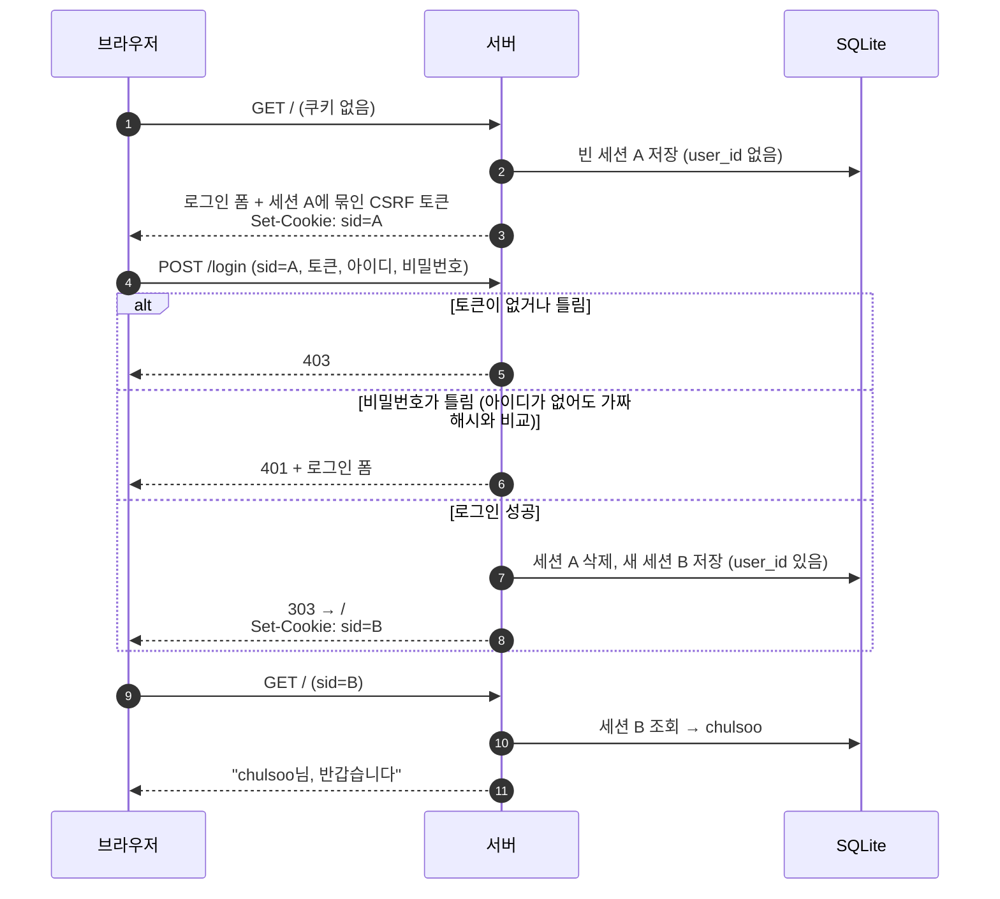
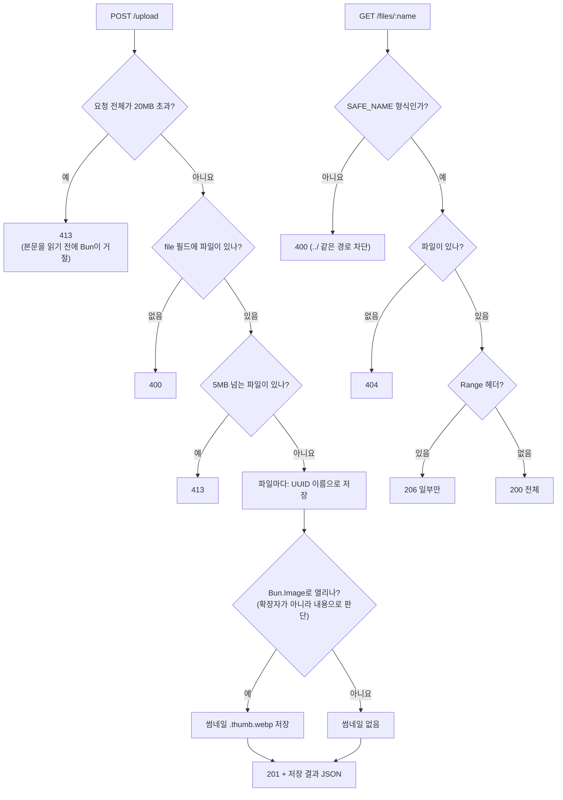
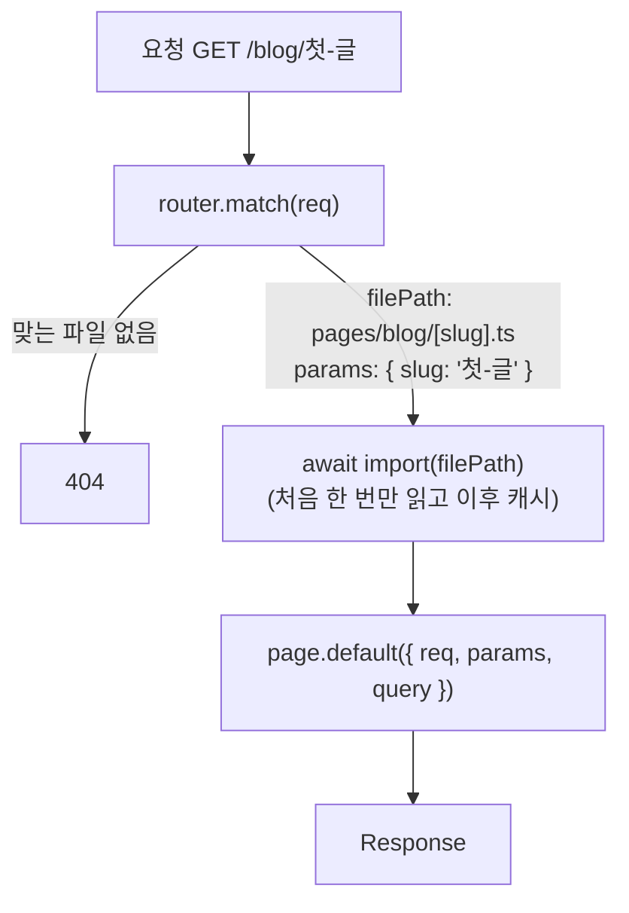
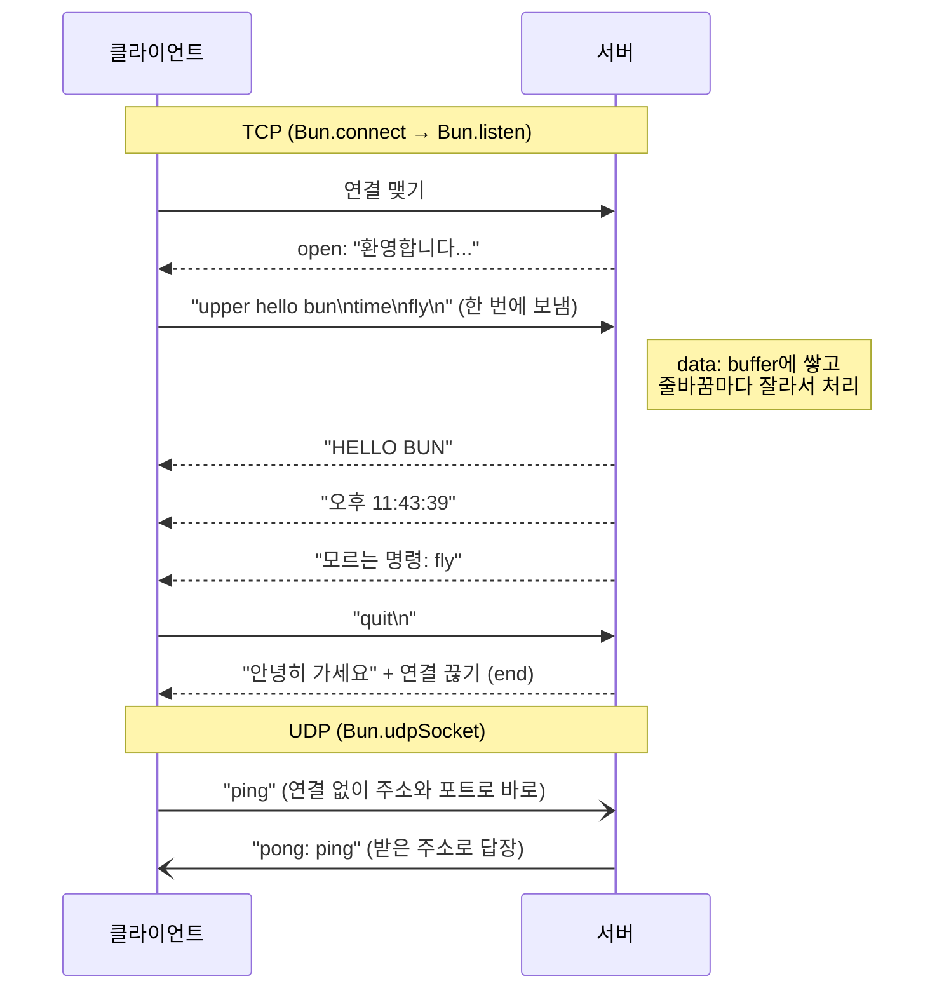
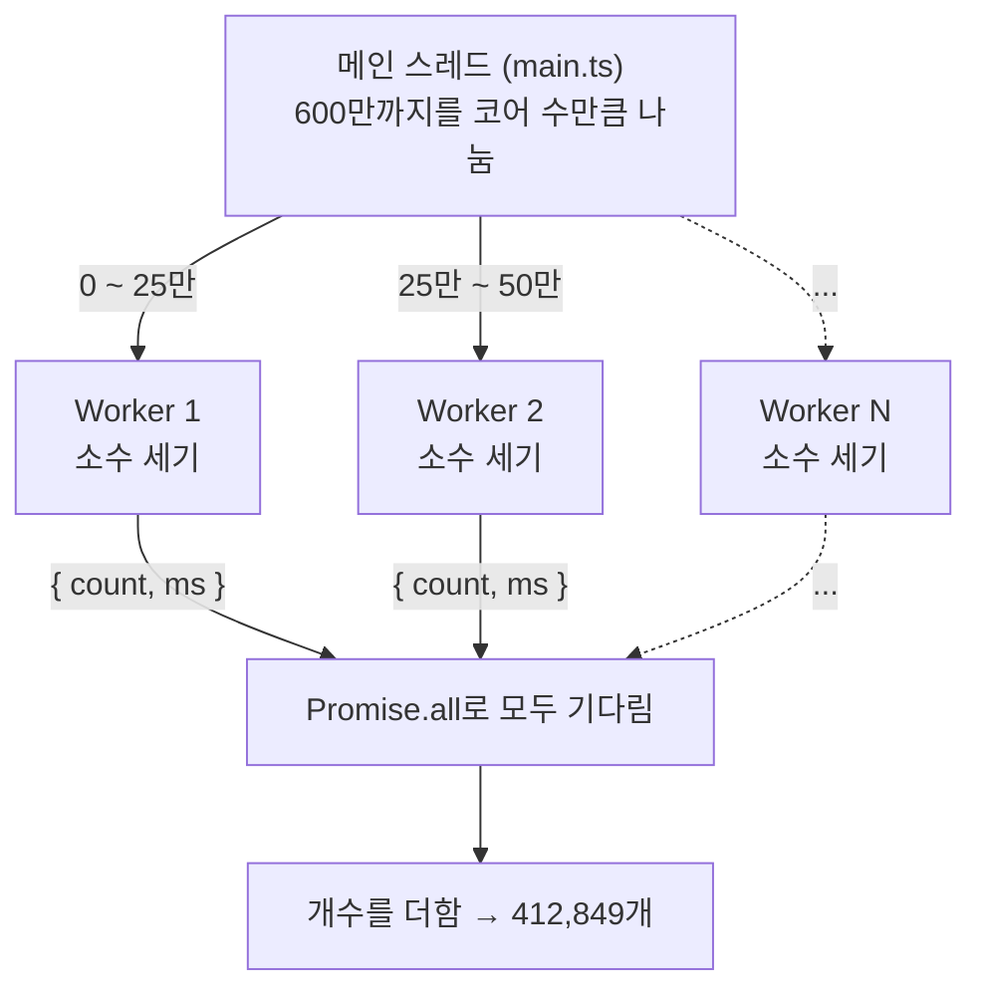
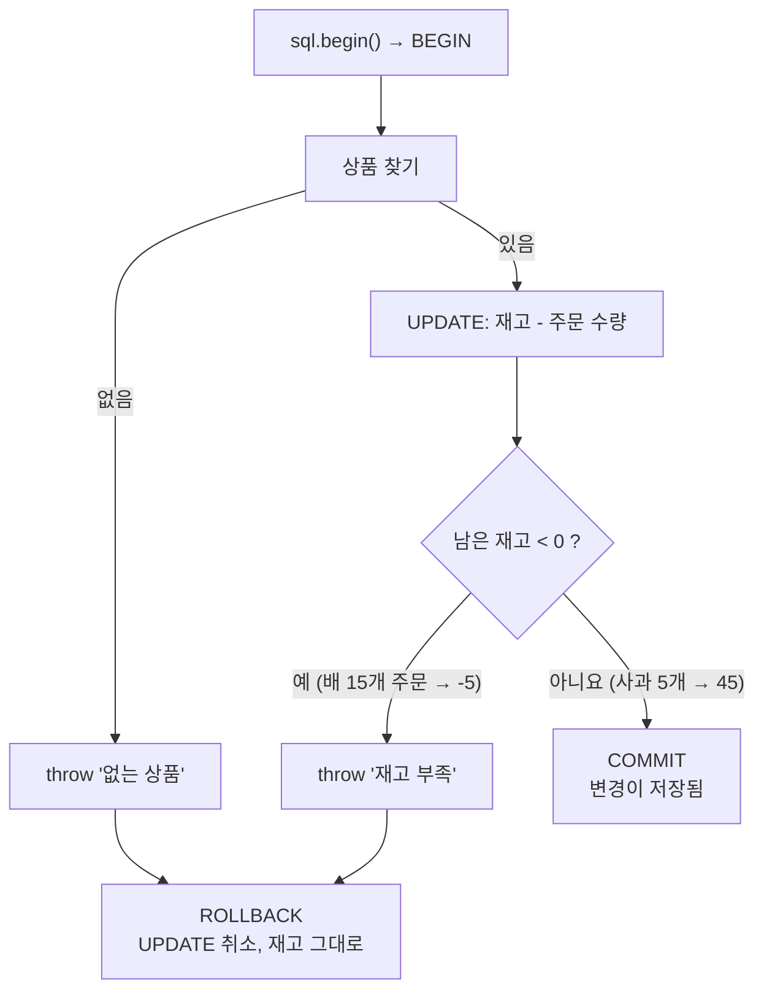
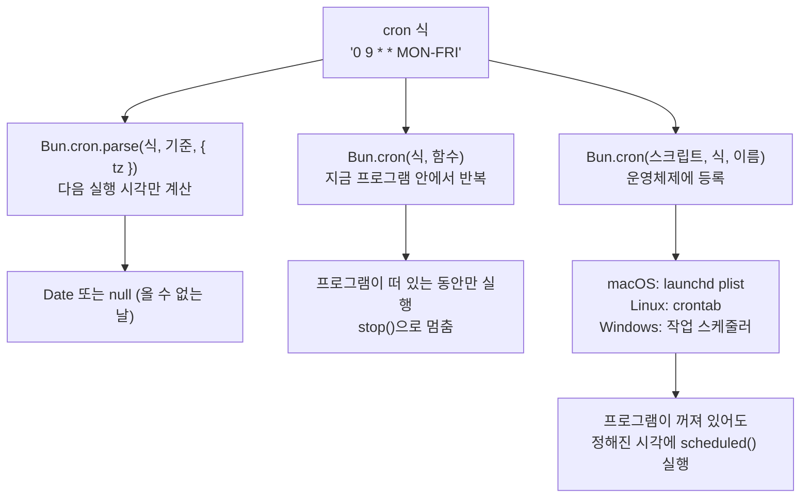
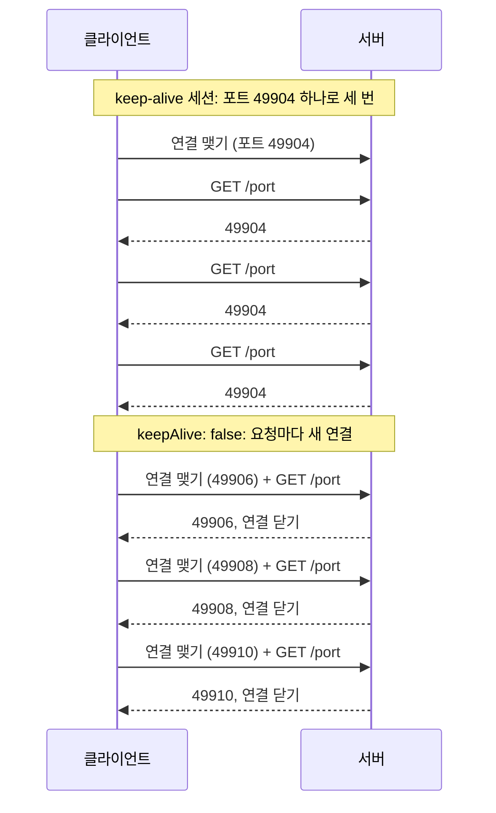

# 16. 중급 예제: 서버와 네트워크

[13장](./13_%EC%98%88%EC%A0%9C_%EC%9B%B9_%EC%84%9C%EB%B2%84.md)에서 만든 서버에 실제 서비스에 필요한 기능을 붙입니다. 로그인과 쿠키, 파일 업로드, 파일 위치로 주소 만들기, 그리고 HTTP 아래의 TCP·UDP, 여러 CPU 코어 쓰기, 예약 작업까지 다룹니다.

서버 예제는 `Ctrl + C`로 멈춥니다. 출력의 포트 번호, 시각, 걸린 시간은 실행할 때마다 다릅니다.

| 예제 | 파일 | 실행 |
|---|---|---|
| 28. 로그인 세션 | `examples/28-login-session.ts` | `http://localhost:3128` |
| 29. 파일 업로드 서버 | `examples/29-upload-server.ts` | `http://localhost:3129` |
| 30. 파일 위치가 곧 주소 | `examples/30-fs-router/` | `http://localhost:3130` |
| 31. TCP, UDP, DNS | `examples/31-tcp-udp-dns.ts` | `bun examples/31-tcp-udp-dns.ts` |
| 32. Worker로 나눠 계산 | `examples/32-workers/` | `bun examples/32-workers/main.ts` |
| 33. Bun.SQL | `examples/33-bun-sql.ts` | `bun examples/33-bun-sql.ts` |
| 34. 예약 작업 (cron) | `examples/34-cron.ts` | `bun examples/34-cron.ts` |
| 35. fetch 더 잘 쓰기 | `examples/35-fetch-advanced.ts` | `bun examples/35-fetch-advanced.ts` |
| 44. 정적 파일과 서버 교체 | `examples/44-static-routes.ts` | `bun examples/44-static-routes.ts` |

## 예제 28. 로그인 세션

`examples/28-login-session.ts` — 아이디·비밀번호로 로그인하고, 로그인 상태를 쿠키로 유지하는 서버입니다. 쿠키(`req.cookies`), 위조 요청 방지 토큰(`Bun.CSRF`), 비밀번호 해시(`Bun.password`), SQLite 세션 저장을 함께 씁니다. 테스트 계정은 `chulsoo` / `bun-1234`입니다.

로그인 전에 세션을 먼저 만들고, 로그인에 성공하면 세션 ID를 새것으로 바꾸는 것이 핵심입니다.



```ts
import { Database } from "bun:sqlite";

const SECRET = Bun.env.CSRF_SECRET ?? crypto.randomUUID(); // 배포할 때는 환경 변수로 고정값을 줍니다
const SESSION_DAYS = 7;

const db = new Database(":memory:", { strict: true });
db.run("CREATE TABLE users (id INTEGER PRIMARY KEY, username TEXT UNIQUE NOT NULL, password_hash TEXT NOT NULL)");
db.run("CREATE TABLE sessions (id TEXT PRIMARY KEY, user_id INTEGER, expires_at INTEGER NOT NULL)");
db.query("INSERT INTO users (username, password_hash) VALUES ($username, $hash)").run({
  username: "chulsoo",
  hash: await Bun.password.hash("bun-1234"),
});
const DUMMY_HASH = await Bun.password.hash("dummy-password");

type Session = { id: string; user_id: number | null; username: string | null };
const q = {
  session: db.query(`SELECT s.id, s.user_id, u.username FROM sessions s LEFT JOIN users u ON u.id = s.user_id
                     WHERE s.id = $id AND s.expires_at > $now`),
  create: db.query("INSERT INTO sessions (id, user_id, expires_at) VALUES ($id, $userId, $expires)"),
  remove: db.query("DELETE FROM sessions WHERE id = $id"),
  user: db.query("SELECT id, password_hash FROM users WHERE username = $username"),
};

// 세션 ID는 추측할 수 없어야 하므로 UUID v7(시각이 들어 있음) 대신 무작위 32바이트를 씁니다
const newSessionId = () => Buffer.from(crypto.getRandomValues(new Uint8Array(32))).toString("base64url");

function startSession(req: Bun.BunRequest, userId: number | null): string {
  const id = newSessionId();
  q.create.run({ id, userId, expires: Date.now() + SESSION_DAYS * 86_400_000 });
  // req.cookies에 넣으면 Bun이 응답에 Set-Cookie 헤더를 붙여 줍니다
  req.cookies.set("sid", id, { httpOnly: true, sameSite: "lax", path: "/", maxAge: SESSION_DAYS * 86_400 });
  return id;
}

/** 로그인 전에도 세션을 만들어 둡니다. 로그인 폼의 CSRF 토큰을 이 세션에 묶기 위해서입니다. */
function getSession(req: Bun.BunRequest): Session {
  const sid = req.cookies.get("sid");
  const found = sid ? (q.session.get({ id: sid, now: Date.now() }) as Session | null) : null;
  return found ?? { id: startSession(req, null), user_id: null, username: null };
}

const csrfField = (session: Session) =>
  `<input type="hidden" name="csrf" value="${Bun.CSRF.generate(SECRET, { sessionId: session.id, expiresIn: 3_600_000 })}">`;

function page(body: string, status = 200): Response {
  return new Response(
    `<!doctype html><html lang="ko"><head><meta charset="utf-8"><title>로그인 예제</title>
<style>body{font-family:sans-serif;max-width:420px;margin:40px auto} input{display:block;width:100%;margin:6px 0;padding:6px} .err{color:crimson}</style>
</head><body>${body}</body></html>`,
    { status, headers: { "Content-Type": "text/html; charset=utf-8" } },
  );
}

function loginForm(session: Session, error = ""): Response {
  return page(
    `<h1>로그인</h1>${error ? `<p class="err">${Bun.escapeHTML(error)}</p>` : ""}
<form method="post" action="/login">${csrfField(session)}
  <input name="username" placeholder="아이디" autocomplete="username">
  <input name="password" type="password" placeholder="비밀번호" autocomplete="current-password">
  <button>로그인</button>
</form>`,
    error ? 401 : 200,
  );
}

async function checkCsrf(req: Bun.BunRequest, session: Session): Promise<FormData | null> {
  const form = await req.formData().catch(() => null);
  const token = String(form?.get("csrf") ?? "");
  // 빈 문자열을 넘기면 false가 아니라 오류를 던지므로 먼저 확인합니다
  return form && token && Bun.CSRF.verify(token, { secret: SECRET, sessionId: session.id }) ? form : null;
}

const server = Bun.serve({
  port: Number(Bun.env.PORT ?? 3128),
  routes: {
    "/": (req) => {
      const session = getSession(req);
      if (!session.username) return loginForm(session);
      return page(`<h1>${Bun.escapeHTML(session.username)}님, 반갑습니다</h1>
<form method="post" action="/logout">${csrfField(session)}<button>로그아웃</button></form>`);
    },
    "/login": {
      POST: async (req) => {
        const session = getSession(req);
        const form = await checkCsrf(req, session);
        if (!form) return page("<p class='err'>요청이 만료되었거나 위조되었습니다. 새로고침 후 다시 시도하세요.</p>", 403);

        const user = q.user.get({ username: String(form.get("username") ?? "") }) as { id: number; password_hash: string } | null;
        // 아이디가 없어도 같은 시간이 걸리도록 가짜 해시와 비교합니다 (아이디 존재 여부를 시간으로 추측하지 못하게)
        const ok = await Bun.password.verify(String(form.get("password") ?? ""), user?.password_hash ?? DUMMY_HASH);
        if (!user || !ok) return loginForm(session, "아이디 또는 비밀번호가 틀렸습니다.");

        // 로그인에 성공하면 세션 ID를 새로 바꿉니다 (세션 고정 공격 방지)
        q.remove.run({ id: session.id });
        startSession(req, user.id);
        return Response.redirect("/", 303);
      },
    },
    "/logout": {
      POST: async (req) => {
        const session = getSession(req);
        if (!(await checkCsrf(req, session))) return page("<p class='err'>잘못된 요청입니다.</p>", 403);
        q.remove.run({ id: session.id });
        req.cookies.delete("sid");
        return Response.redirect("/", 303);
      },
    },
    "/api/me": (req) => {
      const session = getSession(req);
      return session.username
        ? Response.json({ username: session.username })
        : Response.json({ error: "로그인이 필요합니다" }, { status: 401 });
    },
  },
  fetch: () => new Response("Not Found", { status: 404 }),
});

console.log(`로그인 예제 실행 중: ${server.url}  (chulsoo / bun-1234)`);
```

```bash
bun examples/28-login-session.ts
```

브라우저로 `http://localhost:3128`을 열어 로그인해 보세요. 아래는 `curl`로 쿠키를 저장해 가며(`-c`, `-b`) 같은 흐름을 확인한 결과입니다.

| 요청 | 응답 |
|---|---|
| 처음 `GET /` | `200`, `Set-Cookie: sid=ugmm...; Path=/; Max-Age=604800; HttpOnly; SameSite=Lax`, 폼 안에 CSRF 토큰(86글자) |
| CSRF 토큰 없이 `POST /login` | `403` |
| 틀린 토큰(`csrf=abc`)으로 로그인 | `403` |
| 맞는 토큰, 틀린 비밀번호 | `401` (로그인 폼과 오류 문구) |
| 맞는 토큰, 맞는 비밀번호 | `303 See Other`, `Location: /`, **새 값**의 `Set-Cookie: sid=taPu...` |
| `GET /api/me` | `{"username":"chulsoo"}` |
| `GET /` | `<h1>chulsoo님, 반갑습니다</h1>` |
| `POST /logout` (토큰 포함) | `303`, `Set-Cookie: sid=; Path=/; Expires=Thu, 01 Jan 1970 00:00:00 GMT` |
| 로그아웃 뒤 `GET /api/me` | `{"error":"로그인이 필요합니다"}` |

| 기능 | 설명 |
|---|---|
| `req.cookies.get(이름)` | 요청에 담겨 온 쿠키 읽기. `routes`로 받은 요청(`BunRequest`)에 있음 |
| `req.cookies.set(이름, 값, 옵션)` | 응답에 `Set-Cookie`를 자동으로 붙임. `Response`를 만들 때 따로 헤더를 쓰지 않아도 됨 |
| `req.cookies.delete(이름)` | 만료 날짜를 과거로 둔 `Set-Cookie`를 붙여 브라우저가 지우게 함 |
| `Bun.CSRF.generate(비밀키, { sessionId, expiresIn })` | 세션에 묶이고 유효 기간이 있는 토큰 만들기 |
| `Bun.CSRF.verify(토큰, { secret, sessionId })` | 맞으면 `true`. 다른 세션의 토큰, 만료된 토큰, 형식이 틀린 토큰은 `false` |
| `new Bun.Cookie(...)`, `new Bun.CookieMap(...)` | 서버 밖에서 쿠키 문자열을 만들거나 읽을 때 |

쿠키 옵션의 뜻입니다.

| 옵션 | 뜻 |
|---|---|
| `httpOnly: true` | 페이지의 JavaScript(`document.cookie`)가 읽지 못함. 스크립트 주입(XSS)이 있어도 세션을 훔치기 어려움 |
| `sameSite: "lax"` | 다른 사이트에서 보내는 POST 요청에는 쿠키를 싣지 않음 |
| `maxAge` | 초 단위 유효 기간. 없으면 브라우저를 닫을 때 사라짐 |
| `secure: true` | HTTPS에서만 보냄. 실제 서비스에서는 켜야 함(이 예제는 `http://localhost`라 끔) |

**왜 이렇게 만들었나**

- **CSRF 토큰:** 다른 사이트가 사용자 몰래 `POST /logout` 같은 요청을 보내게 만드는 공격(CSRF)을 막습니다. 폼에 숨겨 둔 토큰은 이 사이트의 페이지에서만 얻을 수 있습니다. 1.4.3의 `Bun.CSRF.verify("")`는 `false`가 아니라 **오류를 던지므로**, 빈 토큰을 먼저 걸러야 500 오류가 나지 않습니다.
- **로그인 뒤 세션 ID 교체:** 공격자가 미리 알고 있는 세션 ID로 사용자를 로그인시키는 공격(세션 고정)을 막습니다. 표에서 로그인 전후 `sid` 값이 다른 것을 볼 수 있습니다.
- **없는 아이디에도 해시 비교:** 아이디가 없을 때 바로 응답하면 응답이 빨라서 "이 아이디는 없다"는 것이 드러납니다. 가짜 해시와 비교해 걸리는 시간을 맞춥니다.
- **세션 ID는 무작위 32바이트:** UUID v7은 앞부분이 시각이라 일부를 추측할 수 있습니다. 비밀이어야 하는 값에는 `crypto.getRandomValues`를 씁니다.

## 예제 29. 파일 업로드 서버

`examples/29-upload-server.ts` — 여러 파일을 한 번에 올리고, 이미지면 썸네일을 만들고, 내려받기와 이어받기(Range)를 지원합니다. 올린 파일은 `examples/data/uploads/`에 저장됩니다.

올리는 요청은 큰 것부터 먼저 걸러 내고, 통과한 파일만 저장합니다. 내려받는 요청은 이름 형식부터 검사합니다.



```ts
import { mkdir, readdir } from "node:fs/promises";
import { extname, join } from "node:path";

const DIR = join(import.meta.dir, "data/uploads");
const MAX_FILE = 5 * 1024 * 1024;
await mkdir(DIR, { recursive: true });

// 저장 이름은 서버가 정합니다. 사용자가 보낸 이름을 경로에 그대로 쓰면 ../ 로 다른 폴더에 쓸 수 있기 때문입니다
const SAFE_NAME = /^[0-9a-f-]{36}(\.thumb)?\.[a-z0-9]{1,8}$/;

async function saveUpload(file: File) {
  const bytes = await file.bytes();
  const id = Bun.randomUUIDv7();
  const ext = extname(file.name).toLowerCase().replace(/[^.a-z0-9]/g, "").slice(0, 9) || ".bin";
  const name = `${id}${ext}`;
  await Bun.write(join(DIR, name), bytes);

  // 이미지라면 썸네일을 만듭니다. 확장자는 믿지 않고 실제 내용으로 판단합니다
  try {
    const image = new Bun.Image(bytes, { maxPixels: 40_000_000 });
    const meta = await image.metadata();
    const thumb = `${id}.thumb.webp`;
    await image.resize(320, 320, { fit: "inside", withoutEnlargement: true }).webp({ quality: 75 }).write(join(DIR, thumb));
    return { name, size: bytes.length, original: file.name, image: meta, thumb };
  } catch {
    return { name, size: bytes.length, original: file.name, image: null, thumb: null };
  }
}

const server = Bun.serve({
  port: Number(Bun.env.PORT ?? 3129),
  maxRequestBodySize: 20 * 1024 * 1024, // 이보다 큰 요청은 본문을 읽기 전에 413으로 거절
  routes: {
    "/": () =>
      new Response(
        `<!doctype html><meta charset="utf-8"><title>업로드</title>
<h1>파일 올리기</h1>
<form method="post" action="/upload" enctype="multipart/form-data">
  <input type="file" name="file" multiple> <button>올리기</button>
</form>
<p><a href="/files">올린 파일 목록(JSON)</a></p>`,
        { headers: { "Content-Type": "text/html; charset=utf-8" } },
      ),

    "/upload": {
      POST: async (req) => {
        const form = await req.formData();
        const files = form.getAll("file").filter((f): f is File => f instanceof File && f.size > 0);
        if (!files.length) return Response.json({ error: "file 필드에 파일을 담아 보내세요" }, { status: 400 });
        const tooBig = files.find((f) => f.size > MAX_FILE);
        if (tooBig) return Response.json({ error: `${tooBig.name}: 파일 하나는 5MB까지입니다` }, { status: 413 });
        return Response.json(await Promise.all(files.map(saveUpload)), { status: 201 });
      },
    },

    "/files": async () => {
      const names = (await readdir(DIR)).filter((n) => SAFE_NAME.test(n)).sort();
      return Response.json(names.map((name) => ({ name, size: Bun.file(join(DIR, name)).size })));
    },

    "/files/:name": async (req) => {
      const { name } = req.params;
      if (!SAFE_NAME.test(name)) return Response.json({ error: "잘못된 파일 이름" }, { status: 400 });
      const file = Bun.file(join(DIR, name));
      if (!(await file.exists())) return Response.json({ error: "없는 파일" }, { status: 404 });
      // Bun.file을 그대로 응답하면 Content-Type, Content-Length, Range(이어받기) 처리를 Bun이 합니다
      const download = new URL(req.url).searchParams.has("download");
      return new Response(file, download ? { headers: { "Content-Disposition": `attachment; filename="${name}"` } } : undefined);
    },
  },
  fetch: () => Response.json({ error: "없는 주소" }, { status: 404 }),
  // 처리 중 예상 못 한 오류가 나면 여기로 옵니다. 내부 정보를 숨기고 기록만 남깁니다
  error(err) {
    console.error("[error]", err.message);
    return Response.json({ error: "서버 오류" }, { status: 500 });
  },
});

console.log(`업로드 서버 실행 중: ${server.url}  (저장 폴더: examples/data/uploads)`);
```

```bash
bun examples/29-upload-server.ts
```

다른 터미널에서 이미지 하나(예제 26이 만든 파일)와 글자 파일 하나를 함께 올립니다.

```bash
curl -F "file=@examples/data/image-out/original.png" -F "file=@examples/data/poem.txt" localhost:3129/upload
```

```text
[{"name":"01a14007-c426-7154-b26e-626643eac698.png","size":11113,"original":"original.png","image":{"width":640,"height":400,"format":"png"},"thumb":"01a14007-c426-7154-b26e-626643eac698.thumb.webp"},{"name":"01a14007-c427-72a4-9521-35d1867a72ee.txt","size":123,"original":"poem.txt","image":null,"thumb":null}]
```

| 요청 | 응답 |
|---|---|
| `GET /files` | 원본 2개와 썸네일 1개의 이름·크기 목록 |
| `curl -r 0-19 /files/<글자 파일>` | `206 Partial Content`, `content-range: bytes 0-19/123`, 본문 `죽는 날까지 하` |
| `GET /files/<이름>?download` | `Content-Disposition: attachment; filename="..."` (브라우저가 저장 창을 띄움) |
| `GET /files/..%2F..%2Fpackage.json` | `400` `{"error":"잘못된 파일 이름"}` |
| 6MB 파일 올리기 | `413` `{"error":"big.bin: 파일 하나는 5MB까지입니다"}` |
| 파일 없이 올리기 | `400` `{"error":"file 필드에 파일을 담아 보내세요"}` |

- `req.formData()`의 `getAll("file")`은 같은 이름으로 온 파일을 모두 돌려줍니다. 각 항목은 웹 표준 `File`이라 `name`, `size`, `type`, `bytes()`를 씁니다.
- `maxRequestBodySize`는 서버 전체의 상한입니다. 이보다 크면 본문을 읽기도 전에 거절해서 메모리를 지킵니다. 파일 하나의 상한(5MB)은 코드에서 따로 검사합니다.
- `new Response(Bun.file(...))`로 응답하면 Bun이 운영체제 기능(sendfile)으로 파일을 바로 보내고, 브라우저의 `Range` 요청(동영상 건너뛰기, 이어받기)에 `206`으로 답합니다.
- 업로드 파일 이름은 **절대 그대로 쓰지 않습니다.** 서버가 UUID로 이름을 정하고, 내려받을 때도 정해진 형식(`SAFE_NAME`)이 아니면 거절합니다.
- `error(err)`는 처리 중 잡지 못한 오류를 받습니다. 오류 내용을 사용자에게 그대로 보여 주면 내부 경로 같은 정보가 새어 나가므로 기록만 남깁니다.

## 예제 30. 파일 위치가 곧 주소

`examples/30-fs-router/` — Next.js처럼 `pages/` 폴더의 파일 위치가 주소가 됩니다. 새 파일을 추가하면 서버 코드를 고치지 않아도 주소가 생깁니다.

```text
examples/30-fs-router/
├── server.ts
└── pages/
    ├── index.ts           →  /
    ├── about.ts           →  /about
    ├── blog/
    │   ├── index.ts       →  /blog
    │   └── [slug].ts      →  /blog/아무거나       (params.slug)
    └── api/
        └── [...path].ts   →  /api/a/b/c          (params.path = "a/b/c")
```

```ts
// server.ts
export type PageContext = { req: Request; params: Record<string, string>; query: Record<string, string> };
type Page = { default: (ctx: PageContext) => Response | Promise<Response> };

const router = new Bun.FileSystemRouter({ style: "nextjs", dir: `${import.meta.dir}/pages` });

console.log("등록된 주소:");
for (const [route, file] of Object.entries(router.routes)) {
  console.log(`  ${route.padEnd(16)} ${file.replace(import.meta.dir + "/", "")}`);
}

const server = Bun.serve({
  port: Number(Bun.env.PORT ?? 3130),
  async fetch(req) {
    const match = router.match(req);
    if (!match) return new Response("Not Found", { status: 404 });
    const page: Page = await import(match.filePath);
    return page.default({ req, params: match.params, query: match.query });
  },
});

console.log(`파일 라우터 실행 중: ${server.url}`);
```

요청 하나가 처리되는 순서입니다.



페이지 파일은 `default`로 함수 하나를 내보냅니다.

```ts
// pages/blog/[slug].ts
import type { PageContext } from "../../server";

export default function handle({ params }: PageContext): Response {
  return new Response(`블로그 글: ${params.slug} (pages/blog/[slug].ts)`);
}
```

```ts
// pages/api/[...path].ts
import type { PageContext } from "../../server";

// [...path]는 /api/ 아래의 나머지 경로 전체를 받습니다
export default function handle({ req, params, query }: PageContext): Response {
  return Response.json({ method: req.method, path: params.path, query });
}
```

```bash
bun examples/30-fs-router/server.ts
```

```text
등록된 주소:
  /about           pages/about.ts
  /blog            pages/blog/index.ts
  /                pages/index.ts
  /blog/[slug]     pages/blog/[slug].ts
  /api/[...path]   pages/api/[...path].ts
파일 라우터 실행 중: http://localhost:3130/
```

| 주소 | 응답 |
|---|---|
| `/` | `홈입니다. /about, /blog, /blog/첫-글, /api/users/7 을 열어 보세요.` |
| `/about` | `소개 페이지 (pages/about.ts)` |
| `/blog` | `{"posts":["첫-글","둘째-글"]}` |
| `/blog/첫-글` | `블로그 글: 첫-글 (pages/blog/[slug].ts)` (한글 주소도 풀어서 줌) |
| `/api/users/7?sort=desc` | `{"method":"GET","path":"users/7","query":{"path":"users/7","sort":"desc"}}` |
| `/nothing` | `404 Not Found` |

- `router.match(req)`는 맞는 파일의 경로(`filePath`), 주소 매개변수(`params`), 쿼리(`query`)를 돌려줍니다. `query`에는 주소 매개변수도 함께 들어갑니다.
- `await import(match.filePath)`는 처음 한 번만 파일을 읽고 이후에는 캐시를 씁니다. 개발 중에 페이지를 고치면 `bun --hot`으로 실행하세요.
- `routes`에 직접 쓰는 방법([7장](./07_%EC%9B%B9_%EC%84%9C%EB%B2%84_%EB%A7%8C%EB%93%A4%EA%B8%B0.md))과 비교하면, 주소가 많고 사람마다 맡은 페이지가 다를 때 이 방식이 편합니다.

## 예제 31. TCP, UDP, DNS

`examples/31-tcp-udp-dns.ts` — HTTP는 TCP 위에서 동작합니다. 이 예제는 그 아래 단계를 직접 다룹니다. 채팅, 게임 서버, 데이터베이스 드라이버처럼 HTTP가 아닌 통신을 만들 때 씁니다.

TCP는 연결을 맺고 바이트를 흘려보내므로 받는 쪽이 줄바꿈으로 명령을 나눕니다. UDP는 연결 없이 덩어리 하나를 보내고 끝입니다.



```ts
// ---------------------------------------------------------------- 1. TCP: 한 줄 명령을 받는 서버
type ConnState = { buffer: string; name: string };

const tcpServer = Bun.listen<ConnState>({
  hostname: "127.0.0.1",
  port: 0, // 0이면 비어 있는 포트를 운영체제가 골라 줍니다
  socket: {
    open(socket) {
      socket.data = { buffer: "", name: `손님${socket.remotePort}` };
      socket.write("환영합니다. 명령: upper <글자> | time | quit\n");
    },
    // TCP는 "메시지"가 아니라 바이트의 흐름이라, 한 줄이 여러 조각으로 나뉘거나 여러 줄이 한 번에 올 수 있습니다
    data(socket, chunk) {
      socket.data.buffer += chunk.toString();
      let newline: number;
      while ((newline = socket.data.buffer.indexOf("\n")) >= 0) {
        const line = socket.data.buffer.slice(0, newline).trim();
        socket.data.buffer = socket.data.buffer.slice(newline + 1);
        const [cmd, ...rest] = line.split(" ");
        if (cmd === "upper") socket.write(rest.join(" ").toUpperCase() + "\n");
        else if (cmd === "time") socket.write(new Date().toLocaleTimeString("ko-KR") + "\n");
        else if (cmd === "quit") socket.end("안녕히 가세요\n");
        else socket.write(`모르는 명령: ${cmd}\n`);
      }
    },
    close(socket) {
      console.log(`   [서버] ${socket.data.name} 연결 종료`);
    },
  },
});
console.log(`1) TCP 서버: 127.0.0.1:${tcpServer.port}`);

// 클라이언트: 명령 세 개를 한 번에 보내도 서버가 줄 단위로 나눠 처리합니다
const received: string[] = [];
const { promise: closed, resolve } = Promise.withResolvers<void>();
const client = await Bun.connect({
  hostname: "127.0.0.1",
  port: tcpServer.port,
  socket: {
    data(_socket, chunk) {
      received.push(...chunk.toString().split("\n").filter(Boolean));
    },
    close() {
      resolve();
    },
  },
});
client.write("upper hello bun\ntime\nfly\n");
client.write("quit\n");
await closed;
for (const line of received) console.log(`   [클라이언트] ${line}`);
tcpServer.stop(true);

// ---------------------------------------------------------------- 2. UDP: 주고받기 한 번
const server = await Bun.udpSocket({
  hostname: "127.0.0.1",
  socket: {
    data(socket, buf, port, addr) {
      socket.send(`pong: ${buf.toString()}`, port, addr); // 받은 곳으로 바로 답장
    },
  },
});
const { promise: pong, resolve: gotPong } = Promise.withResolvers<string>();
const udpClient = await Bun.udpSocket({
  socket: {
    data(_socket, buf) {
      gotPong(buf.toString());
    },
  },
});
const sentAt = Bun.nanoseconds();
udpClient.send("ping", server.port, "127.0.0.1");
console.log(`2) UDP: ${await pong} (${((Bun.nanoseconds() - sentAt) / 1e6).toFixed(2)}ms)`);
server.close();
udpClient.close();

// ---------------------------------------------------------------- 3. DNS
const local = await Bun.dns.lookup("localhost");
console.log("3) DNS lookup('localhost'):", local.map((r) => `${r.address} (IPv${r.family})`).join(", "));
try {
  const remote = await Bun.dns.lookup("bun.com", { family: 4 });
  console.log("   lookup('bun.com', IPv4):", remote.map((r) => r.address).join(", "));
} catch (err) {
  console.log("   lookup('bun.com') 실패 (인터넷 연결 확인):", (err as Error).message);
}
Bun.dns.prefetch("example.com", 443); // 곧 접속할 곳을 미리 조회해 두면 첫 fetch가 빨라집니다
console.log("   DNS 캐시 통계:", JSON.stringify(Bun.dns.getCacheStats()));
```

```bash
bun examples/31-tcp-udp-dns.ts
```

```text
1) TCP 서버: 127.0.0.1:49895
   [서버] 손님49896 연결 종료
   [클라이언트] 환영합니다. 명령: upper <글자> | time | quit
   [클라이언트] HELLO BUN
   [클라이언트] 오후 11:43:39
   [클라이언트] 모르는 명령: fly
   [클라이언트] 안녕히 가세요
2) UDP: pong: ping (0.19ms)
3) DNS lookup('localhost'): ::1 (IPv6), 127.0.0.1 (IPv4)
   lookup('bun.com', IPv4): 104.26.9.103, 104.26.8.103, 172.67.72.154
   DNS 캐시 통계: {"cacheHitsCompleted":0,"cacheHitsInflight":0,"cacheMisses":1,"size":1,"errors":0,"totalCount":1}
```

| | TCP (`Bun.listen` / `Bun.connect`) | UDP (`Bun.udpSocket`) |
|---|---|---|
| 연결 | 먼저 연결을 맺고 주고받음 | 연결 없이 주소로 바로 보냄 |
| 순서·유실 | 보낸 순서대로, 빠짐없이 도착 | 순서가 바뀌거나 빠질 수 있음 |
| 경계 | 바이트의 흐름. 메시지 경계를 직접 정해야 함(예제는 줄바꿈) | 보낸 덩어리 하나가 그대로 하나로 도착 |
| 쓰는 곳 | HTTP, 데이터베이스, 채팅 | DNS, 게임 위치 정보, 음성·영상, 측정값 전송 |

- 서버의 "연결 종료" 줄이 먼저 나온 이유는, 클라이언트가 받은 줄을 모아 두었다가 연결이 끝난 뒤에 출력했기 때문입니다.
- `socket.data`는 연결마다 따로 두는 저장 공간입니다. 받다 만 줄(`buffer`)을 여기에 보관합니다. TCP에서는 `data`가 한 번 불릴 때 한 줄이 온다는 보장이 없습니다.
- `Bun.listen`에 `tls: { key, cert }`를 주면 TLS(암호화) 서버가 되고, `Bun.connect({ tls: true })`로 접속합니다.
- `Bun.dns.lookup`은 운영체제 설정(`/etc/hosts` 포함)을 따릅니다. `localhost`는 IPv6(`::1`)가 먼저 나왔습니다.

## 예제 32. Worker로 나눠 계산

`examples/32-workers/` — JavaScript는 한 스레드에서 돌아서, 오래 걸리는 계산을 하면 그동안 다른 일을 못 합니다. `Worker`로 다른 스레드에 일을 맡기고 CPU 코어 여러 개를 함께 씁니다. 600만 미만의 소수를 세는 일을 나눠 봅니다.

메인 스레드는 구간만 `postMessage`로 나눠 보내고, 계산은 Worker들이 동시에 합니다. 메인 스레드는 그동안 다른 일(타이머, 요청 처리)을 계속할 수 있습니다.



```ts
// prime-worker.ts: Worker 안에서 실행되는 코드. 메인 스레드와는 메시지로만 대화합니다.
declare const self: Worker;

export type Job = { from: number; to: number };
export type Result = { from: number; to: number; count: number; ms: number };

function isPrime(n: number): boolean {
  if (n < 2) return false;
  for (let d = 2; d * d <= n; d++) if (n % d === 0) return false;
  return true;
}

self.onmessage = (event: MessageEvent<Job>) => {
  const { from, to } = event.data;
  const start = performance.now();
  let count = 0;
  for (let n = from; n < to; n++) if (isPrime(n)) count++;
  self.postMessage({ from, to, count, ms: performance.now() - start } satisfies Result);
};
```

```ts
// main.ts
import type { Job, Result } from "./prime-worker";

const LIMIT = 6_000_000;
const cores = navigator.hardwareConcurrency;

function runJob(worker: Worker, job: Job): Promise<Result> {
  return new Promise((resolve, reject) => {
    worker.onmessage = (e: MessageEvent<Result>) => resolve(e.data);
    worker.onerror = (e) => reject(e.error ?? new Error(e.message));
    worker.postMessage(job);
  });
}

// 1. Worker 하나로 전부 계산 (= 한 스레드)
const single = new Worker(new URL("./prime-worker.ts", import.meta.url));
let start = performance.now();
const one = await runJob(single, { from: 0, to: LIMIT });
const singleMs = performance.now() - start;
console.log(`1) Worker 1개: ${LIMIT.toLocaleString()} 미만 소수 ${one.count.toLocaleString()}개, ${singleMs.toFixed(0)}ms`);
single.terminate();

// 2. 코어 수만큼 Worker를 만들어 구간을 나눠 계산
const workers = Array.from({ length: cores }, () => new Worker(new URL("./prime-worker.ts", import.meta.url)));
const size = Math.ceil(LIMIT / cores);
start = performance.now();
const parts = await Promise.all(
  workers.map((w, i) => runJob(w, { from: i * size, to: Math.min(LIMIT, (i + 1) * size) })),
);
const parallelMs = performance.now() - start;
const total = parts.reduce((sum, p) => sum + p.count, 0);
console.log(`2) Worker ${cores}개: 소수 ${total.toLocaleString()}개, ${parallelMs.toFixed(0)}ms (${(singleMs / parallelMs).toFixed(1)}배 빠름)`);
for (const p of parts.slice(0, 3)) {
  console.log(`   ${p.from.toLocaleString().padStart(9)} ~ ${p.to.toLocaleString().padEnd(9)} ${String(p.count).padStart(6)}개 ${p.ms.toFixed(0)}ms`);
}
console.log("   ...");
for (const w of workers) w.terminate();

// 3. 계산하는 동안에도 메인 스레드는 멈추지 않습니다
const ticker = new Worker(new URL("./prime-worker.ts", import.meta.url));
let ticks = 0;
const timer = setInterval(() => ticks++, 10);
await runJob(ticker, { from: 0, to: 2_000_000 });
clearInterval(timer);
ticker.terminate();
console.log(`3) Worker가 계산하는 동안 메인 스레드의 10ms 타이머가 ${ticks}번 실행됨`);
```

```bash
bun examples/32-workers/main.ts
```

24코어 컴퓨터에서의 결과입니다. 코어 수와 시간은 컴퓨터마다 다릅니다.

```text
1) Worker 1개: 6,000,000 미만 소수 412,849개, 609ms
2) Worker 24개: 소수 412,849개, 63ms (9.6배 빠름)
           0 ~ 250,000    22044개 15ms
     250,000 ~ 500,000    19494개 26ms
     500,000 ~ 750,000    18700개 25ms
   ...
3) Worker가 계산하는 동안 메인 스레드의 10ms 타이머가 11번 실행됨
```

- 24배가 아니라 약 10배인 이유는 Worker를 시작하는 시간이 들고, 뒤쪽 구간(큰 수)일수록 계산이 오래 걸려서 가장 늦은 Worker를 기다려야 하기 때문입니다. 구간을 더 잘게 나눠 놀고 있는 Worker에게 다음 일을 주면 더 빨라집니다.
- Worker와는 `postMessage`로 **복사한 값**을 주고받습니다(예제 43의 `structuredClone`과 같은 방식). 큰 `ArrayBuffer`는 `postMessage(buf, [buf])`처럼 넘기면 복사하지 않고 옮깁니다.
- 3번에서 Worker가 계산하는 동안에도 메인 스레드의 타이머가 계속 돌았습니다. 서버라면 그동안 다른 요청을 받을 수 있다는 뜻입니다. 같은 계산을 메인 스레드에서 하면 그동안 타이머도 요청 처리도 멈춥니다.
- Worker 파일도 TypeScript 그대로 씁니다. 따로 빌드하지 않아도 됩니다.

## 예제 33. Bun.SQL

`examples/33-bun-sql.ts` — `Bun.SQL`은 SQLite, PostgreSQL, MySQL을 **같은 문법**으로 쓰는 클라이언트입니다. 예제는 설치가 필요 없는 SQLite 메모리 DB로 연습합니다. [14장](./14_%EC%98%88%EC%A0%9C_%EB%8D%B0%EC%9D%B4%ED%84%B0%EB%B2%A0%EC%9D%B4%EC%8A%A4_%ED%85%8C%EC%8A%A4%ED%8A%B8_%EB%B9%8C%EB%93%9C.md)의 `bun:sqlite`와 달리 모든 호출이 비동기(`await`)입니다.

```ts
import { SQL } from "bun";

const sql = new SQL(":memory:");

await sql`CREATE TABLE products (
  id    INTEGER PRIMARY KEY AUTOINCREMENT,
  name  TEXT    NOT NULL,
  price INTEGER NOT NULL,
  stock INTEGER NOT NULL DEFAULT 0
)`;

// 1. 태그드 템플릿: ${값}은 문자열로 이어 붙이지 않고 자리 표시(?)로 따로 보내서 SQL 인젝션이 생기지 않습니다
const evil = "'; DROP TABLE products; --";
await sql`INSERT INTO products (name, price) VALUES (${evil}, ${0})`;
console.log("1) 위험한 글자도 그냥 값으로 저장됨:", (await sql`SELECT name FROM products`)[0].name);
await sql`DELETE FROM products`;

// 2. 객체·배열로 넣기: sql(객체)는 열 이름과 값을 알아서 펼칩니다
const items = [
  { name: "사과", price: 1000, stock: 50 },
  { name: "배", price: 3000, stock: 10 },
  { name: "포도", price: 5000, stock: 0 },
  { name: "귤", price: 500, stock: 200 },
];
const inserted = await sql`INSERT INTO products ${sql(items)} RETURNING id, name`;
console.log("2) 여러 줄 넣기:", JSON.stringify(inserted));

// 3. 결과는 객체 배열. 필요한 열만, 원하는 형태로
const cheap = await sql`SELECT name, price FROM products WHERE price < ${2000} ORDER BY price`;
console.log("3) 2,000원 미만:", JSON.stringify(cheap));
const rows = await sql`SELECT name, stock FROM products ORDER BY id`.values();
console.log("   .values() (배열의 배열):", JSON.stringify(rows));

// 4. IN 목록: sql(배열)
const picked = await sql`SELECT name FROM products WHERE name IN ${sql(["사과", "귤", "없는것"])}`;
console.log("4) IN 목록:", picked.map((r: { name: string }) => r.name).join(", "));

// 5. 동적 열 이름: 열·표 이름은 값이 아니라서 sql("이름")으로 넣습니다 (사용자 입력은 허용 목록으로 검사)
const sortable = new Set(["name", "price", "stock"]);
const sortBy = "price";
if (!sortable.has(sortBy)) throw new Error("정렬할 수 없는 열");
const sorted = await sql`SELECT name FROM products ORDER BY ${sql(sortBy)} DESC`;
console.log(`5) ${sortBy} 내림차순:`, sorted.map((r: { name: string }) => r.name).join(" > "));

// 6. 트랜잭션: 안에서 오류가 나면 전부 취소됩니다
async function order(name: string, quantity: number) {
  return sql.begin(async (tx) => {
    const [product] = await tx`SELECT id, stock FROM products WHERE name = ${name}`;
    if (!product) throw new Error(`${name}: 없는 상품`);
    await tx`UPDATE products SET stock = stock - ${quantity} WHERE id = ${product.id}`;
    const [after] = await tx`SELECT stock FROM products WHERE id = ${product.id}`;
    if (after.stock < 0) throw new Error(`${name}: 재고 부족 (남은 ${product.stock}개)`);
    return after.stock;
  });
}
console.log("6) 사과 5개 주문 → 남은 재고:", await order("사과", 5));
try {
  await order("배", 15);
} catch (err) {
  const [pear] = await sql`SELECT stock FROM products WHERE name = ${"배"}`;
  console.log(`   ${(err as Error).message} → 취소됨, 배 재고 그대로 ${pear.stock}개`);
}

await sql.close();
```

```bash
bun examples/33-bun-sql.ts
```

```text
1) 위험한 글자도 그냥 값으로 저장됨: '; DROP TABLE products; --
2) 여러 줄 넣기: [{"id":2,"name":"사과"},{"id":3,"name":"배"},{"id":4,"name":"포도"},{"id":5,"name":"귤"}]
3) 2,000원 미만: [{"name":"귤","price":500},{"name":"사과","price":1000}]
   .values() (배열의 배열): [["사과",50],["배",10],["포도",0],["귤",200]]
4) IN 목록: 사과, 귤
5) price 내림차순: 포도 > 배 > 사과 > 귤
6) 사과 5개 주문 → 남은 재고: 45
   배: 재고 부족 (남은 10개) → 취소됨, 배 재고 그대로 10개
```

| 쓰는 법 | 뜻 |
|---|---|
| `` sql`... ${값} ...` `` | 값은 자리 표시로 따로 보냄. 문자열을 이어 붙이지 않으므로 SQL 인젝션 없음 |
| `sql(객체)`, `sql(객체 배열)` | `INSERT`의 열 목록과 `VALUES`를 펼침 |
| `sql(배열)` | `IN (...)` 목록 |
| `sql("열이름")` | 열·표 이름 넣기. 사용자 입력이면 **허용 목록으로 먼저 검사** |
| `.values()` | 객체 대신 배열의 배열로 받기 |
| `sql.begin(async (tx) => ...)` | 트랜잭션. 함수가 오류를 던지면 전부 되돌림(ROLLBACK) |
| `new SQL("postgres://...")`, `"mysql://..."` | 주소만 바꾸면 PostgreSQL·MySQL. 주소 없이 `Bun.sql`을 쓰면 `DATABASE_URL` 환경 변수 사용 |

6번 `order()`의 트랜잭션 흐름입니다. 함수 안에서 오류를 던지면 그때까지의 변경이 모두 되돌려집니다.



- 2번의 `id`가 2부터 시작한 이유는 `AUTOINCREMENT`가 지운 줄(1번)의 번호를 다시 쓰지 않기 때문입니다.
- 6번에서 배를 15개 주문하자 재고가 -5가 되었지만, 트랜잭션 안에서 오류를 던졌기 때문에 `UPDATE`가 취소되어 재고가 10개 그대로입니다.
- 이 예제는 SQLite에서만 실행해 확인했습니다. PostgreSQL·MySQL 서버가 있으면 `new SQL(":memory:")` 줄만 바꿔 실행해 보세요(`AUTOINCREMENT`는 PostgreSQL에서 `GENERATED ALWAYS AS IDENTITY`로 바꿔야 합니다).

## 예제 34. 예약 작업 (cron)

`examples/34-cron.ts` — 1.4.3의 `Bun.cron`으로 "평일 오전 9시"처럼 반복되는 일정을 다룹니다. 다음 실행 시각 계산, 프로그램 안에서의 반복 실행, 운영체제 예약 작업 등록까지 합니다.

`Bun.cron`은 부르는 방법에 따라 세 가지로 쓰입니다. 프로그램이 꺼져 있을 때도 실행해야 하면 운영체제 등록을 씁니다.



```ts
// 1. 다음 실행 시각 계산: 기준 시각과 시간대를 정해 두면 결과가 항상 같습니다
const base = new Date("2026-10-15T23:40:00+09:00"); // 목요일 밤
const tz = "Asia/Seoul";
const fmt = (d: Date | null) =>
  d ? d.toLocaleString("ko-KR", { timeZone: tz, dateStyle: "medium", timeStyle: "short", hour12: false }) : "없음";
const weekday = (d: Date | null) => (d ? d.toLocaleDateString("ko-KR", { timeZone: tz, weekday: "short" }) : "");
const pad = (s: string, width: number) => s + " ".repeat(Math.max(0, width - Bun.stringWidth(s)));

console.log(`1) 기준: ${fmt(base)} (${weekday(base)})`);
for (const [expr, meaning] of [
  ["*/15 * * * *", "15분마다"],
  ["0 9 * * MON-FRI", "평일 오전 9시"],
  ["30 2 * * SUN", "일요일 새벽 2시 30분"],
  ["0 0 1 * *", "매월 1일 자정"],
  ["@daily", "매일 자정"],
  ["0 0 30 2 *", "2월 30일 (없는 날)"],
]) {
  const next = Bun.cron.parse(expr, base, { tz });
  console.log(`   ${expr.padEnd(16)} ${pad(meaning, 22)} → ${fmt(next)} ${weekday(next)}`);
}

// 2. 이어서 부르면 다음, 그다음 실행 시각을 차례로 얻습니다
let cursor: Date = base;
const upcoming: string[] = [];
for (let i = 0; i < 3; i++) {
  cursor = Bun.cron.parse("0 9 * * MON-FRI", cursor, { tz })!;
  upcoming.push(`${fmt(cursor)}(${weekday(cursor)})`);
}
console.log("2) 평일 9시 다음 3번:", upcoming.join(", "));

// 3. 잘못된 표현식은 오류
try {
  Bun.cron.parse("61 * * * *");
} catch (err) {
  console.log("3) 잘못된 표현식:", (err as Error).message);
}

// 4. 프로세스 안에서 반복 실행: 서버처럼 계속 떠 있는 프로그램에서 씁니다
// 실행이 끝나야 다음 시각을 계산하므로, 오래 걸리는 작업이 겹쳐 실행되지 않습니다
const job = Bun.cron("* * * * *", async () => {
  console.log("매분 실행:", new Date().toLocaleTimeString("ko-KR"));
});
console.log(`4) 프로세스 안 작업 등록: "${job.cron}" (다음 실행 ${fmt(Bun.cron.parse(job.cron))})`);
job.stop(); // 예제라서 바로 멈춥니다. 멈추지 않으면 프로세스가 계속 살아 있습니다

// 5. 운영체제에 등록: 프로그램이 꺼져 있어도 정해진 시각에 스크립트를 실행합니다
// macOS는 launchd(~/Library/LaunchAgents/bun.cron.<이름>.plist), Linux는 crontab, Windows는 작업 스케줄러
if (Bun.argv.includes("--os")) {
  const worker = `${import.meta.dir}/data/cron-worker.ts`;
  await Bun.write(worker, `export default { scheduled(c: Bun.CronController) { console.log("실행됨", c.cron, new Date(c.scheduledTime)); } };\n`);
  await Bun.cron(worker, "30 2 * * MON", "bun-report-demo");
  const plist = `${process.env.HOME}/Library/LaunchAgents/bun.cron.bun-report-demo.plist`;
  console.log("5) 운영체제 등록 후 plist 있음:", await Bun.file(plist).exists());
  await Bun.cron.remove("bun-report-demo");
  console.log("   삭제 후 plist 있음:", await Bun.file(plist).exists());
  await Bun.file(worker).delete();
} else {
  console.log("5) 운영체제 등록 시험은 --os 를 붙여 실행하세요");
}
```

```bash
bun examples/34-cron.ts --os
```

```text
1) 기준: 2026. 10. 15. 23:40 (목)
   */15 * * * *     15분마다               → 2026. 10. 15. 23:45 목
   0 9 * * MON-FRI  평일 오전 9시          → 2026. 10. 16. 09:00 금
   30 2 * * SUN     일요일 새벽 2시 30분   → 2026. 10. 18. 02:30 일
   0 0 1 * *        매월 1일 자정          → 2026. 11. 1. 00:00 일
   @daily           매일 자정              → 2026. 10. 16. 00:00 금
   0 0 30 2 *       2월 30일 (없는 날)     → 없음 
2) 평일 9시 다음 3번: 2026. 10. 16. 09:00(금), 2026. 10. 19. 09:00(월), 2026. 10. 20. 09:00(화)
3) 잘못된 표현식: Invalid cron expression: value out of range for field
4) 프로세스 안 작업 등록: "* * * * *" (다음 실행 2026. 10. 15. 23:48)
5) 운영체제 등록 후 plist 있음: true
   삭제 후 plist 있음: false
```

cron 표현식은 다섯 칸입니다.

```text
┌──────── 분 (0-59)
│ ┌────── 시 (0-23)
│ │ ┌──── 일 (1-31)
│ │ │ ┌── 월 (1-12 또는 JAN-DEC)
│ │ │ │ ┌ 요일 (0-7 또는 SUN-SAT, 0과 7은 일요일)
* * * * *
```

| 쓰는 법 | 뜻 |
|---|---|
| `*` | 모든 값 |
| `*/15` | 15마다 (0, 15, 30, 45) |
| `MON-FRI`, `1-5` | 범위 |
| `1,15` | 목록 |
| `@daily`, `@hourly`, `@weekly`, `@monthly`, `@yearly` | 자주 쓰는 일정의 줄임말 |

| 함수 | 하는 일 |
|---|---|
| `Bun.cron.parse(식, 기준?, { tz })` | 다음 실행 시각(`Date`). 올 수 없는 날이면 `null`, 잘못된 식이면 오류 |
| `Bun.cron(식, 함수)` | 지금 프로그램 안에서 반복 실행. `stop()`으로 멈춤. 등록된 동안은 프로그램이 끝나지 않음(`unref()`로 풀기) |
| `Bun.cron(스크립트, 식, 이름)` | 운영체제에 등록. 프로그램이 꺼져 있어도, 컴퓨터를 다시 켜도 실행 |
| `Bun.cron.remove(이름)` | 운영체제 등록 삭제 |

- 운영체제에 등록하는 스크립트는 `export default { scheduled(controller) { ... } }` 모양이어야 합니다. 예제는 등록 후 바로 지우므로 실제로 실행되지는 않습니다.
- 시간대(`tz`)를 주지 않으면 컴퓨터의 시간대를 씁니다. 서버는 보통 UTC이므로 "한국 시각 9시"를 원하면 `tz: "Asia/Seoul"`을 꼭 주세요.
- 테스트에서는 실제로 1시간을 기다리지 않고 가짜 시계로 확인합니다([17장 예제 42](./17_%EC%A4%91%EA%B8%89_%EC%98%88%EC%A0%9C_%EB%8F%84%EA%B5%AC_%ED%94%84%EB%A1%9C%EC%84%B8%EC%8A%A4_%ED%85%8C%EC%8A%A4%ED%8A%B8.md#예제-42-테스트-더-잘-쓰기)).

## 예제 35. fetch 더 잘 쓰기

`examples/35-fetch-advanced.ts` — [13장 예제 12](./13_%EC%98%88%EC%A0%9C_%EC%9B%B9_%EC%84%9C%EB%B2%84.md#예제-12-fetch로-다른-서버에-요청하기)의 `fetch`에서 한 걸음 더 나갑니다. 받으면서 진행률 보기, 중간에 취소하기, 스트림으로 올리기, 연결 재사용, 유닉스 소켓을 다룹니다. 연습용 서버를 같은 파일 안에 띄워서 인터넷 없이 실행됩니다.

```ts
import { tmpdir } from "node:os";
import { join } from "node:path";

// 연습용 서버: 천천히 내려주는 다운로드, 받은 바이트 수를 세는 업로드, 요청이 온 포트를 알려 주는 주소
const server = Bun.serve({
  port: 0,
  routes: {
    "/download": () => {
      const total = 10;
      let sent = 0;
      const body = new ReadableStream({
        async pull(controller) {
          await Bun.sleep(30);
          controller.enqueue(new Uint8Array(100_000).fill(65));
          if (++sent === total) controller.close();
        },
      });
      // 스트림 응답에 Content-Length를 넣어도 Bun은 청크 전송으로 보내며 그 헤더를 뺍니다. 전체 크기는 따로 알려 줍니다
      return new Response(body, { headers: { "X-Total-Size": String(total * 100_000) } });
    },
    "/upload": async (req) => {
      let bytes = 0;
      for await (const chunk of req.body!) bytes += chunk.length;
      return Response.json({ bytes });
    },
    // 클라이언트 쪽 포트 번호가 같으면 같은 TCP 연결을 다시 쓴 것입니다
    "/port": (req, srv) => new Response(String(srv.requestIP(req)?.port)),
  },
  fetch: () => new Response("Not Found", { status: 404 }),
});
const base = server.url.href;

// 1. 받으면서 처리하기: 응답 본문을 조각 단위로 읽어 진행률을 보여 줍니다
const res = await fetch(`${base}download`);
const total = Number(res.headers.get("X-Total-Size"));
let received = 0;
let pieces = 0;
const marks: string[] = [];
for await (const chunk of res.body!) {
  received += chunk.length;
  pieces++;
  const percent = Math.floor((received / total) * 10) * 10;
  if (percent > 0 && !marks.includes(`${percent}%`)) marks.push(`${percent}%`);
}
console.log(`1) 다운로드 진행률: ${marks.join(" ")} (${pieces}조각, 총 ${received.toLocaleString()} bytes)`);

// 2. 중간에 취소하기: AbortController.abort()를 부르면 진행 중인 요청과 본문 읽기가 멈춥니다
const controller = new AbortController();
let partial = 0;
try {
  const r = await fetch(`${base}download`, { signal: controller.signal });
  for await (const chunk of r.body!) {
    partial += chunk.length;
    if (partial >= 300_000) controller.abort(new Error("사용자가 취소함"));
  }
} catch (err) {
  console.log(`2) 취소됨: ${(err as Error).message} (${partial.toLocaleString()} bytes 받은 뒤)`);
}

// 시간 제한은 AbortSignal.timeout으로
try {
  await fetch(`${base}download`, { signal: AbortSignal.timeout(50) }).then((r) => r.arrayBuffer());
} catch (err) {
  console.log(`   50ms 시간 초과: ${(err as Error).name}`);
}

// 3. 스트림으로 올리기: 큰 데이터를 메모리에 다 만들지 않고 만들면서 보냅니다
let chunks = 0;
const uploadBody = new ReadableStream({
  pull(c) {
    if (chunks++ === 5) return c.close();
    c.enqueue(new TextEncoder().encode("x".repeat(64 * 1024)));
  },
});
const uploaded = await fetch(`${base}upload`, { method: "POST", body: uploadBody }).then((r) => r.json());
console.log("3) 스트림 업로드: 서버가 받은 바이트", uploaded.bytes.toLocaleString());

// 4. FetchSession: 연결 설정(프록시, TLS 인증서, keep-alive)을 묶어 두고 여러 요청이 같이 씁니다
async function ports(f: typeof session.fetch) {
  const result: string[] = [];
  for (let i = 0; i < 3; i++) result.push(await f(`${base}port`).then((r) => r.text()));
  return result.join(", ");
}
using session = new Bun.FetchSession({ keepAlive: { idleTimeout: 30, maxIdleSockets: 4 } });
using noReuse = new Bun.FetchSession({ keepAlive: false }); // 응답마다 연결을 닫음
console.log("4) keep-alive 세션, 3번 요청한 클라이언트 포트:", await ports(session.fetch));
console.log("   keepAlive:false 세션의 포트:            ", await ports(noReuse.fetch));

// 5. 유닉스 소켓: 같은 컴퓨터 안의 프로그램끼리 포트 없이 파일 경로로 통신 (Docker 엔진 API 등)
const sock = join(tmpdir(), `bun-example-${process.pid}.sock`);
const unixServer = Bun.serve({ unix: sock, fetch: (req) => new Response(`유닉스 소켓으로 받은 요청: ${new URL(req.url).pathname}`) });
console.log("5)", await fetch("http://localhost/hello", { unix: sock }).then((r) => r.text()));
unixServer.stop();

server.stop();
```

```bash
bun examples/35-fetch-advanced.ts
```

```text
1) 다운로드 진행률: 10% 20% 30% 40% 50% 60% 70% 80% 90% 100% (27조각, 총 1,000,000 bytes)
2) 취소됨: 사용자가 취소함 (300,000 bytes 받은 뒤)
   50ms 시간 초과: TimeoutError
3) 스트림 업로드: 서버가 받은 바이트 327,680
4) keep-alive 세션, 3번 요청한 클라이언트 포트: 49904, 49904, 49904
   keepAlive:false 세션의 포트:             49906, 49908, 49910
5) 유닉스 소켓으로 받은 요청: /hello
```

| 기능 | 설명 |
|---|---|
| `for await (const chunk of res.body!)` | 응답을 받는 대로 조각씩 처리. 큰 파일을 메모리에 다 올리지 않음 |
| `AbortController` + `signal` | 사용자가 "취소"를 누를 때. `abort(이유)`의 이유가 오류로 전달됨 |
| `AbortSignal.timeout(ms)` | 시간 제한. 넘으면 `TimeoutError` |
| `body: ReadableStream` | 만들면서 보내기. 서버는 `req.body`를 조각씩 읽음 |
| `new Bun.FetchSession(설정)` | keep-alive, 프록시, TLS 설정을 묶은 연결 묶음. `using`으로 만들면 블록이 끝날 때 자동 정리 |
| `fetch(url, { unix: 경로 })` | TCP 포트 대신 유닉스 소켓 파일로 요청. `Bun.serve({ unix })`와 짝 |

- 서버가 보낸 조각(10개)과 클라이언트가 받은 조각(27개)의 수가 다릅니다. 네트워크는 조각을 나누거나 합칠 수 있어서, **조각 수에 의존하면 안 됩니다.**
4번 결과를 그림으로 보면 이렇습니다. 연결을 맺는 단계가 keep-alive에서는 한 번, `keepAlive: false`에서는 요청마다 있습니다.



- 4번에서 keep-alive 세션은 세 요청 모두 같은 포트(같은 TCP 연결)를 썼고, `keepAlive: false`는 요청마다 새 연결을 맺었습니다. 같은 서버에 요청을 많이 보낼 때 연결을 다시 쓰면 연결을 맺는 시간(특히 HTTPS의 TLS 협상)이 줄어듭니다. 기본 `fetch`도 keep-alive를 씁니다.
- **1.4.3 주의:** 스트림으로 만든 응답에 `Content-Length`를 직접 넣어도 Bun은 청크 전송(`Transfer-Encoding: chunked`)으로 보내며 그 헤더를 뺍니다. 그래서 진행률용 전체 크기를 `X-Total-Size` 헤더로 따로 알렸습니다. 예제 29처럼 `Bun.file()`로 응답하면 크기를 알고 있어서 `Content-Length`가 붙습니다.

## 예제 44. 정적 파일과 서버 교체

`examples/44-static-routes.ts` — 정적 파일을 직접 읽어서 응답하는 대신, `Bun.serve({ routes })`에 **정적 응답**과 **디렉터리 라우트**를 넣습니다. 파일의 ETag/Last-Modified/Range 처리와 304 응답을 Bun에 맡기고, 포트를 닫지 않은 채 요청 처리 규칙을 바꾸는 `server.reload()`도 확인합니다. 임시 폴더와 임의 포트를 쓰므로 다른 서버를 끄지 않아도 됩니다.

```ts
import { mkdtemp, rm } from "node:fs/promises";
import { tmpdir } from "node:os";
import { join } from "node:path";

const publicDir = await mkdtemp(join(tmpdir(), "bun-static-routes-"));
await Bun.write(join(publicDir, "guide.txt"), "Bun의 디렉터리 라우트\n");

const routes = (version: string) => ({
  // Response를 바로 두면 서버가 시작할 때 한 번만 준비하는 정적 응답입니다.
  "/health": new Response("ok", { headers: { "X-App-Version": version } }),
  // 디렉터리 아래 파일을 안전하게 제공합니다. Range·Last-Modified·ETag도 자동 처리합니다.
  "/assets/*": { dir: publicDir },
  "/api/version": () => Response.json({ version }),
});

const server = Bun.serve({
  hostname: "127.0.0.1",
  port: 0,
  routes: routes("v1"),
  fetch: () => Response.json({ error: "찾을 수 없는 주소" }, { status: 404 }),
});

try {
  const health = await fetch(new URL("/health", server.url));
  console.log("1) 정적 응답:", health.status, health.headers.get("X-App-Version"), await health.text());

  const assetUrl = new URL("/assets/guide.txt", server.url);
  const first = await fetch(assetUrl);
  const etag = first.headers.get("etag");
  console.log("2) 디렉터리 파일:", first.status, JSON.stringify((await first.text()).trim()), "ETag 있음:", Boolean(etag));

  const cached = await fetch(assetUrl, { headers: { "If-None-Match": etag! } });
  console.log("3) 같은 파일 다시 요청:", cached.status, "(304면 본문을 다시 받지 않음)");

  server.reload({ routes: routes("v2"), fetch: () => Response.json({ error: "찾을 수 없는 주소" }, { status: 404 }) });
  console.log("4) reload 뒤 API:", await fetch(new URL("/api/version", server.url)).then((r) => r.text()));
} finally {
  await server.stop();
  await rm(publicDir, { recursive: true, force: true });
}
```

```text
1) 정적 응답: 200 v1 ok
2) 디렉터리 파일: 200 "Bun의 디렉터리 라우트" ETag 있음: true
3) 같은 파일 다시 요청: 304 (304면 본문을 다시 받지 않음)
4) reload 뒤 API: {"version":"v2"}
```

| 기능 | 언제 쓰나 | 핵심 |
|---|---|---|
| `"/health": new Response(...)` | 상태 확인, 고정 JSON, 리디렉션 | 서버 시작 때 응답을 준비해 요청마다 새 `Response`를 만들지 않음 |
| `"/assets/*": { dir }` | 공개 이미지·다운로드·정적 사이트 파일 | 경로 이탈을 막고, 파일 MIME 형식·ETag·수정 시각·Range 요청을 처리 |
| `If-None-Match` → `304` | 브라우저가 이미 받은 파일을 다시 요청 | 파일이 같으면 본문 전송을 생략해 대역폭을 아낌 |
| `server.reload({ routes, fetch })` | 개발 중 라우트 교체, 설정 변경 | 포트와 기존 연결을 유지하고 처리 규칙만 바꿈 |
| `await server.stop()` | 배포 종료, 테스트 정리 | 진행 중인 요청을 기다린 뒤 새 연결을 받지 않음. 즉시 끊어야 하면 `stop(true)` |

`dir`에는 로그인 정보나 비공개 파일을 두지 마세요. 디렉터리 라우트는 그 아래 파일을 URL로 공개하는 기능입니다. 파일 접근 권한을 검사해야 한다면 예제 29처럼 요청을 처리하는 함수 안에서 `Bun.file()`을 반환합니다.

## 다음에 해 볼 것

- 예제 28의 로그인과 예제 29의 업로드를 합쳐 "로그인한 사람만 올릴 수 있는" 서버를 만들어 보세요. 업로드 폼에도 CSRF 토큰을 넣어야 합니다.
- 예제 34의 `Bun.cron`으로 예제 28의 만료된 세션(`expires_at < 지금`)을 매시간 지우는 작업을 붙여 보세요.
- 예제 32의 Worker로 예제 26의 이미지 변환을 여러 장 동시에 처리해 보세요. `Bun.Image`는 이미 다른 스레드에서 돌기 때문에, Worker 없이 `Promise.all`만으로도 빨라지는지 비교해 보세요.
- 개발 도구와 테스트는 [17장](./17_%EC%A4%91%EA%B8%89_%EC%98%88%EC%A0%9C_%EB%8F%84%EA%B5%AC_%ED%94%84%EB%A1%9C%EC%84%B8%EC%8A%A4_%ED%85%8C%EC%8A%A4%ED%8A%B8.md)으로 이어집니다.
