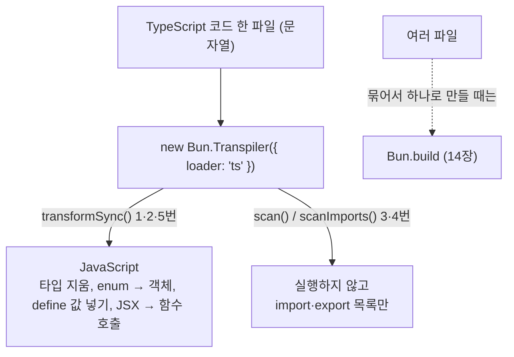
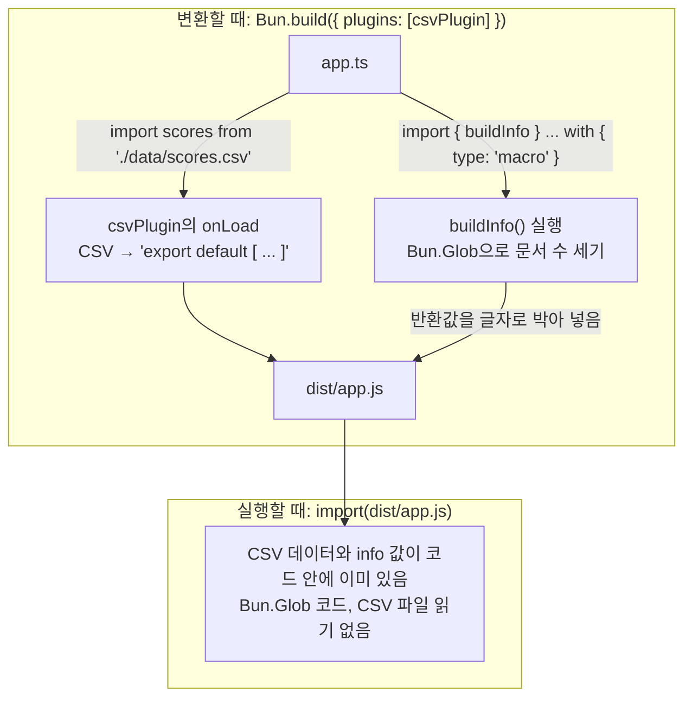
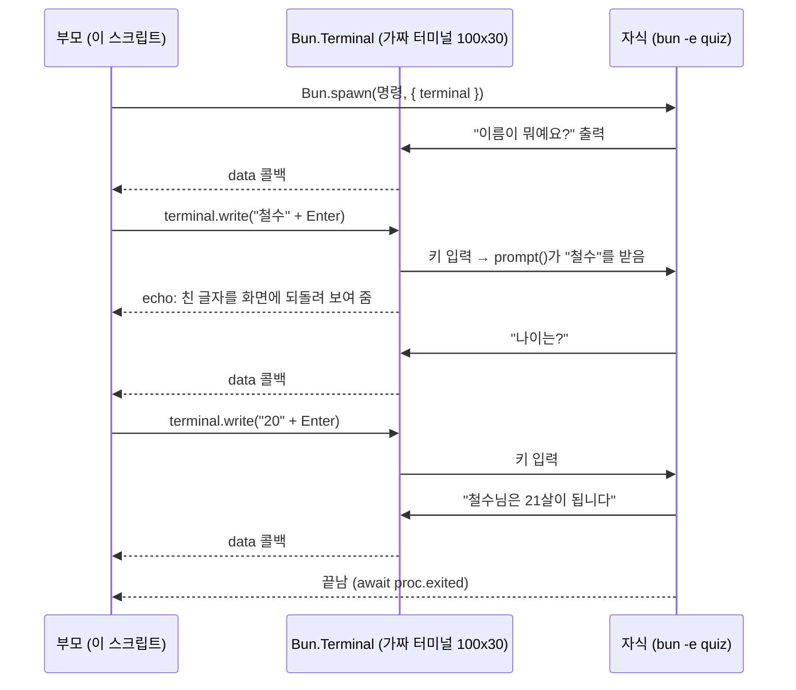
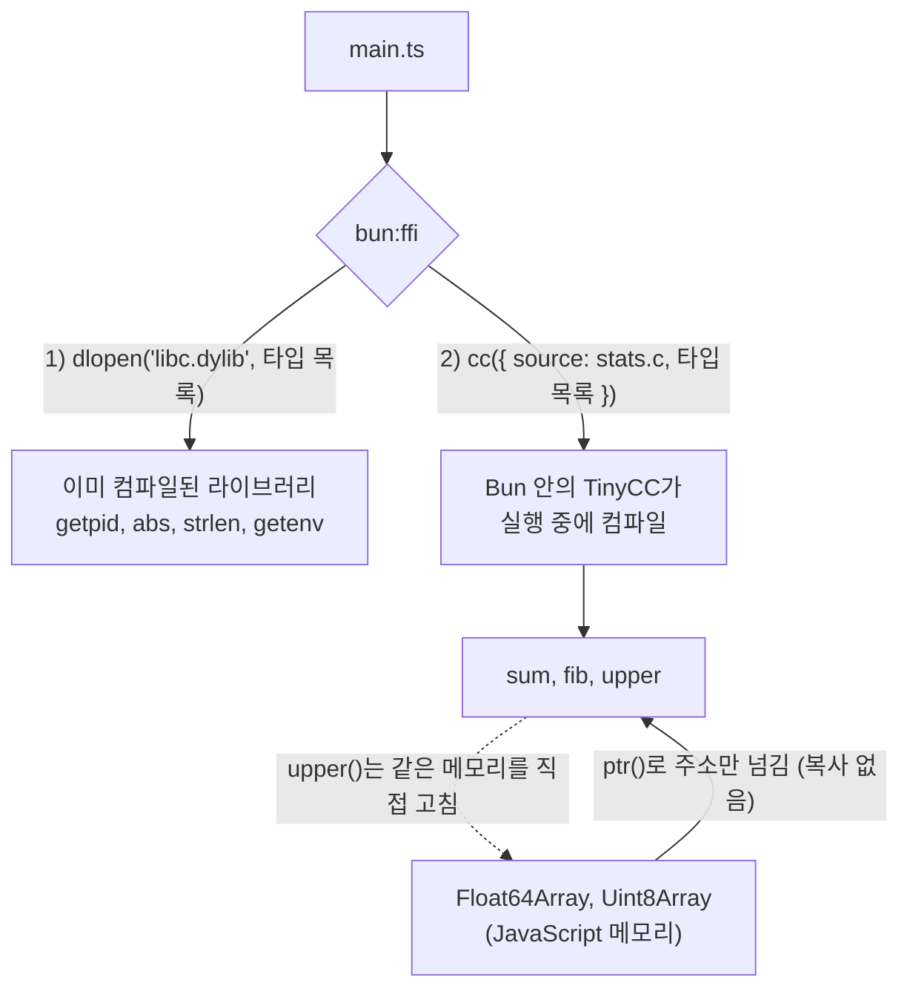
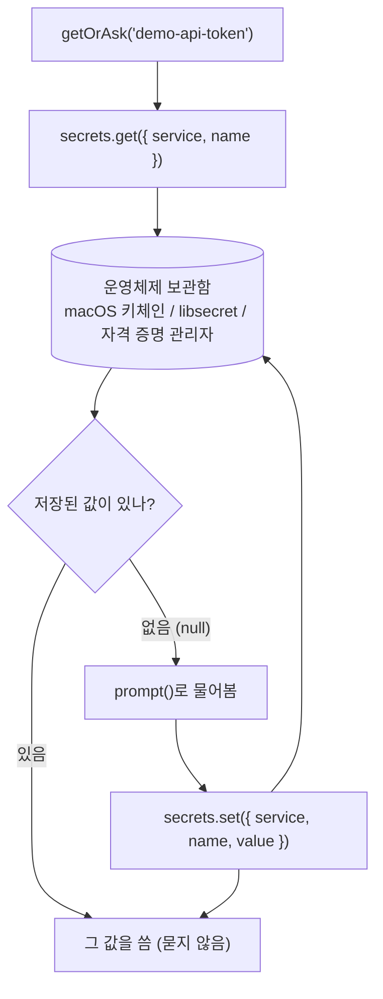
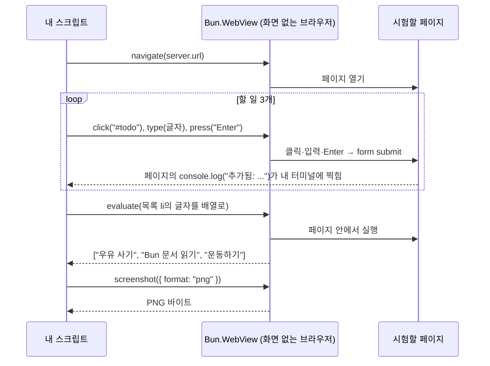
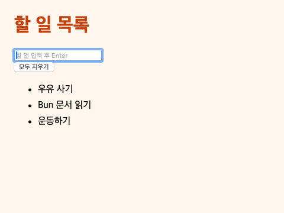
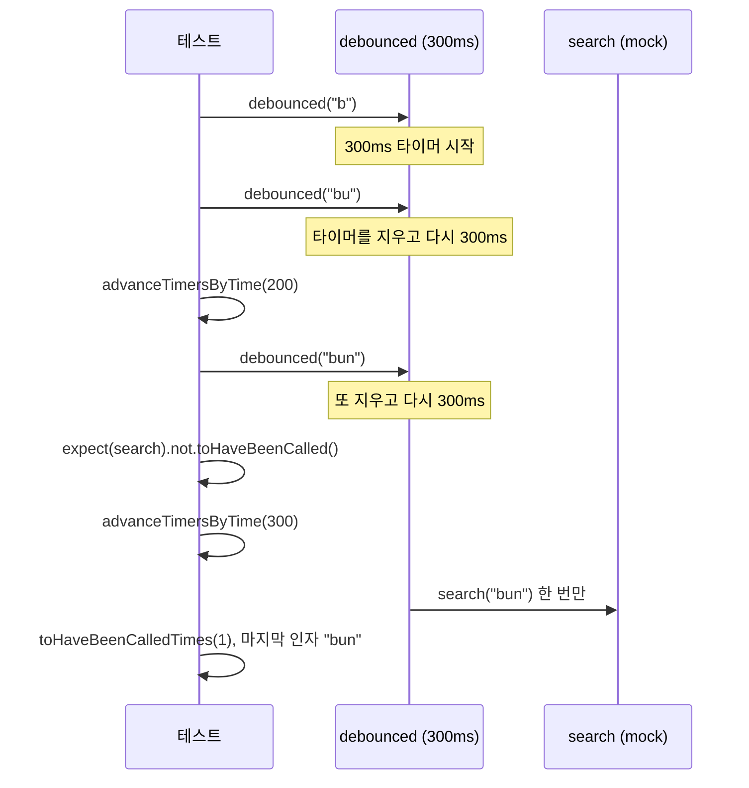
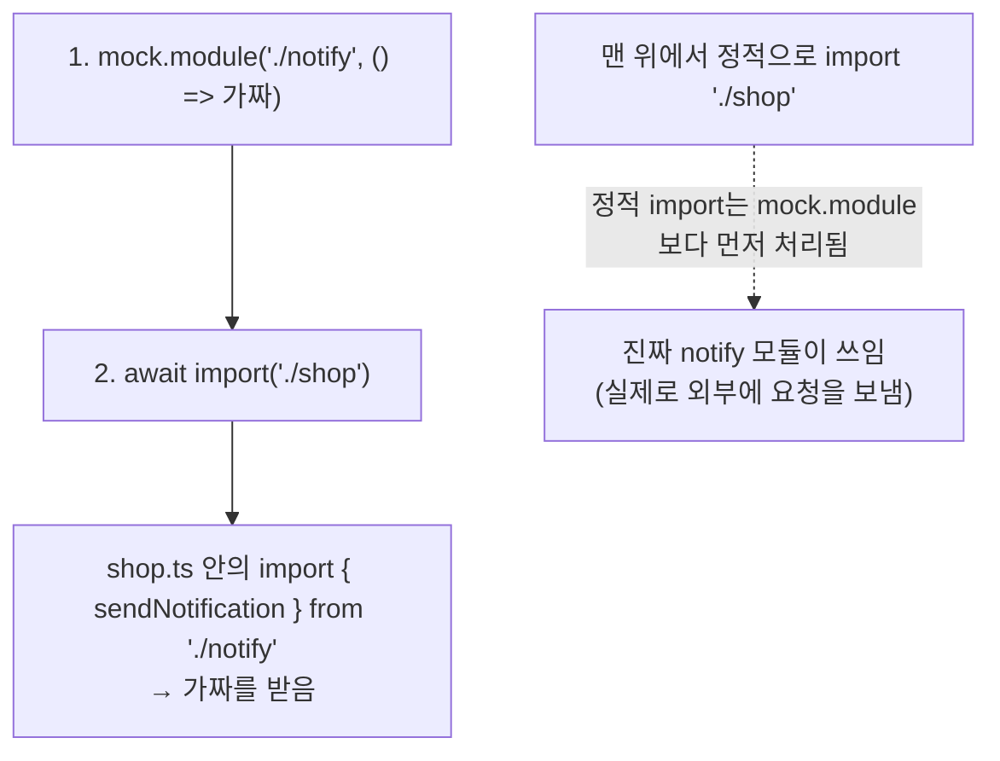

# 17. 중급 예제: 도구, 프로세스, 테스트

Bun은 실행기이면서 변환기·번들러·테스트 도구이기도 합니다. 이 장에서는 그 내부 기능을 코드에서 직접 부르고, 다른 프로그램과 운영체제 기능(가짜 터미널, C 라이브러리, 비밀번호 보관함, 브라우저)을 다룹니다. 마지막으로 시간·모듈·서버에 기대는 코드를 테스트하는 방법을 봅니다.

| 예제 | 파일 | 실행 |
|---|---|---|
| 36. 코드 변환기 | `examples/36-transpiler.ts` | `bun examples/36-transpiler.ts` |
| 37. 플러그인과 매크로 | `examples/37-plugin-macro/` | `bun examples/37-plugin-macro/main.ts` |
| 38. 가짜 터미널 (PTY) | `examples/38-terminal-pty.ts` | `bun examples/38-terminal-pty.ts` |
| 39. C 함수 부르기 (FFI) | `examples/39-ffi/` | `bun examples/39-ffi/main.ts` |
| 40. 비밀값 보관 | `examples/40-secrets.ts` | `bun examples/40-secrets.ts` |
| 41. 브라우저 조종 (WebView) | `examples/41-webview.ts` | `bun examples/41-webview.ts` |
| 42. 테스트 더 잘 쓰기 | `examples/42-testing-advanced/` | `bun test examples/42-testing-advanced` |

## 예제 36. 코드 변환기

`examples/36-transpiler.ts` — `Bun.Transpiler`는 Bun이 `.ts`, `.tsx` 파일을 실행하기 전에 쓰는 변환기입니다. 파일을 묶지(번들) 않고 한 파일의 코드만 바꿉니다. 코드 분석 도구, 문서 생성기, 간단한 빌드 도구를 만들 때 씁니다.



```ts
const source = `
import { Database } from "bun:sqlite";
import type { Server } from "bun";
import config from "./config.json";
export { helper } from "./helper";

enum Level { Info, Error }

export interface User { id: number; name: string }

export function greet(user: User, level: Level = Level.Info): string {
  const prefix = level === Level.Error ? "[!]" : "";
  if (process.env.NODE_ENV === "development") console.debug("greet", user);
  return \`\${prefix} 안녕하세요, \${user.name}님\`;
}

const lazy = await import("./lazy");
export default greet;
`;

// 1. TypeScript → JavaScript: 타입만 지우고, enum처럼 실행에 필요한 것은 JavaScript로 바꿉니다
const ts = new Bun.Transpiler({ loader: "ts" });
console.log("1) transformSync (ts → js):");
console.log(ts.transformSync(source).trim().split("\n").map((l) => "   " + l).join("\n"));

// 2. define: 코드 안의 이름을 빌드할 때 값으로 바꿔 넣고, 그 결과 죽은 코드가 되면 지웁니다
const prod = new Bun.Transpiler({
  loader: "ts",
  define: { "process.env.NODE_ENV": JSON.stringify("production") },
  minifyWhitespace: true,
});
const minified = prod.transformSync(source);
console.log(`2) define + 공백 제거: ${minified.length}글자, console.debug 남아 있음: ${minified.includes("console.debug")}`);

// 3. scan: 실행하지 않고 import/export만 뽑기 (의존성 그래프, 사용하지 않는 파일 찾기에 씁니다)
const { imports, exports } = ts.scan(source);
console.log("3) scan");
for (const i of imports) console.log(`   import ${i.kind.padEnd(16)} ${i.path}`);
console.log("   exports:", exports.join(", "));

// 4. scanImports: import만 더 빠르게. type import는 실행에 필요 없어서 빠집니다
console.log("4) scanImports:", ts.scanImports(source).map((i) => i.path).join(", "));

// 5. JSX도 변환합니다. jsxFactory로 태그를 어떤 함수 호출로 바꿀지 정합니다
const jsx = new Bun.Transpiler({ loader: "tsx", tsconfig: { compilerOptions: { jsx: "react", jsxFactory: "h" } } });
const out = jsx.transformSync(`export const Hello = ({ name }: { name: string }) => <h1 className="title">안녕, {name}</h1>;`);
console.log("5) tsx → js:", out.trim().replace(/\s+/g, " "));
```

```bash
bun examples/36-transpiler.ts
```

```text
1) transformSync (ts → js):
   import { Database } from "bun:sqlite";
   import config from "./config.json";
   export { helper } from "./helper";
   var Level;
   ((Level) => {
     Level[Level["Info"] = 0] = "Info";
     Level[Level["Error"] = 1] = "Error";
   })(Level ||= {});
   export function greet(user, level = 0 /* Info */) {
     const prefix = level === 1 /* Error */ ? "[!]" : "";
     if (true)
       console.debug("greet", user);
     return `${prefix} 안녕하세요, ${user.name}님`;
   }
   const lazy = await import("./lazy");
   export default greet;
2) define + 공백 제거: 365글자, console.debug 남아 있음: false
3) scan
   import import-statement bun:sqlite
   import import-statement ./config.json
   import import-statement ./helper
   import dynamic-import   ./lazy
   exports: default, greet, helper
4) scanImports: bun:sqlite, ./config.json, ./helper, ./lazy
5) tsx → js: export const Hello = ({ name }) => h("h1", { className: "title" }, "안녕, ", name);
```

| 결과에서 볼 것 | 설명 |
|---|---|
| `import type`, `interface`가 사라짐 | 타입은 실행에 필요 없어서 지웁니다. 타입 검사는 하지 않습니다([9장](./09_%ED%83%80%EC%9E%85_%EA%B2%80%EC%82%AC.md)) |
| `enum`이 함수로 바뀜 | `enum`은 실행할 때 값이 필요해서 JavaScript 객체를 만드는 코드가 됩니다 |
| `level = 0 /* Info */` | 값이 정해진 `enum` 멤버는 숫자로 바로 바꿔 넣습니다 |
| `if (true)` | `define`을 주지 않으면 `process.env.NODE_ENV`를 `"development"`로 바꿔 넣습니다 |
| 2번에서 `console.debug` 없음 | `"production"`으로 바꾸자 `if (false)`가 되어 그 안의 코드가 통째로 지워졌습니다 |

- `scan`의 `kind`는 `import-statement`(일반 import), `dynamic-import`(`await import()`), `require-call` 등입니다. `export ... from`도 의존성이므로 `import-statement`로 나옵니다.
- `transformSync` 대신 `await transform()`을 쓰면 다른 스레드에서 변환합니다. 파일이 많을 때 씁니다.
- 여러 파일을 묶어 하나로 만들 때는 `Bun.Transpiler`가 아니라 `Bun.build`([14장](./14_%EC%98%88%EC%A0%9C_%EB%8D%B0%EC%9D%B4%ED%84%B0%EB%B2%A0%EC%9D%B4%EC%8A%A4_%ED%85%8C%EC%8A%A4%ED%8A%B8_%EB%B9%8C%EB%93%9C.md))를 씁니다.

## 예제 37. 플러그인과 매크로

`examples/37-plugin-macro/` — 두 가지 기능을 함께 씁니다.

- **플러그인:** Bun이 모르는 파일 형식을 import할 수 있게 합니다. 여기서는 `.csv` 파일을 객체 배열로 가져옵니다.
- **매크로:** 함수를 실행할 때가 아니라 **코드를 변환할 때** 부르고, 그 결과를 코드에 글자로 박아 넣습니다. 빌드 시각, 버전, 파일 개수처럼 빌드할 때 정해지는 값에 씁니다.

두 기능 모두 "변환할 때" 일하고, 결과물에는 결과 값만 남습니다.



```text
examples/37-plugin-macro/
├── main.ts          # 실행: 플러그인 등록 → CSV import → 번들 → 번들 실행
├── csv-plugin.ts    # .csv 플러그인 (실행 중·번들 모두에서 사용)
├── build-info.ts    # 매크로로 쓰이는 함수
├── app.ts           # CSV와 매크로를 쓰는 코드 (번들 대상)
├── csv.d.ts         # TypeScript에게 .csv import의 타입 알려 주기
└── data/scores.csv
```

```text
name,subject,score
철수,수학,90
영희,수학,95
철수,국어,82
영희,국어,88
민수,수학,71
```

```ts
// csv-plugin.ts
import type { BunPlugin } from "bun";

/** .csv 파일을 import 하면 첫 줄을 열 이름으로 쓴 객체 배열이 되게 합니다. 숫자처럼 보이는 칸은 숫자로 바꿉니다. */
export const csvPlugin: BunPlugin = {
  name: "csv-loader",
  setup(build) {
    build.onLoad({ filter: /\.csv$/ }, async ({ path }) => {
      const [header, ...lines] = (await Bun.file(path).text()).trim().split(/\r?\n/);
      const columns = header.split(",");
      const rows = lines.map((line) =>
        Object.fromEntries(line.split(",").map((cell, i) => [columns[i], cell !== "" && !isNaN(Number(cell)) ? Number(cell) : cell])),
      );
      // JavaScript 코드로 돌려주면 실행 중(Bun.plugin)과 번들(Bun.build)에서 똑같이 동작합니다.
      // 1.4.3에서 { exports: { default: rows }, loader: "object" }는 번들러가 exports 객체 전체를 기본값으로 넣어서 결과가 달라집니다
      return { contents: `export default ${JSON.stringify(rows)};`, loader: "js" };
    });
  },
};
```

```ts
// build-info.ts
// 매크로로 쓰이는 함수. `with { type: "macro" }`로 import 하면 실행할 때가 아니라
// Bun이 코드를 변환(트랜스파일·번들)할 때 이 함수를 부르고, 반환값을 코드에 그대로 박아 넣습니다.

export function buildInfo() {
  return {
    builtAt: new Date().toISOString(),
    bunVersion: Bun.version,
    docCount: [...new Bun.Glob("docs/*.md").scanSync(".")].length,
  };
}
```

```ts
// app.ts: 번들에 들어가는 코드. CSV import(플러그인)와 매크로를 함께 씁니다.
import scores from "./data/scores.csv";
import { buildInfo } from "./build-info" with { type: "macro" };

type Score = { name: string; subject: string; score: number };

export const info = buildInfo();

export function average(subject: string): number {
  const list = (scores as Score[]).filter((s) => s.subject === subject);
  return list.reduce((sum, s) => sum + s.score, 0) / list.length;
}
```

```ts
// csv.d.ts
declare module "*.csv" {
  const rows: Record<string, string | number>[];
  export default rows;
}
```

```ts
// main.ts
import { csvPlugin } from "./csv-plugin";

// 1. 런타임 플러그인: 등록한 뒤에 import 하는 .csv부터 적용됩니다.
// 정적 import는 이 줄보다 먼저 처리되므로, 등록 뒤에 동적 import(await import)로 불러옵니다.
Bun.plugin(csvPlugin);
const { default: scores } = await import("./data/scores.csv");
console.log("1) CSV import:", JSON.stringify(scores.slice(0, 2)), `... 총 ${scores.length}줄`);

const app = await import("./app");
console.log("   수학 평균:", app.average("수학"), "/ 국어 평균:", app.average("국어"));
console.log("   매크로 결과:", JSON.stringify(app.info));

// 2. 번들러 플러그인: 같은 객체를 Bun.build의 plugins에 넣으면 CSV 내용이 결과 JS 안에 들어갑니다
const outdir = `${import.meta.dir}/dist`;
const result = await Bun.build({
  entrypoints: [`${import.meta.dir}/app.ts`],
  outdir,
  plugins: [csvPlugin],
  target: "bun",
});
if (!result.success) throw new AggregateError(result.logs, "빌드 실패");
const bundled = await result.outputs[0].text();
console.log(`2) Bun.build → dist/app.js (${bundled.length}글자)`);

// 3. 결과 코드에는 CSV 데이터와 매크로가 계산한 값이 글자 그대로 들어 있고, build-info.ts의 코드는 없습니다
console.log("   매크로 값:", bundled.match(/var info = [^;]+/)?.[0].replace(/\s+/g, " "));
console.log("   Glob 코드 포함:", bundled.includes("Glob"), "/ CSV 첫 줄:", bundled.match(/\{ name: [^}]+\}/)?.[0]);
const built = await import(`${outdir}/app.js`);
console.log("   번들 실행 결과 수학 평균:", built.average("수학"));
```

```bash
bun examples/37-plugin-macro/main.ts
```

```text
1) CSV import: [{"name":"철수","subject":"수학","score":90},{"name":"영희","subject":"수학","score":95}] ... 총 5줄
   수학 평균: 85.33333333333333 / 국어 평균: 85
   매크로 결과: {"builtAt":"2026-10-15T14:48:48.969Z","bunVersion":"1.4.3","docCount":16}
2) Bun.build → dist/app.js (708글자)
   매크로 값: var info = { builtAt: "2026-10-15T14:48:48.971Z", bunVersion: "1.4.3", docCount: 16 }
   Glob 코드 포함: false / CSV 첫 줄: { name: "\uCCA0\uC218", subject: "\uC218\uD559", score: 90 }
   번들 실행 결과 수학 평균: 85.33333333333333
```

- `Bun.plugin(플러그인)`은 지금 실행 중인 프로그램에 적용되고, `Bun.build({ plugins })`는 번들을 만들 때 적용됩니다. 같은 플러그인 객체를 둘 다에 쓸 수 있습니다.
- 실행할 때마다 플러그인을 쓰려면 `bunfig.toml`에 `preload = ["./csv-plugin-register.ts"]`처럼 등록 파일을 지정합니다. 그러면 정적 `import scores from "./data/scores.csv"`도 동작합니다.
- 번들 결과(`dist/app.js`)에는 매크로가 계산한 **값만** 들어 있고 `Bun.Glob`을 부르는 코드는 없습니다. 매크로 함수 안에서 파일을 읽거나 네트워크를 써도, 결과물을 실행하는 쪽에서는 그 비용이 없습니다.
- 매크로는 변환할 때마다 다시 계산되므로 1번(실행 중)과 2번(번들)의 `builtAt`이 다릅니다.
- 번들 결과의 한글이 `\uCCA0\uC218`처럼 보이는 것은 정상입니다. JavaScript 문자열 표기법이 다를 뿐 같은 값입니다.
- **1.4.3 주의:** 플러그인이 `{ exports: { default: rows }, loader: "object" }`를 돌려주면 실행 중에는 잘 되지만, `Bun.build`에서는 기본값이 `rows`가 아니라 `{ default: rows }` 객체 전체가 됩니다. 두 곳에서 같이 쓸 플러그인은 예제처럼 JavaScript 코드(`loader: "js"`)를 돌려주세요.

## 예제 38. 가짜 터미널 (PTY)

`examples/38-terminal-pty.ts` — 1.4.3의 `Bun.Terminal`은 가짜 터미널(PTY)을 만들어 자식 프로그램을 실행합니다. 자식은 진짜 터미널에 연결된 줄 알기 때문에 색을 쓰고, 화면 폭을 읽고, 대화형으로 질문합니다. 웹 터미널, CLI 자동화, CLI 테스트에 씁니다.

```ts
const probe = `console.log(JSON.stringify({ isTTY: !!process.stdout.isTTY, columns: process.stdout.columns ?? null }))`;
const decoder = new TextDecoder();

// 1. 일반 spawn: 출력이 파이프라서 자식은 터미널이 아니라고 판단합니다
const piped = Bun.spawnSync([process.execPath, "-e", probe]);
console.log("1) 파이프로 실행:", piped.stdout.toString().trim());

// 2. 가짜 터미널로 실행: 자식은 터미널이라고 판단하고, 우리가 정한 폭(100칸)을 읽습니다
async function runInTerminal(args: string[], input?: string[], env: Record<string, string | undefined> = process.env): Promise<string> {
  let output = "";
  await using terminal = new Bun.Terminal({
    cols: 100,
    rows: 30,
    data(_term, data) {
      output += decoder.decode(data);
    },
  });
  const proc = Bun.spawn(args, { terminal, env });
  for (const line of input ?? []) {
    await Bun.sleep(200); // 자식이 질문을 출력할 때까지 잠깐 기다립니다
    terminal.write(line);
  }
  await proc.exited;
  await Bun.sleep(50); // 마지막 출력이 data 콜백으로 다 들어오도록
  return output;
}
console.log("2) 가짜 터미널로 실행:", (await runInTerminal([process.execPath, "-e", probe])).trim());

// 3. 대화형 프로그램에 답하기: prompt()로 질문하는 프로그램에 키 입력을 보냅니다
const quiz = `const name = prompt("이름이 뭐예요?"); const age = prompt("나이는?"); console.log(\`\${name}님은 \${Number(age) + 1}살이 됩니다\`);`;
const conversation = await runInTerminal([process.execPath, "-e", quiz], ["철수\r", "20\r"]);
console.log("3) 대화 기록 (터미널이 되돌려 보여 준 입력 포함):");
for (const line of Bun.stripANSI(conversation).split(/\r?\n/).filter((l) => l.trim())) console.log("   " + line);

// 4. 색: 많은 프로그램은 터미널일 때만 색 코드를 출력하고, NO_COLOR 환경 변수가 있으면 끕니다
const colorProbe = `console.log(Bun.enableANSIColors ? "색 켜짐" : "색 꺼짐")`;
const { NO_COLOR, FORCE_COLOR, ...colorEnv } = process.env;
const color = { ...colorEnv, TERM: "xterm-256color" };
console.log("4) 파이프:", Bun.spawnSync([process.execPath, "-e", colorProbe], { env: color }).stdout.toString().trim());
console.log("   가짜 터미널:", (await runInTerminal([process.execPath, "-e", colorProbe], [], color)).trim());
console.log("   가짜 터미널 + NO_COLOR=1:", (await runInTerminal([process.execPath, "-e", colorProbe], [], { ...color, NO_COLOR: "1" })).trim());
```

```bash
bun examples/38-terminal-pty.ts
```

```text
1) 파이프로 실행: {"isTTY":false,"columns":null}
2) 가짜 터미널로 실행: {"isTTY":true,"columns":100}
3) 대화 기록 (터미널이 되돌려 보여 준 입력 포함):
   이름이 뭐예요? 철수
   나이는? 20
   철수님은 21살이 됩니다
4) 파이프: 색 꺼짐
   가짜 터미널: 색 켜짐
   가짜 터미널 + NO_COLOR=1: 색 꺼짐
```

3번의 대화를 그림으로 보면, 부모와 자식 사이에 가짜 터미널이 끼어 있습니다. 자식은 진짜 사람이 키보드를 치는 것으로 압니다.



- `Bun.spawn(명령, { terminal })`으로 자식의 입력·출력을 모두 가짜 터미널에 연결합니다. 자식의 출력은 `data` 콜백으로, 키 입력은 `terminal.write()`로 보냅니다.
- Enter 키는 `"\r"`입니다. 터미널은 사용자가 친 글자를 화면에 되돌려 보여 주기(echo) 때문에, 3번 기록에 `철수`와 `20`이 질문 옆에 함께 보입니다.
- 4번처럼 같은 프로그램도 파이프로 실행하면 색이 꺼지고, 가짜 터미널이면 켜지고, `NO_COLOR=1`이면 다시 꺼집니다. [15장 예제 23](./15_%EC%A4%91%EA%B8%89_%EC%98%88%EC%A0%9C_%EB%8D%B0%EC%9D%B4%ED%84%B0%EC%99%80_%EC%9C%A0%ED%8B%B8%EB%A6%AC%ED%8B%B0.md#예제-23-터미널-글자-꾸미기)의 `Bun.color(색, "ansi")`가 상황에 따라 빈 문자열을 주는 것도 같은 이유입니다.
- `terminal.resize(cols, rows)`로 창 크기가 바뀐 것을 자식에게 알릴 수 있습니다. 웹 터미널에서 브라우저 창 크기를 바꿀 때 씁니다.
- `Bun.Terminal`은 macOS·Linux(`openpty`)와 Windows(ConPTY)에서 동작합니다. Windows에서는 `"\r"`이 `"\n"`으로 바뀌지 않는 등 세부 동작이 조금 다릅니다. 이 예제는 macOS에서만 실행해 확인했습니다.

## 예제 39. C 함수 부르기 (FFI)

`examples/39-ffi/` — `bun:ffi`로 C로 만든 함수를 JavaScript에서 바로 부릅니다. 이미 있는 C 라이브러리를 쓰거나, Bun에 들어 있는 C 컴파일러(TinyCC)로 C 코드를 실행 중에 컴파일합니다.

> `bun:ffi`는 실험 단계 기능입니다. 타입이나 포인터를 잘못 넘기면 오류 메시지 없이 프로그램이 죽을 수 있습니다.

C 함수를 부르는 길은 두 가지입니다. 어느 쪽이든 인자와 반환값의 타입을 직접 적어 줘야 합니다.



```c
// stats.c: 예제 39에서 bun:ffi의 cc()가 실행 중에 컴파일하는 C 코드
#include <stdint.h>

// 배열의 합 (JavaScript의 Float64Array를 포인터로 받습니다)
double sum(const double *values, int32_t count) {
  double total = 0;
  for (int32_t i = 0; i < count; i++) total += values[i];
  return total;
}

// n번째 피보나치 수 (반복문)
uint64_t fib(int32_t n) {
  uint64_t a = 0, b = 1;
  for (int32_t i = 0; i < n; i++) {
    uint64_t t = a + b;
    a = b;
    b = t;
  }
  return a;
}

// 바이트 배열의 모든 글자를 대문자로 (제자리에서 바꿈)
void upper(uint8_t *bytes, int32_t length) {
  for (int32_t i = 0; i < length; i++)
    if (bytes[i] >= 'a' && bytes[i] <= 'z') bytes[i] -= 32;
}
```

```ts
// main.ts
import { cc, dlopen, ptr, suffix } from "bun:ffi";
import source from "./stats.c" with { type: "file" };

// 1. 이미 있는 시스템 C 라이브러리 불러오기 (macOS: libc.dylib, Linux: libc.so.6)
const libcPath = process.platform === "darwin" ? `libc.${suffix}` : "libc.so.6";
const libc = dlopen(libcPath, {
  getpid: { args: [], returns: "i32" },
  abs: { args: ["i32"], returns: "i32" },
  strlen: { args: ["cstring"], returns: "u64" },
  getenv: { args: ["cstring"], returns: "cstring" },
});
console.log(`1) dlopen("${libcPath}")`);
console.log("   getpid():", libc.symbols.getpid(), "=== process.pid:", libc.symbols.getpid() === process.pid);
console.log("   abs(-42):", libc.symbols.abs(-42));

// C 문자열은 끝에 0바이트가 있어야 합니다. Buffer로 만들어 포인터를 넘깁니다
const cstr = (s: string) => ptr(Buffer.from(s + "\0"));
console.log('   strlen("안녕 bun"):', Number(libc.symbols.strlen(cstr("안녕 bun"))), "(UTF-8 바이트 수, u64는 BigInt로 와서 Number로 바꿈)");
// returns: "cstring"이면 C가 돌려준 포인터를 읽어 CString(문자열처럼 쓰는 객체)으로 줍니다
const home = libc.symbols.getenv(cstr("HOME"));
console.log("   getenv(HOME):", String(home), "/ process.env.HOME과 같음:", String(home) === process.env.HOME);
libc.close();

// 2. C 코드를 실행 중에 컴파일하기 (Bun에 들어 있는 TinyCC 사용, 별도 컴파일러 설치 불필요)
const { symbols } = cc({
  source,
  symbols: {
    sum: { args: ["ptr", "i32"], returns: "f64" },
    fib: { args: ["i32"], returns: "u64" },
    upper: { args: ["ptr", "i32"], returns: "void" },
  },
});
const values = new Float64Array([1.5, 2.5, 3, 4]);
console.log("2) cc()로 컴파일한 C 함수");
console.log("   sum([1.5, 2.5, 3, 4]):", symbols.sum(ptr(values), values.length));
console.log("   fib(90):", symbols.fib(90), "(64비트 정수는 BigInt로 돌아옴)");

const bytes = new TextEncoder().encode("hello, bun ffi!");
symbols.upper(ptr(bytes), bytes.length); // C 함수가 JavaScript의 메모리를 직접 고칩니다
console.log("   upper():", new TextDecoder().decode(bytes));

// 3. 속도 비교: 단순 반복은 JavaScript도 JIT 덕분에 빠르고, 호출 자체에 비용이 있어서 C가 항상 빠르지는 않습니다
const big = new Float64Array(5_000_000).map((_, i) => i % 100);
let t = performance.now();
const cResult = symbols.sum(ptr(big), big.length);
const cMs = performance.now() - t;
t = performance.now();
let jsResult = 0;
for (let i = 0; i < big.length; i++) jsResult += big[i];
const jsMs = performance.now() - t;
console.log(`3) 500만 개 합계: C ${cMs.toFixed(1)}ms / JavaScript ${jsMs.toFixed(1)}ms (결과 같음: ${cResult === jsResult})`);
```

`.c` 파일을 `import`할 때 TypeScript가 타입을 알도록 `examples/39-ffi/c.d.ts`에 선언을 둡니다.

```ts
// `import source from "./stats.c" with { type: "file" }`는 파일 경로(문자열)를 돌려줍니다
declare module "*.c" {
  const path: string;
  export default path;
}
```

```bash
bun examples/39-ffi/main.ts
```

```text
1) dlopen("libc.dylib")
   getpid(): 82078 === process.pid: true
   abs(-42): 42
   strlen("안녕 bun"): 10 (UTF-8 바이트 수, u64는 BigInt로 와서 Number로 바꿈)
   getenv(HOME): /Users/home / process.env.HOME과 같음: true
2) cc()로 컴파일한 C 함수
   sum([1.5, 2.5, 3, 4]): 11
   fib(90): 2880067194370816120n (64비트 정수는 BigInt로 돌아옴)
   upper(): HELLO, BUN FFI!
3) 500만 개 합계: C 17.6ms / JavaScript 6.6ms (결과 같음: true)
```

| C 타입 | FFI 타입 이름 | JavaScript에서 |
|---|---|---|
| `int32_t`, `int` | `"i32"` | `number` |
| `uint64_t`, `size_t` | `"u64"` | `bigint` (`Number()`로 바꿔 씀) |
| `double` | `"f64"` | `number` |
| `char *` (입력) | `"cstring"` 또는 `"ptr"` | `ptr(Buffer.from(글자 + "\0"))` |
| `char *` (반환) | `"cstring"` | `CString` (`String()`으로 바꿔 씀) |
| 배열 포인터 | `"ptr"` | `ptr(TypedArray)` |

- `strlen("안녕 bun")`이 10인 이유는 C가 **바이트** 수를 세기 때문입니다. 한글은 UTF-8에서 글자당 3바이트입니다.
- `upper()`는 JavaScript의 `Uint8Array` 메모리를 C가 직접 고쳤습니다. 복사 없이 같은 메모리를 공유한다는 뜻이고, 그래서 빠르지만 위험하기도 합니다.
- 3번에서 C가 더 느렸습니다. TinyCC는 컴파일이 빠른 대신 최적화를 거의 하지 않고, JavaScript의 단순 반복은 JIT가 기계어로 잘 바꿔 주기 때문입니다. 성능이 목적이라면 `clang -O2`로 만든 라이브러리를 `dlopen`으로 여는 것이 낫습니다. `cc()`는 "C 라이브러리의 헤더를 감싸는 작은 접착 코드"를 쓸 때 편합니다.
- 이 예제의 `dlopen` 부분은 macOS와 Linux에서 동작합니다. Windows에서는 `msvcrt.dll` 같은 다른 라이브러리를 써야 합니다.

## 예제 40. 비밀값 보관

`examples/40-secrets.ts` — API 토큰 같은 비밀값을 `.env` 파일이 아니라 **운영체제의 비밀번호 보관함**(macOS 키체인, Linux libsecret, Windows 자격 증명 관리자)에 저장합니다. 파일로 남지 않아서 실수로 Git에 올리거나 다른 프로그램이 읽어 갈 위험이 줄어듭니다. CLI 도구의 로그인 토큰 저장에 씁니다.

3번 `getOrAsk`의 흐름입니다. 처음 한 번만 묻고, 다음부터는 보관함에서 꺼냅니다.



```ts
import { secrets } from "bun";

const service = "bun-report-example"; // 앱 이름처럼 겹치지 않는 이름
const name = "demo-api-token"; // 계정이나 용도

// 1. 저장: 같은 service + name이면 덮어씁니다
try {
  await secrets.set({ service, name, value: `tok_${crypto.randomUUID()}` });
} catch (err) {
  // 화면 없는 세션(SSH, 백그라운드 작업, 일부 자동화 도구)에서는 키체인이 확인 창을 띄울 수 없어 거절합니다
  if ((err as { code?: string }).code === "ERR_SECRETS_INTERACTION_NOT_ALLOWED") {
    console.log("보관함이 사용자 확인을 요구했지만 이 세션에서는 확인 창을 띄울 수 없습니다.");
    console.log("Mac에 로그인한 상태의 터미널 앱에서 다시 실행하세요.");
    process.exit(1);
  }
  throw err;
}
console.log("1) 저장함:", `${service} / ${name}`);

// 2. 읽기: 없으면 null
const token = await secrets.get({ service, name });
console.log("2) 읽은 값:", token ? `${token.slice(0, 8)}... (${token.length}글자)` : null);

// 3. CLI 도구에서 자주 쓰는 형태: 보관함에 없으면 물어보고 저장
async function getOrAsk(key: string, question: string): Promise<string> {
  const saved = await secrets.get({ service, name: key });
  if (saved) return saved;
  const answer = process.stdin.isTTY ? prompt(question) : "입력-없음(터미널이-아님)";
  if (!answer) throw new Error("값이 필요합니다");
  await secrets.set({ service, name: key, value: answer });
  return answer;
}
console.log("3) getOrAsk 결과 길이:", (await getOrAsk(name, "토큰을 입력하세요:")).length, "(이미 저장돼 있어서 묻지 않음)");

// 4. 삭제: 지웠으면 true, 원래 없었으면 false
console.log("4) 삭제:", await secrets.delete({ service, name }), "/ 다시 삭제:", await secrets.delete({ service, name }));
console.log("   삭제 후 읽기:", await secrets.get({ service, name }));
```

```bash
bun examples/40-secrets.ts
```

이 설명서를 작성한 환경(화면 없는 자동화 세션)에서는 키체인이 확인 창을 띄울 수 없어서 저장 단계에서 아래처럼 끝났습니다. **저장·읽기·삭제가 성공하는 출력은 이 환경에서 확인하지 못했습니다.** Mac에 로그인한 상태로 터미널 앱에서 실행하면 처음 한 번 키체인 접근 허용 창이 뜰 수 있습니다.

```text
보관함이 사용자 확인을 요구했지만 이 세션에서는 확인 창을 띄울 수 없습니다.
Mac에 로그인한 상태의 터미널 앱에서 다시 실행하세요.
```

| 함수 | 설명 |
|---|---|
| `secrets.set({ service, name, value })` | 저장. 같은 `service` + `name`이면 덮어씀 |
| `secrets.get({ service, name })` | 읽기. 없으면 `null` |
| `secrets.delete({ service, name })` | 삭제. 지웠으면 `true`, 없었으면 `false` |

- 예제는 저장한 값을 마지막에 지우므로 보관함에 아무것도 남기지 않습니다. 중간에 멈췄다면 macOS의 "키체인 접근" 앱에서 `bun-report-example`을 찾아 지우면 됩니다.
- 서버나 CI처럼 사람이 없는 곳에서는 보관함 대신 환경 변수나 그 플랫폼의 비밀값 기능(GitHub Actions secrets 등)을 쓰세요.

## 예제 41. 브라우저 조종 (WebView)

`examples/41-webview.ts` — 1.4.3의 `Bun.WebView`는 화면 없는 브라우저를 코드로 조종합니다. 페이지 열기, 클릭, 키 입력, 페이지 안에서 JavaScript 실행, 스크린샷을 할 수 있습니다. Playwright·Puppeteer가 하던 일을 설치 없이 합니다. macOS는 시스템 WebKit을, `--chrome`을 붙이면 설치된 Chrome을 씁니다.



```ts
// 시험할 페이지: 할 일을 입력하고 Enter를 누르면 목록에 추가됩니다
const server = Bun.serve({
  port: 0,
  routes: {
    "/": new Response(
      `<!doctype html><html lang="ko"><meta charset="utf-8"><title>할 일 목록</title>
<style>body{font-family:sans-serif;margin:24px;background:#fff7ed} h1{color:#c2410c} li{padding:4px 0}</style>
<h1>할 일 목록</h1>
<form id="form"><input id="todo" placeholder="할 일 입력 후 Enter" autofocus></form>
<button id="clear">모두 지우기</button>
<ul id="list"></ul>
<script>
  const input = document.querySelector("#todo"), list = document.querySelector("#list");
  document.querySelector("#form").addEventListener("submit", (e) => {
    e.preventDefault();
    if (!input.value) return;
    const li = document.createElement("li"); li.textContent = input.value; list.append(li);
    console.log("추가됨:", input.value); input.value = "";
  });
  document.querySelector("#clear").addEventListener("click", () => { list.replaceChildren(); console.log("모두 지움"); });
</script></html>`,
      { headers: { "Content-Type": "text/html; charset=utf-8" } },
    ),
  },
});

const backend = Bun.argv.includes("--chrome") ? "chrome" : undefined;
await using view = new Bun.WebView({ width: 480, height: 360, backend, console: globalThis.console });

// 1. 페이지 열기
await view.navigate(server.url.href);
console.log(`1) 열린 페이지: "${await view.evaluate("document.title")}" (${view.url})`);

// 2. 키보드 입력: 글자를 넣고 Enter를 누릅니다. 페이지의 console.log는 console 옵션 덕분에 여기에 그대로 찍힙니다
// type()은 붙여넣기처럼 글자를 넣어서 keydown 이벤트가 없고, WebKit에서 press("Enter")는 줄바꿈 명령으로 처리됩니다.
// 그래서 페이지는 keydown 대신 form의 submit 이벤트로 Enter를 받습니다 (실제 사용자의 Enter와 같은 동작)
for (const todo of ["우유 사기", "Bun 문서 읽기", "운동하기"]) {
  await view.click("#todo");
  await view.type(todo);
  await view.press("Enter");
}

// 3. 페이지 안에서 JavaScript를 실행해 결과를 받아 옵니다
const items = await view.evaluate(`[...document.querySelectorAll("#list li")].map((li) => li.textContent)`);
console.log("3) 목록:", JSON.stringify(items));

// 4. 스크린샷 저장
const shot = `${import.meta.dir}/data/image-out/webview.png`;
await Bun.write(shot, await view.screenshot({ format: "png" }));
console.log("4) 스크린샷:", shot.replace(process.cwd() + "/", ""), `${Bun.file(shot).size.toLocaleString()} bytes`);

// 5. 버튼 클릭 후 상태 확인
await view.click("#clear");
console.log("5) 지운 뒤 항목 수:", await view.evaluate(`document.querySelectorAll("#list li").length`));

server.stop();
```

```bash
bun examples/41-webview.ts
```

```text
1) 열린 페이지: "할 일 목록" (http://localhost:50079/)
추가됨: 우유 사기
추가됨: Bun 문서 읽기
추가됨: 운동하기
3) 목록: ["우유 사기","Bun 문서 읽기","운동하기"]
4) 스크린샷: examples/data/image-out/webview.png 15,045 bytes
모두 지움
5) 지운 뒤 항목 수: 0
```

4번에서 저장한 스크린샷입니다.



| 메서드 | 설명 |
|---|---|
| `new Bun.WebView({ width, height, backend, console })` | 브라우저 열기. `console: globalThis.console`이면 페이지의 `console.log`가 내 터미널에 찍힘 |
| `navigate(url)` | 페이지 열기. 다 읽힐 때까지 기다림 |
| `click(선택자)`, `type(글자)`, `press(키)` | 실제 사용자처럼 클릭·입력 |
| `evaluate(코드)` | 페이지 안에서 JavaScript를 실행하고 결과를 받음 |
| `screenshot({ format })` | 화면 캡처 (`png`, `jpeg`, `webp`) |
| `await using` | 블록이 끝나면 브라우저를 자동으로 닫음 |

**1.4.3 WebKit(macOS 기본)에서 확인한 주의점**

- `type()`은 붙여넣기처럼 글자를 넣어서 `keydown` 이벤트가 생기지 않습니다. `keydown`으로 Enter를 기다리는 페이지는 반응하지 않습니다.
- `press("Enter")`는 WebKit에서 "줄바꿈 넣기" 편집 명령으로 처리되어, 입력란이 `<form>` 안에 있을 때 제출(`submit`)됩니다. 예제 페이지가 `<form>`의 `submit`으로 Enter를 받는 이유입니다. 이 방식은 실제 사용자가 Enter를 누를 때와 같은 동작이고, `--chrome`에서도 똑같이 동작했습니다.
- `navigate()` 직후의 `view.title`은 빈 문자열이었습니다. 제목은 `evaluate("document.title")`로 읽으세요.

## 예제 42. 테스트 더 잘 쓰기

`examples/42-testing-advanced/` — [14장 예제 17](./14_%EC%98%88%EC%A0%9C_%EB%8D%B0%EC%9D%B4%ED%84%B0%EB%B2%A0%EC%9D%B4%EC%8A%A4_%ED%85%8C%EC%8A%A4%ED%8A%B8_%EB%B9%8C%EB%93%9C.md#예제-17-장바구니-테스트)의 기본 테스트에서 나아가, 테스트하기 까다로운 코드를 다룹니다. 현재 시각에 따라 달라지는 코드, 타이머, 외부로 요청을 보내는 모듈, 서버입니다.

```ts
// notify.ts: 실제로는 메일이나 메신저로 알림을 보내는 모듈이라고 가정합니다. 테스트에서는 mock.module로 바꿔 끼웁니다.
export async function sendNotification(to: string, message: string): Promise<{ id: string }> {
  const res = await fetch("https://notify.example.com/send", { method: "POST", body: JSON.stringify({ to, message }) });
  if (!res.ok) throw new Error(`알림 전송 실패: ${res.status}`);
  return res.json();
}
```

```ts
// shop.ts: 시간·타이머·외부 모듈·서버에 기대는 코드들. 테스트하기 까다로운 대표적인 경우를 모았습니다.
import { sendNotification } from "./notify";

/** 시간대에 따라 다른 인사말 (현재 시각에 의존) */
export function greeting(now = new Date()): string {
  const hour = now.getHours();
  if (hour < 12) return "좋은 아침입니다";
  if (hour < 18) return "좋은 오후입니다";
  return "좋은 저녁입니다";
}

/** 주문 영수증 (모양이 바뀌면 안 되는 출력 → 스냅샷 테스트) */
export function receipt(items: { name: string; price: number; qty: number }[], at = new Date()): string {
  const lines = items.map((i) => `${i.name} ${String(i.qty)}개 x ${i.price.toLocaleString("ko-KR")}원`);
  const total = items.reduce((sum, i) => sum + i.price * i.qty, 0);
  return [`[영수증] ${at.toISOString().slice(0, 10)}`, ...lines, `합계 ${total.toLocaleString("ko-KR")}원`].join("\n");
}

/** 마지막 호출 후 wait ms 동안 조용하면 한 번만 실행 (검색창 자동 완성 등) */
export function debounce<T extends unknown[]>(fn: (...args: T) => void, wait: number) {
  let timer: ReturnType<typeof setTimeout> | undefined;
  return (...args: T) => {
    clearTimeout(timer);
    timer = setTimeout(() => fn(...args), wait);
  };
}

/** 주문 완료 후 알림 보내기 (외부 모듈 의존) */
export async function completeOrder(orderId: number, email: string) {
  const { id } = await sendNotification(email, `주문 ${orderId}번이 완료되었습니다`);
  console.log(`[주문] ${orderId} 알림 ${id}`);
  return { orderId, notificationId: id };
}

/** 매시 정각 재고 확인 작업 등록 (Bun.cron 의존) */
export function scheduleStockCheck(check: () => void) {
  return Bun.cron("0 * * * *", check);
}

/** 주문 API 서버 (테스트에서 port: 0으로 띄웁니다) */
export function createServer(port = 0) {
  return Bun.serve({
    port,
    routes: {
      "/api/orders": {
        POST: async (req) => {
          const body = (await req.json().catch(() => null)) as { item?: unknown; qty?: unknown } | null;
          if (typeof body?.item !== "string" || typeof body.qty !== "number" || body.qty < 1)
            return Response.json({ error: "item(문자열)과 qty(1 이상)가 필요합니다" }, { status: 400 });
          return Response.json({ id: Bun.randomUUIDv7(), item: body.item, qty: body.qty }, { status: 201 });
        },
      },
    },
    fetch: () => Response.json({ error: "없는 주소" }, { status: 404 }),
  });
}
```

```ts
// shop.test.ts
import { afterAll, afterEach, beforeAll, describe, expect, jest, mock, setSystemTime, spyOn, test } from "bun:test";

// mock.module: 이 파일에서 "./notify"를 import 하는 모든 코드가 진짜 대신 가짜를 받습니다.
// 진짜 모듈이 먼저 로드되기 전에 등록하려고, shop.ts는 아래에서 동적으로 import 합니다.
const sendNotification = mock(async (to: string, _message: string) => ({ id: `ntf-${to.split("@")[0]}` }));
mock.module("./notify", () => ({ sendNotification }));
const { completeOrder, createServer, debounce, greeting, receipt, scheduleStockCheck } = await import("./shop");

describe("시간에 의존하는 코드", () => {
  afterEach(() => setSystemTime()); // 인자 없이 부르면 진짜 시각으로 돌아갑니다

  test.each([
    ["2026-10-15T08:00:00", "좋은 아침입니다"],
    ["2026-10-15T14:30:00", "좋은 오후입니다"],
    ["2026-10-15T21:00:00", "좋은 저녁입니다"],
  ])("setSystemTime(%s) → %s", (time, expected) => {
    setSystemTime(new Date(time));
    expect(greeting()).toBe(expected);
  });
});

describe("스냅샷", () => {
  const items = [
    { name: "사과", price: 1000, qty: 3 },
    { name: "노트북", price: 1_290_000, qty: 1 },
  ];

  // 처음 실행하면 __snapshots__/에 결과를 저장하고, 다음부터는 저장된 것과 비교합니다.
  // 일부러 모양을 바꿨다면 bun test --update-snapshots 로 다시 저장합니다
  test("영수증 모양이 바뀌지 않았다", () => {
    expect(receipt(items, new Date("2026-10-15T00:00:00Z"))).toMatchSnapshot();
  });

  test("객체 일부만 확인하기: toMatchObject와 expect.any", () => {
    expect({ id: Bun.randomUUIDv7(), item: "사과", qty: 3, createdAt: new Date() }).toMatchObject({
      id: expect.stringMatching(/^[0-9a-f-]{36}$/),
      item: "사과",
      createdAt: expect.any(Date),
    });
  });
});

describe("가짜 타이머", () => {
  beforeAll(() => jest.useFakeTimers());
  afterAll(() => jest.useRealTimers());

  test("debounce: 300ms 안에 여러 번 불러도 마지막 한 번만 실행", () => {
    const search = mock((q: string) => q);
    const debounced = debounce(search, 300);
    debounced("b");
    debounced("bu");
    jest.advanceTimersByTime(200); // 실제로 기다리지 않고 시간을 앞으로 돌립니다
    debounced("bun");
    expect(search).not.toHaveBeenCalled();
    jest.advanceTimersByTime(300);
    expect(search).toHaveBeenCalledTimes(1);
    expect(search).toHaveBeenLastCalledWith("bun");
  });

  test("Bun.cron: 정각마다 실행되는지 1시간을 기다리지 않고 확인", () => {
    jest.setSystemTime(new Date("2026-10-15T09:59:00"));
    const check = mock(() => {});
    const job = scheduleStockCheck(check);
    jest.advanceTimersByTime(59_000); // 09:59:59
    expect(check).not.toHaveBeenCalled();
    jest.advanceTimersByTime(1_000); // 10:00
    expect(check).toHaveBeenCalledTimes(1);
    jest.advanceTimersByTime(60 * 60_000); // 11:00
    expect(check).toHaveBeenCalledTimes(2);
    job.stop();
  });
});

describe("모듈 가짜로 바꾸기, 함수 엿보기", () => {
  test("mock.module로 바꾼 알림 모듈이 불린다", async () => {
    const log = spyOn(console, "log").mockImplementation(() => {}); // 출력은 막고 호출만 기록
    const result = await completeOrder(42, "chulsoo@example.com");

    expect(result).toEqual({ orderId: 42, notificationId: "ntf-chulsoo" });
    expect(sendNotification).toHaveBeenCalledWith("chulsoo@example.com", "주문 42번이 완료되었습니다");
    expect(log).toHaveBeenCalledWith("[주문] 42 알림 ntf-chulsoo");
    log.mockRestore(); // 원래 console.log로 되돌립니다
  });

  test("알림이 실패하면 주문 완료도 실패한다", async () => {
    sendNotification.mockRejectedValueOnce(new Error("알림 전송 실패: 503"));
    expect.assertions(1); // 아래 expect가 꼭 한 번 실행되어야 통과 (catch를 건너뛰는 실수 방지)
    await expect(completeOrder(43, "a@b.c")).rejects.toThrow("503");
  });
});

describe("HTTP 서버 테스트", () => {
  const server = createServer(0); // 0번 포트: 비어 있는 아무 포트. 여러 테스트를 동시에 돌려도 겹치지 않습니다
  afterAll(() => server.stop(true));

  const post = (body: unknown) =>
    fetch(new URL("/api/orders", server.url), { method: "POST", headers: { "Content-Type": "application/json" }, body: JSON.stringify(body) });

  test.concurrent("올바른 주문은 201", async () => {
    const res = await post({ item: "사과", qty: 2 });
    expect(res.status).toBe(201);
    expect(await res.json()).toMatchObject({ item: "사과", qty: 2 });
  });

  test.concurrent.each([[{}], [{ item: "사과" }], [{ item: "사과", qty: 0 }]])("잘못된 주문 %j 은 400", async (body) => {
    expect((await post(body)).status).toBe(400);
  });
});
```

```bash
bun test examples/42-testing-advanced
```

```text
bun test v1.4.3 (c6da4a4d3)

examples/42-testing-advanced/shop.test.ts:
(pass) 시간에 의존하는 코드 > setSystemTime(2026-10-15T08:00:00) → 좋은 아침입니다 [1.82ms]
(pass) 시간에 의존하는 코드 > setSystemTime(2026-10-15T14:30:00) → 좋은 오후입니다
(pass) 시간에 의존하는 코드 > setSystemTime(2026-10-15T21:00:00) → 좋은 저녁입니다
(pass) 스냅샷 > 영수증 모양이 바뀌지 않았다 [1.64ms]
(pass) 스냅샷 > 객체 일부만 확인하기: toMatchObject와 expect.any [0.09ms]
(pass) 가짜 타이머 > debounce: 300ms 안에 여러 번 불러도 마지막 한 번만 실행 [0.06ms]
(pass) 가짜 타이머 > Bun.cron: 정각마다 실행되는지 1시간을 기다리지 않고 확인 [0.05ms]
(pass) 모듈 가짜로 바꾸기, 함수 엿보기 > mock.module로 바꾼 알림 모듈이 불린다 [0.11ms]
(pass) 모듈 가짜로 바꾸기, 함수 엿보기 > 알림이 실패하면 주문 완료도 실패한다 [0.05ms]
(pass) HTTP 서버 테스트 > 올바른 주문은 201 [0.91ms]
(pass) HTTP 서버 테스트 > 잘못된 주문 {"item":"사과","qty":0} 은 400 [0.78ms]
(pass) HTTP 서버 테스트 > 잘못된 주문 {"item":"사과"} 은 400 [0.79ms]
(pass) HTTP 서버 테스트 > 잘못된 주문 {} 은 400 [0.82ms]

 13 pass
 0 fail
 1 snapshots, 20 expect() calls
Ran 13 tests across 1 file. [8.00ms]
```

처음 실행하면 `__snapshots__/shop.test.ts.snap` 파일이 생기고, 영수증 출력이 그대로 저장됩니다.

```text
// Bun Snapshot v1, https://bun.sh/docs/test/snapshots

exports[`스냅샷 영수증 모양이 바뀌지 않았다 1`] = `
"[영수증] 2026-10-15
사과 3개 x 1,000원
노트북 1개 x 1,290,000원
합계 1,293,000원"
`;
```

이후 영수증 모양이 바뀌면 테스트가 실패하면서 달라진 줄을 보여 줍니다. 아래는 저장된 스냅샷이 `사과 3 x 1000`이었을 때의 결과입니다(`-`가 저장된 값, `+`가 지금 값).

```text
error: expect(received).toMatchSnapshot(expected)

  "[영수증] 2026-10-15
- 사과 3 x 1000
+ 사과 3개 x 1,000원
  노트북 1개 x 1,290,000원
  합계 1,293,000원"

- Expected  - 1
+ Received  + 1

(fail) 스냅샷 > 영수증 모양이 바뀌지 않았다 [1.73ms]

 12 pass
 1 fail
snapshots: 1 failed
```

일부러 바꾼 것이라면 `bun test examples/42-testing-advanced --update-snapshots`로 새 모양을 저장합니다.

| 어려운 점 | 쓸 것 | 예제의 테스트 |
|---|---|---|
| 현재 시각에 따라 결과가 다름 | `setSystemTime(날짜)`, 인자 없이 부르면 원래대로 | 인사말 3가지 |
| 긴 출력 전체를 비교하기 번거로움 | `toMatchSnapshot()`, `--update-snapshots` | 영수증 |
| 매번 다른 값(ID, 시각)이 섞임 | `toMatchObject` + `expect.any(Date)`, `expect.stringMatching(정규식)` | 주문 객체 |
| `setTimeout`·cron을 실제로 기다려야 함 | `jest.useFakeTimers()`, `jest.advanceTimersByTime(ms)` | debounce, 매시 정각 cron |
| 외부로 요청을 보내는 모듈 | `mock.module(경로, () => 가짜)` | 알림 모듈 |
| `console.log` 같은 전역 함수 | `spyOn(객체, "이름").mockImplementation()`, `mockRestore()` | 주문 완료 로그 |
| 실패하는 경우 | `mockRejectedValueOnce(오류)`, `rejects.toThrow()`, `expect.assertions(n)` | 알림 실패 |
| 서버 | `Bun.serve({ port: 0 })` + `fetch`, `test.concurrent` | 주문 API |

가짜 타이머로 debounce를 확인하는 과정입니다. 실제로는 기다리지 않고 `advanceTimersByTime`으로 시계를 앞으로 돌립니다.



`mock.module`은 순서가 중요합니다.



- **`mock.module`은 대상 모듈을 처음 불러오기 전에** 등록해야 합니다. 그래서 `shop.ts`를 맨 위의 정적 `import`가 아니라 등록 뒤의 `await import("./shop")`으로 불렀습니다. 여러 테스트 파일에서 쓰려면 `bunfig.toml`의 `[test] preload`에 등록 파일을 넣습니다.
- 가짜 타이머를 켜면 `Bun.cron`도 가짜 시계를 따릅니다. 09:59:59까지는 실행되지 않고 10:00과 11:00에 한 번씩 실행되는 것을 1시간을 기다리지 않고 확인했습니다.
- `test.concurrent`로 표시한 테스트는 서로 기다리지 않고 동시에 실행됩니다(기본 최대 20개). 서버 요청처럼 기다림이 많은 테스트가 빨라집니다. 파일 전체에 적용하려면 `bun test --concurrent`를 쓰고, 같은 데이터를 고치는 테스트처럼 순서가 중요한 것은 `test.serial`로 둡니다.
- 이 예제의 테스트가 `shop.ts`를 얼마나 실행했는지는 `bun test --coverage examples/42-testing-advanced`로 봅니다.

```text
File                                  | % Funcs | % Lines | Uncovered Line #s
--------------------------------------|---------|---------|-------------------
All files                             |   86.67 |  100.00 |
 examples/42-testing-advanced/shop.ts |   86.67 |  100.00 | 
--------------------------------------|---------|---------|-------------------
```

## 다음에 해 볼 것

- 예제 41의 WebView로 [16장 예제 28](./16_%EC%A4%91%EA%B8%89_%EC%98%88%EC%A0%9C_%EC%84%9C%EB%B2%84%EC%99%80_%EB%84%A4%ED%8A%B8%EC%9B%8C%ED%81%AC.md#예제-28-로그인-세션)의 로그인 화면을 자동으로 테스트해 보세요. 아이디·비밀번호를 입력하고 버튼을 누른 뒤 `evaluate("document.querySelector('h1').textContent")`로 환영 문구를 확인하면 됩니다.
- 예제 38의 `Bun.Terminal`로 [12장 예제 3](./12_%EC%98%88%EC%A0%9C_%EC%8A%A4%ED%81%AC%EB%A6%BD%ED%8A%B8%EC%99%80_%ED%8C%8C%EC%9D%BC.md)의 할 일 CLI를 실행하고 출력을 검사하는 테스트를 써 보세요.
- 예제 36의 `scan`으로 `examples/` 폴더 전체의 import를 모아, 어떤 파일이 어떤 모듈을 쓰는지 표로 출력해 보세요.
- 지금까지 다룬 기능 전체는 [0장 내장 API 지도](./00_%EB%82%B4%EC%9E%A5_API_%EC%A7%80%EB%8F%84.md)에 정리되어 있습니다.
