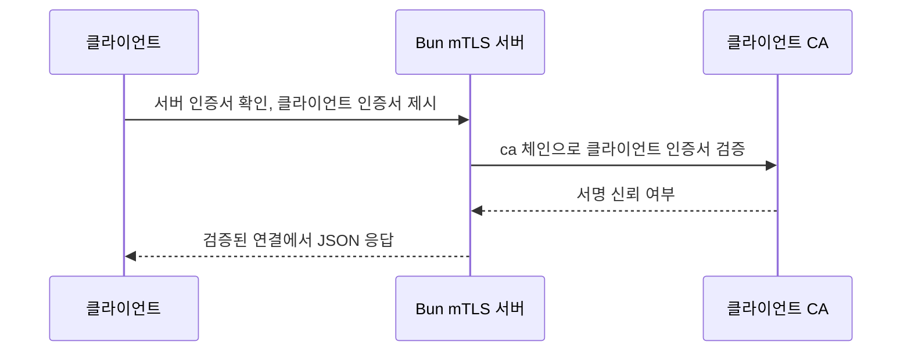

# 23. 고급 예제: 네이티브 확장과 mTLS

| 예제 | 파일 | 실행 |
|---|---|---|
| 53. SQLite 네이티브 확장 | `examples/53-sqlite-extension.ts` | 신뢰하는 확장 경로와 `--load`를 지정 |
| 54. mTLS 서버 | `examples/54-mtls-server.ts` | 서버 키·인증서·CA와 `--serve`를 지정 |

이 장의 두 예제는 운영체제 네이티브 코드 또는 인증서에 접근합니다. 그래서 환경 변수가 없거나 명시 플래그가 없으면 실제 동작 대신 실행 방법만 출력합니다.

## 예제 53. SQLite 네이티브 확장

`Database.loadExtension()`은 SQLite 확장 라이브러리(`.dylib`, `.so`, `.dll`)를 현재 프로세스에 로드합니다. 확장이 제공하는 가상 테이블이나 SQL 함수를 앱에서 쓸 수 있지만, 이는 곧 **그 라이브러리의 네이티브 코드를 실행한다**는 뜻입니다.

```bash
SQLITE_EXTENSION=/절대/경로/extension.dylib \
bun examples/53-sqlite-extension.ts --load
```

| API | 역할 | 반드시 지킬 점 |
|---|---|---|
| `Database.loadExtension(path)` | SQLite 확장 로드 | 검증한 절대 경로만 사용하고, 사용자 입력을 그대로 넘기지 않음 |
| `Database.setCustomSQLite(path)` | Bun이 사용할 SQLite 동적 라이브러리 지정 | 첫 `Database`를 만들기 **전에 한 번만** 호출 |
| `using db = new Database()` | 블록 끝에서 데이터베이스 닫기 | 확장 로드 실패도 예외로 처리할 수 있게 경계를 좁힘 |

macOS의 시스템 SQLite는 확장 로딩을 지원하지 않을 수 있습니다. 그 경우 확장 로딩을 지원하는 별도 SQLite 라이브러리를 설치한 뒤, 아래처럼 경로를 함께 지정합니다.

```bash
SQLITE_LIBRARY=/절대/경로/libsqlite3.dylib \
SQLITE_EXTENSION=/절대/경로/extension.dylib \
bun examples/53-sqlite-extension.ts --load
```

확장 파일은 패키지 의존성보다도 강한 공급망 위험을 가집니다. 운영 배포물에 포함한 버전만 허용하고, 해시·서명·배포 경로를 고정하세요.

```ts
// examples/53-sqlite-extension.ts
import { Database } from "bun:sqlite";

const extension = Bun.env.SQLITE_EXTENSION;
if (!extension || !Bun.argv.includes("--load")) {
  console.log("SQLITE_EXTENSION에 신뢰하는 SQLite 확장 라이브러리의 절대 경로를 설정하고 --load를 붙이세요.");
  console.log("macOS 기본 SQLite는 확장 로딩을 지원하지 않을 수 있습니다. 그때는 SQLITE_LIBRARY도 설정합니다.");
  process.exit(0);
}

if (Bun.env.SQLITE_LIBRARY) {
  console.log("사용자 SQLite 라이브러리 설정:", Database.setCustomSQLite(Bun.env.SQLITE_LIBRARY));
}

using db = new Database(":memory:");
db.loadExtension(extension);
console.log("확장을 로드했습니다. 확장이 제공하는 SQL 함수는 해당 확장의 문서를 따라 호출하세요.");
```

## 예제 54. 클라이언트 인증서(mTLS) 서버

일반 HTTPS는 서버만 인증합니다. mTLS(mutual TLS)는 클라이언트도 CA가 서명한 인증서를 제시하게 하므로, 내부 서비스·운영자 API처럼 강한 기계 간 인증이 필요한 곳에 쓸 수 있습니다.

```bash
TLS_KEY=certs/server-key.pem \
TLS_CERT=certs/server-cert.pem \
TLS_CA=certs/client-ca.pem \
bun examples/54-mtls-server.ts --serve
```

| `Bun.serve` TLS 옵션 | 의미 |
|---|---|
| `key`, `cert` | 서버의 PEM 개인 키와 인증서 |
| `ca` | 신뢰할 클라이언트 인증서를 서명한 CA 인증서 |
| `requestCert: true` | TLS 연결에서 클라이언트 인증서를 요청 |

이 예제는 `https://127.0.0.1:3444`에서 대기합니다. 실제 요청에는 해당 CA가 서명한 클라이언트 키·인증서를 함께 제공해야 합니다. 인증서 검증 정책은 프록시·인증서 체인·Bun 버전별 설정을 포함해 배포 환경에서 별도로 통합 테스트하세요.

개인 키와 CA 파일은 소스 저장소, 클라이언트 번들, 로그에 넣지 마세요. 운영에서는 파일 권한을 최소화하고, 갱신·폐기 절차와 인증서 만료 감시도 같이 운영해야 합니다.

이 그림은 mTLS에서 서버와 클라이언트가 서로 어떤 인증서를 확인하는지 보여 줍니다.



```ts
// examples/54-mtls-server.ts
const key = Bun.env.TLS_KEY;
const cert = Bun.env.TLS_CERT;
const ca = Bun.env.TLS_CA;

if (!key || !cert || !ca || !Bun.argv.includes("--serve")) {
  console.log("TLS_KEY, TLS_CERT, TLS_CA에 PEM 경로를 설정하고 --serve를 붙이면 mTLS 서버를 시작합니다.");
  process.exit(0);
}

const server = Bun.serve({
  hostname: "127.0.0.1",
  port: Number(Bun.env.PORT ?? 3444),
  tls: { key: Bun.file(key), cert: Bun.file(cert), ca: Bun.file(ca), requestCert: true },
  fetch: () => Response.json({ ok: true, authenticatedBy: "client certificate" }),
});

console.log(`mTLS 서버: ${server.url}`);
```
