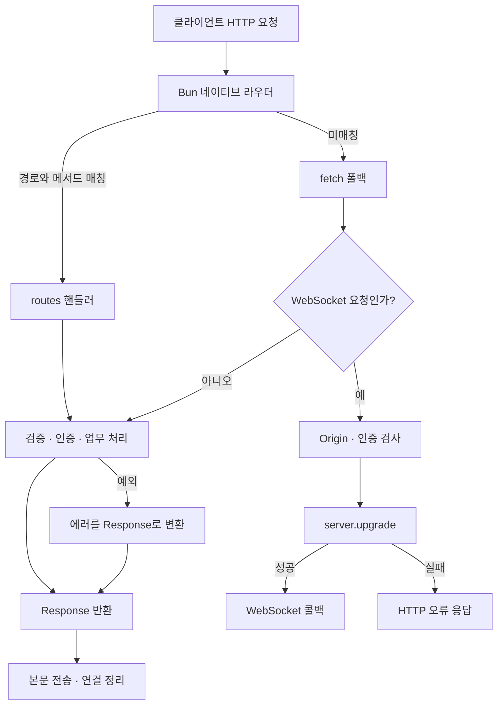
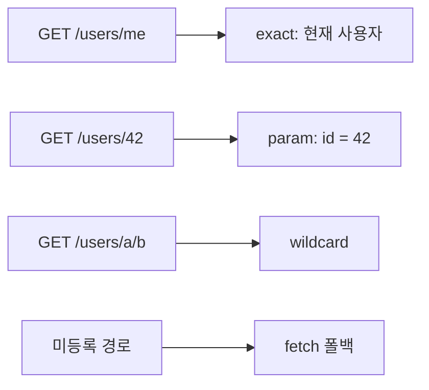
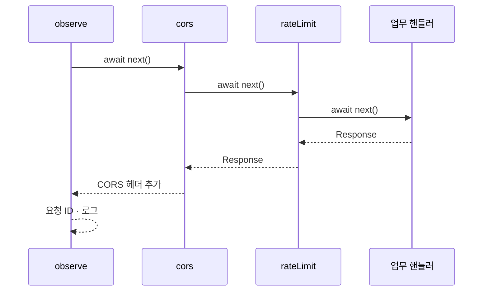
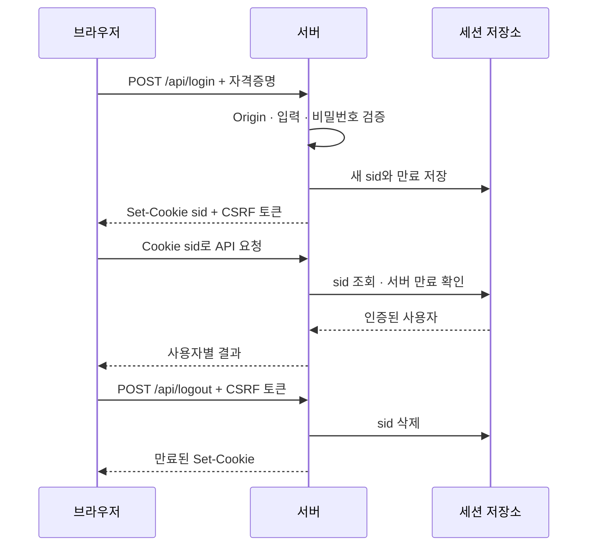
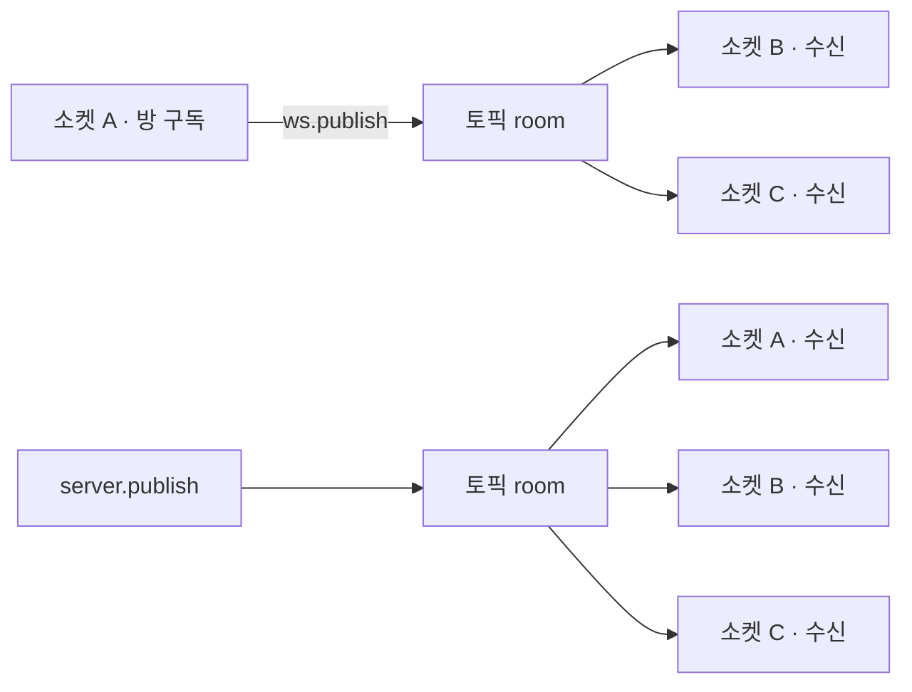
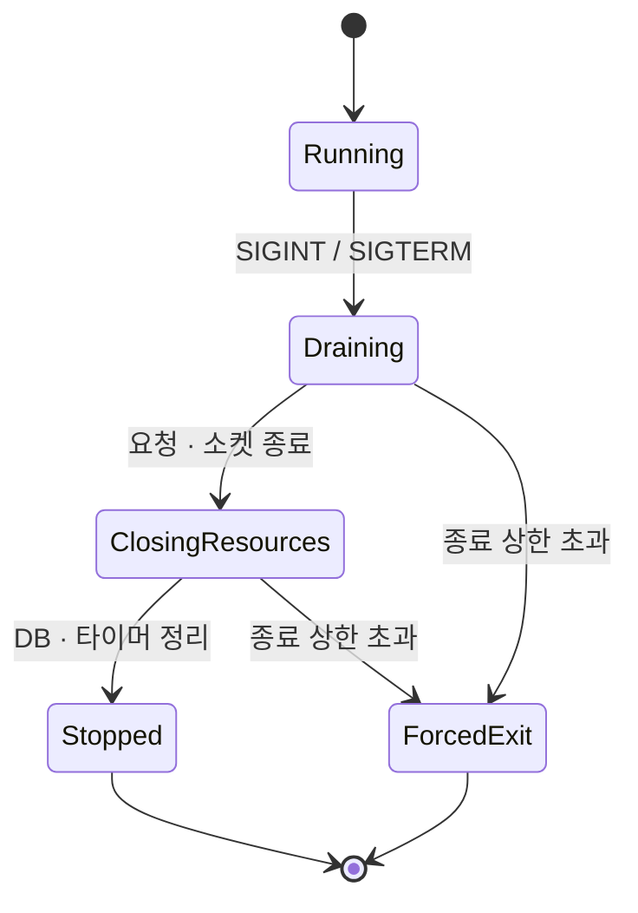
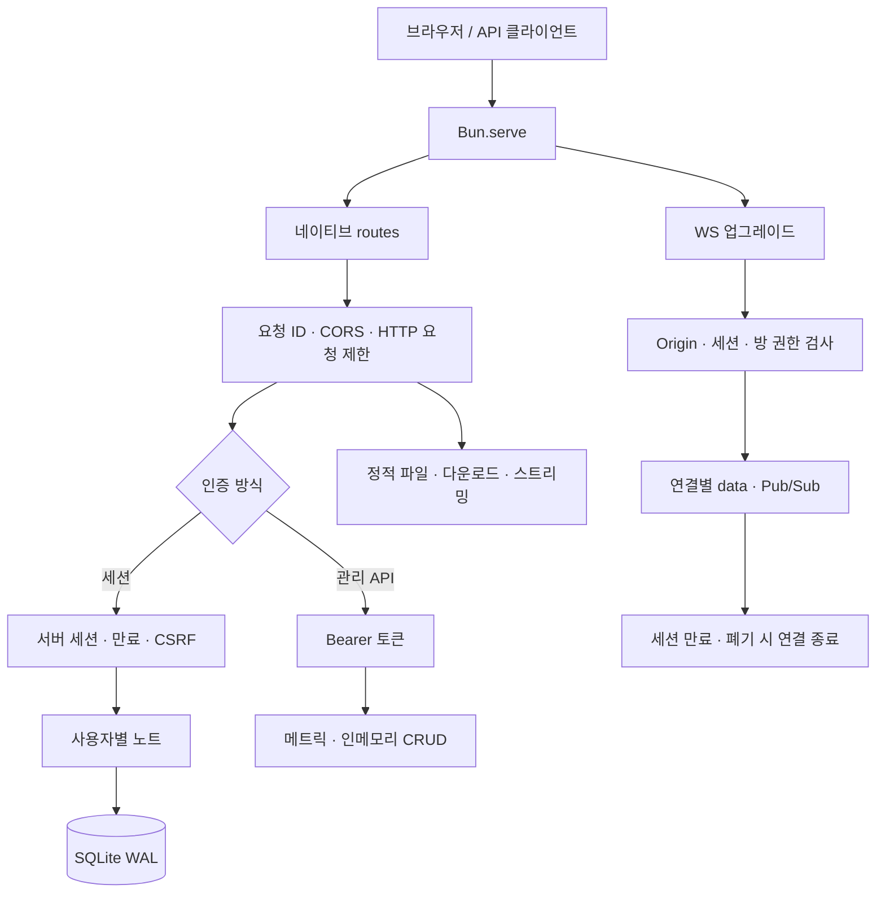

# 1부 Bun.serve 예제 전체 보고서

> - 대상: `01_hello.ts` ~ `41_ws_publish.ts` (41개) + 부속 파일(`_mini/mini.ts`, `_html_import/*`, `_public/*`, `_static/*`, `_data/*`, `_certs/*`)
> - 검증 런타임: **Bun 1.3.14** (`bun --version` 확인)
> - 외부 프레임워크·npm 패키지 없음. `bun:sqlite` · Web Crypto · HTML import 는 모두 Bun 내장.

---

## 목차

- [0. 개요와 공통 개념](#0-개요와-공통-개념)
- [초급 (01–16)](#초급-0116)
  - [01 hello](#01_hellots--hello-world) · [02 html](#02_htmlts--html-응답) · [03 json](#03_jsonts--json-응답) · [04 routes](#04_routests--다중-경로--경로-파라미터) · [05 methods](#05_methodsts--http-메서드별-핸들러) · [06 query](#06_queryts--쿼리-파라미터) · [07 body](#07_bodyts--요청-바디) · [08 static](#08_staticts--정적-파일)
  - [09 cookies](#09_cookiests--쿠키) · [10 websocket](#10_websocketts--websocket-에코) · [11 cors](#11_corsts--cors) · [12 redirect](#12_redirectts--정적-response--리다이렉트--헬스체크) · [13 error](#13_errorts--에러-처리) · [14 upload](#14_uploadts--파일-업로드) · [15 sse](#15_ssets--server-sent-events) · [16 auth](#16_authts--bearer-토큰-인증-가드)
- [중급 (17–32)](#중급-1732)
  - [17 middleware](#17_middlewarets--미들웨어-합성) · [18 static_dir](#18_static_dirts--정적-디렉터리-서버) · [19 stream](#19_streamts--readablestream-응답) · [20 ws_pubsub](#20_ws_pubsubts--websocket-pubsub-채팅) · [21 crud](#21_crudts--rest-crud) · [22 sqlite](#22_sqlitets--sqlite-rest) · [23 metrics](#23_metricsts--메트릭--requestip) · [24 ratelimit](#24_ratelimitts--rate-limit)
  - [25 graceful](#25_gracefults--graceful-shutdown) · [26 reload](#26_reloadts--serverreload) · [27 unix](#27_unixts--unix-domain-socket) · [28 range](#28_rangets--range-요청) · [29 proxy](#29_proxyts--리버스-프록시) · [30 timeout](#30_timeoutts--idletimeout--servertimeout) · [31 session](#31_sessionts--쿠키-세션) · [32 export_default](#32_export_defaultts--export-default--라우트-우선순위)
- [고급 (33–41)](#고급-3341)
  - [33 tls](#33_tlsts--tls--https) · [34 http3](#34_http3ts--http3-실험적) · [35 html_import](#35_html_importts--html-import--hmr) · [36 ws_advanced](#36_ws_advancedts--websocket-고급) · [37 jwt](#37_jwtts--jwt-hmac-sha256) · [38 mini_app](#38_mini_appts--express식-미니-프레임워크) · [39 production](#39_productionts--실전-통합) · [40 hardening](#40_hardeningts--프로덕션-하드닝) · [41 ws_publish](#41_ws_publishts--wspublish-vs-serverpublish)
- [부속 파일](#부속-파일)
- [전체 검토 요약표](#전체-검토-요약표)

---

## 0. 개요와 공통 개념

### 실행 방법 (readme.md 원문)

```bash
bun --hot 01_hello.ts
bun --hot 17_middleware.ts
bun --hot 33_tls.ts          # curl -k https://localhost:3033/
bun --hot 35_html_import.ts  # 브라우저 HMR
```

포트 배치: `01_hello.ts`(3001) ~ `41_ws_publish.ts`(3041) — **파일 번호 + 3000 = 포트**. 겹치지 않으므로 여러 개를 동시에 켜서 비교 학습할 수 있습니다.

### Bun.serve 핵심 API (예제 전반에서 반복되는 개념)

| 개념 | 요약 |
|---|---|
| `routes` | 경로 → 핸들러 맵. `"/path": handler` 또는 메서드별 `{ GET, POST, ... }`. 값이 `Response` 객체면 **제로할당 정적 디스패치**. |
| 경로 파라미터 | `"/users/:id"` → 핸들러의 `req.params.id`. 이때 `req` 는 확장 타입 **BunRequest**(`params`, `cookies` 보유). |
| 라우트 우선순위 | **exact > `:param` > `/prefix/*` > `/*`** (예제 32 참고). |
| `fetch(req, server)` | `routes` 에 안 걸린 모든 요청의 최종 폴백. WebSocket 업그레이드도 보통 여기서. |
| `server.upgrade(req, { data })` | HTTP→WS 승격. 성공 시 `true`, 이후 `fetch` 반환값은 무시(관례상 `undefined`). |
| `websocket: { open, message, close, drain }` | WS 콜백. `server.publish` / `ws.publish` / `ws.subscribe` 로 pub/sub. |
| `server.requestIP(req)` | `{ address, family, port }` 클라이언트 소켓 정보. |
| `server.timeout(req, sec)` | **요청 단위** 유휴 타임아웃 (0=비활성). SSE/롱폴링 필수. |
| `idleTimeout` | 서버 전역 HTTP 유휴 타임아웃(초). 기본 10, 최대 255, 0=비활성. |
| `error(err)` | 라우트/`fetch` 에서 throw 된 에러 → `Response` 로 변환. |
| `development` | `true` 면 내장 에러 페이지/스택 노출. 프로덕션은 `false`. |
| `maxRequestBodySize` | 초과 바디는 **핸들러 도달 전 자동 413**. |
| `server.reload(opts)` | 포트 유지한 채 핸들러 교체. |
| `server.stop(force?)` | graceful(기본) / 강제(`true`) 종료. |

> **참고 — `bun --hot` vs `bun`**: `--hot` 은 파일 수정 시 상태를 최대한 보존하며 리로드(HMR). SIGINT/graceful 종료(예제 25)나 `server.reload` 타이밍(예제 26)을 관찰할 때는 `--hot` 없이 순수 `bun` 으로 돌리는 게 명확합니다.

---

# 초급 (01–16)

## `01_hello.ts` — Hello World

포트 **3001**. Bun.serve 최소 구성. `fetch` 하나만 두면 모든 요청에 같은 응답.

```ts
// 01. Hello World — 최소 Bun.serve
// 실행: bun --hot 01_hello.ts
// 확인: curl http://localhost:3001/

const server = Bun.serve({
  port: 3001,
  fetch() {
    return new Response("Hello, Bun.serve!");
  },
});

console.log(`01 hello → ${server.url}`);
```

**해설** — `Bun.serve` 는 `server` 객체를 반환하고 `server.url` 로 실제 바인딩 주소를 얻습니다. `fetch` 는 인자를 안 써서 생략했습니다.

**검토** — 문제 없음(의도된 최소 예제). 보충: `port: 0` 을 주면 OS가 빈 포트를 자동 할당하며, 그 실제 포트는 `server.port` 로 알 수 있습니다(테스트에서 유용).

---

## `02_html.ts` — HTML 응답

포트 **3002**. 문자열 HTML을 `Content-Type: text/html` 로 반환.

```ts
// 02. HTML 응답
// 실행: bun --hot 02_html.ts
// 확인: 브라우저에서 http://localhost:3002/

const html = `<!DOCTYPE html>
<html lang="ko">
<head>
  <meta charset="UTF-8" />
  <meta name="viewport" content="width=device-width, initial-scale=1" />
  <title>Bun.serve HTML</title>
  <style>
    body {
      min-height: 100dvh;
      display: grid;
      place-items: center;
      font-family: ui-sans-serif, system-ui, sans-serif;
      background: #0f1115;
      color: #e8eaed;
    }
    h1 { font-weight: 600; letter-spacing: -0.03em; }
    p { color: #9aa0a6; margin-top: 0.5rem; }
  </style>
</head>
<body>
  <main>
    <h1>Hello HTML</h1>
    <p>Content-Type: text/html</p>
  </main>
</body>
</html>`;

const server = Bun.serve({
  port: 3002,
  fetch() {
    return new Response(html, {
      headers: { "Content-Type": "text/html; charset=utf-8" },
    });
  },
});

console.log(`02 html → ${server.url}`);
```

**해설** — `Content-Type` 을 명시하지 않으면 문자열 Response 는 `text/plain` 이 되어 브라우저가 태그를 그대로 보여줍니다. `charset=utf-8` 을 붙여 한글 깨짐을 방지.

**검토** — 문제 없음. 보충: 정적 HTML을 번들·HMR과 함께 서빙하려면 문자열이 아니라 **HTML 파일 import**(예제 35)가 낫습니다.

---

## `03_json.ts` — JSON 응답

포트 **3003**. `Response.json()` 헬퍼로 JSON 직렬화 + `Content-Type` 자동 설정.

```ts
// 03. JSON 응답 — Response.json
// 실행: bun --hot 03_json.ts
// 확인: curl http://localhost:3003/api/status

const server = Bun.serve({
  port: 3003,
  routes: {
    "/": () =>
      Response.json({
        message: "Bun.serve JSON 예제",
        tip: "GET /api/status",
      }),
    "/api/status": () =>
      Response.json({
        ok: true,
        runtime: "bun",
        time: new Date().toISOString(),
      }),
  },
  fetch() {
    return Response.json({ error: "Not Found" }, { status: 404 });
  },
});

console.log(`03 json → ${server.url}`);
```

**해설** — `routes` 에 정의된 경로만 매칭되고, 나머지는 `fetch` 폴백이 JSON 404를 반환합니다. `Response.json` 은 두 번째 인자로 `{ status, headers }` 를 받습니다.

**검토** — 문제 없음. 이 구조(“routes = 정상 경로, fetch = 404 폴백”)가 이후 대부분 예제의 골격입니다.

---

## `04_routes.ts` — 다중 경로 + 경로 파라미터

포트 **3004**. `:id` 같은 동적 세그먼트를 `req.params` 로 받습니다.

```ts
// 04. routes — 다중 경로 + 경로 파라미터 (:id)
// 실행: bun --hot 04_routes.ts
// 확인:
//   curl http://localhost:3004/
//   curl http://localhost:3004/users/42
//   curl http://localhost:3004/orgs/acme/repos/api

const server = Bun.serve({
  port: 3004,
  routes: {
    "/": () => new Response("홈"),
    "/about": () => new Response("소개 페이지"),
    "/users/:id": (req) => {
      const { id } = req.params;
      return Response.json({ userId: id });
    },
    "/orgs/:orgId/repos/:repoId": (req) => {
      const { orgId, repoId } = req.params;
      return Response.json({ orgId, repoId });
    },
  },
  fetch() {
    return new Response("Not Found", { status: 404 });
  },
});

console.log(`04 routes → ${server.url}`);
```

**해설** — 여러 파라미터(`:orgId`, `:repoId`)도 동시에 지원. 여기서 `req` 는 `params` 를 가진 BunRequest이므로 별도 파싱 없이 구조분해할 수 있습니다.

**검토** — 문제 없음. 보충: `req.params.id` 값은 URL 디코딩된 문자열입니다. 숫자로 쓰려면 예제 06처럼 `Number()` + 검증을 직접 해야 합니다.

---

## `05_methods.ts` — HTTP 메서드별 핸들러

포트 **3005**. 같은 경로에서 `GET`/`POST` 를 분기하고 요청 바디를 검증.

```ts
// 05. HTTP 메서드별 핸들러 (GET / POST)
// 실행: bun --hot 05_methods.ts
// 확인:
//   curl http://localhost:3005/api/posts
//   curl -X POST http://localhost:3005/api/posts \
//     -H 'Content-Type: application/json' \
//     -d '{"title":"첫 글"}'

type Post = { id: number; title: string };

const posts: Post[] = [
  { id: 1, title: "Hello Bun" },
  { id: 2, title: "routes 배우기" },
];

const server = Bun.serve({
  port: 3005,
  routes: {
    "/api/posts": {
      GET: () => Response.json({ posts }),
      POST: async (req) => {
        const body = (await req.json()) as { title?: string };
        if (!body.title?.trim()) {
          return Response.json({ error: "title required" }, { status: 400 });
        }
        const post: Post = { id: posts.length + 1, title: body.title.trim() };
        posts.push(post);
        return Response.json({ created: true, post }, { status: 201 });
      },
    },
  },
  fetch() {
    return new Response("Not Found", { status: 404 });
  },
});

console.log(`05 methods → ${server.url}`);
```

**해설** — 라우트 값에 객체를 주면 메서드별 핸들러가 됩니다. 정의 안 된 메서드(예: `DELETE`)는 Bun이 자동으로 **405 Method Not Allowed** 를 냅니다. `POST` 는 `title` 공백 검증 후 201 생성.

**검토 / 보충**
- ⚠️ **ID 발급이 `posts.length + 1`**: 배열이므로 삭제 기능이 생기면 ID가 충돌할 수 있습니다(예: 3개 중 2번 삭제 → length 2 → 다음 id 3, 이미 존재). 이 예제엔 삭제가 없어 안전하지만, 실무에선 단조 증가 카운터나 `crypto.randomUUID()`(예제 21)를 쓰는 게 안전합니다.
- ⚠️ `await req.json()` 이 잘못된 JSON을 받으면 throw → 여기선 `error()` 핸들러가 없어 Bun 기본 500. 예제 07처럼 `try/catch` 로 400을 주는 편이 사용자 친화적입니다.

```ts
// 개선안: JSON 파싱 실패를 400으로, ID는 단조 카운터로
let nextId = posts.length + 1;
// ...
POST: async (req) => {
  let body: { title?: string };
  try {
    body = (await req.json()) as { title?: string };
  } catch {
    return Response.json({ error: "invalid JSON" }, { status: 400 });
  }
  if (!body.title?.trim()) {
    return Response.json({ error: "title required" }, { status: 400 });
  }
  const post: Post = { id: nextId++, title: body.title.trim() };
  posts.push(post);
  return Response.json({ created: true, post }, { status: 201 });
},
```

---

## `06_query.ts` — 쿼리 파라미터

포트 **3006**. `new URL(req.url).searchParams` 로 쿼리 스트링을 읽고 검증.

```ts
// 06. 쿼리 파라미터 — new URL(req.url).searchParams
// 실행: bun --hot 06_query.ts
// 확인:
//   curl 'http://localhost:3006/search?q=bun&page=2'
//   curl 'http://localhost:3006/search'   # 400 기대

const server = Bun.serve({
  port: 3006,
  routes: {
    "/": () =>
      new Response("예: GET /search?q=키워드&page=1"),
    "/search": (req) => {
      const url = new URL(req.url);
      const term = url.searchParams.get("q")?.trim();
      const page = Number(url.searchParams.get("page") ?? "1");

      if (!term) {
        return Response.json({ error: "q required" }, { status: 400 });
      }
      if (!Number.isInteger(page) || page < 1) {
        return Response.json({ error: "bad page" }, { status: 400 });
      }

      return Response.json({
        term,
        page,
        results: [`${term} 결과 #${page}`],
      });
    },
  },
  fetch() {
    return new Response("Not Found", { status: 404 });
  },
});

console.log(`06 query → ${server.url}`);
```

**해설** — `searchParams.get()` 는 없으면 `null`. `?? "1"` 기본값 처리 후 `Number.isInteger` + 범위로 검증. `page=abc` → `NaN` → `isInteger(NaN)` false → 400. `page=2.5` → 400. 깔끔한 검증 패턴.

**검토** — 문제 없음. 보충: 쿼리를 여러 번 파싱한다면 `URL` 객체를 한 번만 만들어 재사용하세요(이 예제는 이미 그렇게 함).

---

## `07_body.ts` — 요청 바디

포트 **3007**. `text()` / `json()` / `formData()` 세 가지 바디 파싱.

```ts
// 07. 요청 바디 — text / json / formData
// 실행: bun --hot 07_body.ts
// 확인:
//   curl -X POST http://localhost:3007/echo/text -d 'hello'
//   curl -X POST http://localhost:3007/echo/json \
//     -H 'Content-Type: application/json' -d '{"name":"bun"}'
//   curl -X POST http://localhost:3007/echo/form -d 'name=bun&age=1'

const server = Bun.serve({
  port: 3007,
  routes: {
    "/": () =>
      new Response(
        "POST /echo/text | /echo/json | /echo/form 을 호출해 보세요",
      ),
    "/echo/text": {
      POST: async (req) => {
        const text = await req.text();
        return Response.json({ type: "text", length: text.length, text });
      },
    },
    "/echo/json": {
      POST: async (req) => {
        try {
          const data = await req.json();
          return Response.json({ type: "json", data });
        } catch {
          return Response.json({ error: "invalid JSON" }, { status: 400 });
        }
      },
    },
    "/echo/form": {
      POST: async (req) => {
        const form = await req.formData();
        const entries = Object.fromEntries(form.entries());
        return Response.json({ type: "form", entries });
      },
    },
  },
  fetch() {
    return new Response("Not Found", { status: 404 });
  },
});

console.log(`07 body → ${server.url}`);
```

**해설** — `/echo/json` 이 예제 05의 개선안처럼 `try/catch` 로 잘못된 JSON을 400 처리하는 **모범 사례**입니다. `formData()` 는 `application/x-www-form-urlencoded` 와 `multipart/form-data` 를 모두 파싱.

**검토 / 보충**
- `Object.fromEntries(form.entries())` 는 **같은 이름의 필드가 여러 개면 마지막 값만** 남습니다(예: `a=1&a=2` → `{a:"2"}`). 다중 값이 필요하면 아래처럼 처리하세요.

```ts
// 다중 값 보존
const entries: Record<string, string | string[]> = {};
for (const [k, v] of form.entries()) {
  const val = typeof v === "string" ? v : `[file ${v.name}]`;
  if (k in entries) entries[k] = ([] as string[]).concat(entries[k], val);
  else entries[k] = val;
}
```

- 바디 본문(body stream)은 **한 번만** 읽을 수 있습니다. `req.text()` 후 `req.json()` 을 또 부르면 에러. 하나만 고르세요.

---

## `08_static.ts` — 정적 파일

포트 **3008**. `Bun.file()` 로 디스크 파일을 스트리밍 서빙.

```ts
// 08. 정적 파일 — Bun.file + Response
// 실행: bun --hot 08_static.ts
// 확인:
//   curl http://localhost:3008/
//   curl http://localhost:3008/readme.txt
//   curl -o /tmp/out.html http://localhost:3008/page.html

const ROOT = import.meta.dir;

// 예제용 파일 (같은 폴더에 없으면 실행 시 생성)
const readmePath = `${ROOT}/_static/readme.txt`;
const pagePath = `${ROOT}/_static/page.html`;

await Bun.write(
  readmePath,
  "Bun.file 로 정적 파일을 서빙하는 초급 예제입니다.\n",
);
await Bun.write(
  pagePath,
  `<!DOCTYPE html>
<html lang="ko">
<head><meta charset="UTF-8" /><title>Static</title></head>
<body><h1>정적 HTML</h1><p>Bun.file → Response</p></body>
</html>
`,
);

const server = Bun.serve({
  port: 3008,
  routes: {
    "/": () =>
      Response.json({
        files: ["/readme.txt", "/page.html"],
      }),
    // 요청마다 파일 읽기 (큰 파일·자주 바뀌는 파일에 적합)
    "/readme.txt": () => new Response(Bun.file(readmePath)),
    "/page.html": () =>
      new Response(Bun.file(pagePath), {
        headers: { "Content-Type": "text/html; charset=utf-8" },
      }),
  },
  fetch() {
    return new Response("Not Found", { status: 404 });
  },
});

console.log(`08 static → ${server.url}`);
```

**해설** — `new Response(Bun.file(path))` 는 파일을 메모리에 다 올리지 않고 스트리밍하며, `Content-Type` 을 확장자로 자동 추론(`.txt`→text/plain 등)합니다. `.html` 은 이 예제에서 굳이 헤더를 직접 지정했는데, Bun이 `.html` 도 자동 추론하므로 없어도 동작합니다(명시가 더 안전).

**검토 / 보충**
- 이 예제는 **경로를 하드코딩**해서 안전합니다. 임의 경로를 받는 디렉터리 서버는 경로 이탈(`..`) 방어가 필요 → 예제 18 참고.
- 파일이 없을 때 `new Response(Bun.file(없는경로))` 는 응답 시점에 빈 바디/에러가 될 수 있으니, 동적 경로라면 `await file.exists()` 로 먼저 확인하세요(예제 18).

---

## `09_cookies.ts` — 쿠키

포트 **3009**. BunRequest의 `req.cookies` 로 쿠키 읽기/설정/삭제. 방문 횟수 카운터.

```ts
// 09. 쿠키 — req.cookies (BunRequest)
// 실행: bun --hot 09_cookies.ts
// 확인:
//   curl -i -c /tmp/bun-c.txt -b /tmp/bun-c.txt http://localhost:3009/visit
//   curl -i -c /tmp/bun-c.txt -b /tmp/bun-c.txt http://localhost:3009/visit
//   curl -i -c /tmp/bun-c.txt -b /tmp/bun-c.txt http://localhost:3009/logout

const server = Bun.serve({
  port: 3009,
  routes: {
    "/": () =>
      new Response("GET /visit → 방문 횟수 쿠키 | GET /logout → 쿠키 삭제"),
    "/visit": (req) => {
      const raw = req.cookies.get("visits") ?? "0";
      const visits = Number(raw) + 1;
      req.cookies.set("visits", String(visits), {
        path: "/",
        httpOnly: true,
        sameSite: "lax",
      });
      return Response.json({ visits, message: `${visits}번째 방문` });
    },
    "/logout": (req) => {
      req.cookies.delete("visits", { path: "/" });
      return Response.json({ ok: true, message: "visits 쿠키 삭제" });
    },
  },
  fetch() {
    return new Response("Not Found", { status: 404 });
  },
});

console.log(`09 cookies → ${server.url}`);
```

**해설** — `req.cookies` 는 `CookieMap` 입니다. `.set()`/`.delete()` 로 변경하면 Bun이 응답에 `Set-Cookie` 헤더를 **자동으로** 붙여줍니다(직접 헤더를 만들 필요 없음). `httpOnly`+`sameSite:"lax"` 는 기본 보안 옵션.

**검토 / 보충**
- ⚠️ **`req.cookies` 는 `routes` 핸들러(BunRequest)에서만** 제공됩니다. `fetch(req, ...)` 폴백의 `req` 는 표준 `Request` 라 `cookies` 가 없습니다. 폴백에서 쿠키를 다루려면 `req.headers.get("cookie")` 를 직접 파싱해야 합니다.
- 값이 신뢰 못 할 클라이언트에서 오므로 `Number(raw)` 가 `NaN` 이 될 수 있습니다(변조 시). `Number(raw) || 0` 로 방어하면 더 견고합니다.
- 실제 로그인 세션은 서버측 세션 스토어(예제 31)와 결합해야 합니다.

---

## `10_websocket.ts` — WebSocket 에코

포트 **3010**. HTTP→WS 업그레이드 + 에코 서버 + 테스트용 HTML 페이지.

```ts
// 10. WebSocket — 에코 서버
// 실행: bun --hot 10_websocket.ts
// 확인 (브라우저 콘솔 또는 아래 스크립트):
//   const ws = new WebSocket("ws://localhost:3010/ws");
//   ws.onmessage = (e) => console.log(e.data);
//   ws.onopen = () => ws.send("안녕");
//
// 또는: bun -e '
//   const ws = new WebSocket("ws://localhost:3010/ws");
//   ws.addEventListener("message", (e) => { console.log(e.data); ws.close(); });
//   ws.addEventListener("open", () => ws.send("ping"));
// '

const html = `<!DOCTYPE html>
<html lang="ko">
<head>
  <meta charset="UTF-8" />
  <title>WS Echo</title>
  <style>
    body { font-family: ui-sans-serif, system-ui, sans-serif; padding: 2rem; }
    #log { white-space: pre-wrap; background: #f4f4f5; padding: 1rem; }
  </style>
</head>
<body>
  <h1>WebSocket Echo</h1>
  <input id="msg" value="hello" />
  <button id="send">보내기</button>
  <pre id="log"></pre>
  <script>
    const log = document.getElementById("log");
    const ws = new WebSocket("ws://" + location.host + "/ws");
    ws.onmessage = (e) => { log.textContent += "← " + e.data + "\\n"; };
    ws.onopen = () => { log.textContent += "연결됨\\n"; };
    document.getElementById("send").onclick = () => {
      const v = document.getElementById("msg").value;
      ws.send(v);
      log.textContent += "→ " + v + "\\n";
    };
  </script>
</body>
</html>`;

const server = Bun.serve({
  port: 3010,
  routes: {
    "/": () =>
      new Response(html, {
        headers: { "Content-Type": "text/html; charset=utf-8" },
      }),
  },
  fetch(req, server) {
    const url = new URL(req.url);
    if (url.pathname === "/ws") {
      // HTTP → WebSocket 업그레이드
      if (server.upgrade(req)) return undefined as never;
      return new Response("WebSocket upgrade failed", { status: 400 });
    }
    return new Response("Not Found", { status: 404 });
  },
  websocket: {
    open(ws) {
      ws.send("connected");
    },
    message(ws, message) {
      ws.send(`echo: ${message}`);
    },
    close(ws) {
      console.log("client closed");
    },
  },
});

console.log(`10 websocket → ${server.url}`);
```

**해설** — 업그레이드는 `routes` 가 아니라 `fetch` 안에서 `server.upgrade(req)` 로 합니다. 성공 시 응답을 반환하면 안 되므로 관례상 `undefined as never`. 이후 통신은 `websocket.{open,message,close}` 콜백이 담당. `open` 에서 `"connected"`, `message` 마다 `echo: ...`.

**검토 / 보충**
- `close(ws)` 의 `ws` 파라미터가 미사용이라 TS `noUnusedParameters` 설정 시 경고. `close()` 로 비우거나 `_ws` 로 두면 깔끔합니다(동작엔 무관).
- `return undefined as never` 는 타입 트릭입니다. Bun 최신 타입에선 `server.upgrade` 성공 시 `undefined` 반환이 허용되므로 `return;` 만 써도 됩니다.

---

## `11_cors.ts` — CORS

포트 **3011**. 프리플라이트(OPTIONS) 포함 CORS 헤더 처리.

```ts
// 11. CORS — 프리플라이트(OPTIONS) 포함
// 실행: bun --hot 11_cors.ts
// 확인:
//   curl -i -X OPTIONS http://localhost:3011/api/hello \
//     -H 'Origin: http://localhost:5173' \
//     -H 'Access-Control-Request-Method: GET'
//   curl -i http://localhost:3011/api/hello -H 'Origin: http://localhost:5173'

const CORS = {
  "Access-Control-Allow-Origin": "*",
  "Access-Control-Allow-Methods": "GET,POST,PUT,DELETE,OPTIONS",
  "Access-Control-Allow-Headers": "Content-Type, Authorization",
};

const server = Bun.serve({
  port: 3011,
  async fetch(req) {
    if (req.method === "OPTIONS") {
      return new Response(null, { status: 204, headers: CORS });
    }

    const url = new URL(req.url);
    if (url.pathname === "/api/hello") {
      return Response.json({ message: "cors ok" }, { headers: CORS });
    }

    return Response.json({ error: "Not Found" }, { status: 404, headers: CORS });
  },
});

console.log(`11 cors → ${server.url}`);
```

**해설** — 프리플라이트(OPTIONS)에 204 + CORS 헤더로 응답하고, 실제 요청 응답에도 같은 헤더를 붙입니다. `Access-Control-Allow-Origin: *` 는 모든 출처 허용.

**검토 / 보충**
- ⚠️ **와일드카드 `*` + 자격증명(쿠키) 조합은 브라우저가 거부**합니다. 쿠키 세션(예제 31/39)과 CORS를 함께 쓰려면 `Allow-Origin` 을 **구체 출처**로 반사하고 `Allow-Credentials: true` 를 추가해야 합니다.

```ts
// 자격증명 허용 CORS (허용 목록 반사 방식)
const ALLOW = new Set(["http://localhost:5173", "http://localhost:3000"]);
function corsFor(origin: string | null) {
  const h: Record<string, string> = {
    "Access-Control-Allow-Methods": "GET,POST,PUT,DELETE,OPTIONS",
    "Access-Control-Allow-Headers": "Content-Type, Authorization",
    Vary: "Origin", // 캐시 오염 방지
  };
  if (origin && ALLOW.has(origin)) {
    h["Access-Control-Allow-Origin"] = origin;
    h["Access-Control-Allow-Credentials"] = "true";
  }
  return h;
}
```

- 프리플라이트 응답에 `Access-Control-Max-Age` 를 주면 브라우저가 결과를 캐시해 OPTIONS 왕복을 줄입니다.

---

## `12_redirect.ts` — 정적 Response · 리다이렉트 · 헬스체크

포트 **3012**. 라우트 값에 **함수가 아닌 Response 객체**를 직접 두는 제로할당 패턴.

```ts
// 12. 정적 Response · 리다이렉트 · 헬스체크
// 실행: bun --hot 12_redirect.ts
// 확인:
//   curl -i http://localhost:3012/health
//   curl -i http://localhost:3012/blog          # 302 Location
//   curl -i http://localhost:3012/api/config

const server = Bun.serve({
  port: 3012,
  routes: {
    // Response 객체를 그대로 두면 제로할당 디스패치 (고정 응답에 적합)
    "/health": new Response("OK"),
    "/ready": new Response("Ready", {
      headers: { "X-Ready": "1" },
    }),
    "/blog": Response.redirect("https://bun.com/blog"),
    "/api/config": Response.json({
      version: "1.0.0",
      env: "development",
    }),
    "/": () =>
      Response.json({
        tip: ["GET /health", "GET /ready", "GET /blog", "GET /api/config"],
      }),
  },
  fetch() {
    return new Response("Not Found", { status: 404 });
  },
});

console.log(`12 redirect → ${server.url}`);
```

**해설** — 고정 응답은 매 요청 새 객체를 만들 필요가 없으므로 라우트에 **미리 만든 Response** 를 두면 Bun이 그대로 재사용(제로할당). 헬스체크(`/health`, `/ready`)나 리다이렉트에 적합. `Response.redirect` 는 기본 302.

**검토 / 보충**
- 정적 Response 는 “불변”이라는 전제입니다. 시간 등 **동적 값**이 필요하면 반드시 함수(`() => ...`)로 두세요. 예: `/api/config` 는 고정값이라 괜찮지만, 만약 `time: new Date()...` 를 넣으면 서버 시작 시각에 고정됩니다.
- 영구 이동은 `Response.redirect(url, 301)` 처럼 상태코드를 명시하세요.

---

## `13_error.ts` — 에러 처리

포트 **3013**. `error()` 콜백으로 throw된 예외를 Response로 변환 + `development:true`.

```ts
// 13. 에러 처리 — error 핸들러 + development
// 실행: bun --hot 13_error.ts
// 확인:
//   curl -i http://localhost:3013/ok
//   curl -i http://localhost:3013/boom          # error() 가 잡음
//   curl -i http://localhost:3013/missing      # 404

const server = Bun.serve({
  port: 3013,
  development: true,
  routes: {
    "/ok": () => Response.json({ ok: true }),
    "/boom": () => {
      throw new Error("의도적으로 터뜨린 에러");
    },
  },
  fetch() {
    return Response.json({ error: "Not Found" }, { status: 404 });
  },
  // 라우트/fetch 안에서 던진 에러 → 여기서 Response 로 변환
  error(err) {
    console.error("[error]", err);
    return Response.json(
      {
        error: "Internal Server Error",
        message: err instanceof Error ? err.message : String(err),
      },
      { status: 500 },
    );
  },
});

console.log(`13 error → ${server.url}`);
```

**해설** — 핸들러에서 throw 된 예외는 `error(err)` 로 모입니다. 커스텀 500 JSON을 반환하고 로그도 남깁니다. `development:true` 면 `error()` 를 안 뒀을 때 Bun이 상세 스택 페이지를 보여줍니다.

**검토 / 보충**
- ⚠️ **에러 메시지를 그대로 클라이언트에 노출**(`message: err.message`)하는 것은 개발용입니다. 프로덕션에선 내부 정보 유출이 될 수 있으니 `development` 플래그로 분기하세요.

```ts
error(err) {
  console.error("[error]", err);
  const dev = process.env.NODE_ENV !== "production";
  return Response.json(
    dev
      ? { error: "Internal Server Error", message: String(err) }
      : { error: "Internal Server Error" },
    { status: 500 },
  );
},
```

- 비동기 핸들러 내부의 rejected Promise도 `error()` 로 잡힙니다(`async` 핸들러를 await 하므로).

---

## `14_upload.ts` — 파일 업로드

포트 **3014**. `multipart/form-data` 파일을 `Bun.write` 로 저장.

```ts
// 14. 파일 업로드 — multipart formData + File + Bun.write
// 실행: bun --hot 14_upload.ts
// 확인:
//   echo 'hello upload' > /tmp/demo.txt
//   curl -F 'file=@/tmp/demo.txt' http://localhost:3014/upload
//   ls ./_uploads

const UPLOAD_DIR = `${import.meta.dir}/_uploads`;

await Bun.write(`${UPLOAD_DIR}/.keep`, "");

const server = Bun.serve({
  port: 3014,
  routes: {
    "/": () =>
      new Response(
        "POST /upload (multipart, field name: file)\n예: curl -F 'file=@./readme.md' http://localhost:3014/upload\n",
      ),
    "/upload": {
      POST: async (req) => {
        const form = await req.formData();
        const file = form.get("file");

        if (!(file instanceof File)) {
          return Response.json(
            { error: "file field required (multipart)" },
            { status: 400 },
          );
        }

        // 간단 안전: 파일명에서 경로 분리자 제거
        const safeName = file.name.replace(/[/\\]/g, "_") || "upload.bin";
        const out = `${UPLOAD_DIR}/${Date.now()}_${safeName}`;
        await Bun.write(out, file);

        return Response.json({
          saved: out,
          name: file.name,
          size: file.size,
          type: file.type || "application/octet-stream",
        });
      },
    },
  },
  fetch() {
    return new Response("Not Found", { status: 404 });
  },
});

console.log(`14 upload → ${server.url}`);
```

**해설** — `form.get("file")` 이 `File` 인스턴스인지 확인 후 저장. `Bun.write(path, file)` 은 File/Blob을 바로 디스크에 씁니다. 파일명 접두사로 `Date.now()` 를 붙여 충돌 방지, 경로 분리자(`/`, `\`)를 `_` 로 치환해 디렉터리 이탈 방어.

**검토 / 보충**
- ⚠️ **파일명 방어가 부족**합니다. `..` 자체는 남으므로 `....//` 같은 조합이나 선행 `.`(숨김파일) 위험이 있습니다. 더 견고하게:

```ts
const base = file.name.split(/[/\\]/).pop() ?? "upload.bin"; // 마지막 세그먼트만
const safeName = base.replace(/[^\w.\-]/g, "_").replace(/^\.+/, "") || "upload.bin";
```

- ⚠️ **업로드 크기 제한**이 없습니다. `maxRequestBodySize`(예제 40) 를 설정해 대용량 업로드로 인한 메모리/디스크 고갈을 막으세요.
- 동시에 같은 밀리초에 같은 이름이 오면 `Date.now()` 만으로는 충돌 가능 → `crypto.randomUUID()` 를 접두사에 함께 쓰면 안전.

---

## `15_sse.ts` — Server-Sent Events

포트 **3015**. `ReadableStream` + `text/event-stream` 으로 실시간 이벤트 푸시.

```ts
// 15. SSE (Server-Sent Events) — 실시간 이벤트 스트림
// 실행: bun --hot 15_sse.ts
// 확인:
//   curl -N http://localhost:3015/events
//   브라우저: http://localhost:3015/

const html = `<!DOCTYPE html>
<html lang="ko">
<head>
  <meta charset="UTF-8" />
  <title>SSE</title>
  <style>
    body { font-family: ui-sans-serif, system-ui, sans-serif; padding: 2rem; }
    #log { white-space: pre-wrap; background: #f4f4f5; padding: 1rem; }
  </style>
</head>
<body>
  <h1>SSE Demo</h1>
  <pre id="log"></pre>
  <script>
    const log = document.getElementById("log");
    const es = new EventSource("/events");
    es.onmessage = (e) => { log.textContent += e.data + "\\n"; };
  </script>
</body>
</html>`;

const server = Bun.serve({
  port: 3015,
  routes: {
    "/": () =>
      new Response(html, {
        headers: { "Content-Type": "text/html; charset=utf-8" },
      }),
    "/events": (req, srv) => {
      // 기본 idleTimeout(10s)에 끊기지 않도록 비활성
      srv.timeout(req, 0);

      let timer: ReturnType<typeof setInterval> | undefined;
      const stream = new ReadableStream({
        start(controller) {
          const enc = new TextEncoder();
          let n = 0;
          timer = setInterval(() => {
            n += 1;
            controller.enqueue(
              enc.encode(`data: ${JSON.stringify({ n, t: Date.now() })}\n\n`),
            );
            if (n >= 10) {
              clearInterval(timer);
              controller.close();
            }
          }, 500);
        },
        cancel() {
          if (timer) clearInterval(timer);
        },
      });

      return new Response(stream, {
        headers: {
          "Content-Type": "text/event-stream",
          "Cache-Control": "no-cache",
          Connection: "keep-alive",
        },
      });
    },
  },
  fetch() {
    return new Response("Not Found", { status: 404 });
  },
});

console.log(`15 sse → ${server.url}`);
```

**해설** — SSE 포맷은 `data: <내용>\n\n`. `srv.timeout(req, 0)` 로 이 요청의 유휴 타임아웃을 꺼 장시간 스트림이 끊기지 않게 합니다. **핵심은 `cancel()`**: 클라이언트가 연결을 끊으면 `setInterval` 을 정리해 타이머 누수를 막습니다.

**검토 / 보충**
- ✅ `cancel()` 로 정리하는 부분이 잘 되어 있습니다. 다만 브라우저 `EventSource` 는 연결이 끊기면 **자동 재연결**하므로, `controller.close()` 후에도 클라이언트가 계속 재접속을 시도합니다. 종료를 알리려면 커스텀 이벤트나 상태를 보내고 클라이언트에서 `es.close()` 하세요.
- 다중 라인 데이터는 각 줄마다 `data:` 를 붙여야 합니다. 이벤트 이름은 `event: name\n`, 재연결 ID는 `id: 123\n` 로 지정 가능.

---

## `16_auth.ts` — Bearer 토큰 인증 가드

포트 **3016**. `Authorization: Bearer <token>` 검사로 보호 라우트.

```ts
// 16. Bearer 토큰 인증 가드
// 실행: bun --hot 16_auth.ts
// 확인:
//   curl -i http://localhost:3016/public
//   curl -i http://localhost:3016/admin
//   curl -i http://localhost:3016/admin -H 'Authorization: Bearer s3cret'

const TOKEN = "s3cret";

function requireBearer(req: Request, token: string): Response | null {
  const auth = req.headers.get("authorization") ?? "";
  if (auth === `Bearer ${token}`) return null; // 통과
  return new Response("Unauthorized", {
    status: 401,
    headers: { "WWW-Authenticate": "Bearer" },
  });
}

const server = Bun.serve({
  port: 3016,
  routes: {
    "/": () =>
      new Response(
        "GET /public (공개) | GET /admin (Bearer s3cret 필요)\n",
      ),
    "/public": () => Response.json({ message: "누구나 볼 수 있음" }),
    "/admin": (req) =>
      requireBearer(req, TOKEN) ??
      Response.json({ secret: 42, message: "인증 성공" }),
  },
  fetch() {
    return new Response("Not Found", { status: 404 });
  },
});

console.log(`16 auth → ${server.url}`);
```

**해설** — `requireBearer` 는 통과 시 `null`, 실패 시 401 Response를 반환합니다. 그래서 `requireBearer(...) ?? 실제응답` 이라는 간결한 가드 패턴이 됩니다(null이면 실제 응답으로 진행). 401에 `WWW-Authenticate` 헤더도 규격대로 첨부.

**검토 / 보충**
- ⚠️ **타이밍 공격**: `auth === \`Bearer ${token}\`` 문자열 비교는 조기 반환(early-return)이라 실행 시간이 토큰과의 일치 길이에 비례합니다. 고보안 환경에선 상수 시간 비교를 쓰세요.

```ts
function safeEqual(a: string, b: string): boolean {
  if (a.length !== b.length) return false;
  let diff = 0;
  for (let i = 0; i < a.length; i++) diff |= a.charCodeAt(i) ^ b.charCodeAt(i);
  return diff === 0;
}
// if (safeEqual(auth, `Bearer ${token}`)) return null;
```

- 실무에선 이 정적 토큰 대신 **서명된 토큰(JWT, 예제 37)** 이나 서버 세션(예제 31)을 사용하세요. 토큰은 코드가 아니라 환경변수(`Bun.env.API_TOKEN`)로 관리.

---

# 중급 (17–32)

## `17_middleware.ts` — 미들웨어 합성

포트 **3017**. 프레임워크 없이 미들웨어를 `reduceRight` 로 합성(로깅·요청ID).

```ts
// 17. 미들웨어 합성 — 로깅 · 타이밍 · 헤더 (프레임워크 없이)
// 실행: bun --hot 17_middleware.ts
// 확인: curl -i http://localhost:3017/api/hello

type Mw = (
  req: Request,
  next: () => Promise<Response>,
) => Promise<Response>;

const withLog: Mw = async (req, next) => {
  const t = performance.now();
  const res = await next();
  const ms = (performance.now() - t).toFixed(1);
  console.log(`${req.method} ${new URL(req.url).pathname} ${res.status} ${ms}ms`);
  return res;
};

const withRequestId: Mw = async (req, next) => {
  const id = crypto.randomUUID().slice(0, 8);
  const res = await next();
  const headers = new Headers(res.headers);
  headers.set("X-Request-Id", id);
  return new Response(res.body, { status: res.status, headers });
};

const compose =
  (mws: Mw[], handler: (req: Request) => Promise<Response>) =>
  (req: Request) =>
    mws.reduceRight<() => Promise<Response>>(
      (next, mw) => () => mw(req, next),
      () => handler(req),
    )();

const handler = async (req: Request) => {
  const url = new URL(req.url);
  if (url.pathname === "/api/hello") {
    await Bun.sleep(5); // 처리 지연 흉내
    return Response.json({ message: "middleware ok" });
  }
  return new Response("Not Found", { status: 404 });
};

const server = Bun.serve({
  port: 3017,
  fetch: compose([withLog, withRequestId], handler),
});

console.log(`17 middleware → ${server.url}`);
```

**해설** — `Mw` 는 `(req, next) => Response` 형태. `compose` 는 `reduceRight` 로 미들웨어 배열을 **양파 구조**(withLog → withRequestId → handler → …되돌아옴)로 감쌉니다. `withRequestId` 는 응답에 헤더를 추가하기 위해 Response를 재생성.

**검토 / 보충**
- ⚠️ `new Response(res.body, ...)` 로 재생성하면 **원본 Response의 `statusText`, 일부 특성이 유실**될 수 있고, 이미 소비된 스트림이면 문제가 됩니다. 헤더만 바꾸려면 원본을 재활용하는 게 더 안전합니다.

```ts
const withRequestId: Mw = async (req, next) => {
  const id = crypto.randomUUID().slice(0, 8);
  const res = await next();
  res.headers.set("X-Request-Id", id); // 헤더만 추가 (스트림 보존)
  return res;
};
```
> 주: Bun의 Response headers 는 대개 가변이라 위처럼 직접 set 이 동작합니다. 불변인 경우엔 원 코드처럼 재생성이 필요합니다.

- `handler` 가 라우팅까지 담당하는데, `Bun.serve` 의 `routes` 와 병행하면 더 깔끔합니다. 다만 이 예제의 목적은 “프레임워크 없이 미들웨어 원리”라 의도적으로 `fetch` 하나로 처리한 것.

---

## `18_static_dir.ts` — 정적 디렉터리 서버

포트 **3018**. 디렉터리 전체를 서빙하며 경로 이탈(`..`) 방어.

```ts
// 18. 정적 디렉터리 서버 — 경로 이탈(..) 방지
// 실행: bun --hot 18_static_dir.ts
// 확인:
//   curl http://localhost:3018/
//   curl http://localhost:3018/about.html
//   curl http://localhost:3018/%2e%2e/secret.txt     # 400 (.. 인코딩)

const PUBLIC = `${import.meta.dir}/_public`;

await Bun.write(
  `${PUBLIC}/index.html`,
  `<!DOCTYPE html><html lang="ko"><body><h1>Public</h1><a href="/about.html">about</a></body></html>\n`,
);
await Bun.write(
  `${PUBLIC}/about.html`,
  `<!DOCTYPE html><html lang="ko"><body><h1>About</h1></body></html>\n`,
);
await Bun.write(`${PUBLIC}/hello.txt`, "static dir ok\n");

const server = Bun.serve({
  port: 3018,
  async fetch(req) {
    const url = new URL(req.url);
    let rel = decodeURIComponent(url.pathname.slice(1)) || "index.html";

    if (rel.includes("..") || rel.includes("\0")) {
      return new Response("Bad path", { status: 400 });
    }

    const file = Bun.file(`${PUBLIC}/${rel}`);
    if (await file.exists()) return new Response(file);
    return new Response("Not Found", { status: 404 });
  },
});

console.log(`18 static_dir → ${server.url}`);
```

**해설** — 핵심 방어: (1) `decodeURIComponent` 로 `%2e%2e`(=`..`) 인코딩 우회를 먼저 풀고, (2) `..` 와 널바이트(`\0`)를 차단, (3) `file.exists()` 로 존재 확인 후 서빙. `Content-Type` 은 확장자 자동 추론.

**검토 / 보충**
- ✅ 인코딩된 `..` 를 decode 후에 검사하는 순서가 정확합니다. 다만 `..` 문자열 자체를 막는 방식은 `foo..bar.txt` 같은 **정상 파일명도 400** 이 됩니다. 더 정밀한 방어는 **정규화 후 루트 접두사 확인**입니다.

```ts
import { resolve, sep } from "node:path";
const rootResolved = resolve(PUBLIC) + sep;
const target = resolve(PUBLIC, rel);
if (!target.startsWith(rootResolved)) {
  return new Response("Bad path", { status: 400 }); // 루트 밖 → 차단
}
```

- 심볼릭 링크로 루트 밖을 가리키는 경우까지 막으려면 `realpath` 검증이 추가로 필요합니다. 정적 서빙이 주목적이라면 아예 Bun의 **내장 정적 서빙(HTML import·`routes` 정적 Response)** 을 쓰는 편이 안전합니다.

---

## `19_stream.ts` — ReadableStream 응답

포트 **3019**. 청크를 순차 enqueue 하여 스트리밍 전송.

```ts
// 19. ReadableStream 응답 — 청크 스트리밍
// 실행: bun --hot 19_stream.ts
// 확인: curl -N http://localhost:3019/stream

const server = Bun.serve({
  port: 3019,
  routes: {
    "/": () => new Response("GET /stream 으로 청크 스트림을 받아보세요"),
    "/stream": () => {
      const stream = new ReadableStream({
        async start(controller) {
          const enc = new TextEncoder();
          for (const chunk of ["하나\n", "둘\n", "셋\n", "끝\n"]) {
            controller.enqueue(enc.encode(chunk));
            await Bun.sleep(200);
          }
          controller.close();
        },
      });
      return new Response(stream, {
        headers: { "Content-Type": "text/plain; charset=utf-8" },
      });
    },
  },
  fetch() {
    return new Response("Not Found", { status: 404 });
  },
});

console.log(`19 stream → ${server.url}`);
```

**해설** — SSE(예제 15)와 달리 일반 텍스트 스트림. `start` 안에서 `await Bun.sleep` 으로 200ms 간격 전송. `curl -N`(버퍼링 끄기)으로 청크가 도착하는 걸 실시간 확인.

**검토 / 보충**
- SSE와 달리 여기엔 `cancel()` 이 없는데, 이 스트림은 짧고(4청크) `Bun.sleep` 기반이라 큰 문제는 아닙니다. 하지만 클라이언트가 중간에 끊으면 루프는 계속 돌다 `enqueue` 에서 에러가 날 수 있으니, 장시간/무한 스트림이라면 `cancel()` 로 중단 플래그를 세우는 패턴을 권장합니다.

```ts
let aborted = false;
const stream = new ReadableStream({
  async start(controller) { /* 루프 안에서 if (aborted) break; */ },
  cancel() { aborted = true; },
});
```

---

## `20_ws_pubsub.ts` — WebSocket Pub/Sub 채팅

포트 **3020**. 토픽(방) 기반 pub/sub 채팅. `ws.data` 로 연결별 상태 저장.

```ts
// 20. WebSocket Pub/Sub — 방(room) 채팅
// 실행: bun --hot 20_ws_pubsub.ts
// 확인: 브라우저 http://localhost:3020/?user=ada&room=lobby
//       다른 탭에서 ?user=bob&room=lobby

type WsData = { username: string; room: string };

const html = `<!DOCTYPE html>
<html lang="ko">
<head>
  <meta charset="UTF-8" />
  <title>WS Pub/Sub</title>
  <style>
    body { font-family: ui-sans-serif, system-ui, sans-serif; padding: 2rem; max-width: 40rem; }
    #log { height: 16rem; overflow: auto; background: #f4f4f5; padding: 1rem; white-space: pre-wrap; }
    .row { display: flex; gap: 0.5rem; margin-top: 0.75rem; }
    input { flex: 1; padding: 0.5rem; }
  </style>
</head>
<body>
  <h1>Room Chat</h1>
  <p id="meta"></p>
  <pre id="log"></pre>
  <div class="row">
    <input id="msg" placeholder="메시지" />
    <button id="send">보내기</button>
  </div>
  <script>
    const q = new URLSearchParams(location.search);
    const room = q.get("room") || "lobby";
    const user = q.get("user") || "anon";
    document.getElementById("meta").textContent = user + " @ " + room;
    const log = document.getElementById("log");
    const ws = new WebSocket("ws://" + location.host + "/ws?room=" + encodeURIComponent(room) + "&user=" + encodeURIComponent(user));
    ws.onmessage = (e) => { log.textContent += e.data + "\\n"; log.scrollTop = log.scrollHeight; };
    document.getElementById("send").onclick = () => {
      const v = document.getElementById("msg").value;
      if (!v) return;
      ws.send(v);
      document.getElementById("msg").value = "";
    };
  </script>
</body>
</html>`;

const server = Bun.serve({
  port: 3020,
  routes: {
    "/": () =>
      new Response(html, {
        headers: { "Content-Type": "text/html; charset=utf-8" },
      }),
    "/stats": (_req, srv) =>
      Response.json({
        lobby: srv.subscriberCount("lobby"),
        pendingWebSockets: srv.pendingWebSockets,
      }),
  },
  fetch(req, srv) {
    const url = new URL(req.url);
    if (url.pathname === "/ws") {
      const ok = srv.upgrade(req, {
        data: {
          username: url.searchParams.get("user") ?? "anon",
          room: url.searchParams.get("room") ?? "lobby",
        } satisfies WsData,
      });
      return ok ? undefined : new Response("Upgrade failed", { status: 400 });
    }
    return new Response("Not Found", { status: 404 });
  },
  websocket: {
    data: {} as WsData,
    open(ws) {
      ws.subscribe(ws.data.room);
      // server.publish → 토픽 구독자 전원
      server.publish(ws.data.room, `* ${ws.data.username} joined`);
    },
    message(ws, message) {
      server.publish(ws.data.room, `${ws.data.username}: ${message}`);
    },
    close(ws) {
      ws.unsubscribe(ws.data.room);
      server.publish(ws.data.room, `* ${ws.data.username} left`);
    },
  },
});

console.log(`20 ws_pubsub → ${server.url}?user=ada&room=lobby`);
```

**해설** — 업그레이드 시 `data` 로 연결별 상태(`username`, `room`)를 넘기고, `open` 에서 `ws.subscribe(room)` 으로 토픽 구독. 메시지는 `server.publish(room, msg)` 로 그 토픽 구독자 **전원**(보낸 사람 포함)에게 전달. `/stats` 는 `subscriberCount` 로 방 인원 조회.

**검토 / 보충**
- ⚠️ `websocket.data = {} as WsData` 는 **불필요한 no-op** 입니다. 연결별 데이터는 `upgrade(req, { data })` 로 주입되며, 핸들러 객체의 `data` 필드는 Bun이 사용하지 않습니다(타입 힌트 용도로 착각한 흔적). 지워도 동작 동일합니다. — 예제 36/39/41에도 동일 패턴이 반복됩니다.
- `open`/`message`/`close` 에서 `server.publish` 대신 `ws.publish` 를 쓰면 “본인 제외” 브로드캐스트가 됩니다(차이는 예제 41에서 상세). 채팅 입장/퇴장 알림은 본인 포함이 자연스러워 `server.publish` 가 맞습니다.
- XSS: 클라이언트가 받은 메시지를 `textContent` 로 넣어 안전합니다(`innerHTML` 아님). 👍

---

## `21_crud.ts` — REST CRUD

포트 **3021**. `Map` 기반 인메모리 저장소로 GET/POST/PUT/PATCH/DELETE 전부.

```ts
// 21. REST CRUD — GET/POST/PUT/PATCH/DELETE
// 실행: bun --hot 21_crud.ts
// 확인:
//   curl http://localhost:3021/api/items
//   curl -X POST http://localhost:3021/api/items -H 'Content-Type: application/json' -d '{"name":"pen"}'
//   curl -X PUT http://localhost:3021/api/items/1 -H 'Content-Type: application/json' -d '{"name":"pencil","qty":10}'
//   curl -X PATCH http://localhost:3021/api/items/1 -H 'Content-Type: application/json' -d '{"qty":3}'
//   curl -X DELETE http://localhost:3021/api/items/1

type Item = { id: string; name: string; qty: number };

const items = new Map<string, Item>([
  ["1", { id: "1", name: "notebook", qty: 2 }],
]);

const server = Bun.serve({
  port: 3021,
  routes: {
    "/api/items": {
      GET: () => Response.json([...items.values()]),
      POST: async (req) => {
        const body = (await req.json()) as { name?: string; qty?: number };
        if (!body.name?.trim()) {
          return Response.json({ error: "name required" }, { status: 400 });
        }
        const item: Item = {
          id: crypto.randomUUID().slice(0, 8),
          name: body.name.trim(),
          qty: body.qty ?? 1,
        };
        items.set(item.id, item);
        return Response.json(item, { status: 201 });
      },
    },
    "/api/items/:id": {
      GET: (req) => {
        const item = items.get(req.params.id);
        if (!item) return new Response("Not Found", { status: 404 });
        return Response.json(item);
      },
      PUT: async (req) => {
        if (!items.has(req.params.id)) {
          return new Response("Not Found", { status: 404 });
        }
        const body = (await req.json()) as { name?: string; qty?: number };
        if (!body.name?.trim() || typeof body.qty !== "number") {
          return Response.json(
            { error: "name and qty required" },
            { status: 400 },
          );
        }
        const item: Item = {
          id: req.params.id,
          name: body.name.trim(),
          qty: body.qty,
        };
        items.set(item.id, item);
        return Response.json(item);
      },
      PATCH: async (req) => {
        const cur = items.get(req.params.id);
        if (!cur) return new Response("Not Found", { status: 404 });
        const body = (await req.json()) as Partial<Pick<Item, "name" | "qty">>;
        const next = {
          ...cur,
          ...(body.name !== undefined ? { name: body.name } : {}),
          ...(body.qty !== undefined ? { qty: body.qty } : {}),
        };
        items.set(next.id, next);
        return Response.json(next);
      },
      DELETE: (req) => {
        if (!items.delete(req.params.id)) {
          return new Response("Not Found", { status: 404 });
        }
        return new Response(null, { status: 204 });
      },
    },
  },
  fetch() {
    return new Response("Not Found", { status: 404 });
  },
});

console.log(`21 crud → ${server.url}`);
```

**해설** — REST 시맨틱을 정확히 지킵니다: **PUT=전체 교체**(name+qty 둘 다 필수), **PATCH=부분 수정**(있는 필드만 병합), **DELETE=204 No Content**, **POST=201 Created**. ID는 `crypto.randomUUID().slice(0,8)`.

**검토 / 보충**
- ✅ REST 의미론이 교과서적으로 정확합니다. 특히 PATCH의 조건부 스프레드가 좋습니다.
- ⚠️ PATCH가 빈 바디(`{}`)나 잘못된 JSON을 받으면? `{}` 는 그대로 통과(변경 없음)하지만, 깨진 JSON은 throw → `error()` 미설정이라 500. `try/catch` 로 400을 주는 게 낫습니다.
- ⚠️ PATCH의 `body.qty` 타입 검증이 없어 `{"qty":"열개"}` 같은 문자열도 그대로 저장됩니다. PUT처럼 `typeof` 검증을 추가하세요.
- 재시작하면 데이터가 사라집니다(인메모리). 영속화는 예제 22(SQLite).

---

## `22_sqlite.ts` — SQLite REST

포트 **3022**. `bun:sqlite` 내장 모듈 + prepared statement 로 영속 CRUD.

```ts
// 22. SQLite REST — bun:sqlite (내장, npm 패키지 아님)
// 실행: bun --hot 22_sqlite.ts
// 확인:
//   curl http://localhost:3022/api/posts
//   curl -X POST http://localhost:3022/api/posts \
//     -H 'Content-Type: application/json' \
//     -d '{"title":"hello","content":"world"}'
//   curl http://localhost:3022/api/posts/<id>

import { Database } from "bun:sqlite";

const dbPath = `${import.meta.dir}/_data/posts.db`;
await Bun.write(`${import.meta.dir}/_data/.keep`, "");

const db = new Database(dbPath);
db.exec(`
  CREATE TABLE IF NOT EXISTS posts (
    id TEXT PRIMARY KEY,
    title TEXT NOT NULL,
    content TEXT NOT NULL,
    created_at TEXT NOT NULL
  )
`);

const listPosts = db.query("SELECT * FROM posts ORDER BY created_at DESC");
const getPost = db.query("SELECT * FROM posts WHERE id = ?");
const insertPost = db.query(
  `INSERT INTO posts (id, title, content, created_at) VALUES (?, ?, ?, ?)`,
);
const deletePost = db.query("DELETE FROM posts WHERE id = ?");

const server = Bun.serve({
  port: 3022,
  routes: {
    "/api/posts": {
      GET: () => Response.json(listPosts.all()),
      POST: async (req) => {
        const body = (await req.json()) as { title?: string; content?: string };
        if (!body.title?.trim() || !body.content?.trim()) {
          return Response.json(
            { error: "title and content required" },
            { status: 400 },
          );
        }
        const id = crypto.randomUUID();
        const created_at = new Date().toISOString();
        insertPost.run(id, body.title.trim(), body.content.trim(), created_at);
        return Response.json(
          { id, title: body.title.trim(), content: body.content.trim(), created_at },
          { status: 201 },
        );
      },
    },
    "/api/posts/:id": {
      GET: (req) => {
        const post = getPost.get(req.params.id);
        if (!post) return new Response("Not Found", { status: 404 });
        return Response.json(post);
      },
      DELETE: (req) => {
        const r = deletePost.run(req.params.id);
        if (r.changes === 0) return new Response("Not Found", { status: 404 });
        return new Response(null, { status: 204 });
      },
    },
  },
  fetch() {
    return new Response("Not Found", { status: 404 });
  },
  error(err) {
    console.error(err);
    return new Response("Internal Server Error", { status: 500 });
  },
});

console.log(`22 sqlite → ${server.url} (db: ${dbPath})`);
```

**해설** — `bun:sqlite` 는 npm 설치 없이 바로 씁니다. **prepared statement 를 서버 시작 시 한 번 준비**(`db.query(...)`)해 재사용하므로 빠르고 SQL 인젝션에 안전(파라미터 바인딩). `run()` 은 `{ changes }` 를 반환해 DELETE의 존재 여부 판단에 활용. `error()` 콜백도 갖춰 견고.

**검토 / 보충**
- ✅ prepared statement 재사용 + 파라미터 바인딩 = 모범 사례.
- 💡 **동시성 성능**: 웹 서버라면 WAL 모드를 켜 읽기/쓰기 병행성을 높이세요.

```ts
db.exec("PRAGMA journal_mode = WAL;");
db.exec("PRAGMA busy_timeout = 5000;"); // 잠금 대기
```

- 종료 시 `db.close()` 를 graceful shutdown(예제 25/39)과 결합하면 WAL 체크포인트가 안전하게 마무리됩니다. 이 예제엔 shutdown 훅이 없습니다(예제 39에 통합되어 있음).
- `.keep` 을 매 실행 `Bun.write` 하는 건 `_data/` 디렉터리 존재 보장을 위한 트릭입니다.

---

## `23_metrics.ts` — 메트릭 · requestIP

포트 **3023**. Server 객체의 관측 API(`requestIP`, `pendingRequests` 등) 노출.

```ts
// 23. 메트릭 · requestIP · Server API
// 실행: bun --hot 23_metrics.ts
// 확인:
//   curl http://localhost:3023/whoami
//   curl http://localhost:3023/metrics

const server = Bun.serve({
  port: 3023,
  routes: {
    "/": () =>
      new Response("GET /whoami | GET /metrics | WS /ws (메트릭용)\n"),
    "/whoami": (req, srv) => {
      const ip = srv.requestIP(req);
      return Response.json({
        ip: ip?.address ?? null,
        family: ip?.family ?? null,
        port: ip?.port ?? null,
      });
    },
    "/metrics": (_req, srv) =>
      Response.json({
        pendingRequests: srv.pendingRequests,
        pendingWebSockets: srv.pendingWebSockets,
        hostname: srv.hostname,
        port: srv.port,
        url: String(srv.url),
        topicDemo: srv.subscriberCount("demo"),
      }),
  },
  fetch(req, srv) {
    const url = new URL(req.url);
    if (url.pathname === "/ws") {
      if (srv.upgrade(req)) return undefined as never;
      return new Response("Upgrade failed", { status: 400 });
    }
    return new Response("Not Found", { status: 404 });
  },
  websocket: {
    open(ws) {
      ws.subscribe("demo");
    },
    message() {},
    close(ws) {
      ws.unsubscribe("demo");
    },
  },
});

console.log(`23 metrics → ${server.url}`);
```

**해설** — 라우트 핸들러의 두 번째 인자 `srv`(=server)로 런타임 통계를 얻습니다. `requestIP(req)` 는 소켓의 `{address, family, port}`. `/metrics` 는 대기 요청/WS 수, 토픽 구독자 수 등 모니터링용 지표.

**검토 / 보충**
- ⚠️ **프록시 뒤에서는 `requestIP` 가 프록시 IP** 를 줍니다. 실제 클라이언트 IP가 필요하면 `X-Forwarded-For` / `X-Real-IP` 헤더를 신뢰 가능한 프록시 한정으로 파싱하세요.

```ts
function clientIp(req: Request, srv: Bun.Server): string {
  const xff = req.headers.get("x-forwarded-for");
  if (xff) return xff.split(",")[0]!.trim(); // 신뢰된 프록시 뒤에서만
  return srv.requestIP(req)?.address ?? "unknown";
}
```

- `/metrics` 는 인증 없이 내부 상태를 노출하므로 실제 배포에선 내부망 한정 또는 인증(예제 16)으로 보호하세요. Prometheus 포맷으로 뽑으려면 텍스트 exposition 형식으로 바꾸면 됩니다.

---

## `24_ratelimit.ts` — Rate Limit

포트 **3024**. IP 기준 고정 윈도우(fixed window) 인메모리 레이트 리미터.

```ts
// 24. Rate limit — IP 기준 고정 윈도우 (인메모리)
// 실행: bun --hot 24_ratelimit.ts
// 확인: for i in $(seq 1 8); do curl -s -o /dev/null -w "%{http_code}\n" http://localhost:3024/; done
//       (LIMIT=5 → 앞 5개는 200, 이후 429)

const hits = new Map<string, { count: number; resetAt: number }>();
const LIMIT = 5;
const WINDOW_MS = 10_000;

function rateLimit(ip: string): { ok: boolean; remaining: number; resetAt: number } {
  const now = Date.now();
  let rec = hits.get(ip);
  if (!rec || now > rec.resetAt) {
    rec = { count: 0, resetAt: now + WINDOW_MS };
    hits.set(ip, rec);
  }
  if (rec.count >= LIMIT) {
    return { ok: false, remaining: 0, resetAt: rec.resetAt };
  }
  rec.count++;
  return {
    ok: true,
    remaining: LIMIT - rec.count,
    resetAt: rec.resetAt,
  };
}

const server = Bun.serve({
  port: 3024,
  fetch(req, srv) {
    const ip = srv.requestIP(req)?.address ?? "unknown";
    const { ok, remaining, resetAt } = rateLimit(ip);
    const retryAfter = Math.max(1, Math.ceil((resetAt - Date.now()) / 1000));

    if (!ok) {
      return new Response("Too Many Requests", {
        status: 429,
        headers: {
          "Retry-After": String(retryAfter),
          "X-RateLimit-Limit": String(LIMIT),
          "X-RateLimit-Remaining": "0",
        },
      });
    }

    return Response.json(
      { ok: true, ip, remaining },
      {
        headers: {
          "X-RateLimit-Limit": String(LIMIT),
          "X-RateLimit-Remaining": String(remaining),
        },
      },
    );
  },
});

console.log(`24 ratelimit → ${server.url} (limit ${LIMIT}/${WINDOW_MS}ms)`);
```

**해설** — IP별로 `{count, resetAt}` 를 저장하고, 윈도우가 지나면 리셋. 표준 헤더 `Retry-After`, `X-RateLimit-*` 를 붙여 클라이언트가 백오프할 수 있게 합니다.

**검토 / 보충**
- ⚠️ **메모리 누수**: `hits` 맵은 IP가 늘수록 무한 증가합니다(만료 항목을 지우지 않음). 주기적 청소가 필요합니다.

```ts
setInterval(() => {
  const now = Date.now();
  for (const [ip, rec] of hits) if (now > rec.resetAt) hits.delete(ip);
}, WINDOW_MS).unref?.(); // 이벤트 루프 유지 안 함
```

- ⚠️ **고정 윈도우의 경계 버스트**: 윈도우 경계에서 순간적으로 `2×LIMIT` 이 통과할 수 있습니다. 정밀하려면 슬라이딩 윈도우/토큰 버킷을 쓰세요.
- ⚠️ 프록시 뒤 IP 문제는 예제 23 보충과 동일. `X-Forwarded-For` 신뢰 처리 필요.
- 다중 인스턴스 배포에선 인메모리로 부족 → Redis 등 공유 스토어로.

---

## `25_graceful.ts` — Graceful Shutdown

포트 **3025**. SIGINT/SIGTERM 수신 시 진행 중 요청을 마치고 종료.

```ts
// 25. Graceful shutdown — SIGINT/SIGTERM → server.stop()
// 실행: bun 25_graceful.ts
// 확인:
//   터미널1: bun 25_graceful.ts
//   터미널2: curl http://localhost:3025/slow   # 0.8초 걸리는 요청
//   터미널1: Ctrl+C  — in-flight 끝나면 종료

const server = Bun.serve({
  port: 3025,
  routes: {
    "/": () => new Response("GET /slow 후 Ctrl+C 로 graceful stop 테스트"),
    "/slow": async () => {
      await Bun.sleep(800);
      return Response.json({ done: true, at: Date.now() });
    },
  },
  fetch() {
    return new Response("Not Found", { status: 404 });
  },
});

let closing = false;

async function shutdown(signal: string) {
  if (closing) return;
  closing = true;
  console.log(`\n${signal} 수신 — 새 연결 차단, in-flight 대기…`);
  await server.stop(); // 인자 없음: 진행 중 요청 완료까지 대기
  // await server.stop(true); // 강제 종료
  console.log("종료 완료");
  process.exit(0);
}

process.on("SIGINT", () => void shutdown("SIGINT"));
process.on("SIGTERM", () => void shutdown("SIGTERM"));

console.log(`25 graceful → ${server.url} (Ctrl+C)`);
```

**해설** — `closing` 플래그로 중복 시그널 방지. `await server.stop()`(인자 없음)은 새 연결을 막고 **진행 중 요청이 끝날 때까지** 기다립니다. `server.stop(true)` 는 즉시 강제 종료. `bun`(--hot 없이)으로 돌려야 시그널 흐름이 명확합니다.

**검토 / 보충**
- ✅ 프로덕션 필수 패턴을 정확히 담았습니다. `void shutdown(...)` 로 async 함수의 Promise를 명시적으로 버려 unhandled rejection 경고를 피합니다.
- 💡 무한정 대기를 막는 **강제 종료 타임아웃**을 더하면 더 견고합니다.

```ts
async function shutdown(signal: string) {
  if (closing) return;
  closing = true;
  const force = setTimeout(() => { console.error("타임아웃 — 강제 종료"); process.exit(1); }, 10_000);
  await server.stop();
  clearTimeout(force);
  process.exit(0);
}
```

- DB/리소스가 있으면 `server.stop()` 후 `db.close()` 등 정리를 추가하세요(예제 39가 그 예).

---

## `26_reload.ts` — server.reload

포트 **3026**. 포트를 유지한 채 라우트 핸들러를 런타임에 교체.

```ts
// 26. server.reload — 포트 유지한 채 핸들러 교체
// 실행: bun 26_reload.ts
// 확인:
//   curl http://localhost:3026/api/version   # v1
//   # 3초 후 자동 reload
//   curl http://localhost:3026/api/version   # v2
//
// bun --hot 과 병행 시: globalThis 상태는 프로세스에 남음

const g = globalThis as typeof globalThis & { __reloadCount?: number };
g.__reloadCount ??= 0;

const server = Bun.serve({
  port: 3026,
  routes: {
    "/api/version": () =>
      Response.json({
        version: "1.0.0",
        reloadCount: g.__reloadCount,
      }),
    "/": () =>
      new Response("GET /api/version — 3초 뒤 v2 로 reload 됩니다\n"),
  },
  fetch() {
    return new Response("Not Found", { status: 404 });
  },
});

console.log(`26 reload → ${server.url} (v1)`);

setTimeout(() => {
  g.__reloadCount = (g.__reloadCount ?? 0) + 1;
  server.reload({
    routes: {
      "/api/version": () =>
        Response.json({
          version: "2.0.0",
          reloadCount: g.__reloadCount,
          note: "server.reload 로 교체됨",
        }),
      "/": () => new Response("이제 v2 입니다\n"),
    },
    fetch() {
      return new Response("Not Found", { status: 404 });
    },
  });
  console.log("→ reloaded to v2 (port unchanged)");
}, 3000);
```

**해설** — `server.reload(opts)` 는 **소켓/포트를 유지**하며 핸들러만 바꿉니다(무중단 배포의 기초). `globalThis` 에 상태를 두면 `--hot` 리로드 사이에도 값이 보존됨을 보여줍니다. `??=` 는 최초 1회만 0으로 초기화.

**검토 / 보충**
- `server.reload` 로는 `routes`/`fetch`/`error` 등 핸들러류는 교체되지만 `port` 는 바뀌지 않습니다(의도된 동작). 포트를 바꾸려면 서버를 새로 띄워야 합니다.
- `--hot` 개발 모드는 파일 저장 시 자동으로 유사한 리로드를 수행합니다. 이 예제는 그걸 **코드로 명시적으로** 보여주는 것.

---

## `27_unix.ts` — Unix Domain Socket

포트 대신 **유닉스 소켓**으로 바인딩. 리버스 프록시(nginx 등) 뒤 로컬 통신.

```ts
// 27. Unix domain socket — 리버스 프록시 뒤 로컬 통신
// 실행: bun --hot 27_unix.ts
// 확인:
//   curl --unix-socket /tmp/bunserve-27.sock http://localhost/
//   (macOS/Linux curl 지원)

const sock = "/tmp/bunserve-27.sock";

try {
  const { unlinkSync } = await import("node:fs");
  unlinkSync(sock);
} catch {
  // 없으면 무시
}

const server = Bun.serve({
  unix: sock,
  routes: {
    "/": () =>
      Response.json({
        ok: true,
        via: "unix",
        tip: `curl --unix-socket ${sock} http://localhost/`,
      }),
    "/health": new Response("OK"),
  },
  fetch() {
    return new Response("Not Found", { status: 404 });
  },
});

console.log(`27 unix → unix:${sock}`);
// server.url 은 unix 모드에서 의미가 다를 수 있음
void server;
```

**해설** — `port` 대신 `unix: 경로` 를 주면 TCP 포트 없이 유닉스 소켓으로 서빙합니다(프록시-앱 간 통신에서 TCP 오버헤드/포트 관리 제거). 시작 전 **낡은 소켓 파일을 `unlinkSync` 로 제거**해야 “address in use” 를 피합니다.

**검토 / 보충**
- ✅ 낡은 소켓 정리 패턴이 정확합니다. 다만 **종료 시에도 소켓 파일을 지우는 것**이 깔끔합니다(다음 실행을 위해). graceful shutdown(예제 25)과 결합해 `unlinkSync(sock)` 를 추가하세요.
- 소켓 파일 권한(퍼미션)으로 접근 제어가 됩니다. 프록시만 접근하도록 디렉터리/권한을 관리하세요.
- `void server;` 는 “변수 미사용” 린트를 억제하는 관용구(서버는 백그라운드로 계속 동작).

---

## `28_range.ts` — Range 요청

포트 **3028**. `Range` 헤더를 파싱해 부분 응답(206)으로 반환(미디어 seek/이어받기).

```ts
// 28. Range 요청 — Bun.file.slice (부분 다운로드 / 미디어 seek)
// 실행: bun --hot 28_range.ts
// 확인:
//   curl -i http://localhost:3028/file
//   curl -i -H 'Range: bytes=0-11' http://localhost:3028/file
//   curl -i -H 'Range: bytes=12-' http://localhost:3028/file

const FILE = `${import.meta.dir}/_data/range-demo.txt`;
await Bun.write(
  FILE,
  "Hello Range!\nSecond line here.\nThird line end.\n",
);

const server = Bun.serve({
  port: 3028,
  routes: {
    "/": () =>
      new Response(
        "GET /file  (전체)\nGET /file  + Header Range: bytes=0-11\n",
      ),
    "/file": async (req) => {
      const file = Bun.file(FILE);
      const size = file.size;
      const range = req.headers.get("Range");

      if (!range) {
        return new Response(file, {
          headers: {
            "Content-Type": "text/plain; charset=utf-8",
            "Accept-Ranges": "bytes",
            "Content-Length": String(size),
          },
        });
      }

      // bytes=start-end | bytes=start- | bytes=-suffix
      const raw = range.split("=").at(-1) ?? "0-";
      const [a, b] = raw.split("-");
      let start: number;
      let end: number;

      if (a === "") {
        // bytes=-N → 끝에서 N바이트
        const suffix = Number(b);
        start = Math.max(0, size - suffix);
        end = size;
      } else {
        start = Number(a);
        end = b === "" || b == null ? size : Number(b) + 1; // end inclusive → slice exclusive
      }

      if (
        !Number.isFinite(start) ||
        !Number.isFinite(end) ||
        start < 0 ||
        start >= size ||
        end <= start
      ) {
        return new Response("Range Not Satisfiable", {
          status: 416,
          headers: { "Content-Range": `bytes */${size}` },
        });
      }

      end = Math.min(end, size);
      const slice = file.slice(start, end);

      return new Response(slice, {
        status: 206,
        headers: {
          "Content-Type": "text/plain; charset=utf-8",
          "Accept-Ranges": "bytes",
          "Content-Range": `bytes ${start}-${end - 1}/${size}`,
          "Content-Length": String(end - start),
        },
      });
    },
  },
  fetch() {
    return new Response("Not Found", { status: 404 });
  },
});

console.log(`28 range → ${server.url}`);
```

**해설** — 세 가지 Range 형식(`start-end`, `start-`, `-suffix`)을 모두 처리. **end inclusive → slice exclusive** 변환(`Number(b)+1`)과 `Content-Range: bytes start-end/total` 헤더, 잘못된 범위는 **416 + `Content-Range: bytes */size`** 규격을 정확히 지킵니다. `Bun.file.slice` 로 부분만 스트리밍.

**검토 / 보충**
- ✅ 표준(RFC 7233)을 충실히 구현했습니다. 검증 로직도 견고합니다.
- 다중 범위(`bytes=0-1,4-5`)는 미지원(단일 범위만). 대부분의 미디어 재생/다운로드엔 단일 범위로 충분합니다.
- 파일이 자주 바뀌면 요청 시점에 `size` 를 다시 읽는 현재 방식이 맞습니다(캐시하면 stale 위험).

---

## `29_proxy.ts` — 리버스 프록시

포트 **3029**. 들어온 요청을 업스트림(`httpbin.org`)으로 전달하고 응답을 스트리밍.

```ts
// 29. 리버스 프록시 — fetch 결과를 그대로 전달
// 실행: bun --hot 29_proxy.ts
// 확인:
//   curl -i http://localhost:3029/proxy/get
//   curl -i http://localhost:3029/proxy/status/418
//
// 업스트림: https://httpbin.org  (네트워크 필요)
// 오프라인 테스트용 /local 도 제공

const UPSTREAM = "https://httpbin.org";

const server = Bun.serve({
  port: 3029,
  routes: {
    "/": () =>
      new Response(
        "GET /proxy/* → httpbin.org 로 프록시\nGET /local → 로컬 에코 (오프라인용)\n",
      ),
    "/local": () =>
      Response.json({ via: "local", message: "프록시 없이 로컬 응답" }),
    "/proxy/*": async (req) => {
      const url = new URL(req.url);
      // /proxy/get → https://httpbin.org/get
      const path = url.pathname.replace(/^\/proxy/, "") || "/";
      const target = `${UPSTREAM}${path}${url.search}`;

      try {
        const upstream = await fetch(target, {
          method: req.method,
          headers: {
            accept: req.headers.get("accept") ?? "*/*",
          },
          body:
            req.method === "GET" || req.method === "HEAD"
              ? undefined
              : await req.arrayBuffer(),
          redirect: "manual",
        });

        // 응답 헤더 일부만 전달
        const headers = new Headers();
        const pass = ["content-type", "content-length", "cache-control"];
        for (const key of pass) {
          const v = upstream.headers.get(key);
          if (v) headers.set(key, v);
        }
        headers.set("X-Proxied-From", target);

        return new Response(upstream.body, {
          status: upstream.status,
          headers,
        });
      } catch (err) {
        return Response.json(
          {
            error: "upstream unreachable",
            detail: err instanceof Error ? err.message : String(err),
            tip: "오프라인이면 GET /local 사용",
          },
          { status: 502 },
        );
      }
    },
  },
  fetch() {
    return new Response("Not Found", { status: 404 });
  },
});

console.log(`29 proxy → ${server.url}`);
```

**해설** — `/proxy/*` 와일드카드로 하위 경로 전체를 받아 업스트림 URL로 재구성. **응답 바디를 `upstream.body`(스트림)로 그대로 전달**해 메모리에 다 담지 않습니다. 화이트리스트 헤더만 전달, 실패 시 502. `redirect:"manual"` 로 프록시가 리다이렉트를 대신 따라가지 않게 함.

**검토 / 보충**
- ✅ 업스트림이 **고정 상수**라 SSRF(내부망 스캔 등) 위험이 없습니다. 만약 클라이언트가 대상 URL을 지정하게 만든다면 반드시 목적지 화이트리스트/사설IP 차단이 필요합니다.
- 요청 본문을 `arrayBuffer()` 로 버퍼링합니다. 대용량 업로드 프록시라면 요청도 스트림으로 넘기는 편이 좋지만(그러면 `duplex: "half"` 필요), 예제 목적엔 충분.
- `content-length` 를 그대로 전달하는데, 만약 본문을 변형한다면 `content-length` 는 빼야 합니다(불일치 방지). 여기선 무변형 전달이라 OK.

---

## `30_timeout.ts` — idleTimeout · server.timeout

포트 **3030**. 서버 전역 유휴 타임아웃과 요청별 타임아웃 제어를 대비.

```ts
// 30. idleTimeout · server.timeout — 요청별 타임아웃 제어
// 실행: bun --hot 30_timeout.ts
// 확인:
//   curl -m 5 http://localhost:3030/fast          # 즉시
//   curl -m 5 http://localhost:3030/slow-ok       # timeout(req,0) → 완료
//   curl -m 5 http://localhost:3030/slow-default  # 기본 idle 에 걸릴 수 있음
//
// 서버 기본 idleTimeout 을 2초로 낮춰 차이를 보기 쉽게 함

const server = Bun.serve({
  port: 3030,
  idleTimeout: 2, // 초 (HTTP 유휴). 기본은 10, 최대 255, 0=비활성
  routes: {
    "/": () =>
      new Response(
        [
          "GET /fast",
          "GET /slow-ok       — server.timeout(req, 0) 후 3초 대기",
          "GET /slow-default — timeout 미설정, idleTimeout=2 에 끊길 수 있음",
          "",
        ].join("\n"),
      ),
    "/fast": () => Response.json({ ok: true }),
    "/slow-ok": async (req, srv) => {
      // 이 요청만 유휴 타임아웃 비활성
      srv.timeout(req, 0);
      await Bun.sleep(3000);
      return Response.json({ ok: true, waitedMs: 3000, timeout: "disabled" });
    },
    "/slow-default": async () => {
      // idleTimeout(2s) 동안 응답이 없으면 연결이 끊길 수 있음
      await Bun.sleep(3000);
      return Response.json({ ok: true, waitedMs: 3000 });
    },
  },
  fetch() {
    return new Response("Not Found", { status: 404 });
  },
});

console.log(`30 timeout → ${server.url} (idleTimeout=2s)`);
```

**해설** — `idleTimeout: 2` 로 전역 유휴 타임아웃을 낮춘 상태에서, `/slow-ok` 는 `srv.timeout(req, 0)` 로 **그 요청만** 타임아웃을 꺼 3초 작업을 완주합니다. `/slow-default` 는 설정 안 해 2초 유휴 제한에 걸려 끊길 수 있습니다. SSE(예제 15)에서 이 API를 실제로 활용했습니다.

**검토 / 보충**
- `idleTimeout` 은 **유휴(idle)** 시간 기준입니다. 데이터가 오가면 리셋되므로, 스트리밍처럼 주기적으로 데이터를 보내면 굳이 0으로 안 꺼도 유지됩니다. 반대로 “긴 침묵” 구간이 있으면 `srv.timeout(req, 0)` 필요.
- 값 범위: 0(비활성)~255초. 무한정 요청을 허용하면 슬로로리스(slowloris)류 공격에 취약하므로 프로덕션에선 신중히.

---

## `31_session.ts` — 쿠키 세션

포트 **3031**. 서버측 세션 스토어(`Map`) + 세션 쿠키로 보호 라우트.

```ts
// 31. 쿠키 세션 — 로그인 쿠키로 보호 라우트
// 실행: bun --hot 31_session.ts
// 확인:
//   curl -i -c /tmp/s.txt -b /tmp/s.txt -X POST http://localhost:3031/login \
//     -H 'Content-Type: application/json' -d '{"user":"ada"}'
//   curl -i -c /tmp/s.txt -b /tmp/s.txt http://localhost:3031/me
//   curl -i -c /tmp/s.txt -b /tmp/s.txt -X POST http://localhost:3031/logout
//   curl -i -c /tmp/s.txt -b /tmp/s.txt http://localhost:3031/me

type Session = { user: string; createdAt: number };

const sessions = new Map<string, Session>();

const server = Bun.serve({
  port: 3031,
  routes: {
    "/": () =>
      new Response(
        "POST /login {user} → POST /logout → GET /me (세션 필요)\n",
      ),
    "/login": {
      POST: async (req) => {
        const body = (await req.json()) as { user?: string };
        if (!body.user?.trim()) {
          return Response.json({ error: "user required" }, { status: 400 });
        }
        const sid = crypto.randomUUID();
        sessions.set(sid, { user: body.user.trim(), createdAt: Date.now() });
        req.cookies.set("sid", sid, {
          httpOnly: true,
          sameSite: "lax",
          path: "/",
          maxAge: 60 * 60,
        });
        return Response.json({ ok: true, user: body.user.trim() });
      },
    },
    "/logout": {
      POST: (req) => {
        const sid = req.cookies.get("sid");
        if (sid) sessions.delete(sid);
        req.cookies.delete("sid", { path: "/" });
        return Response.json({ ok: true });
      },
    },
    "/me": (req) => {
      const sid = req.cookies.get("sid");
      const session = sid ? sessions.get(sid) : undefined;
      if (!session) {
        return Response.json({ error: "Unauthorized" }, { status: 401 });
      }
      return Response.json({ user: session.user, sid });
    },
  },
  fetch() {
    return new Response("Not Found", { status: 404 });
  },
});

console.log(`31 session → ${server.url}`);
```

**해설** — 예제 09(쿠키)+16(인증)의 결합판. 로그인 시 랜덤 `sid`(UUID)를 서버 `Map` 에 저장하고 `httpOnly` 쿠키로 클라이언트에 심습니다. `/me` 는 쿠키의 sid로 세션을 조회해 인증. 로그아웃은 서버 세션 삭제 + 쿠키 삭제. **세션 값이 서버에만 있어** 쿠키 변조로 남의 세션이 될 수 없습니다.

**검토 / 보충**
- ⚠️ **세션 만료 청소 없음**: `maxAge`(쿠키)와 `createdAt`(세션)이 있지만 서버 `Map` 에서 만료 세션을 지우지 않아 메모리가 누적됩니다. 주기적 청소를 추가하세요.

```ts
const TTL = 60 * 60 * 1000;
setInterval(() => {
  const now = Date.now();
  for (const [sid, s] of sessions) if (now - s.createdAt > TTL) sessions.delete(sid);
}, 60_000).unref?.();
```
그리고 `/me` 에서도 `createdAt` 을 확인해 만료면 401 처리하는 게 정확합니다.

- 프로덕션 HTTPS에선 쿠키에 `secure: true` 를 추가하세요(HTTPS에서만 전송). CSRF가 걱정되면 `sameSite: "strict"` 또는 CSRF 토큰 병행.
- 다중 인스턴스면 세션 스토어를 Redis 등 외부로 빼야 합니다(예제 24와 동일 한계).

---

## `32_export_default.ts` — export default · 라우트 우선순위

포트 **3032**. `Bun.serve()` 대신 **default export 로 서버 설정**을 내보내고, 라우트 우선순위를 실증.

```ts
// 32. export default · 와일드카드 라우트 · 우선순위
// 실행: bun 32_export_default.ts
//   (또는: bun --hot 32_export_default.ts)
// 확인:
//   curl http://localhost:3032/
//   curl http://localhost:3032/api/users/me     # exact 우선
//   curl http://localhost:3032/api/users/42     # :id
//   curl http://localhost:3032/api/other        # /api/*
//   curl http://localhost:3032/anything         # /*

import type { Serve } from "bun";

export default {
  port: 3032,
  routes: {
    "/": () =>
      Response.json({
        tip: [
          "exact > param > wildcard > global",
          "/api/users/me",
          "/api/users/:id",
          "/api/*",
          "/*",
        ],
      }),
    // 1) Exact
    "/api/users/me": () => Response.json({ user: "current" }),
    // 2) Parameter
    "/api/users/:id": (req) => Response.json({ userId: req.params.id }),
    // 3) Wildcard
    "/api/*": (req) => {
      const url = new URL(req.url);
      return Response.json({ catch: "api", path: url.pathname });
    },
    // 4) Global catch-all
    "/*": (req) => {
      const url = new URL(req.url);
      return Response.json({ catch: "global", path: url.pathname }, { status: 404 });
    },
  },
  fetch() {
    // routes 의 /* 가 대부분 잡음. 여기까지 오면 진짜 미매칭
    return new Response("fallback", { status: 404 });
  },
} satisfies Serve.Options<undefined>;

console.log("32 export_default → http://localhost:3032/");
```

**해설** — `export default { ... }` 형태면 `bun 파일.ts` 실행 시 Bun이 자동으로 서버로 띄웁니다(별도 `Bun.serve()` 호출 불필요). 매칭 우선순위는 **exact(`/api/users/me`) > param(`/api/users/:id`) > wildcard(`/api/*`) > global(`/*`)**. `satisfies Serve.Options<undefined>` 로 타입 안전성 확보.

**검토 / 보충**
- ✅ 우선순위 규칙을 실행 가능한 형태로 잘 보여줍니다. `/*` 가 모든 걸 잡으므로 하단 `fetch` 폴백은 사실상 도달하지 않습니다(설명 주석대로).
- default export 방식은 `server.url` 참조/시그널 훅을 코드에서 직접 잡기 어렵습니다(서버 객체를 손에 못 쥠). graceful shutdown 등이 필요하면 명시적 `const server = Bun.serve(...)` 방식이 낫습니다.
- `console.log` 의 URL을 하드코딩(`http://localhost:3032/`)한 이유는 default export 라 `server` 객체가 없기 때문입니다.

---

# 고급 (33–41)

## `33_tls.ts` — TLS / HTTPS

포트 **3033**. 자체 서명 인증서로 HTTPS 서버.

```ts
// 33. TLS / HTTPS — 자체 서명 인증서
// 실행: bun --hot 33_tls.ts
// 확인:
//   curl -k https://localhost:3033/
//   브라우저: https://localhost:3033/  (경고 무시 — 개발용 인증서)
//
// 인증서: ./_certs/{key,cert}.pem
// 재발급: openssl req -x509 -newkey rsa:2048 -nodes \
//   -keyout _certs/key.pem -out _certs/cert.pem -days 365 \
//   -subj "/CN=localhost" -addext "subjectAltName=DNS:localhost,IP:127.0.0.1"

const CERT_DIR = `${import.meta.dir}/_certs`;

const server = Bun.serve({
  port: 3033,
  tls: {
    // 경로 문자열이 아니라 BunFile / 내용
    key: Bun.file(`${CERT_DIR}/key.pem`),
    cert: Bun.file(`${CERT_DIR}/cert.pem`),
  },
  routes: {
    "/": () =>
      Response.json({
        ok: true,
        protocol: "https",
        tip: "curl -k https://localhost:3033/",
      }),
    "/whoami": (req, srv) =>
      Response.json({
        url: req.url,
        ip: srv.requestIP(req)?.address ?? null,
      }),
  },
  fetch() {
    return new Response("Not Found", { status: 404 });
  },
});

console.log(`33 tls → ${server.url}  (curl -k ${server.url})`);
```

**해설** — `tls: { key, cert }` 에 **경로 문자열이 아니라 `Bun.file(경로)`**(BunFile)를 넘기는 게 포인트입니다. 자체 서명이라 `curl -k`(검증 무시)나 브라우저 경고 무시가 필요. 인증서 재발급 명령이 주석에 포함되어 재현 가능.

**검토 / 보충**
- ✅ 개발용 HTTPS의 정석. 프로덕션은 Let's Encrypt 등 신뢰된 CA 인증서를 쓰고, 갱신 시 `server.reload({ tls })` 로 무중단 교체할 수 있습니다.
- 여러 도메인은 `tls` 를 배열로 주어 SNI(도메인별 인증서)를 구성할 수 있습니다.
- 인증서 파일은 저장소에 커밋하지 않는 게 원칙입니다(이 예제는 학습용이라 `_certs/` 에 포함).

---

## `34_http3.ts` — HTTP/3 (실험적)

포트 **3034**. QUIC 기반 HTTP/3. TLS 필수, 같은 포트에서 TCP+UDP.

```ts
// 34. HTTP/3 (실험적) — TLS 필수, 같은 포트 TCP+UDP
// 실행: bun --hot 34_http3.ts
// 확인:
//   curl -k --http3-only https://localhost:3034/     # curl 이 HTTP/3 지원할 때
//   curl -k https://localhost:3034/                  # HTTP/1.1 로도 응답 (http1 기본 on)
//
// 주의: Unix 소켓과 함께 쓸 수 없음 (QUIC=UDP)

const CERT_DIR = `${import.meta.dir}/_certs`;

const server = Bun.serve({
  port: 3034,
  tls: {
    key: Bun.file(`${CERT_DIR}/key.pem`),
    cert: Bun.file(`${CERT_DIR}/cert.pem`),
  },
  http3: true,
  // http1: false, // 켜면 HTTP/3 만
  routes: {
    "/": (req) =>
      Response.json({
        ok: true,
        http3: true,
        // 클라이언트가 실제로 h3 로 왔는지는 프록시/환경에 따라 다름
        url: req.url,
      }),
  },
  fetch() {
    return new Response("Not Found", { status: 404 });
  },
});

console.log(`34 http3 → ${server.url}`);
console.log("  try: curl -k --http3-only " + server.url);
```

**해설** — `http3: true` 로 QUIC(UDP 기반) HTTP/3를 켭니다. **TLS 필수**이며, 기본적으로 HTTP/1.1도 함께 서빙(`http1: false` 로 끄면 h3 전용). QUIC은 UDP라 유닉스 소켓과 병행 불가.

**검토 / 보충**
- ⚠️ **실험적 기능**입니다. Bun 버전/플랫폼에 따라 동작이 다를 수 있고, 클라이언트(curl)도 HTTP/3 빌드여야 `--http3-only` 가 됩니다.
- 브라우저는 보통 HTTP/2로 먼저 붙은 뒤 `Alt-Svc` 헤더를 보고 HTTP/3로 승격합니다. 로컬 자체 서명 환경에선 브라우저가 h3를 안 쓸 수 있습니다.
- 방화벽에서 해당 UDP 포트를 열어야 QUIC이 통과합니다.

---

## `35_html_import.ts` — HTML import + HMR

포트 **3035**. HTML 파일을 import 하면 Bun 번들러를 타고, `--hot` 에서 브라우저 HMR.

```ts
// 35. HTML import — 풀스택 번들 + bun --hot 브라우저 HMR
// 실행: bun --hot 35_html_import.ts
// 확인: 브라우저 http://localhost:3035/
//       _html_import/app.ts 를 수정·저장하면 브라우저가 자동 갱신(HMR)
//
// 인라인 HTML 문자열과 달리, HTML 파일 import 는 Bun 번들러를 탄다.

import homepage from "./_html_import/index.html";

const server = Bun.serve({
  port: 3035,
  routes: {
    "/": homepage,
    "/api/time": () => Response.json({ now: Date.now() }),
  },
  fetch() {
    return new Response("Not Found", { status: 404 });
  },
  development: true,
});

console.log(`35 html_import → ${server.url}`);
console.log("  edit _html_import/app.ts then save → browser HMR");
```

**해설** — `import homepage from "./index.html"` 는 문자열이 아니라 **번들 엔트리**입니다. Bun이 `<script src="./app.ts">` 같은 참조를 자동으로 번들/트랜스파일하고, `development:true` + `--hot` 이면 소스 수정 시 **브라우저가 자동 새로고침(HMR)** 됩니다. 인라인 HTML 문자열(예제 02/10 등)과의 결정적 차이.

**검토 / 보충**
- ✅ 이것이 Bun의 “풀스택” 강점입니다. 프론트 빌드 도구(Vite 등) 없이 TS/TSX/CSS를 번들.
- 프로덕션 배포 시엔 `development: false` + 사전 빌드(`bun build ./index.html`)로 정적 산출물을 만들어 서빙하는 편이 좋습니다.
- 관련 파일: [`_html_import/index.html`](#_html_importindexhtml), [`_html_import/app.ts`](#_html_importappts) — 아래 부속 파일 절 참고.

---

## `36_ws_advanced.ts` — WebSocket 고급

포트 **3036**. perMessageDeflate(압축)·백프레셔·cork·연결별 data 등 WS 고급 옵션.

```ts
// 36. WebSocket 고급 — perMessageDeflate · 백프레셔 · cork · data
// 실행: bun --hot 36_ws_advanced.ts
// 확인: 브라우저 http://localhost:3036/

type WsData = { id: string; joinedAt: number };

const html = `<!DOCTYPE html>
<html lang="ko">
<head>
  <meta charset="UTF-8" />
  <title>WS Advanced</title>
  <style>
    body { font-family: ui-sans-serif, system-ui, sans-serif; padding: 2rem; }
    #log { white-space: pre-wrap; background: #f4f4f5; padding: 1rem; height: 14rem; overflow: auto; }
  </style>
</head>
<body>
  <h1>WS Advanced</h1>
  <button id="burst">100개 연속 전송 (백프레셔 관찰)</button>
  <pre id="log"></pre>
  <script>
    const log = document.getElementById("log");
    const ws = new WebSocket("ws://" + location.host + "/ws");
    ws.binaryType = "arraybuffer";
    ws.onmessage = (e) => {
      log.textContent += (typeof e.data === "string" ? e.data : "[bin " + e.data.byteLength + "]") + "\\n";
    };
    document.getElementById("burst").onclick = () => {
      for (let i = 0; i < 100; i++) ws.send("burst-" + i);
    };
  </script>
</body>
</html>`;

const server = Bun.serve({
  port: 3036,
  routes: {
    "/": () =>
      new Response(html, {
        headers: { "Content-Type": "text/html; charset=utf-8" },
      }),
  },
  fetch(req, srv) {
    const url = new URL(req.url);
    if (url.pathname === "/ws") {
      const ok = srv.upgrade(req, {
        data: {
          id: crypto.randomUUID().slice(0, 8),
          joinedAt: Date.now(),
        } satisfies WsData,
      });
      return ok ? undefined : new Response("Upgrade failed", { status: 400 });
    }
    return new Response("Not Found", { status: 404 });
  },
  websocket: {
    data: {} as WsData,
    perMessageDeflate: true,
    idleTimeout: 60,
    maxPayloadLength: 1024 * 1024,
    backpressureLimit: 1024 * 1024,
    closeOnBackpressureLimit: false,
    open(ws) {
      ws.send(`welcome ${ws.data.id}`);
    },
    message(ws, message) {
      // cork: 여러 send 를 한 번에 플러시
      ws.cork((socket) => {
        const status = socket.send(`echo: ${message}`, true); // compress
        // status: -1 큐잉(백프레셔), 0 드롭, 1+ 전송 바이트
        if (status === -1) {
          socket.send("(server backpressure)");
        }
      });
    },
    drain(ws) {
      // 백프레셔 해소 시
      ws.send("(drain: backpressure cleared)");
    },
  },
});

console.log(`36 ws_advanced → ${server.url}`);
```

**해설** — WS 튜닝 옵션 총집합:
- `perMessageDeflate: true` — 메시지 압축.
- `maxPayloadLength` — 수신 메시지 최대 크기(초과 시 연결 종료).
- `backpressureLimit` / `closeOnBackpressureLimit` — 송신 버퍼가 한계를 넘으면 큐잉/종료 정책.
- `ws.cork(fn)` — 콜백 안의 여러 `send` 를 **한 번에 플러시**(TCP 패킷 효율).
- `socket.send(msg, true)` 반환값 — `-1`(백프레셔로 큐잉), `0`(드롭), `1+`(전송 바이트).
- `drain(ws)` — 백프레셔 해소 시 호출(그때 밀린 데이터 재전송).

**검토 / 보충**
- ⚠️ `websocket.data = {} as WsData` 는 예제 20과 동일하게 **no-op**(실 데이터는 upgrade의 `data`). 제거 가능.
- `drain` 콜백은 백프레셔 기반 흐름제어의 핵심입니다. 대량 브로드캐스트 서버라면 `send` 반환값이 `-1` 일 때 생산을 멈추고 `drain` 에서 재개하는 패턴을 반드시 구현해야 메모리 폭증을 막습니다.
- `perMessageDeflate` 는 CPU를 더 쓰므로, 작은 메시지가 많으면 오히려 손해일 수 있어 워크로드에 따라 선택.

---

## `37_jwt.ts` — JWT (HMAC-SHA256)

포트 **3037**. npm 라이브러리 없이 **Web Crypto만으로** JWT 발급/검증.

```ts
// 37. JWT (HMAC-SHA256) — Web Crypto만 사용, npm 0
// 실행: bun --hot 37_jwt.ts
// 확인:
//   TOKEN=$(curl -s -X POST http://localhost:3037/login \
//     -H 'Content-Type: application/json' -d '{"sub":"ada"}' | bun -e 'console.log((await Bun.stdin.json()).token)')
//   curl -i http://localhost:3037/secret -H "Authorization: Bearer $TOKEN"

const SECRET = "dev-only-change-me";

function b64url(data: ArrayBuffer | string): string {
  const bytes =
    typeof data === "string" ? new TextEncoder().encode(data) : new Uint8Array(data);
  let s = "";
  for (const b of bytes) s += String.fromCharCode(b);
  return btoa(s).replace(/\+/g, "-").replace(/\//g, "_").replace(/=+$/, "");
}

function b64urlJson(obj: unknown): string {
  return b64url(JSON.stringify(obj));
}

async function hmacKey() {
  return crypto.subtle.importKey(
    "raw",
    new TextEncoder().encode(SECRET),
    { name: "HMAC", hash: "SHA-256" },
    false,
    ["sign", "verify"],
  );
}

async function signJwt(payload: Record<string, unknown>, expiresInSec = 3600) {
  const header = { alg: "HS256", typ: "JWT" };
  const body = {
    ...payload,
    iat: Math.floor(Date.now() / 1000),
    exp: Math.floor(Date.now() / 1000) + expiresInSec,
  };
  const h = b64urlJson(header);
  const p = b64urlJson(body);
  const key = await hmacKey();
  const sig = await crypto.subtle.sign(
    "HMAC",
    key,
    new TextEncoder().encode(`${h}.${p}`),
  );
  return `${h}.${p}.${b64url(sig)}`;
}

function fromB64url(s: string): Uint8Array {
  const pad = "=".repeat((4 - (s.length % 4)) % 4);
  const b64 = s.replace(/-/g, "+").replace(/_/g, "/") + pad;
  return Uint8Array.from(atob(b64), (c) => c.charCodeAt(0));
}

async function verifyJwt(token: string): Promise<Record<string, unknown> | null> {
  const parts = token.split(".");
  if (parts.length !== 3) return null;
  const [h, p, s] = parts;
  const key = await hmacKey();
  const ok = await crypto.subtle.verify(
    "HMAC",
    key,
    fromB64url(s!),
    new TextEncoder().encode(`${h}.${p}`),
  );
  if (!ok) return null;
  const payload = JSON.parse(
    new TextDecoder().decode(fromB64url(p!)),
  ) as Record<string, unknown>;
  if (typeof payload.exp === "number" && payload.exp < Date.now() / 1000) {
    return null;
  }
  return payload;
}

const server = Bun.serve({
  port: 3037,
  routes: {
    "/": () =>
      new Response("POST /login {sub} → GET /secret (Bearer JWT)\n"),
    "/login": {
      POST: async (req) => {
        const body = (await req.json()) as { sub?: string };
        if (!body.sub?.trim()) {
          return Response.json({ error: "sub required" }, { status: 400 });
        }
        const token = await signJwt({ sub: body.sub.trim() }, 60 * 60);
        return Response.json({ token, token_type: "Bearer" });
      },
    },
    "/secret": {
      GET: async (req) => {
        const auth = req.headers.get("authorization") ?? "";
        const m = /^Bearer\s+(.+)$/i.exec(auth);
        if (!m) return new Response("Unauthorized", { status: 401 });
        const payload = await verifyJwt(m[1]!);
        if (!payload) return new Response("Invalid token", { status: 401 });
        return Response.json({ ok: true, payload });
      },
    },
  },
  fetch() {
    return new Response("Not Found", { status: 404 });
  },
});

console.log(`37 jwt → ${server.url}`);
```

**해설** — JWT 3파트(`header.payload.signature`)를 직접 조립합니다:
- `b64url` — base64url 인코딩(`+/=` → `-_` 제거).
- `signJwt` — `iat`/`exp` 를 넣고 HMAC-SHA256 서명.
- `verifyJwt` — **`crypto.subtle.verify`** 로 서명 검증(상수 시간, 안전) 후 `exp` 만료 확인.
- HMAC 키는 `SECRET` 에서 `importKey`.

**검토 / 보충**
- ✅ 서명 검증에 `crypto.subtle.verify` 를 써서 **타이밍 세이프**합니다(수동 문자열 비교보다 안전).
- ✅ **alg 혼동 공격 안전**: 검증을 항상 HMAC로 고정하므로, 공격자가 `{"alg":"none"}` 헤더를 넣어도 서명 검증에서 걸립니다. 다만 명시적으로 `header.alg === "HS256"` 를 확인하면 방어가 더 분명해집니다.
- ⚠️ **`SECRET` 하드코딩**: 반드시 환경변수(`Bun.env.JWT_SECRET`)로 빼고, 충분히 긴 랜덤 값을 쓰세요. 코드/저장소에 노출 금지.
- ⚠️ `verifyJwt` 의 `JSON.parse` 는 payload가 깨졌을 때 throw 할 수 있습니다. `try/catch` 로 감싸 `null` 반환하면 더 견고합니다.

```ts
// verifyJwt payload 파싱 방어
let payload: Record<string, unknown>;
try {
  payload = JSON.parse(new TextDecoder().decode(fromB64url(p!)));
} catch { return null; }
```

---

## `38_mini_app.ts` — Express식 미니 프레임워크

포트 **3038**. 부속 파일 [`_mini/mini.ts`](#_miniminits) 의 초소형 라우터를 사용.

```ts
// 38. Express식 미니 프레임워크 — app.get/post + 미들웨어 + :id
// 실행: bun --hot 38_mini_app.ts
// 확인:
//   curl http://localhost:3038/
//   curl http://localhost:3038/api/users
//   curl -X POST http://localhost:3038/api/users \
//     -H 'Content-Type: application/json' -d '{"name":"lin"}'
//   curl http://localhost:3038/api/users/<id>

import { mini } from "./_mini/mini.ts";

type User = { id: string; name: string };
const users: User[] = [{ id: "1", name: "ada" }];

const app = mini();

app.use(async (req, _res, next) => {
  const t = performance.now();
  await next();
  console.log(
    `${req.method} ${req.path} ${(performance.now() - t).toFixed(1)}ms`,
  );
});

app.get("/", (_req, res) => {
  res.json({ tip: ["GET /api/users", "POST /api/users", "GET /api/users/:id"] });
});

app.get("/api/users", (_req, res) => {
  res.json(users);
});

app.post("/api/users", async (req, res) => {
  const body = (await req.raw.json()) as { name?: string };
  if (!body.name?.trim()) {
    res.status(400).json({ error: "name required" });
    return;
  }
  const user = { id: crypto.randomUUID().slice(0, 8), name: body.name.trim() };
  users.push(user);
  res.status(201).json(user);
});

app.get("/api/users/:id", (req, res) => {
  const user = users.find((u) => u.id === req.params.id);
  if (!user) {
    res.status(404).json({ error: "Not Found" });
    return;
  }
  res.json(user);
});

const server = app.listen(3038);
console.log(`38 mini_app → ${server.url}`);
```

**해설** — Express의 `app.use`/`app.get`/`res.status().json()` 감각을 Bun.serve 위에 얇게 재현. 원 요청은 `req.raw`(원본 Request)로 접근. 미들웨어(`app.use`)는 `next()` 로 체이닝. 실제 라우팅/응답 변환 로직은 부속 파일 `mini.ts` 에 있습니다.

**검토 / 보충** (프레임워크 본체 검토는 [부속 파일 절](#_miniminits)에서 상세)
- ⚠️ `mini.ts` 의 라우트 매칭이 **메서드는 맞지만 경로가 다른 경우와, 경로는 맞지만 메서드가 다른 경우를 구분하지 않아** 무조건 404를 냅니다(405가 아님). 학습용 축소판이라 감안.
- `req.raw.json()` 을 쓰는데, 편의상 `req.json()` 헬퍼를 `MiniReq` 에 추가하면 더 Express답습니다.

---

## `39_production.ts` — 실전 통합

포트 **3039**. REST + 쿠키세션 + WS pub/sub + SQLite + metrics + graceful 을 한 서버에.

```ts
// 39. 실전 통합 — REST + 쿠키세션 + WS pub/sub + metrics + graceful
// 실행: bun --hot 39_production.ts
// 확인:
//   curl http://localhost:3039/health
//   curl -c /tmp/p.txt -b /tmp/p.txt -X POST http://localhost:3039/api/login \
//     -H 'Content-Type: application/json' -d '{"user":"ada"}'
//   curl -c /tmp/p.txt -b /tmp/p.txt http://localhost:3039/api/me
//   브라우저: http://localhost:3039/

import { Database } from "bun:sqlite";

type WsData = { user: string; room: string };

const dbPath = `${import.meta.dir}/_data/prod.db`;
await Bun.write(`${import.meta.dir}/_data/.keep`, "");
const db = new Database(dbPath);
db.exec(`
  CREATE TABLE IF NOT EXISTS notes (
    id TEXT PRIMARY KEY,
    user TEXT NOT NULL,
    body TEXT NOT NULL,
    created_at TEXT NOT NULL
  )
`);

const sessions = new Map<string, string>(); // sid → user
const insertNote = db.query(
  `INSERT INTO notes (id, user, body, created_at) VALUES (?, ?, ?, ?)`,
);
const listNotes = db.query(
  `SELECT * FROM notes WHERE user = ? ORDER BY created_at DESC`,
);

const html = `<!DOCTYPE html>
<html lang="ko"><head><meta charset="UTF-8" /><title>Prod Demo</title>
<style>body{font-family:system-ui;padding:2rem}#log{background:#f4f4f5;padding:1rem;height:10rem;overflow:auto;white-space:pre-wrap}</style>
</head><body>
<h1>통합 데모</h1>
<p>REST + session cookie + WS room</p>
<pre id="log"></pre>
<input id="msg" /><button id="send">WS send</button>
<script>
  const log=document.getElementById("log");
  const ws=new WebSocket("ws://"+location.host+"/ws?user=guest&room=lobby");
  ws.onmessage=e=>{log.textContent+=e.data+"\\n"};
  document.getElementById("send").onclick=()=>ws.send(document.getElementById("msg").value);
</script>
</body></html>`;

const server = Bun.serve({
  port: 3039,
  development: false,
  maxRequestBodySize: 1024 * 1024, // 1MB — 초과 시 자동 413
  routes: {
    "/": () =>
      new Response(html, {
        headers: { "Content-Type": "text/html; charset=utf-8" },
      }),
    "/health": Response.json({ ok: true }),
    "/metrics": (_req, srv) =>
      Response.json({
        pendingRequests: srv.pendingRequests,
        pendingWebSockets: srv.pendingWebSockets,
        sessions: sessions.size,
      }),
    "/api/login": {
      POST: async (req) => {
        const body = (await req.json()) as { user?: string };
        if (!body.user?.trim()) {
          return Response.json({ error: "user required" }, { status: 400 });
        }
        const sid = crypto.randomUUID();
        sessions.set(sid, body.user.trim());
        req.cookies.set("sid", sid, {
          httpOnly: true,
          sameSite: "lax",
          path: "/",
          maxAge: 3600,
        });
        return Response.json({ ok: true, user: body.user.trim() });
      },
    },
    "/api/me": (req) => {
      const sid = req.cookies.get("sid");
      const user = sid ? sessions.get(sid) : undefined;
      if (!user) return new Response("Unauthorized", { status: 401 });
      return Response.json({ user });
    },
    "/api/notes": {
      GET: (req) => {
        const sid = req.cookies.get("sid");
        const user = sid ? sessions.get(sid) : undefined;
        if (!user) return new Response("Unauthorized", { status: 401 });
        return Response.json(listNotes.all(user));
      },
      POST: async (req) => {
        const sid = req.cookies.get("sid");
        const user = sid ? sessions.get(sid) : undefined;
        if (!user) return new Response("Unauthorized", { status: 401 });
        const body = (await req.json()) as { body?: string };
        if (!body.body?.trim()) {
          return Response.json({ error: "body required" }, { status: 400 });
        }
        const id = crypto.randomUUID();
        const created_at = new Date().toISOString();
        insertNote.run(id, user, body.body.trim(), created_at);
        return Response.json(
          { id, user, body: body.body.trim(), created_at },
          { status: 201 },
        );
      },
    },
  },
  fetch(req, srv) {
    const url = new URL(req.url);
    if (url.pathname === "/ws") {
      const ok = srv.upgrade(req, {
        data: {
          user: url.searchParams.get("user") ?? "anon",
          room: url.searchParams.get("room") ?? "lobby",
        } satisfies WsData,
      });
      return ok ? undefined : new Response("Upgrade failed", { status: 400 });
    }
    return new Response("Not Found", { status: 404 });
  },
  websocket: {
    data: {} as WsData,
    open(ws) {
      ws.subscribe(ws.data.room);
      server.publish(ws.data.room, `* ${ws.data.user} joined`);
    },
    message(ws, message) {
      server.publish(ws.data.room, `${ws.data.user}: ${message}`);
    },
    close(ws) {
      ws.unsubscribe(ws.data.room);
      server.publish(ws.data.room, `* ${ws.data.user} left`);
    },
  },
  error(err) {
    console.error(err);
    return new Response("Internal Server Error", { status: 500 });
  },
});

let closing = false;
async function shutdown(sig: string) {
  if (closing) return;
  closing = true;
  console.log(`\n${sig} — graceful stop`);
  await server.stop();
  db.close();
  process.exit(0);
}
process.on("SIGINT", () => void shutdown("SIGINT"));
process.on("SIGTERM", () => void shutdown("SIGTERM"));

console.log(`39 production → ${server.url}`);
```

**해설** — 앞선 예제들의 종합판:
- **REST**(예제 21/22) + **세션 쿠키 인증**(예제 31) + **WS pub/sub**(예제 20) + **SQLite 영속**(예제 22) + **metrics**(예제 23) + **graceful shutdown + `db.close()`**(예제 25).
- `development: false`(내장 에러 페이지 끔) + `maxRequestBodySize`(자동 413) + `error()` 콜백 = 프로덕션 하드닝(예제 40).
- 노트 API는 세션 사용자별로 격리(`WHERE user = ?`).

**검토 / 보충**
- ✅ 각 조각이 앞 예제와 일관되며 통합이 자연스럽습니다. **graceful 종료에서 `db.close()`** 를 호출하는 부분이 특히 좋습니다(SQLite WAL 안전 종료).
- ⚠️ 세션 만료 청소가 여전히 없습니다(예제 31 보충 참조). 장기 구동 시 `sessions` 누수.
- ⚠️ `sessions` 는 인메모리라 재시작하면 전원 로그아웃되고, 다중 인스턴스 확장 불가. 프로덕션이라면 세션/pub-sub을 외부 스토어(Redis)로.
- WS 인증이 없습니다. `/ws` 업그레이드 시 쿠키의 `sid` 를 검증해 인증된 사용자만 방에 넣는 편이 실전적입니다.
- `websocket.data = {} as WsData` no-op은 여기도 동일(제거 가능).

---

## `40_hardening.ts` — 프로덕션 하드닝

포트 **3040**. `maxRequestBodySize`(자동 413) · `development:false` · `error()` 핵심 3종.

```ts
// 40. maxRequestBodySize · development:false — 프로덕션 하드닝 포인트
// 실행: bun --hot 40_hardening.ts
// 확인:
//   curl -i -X POST http://localhost:3040/echo -H 'Content-Type: text/plain' -d 'hi'
//   # 큰 바디 → 413 (핸들러 도달 전 자동)
//   dd if=/dev/zero bs=1024 count=20 2>/dev/null | \
//     curl -i -X POST http://localhost:3040/echo \
//       -H 'Content-Type: application/octet-stream' --data-binary @-

const server = Bun.serve({
  port: 3040,
  development: false, // 내장 에러 페이지 비활성 (프로덕션 권장)
  maxRequestBodySize: 8 * 1024, // 8KB — 초과 시 자동 413
  routes: {
    "/": () =>
      new Response(
        [
          "POST /echo  (max body 8KB)",
          "development: false",
          "error() 커스텀 JSON",
          "",
        ].join("\n"),
      ),
    "/echo": {
      POST: async (req) => {
        const buf = await req.arrayBuffer();
        return Response.json({
          bytes: buf.byteLength,
          note: "8KB 넘기면 여기까지 도달하지 않음 (413)",
        });
      },
    },
    "/boom": () => {
      throw new Error("prod error");
    },
  },
  fetch() {
    return Response.json({ error: "Not Found" }, { status: 404 });
  },
  error(err) {
    // development:false 여도 error 콜백은 동작
    console.error("[error]", err);
    return Response.json(
      { error: "Internal Server Error" },
      { status: 500 },
    );
  },
});

console.log(`40 hardening → ${server.url}`);
```

**해설** — 프로덕션 3대 스위치를 압축 시연:
1. `maxRequestBodySize` — 한도를 넘는 바디는 **핸들러 도달 전 자동 413**(메모리 보호).
2. `development: false` — 내장 스택 트레이스 페이지 비활성(정보 유출 방지).
3. `error()` — 그래도 커스텀 500 JSON은 콜백으로 제어(내부 메시지 노출 없이).

**검토 / 보충**
- ✅ 세 스위치의 조합이 정확합니다. 예제 13(개발용 상세 에러)과 정확히 대비됩니다.
- 추가 하드닝 아이디어: 보안 헤더(`Content-Security-Policy`, `X-Content-Type-Options: nosniff`, `Strict-Transport-Security` — HTTPS 시), 요청 타임아웃(예제 30), 레이트 리밋(예제 24)을 함께.

---

## `41_ws_publish.ts` — ws.publish vs server.publish

포트 **3041**. 두 브로드캐스트 API의 **수신자 차이**를 실증.

```ts
// 41. ws.publish vs server.publish
// 실행: bun --hot 41_ws_publish.ts
// 확인: 브라우저 탭 2개
//   http://localhost:3041/?user=ada
//   http://localhost:3041/?user=bob
//
// | API | 수신자 |
// |---|---|
// | server.publish(topic, msg) | 토픽 구독자 **전원** (보낸 사람 포함) |
// | ws.publish(topic, msg)     | 토픽 구독자 중 **본인 제외** |

type WsData = { user: string };

const TOPIC = "demo";

const html = `<!DOCTYPE html>
<html lang="ko">
<head>
  <meta charset="UTF-8" />
  <title>publish 비교</title>
  <style>
    body { font-family: ui-sans-serif, system-ui, sans-serif; padding: 2rem; max-width: 36rem; }
    #log { height: 14rem; overflow: auto; background: #f4f4f5; padding: 1rem; white-space: pre-wrap; }
    .row { display: flex; gap: 0.5rem; margin-top: 0.75rem; flex-wrap: wrap; }
    button { padding: 0.5rem 0.75rem; cursor: pointer; }
    code { background: #e4e4e7; padding: 0.1rem 0.35rem; }
  </style>
</head>
<body>
  <h1>publish 비교</h1>
  <p id="meta"></p>
  <p>
    <code>server</code> = 전원(나 포함) ·
    <code>ws</code> = 남만(나는 안 받음)
  </p>
  <pre id="log"></pre>
  <div class="row">
    <button id="serverPub">server.publish</button>
    <button id="wsPub">ws.publish</button>
  </div>
  <script>
    const user = new URLSearchParams(location.search).get("user") || "anon";
    document.getElementById("meta").textContent = "나: " + user + "  (다른 탭을 하나 더 여세요)";
    const log = document.getElementById("log");
    const ws = new WebSocket("ws://" + location.host + "/ws?user=" + encodeURIComponent(user));
    ws.onmessage = (e) => {
      log.textContent += e.data + "\\n";
      log.scrollTop = log.scrollHeight;
    };
    document.getElementById("serverPub").onclick = () => ws.send(JSON.stringify({ mode: "server" }));
    document.getElementById("wsPub").onclick = () => ws.send(JSON.stringify({ mode: "ws" }));
  </script>
</body>
</html>`;

const server = Bun.serve({
  port: 3041,
  routes: {
    "/": () =>
      new Response(html, {
        headers: { "Content-Type": "text/html; charset=utf-8" },
      }),
  },
  fetch(req, srv) {
    const url = new URL(req.url);
    if (url.pathname === "/ws") {
      const ok = srv.upgrade(req, {
        data: { user: url.searchParams.get("user") ?? "anon" } satisfies WsData,
      });
      return ok ? undefined : new Response("Upgrade failed", { status: 400 });
    }
    return new Response("Not Found", { status: 404 });
  },
  websocket: {
    data: {} as WsData,
    open(ws) {
      ws.subscribe(TOPIC);
      // 입장 알림은 전원에게 (본인 포함)
      server.publish(TOPIC, `* ${ws.data.user} joined (subscribers=${server.subscriberCount(TOPIC)})`);
    },
    message(ws, raw) {
      let mode = "server";
      try {
        mode = (JSON.parse(String(raw)) as { mode?: string }).mode ?? "server";
      } catch {
        /* plain text → server */
      }

      if (mode === "ws") {
        // 본인 제외 → 보낸 탭 로그에는 안 뜸 (다른 탭만)
        ws.publish(TOPIC, `[ws.publish] ${ws.data.user} → others only`);
        // 보낸 사람에게만 로컬 확인용
        ws.send(`[local] ws.publish 호출함 (나는 토픽으로 안 받음)`);
      } else {
        // 전원 → 보낸 탭에도 동일 메시지 수신
        server.publish(TOPIC, `[server.publish] ${ws.data.user} → everyone`);
      }
    },
    close(ws) {
      ws.unsubscribe(TOPIC);
      server.publish(TOPIC, `* ${ws.data.user} left`);
    },
  },
});

console.log(`41 ws_publish → ${server.url}?user=ada`);
console.log(`  다른 탭: ${server.url}?user=bob`);
```

**해설** — 핵심 대비:

| API | 수신자 |
|---|---|
| `server.publish(topic, msg)` | 토픽 구독자 **전원**(보낸 사람 포함) |
| `ws.publish(topic, msg)` | 토픽 구독자 중 **본인 제외** |

채팅에서 “내가 보낸 메시지를 나도 화면에 그려야” 하면 `server.publish`(전원), “남에게만 알림”이면 `ws.publish`(본인 제외). 예제는 버튼 두 개로 이 차이를 직접 눈으로 확인하게 합니다. `ws.publish` 시엔 보낸 사람에게 `ws.send` 로 로컬 확인 메시지를 따로 줍니다.

**검토 / 보충**
- ✅ 예제 20의 채팅이 왜 `server.publish` 를 썼는지(본인 메시지도 표시) 이 예제로 명확해집니다. 실무 채팅에선 보통 `server.publish` 로 전원 브로드캐스트 후 클라이언트가 자기 메시지를 구분 표시.
- `websocket.data = {} as WsData` no-op 동일(제거 가능).

---

# 부속 파일

## `_mini/mini.ts`

예제 38이 사용하는 Express식 초소형 라우터(의존성 0). 학습용 축소판.

```ts
// _mini/mini.ts — Express식 초소형 라우터 (의존성 0)
// 고급 예제 38에서 사용. 학습용 축소판.

export type Next = (err?: unknown) => void;
export type Handler = (
  req: MiniReq,
  res: MiniRes,
  next: Next,
) => unknown | Promise<unknown>;

type Route = { method: string; pattern: string; handlers: Handler[] };

export class MiniReq {
  raw: Request;
  method: string;
  url: URL;
  params: Record<string, string> = {};
  body: unknown;
  constructor(raw: Request) {
    this.raw = raw;
    this.method = raw.method;
    this.url = new URL(raw.url);
  }
  get path() {
    return this.url.pathname;
  }
  get query() {
    return this.url.searchParams;
  }
}

export class MiniRes {
  statusCode = 200;
  headers = new Headers();
  finished = false;
  private _body: BodyInit | null = null;

  status(code: number) {
    this.statusCode = code;
    return this;
  }
  json(data: unknown) {
    this.headers.set("Content-Type", "application/json; charset=utf-8");
    this._body = JSON.stringify(data);
    return this.end();
  }
  send(text: string) {
    if (!this.headers.has("Content-Type")) {
      this.headers.set("Content-Type", "text/plain; charset=utf-8");
    }
    this._body = text;
    return this.end();
  }
  end() {
    this.finished = true;
    return this;
  }
  toResponse() {
    return new Response(this._body, {
      status: this.statusCode,
      headers: this.headers,
    });
  }
}

function match(pattern: string, path: string): Record<string, string> | null {
  const pp = pattern.split("/").filter(Boolean);
  const sp = path.split("/").filter(Boolean);
  if (pp.length !== sp.length) return null;
  const params: Record<string, string> = {};
  for (let i = 0; i < pp.length; i++) {
    const a = pp[i]!;
    const b = sp[i]!;
    if (a.startsWith(":")) params[a.slice(1)] = decodeURIComponent(b);
    else if (a !== b) return null;
  }
  return params;
}

export function mini() {
  const routes: Route[] = [];
  const middlewares: Handler[] = [];

  const add =
    (method: string) =>
    (pattern: string, ...handlers: Handler[]) => {
      routes.push({ method, pattern, handlers });
      return api;
    };

  const api = {
    use(mw: Handler) {
      middlewares.push(mw);
      return api;
    },
    get: add("GET"),
    post: add("POST"),
    put: add("PUT"),
    patch: add("PATCH"),
    delete: add("DELETE"),
    listen(port: number) {
      return Bun.serve({
        port,
        async fetch(raw) {
          const req = new MiniReq(raw);
          const res = new MiniRes();

          const stack: Handler[] = [...middlewares];
          const found = routes.find(
            (r) =>
              r.method === req.method &&
              match(r.pattern, req.path) !== null,
          );
          if (found) {
            req.params = match(found.pattern, req.path)!;
            stack.push(...found.handlers);
          } else {
            stack.push((_q, r) => {
              r.status(404).send("Not Found");
            });
          }

          let i = 0;
          const next: Next = async (err) => {
            if (err) {
              console.error(err);
              if (!res.finished) res.status(500).json({ error: "Internal" });
              return;
            }
            const h = stack[i++];
            if (!h || res.finished) return;
            try {
              await h(req, res, next);
            } catch (e) {
              await next(e);
            }
          };
          await next();
          return res.toResponse();
        },
      });
    },
  };

  return api;
}
```

**해설** — 구조:
- `MiniReq` — 원 Request를 감싸 `path`/`query`/`params` 게터 제공.
- `MiniRes` — `status().json()/.send()` 체이닝, 최종 `toResponse()` 로 Bun Response 변환.
- `match()` — `/` 세그먼트 단위 비교, `:param` 캡처(디코딩 포함).
- `mini()` — 라우트/미들웨어 등록 + `listen()` 안에서 미들웨어→핸들러 스택을 `next()` 재귀로 실행(에러는 `next(err)` 로 전파).

**검토 / 보충**
- ⚠️ **`match()` 를 두 번 호출**합니다(`find` 에서 한 번, `req.params` 채우려고 또 한 번). 라우트가 많으면 낭비. 한 번만 계산해 재사용하세요.

```ts
let matched: { route: Route; params: Record<string, string> } | undefined;
for (const r of routes) {
  if (r.method !== req.method) continue;
  const p = match(r.pattern, req.path);
  if (p) { matched = { route: r, params: p }; break; }
}
if (matched) { req.params = matched.params; stack.push(...matched.route.handlers); }
else stack.push((_q, res) => { res.status(404).send("Not Found"); });
```

- ⚠️ **405 미구분**: 경로는 맞고 메서드만 다른 경우도 404가 됩니다. 경로 매칭과 메서드 매칭을 분리하면 405를 낼 수 있습니다(학습용이라 생략된 부분).
- ⚠️ 라우트 우선순위가 **등록 순서(선착순)** 입니다. `/api/users/:id` 를 `/api/users/me` 보다 먼저 등록하면 `me` 가 `:id` 로 잡힙니다. 예제 32의 Bun 내장 라우터(exact > param)와 다른 점이니 등록 순서에 주의.
- `next()` 를 여러 번 부르는 오용에 대한 방어는 없습니다(Express도 유사). `res.finished` 체크가 일부 완충.

---

## `_html_import/index.html`

예제 35의 번들 엔트리 HTML. `<script type="module" src="./app.ts">` 로 TS를 참조.

```html
<!DOCTYPE html>
<html lang="ko">
<head>
  <meta charset="UTF-8" />
  <meta name="viewport" content="width=device-width, initial-scale=1" />
  <title>HTML Import</title>
  <style>
    body {
      min-height: 100dvh;
      display: grid;
      place-items: center;
      font-family: ui-sans-serif, system-ui, sans-serif;
      background: #0f1115;
      color: #e8eaed;
    }
    #count { font-size: 3rem; font-weight: 600; }
    button {
      margin-top: 1rem;
      padding: 0.6rem 1.2rem;
      border: 0;
      background: #3b82f6;
      color: white;
      font-size: 1rem;
      cursor: pointer;
    }
  </style>
</head>
<body>
  <main>
    <p>HTML import + bun --hot → 브라우저 HMR</p>
    <div id="count">0</div>
    <button id="inc">+1</button>
  </main>
  <script type="module" src="./app.ts"></script>
</body>
</html>
```

**해설** — 평범한 HTML이지만 `src="./app.ts"`(TypeScript!)를 그대로 참조합니다. Bun이 import 시 이 TS를 자동 트랜스파일·번들합니다. 브라우저는 트랜스파일된 JS를 받습니다.

## `_html_import/app.ts`

예제 35의 클라이언트 스크립트. 저장 시 HMR 대상.

```ts
// bun --hot 로 돌리면 이 파일 수정 시 브라우저 HMR
const el = document.getElementById("count")!;
const btn = document.getElementById("inc")!;

let n = 0;
const render = () => {
  el.textContent = String(n);
};

btn.addEventListener("click", () => {
  n += 1;
  render();
});

render();
console.log("[app.ts] loaded — 이 파일을 저장하면 HMR");
```

**해설** — 카운터 로직. `bun --hot` 상태에서 이 파일을 수정·저장하면 브라우저가 자동 갱신됩니다. TS의 non-null 단언(`!`)으로 DOM 요소를 가져옵니다.

**검토** — 학습용으로 충분. 실무라면 `getElementById` 결과가 `null` 일 가능성(요소 없음)을 방어하는 게 안전하지만, 자기 소유 HTML이라 `!` 로 단언한 것.

## 정적 산출물/데이터 파일

이 파일들은 **예제 실행 시 코드가 자동 생성**합니다(`Bun.write`). 저장소에 남아 있는 현재 내용:

| 파일 | 생성 예제 | 내용 |
|---|---|---|
| `_static/readme.txt` | 08 | `Bun.file 로 정적 파일을 서빙하는 초급 예제입니다.` |
| `_static/page.html` | 08 | 정적 HTML(`<h1>정적 HTML</h1>`) |
| `_public/index.html` | 18 | `<h1>Public</h1><a href="/about.html">about</a>` |
| `_public/about.html` | 18 | `<h1>About</h1>` |
| `_public/hello.txt` | 18 | `static dir ok` |
| `_data/range-demo.txt` | 28 | `Hello Range!\nSecond line here.\nThird line end.` (45바이트) |
| `_data/posts.db` | 22 | SQLite DB(posts 테이블) |
| `_data/prod.db` | 39 | SQLite DB(notes 테이블) |
| `_data/.keep`, `_uploads/.keep` | 여러 예제 | 디렉터리 유지용 빈 파일 |
| `_uploads/1785769774054_demo.txt` | 14 | 업로드 테스트 산출물(`hi`) — `Date.now()` 접두사 |
| `_certs/cert.pem`, `_certs/key.pem` | (openssl 수동) | 개발용 자체 서명 인증서(예제 33/34) |

> **참고** — `.db` 는 바이너리, `.pem` 은 개인키를 포함하므로 본문에는 원문을 싣지 않았습니다. `_certs/key.pem` 은 **개발용 개인키**이니 실서비스에 재사용하지 말고, 저장소 공개 시 노출에 유의하세요.

---

# 전체 검토 요약표

| # | 파일 | 포트 | 핵심 주제 | 상태 | 주요 검토/보충 포인트 |
|---|---|---|---|---|---|
| 01 | hello | 3001 | 최소 서버 | ✅ | `port:0` 자동할당 팁 |
| 02 | html | 3002 | HTML 응답 | ✅ | Content-Type 명시 |
| 03 | json | 3003 | `Response.json` | ✅ | routes+fetch 폴백 골격 |
| 04 | routes | 3004 | 경로 파라미터 | ✅ | params는 디코딩된 문자열 |
| 05 | methods | 3005 | 메서드 분기 | ⚠️ | ID=length+1 충돌 위험, JSON 파싱 400 처리 |
| 06 | query | 3006 | 쿼리 검증 | ✅ | 견고한 검증 패턴 |
| 07 | body | 3007 | 바디 파싱 3종 | ✅ | 다중 필드/바디 1회성 주의 |
| 08 | static | 3008 | `Bun.file` | ✅ | 동적경로는 exists 확인 |
| 09 | cookies | 3009 | 쿠키 | ⚠️ | cookies는 routes에서만, `Number||0` 방어 |
| 10 | websocket | 3010 | WS 에코 | ✅ | 미사용 파라미터 |
| 11 | cors | 3011 | CORS | ⚠️ | `*`+쿠키 불가, credentials CORS 보충 |
| 12 | redirect | 3012 | 정적 Response | ✅ | 동적값은 함수로 |
| 13 | error | 3013 | 에러 핸들러 | ⚠️ | 메시지 노출은 dev 한정 |
| 14 | upload | 3014 | 업로드 | ⚠️ | 파일명 방어 강화·크기 제한 |
| 15 | sse | 3015 | SSE | ✅ | cancel 정리 우수, 자동재연결 |
| 16 | auth | 3016 | Bearer 가드 | ⚠️ | 상수시간 비교·env 토큰 |
| 17 | middleware | 3017 | 미들웨어 합성 | ⚠️ | Response 재생성 대신 헤더 직접 set |
| 18 | static_dir | 3018 | 디렉터리 서빙 | ⚠️ | resolve 접두사 검증이 더 정밀 |
| 19 | stream | 3019 | 스트리밍 | ✅ | 장시간이면 cancel 추가 |
| 20 | ws_pubsub | 3020 | pub/sub 채팅 | ⚠️ | `data:{}` no-op |
| 21 | crud | 3021 | REST CRUD | ⚠️ | PATCH 타입검증·JSON 400 |
| 22 | sqlite | 3022 | SQLite | ✅ | WAL·busy_timeout 권장 |
| 23 | metrics | 3023 | Server API | ⚠️ | 프록시 뒤 IP·/metrics 보호 |
| 24 | ratelimit | 3024 | 레이트리밋 | ⚠️ | 맵 누수 청소·경계버스트 |
| 25 | graceful | 3025 | graceful stop | ✅ | 강제종료 타임아웃 보충 |
| 26 | reload | 3026 | `server.reload` | ✅ | 포트는 불변 |
| 27 | unix | 3027* | 유닉스 소켓 | ✅ | 종료 시 소켓 정리 보충 |
| 28 | range | 3028 | Range 206 | ✅ | RFC 충실, 단일범위 |
| 29 | proxy | 3029 | 리버스 프록시 | ✅ | 고정 업스트림=SSRF 안전 |
| 30 | timeout | 3030 | 타임아웃 | ✅ | idle=유휴 기준 |
| 31 | session | 3031 | 쿠키 세션 | ⚠️ | 세션 만료 청소·secure |
| 32 | export_default | 3032 | 라우트 우선순위 | ✅ | server 객체 없음 |
| 33 | tls | 3033 | HTTPS | ✅ | 프로덕션은 CA 인증서 |
| 34 | http3 | 3034 | HTTP/3 | ⚠️ | 실험적·환경 의존 |
| 35 | html_import | 3035 | 번들+HMR | ✅ | 배포는 사전빌드 |
| 36 | ws_advanced | 3036 | WS 튜닝 | ⚠️ | drain 흐름제어·`data:{}` no-op |
| 37 | jwt | 3037 | JWT HMAC | ⚠️ | SECRET env화·payload parse 방어 |
| 38 | mini_app | 3038 | 미니 프레임워크 | ⚠️ | (mini.ts) match 중복·405 미구분·등록순 우선순위 |
| 39 | production | 3039 | 실전 통합 | ✅ | 세션청소·WS인증 보충 |
| 40 | hardening | 3040 | 하드닝 3종 | ✅ | 보안헤더 추가 |
| 41 | ws_publish | 3041 | publish 차이 | ✅ | server=전원 / ws=본인제외 |

> `*` 예제 27은 TCP 포트가 아니라 유닉스 소켓(`/tmp/bunserve-27.sock`)을 씁니다.

### 반복되는 공통 개선 포인트 (여러 예제 공통)

1. **`websocket.data = {} as WsData` 는 no-op** — 예제 20/36/39/41 공통. 실제 연결 데이터는 `upgrade(req, { data })` 에서 주입되므로 삭제해도 무방(타입 힌트 목적이었던 것으로 보임).
2. **인메모리 상태의 만료 청소 부재** — 예제 24(레이트리밋)·31/39(세션). 장기 구동 시 메모리 누수 → `setInterval(...).unref()` 청소 권장.
3. **프록시 뒤 실제 클라이언트 IP** — 예제 23/24. `requestIP` 는 프록시 IP이므로 신뢰된 프록시 한정 `X-Forwarded-For` 처리 필요.
4. **비밀값 하드코딩** — 예제 16(토큰)/37(JWT SECRET). 환경변수(`Bun.env.*`)로 분리.
5. **잘못된 JSON 바디** — 예제 05/21 등. `try/catch` 로 400을 주면 예제 07 수준의 견고함.
6. **다중 인스턴스 확장** — 인메모리 세션/pub-sub/레이트리밋은 단일 프로세스 전제. 수평 확장 시 Redis 등 공유 스토어 필요.

---

# 2부 Bun.serve 통합 리포트: HTTP 서버의 기초부터 인증·실시간 통신·운영까지

이 리포트는 같은 기능을 여러 예제로 반복하지 않고, 공통 처리와 기능별 처리를 구분한다. 먼저 요청·라우팅·검증을 익히고, 저장소·파일·스트리밍·인증·WebSocket을 구현한 뒤, 마지막에 하나의 서버로 결합한다. HTTP/2·HTTP/3처럼 실험적인 기능은 기본 HTTP 서버와 구분해서 다룬다.

각 코드 블록에 파일명이 있으면 해당 이름으로 저장한다. **코드는 모두 이 문서 안에 포함되어 있다.** `core.ts`처럼 공통 모듈로 만든 코드는 뒤의 예제에서 import하여 사용한다. 여러 서버 예제를 동시에 실행하면 포트가 겹칠 수 있으므로, 한 번에 하나씩 실행하거나 포트를 변경한다.

## 학습 순서

1. 실행 준비와 요청 처리 구조
2. 최소 서버와 응답 생성
3. 네이티브 라우팅과 HTTP 메서드
4. 요청 검증과 일관된 에러 응답
5. 미들웨어 합성·로깅·CORS·요청 제한
6. 인메모리 REST CRUD
7. SQLite 영속 저장소
8. 정적 파일과 업로드
9. Range와 조건부 다운로드
10. 일반 스트리밍과 SSE
11. Bearer 인증·쿠키·서버 세션
12. Web Crypto 기반 JWT
13. WebSocket·Pub/Sub·백프레셔
14. 제한된 리버스 프록시
15. HTML import와 개발 리로드
16. TLS·HTTP/2·HTTP/3·Unix 소켓
17. 관측과 안전한 종료
18. Express 스타일 래퍼의 구현 원리
19. HTTP·세션·SQLite·WebSocket 통합 서버
20. 검증 방법과 운영 시 판단 기준

---

## 1. 실행 준비와 요청 처리 구조

```bash
mkdir bun-serve-lab
cd bun-serve-lab
bun --version

# 파일 수정 때 서버 코드를 다시 평가한다.
bun --hot hello.ts

# 프로세스를 다시 시작하면서 개발한다.
bun --watch hello.ts

# 종료 신호와 리소스 정리를 확인할 때 사용한다.
bun hello.ts
```

TypeScript 파일은 Bun이 직접 실행하므로 JavaScript로 먼저 변환할 필요가 없다. 다만 **실행과 타입 검사는 다른 작업**이다. `as SomeType`를 붙인 코드도 잘못된 JSON을 그대로 받을 수 있고, 타입 오류가 있는 코드도 실행될 수 있다. 외부 입력에는 런타임 검증이 필요하다.

`--hot`은 모듈을 다시 평가하면서 프로세스를 유지하는 개발 모드다. `globalThis`에 둔 값이 유지될 수 있지만 일반 모듈 변수가 모두 보존되는 것은 아니다. `--watch`는 프로세스를 다시 시작하므로 메모리 상태도 초기화된다. 운영에서는 개발용 리로드 대신 명시적인 시작·종료 절차를 사용한다.



`routes`와 `fetch`는 앞뒤로 실행되는 미들웨어가 아니다. `routes`가 처리한 요청은 일반적으로 `fetch`를 지나지 않는다. 따라서 `fetch`에만 인증·CORS·요청 제한을 넣으면 네이티브 라우트에는 적용되지 않는다. 공통 처리는 각 라우트를 감싸거나 모든 HTTP 요청을 하나의 수동 디스패처로 통과시켜야 한다.

## 2. 최소 서버와 응답 생성

### 2.1 텍스트·HTML·JSON·리다이렉트

```ts
// hello.ts
const server = Bun.serve({
  hostname: "127.0.0.1",
  port: 3000,
  development: true,
  routes: {
    "/": () => new Response("Hello, Bun!"),
    "/page": () => new Response(
      '<!doctype html><html lang="ko"><meta charset="utf-8"><h1>안녕 Bun</h1></html>',
      { headers: { "Content-Type": "text/html; charset=utf-8" } },
    ),
    "/api/time": () => Response.json({ now: new Date().toISOString() }),
    "/health": Response.json({ ok: true }),
    "/old": () => new Response(null, {
      status: 308,
      headers: { Location: "/page" },
    }),
  },
  fetch: () => Response.json({ error: "Not Found" }, { status: 404 }),
});

console.log(`Listening: ${server.url}`);
console.log(`JSON endpoint: ${new URL("/api/time", server.url)}`);
```

**코드 해설**

- `Bun.serve()`는 서버 객체를 반환한다. `server.url`은 실제 주소를 나타내는 `URL`이며, 경로를 합칠 때는 `new URL(path, server.url)`을 사용한다. 문자열로 `/`를 추가하면 이중 슬래시가 생길 수 있다.
- `new Response("...")`는 문자열 본문을 만든다. HTML은 `Content-Type: text/html`을 명시해야 브라우저가 문서로 해석한다.
- `Response.json()`은 직렬화와 JSON Content-Type 설정을 처리한다. `BigInt`나 순환 참조가 있는 객체는 그대로 직렬화할 수 없다.
- `/api/time`의 함수는 요청마다 실행되므로 시간이 바뀐다. `/health`의 `Response`는 시작할 때 만들어지는 고정 응답이다. 고정 JSON·고정 리다이렉트·작은 에셋에는 네이티브 정적 응답 경로를 사용할 수 있다.
- 정적 응답 안에 현재 시간·사용자 정보·쿠키처럼 요청마다 달라지는 값을 넣으면 안 된다. 특정 성능 향상 비율도 실제 워크로드 측정 없이 일반화하지 않는다.
- `308`은 이동 뒤에도 원래 메서드와 본문을 유지하는 영구 리다이렉트다. POST 처리 후 조회 페이지로 이동시키는 흐름에는 `303`이 적합하다. 리다이렉트 목적지를 사용자 입력으로 받는다면 허용 경로를 검증해야 한다.

```bash
curl -i http://127.0.0.1:3000/
curl -i http://127.0.0.1:3000/page
curl -i http://127.0.0.1:3000/api/time
curl -i http://127.0.0.1:3000/old
curl -i http://127.0.0.1:3000/missing
```

### 2.2 포트·바인딩 주소·default export

```ts
// auto-server.ts — bun auto-server.ts
import type { Serve } from "bun";

export default {
  hostname: "127.0.0.1",
  port: Number(Bun.env.APP_PORT ?? "3000"),
  fetch: () => new Response("default export server"),
} satisfies Serve.Options<undefined>;
```

Bun은 `fetch`를 가진 default export를 서버 설정으로 실행할 수 있다. `satisfies`는 설정 형태를 검사하면서 리터럴 타입을 유지한다. 서버 객체를 직접 다뤄 종료·메트릭·리로드를 제어하려면 `const server = Bun.serve(...)` 형태가 편하다.

`hostname: "127.0.0.1"`은 로컬 접속용이다. 컨테이너나 외부 프록시에서 접근해야 하면 배치 구조에 맞춰 `0.0.0.0` 등을 지정한다. `port: 0`은 운영 포트 설정이 아니라 테스트에서 사용 가능한 포트를 OS에 맡기는 용도로 유용하다. 환경변수 포트는 운영 코드에서 정수와 유효 범위까지 검사한다.

## 3. 네이티브 라우팅과 HTTP 메서드

```ts
// routing.ts
import type { BunRequest } from "bun";

function settings(req: BunRequest<"/orgs/:org/repos/:repo/settings">) {
  return Response.json({ org: req.params.org, repo: req.params.repo });
}

Bun.serve({
  hostname: "127.0.0.1",
  port: 3000,
  routes: {
    "/users/me": () => Response.json({ user: "current" }),
    "/users/:id": req => Response.json({ userId: req.params.id }),
    "/users/*": () => new Response("users wildcard"),
    "/orgs/:org/repos/:repo/settings": settings,
    "/api/posts": {
      GET: () => Response.json({ posts: [] }),
      HEAD: () => new Response(null, { headers: { "Content-Type": "application/json" } }),
      POST: async req => Response.json(await req.json(), { status: 201 }),
    },
  },
  fetch(req) {
    const path = new URL(req.url).pathname;
    if (path === "/api/posts") {
      return new Response(null, {
        status: 405,
        headers: { Allow: "GET, HEAD, POST" },
      });
    }
    return new Response("Not Found", { status: 404 });
  },
});
```

**코드 해설**

1. `/users/me`는 정확한 경로이므로 `/users/:id`보다 우선한다. 기본적인 우선순위는 **정확한 경로 → 파라미터 → 경로별 와일드카드 → 전역 `/`***다.
2. 라우트 핸들러의 요청은 `BunRequest`다. Web 표준 `Request` 기능에 `params`와 `cookies` 같은 기능이 더해진다. 경로 리터럴로 선언하면 파라미터 이름도 추론할 수 있다.
3. `req.params.id`는 디코딩된 문자열이다. 숫자 ID라면 정수·범위를 검사해야 하며, 타입 추론이 값의 유효성까지 보장하지 않는다. 이미 디코딩된 파라미터에 `decodeURIComponent()`를 다시 적용하지 않는다.
4. 메서드 객체는 같은 경로의 GET·POST 등을 구분한다. 위 POST는 문법을 보여주는 최소 예시이며, 실제 생성 API는 JSON 구문과 필드 값을 모두 검증해야 한다.
5. 미지원 메서드의 응답은 네이티브 처리·폴백·와일드카드 조합까지 영향을 받는다. **API 계약이 405라면 직접** `Allow`**와 함께 반환하도록 구성하고 실제 버전에서 확인한다.** 위 폴백은 해당 요청이 폴백으로 내려오는 경우에도 404가 되지 않도록 한다. 직접 만드는 라우터에서는 HEAD·OPTIONS도 명시적으로 처리한다.
6. `/*`를 두면 WebSocket 업그레이드 경로도 가로챌 수 있다. `/ws`를 네이티브 라우트에서 처리하거나, 업그레이드가 필요한 경로는 폴백에 도달하도록 설계한다.



## 4. 요청 검증과 일관된 에러 응답

### 4.1 공통 모듈

```ts
// core.ts
export class HttpError extends Error {
  constructor(
    public status: number,
    message: string,
    public headers: HeadersInit = {},
  ) {
    super(message);
    this.name = "HttpError";
  }
}

export function errorResponse(error: unknown): Response {
  if (error instanceof HttpError) {
    return Response.json({ error: error.message }, {
      status: error.status,
      headers: error.headers,
    });
  }
  console.error(error);
  return Response.json({ error: "Internal Server Error" }, { status: 500 });
}

export function object(value: unknown): Record<string, unknown> {
  if (value === null || typeof value !== "object" || Array.isArray(value)) {
    throw new HttpError(400, "JSON object required");
  }
  return value as Record<string, unknown>;
}

export async function readObject(req: Request): Promise<Record<string, unknown>> {
  const media = req.headers.get("content-type")?.split(";")[0]?.trim().toLowerCase();
  if (media !== "application/json") {
    throw new HttpError(415, "Content-Type must be application/json");
  }
  let value: unknown;
  try {
    value = await req.json();
  } catch {
    throw new HttpError(400, "Invalid JSON");
  }
  return object(value);
}

export function text(value: unknown, field: string, max = 200): string {
  if (typeof value !== "string") throw new HttpError(400, `${field} must be a string`);
  const result = value.trim();
  if (!result || result.length > max) {
    throw new HttpError(400, `${field} length must be 1..${max}`);
  }
  return result;
}

export function quantity(value: unknown): number {
  if (typeof value !== "number" || !Number.isSafeInteger(value) || value < 0) {
    throw new HttpError(400, "qty must be a non-negative safe integer");
  }
  return value;
}

export function onlyKeys(value: Record<string, unknown>, allowed: string[]) {
  if (Object.keys(value).some(key => !allowed.includes(key))) {
    throw new HttpError(400, "Unknown field");
  }
}

export function positiveInt(raw: string | null, fallback: number, max: number) {
  if (raw === null) return fallback;
  if (!/^[1-9]\d*$/.test(raw)) throw new HttpError(400, "Invalid positive integer");
  const result = Number(raw);
  if (!Number.isSafeInteger(result) || result > max) {
    throw new HttpError(400, "Integer out of range");
  }
  return result;
}

export function methodNotAllowed(allow: string): Response {
  return new Response(null, { status: 405, headers: { Allow: allow } });
}
```

**코드 해설**

`readObject()`는 Content-Type, JSON 문법, 최상위 객체 여부를 차례로 검사한다. `null`, 배열, 숫자도 JSON으로는 유효하지만 객체 입력을 받는 API의 계약에는 맞지 않는다. `as { name: string }`만 쓰면 이 구분을 건너뛰게 된다.

`text()`는 문자열임을 확인한 후 공백을 제거한다. 문자열 길이는 JavaScript의 UTF-16 코드 단위 기준이며 바이트 수와 다르다. 바이트 기반 제한이 필요한 메시지나 파일에는 별도로 바이트 수를 검사한다.

`quantity()`는 `typeof number`만 보는 대신 안전한 정수인지 검사한다. 음수·소수·NaN·Infinity를 모두 거부한다. `positiveInt()`는 쿼리의 `page=`, `page=1.5`, `page=1e3`을 허용하지 않도록 문자열 형식부터 검사한다.

`HttpError`는 클라이언트에게 보여줘도 되는 예상 오류에만 사용한다. 데이터베이스 예외·파일 시스템 경로·스택은 `errorResponse()`가 서버 로그에 기록하고 클라이언트에는 일반적인 500 메시지만 반환한다.

### 4.2 쿼리와 바디의 읽기 규칙

```ts
// request-example.ts
import { positiveInt, readObject, text, errorResponse } from "./core";

Bun.serve({
  port: 3000,
  maxRequestBodySize: 64 * 1024,
  routes: {
    "/search": req => {
      const query = new URL(req.url).searchParams;
      const q = text(query.get("q"), "q", 100);
      const page = positiveInt(query.get("page"), 1, 10_000);
      return Response.json({ q, page, tags: query.getAll("tag") });
    },
    "/echo": {
      POST: async req => Response.json(await readObject(req)),
    },
    "/form": {
      POST: async req => {
        const form = await req.formData();
        return Response.json({ name: form.get("name"), tags: form.getAll("tag") });
      },
    },
  },
  fetch: () => new Response("Not Found", { status: 404 }),
  error: errorResponse,
});
```

`searchParams.getAll()`과 `form.getAll()`은 같은 이름으로 반복된 값을 보존한다. `Object.fromEntries(form)`는 중복 키를 하나로 덮어쓰므로 체크박스·다중 태그 입력에 그대로 쓰면 값이 사라진다.

요청 본문은 스트림이므로 한 번 읽는 것이 원칙이다. `req.text()` 뒤에 `req.json()`을 호출하거나, 로깅 미들웨어가 본문을 먼저 소비하면 다음 핸들러에서 읽을 수 없다. 서명 검증에 원문이 필요하면 원문을 한 번 읽은 뒤 그 값으로 검증과 파싱을 함께 수행한다. 무조건 `clone()`으로 복사하면 큰 본문을 중복 버퍼링할 수 있다.

`maxRequestBodySize`는 서버 전체의 상한이다. 한도를 넘는 요청은 413으로 거부될 수 있다. Content-Length가 있는 요청과 스트리밍 요청은 크기 초과를 발견하는 시점이 다르므로, **어떤 요청도 핸들러에 들어오기 전에 반드시 차단된다고 가정하지 않는다.** 요청별 검증과 서버 상한은 함께 필요하다.

## 5. 미들웨어 합성·로깅·CORS·요청 제한

### 5.1 `await next()`가 실제로 다음 처리를 기다리는 체인

```ts
// pipeline.ts
import { errorResponse } from "./core";

export type Runtime = {
  requestIP(req: Request): { address: string } | null;
};
export type Context = {
  req: Request;
  url: URL;
  runtime: Runtime;
  requestId: string;
};
export type Handler = (ctx: Context) => Response | Promise<Response>;
export type Middleware = (ctx: Context, next: () => Promise<Response>) => Promise<Response>;

export function setHeaders(res: Response, values: HeadersInit): Response {
  const headers = new Headers(res.headers);
  new Headers(values).forEach((value, key) => headers.set(key, value));
  return new Response(res.body, {
    status: res.status,
    statusText: res.statusText,
    headers,
  });
}

export function createPipeline(middlewares: Middleware[]) {
  return async (req: Request, runtime: Runtime, terminal: Handler): Promise<Response> => {
    const ctx: Context = {
      req, runtime, url: new URL(req.url), requestId: crypto.randomUUID(),
    };
    let lastIndex = -1;
    async function dispatch(index: number): Promise<Response> {
      if (index <= lastIndex) throw new Error("next() called more than once");
      lastIndex = index;
      const mw = middlewares[index];
      return mw ? mw(ctx, () => dispatch(index + 1)) : terminal(ctx);
    }
    return dispatch(0);
  };
}

export const observe: Middleware = async (ctx, next) => {
  const started = performance.now();
  let res: Response;
  try {
    res = await next();
  } catch (error) {
    res = errorResponse(error);
  }
  console.log(JSON.stringify({
    requestId: ctx.requestId,
    method: ctx.req.method,
    path: ctx.url.pathname,
    status: res.status,
    handlerMs: Number((performance.now() - started).toFixed(2)),
  }));
  return setHeaders(res, {
    "X-Request-Id": ctx.requestId,
    "X-Content-Type-Options": "nosniff",
  });
};
```

**코드 해설**

`dispatch()`는 미들웨어 배열을 하나씩 실행한다. 미들웨어가 `await next()`를 호출하면 뒤의 처리가 끝난 응답을 받아 후처리할 수 있다. `next()`를 두 번 호출하면 같은 업무가 중복 실행될 수 있으므로 인덱스로 차단한다.

`observe`는 가장 바깥에서 전체 체인을 감싼다. 뒤쪽 검증·인증에서 던진 예외를 응답으로 바꾼 뒤, 성공·실패 모두에 요청 ID와 로그를 남긴다. 스트림 본문 전송은 핸들러 반환 뒤에도 계속되므로 `handlerMs`는 전체 다운로드 시간이 아니다. 스트림 종료와 전송량은 별도 지표로 측정한다.

`setHeaders()`는 원본 응답 헤더가 불변일 수 있는 경우에도 동작하도록 응답을 다시 만든다. 본문을 `text()`로 읽지 않고 스트림을 넘기며 `statusText`도 유지한다. 이 함수는 **아직 소비되지 않은 일반 HTTP 응답**에 사용한다. WebSocket 업그레이드 응답을 이 체인으로 감싸지 않는다.



### 5.2 쿠키와 함께 사용하는 CORS

```ts
// cors.ts
import type { Middleware } from "./pipeline";
import { setHeaders } from "./pipeline";
import { errorResponse } from "./core";

export function cors(allowedOrigins: Set<string>): Middleware {
  const methods = new Set(["GET", "HEAD", "POST", "PUT", "PATCH", "DELETE"]);
  const allowedHeaders = new Set(["content-type", "authorization", "x-csrf-token"]);
  return async (ctx, next) => {
    const origin = ctx.req.headers.get("origin");
    const requestedMethod = ctx.req.headers.get("access-control-request-method");
    const preflight = ctx.req.method === "OPTIONS" && origin !== null && requestedMethod !== null;
    const accepted = origin !== null && allowedOrigins.has(origin);
    let res: Response;

    if (preflight) {
      const names = (ctx.req.headers.get("access-control-request-headers") ?? "")
        .split(",").map(name => name.trim().toLowerCase()).filter(Boolean);
      if (!accepted || !methods.has(requestedMethod!) || names.some(name => !allowedHeaders.has(name))) {
        res = new Response(null, { status: 403 });
      } else {
        res = new Response(null, {
          status: 204,
          headers: {
            "Access-Control-Allow-Methods": [...methods].join(", "),
            "Access-Control-Allow-Headers": [...allowedHeaders].join(", "),
            "Access-Control-Max-Age": "600",
          },
        });
      }
    } else {
      // 오류 응답에도 허용된 Origin의 헤더를 붙인다.
      try { res = await next(); }
      catch (error) {
        res = errorResponse(error);
      }
    }

    const vary = new Set((res.headers.get("vary") ?? "")
      .split(",").map(value => value.trim()).filter(Boolean));
    vary.add("Origin");
    if (preflight) {
      vary.add("Access-Control-Request-Method");
      vary.add("Access-Control-Request-Headers");
    }
    return setHeaders(res, {
      Vary: [...vary].join(", "),
      ...(accepted ? {
        "Access-Control-Allow-Origin": origin!,
        "Access-Control-Allow-Credentials": "true",
        "Access-Control-Expose-Headers": "X-Request-Id",
      } : {}),
    });
  };
}
```

**코드 해설**

프리플라이트는 단순히 OPTIONS라는 이유만으로 판정하지 않는다. 브라우저가 보내는 `Origin`과 `Access-Control-Request-Method`까지 확인하고, 요청 메서드와 헤더가 허용 목록에 있는지 검사한다.

쿠키를 포함하는 요청에는 `Access-Control-Allow-Origin: *`를 사용할 수 없다. 등록된 구체 Origin만 반환하고 `Allow-Credentials: true`를 붙인다. 브라우저 요청도 `fetch(url, { credentials: "include" })`로 설정해야 한다. 실제로 다른 사이트 간 쿠키를 보내려면 `SameSite=None; Secure` 등 쿠키 정책도 맞아야 한다.

`Vary`는 기존 값을 지우지 않고 Origin 관련 값을 합친다. 응답을 Origin별로 다르게 만드는 경우 캐시가 다른 출처의 응답을 재사용하지 않도록 하기 위해서다. 오류 응답에도 허용된 Origin의 헤더를 넣어 브라우저가 400·401 등의 내용을 읽을 수 있게 한다.

**CORS는 인증이나 CSRF 방어가 아니다.** 허용되지 않은 출처의 브라우저가 응답을 읽지 못하게 할 뿐, 모든 요청의 서버 실행을 막아주지는 않는다. 상태를 변경하는 세션 API에는 별도의 Origin 검사 또는 CSRF 토큰이 필요하다.

### 5.3 고정 윈도우 요청 제한

```ts
// limiter.ts
import type { Middleware } from "./pipeline";

export function fixedWindow(limit = 60, windowMs = 60_000) {
  const hits = new Map<string, { count: number; resetAt: number }>();
  const cleanup = setInterval(() => {
    const now = Date.now();
    for (const [key, value] of hits) if (now >= value.resetAt) hits.delete(key);
  }, windowMs);
  cleanup.unref();

  const middleware: Middleware = async (ctx, next) => {
    const key = ctx.runtime.requestIP(ctx.req)?.address ?? "unknown";
    const now = Date.now();
    let slot = hits.get(key);
    if (!slot || now >= slot.resetAt) {
      if (hits.size >= 10_000 && !slot) {
        return new Response("Limiter capacity reached", { status: 503 });
      }
      slot = { count: 0, resetAt: now + windowMs };
      hits.set(key, slot);
    }
    if (slot.count >= limit) {
      return new Response("Too Many Requests", {
        status: 429,
        headers: { "Retry-After": String(Math.max(1, Math.ceil((slot.resetAt - now) / 1000))) },
      });
    }
    slot.count++;
    return next();
  };
  return { middleware, close: () => clearInterval(cleanup) };
}
```

이 구현은 토큰 버킷이 아니라 **고정 윈도우**다. 한 키의 첫 요청에서 윈도우가 시작되고, 정해진 횟수만 통과한다. 경계 직전과 직후에는 짧은 시간에 최대 두 윈도우의 요청이 몰릴 수 있다. 순간 속도까지 제어하려면 토큰 버킷이나 슬라이딩 윈도우가 필요하다.

만료 항목 청소와 최대 키 수를 함께 둬 메모리 증가를 제한한다. `unref()`는 타이머만 남았을 때 프로세스를 붙잡지 않게 하고, `close()`는 종료 시 명시적으로 정리한다.

프록시 뒤에서 `requestIP()`는 프록시 주소다. `X-Forwarded-For`의 첫 값을 무조건 믿으면 클라이언트가 IP를 위조할 수 있다. 네트워크상 접근 가능한 프록시 범위를 고정하고, 프록시가 헤더를 덮어쓰도록 구성한 뒤 신뢰 체인에 맞춰 해석해야 한다. 여러 인스턴스에서는 공유 저장소의 원자적 증가·만료 처리가 필요하다.

## 6. 인메모리 REST CRUD

```ts
// items.ts
import { HttpError, readObject, text, quantity, onlyKeys, positiveInt } from "./core";

export type Item = { id: string; name: string; qty: number };
const items = new Map<string, Item>();

export function listItems(req: Request): Response {
  const query = new URL(req.url).searchParams;
  const page = positiveInt(query.get("page"), 1, 10_000);
  const size = positiveInt(query.get("size"), 20, 100);
  const all = [...items.values()];
  return Response.json({ total: all.length, page, size, items: all.slice((page - 1) * size, page * size) });
}

export function getItem(id: string): Item {
  const item = items.get(id);
  if (!item) throw new HttpError(404, "Item not found");
  return item;
}

export async function createItem(req: Request): Promise<Response> {
  const body = await readObject(req);
  onlyKeys(body, ["name", "qty"]);
  const item: Item = {
    id: crypto.randomUUID(),
    name: text(body.name, "name"),
    qty: body.qty === undefined ? 1 : quantity(body.qty),
  };
  items.set(item.id, item);
  return Response.json(item, {
    status: 201,
    headers: { Location: `/api/items/${item.id}` },
  });
}

export async function changeItem(req: Request, id: string, partial: boolean): Promise<Response> {
  const body = await readObject(req);
  onlyKeys(body, ["name", "qty"]);
  // await 뒤에 최신 상태를 조회한다.
  const current = getItem(id);
  if (partial && Object.keys(body).length === 0) throw new HttpError(400, "Empty patch");
  const name = partial && !Object.hasOwn(body, "name") ? current.name : text(body.name, "name");
  const qty = partial && !Object.hasOwn(body, "qty") ? current.qty : quantity(body.qty);
  const item: Item = { id, name, qty };
  items.set(id, item);
  return Response.json(item);
}

export function deleteItem(id: string): Response {
  if (!items.delete(id)) throw new HttpError(404, "Item not found");
  return new Response(null, { status: 204 });
}
```

**코드 해설**

- POST는 새 UUID를 만들고 `201 Created`와 `Location`을 반환한다. 배열 길이로 ID를 만들면 삭제 뒤 충돌할 수 있고, UUID를 짧게 자르면 충돌 공간이 줄어들므로 전체 값을 사용한다.
- PUT은 `partial=false`로 호출하여 `name`과 `qty`를 모두 받는다. PATCH는 `partial=true`로 호출하며 전달된 필드만 바꾼다. `null`은 누락이 아니므로 필드 검증에서 거부된다.
- 본문을 읽는 동안 다른 요청이 상태를 바꿀 수 있으므로 `await readObject()` 뒤에 현재 항목을 읽는다. 그 뒤의 Map 조회·변경은 중간에 `await` 없이 수행한다. 여러 프로세스에 걸친 동시성은 별도 문제다.
- DELETE의 204 응답에는 문자열 본문을 넣지 않는다. 없는 항목을 삭제한 경우 이 API는 404를 반환하는 계약을 선택했다.
- 목록은 페이지 크기를 제한한다. 이 Map 예제는 전체 값을 배열로 옮기므로 대규모 데이터용 구현은 아니다. 데이터가 커지면 저장소에서 정렬·필터·페이지네이션해야 한다.

HTTP 메서드의 멱등성은 응답 코드가 매번 같다는 뜻이 아니다. 같은 PUT이나 DELETE를 반복한 뒤의 서버 상태가 같도록 설계한다는 의미다. POST 재시도로 중복 생성이 문제가 된다면 idempotency key와 저장소의 유일성 제약을 함께 사용한다.

## 7. SQLite 영속 저장소

```ts
// store.ts
import { Database } from "bun:sqlite";
import { mkdir } from "node:fs/promises";
import { resolve } from "node:path";

export type Note = {
  id: string;
  user_id: string;
  body: string;
  created_at: string;
};

export async function openStore(directory = resolve(import.meta.dir, "data")) {
  await mkdir(directory, { recursive: true });
  const db = new Database(resolve(directory, "app.sqlite"), { create: true, strict: true });
  db.exec(`
    PRAGMA journal_mode = WAL;
    PRAGMA foreign_keys = ON;
    PRAGMA busy_timeout = 1000;
    CREATE TABLE IF NOT EXISTS notes (
      id TEXT PRIMARY KEY,
      user_id TEXT NOT NULL,
      body TEXT NOT NULL CHECK(length(body) BETWEEN 1 AND 10000),
      created_at TEXT NOT NULL
    );
    CREATE INDEX IF NOT EXISTS notes_user_time
      ON notes(user_id, created_at DESC, id DESC);
  `);

  const insert = db.query("INSERT INTO notes(id, user_id, body, created_at) VALUES (?, ?, ?, ?)");
  const list = db.query<Note, [string, number, number]>(
    "SELECT * FROM notes WHERE user_id = ? ORDER BY created_at DESC, id DESC LIMIT ? OFFSET ?",
  );
  const remove = db.query("DELETE FROM notes WHERE id = ? AND user_id = ?");

  return {
    create(userId: string, body: string): Note {
      const note: Note = {
        id: crypto.randomUUID(), user_id: userId, body,
        created_at: new Date().toISOString(),
      };
      insert.run(note.id, note.user_id, note.body, note.created_at);
      return note;
    },
    list(userId: string, size = 20, offset = 0): Note[] {
      return list.all(userId, size, offset);
    },
    delete(userId: string, id: string): boolean {
      return remove.run(id, userId).changes > 0;
    },
    close() { db.close(); },
  };
}
```

**코드 해설**

`bun:sqlite`는 내장 SQLite 인터페이스다. 디렉터리는 `mkdir(..., { recursive: true })`로 만들고, SQL 준비는 요청마다 반복하지 않고 저장소를 열 때 수행한다.

`?`에 값을 바인딩하므로 사용자 입력을 SQL 문자열에 직접 이어 붙이지 않는다. 단, 바인딩은 테이블명·컬럼명·정렬 방향을 대신하지 않는다. 동적인 정렬 키가 필요하면 허용된 컬럼명을 코드에서 선택한다.

WAL은 읽기와 쓰기의 병행에 도움을 주지만 쓰기 작업이 여러 개 동시에 실행되는 것은 아니다. `busy_timeout`은 잠금 대기 시간이며, 동기 SQLite 호출이 기다리는 동안 JavaScript 이벤트 루프도 지연될 수 있다. 긴 집계·대량 쓰기·CPU 작업은 워커나 별도 서비스로 옮기는 방식을 고려한다.

`WHERE user_id = ?`는 목록의 사용자 격리를, `DELETE ... WHERE id = ? AND user_id = ?`는 삭제 권한을 저장소에서도 강제한다. 클라이언트가 보낸 user ID 대신 인증으로 확정된 사용자 값을 전달한다.

```ts
// 여러 변경을 하나로 묶는 트랜잭션 패턴
import { Database } from "bun:sqlite";
const db = new Database(":memory:");
db.exec("CREATE TABLE counter(id TEXT PRIMARY KEY, value INTEGER NOT NULL)");
const insert = db.query("INSERT INTO counter VALUES (?, ?)");
const createPair = db.transaction(() => {
  insert.run("a", 1);
  insert.run("b", 2);
});
createPair();
db.close();
```

트랜잭션 내부에서 한 쿼리가 실패하면 전체 변경을 되돌린다. `db.transaction()`의 콜백은 동기 작업으로 구성한다. HTTP 호출이나 `await`를 섞어 데이터베이스 트랜잭션이 외부 작업 전체를 감싼다고 생각하면 안 된다. 외부 발행까지 일관성을 맞추려면 DB에 이벤트를 함께 기록하는 outbox 방식 등을 설계한다.

## 8. 정적 파일과 업로드

### 8.1 고정 파일과 안전한 디렉터리 서빙

```ts
// files.ts
import { mkdir, realpath, stat } from "node:fs/promises";
import { resolve, relative, isAbsolute, sep } from "node:path";
import { HttpError } from "./core";

const PUBLIC_DIR = resolve(import.meta.dir, "public");
const UPLOAD_DIR = resolve(import.meta.dir, "uploads");
await mkdir(PUBLIC_DIR, { recursive: true });
await mkdir(UPLOAD_DIR, { recursive: true });
const ROOT = await realpath(PUBLIC_DIR);

function contained(root: string, target: string): boolean {
  const rel = relative(root, target);
  return !isAbsolute(rel) && rel !== ".." && !rel.startsWith(`..${sep}`);
}

export async function staticFile(req: Request): Promise<Response> {
  let path: string;
  try { path = decodeURIComponent(new URL(req.url).pathname); }
  catch { throw new HttpError(400, "Invalid path encoding"); }
  if (!path.startsWith("/assets/")) throw new HttpError(404, "Not Found");
  const rel = path.slice("/assets/".length) || "index.html";
  if (rel.includes("\0") || rel.includes("\\")) throw new HttpError(400, "Invalid path");
  const candidate = resolve(ROOT, rel);
  if (!contained(ROOT, candidate)) throw new HttpError(403, "Forbidden path");

  let target: string;
  try { target = await realpath(candidate); }
  catch (error) {
    const code = (error as NodeJS.ErrnoException).code;
    if (code === "ENOENT" || code === "ENOTDIR") throw new HttpError(404, "File not found");
    throw error;
  }
  if (!contained(ROOT, target)) throw new HttpError(403, "Forbidden path");
  if (!(await stat(target)).isFile()) throw new HttpError(404, "File not found");

  const file = Bun.file(target);
  return new Response(req.method === "HEAD" ? null : file, {
    headers: {
      "Content-Type": file.type || "application/octet-stream",
      "Content-Length": String(file.size),
      "X-Content-Type-Options": "nosniff",
      "Cache-Control": "no-cache",
    },
  });
}
```

**코드 해설**

`new Response(Bun.file(path))`는 파일 전체를 JavaScript 문자열로 읽지 않고 전송한다. 파일 전송의 최적화 경로는 운영체제·프로토콜·TLS 여부 등에 따라 달라지므로 모든 경우를 무조건 제로카피라고 부르지 않는다.

사용자가 경로를 지정하는 서버는 존재 여부보다 **허용 루트 안에 있는지**를 먼저 검증해야 한다. 이 코드는 URL 디코딩 오류를 400으로 처리하고, `resolve()`로 정규화한 경로를 `relative()`로 검사한다. 단순 `startsWith(root)`는 `/public-secret` 같은 형제 디렉터리까지 통과시킬 수 있다.

이어서 `realpath()`로 심볼릭 링크를 해석한 실제 경로도 검사한다. 문자열 검사만으로는 루트 내부의 링크가 외부 비밀 파일을 가리키는 상황을 막을 수 없다. 다만 검사와 파일 열기 사이에 링크가 바뀌는 경쟁 조건까지 해결한 것은 아니다. 이 예제의 전제는 **정적 디렉터리를 신뢰된 배포 프로세스만 수정한다**는 것이다. 업로드 디렉터리를 정적 디렉터리와 분리한 이유도 여기에 있다.

HEAD는 GET과 동일한 메타데이터를 제공하면서 본문을 생략한다. 파일이 바뀔 수 있는 경로에는 `no-cache`로 재검증을 요구하고, 해시가 포함된 불변 에셋에는 별도로 장기 캐시 정책을 적용할 수 있다.

### 8.2 업로드의 크기·저장 이름·미디어 타입

```ts
// files.ts에 이어서 작성
export async function uploadFile(req: Request): Promise<Response> {
  if (!req.headers.get("content-type")?.toLowerCase().startsWith("multipart/form-data;")) {
    throw new HttpError(415, "multipart/form-data required");
  }
  let form: FormData;
  try { form = await req.formData(); }
  catch { throw new HttpError(400, "Invalid multipart body"); }
  const files = form.getAll("file");
  if (files.length !== 1 || !(files[0] instanceof File)) {
    throw new HttpError(400, "Exactly one file field required");
  }
  const file = files[0];
  if (file.size === 0 || file.size > 1024 * 1024) {
    throw new HttpError(413, "File size must be 1 byte..1 MiB");
  }
  const id = crypto.randomUUID();
  await Bun.write(resolve(UPLOAD_DIR, id), file);
  return Response.json({
    id,
    originalName: file.name,
    bytes: file.size,
  }, { status: 201 });
}
```

**코드 해설**

사용자가 준 이름은 저장 경로에 사용하지 않는다. 서버가 생성한 UUID만 저장 키로 쓰면 슬래시 치환이나 `..` 제거 규칙에 의존할 필요가 줄고, 같은 파일명·같은 시각의 업로드도 덮어쓰지 않는다. 원래 이름은 표시용 메타데이터로만 취급한다.

`file.type`과 확장자는 클라이언트가 제공한 정보이므로 실제 파일 형식을 증명하지 않는다. 이미지만 허용하는 서비스라면 디코더로 형식을 확인하고 크기·해상도까지 제한한다. 이 코드는 일반 파일을 비공개 디렉터리에 저장하는 예제다. 다운로드 기능을 추가할 때는 소유자 권한을 검사하고 `application/octet-stream`·`Content-Disposition: attachment` 등을 적용한다.

`formData()`는 대형 업로드의 완전한 스트리밍 처리기로 간주하면 안 된다. 서버 전체 본문 제한은 multipart 경계와 필드의 오버헤드를 포함하므로 파일 한도보다 여유 있게 잡는다. 대형 파일에는 스트리밍 파서나 객체 저장소 직접 업로드 구조가 더 적합하다.

```bash
mkdir -p public
printf 'static demo\n' > public/hello.txt
curl -i http://127.0.0.1:3000/assets/hello.txt
curl -I http://127.0.0.1:3000/assets/hello.txt
curl -F 'file=@public/hello.txt' http://127.0.0.1:3000/upload
```

이 명령의 `/upload`는 해당 함수를 연결한 서버에서 사용한다. 실제 서비스에서는 업로드 인증·소유자 기록·사용자별 저장 용량·보관 기간도 함께 구현한다.

## 9. Range와 조건부 다운로드

### 9.1 단일 바이트 범위 파서

```ts
// range.ts
export type ByteRange = { start: number; end: number };
export type RangeResult = ByteRange | "unsatisfiable" | null;

export function parseSingleRange(header: string | null, size: number): RangeResult {
  if (!header) return null;
  // 다중 범위·알 수 없는 단위·잘못된 문법은 이 구현에서 무시한다.
  const match = /^bytes=(\d*)-(\d*)$/.exec(header.trim());
  if (!match || (!match[1] && !match[2])) return null;
  const a = match[1]!;
  const b = match[2]!;
  if (size === 0) return "unsatisfiable";

  if (a === "") {
    const suffix = Number(b);
    if (!Number.isSafeInteger(suffix)) return null;
    if (suffix <= 0) return "unsatisfiable";
    return { start: Math.max(0, size - suffix), end: size };
  }
  const start = Number(a);
  const last = b === "" ? size - 1 : Number(b);
  if (!Number.isSafeInteger(start) || !Number.isSafeInteger(last)) return null;
  if (b !== "" && last < start) return null;
  if (start >= size) return "unsatisfiable";
  return { start, end: Math.min(last, size - 1) + 1 };
}
```

`Range: bytes=0-11`의 마지막 숫자 11은 포함된다. 반면 `slice(start, end)`의 end는 포함되지 않는다. 따라서 파서 결과는 `{ start: 0, end: 12 }`다. `bytes=12-`는 12부터 끝까지, `bytes=-12`는 마지막 12바이트다.

이 구현은 단일 범위만 지원한다. 다중 범위나 잘못된 문법은 Range를 무시하여 전체 200 응답으로 처리한다. 문법은 유효하지만 파일에서 만족할 수 없는 범위는 416이다. 단순 `split("-").map(Number)`는 빈 문자열을 0으로 바꾸고 소수·다중 범위를 제대로 구분하지 못한다.

### 9.2 ETag·If-None-Match·If-Range·HEAD

```ts
// range.ts에 이어서 작성
import { HttpError } from "./core";

export async function download(req: Request): Promise<Response> {
  // 작은 불변 데모 파일의 스냅샷을 만든다.
  const file = Bun.file(new URL("./public/hello.txt", import.meta.url));
  if (!(await file.exists())) throw new HttpError(404, "File not found");
  const bytes = await file.bytes();
  const size = bytes.byteLength;
  const etag = `"${new Bun.CryptoHasher("sha256").update(bytes).digest("hex")}"`;
  const headers = new Headers({
    ETag: etag,
    "Accept-Ranges": "bytes",
    "Content-Type": file.type || "application/octet-stream",
    "Cache-Control": "no-cache",
  });

  const noneMatch = req.headers.get("if-none-match");
  if (noneMatch?.split(",").some(value => {
    const tag = value.trim();
    return tag === "*" || tag.replace(/^W\//, "") === etag;
  })) {
    return new Response(null, { status: 304, headers });
  }
  headers.set("Content-Length", String(size));
  // Range는 GET의 의미다. HEAD에는 전체 GET의 헤더를 반환한다.
  if (req.method === "HEAD") return new Response(null, { headers });

  const ifRange = req.headers.get("if-range");
  const selected = !ifRange || ifRange === etag
    ? parseSingleRange(req.headers.get("range"), size) : null;
  if (selected === "unsatisfiable") {
    headers.delete("Content-Length");
    headers.set("Content-Range", `bytes */${size}`);
    return new Response(null, { status: 416, headers });
  }
  if (selected) {
    headers.set("Content-Range", `bytes ${selected.start}-${selected.end - 1}/${size}`);
    headers.set("Content-Length", String(selected.end - selected.start));
    return new Response(bytes.subarray(selected.start, selected.end), { status: 206, headers });
  }
  return new Response(bytes, { headers });
}
```

**코드 해설**

- ETag는 응답 데이터의 식별자다. 이 예제는 실제 바이트를 해시하여 강한 ETag를 만든다. 같은 데이터인지 확인하는 GET·HEAD 재검증에서는 약한 태그도 비교할 수 있다.
- `If-None-Match`가 일치하면 본문 없는 304를 반환한다. 조건부 요청을 Range보다 먼저 평가한다.
- `If-Range`가 강한 ETag와 정확히 일치할 때만 부분 응답을 허용한다. 파일이 바뀌었다면 전체 파일을 200으로 보내 이어받기 데이터가 섞이지 않게 한다. 이 구현은 날짜형 If-Range를 해석하지 않고 전체 응답으로 처리한다.
- 206에는 `Content-Range`와 선택된 바이트 길이를 넣고, 416에는 `Content-Range: bytes */전체크기`를 넣는다.
- 매 요청 파일 전체를 읽는 것은 작은 데모의 일관된 스냅샷을 만들기 위한 선택이다. 큰 동영상·압축 파일에는 배포 시 계산한 해시와 불변 파일 버전, `Bun.file(path).slice(start, end)`를 조합하여 전체 메모리 로드를 피한다. 같은 파일을 요청 도중 덮어쓰지 않도록 원자적 교체 정책도 필요하다.

```bash
curl -i -H 'Range: bytes=0-5' http://127.0.0.1:3000/download
curl -i -H 'Range: bytes=-5' http://127.0.0.1:3000/download
curl -i -H 'Range: bytes=999999-' http://127.0.0.1:3000/download
curl -I http://127.0.0.1:3000/download
```

## 10. 일반 스트리밍과 SSE

### 10.1 소비 속도에 맞추는 ReadableStream

```ts
// streams.ts
export function textStream(req: Request): Response {
  const encoder = new TextEncoder();
  const chunks = ["하나\n", "둘\n", "셋\n", "끝\n"];
  let index = 0;
  let cancelled = false;
  const stream = new ReadableStream<Uint8Array>({
    async pull(controller) {
      await Bun.sleep(200);
      if (cancelled || req.signal.aborted) {
        if (!cancelled) controller.close();
        return;
      }
      controller.enqueue(encoder.encode(chunks[index++]!));
      if (index === chunks.length) controller.close();
    },
    cancel() { cancelled = true; },
  }, { highWaterMark: 1 });
  return new Response(stream, {
    headers: { "Content-Type": "text/plain; charset=utf-8" },
  });
}
```

`start()`에서 무한 루프를 돌며 계속 enqueue하면 느린 소비자에게 보낼 데이터가 메모리에 쌓일 수 있다. `pull()`은 스트림이 데이터를 더 받을 준비가 될 때 호출된다. 이 예제는 한 번에 한 청크만 생산하고, `cancel()`로 중단 상태를 기록한다.

`await` 중에도 연결이 끊길 수 있으므로 대기 뒤에 다시 중단 여부를 검사한다. 작은 `Bun.sleep()`은 즉시 취소되지 않지만, 취소 뒤 새 데이터를 넣지는 않는다. 실제 장기 작업은 `AbortSignal`을 지원하는 API로 연결해 내부 작업까지 취소한다.

### 10.2 종료·타임아웃·재연결을 다루는 SSE

```ts
// streams.ts에 이어서 작성
export function eventStream(req: Request, timeout: (seconds: number) => void): Response {
  timeout(0);
  const encoder = new TextEncoder();
  let sequence = 0;
  let ended = false;
  let cancelled = false;
  let timer: ReturnType<typeof setTimeout> | undefined;
  let wake: (() => void) | undefined;

  const stop = () => {
    ended = true;
    clearTimeout(timer);
    wake?.();
    wake = undefined;
    req.signal.removeEventListener("abort", stop);
  };
  req.signal.addEventListener("abort", stop, { once: true });
  if (req.signal.aborted) stop();

  const stream = new ReadableStream<Uint8Array>({
    async pull(controller) {
      if (cancelled) return;
      if (ended) { controller.close(); return; }
      await new Promise<void>(resolve => {
        wake = resolve;
        timer = setTimeout(resolve, 1000);
      });
      wake = undefined;
      clearTimeout(timer);
      if (cancelled) return;
      if (ended) { controller.close(); return; }
      sequence++;
      const data = JSON.stringify({ sequence, at: new Date().toISOString() });
      controller.enqueue(encoder.encode(`id: ${sequence}\nevent: tick\ndata: ${data}\n\n`));
      if (sequence === 10) {
        controller.enqueue(encoder.encode("event: done\ndata: {}\n\n"));
        stop();
        controller.close();
      }
    },
    cancel() { cancelled = true; stop(); },
  }, { highWaterMark: 1 });
  return new Response(stream, {
    headers: {
      "Content-Type": "text/event-stream; charset=utf-8",
      "Cache-Control": "no-cache, no-transform",
      "X-Accel-Buffering": "no",
    },
  });
}
```

**코드 해설**

SSE는 HTTP 응답을 유지하면서 텍스트 이벤트를 보낸다. 이벤트는 빈 줄로 끝나며 `event:`는 이름, `data:`는 데이터, `id:`는 마지막 이벤트 식별자다. 여러 줄의 원문을 보낼 때는 각 줄마다 `data:`를 붙인다. JSON.stringify 결과는 문자열 내부 개행을 이스케이프하므로 한 줄 data로 다루기 쉽다.

`timeout(0)`은 이 요청의 Bun 유휴 타임아웃을 끈다. 프록시·로드밸런서의 타임아웃까지 끄는 것은 아니다. 이벤트가 드문 서비스는 `: heartbeat\n\n` 같은 주석 프레임을 적절한 간격으로 보내고 프록시 버퍼링도 조정해야 한다. 연결별 이벤트 큐를 무제한으로 쌓지 않는 정책도 필요하다.

타이머는 `pull()`마다 하나만 만들고, 연결 취소나 abort 때 타이머와 대기 Promise를 정리한다. 종료 처리는 여러 번 호출되어도 안전하게 구성한다. 응답 헤더를 보낸 뒤에 발생한 스트림 오류는 일반 500 JSON으로 되돌릴 수 없으므로 별도 로그·정리·종료 신호로 다룬다.

```js
// 브라우저 콘솔 또는 페이지의 <script>
const events = new EventSource("/events");
events.addEventListener("tick", event => console.log(JSON.parse(event.data)));
events.addEventListener("done", () => events.close());
events.onerror = () => console.log("연결 종료 또는 재연결 시도");
```

`EventSource`는 연결이 끊기면 자동으로 재연결한다. 서버가 10개를 보내고 응답을 닫았다는 사실만으로 브라우저의 재연결이 멈추지 않으므로 `done` 이벤트에서 `close()`한다.

이 데모의 ID는 연결마다 1부터 다시 시작한다. **재연결 후 누락 복구를 구현한 예제는 아니다.** 복구가 필요하면 영속적인 이벤트 ID·보관 로그·`Last-Event-ID`에 따른 재전송을 추가한다. 기본 EventSource는 임의 Authorization 헤더를 설정할 수 없으므로 쿠키 인증 또는 fetch 기반 스트림 클라이언트를 선택한다. 토큰을 URL에 넣으면 로그에 남을 수 있다.

## 11. Bearer 인증·쿠키·서버 세션

### 11.1 환경변수 토큰을 확인하는 가드

```ts
// auth.ts
import { timingSafeEqual } from "node:crypto";
import { HttpError } from "./core";

export function requireBearer(req: Request, expected: string): void {
  const match = /^Bearer[ \t]+([^ \t]+)$/i.exec(req.headers.get("authorization") ?? "");
  const actual = Buffer.from(match?.[1] ?? "", "utf8");
  const wanted = Buffer.from(expected, "utf8");
  if (!expected || actual.length !== wanted.length || !timingSafeEqual(actual, wanted)) {
    throw new HttpError(401, "Unauthorized", { "WWW-Authenticate": "Bearer" });
  }
}

export function requireOrigin(req: Request, origins: Set<string>): void {
  const origin = req.headers.get("origin");
  if (!origin || !origins.has(origin)) throw new HttpError(403, "Forbidden origin");
}
```

인증 실패는 401과 인증 방식 설명을 반환하고, 인증은 됐지만 권한이 없으면 403을 사용한다. 이 Bearer 가드는 사용자별 권한 모델이 아니라 내부 관리 API 등에 사용하는 공유 비밀 예제다. 비밀은 코드에 넣지 않고 환경변수에서 읽고, 없으면 서버 시작 단계에서 실패시킨다.

`timingSafeEqual()`은 같은 길이의 바이트를 비교하므로 길이를 먼저 확인한다. JavaScript 루프를 직접 작성했다고 상수 시간 실행이 보장되는 것은 아니다. 이 함수도 요청 전체의 모든 실행 시간이 같다는 보장은 아니며, 비교 연산에 적합한 기본 기능을 사용하는 것이다.

### 11.2 서버 세션 저장소

```ts
// sessions.ts
export type Session = {
  userId: string;
  csrfToken: string;
  expiresAt: number;
};

export function createSessions(ttlMs = 60 * 60 * 1000) {
  const sessions = new Map<string, Session>();
  const cleanup = setInterval(() => {
    const now = Date.now();
    for (const [id, value] of sessions) if (now >= value.expiresAt) sessions.delete(id);
  }, 60_000);
  cleanup.unref();

  return {
    create(userId: string, previousId?: string) {
      if (previousId) sessions.delete(previousId);
      if (sessions.size >= 10_000) throw new Error("Session capacity reached");
      const id = crypto.randomUUID();
      const session: Session = {
        userId, csrfToken: crypto.randomUUID(), expiresAt: Date.now() + ttlMs,
      };
      sessions.set(id, session);
      return { id, session };
    },
    get(id: string | undefined): Session | undefined {
      if (!id) return undefined;
      const session = sessions.get(id);
      if (!session) return undefined;
      if (Date.now() >= session.expiresAt) {
        sessions.delete(id);
        return undefined;
      }
      return session;
    },
    delete(id: string | undefined) { if (id) sessions.delete(id); },
    size() { return sessions.size; },
    close() { clearInterval(cleanup); sessions.clear(); },
  };
}

export function sessionId(req: Request): string | undefined {
  return new Bun.CookieMap(req.headers.get("cookie") ?? "").get("sid");
}
```

**코드 해설**

쿠키에는 랜덤한 세션 ID만 넣고 사용자 정보·만료 시각·CSRF 토큰은 서버에 둔다. 브라우저가 보낸 sid가 있다는 것만으로 인증하지 않고 **저장소에서 실제 세션과 만료를 조회**한다. 임의의 쿠키 값을 만드는 것만으로 로그인할 수 없어야 한다.

쿠키의 `Max-Age`는 브라우저의 보관 정책이다. 탈취한 쿠키를 직접 HTTP 클라이언트로 다시 보내는 상황까지 차단하려면 서버가 매 조회 때 만료를 확인해야 한다. 주기적 청소는 메모리를 회수하는 용도이며 조회 시 만료 검사를 대체하지 않는다.

로그인 성공이나 권한 상승 시 새 sid를 발급하고 이전 sid를 제거해 세션을 회전한다. 세션 ID를 JSON·로그·메트릭에 노출하지 않는다. 재시작하면 Map은 사라지므로 이 구현은 단일 프로세스 학습용이다. 다중 인스턴스에서는 공유 세션 저장소가 필요하다.

### 11.3 BunRequest 쿠키 API

```ts
// cookies.ts
Bun.serve({
  port: 3000,
  routes: {
    "/preferences": {
      POST: req => {
        req.cookies.set("theme", "dark", {
          path: "/",
          httpOnly: true,
          sameSite: "lax",
          secure: Bun.env.NODE_ENV === "production",
          maxAge: 3600,
        });
        return Response.json({ ok: true });
      },
      GET: req => Response.json({ theme: req.cookies.get("theme") ?? "light" }),
      DELETE: req => {
        req.cookies.delete("theme", { path: "/" });
        return new Response(null, { status: 204 });
      },
    },
  },
  fetch(req) {
    const cookies = new Bun.CookieMap(req.headers.get("cookie") ?? "");
    return Response.json({ theme: cookies.get("theme") ?? "light" });
  },
});
```

`routes`의 `req.cookies.set()`과 `delete()`는 응답의 Set-Cookie에 자동 반영된다. 일반 Request를 받는 코드에서는 `Bun.CookieMap`으로 헤더를 파싱할 수 있지만, 별도로 만든 CookieMap의 변경이 응답에 자동 반영되는 것은 아니다.

`HttpOnly`는 JavaScript의 쿠키 읽기를 막고, `Secure`는 HTTPS 전송을 요구한다. `SameSite`는 사이트 경계에서의 전송 정책이다. 쿠키를 삭제할 때는 설정 당시의 Path·Domain 범위를 맞춘다. 이 예제의 theme는 사용자 설정일 뿐 인증 수단이 아니다.



세션 쓰기 요청에서는 허용 Origin을 확인하고, `X-CSRF-Token`과 서버 세션의 토큰을 비교한다. SameSite만으로 모든 CSRF 위험이 없어지는 것은 아니다. 반대로 Bearer 헤더를 직접 붙이는 API와 자동 전송되는 쿠키 API는 위협 모델이 다르므로 같은 검사를 무조건 복사하지 않는다.

## 12. Web Crypto 기반 JWT

### 12.1 HS256 발급·검증 모듈

```ts
// jwt.ts
const encode = (value: unknown) => Buffer.from(JSON.stringify(value)).toString("base64url");
function decode(segment: string): unknown {
  if (!/^[A-Za-z0-9_-]+$/.test(segment)) throw new Error("Invalid base64url");
  const bytes = Buffer.from(segment, "base64url");
  if (bytes.toString("base64url") !== segment) throw new Error("Non-canonical base64url");
  return JSON.parse(bytes.toString("utf8"));
}
function record(value: unknown): value is Record<string, unknown> {
  return value !== null && typeof value === "object" && !Array.isArray(value);
}

export async function createJwt(secretHex: string, issuer = "bun-lab", audience = "bun-api") {
  if (!/^[0-9a-fA-F]{64}$/.test(secretHex)) throw new Error("JWT key must be 32 random bytes in hex");
  const key = await crypto.subtle.importKey(
    "raw", Buffer.from(secretHex, "hex"),
    { name: "HMAC", hash: "SHA-256" }, false, ["sign", "verify"],
  );
  const encoder = new TextEncoder();

  return {
    async sign(userId: string, ttlSeconds = 900): Promise<string> {
      if (!userId || !Number.isSafeInteger(ttlSeconds) || ttlSeconds <= 0) throw new Error("Invalid claims");
      const now = Math.floor(Date.now() / 1000);
      const head = encode({ alg: "HS256", typ: "JWT" });
      const body = encode({ sub: userId, iss: issuer, aud: audience, iat: now, exp: now + ttlSeconds });
      const input = `${head}.${body}`;
      const signature = await crypto.subtle.sign("HMAC", key, encoder.encode(input));
      return `${input}.${Buffer.from(signature).toString("base64url")}`;
    },
    async verify(token: string): Promise<{ sub: string; exp: number } | null> {
      try {
        if (token.length > 8192) return null;
        const parts = token.split(".");
        if (parts.length !== 3) return null;
        const [head, body, signature] = parts as [string, string, string];
        const header = decode(head);
        if (!record(header) || header.alg !== "HS256" || header.typ !== "JWT") return null;
        // 확장된 헤더 의미는 이 소형 구현에서 지원하지 않는다.
        if (Object.keys(header).some(key => key !== "alg" && key !== "typ")) return null;
        if (!/^[A-Za-z0-9_-]+$/.test(signature)) return null;
        const signatureBytes = Buffer.from(signature, "base64url");
        if (signatureBytes.length !== 32 || signatureBytes.toString("base64url") !== signature) return null;
        const valid = await crypto.subtle.verify(
          "HMAC", key, signatureBytes, encoder.encode(`${head}.${body}`),
        );
        if (!valid) return null;
        const payload = decode(body);
        if (!record(payload)) return null;
        const now = Math.floor(Date.now() / 1000);
        if (typeof payload.sub !== "string" || !payload.sub) return null;
        if (payload.iss !== issuer || payload.aud !== audience) return null;
        if (typeof payload.exp !== "number" || !Number.isSafeInteger(payload.exp) || now >= payload.exp) return null;
        if (typeof payload.iat !== "number" || !Number.isSafeInteger(payload.iat) || payload.iat > now + 30) return null;
        if (payload.nbf !== undefined &&
          (typeof payload.nbf !== "number" || !Number.isSafeInteger(payload.nbf) || now < payload.nbf)) return null;
        return { sub: payload.sub, exp: payload.exp };
      } catch {
        return null;
      }
    },
  };
}
```

**코드 해설**

JWT는 `base64url(header).base64url(payload).signature` 구조다. Base64url은 암호화가 아니므로 누구나 payload 내용을 읽을 수 있다. 비밀번호·비밀값을 넣지 않는다.

서명 키는 시작할 때 한 번 import하고 재사용한다. HS256은 발급자와 검증자가 같은 비밀을 가지므로 검증 서비스도 토큰을 발급할 수 있다. 검증자에게 서명 권한을 주면 안 되는 구조에서는 비대칭 키와 키 배포 정책이 필요하다.

검증은 입력 길이·3개 세그먼트·고정 알고리즘·서명·claim을 모두 확인한다. 서명만 맞고 exp가 없거나, 다른 서비스용 aud를 가진 토큰을 통과시키지 않는다. 만료는 `now >= exp`에서 거부한다. 이 예제는 단일 issuer·단일 문자열 audience·단일 키만 지원하며 키 회전이나 여러 JWT 확장 기능은 구현하지 않았다.

```ts
// jwt-example.ts — 서버 기동 없이 실행 가능한 예제
import { createJwt } from "./jwt";
const secret = Bun.env.JWT_SECRET_HEX;
if (!secret) throw new Error("JWT_SECRET_HEX required");
const jwt = await createJwt(secret);
const token = await jwt.sign("user-123");
console.log(await jwt.verify(token));
console.log(await jwt.verify(token + "tampered")); // null
```

```bash
# 32바이트 난수를 64자리 hex로 생성한다. 실제 비밀은 저장소에 넣지 않는다.
openssl rand -hex 32
# 생성한 값을 환경변수로 설정한 뒤 실행한다.
bun jwt-example.ts
```

토큰 발급은 비밀번호·외부 인증 등으로 **이미 검증된 사용자**에게만 수행한다. 요청의 `sub`를 그대로 서명하는 로그인 API는 인증이 아니다. 로그아웃 즉시 폐기가 필요하면 짧은 만료, 갱신 토큰 회전, 폐기 목록 또는 서버 세션을 선택한다.

## 13. WebSocket·Pub/Sub·백프레셔

### 13.1 업그레이드와 연결별 데이터

```ts
// websocket.ts
import type { WebSocketHandler, ServerWebSocket } from "bun";

export type SocketData = { userId: string; topic: string; expiresAt: number; sid: string };
export type Socket = ServerWebSocket<SocketData>;

export function createSocketHandlers(
  publish: (topic: string, message: string) => void,
  activeSession: (sid: string) => boolean,
) {
  const sockets = new Set<Socket>();
  const handler = {
    // 타입 추론용 선언. 실제 값은 upgrade(req, { data })로 전달한다.
    data: {} as SocketData,
    idleTimeout: 60,
    maxPayloadLength: 16 * 1024,
    backpressureLimit: 256 * 1024,
    closeOnBackpressureLimit: true,
    perMessageDeflate: false,
    open(ws) {
      sockets.add(ws);
      ws.subscribe(ws.data.topic);
      ws.send(JSON.stringify({ type: "welcome", user: ws.data.userId }));
    },
    message(ws, message) {
      if (Date.now() >= ws.data.expiresAt || !activeSession(ws.data.sid)) {
        ws.close(1008, "Session expired");
        return;
      }
      if (typeof message !== "string") {
        ws.close(1003, "Text messages required");
        return;
      }
      const body = message.trim();
      if (!body || Buffer.byteLength(body) > 4096) {
        ws.close(1008, "Invalid message");
        return;
      }
      publish(ws.data.topic, JSON.stringify({ type: "chat", user: ws.data.userId, body }));
    },
    close(ws) { sockets.delete(ws); },
  } satisfies WebSocketHandler<SocketData>;

  return {
    handler,
    closeSession(sid: string) {
      for (const ws of sockets) if (ws.data.sid === sid) ws.close(1008, "Session revoked");
    },
    closeInvalid() {
      for (const ws of sockets) {
        if (Date.now() >= ws.data.expiresAt || !activeSession(ws.data.sid)) {
          ws.close(1008, "Session expired");
        }
      }
    },
    closeAll() {
      for (const ws of sockets) ws.close(1001, "Server shutting down");
    },
  };
}
```

**코드 해설**

`Bun.serve`에는 소켓마다 이벤트 리스너를 새로 붙이는 대신 서버 단위의 `websocket` 핸들러 객체를 등록한다. 연결별 사용자·방·만료는 `server.upgrade(req, { data })`로 전달하고 콜백에서 `ws.data`로 읽는다.

`websocket.data: {} as SocketData`는 실제 모든 연결에 빈 객체를 주입한다는 뜻이 아니다. Bun 1.4 계열의 타입 추론에 사용하는 선언이다. **런타임 값 주입과 타입 선언은 역할이 다르므로, 실제 데이터를 만들지 않는다는 이유로 타입상 의미까지 없다고 판단하면 안 된다.**

업그레이드 전에는 HTTP의 Origin·세션을 검증한다. URL의 `?user=admin`을 사용자 신원으로 사용하면 안 된다. WebSocket은 일반 CORS 응답 검사와 다르므로 허용 Origin을 직접 확인한다. 방 ID를 검증하는 것과 그 방에 들어갈 권한을 확인하는 것도 별개다.

연결 후 세션이 만료될 수 있어 메시지 수신 때도 재검사한다. 이 핸들러는 로그아웃된 사용자가 방의 메시지를 계속 받지 않도록 `closeSession()`을 제공한다. 만료 즉시 수신까지 차단하려면 타이머나 주기적 검사로 소켓을 닫아야 한다. 마지막 통합 서버는 주기적 검사도 연결한다.

### 13.2 `ws.publish`와 `server.publish`

| 호출 | 기본 수신 범위 | 대표 용도 |
|---|---|---|
| `ws.send(message)` | 현재 소켓 | 개인 응답·확인 메시지 |
| `ws.publish(topic, message)` | 구독자 중 발행 소켓을 제외 | 다른 참가자에게만 알림 |
| `server.publish(topic, message)` | 해당 토픽의 구독자 전체 | 발신자에게도 보이는 채팅 |
| `ws.subscribe(topic)` | 현재 소켓의 구독 등록 | 방 참여 |
| `server.subscriberCount(topic)` | 구독자 수 조회 | 내부 관측 |

`ws.publish()`의 자기 수신 여부에는 `publishToSelf` 설정도 영향을 줄 수 있다. 위 표는 기본 동작 기준이다. `server.publish()`를 호출한 사용자가 그 토픽을 구독하고 있어야 본인도 수신한다.



내장 Pub/Sub는 프로세스 내부 기능이다. 다른 서버 인스턴스의 소켓에 자동 전달되거나, 연결이 끊긴 동안의 메시지를 저장하지 않는다. 다중 서버 채팅은 외부 메시지 브로커와 인스턴스별 재발행을, 메시지 복구는 영속 로그와 ID 기반 재전송을 추가한다.

### 13.3 백프레셔에서 중복 전송하지 않기

```ts
// 생산 속도를 제어하는 핵심 패턴. 기존 소켓 핸들러에 통합해서 사용한다.
import type { ServerWebSocket } from "bun";
type ProducerData = { next: number; blocked: boolean };

function pump(ws: ServerWebSocket<ProducerData>) {
  let sentThisTurn = 0;
  while (!ws.data.blocked && ws.data.next < 1000 && sentThisTurn < 32) {
    const result = ws.send(JSON.stringify({ index: ws.data.next }));
    if (result === 0) {
      ws.close(1013, "Slow consumer");
      return;
    }
    // -1도 현재 메시지가 이미 큐에 들어간 상태다.
    ws.data.next++;
    sentThisTurn++;
    if (result === -1) { ws.data.blocked = true; return; }
  }
  if (ws.data.next < 1000) {
    setTimeout(() => { if (ws.readyState === 1) pump(ws); }, 0);
  }
}

const producerHandlers = {
  data: {} as ProducerData,
  open: pump,
  message() {},
  drain(ws: ServerWebSocket<ProducerData>) {
    ws.data.blocked = false;
    pump(ws);
  },
};
```

`send()`의 양수 반환은 전송된 바이트 수, `-1`은 큐에 들어갔지만 백프레셔가 발생한 상태, `0`은 전송되지 않은 상태다. `-1`을 실패로 보고 같은 메시지를 다시 보내면 중복 전달될 수 있다. 생산자는 다음 인덱스로 이동한 뒤 멈추고 `drain()`에서 재개한다.

한 번에 처리할 메시지 수도 제한해 이벤트 루프를 오래 독점하지 않는다. `cork()`는 동기 콜백 안에서 여러 전송을 묶는 도구이며 백프레셔 자체를 해결하지 않는다. 콜백의 `await` 뒤 전송까지 한 묶음이 된다고 가정하지 않는다.

압축은 `perMessageDeflate` 협상과 메시지별 옵션으로 제어한다. CPU·연결별 메모리를 더 사용할 수 있으므로 짧은 메시지의 채팅에서는 압축을 끈 상태부터 측정한다. 토픽 발행도 느린 구독자의 송신 버퍼를 만들 수 있어 수신 메시지 크기·사용자별 빈도·버퍼 상한을 함께 관리한다.

### 13.4 브라우저 클라이언트

```js
const url = new URL("/ws?room=lobby", location.href);
url.protocol = location.protocol === "https:" ? "wss:" : "ws:";
const socket = new WebSocket(url);
socket.addEventListener("message", event => {
  const message = JSON.parse(event.data);
  console.log(message);
  // 화면에는 textContent 또는 안전한 DOM API로 출력한다.
});
function sendChat(message) {
  if (socket.readyState !== WebSocket.OPEN) return;
  socket.send(message);
}
```

HTTPS 페이지에서는 `wss:`를 사용한다. 브라우저의 기본 WebSocket 생성자는 임의 Authorization 헤더를 붙이는 API를 제공하지 않는다. 같은 출처의 세션 쿠키는 핸드셰이크에 포함될 수 있다. Bun에서 실행하는 WebSocket 클라이언트의 커스텀 헤더 옵션과 브라우저 API를 혼동하지 않는다.

## 14. 제한된 리버스 프록시

```ts
// proxy.ts — 허용한 단일 origin에 JSON API 요청만 전달한다.
import { HttpError } from "./core";

const UPSTREAM = new URL("https://api.example.com");
const HOP = [
  "connection", "keep-alive", "proxy-authenticate", "proxy-authorization",
  "te", "trailer", "transfer-encoding", "upgrade", "proxy-connection",
];
function cleanHeaders(input: Headers): Headers {
  const headers = new Headers(input);
  const extra = (headers.get("connection") ?? "").split(",").map(v => v.trim()).filter(Boolean);
  for (const name of [...HOP, ...extra]) headers.delete(name);
  return headers;
}

export async function proxy(req: Request): Promise<Response> {
  const source = new URL(req.url);
  const path = source.pathname.slice("/proxy".length) || "/";
  // //evil.example 형태를 상대 URL로 해석시키지 않고 고정 origin의 pathname으로 넣는다.
  const target = new URL(UPSTREAM);
  target.pathname = path;
  target.search = source.search;

  const headers = new Headers({ Accept: "application/json", "Accept-Encoding": "identity" });
  const contentType = req.headers.get("content-type");
  if (contentType) headers.set("Content-Type", contentType);
  if (req.method !== "GET" && req.method !== "HEAD" &&
      contentType?.split(";")[0]?.trim().toLowerCase() !== "application/json") {
    throw new HttpError(415, "JSON proxy body required");
  }
  const deadline = AbortSignal.timeout(5000);
  const signal = AbortSignal.any([req.signal, deadline]);
  let upstream: Response;
  try {
    upstream = await fetch(target, {
      method: req.method,
      headers,
      body: req.method === "GET" || req.method === "HEAD" ? undefined : req.body,
      duplex: "half",
      redirect: "manual",
      signal,
    });
  } catch {
    if (req.signal.aborted) throw new HttpError(499, "Client closed request");
    throw new HttpError(deadline.aborted ? 504 : 502, "Upstream request failed");
  }
  if (upstream.status >= 300 && upstream.status < 400) {
    await upstream.body?.cancel();
    throw new HttpError(502, "Upstream redirects are not supported");
  }
  if (upstream.headers.get("content-encoding") &&
      upstream.headers.get("content-encoding")?.toLowerCase() !== "identity") {
    await upstream.body?.cancel();
    throw new HttpError(502, "Encoded upstream response is not supported");
  }
  const output = cleanHeaders(upstream.headers);
  // 프록시의 계약에서 전달할 헤더만 선택한다.
  for (const name of [...output.keys()]) {
    if (!["content-type", "cache-control"].includes(name.toLowerCase())) output.delete(name);
  }
  // Content-Length는 전송 계층에서 다시 결정하게 한다.
  return new Response(req.method === "HEAD" ? null : upstream.body, {
    status: upstream.status,
    statusText: upstream.statusText,
    headers: output,
  });
}
```

**코드 해설**

이 프록시는 범용 투명 프록시가 아니다. 고정 업스트림의 JSON API만 중계하고 쿠키·Authorization·리다이렉트·압축 표현은 전달하지 않는 계약을 가진다. `api.example.com`은 예시 주소이므로 실제 운영에서 소유·허용한 업스트림으로 바꿔야 한다.

사용자 입력을 `new URL(path, upstream)`에 바로 넘기면 `//host`가 origin을 바꾸는 실수가 생길 수 있다. 여기서는 고정 URL의 `pathname`과 `search`만 바꾸어 목적지 origin을 유지한다. 그럼에도 고정 도메인이 곧 모든 SSRF 위험 제거를 의미하지는 않는다. DNS·프록시 환경·업스트림 동작과 네트워크 egress 정책도 영향을 준다.

요청과 응답 본문을 스트림으로 전달하여 전체 버퍼링을 피한다. Content-Length는 필터링하고, 응답 압축은 identity만 받도록 계약을 제한한다. fetch가 본문을 자동 해제한 뒤 원래의 Content-Encoding·Content-Length를 그대로 전달하면 헤더와 본문이 달라질 수 있기 때문이다. 압축·Range·Set-Cookie까지 투명하게 지원하려면 별도 설계가 필요하다.

`AbortSignal.any()`는 클라이언트 중단과 업스트림 제한 시간을 결합한다. 이 예제의 5초 제한은 스트리밍 응답 소비에도 영향을 줄 수 있으므로 장시간 다운로드용 프록시와는 맞지 않는다. 헤더 전송 전에 업스트림 연결이 실패하면 502, 제한 시간이 지나면 504로 처리한다. 응답이 이미 시작된 뒤의 실패는 502 JSON으로 교체할 수 없다. 499는 이 예제의 내부 관측용 비표준 코드이며 끊긴 클라이언트에게 전달된다고 기대하지 않는다.

## 15. HTML import와 개발 리로드

### 15.1 HTML·TypeScript·서버 API를 함께 묶기

```html
<!-- index.html -->
<!doctype html>
<html lang="ko">
  <head><meta charset="utf-8"><title>Bun Fullstack</title></head>
  <body>
    <button id="load">서버 시간</button>
    <pre id="result"></pre>
    <script type="module" src="./client.ts"></script>
  </body>
</html>
```

```ts
// client.ts — 브라우저 코드
const button = document.querySelector<HTMLButtonElement>("#load");
const result = document.querySelector<HTMLPreElement>("#result");
if (!button || !result) throw new Error("Required DOM missing");
button.addEventListener("click", async () => {
  try {
    const response = await fetch("/api/time");
    if (!response.ok) throw new Error(`HTTP ${response.status}`);
    result.textContent = JSON.stringify(await response.json(), null, 2);
  } catch (error) {
    result.textContent = String(error);
  }
});
```

```ts
// fullstack.ts
import page from "./index.html";

Bun.serve({
  port: 3000,
  development: Bun.env.NODE_ENV !== "production",
  routes: {
    "/": page,
    "/api/time": () => Response.json({ now: new Date().toISOString() }),
  },
  fetch: () => new Response("Not Found", { status: 404 }),
});
```

```bash
bun --hot fullstack.ts

# 서버 엔트리를 빌드해 HTML import와 클라이언트 에셋을 함께 준비한다.
bun build --target=bun ./fullstack.ts --outdir ./dist
NODE_ENV=production bun ./dist/fullstack.js
```

**코드 해설**

HTML import는 HTML 문자열 읽기가 아니라 번들 엔트리 선언이다. HTML의 TypeScript·CSS 의존성을 Bun이 처리하고 브라우저에는 실행 가능한 에셋을 제공한다. 브라우저에 비밀 환경변수를 직접 전달하거나 서버 전용 모듈을 import하지 않는다.

개발 중에는 HTML import 경로와 HMR을 사용한다. 서버 TS의 일반 `--hot`만으로 인라인 HTML 페이지가 자동으로 갱신되는 것은 아니다. 프로덕션 빌드는 HTML 파일 하나만 빌드하는 작업과 서버 엔트리에서 HTML을 import해 빌드하는 작업을 구분한다. 위 명령은 후자다. 출력 디렉터리의 필요한 산출물을 함께 배포한다.

### 15.2 `server.reload()`와 상태 보존

```ts
// reload.ts — bun reload.ts
const state = globalThis as typeof globalThis & { bunReloadCount?: number };
state.bunReloadCount ??= 0;
state.bunReloadCount++;

const server = Bun.serve({
  port: 3000,
  routes: { "/version": () => Response.json({ version: 1 }) },
  fetch: () => new Response("Not Found", { status: 404 }),
});

setTimeout(() => {
  server.reload({
    routes: { "/version": () => Response.json({ version: 2 }) },
    fetch: () => new Response("Not Found", { status: 404 }),
  });
}, 3000);
```

`server.reload()`는 기존 리슨 소켓을 유지하며 핸들러 구성을 갱신한다. 갱신 대상으로 다루는 것은 `routes`·`fetch`·`error`·`websocket`이다. 포트·호스트·TLS 인증서 변경까지 같은 API로 된다고 가정하면 안 된다.

핸들러 교체는 데이터베이스 마이그레이션·세션 이전·진행 중 작업의 버전 호환성까지 해결하는 배포 전략은 아니다. `--hot`에서 초기화 코드가 재실행되면 타이머·신호 리스너·DB 연결이 중복될 수 있다. 상태 보존이 필요한 리소스는 명시적으로 재사용하거나 정리해야 한다.

## 16. TLS·HTTP/2·HTTP/3·Unix 소켓

### 16.1 개발용 HTTPS

```bash
mkdir -p certs
openssl req -x509 -newkey rsa:2048 -nodes \
  -keyout certs/key.pem -out certs/cert.pem -days 30 \
  -subj '/CN=localhost' \
  -addext 'subjectAltName=DNS:localhost,IP:127.0.0.1'
```

```ts
// tls.ts
Bun.serve({
  hostname: "127.0.0.1",
  port: 3443,
  tls: {
    key: Bun.file(new URL("./certs/key.pem", import.meta.url)),
    cert: Bun.file(new URL("./certs/cert.pem", import.meta.url)),
  },
  fetch: () => Response.json({ secure: true }),
});
```

`key`와 `cert`는 파일 경로 문자열이 아니라 PEM 내용 또는 BunFile 등으로 전달한다. 개인키 파일을 저장소에 넣거나 예제 키를 실서비스에 재사용하지 않는다. 자체 서명 인증서는 로컬 개발용이며 운영에는 신뢰 체인·도메인·갱신 절차를 갖춘 인증서가 필요하다.

```bash
# -k는 이 로컬 자체 서명 인증서 실험에서만 사용한다.
curl -k https://localhost:3443/
```

여러 도메인에는 `tls` 배열의 각 항목에 `serverName`과 해당 인증서를 지정하는 SNI 구성을 사용할 수 있다. 인증서 갱신은 TLS 종료 계층의 교체·롤링 재시작 등 검증된 운영 절차로 수행한다.

### 16.2 HTTP/2와 HTTP/3

```ts
// protocols.ts — 실험용 서버
Bun.serve({
  hostname: "127.0.0.1",
  port: 3443,
  tls: {
    key: Bun.file(new URL("./certs/key.pem", import.meta.url)),
    cert: Bun.file(new URL("./certs/cert.pem", import.meta.url)),
  },
  http2: true,
  http3: true,
  // http1: false, // HTTP/1.1을 끄면 일반 WebSocket upgrade도 사용할 수 없다.
  fetch: () => new Response("Protocol negotiation demo"),
});
```

HTTP/2와 HTTP/3의 `Bun.serve` 지원은 이 기준 버전에서 실험적 기능이다. HTTP/2는 TLS에서 ALPN 협상으로 선택할 수 있고, HTTP/3는 TLS와 QUIC의 UDP 통신이 필요하다. HTTP/3를 켜면 HTTP/1.1용 TCP와 HTTP/3용 UDP가 같은 포트 번호를 사용할 수 있으므로 방화벽도 전송 방식별로 확인한다.

응답 JSON에 `http3: true`를 넣었다고 실제 요청이 HTTP/3였다는 증거가 되는 것은 아니다. 클라이언트의 협상 결과·서버 로그·프로토콜 관측으로 확인해야 한다. `curl -V`에서 지원 기능을 확인한 뒤 `--http2`, `--http3-only` 등으로 시험한다. HTTP/3는 Unix 소켓과 함께 사용할 수 없다.

`server.upgrade()`는 HTTP/1.1 WebSocket 핸드셰이크용이다. HTTP/2 연결에서 같은 방식으로 업그레이드하거나 HTTP/3의 WebTransport가 자동 제공된다고 가정하지 않는다. HTTP/2 지원 자체도 gRPC에 필요한 모든 기능이 갖춰졌다는 뜻은 아니다.

### 16.3 Unix 도메인 소켓

```ts
// unix.ts — bun unix.ts
import { mkdir, rm, mkdtemp } from "node:fs/promises";
import { resolve } from "node:path";

const base = resolve(import.meta.dir, "run");
await mkdir(base, { recursive: true, mode: 0o700 });
const directory = await mkdtemp(resolve(base, "bun-"));
const socketPath = resolve(directory, "http.sock");
const server = Bun.serve({
  unix: socketPath,
  fetch: () => new Response("unix socket response"),
});
console.log(`curl --unix-socket '${socketPath}' http://localhost/`);

let stopping = false;
async function shutdown() {
  if (stopping) return;
  stopping = true;
  const deadline = setTimeout(() => process.exit(1), 10_000);
  try {
    await server.stop();
    await rm(directory, { recursive: true, force: true });
    clearTimeout(deadline);
  } catch (error) {
    console.error(error);
    process.exit(1);
  }
}
process.on("SIGINT", () => { void shutdown().catch(console.error); });
process.on("SIGTERM", () => { void shutdown().catch(console.error); });
```

Unix 소켓은 동일 호스트의 프록시와 앱 사이 통신에 사용할 수 있다. TCP 포트 대신 파일 경로를 사용하고 디렉터리·소켓 권한으로 접근을 제한한다. 위 예제는 매번 고유 디렉터리를 만들므로 기존 서버의 소켓 경로를 무심코 삭제하지 않는다.

고정 경로를 사용한다면 남은 소켓이 실제로 사용 중인지 확인해야 한다. 시작할 때 무조건 unlink하면 살아 있는 서버의 접근 경로를 없애는 문제가 생길 수 있다. Linux의 NUL 접두사 abstract socket은 파일 시스템 경로가 아니며 macOS용 동작과 구분한다.

## 17. 관측과 안전한 종료

### 17.1 서버 통계와 시간 제한

```ts
// metrics-example.ts
import { requireBearer } from "./auth";
import { errorResponse } from "./core";
const adminToken = Bun.env.ADMIN_TOKEN;
if (!adminToken) throw new Error("ADMIN_TOKEN required");
const started = Date.now();

const server = Bun.serve({
  port: 3000,
  idleTimeout: 30,
  development: false,
  routes: {
    "/health": Response.json({ ok: true }),
    "/metrics": (req, srv) => {
      requireBearer(req, adminToken);
      return Response.json({
        uptimeSeconds: (Date.now() - started) / 1000,
        pendingRequests: srv.pendingRequests,
        pendingWebSockets: srv.pendingWebSockets,
        rssBytes: process.memoryUsage().rss,
      }, { headers: { "Cache-Control": "no-store" } });
    },
    "/slow": async (req, srv) => {
      srv.timeout(req, 60);
      await Bun.sleep(1000);
      return Response.json({ done: true });
    },
  },
  fetch: () => new Response("Not Found", { status: 404 }),
  error: errorResponse,
});
console.log(server.url);
```

`pendingRequests`와 `pendingWebSockets`는 현재 진행 상태이며 전체 누적 요청 수가 아니다. 메트릭 조회 요청 자체가 활성 요청 수에 포함될 수도 있다. 운영 대시보드에는 요청 수·오류율·처리 시간 분포·이벤트 루프 지연·DB 대기·스트림 수명 등을 별도로 수집한다. 사용자 ID나 토큰을 메트릭 라벨에 넣으면 보안 문제와 높은 카디널리티 문제가 생긴다.

`idleTimeout`은 아무 데이터도 오가지 않는 시간이다. HTTP 기본값은 10초이고 설정 범위의 최대는 255초, 0은 비활성이다. WebSocket의 `websocket.idleTimeout`은 별도 설정이다. 애플리케이션 작업의 총 실행 시간을 제한하는 deadline과 idle timeout을 구분한다.

`server.timeout(req, 60)`은 개별 요청의 유휴 제한을 조정한다. `0`으로 끄면 긴 SSE에 유용하지만 요청마다 무한 대기를 허용하는 기본값으로 쓰지는 않는다. 프록시 타임아웃과 DB·업스트림 작업 제한도 따로 설정한다.

`server.unref()`와 `ref()`는 서버가 프로세스를 살아 있게 하는지 제어한다. 연결을 정리하거나 요청을 종료하는 API가 아니다. `server.fetch()` 같은 내부 호출도 실제 소켓·프록시·TLS·클라이언트 중단을 통과하는 검증을 대신할 수 없다.

### 17.2 종료 절차를 재사용하는 함수

```ts
// shutdown.ts
export function installShutdown(options: {
  stop: (force?: boolean) => Promise<unknown>;
  beforeStop?: () => void;
  afterStop?: () => void | Promise<void>;
  deadlineMs?: number;
}) {
  let closing = false;
  const shutdown = async (signal: string) => {
    if (closing) return;
    closing = true;
    console.log(JSON.stringify({ event: "shutdown", signal }));
    // 이 타이머는 종료 상한을 강제하므로 unref하지 않는다.
    const force = setTimeout(() => {
      console.error("Shutdown deadline exceeded");
      void options.stop(true).catch(console.error);
      process.exit(1);
    }, options.deadlineMs ?? 10_000);
    try {
      options.beforeStop?.();
      await options.stop();
      await options.afterStop?.();
      clearTimeout(force);
      process.exitCode = 0;
    } catch (error) {
      console.error(error);
      process.exit(1);
    }
  };
  const onInt = () => { void shutdown("SIGINT").catch(console.error); };
  const onTerm = () => { void shutdown("SIGTERM").catch(console.error); };
  process.on("SIGINT", onInt);
  process.on("SIGTERM", onTerm);
  return () => {
    process.off("SIGINT", onInt);
    process.off("SIGTERM", onTerm);
  };
}
```

**코드 해설**

종료는 준비 상태를 내리고, 새 연결을 받지 않게 한 뒤, 진행 중 요청을 마치고, 데이터베이스·타이머·세션을 정리하는 순서다. WebSocket이나 무한 SSE가 있으면 `server.stop()`만 기다려서는 끝나지 않을 수 있다. 소켓을 닫고 스트림에 종료 신호를 전달하는 절차가 필요하다.

`stop()`은 진행 중 연결의 완료를 기다리고 `stop(true)`는 강제로 끊는다. 종료 제한 시간은 컨테이너·프로세스 관리자의 강제 종료 시간보다 짧게 잡아야 정리할 여지가 생긴다. 예제의 force 경로는 종료 상한을 위한 최후 수단이므로 데이터 손실 가능성을 이해하고 사용한다.

`void someAsyncFunction()`은 Promise를 무시한다는 표시일 뿐 rejected Promise를 처리하지 않는다. 위 코드처럼 함수 안에서 예외를 처리하거나 `.catch()`를 연결해야 한다. 종료가 정상적으로 끝난 경로에서는 `process.exitCode`만 설정하여 남은 자연스러운 정리를 허용한다.



## 18. Express 스타일 래퍼의 구현 원리

네이티브 `routes`를 직접 사용하는 구성이 기본이다. 다음 코드는 `app.get()`·`res.status().json()` 같은 인터페이스가 필요할 때 Request·Response 위에 어떤 상태와 흐름을 추가하는지 보여주는 학습용 래퍼다. Express 전체 호환 구현은 아니다.

```ts
// mini.ts
import { HttpError, methodNotAllowed } from "./core";
import { createPipeline, observe, type Middleware, type Context } from "./pipeline";

type MiniRequest = { raw: Request; path: string; params: Record<string, string> };
class MiniResponse {
  code = 200;
  headers = new Headers();
  result: Response | undefined;
  status(code: number) { this.code = code; return this; }
  json(value: unknown) {
    if (this.result) throw new Error("Response already finished");
    this.result = Response.json(value, { status: this.code, headers: this.headers });
    return this;
  }
  send(value: string | null) {
    if (this.result) throw new Error("Response already finished");
    this.result = new Response(value, { status: this.code, headers: this.headers });
    return this;
  }
}
type Next = (error?: unknown) => Promise<void>;
type MiniHandler = (req: MiniRequest, res: MiniResponse, next: Next) => unknown | Promise<unknown>;
type Route = { method: string; pattern: string; handlers: MiniHandler[] };
type MiniApp = {
  use(prefix: string, mw: Middleware): MiniApp;
  route(method: string, pattern: string, ...handlers: MiniHandler[]): MiniApp;
  get(pattern: string, ...handlers: MiniHandler[]): MiniApp;
  post(pattern: string, ...handlers: MiniHandler[]): MiniApp;
  mount(prefix: string, child: MiniApp): MiniApp;
  definitions(): Route[];
  listen(port: number): Bun.Server<undefined>;
};

function match(pattern: string, path: string): Record<string, string> | null {
  const expected = pattern.split("/");
  const actual = path.split("/");
  if (expected.length !== actual.length) return null;
  const params: Record<string, string> = Object.create(null);
  for (let i = 0; i < expected.length; i++) {
    const part = expected[i]!;
    const value = actual[i]!;
    if (part.startsWith(":")) {
      if (!value) return null;
      try { params[part.slice(1)] = decodeURIComponent(value); }
      catch { throw new HttpError(400, "Invalid path parameter"); }
    } else if (part !== value) return null;
  }
  return params;
}

export function mini(): MiniApp {
  const routes: Route[] = [];
  const middleware: Middleware[] = [];
  const api: MiniApp = {
    use(prefix: string, mw: Middleware) {
      const base = prefix === "/" ? "" : prefix.replace(/\/$/, "");
      middleware.push(async (ctx, next) =>
        ctx.url.pathname === base || ctx.url.pathname.startsWith(`${base}/`) ? mw(ctx, next) : next());
      return api;
    },
    route(method: string, pattern: string, ...handlers: MiniHandler[]) {
      routes.push({ method, pattern, handlers });
      return api;
    },
    get(pattern: string, ...handlers: MiniHandler[]) { return api.route("GET", pattern, ...handlers); },
    post(pattern: string, ...handlers: MiniHandler[]) { return api.route("POST", pattern, ...handlers); },
    mount(prefix: string, child: MiniApp) {
      const base = prefix.replace(/\/$/, "");
      for (const route of child.definitions()) {
        routes.push({ ...route, pattern: `${base}${route.pattern}` });
      }
      return api;
    },
    definitions(): Route[] { return routes.map(route => ({ ...route, handlers: [...route.handlers] })); },
    listen(port: number) {
      const run = createPipeline([observe, ...middleware]);
      return Bun.serve({
        port,
        fetch(raw, runtime) {
          return run(raw, runtime, async (ctx: Context) => {
            const paths = routes.map(route => ({ route, params: match(route.pattern, ctx.url.pathname) }))
              .filter(entry => entry.params !== null);
            const selected = paths.find(entry => entry.route.method === raw.method);
            if (!selected) {
              if (paths.length) return methodNotAllowed([...new Set(paths.map(p => p.route.method))].join(", "));
              throw new HttpError(404, "Not Found");
            }
            const req: MiniRequest = { raw, path: ctx.url.pathname, params: selected.params! };
            const res = new MiniResponse();
            let last = -1;
            const dispatch = async (index: number): Promise<void> => {
              if (index <= last) throw new Error("next() called twice");
              last = index;
              if (res.result) return;
              const handler = selected.route.handlers[index];
              if (!handler) return;
              await handler(req, res, async error => {
                if (error !== undefined) throw error;
                await dispatch(index + 1);
              });
            };
            await dispatch(0);
            if (!res.result) throw new Error("Handler finished without a response");
            return res.result;
          });
        },
      });
    },
  };
  return api;
}
```

```ts
// mini-example.ts
import { mini } from "./mini";
import { readObject, text } from "./core";

const app = mini();
app.use("/", async (_ctx, next) => next());
app.get("/hello/:name", (req, res) => res.json({ hello: req.params.name }));
app.post("/users", async (req, res) => {
  const body = await readObject(req.raw);
  res.status(201).json({ id: crypto.randomUUID(), name: text(body.name, "name") });
});
app.get("/guarded", async (_req, _res, next) => {
  // 검사 성공 뒤에는 다음 핸들러를 기다린다.
  await next();
}, (_req, res) => res.json({ ok: true }));
const child = mini();
child.get("/status", (_req, res) => res.json({ ok: true }));
app.mount("/api", child);
console.log(app.listen(3000).url);
```

**코드 해설**

`MiniRequest`는 원 Request를 보존하고 경로·파라미터를 추가한다. `MiniResponse`는 상태·헤더를 모으다가 `json()`·`send()`에서 최종 Response를 확정한다. 중복 응답을 만들면 예외로 처리하고, 204는 `res.status(204).send(null)`처럼 본문 없이 사용한다.

경로 매칭과 메서드 매칭을 분리해 404와 405를 구분한다. 이 축소 구현은 등록 순서대로 첫 라우트를 선택하므로 `/users/me`를 `/users/:id`보다 먼저 등록해야 한다. 네이티브 라우터의 구체성 우선순위와 다르다. HEAD·OPTIONS·와일드카드·자동 바디 파싱·Express식 에러 미들웨어 등은 별도로 구현해야 한다.

`use("/")`는 전체 하위 경로와 매칭되도록 빈 prefix로 정규화한다. `/api`는 `/api`와 `/api/...`에 적용하지만 `/apix`에는 적용하지 않는다. `mount()`는 하위 라우트 정의를 복사하여 prefix를 붙인다. **하위 앱의** `use()` **미들웨어까지 복사하지는 않으므로** 마운트된 경로의 공통 처리는 부모 `use("/api", ...)`로 등록한다.

여기서 `next()`는 Promise를 반환한다. 다음 처리 뒤에 로깅·리소스 정리 등을 하려면 `await next()`를 사용해야 한다. 호출 여부만 기록하고 현재 핸들러가 끝난 뒤 다음 레이어를 실행하는 구현은 같은 모양의 인터페이스라도 비동기 후처리의 의미가 다르다. 이 래퍼의 에러는 파이프라인의 `observe`가 응답으로 변환한다.

## 19. HTTP·세션·SQLite·WebSocket 통합 서버

### 19.1 구성과 신뢰 경계

이 서버는 노트 REST API·로그인 세션·쿠키·CSRF·SQLite·파일·SSE·WebSocket·관리자 메트릭을 한 프로세스에서 연결한다. 앞에서 작성한 모듈을 같은 디렉터리에 저장하고 다음 `app.ts`를 추가한다. 인메모리 CRUD는 관리자 토큰으로 보호하고, 노트는 세션 사용자의 데이터만 조회한다.



### 19.2 서버 코드

```ts
// app.ts
import type { Server } from "bun";
import { timingSafeEqual } from "node:crypto";
import { HttpError, readObject, text, onlyKeys, positiveInt, errorResponse, methodNotAllowed } from "./core";
import { createPipeline, observe, type Context } from "./pipeline";
import { cors } from "./cors";
import { fixedWindow } from "./limiter";
import { requireBearer, requireOrigin } from "./auth";
import { createSessions, sessionId } from "./sessions";
import { openStore } from "./store";
import { listItems, getItem, createItem, changeItem, deleteItem } from "./items";
import { staticFile, uploadFile } from "./files";
import { download } from "./range";
import { textStream, eventStream } from "./streams";
import { createSocketHandlers, type SocketData } from "./websocket";
import { installShutdown } from "./shutdown";

function required(name: string): string {
  const value = Bun.env[name];
  if (!value) throw new Error(`${name} required`);
  return value;
}
const adminToken = required("ADMIN_TOKEN");
const demoUsername = required("DEMO_USERNAME");
const passwordHash = required("DEMO_PASSWORD_HASH");
const port = positiveInt(Bun.env.APP_PORT ?? null, 3000, 65535);
const publicURL = new URL(Bun.env.APP_ORIGIN ?? `http://127.0.0.1:${port}`);
if (!["http:", "https:"].includes(publicURL.protocol)) throw new Error("HTTP origin required");
if (Bun.env.NODE_ENV === "production" && publicURL.protocol !== "https:") {
  throw new Error("Production APP_ORIGIN must use HTTPS");
}
const allowedOrigins = new Set([publicURL.origin]);
const cookieOptions = {
  path: "/", httpOnly: true, sameSite: "lax" as const,
  secure: publicURL.protocol === "https:", maxAge: 3600,
};
const store = await openStore();
const sessions = createSessions();
const limiter = fixedWindow(120, 60_000);
const run = createPipeline([observe, cors(allowedOrigins), limiter.middleware]);
let closing = false;
const started = Date.now();

function authenticated(req: Request) {
  const session = sessions.get(sessionId(req));
  if (!session) throw new HttpError(401, "Login required");
  return session;
}
function writable(req: Request) {
  requireOrigin(req, allowedOrigins);
  const session = authenticated(req);
  const actual = Buffer.from(req.headers.get("x-csrf-token") ?? "");
  const expected = Buffer.from(session.csrfToken);
  if (actual.length !== expected.length || !timingSafeEqual(actual, expected)) {
    throw new HttpError(403, "Invalid CSRF token");
  }
  return session;
}
function admin(ctx: Context) { requireBearer(ctx.req, adminToken); }

let server: Server<SocketData>;
const sockets = createSocketHandlers(
  (topic, message) => { server.publish(topic, message, false); },
  sid => sessions.get(sid) !== undefined,
);

server = Bun.serve({
  hostname: "127.0.0.1",
  port,
  development: false,
  maxRequestBodySize: 2 * 1024 * 1024,
  idleTimeout: 30,
  routes: {
    "/": (_req, _srv) => new Response("Bun API: /health /ready /api/login /api/me /api/notes /events"),
    "/health": Response.json({ ok: true }),
    "/ready": {
      GET: (req, srv) => run(req, srv, () => Response.json(
        { ready: !closing }, { status: closing ? 503 : 200 },
      )),
      HEAD: (req, srv) => run(req, srv, () => new Response(null, {
        status: closing ? 503 : 200, headers: { "Content-Type": "application/json" },
      })),
    },
    "/api/login": {
      POST: (req, srv) => run(req, srv, async () => {
        requireOrigin(req, allowedOrigins);
        const body = await readObject(req);
        onlyKeys(body, ["username", "password"]);
        const username = text(body.username, "username", 64);
        if (typeof body.password !== "string" || !body.password || body.password.length > 1024) {
          throw new HttpError(400, "Invalid password input");
        }
        const validPassword = await Bun.password.verify(body.password, passwordHash);
        if (username !== demoUsername || !validPassword) throw new HttpError(401, "Invalid credentials");
        const previous = sessionId(req);
        const created = sessions.create(username, previous);
        if (previous) sockets.closeSession(previous);
        req.cookies.set("sid", created.id, cookieOptions);
        return Response.json({ user: created.session.userId, csrfToken: created.session.csrfToken }, {
          headers: { "Cache-Control": "no-store" },
        });
      }),
    },
    "/api/me": {
      HEAD: (req, srv) => run(req, srv, () => {
        authenticated(req);
        return new Response(null, { headers: { "Content-Type": "application/json", "Cache-Control": "no-store" } });
      }),
      GET: (req, srv) => run(req, srv, () => {
        const session = authenticated(req);
        return Response.json({ user: session.userId, csrfToken: session.csrfToken }, {
          headers: { "Cache-Control": "no-store" },
        });
      }),
    },
    "/api/logout": {
      POST: (req, srv) => run(req, srv, () => {
        writable(req);
        const sid = sessionId(req);
        sessions.delete(sid);
        if (sid) sockets.closeSession(sid);
        req.cookies.delete("sid", { path: "/" });
        return new Response(null, { status: 204 });
      }),
    },
    "/api/notes": {
      HEAD: (req, srv) => run(req, srv, () => {
        authenticated(req);
        const q = new URL(req.url).searchParams;
        positiveInt(q.get("page"), 1, 10_000);
        positiveInt(q.get("size"), 20, 100);
        return new Response(null, { headers: { "Content-Type": "application/json", "Cache-Control": "no-store" } });
      }),
      GET: (req, srv) => run(req, srv, () => {
        const session = authenticated(req);
        const q = new URL(req.url).searchParams;
        const page = positiveInt(q.get("page"), 1, 10_000);
        const size = positiveInt(q.get("size"), 20, 100);
        return Response.json(store.list(session.userId, size, (page - 1) * size), {
          headers: { "Cache-Control": "no-store" },
        });
      }),
      POST: (req, srv) => run(req, srv, async () => {
        const session = writable(req);
        const body = await readObject(req);
        onlyKeys(body, ["body"]);
        // 본문 대기 중 세션이 만료될 수 있어 쓰기 직전에 다시 검사한다.
        authenticated(req);
        const note = store.create(session.userId, text(body.body, "body", 10_000));
        return Response.json(note, { status: 201, headers: { "Cache-Control": "no-store" } });
      }),
    },
    "/api/notes/:id": {
      DELETE: (req, srv) => run(req, srv, () => {
        const session = writable(req);
        if (!store.delete(session.userId, req.params.id)) throw new HttpError(404, "Note not found");
        return new Response(null, { status: 204 });
      }),
    },
    "/api/items": {
      HEAD: (req, srv) => run(req, srv, ctx => {
        admin(ctx);
        const q = new URL(req.url).searchParams;
        positiveInt(q.get("page"), 1, 10_000);
        positiveInt(q.get("size"), 20, 100);
        return new Response(null, { headers: { "Content-Type": "application/json" } });
      }),
      GET: (req, srv) => run(req, srv, ctx => { admin(ctx); return listItems(req); }),
      POST: (req, srv) => run(req, srv, ctx => { admin(ctx); return createItem(req); }),
    },
    "/api/items/:id": {
      HEAD: (req, srv) => run(req, srv, ctx => {
        admin(ctx); getItem(req.params.id);
        return new Response(null, { headers: { "Content-Type": "application/json" } });
      }),
      GET: (req, srv) => run(req, srv, ctx => { admin(ctx); return Response.json(getItem(req.params.id)); }),
      PUT: (req, srv) => run(req, srv, ctx => { admin(ctx); return changeItem(req, req.params.id, false); }),
      PATCH: (req, srv) => run(req, srv, ctx => { admin(ctx); return changeItem(req, req.params.id, true); }),
      DELETE: (req, srv) => run(req, srv, ctx => { admin(ctx); return deleteItem(req.params.id); }),
    },
    "/assets/*": {
      GET: (req, srv) => run(req, srv, () => staticFile(req)),
      HEAD: (req, srv) => run(req, srv, () => staticFile(req)),
    },
    "/download": {
      GET: (req, srv) => run(req, srv, () => download(req)),
      HEAD: (req, srv) => run(req, srv, () => download(req)),
    },
    "/upload": {
      POST: (req, srv) => run(req, srv, () => { writable(req); return uploadFile(req); }),
    },
    "/stream": {
      GET: (req, srv) => run(req, srv, () => textStream(req)),
      HEAD: (req, srv) => run(req, srv, () => new Response(null, {
        headers: { "Content-Type": "text/plain; charset=utf-8" },
      })),
    },
    "/events": {
      GET: (req, srv) => run(req, srv, () => eventStream(req, seconds => srv.timeout(req, seconds))),
      HEAD: (req, srv) => run(req, srv, () => new Response(null, {
        headers: { "Content-Type": "text/event-stream; charset=utf-8", "Cache-Control": "no-cache, no-transform" },
      })),
    },
    "/metrics": {
      HEAD: (req, srv) => run(req, srv, ctx => {
        admin(ctx);
        return new Response(null, { headers: { "Content-Type": "application/json", "Cache-Control": "no-store" } });
      }),
      GET: (req, srv) => run(req, srv, ctx => {
        admin(ctx);
        return Response.json({
          uptimeSeconds: (Date.now() - started) / 1000,
          pendingRequests: srv.pendingRequests,
          pendingWebSockets: srv.pendingWebSockets,
          sessions: sessions.size(),
          lobbySubscribers: srv.subscriberCount("room:lobby"),
        }, { headers: { "Cache-Control": "no-store" } });
      }),
    },
  },
  fetch(req, srv) {
    const path = new URL(req.url).pathname;
    if (path === "/ws") {
      try {
        if (closing) throw new HttpError(503, "Server shutting down");
        if (req.method !== "GET") return methodNotAllowed("GET");
        requireOrigin(req, allowedOrigins);
        const sid = sessionId(req)!;
        const session = authenticated(req);
        const room = new URL(req.url).searchParams.get("room") ?? "lobby";
        if (room !== "lobby") throw new HttpError(403, "Room access denied");
        if (srv.upgrade(req, { data: {
          sid, userId: session.userId, expiresAt: session.expiresAt, topic: "room:lobby",
        } satisfies SocketData })) return;
        return new Response("WebSocket upgrade required", {
          status: 426, headers: { Upgrade: "websocket" },
        });
      } catch (error) { return errorResponse(error); }
    }
    return run(req, srv, () => {
      const allow = path === "/api/items" ? "GET, HEAD, POST"
        : /^\/api\/items\/[^/]+$/.test(path) ? "GET, HEAD, PUT, PATCH, DELETE"
        : path === "/api/notes" ? "GET, HEAD, POST"
        : /^\/api\/notes\/[^/]+$/.test(path) ? "DELETE"
        : ["/api/login", "/api/logout", "/upload"].includes(path) ? "POST"
        : ["/api/me", "/metrics", "/download", "/stream", "/events", "/ready"].includes(path) || path.startsWith("/assets/")
          ? "GET, HEAD" : null;
      if (allow) {
        if (req.method === "OPTIONS") return new Response(null, { status: 204, headers: { Allow: allow } });
        return methodNotAllowed(allow);
      }
      throw new HttpError(404, "Not Found");
    });
  },
  websocket: sockets.handler,
  error: errorResponse,
});

const expiryCheck = setInterval(() => sockets.closeInvalid(), 1000);
expiryCheck.unref();
installShutdown({
  deadlineMs: 15_000,
  beforeStop() {
    closing = true;
    clearInterval(expiryCheck);
    limiter.close();
    sockets.closeAll();
  },
  stop: force => server.stop(force),
  afterStop() { sessions.close(); store.close(); },
});
console.log(`Listening: ${server.url}`);
```

**통합 흐름 해설**

1. 서버는 필요한 환경변수·공개 Origin·쿠키 정책을 확인한 뒤 저장소와 파이프라인을 만든다. 로그인은 실제 비밀번호 해시를 검증한다. 사용자 이름만 전달하면 로그인되는 데모와 구분된다. 다만 사용자 계정은 환경변수의 단일 계정이며 가입·비밀번호 재설정·권한 관리까지 포함한 서비스는 아니다.
2. 각 동적 HTTP 라우트는 `run(req, srv, handler)`를 통과한다. 인증은 필요한 라우트 내부에서 실행하여 공개 파일·SSE와 사용자 데이터의 접근 정책을 구분한다. 고정 liveness 응답은 정적 Response로 둔다.
3. 노트 쓰기는 Origin·CSRF·세션을 검사한다. 본문을 읽는 동안 로그아웃이나 만료가 발생할 수 있으므로 데이터베이스 쓰기 직전 세션을 다시 확인한다. 데이터베이스에는 인증으로 확정된 사용자 ID를 전달한다.
4. WebSocket은 일반 응답 파이프라인 밖에서 업그레이드한다. 업그레이드 성공 뒤에는 Response를 반환하지 않고 `return`한다. `undefined as never` 같은 타입 우회는 필요하지 않다. 업그레이드 실패 때만 HTTP 응답을 보낸다.
5. WebSocket 방은 공유 `lobby`만 허용한다. 실제 개인 방·조직 방으로 확장하려면 가입 관계나 ACL을 조회해야 한다. HTTP 요청 제한은 프레임별 메시지 빈도를 제한하지 않으므로 사용자별 메시지 제한과 업그레이드 빈도 제한은 추가해야 한다.
6. 세션 만료 검사는 HTTP 조회 시 즉시, WebSocket 수신 시 즉시, 유휴 소켓에는 1초 주기로 적용한다. 로그아웃은 해당 sid의 소켓을 닫는다. 따라서 유휴 소켓의 만료 수신 차단에는 최대 주기만큼 지연이 있을 수 있다.
7. `/events`는 10초 내외로 끝나는 유한 스트림이다. 종료 시 WebSocket을 먼저 닫고, 진행 중 HTTP 요청이 끝난 뒤 DB와 세션을 닫는다. 무한 SSE로 바꾼다면 종료 시 모든 SSE에 중단 신호를 전달하도록 연결 레지스트리를 추가해야 한다.

### 19.3 실행과 HTTP 확인

```bash
# 로그인에 사용할 비밀번호 해시를 생성한다.
# 아래 문자열은 로컬 실습용이다. 실제 비밀번호는 별도로 정한다.
bun -e 'console.log(await Bun.password.hash("local-demo-password"))'

# 생성한 해시 전체를 작은따옴표로 감싸 설정한다.
# 해시 안의 $가 셸 확장되지 않도록 한다.
export DEMO_PASSWORD_HASH='생성한_해시_전체'
export DEMO_USERNAME='ada'
# openssl rand -hex 32 등으로 생성한 별도의 관리 토큰을 사용한다.
export ADMIN_TOKEN='생성한_랜덤_관리토큰'
export APP_ORIGIN='http://127.0.0.1:3000'
mkdir -p public
printf 'Hello Range!\n' > public/hello.txt
bun app.ts
```

환경변수 예시의 자리표시자는 실제 값으로 바꾼다. `Bun.password.hash()`는 서버가 로그인마다 실행하는 작업이 아니라 계정을 준비할 때 수행하는 작업이다. 로그인 요청에서는 저장된 해시에 대해 `verify()`만 수행한다.

```bash
curl -i http://127.0.0.1:3000/health

# 로그인 응답의 csrfToken을 다음 쓰기 요청에 사용한다.
curl -i -c cookies.txt -X POST http://127.0.0.1:3000/api/login \
  -H 'Origin: http://127.0.0.1:3000' \
  -H 'Content-Type: application/json' \
  --data '{"username":"ada","password":"local-demo-password"}'

curl -i -b cookies.txt http://127.0.0.1:3000/api/me

curl -i -b cookies.txt -X POST http://127.0.0.1:3000/api/notes \
  -H 'Origin: http://127.0.0.1:3000' \
  -H 'X-CSRF-Token: 로그인_응답의_csrfToken' \
  -H 'Content-Type: application/json' \
  --data '{"body":"첫 번째 노트"}'

curl -i -b cookies.txt http://127.0.0.1:3000/api/notes
curl -i -H "Authorization: Bearer $ADMIN_TOKEN" http://127.0.0.1:3000/metrics
curl -N http://127.0.0.1:3000/events
```

다른 포트에서 실행한 브라우저 프론트엔드를 허용하려면 `allowedOrigins`에 정확한 Origin을 추가한다. CORS 허용 목록을 넓혔더라도 쿠키의 사이트 전송 정책·CSRF 정책·WebSocket Origin 정책은 각각 확인한다.

## 20. 검증 방법과 운영 시 판단 기준

### 20.1 정상 응답보다 경계 조건을 먼저 고정하기

| 영역 | 확인할 입력 | 기대 결과 |
|---|---|---|
| JSON | 문법이 깨진 본문 | 400 |
| JSON | `null`, 배열, 숫자 | 객체 입력 API에서 400 |
| Content-Type | JSON API에 text/plain | 415 |
| 이름·수량 | 숫자 이름, 음수·소수 수량 | 400 |
| PATCH | 빈 객체·알 수 없는 필드 | 400 |
| 존재하지 않는 자원 | 없는 항목 GET·DELETE | 404 |
| 메서드 | 등록 자원의 미지원 메서드 | 405 + Allow |
| HEAD | 다운로드 HEAD | 메타데이터만, 본문 없음 |
| 쿠키 | 임의 sid·만료 sid | 401 |
| 로그인 | 잘못된 비밀번호 | 401, 세션 미생성 |
| CSRF | 쿠키만 있고 토큰 누락 | 403 |
| CORS | 미등록 Origin의 preflight | 403, Allow-Origin 미부여 |
| 파일 | 루트 밖 경로·외부 symlink | 외부 파일 미노출 |
| 업로드 | 두 파일·빈 파일·크기 초과 | 400 또는 413 |
| Range | 접두·열린 끝·접미 범위 | 올바른 206과 바이트 길이 |
| Range | 파일 끝 이후의 시작점 | 416 + Content-Range |
| 캐시 | 현재 ETag의 If-None-Match | 본문 없는 304 |
| JWT | 변조·만료·다른 aud·exp 누락 | 검증 실패 |
| WS | 미인증·미등록 Origin·허용 안 된 방 | 업그레이드 거부 |
| WS | 같은 방에서 server.publish | 구독자 전체 수신 |
| WS | ws.publish 기본 설정 | 발행 소켓 제외 |
| 스트림 | 클라이언트 중도 취소 | 생산·타이머 정리 |
| 제한 | 같은 키의 한도 초과 | 429 + Retry-After |
| 종료 | 요청 중 SIGTERM | 정상 완료 뒤 정리, 상한 초과 시 종료 |

### 20.2 검증 범위

이 통합본을 작성한 환경의 런타임은 **Bun 1.4.4 / macOS arm64**다. 본문에서 코드를 추출해 **17개 테스트·126개 assertion을 실행했고 모두 통과했다.** 검증 대상은 코드 블록의 TypeScript·JavaScript 구문 변환, 공통 입력 검증, Map CRUD, SQLite 격리·영속성·트랜잭션, Range 계산과 조건부 응답, JWT 서명·변조·만료, 세션 회전·만료, 미들웨어 흐름, CORS, 파일·업로드·스트림 보조 로직이다.

미니 라우터와 통합 서버는 리슨 함수를 대체한 테스트에서 핸들러를 직접 호출해 로그인·CSRF·노트 저장·HEAD·405·로그아웃·WS 업그레이드 전 인증을 확인했다. 이 검증은 실제 Bun 네이티브 라우터나 자동 Set-Cookie 전송을 통과한 네트워크 테스트가 아니다. 구문 변환 역시 TypeScript 전체 타입 검사와 구분한다.

이 환경은 TCP·Unix 리슨 소켓 생성이 제한되어 있어 **실제 HTTP 왕복, 브라우저 HMR, WebSocket 네트워크 전달, TLS·HTTP/2·HTTP/3 협상은 실행 검증한 것으로 표시하지 않는다.** 위 curl 명령과 경계 조건 표는 실행 가능한 환경에서 수행할 수 있는 확인 절차다. 버전과 플랫폼이 달라지면 네이티브 라우팅의 메서드 처리·실험적 프로토콜·연결 종료 동작도 다시 확인한다.

### 20.3 운영으로 옮길 때의 코드 변경 방향

| 현재 구성 | 규모가 커질 때 변경할 부분 | 이유 |
|---|---|---|
| Map 항목·세션·요청 제한 | 영속·공유 저장소와 원자 연산 | 재시작·다중 프로세스 일관성 |
| 내장 WS Pub/Sub | 외부 브로커 + 인스턴스별 발행 | 여러 서버의 구독자 연결 |
| 단일 데모 계정 | 계정 DB·비밀번호 정책·권한 모델 | 사용자 생명주기 관리 |
| 동기 SQLite | 작업 분리·워커·DB 접근 설계 | 긴 쿼리의 이벤트 루프 차단 |
| 작은 파일 전체 해시 | 배포 시 해시 + 불변 파일 | 다운로드마다 전체 메모리 로드 방지 |
| 메모리 multipart 파싱 | 스트리밍 또는 객체 저장소 업로드 | 큰 파일의 메모리·디스크 사용 관리 |
| 단순 목록 OFFSET | 안정적인 정렬·커서 페이지네이션 | 큰 OFFSET 비용과 변경 중 목록 일관성 |
| 유한 SSE | 연결 레지스트리·재전송 로그·종료 전파 | 장기 연결의 복구와 배포 |
| 단일 Origin 검사 | 명시적인 출처·프록시·CSRF 정책 | 배포 구조에 맞는 신뢰 경계 |
| 로컬 HTTP 바인딩 | TLS 종료·준비 상태·롤링 배포 | 암호화와 요청 드레이닝 |

`Bun.serve`는 HTTP 처리에 필요한 기본 도구를 제공한다. 서비스의 동작을 결정하는 핵심은 입력을 어디서 검증하고, 누구의 권한으로 저장소를 조회하며, 느린 연결과 만료된 상태를 언제 정리하는지 코드로 명확히 표현하는 데 있다.
