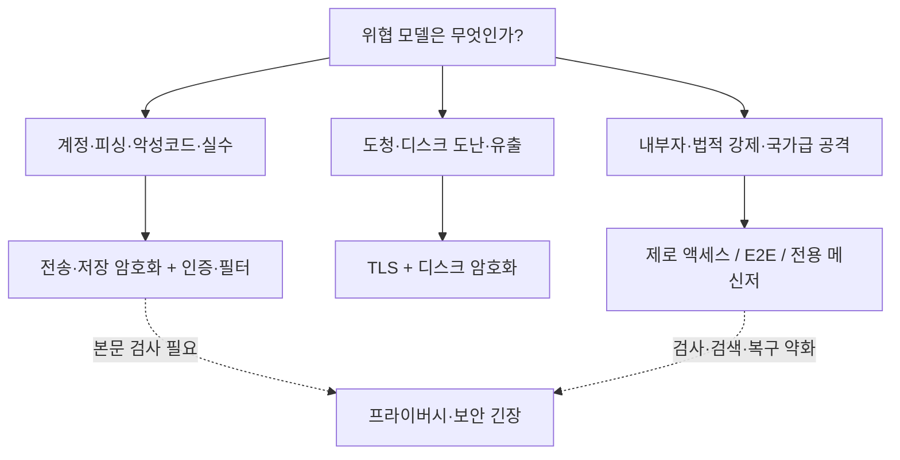
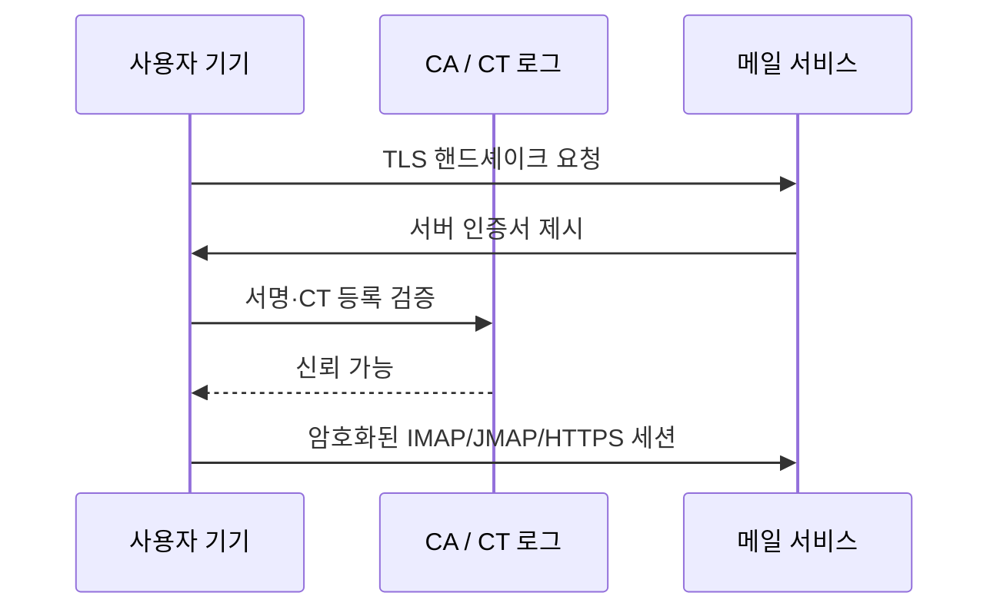
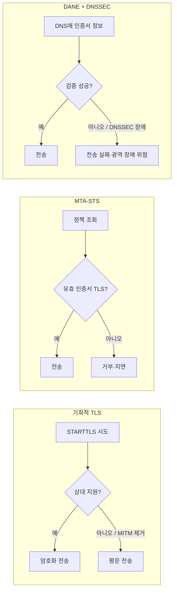
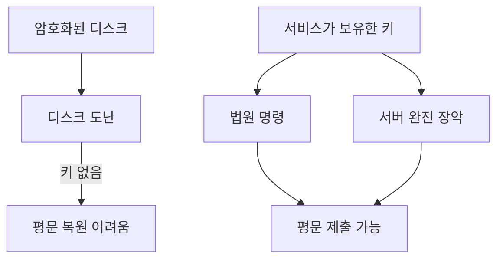
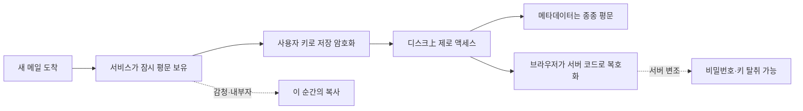
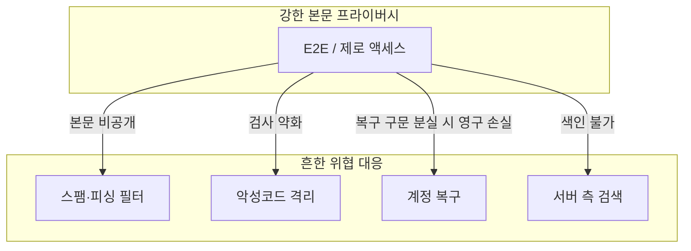

# 이메일 암호화는 만능이 아니다… 무엇을 막고, 무엇을 포기하는가

### Fastmail이 정리한 전송·저장·제로 액세스·종단 간 암호화의 차이… 위협 모델을 먼저 고르지 않으면 ‘더 안전해 보이는’ 선택이 오히려 검색·스팸 방어·가용성을 깎을 수 있다

‘암호화된 이메일’이라는 말은 자주 들린다. 그러나 그 한 단어 안에는 전혀 다른 보호 범위가 섞여 있다. 기기와 메일 서버 사이 연결을 암호화하는 것, 서버와 서버 사이 전송을 암호화하는 것, 디스크에 저장된 메일을 암호화하는 것, 서비스 제공자도 저장본을 읽지 못하게 하는 것, 발신자와 수신자만 본문을 읽게 하는 것은 각각 막는 위협이 다르다.

2025년 12월 17일 Fastmail의 Neil Jenkins(Chief Product Officer)는 [Understanding email encryption](https://www.fastmail.com/blog/email-encryption/)에서 이 차이를 위협 모델부터 풀어 썼다. 요지는 단순하다. 암호화를 ‘더 많이’ 붙이는 일이 항상 ‘더 안전함’으로 이어지지 않는다. 어떤 위협을 막으려는지를 먼저 적고, 그 보호가 검색·스팸 필터·악성코드 검사·비밀번호 복구·표준 클라이언트 호환성에 어떤 대가를 지우는지를 같이 봐야 한다.

이 글은 그 원문과, 원문을 요약한 기술 커뮤니티 토론(GeekNews에 정리된 Hacker News 의견 포함)을 바탕으로 이메일 암호화의 층을 다시 정리한다. 일상 메일과 취재원 보호처럼 위협 모델이 다른 소통을 같은 ‘암호화 메일’ 말로 묶지 않는 것이 목적이다.

## 1. 먼저 물을 것: 무엇을 막으려는가

암호화 기술 이름보다 앞서는 질문은 위협이다. Fastmail은 대부분의 사용자에게 현실적인 위협을 이렇게 나눈다.

| 빈도  | 위협        | 예시                            |
| --- | --------- | ----------------------------- |
| 흔함  | 계정 탈취     | 피싱, 비밀번호 재사용으로 계정 접근권을 빼앗김    |
| 흔함  | 잘못된 스팸 판정 | 중요한 메일이 스팸함으로 가 누락됨           |
| 흔함  | 악성코드      | 링크·첨부파일을 통한 감염                |
| 흔함  | 실수로 인한 삭제 | 사람이 중요한 메일을 지움                |
| 드묾  | 네트워크 도청   | 같은 Wi-Fi·ISP·중간 경로에서 트래픽 가로채기 |
| 드묾  | 데이터 유출    | 취약점으로 저장 메일이 노출됨              |
| 드묾  | 물리적 도난    | 기기·하드 드라이브 도난                 |
| 소수  | 내부자·법적 강제 | 서비스 직원, 적대적 환경의 정부 강제, 고도 공격자 |

기자·활동가처럼 내부자와 법적 강제까지 위협 모델에 넣는 사람에게는 제로 액세스나 종단 간 암호화가 의미가 있다. 대부분의 일상 메일에서는 계정 탈취와 피싱·악성코드가 더 가깝다. 후자를 막는 수단(서버 측 검사, 스팸 필터, 계정 복구)은 종종 전자(강한 본문 기밀성)와 충돌한다.

암호화 방식마다 막는 위협의 부분집합이 다르고, 어떤 보호는 다른 보호를 약하게 만든다. ‘암호화 메일을 쓴다’는 문장만으로는 어떤 칸을 고른 것인지 알 수 없다.

## 2. 기기 ↔ 메일 서비스: TLS, PKI, 인증서 투명성

사용자가 브라우저나 메일 클라이언트로 Fastmail·Gmail에 접속할 때, TLS(Transport Layer Security)가 기기와 서버 사이를 암호화한다. 로컬 Wi-Fi, ISP, 그 사이 경로의 수동적 도청을 막는 층이다. 최신 권고는 TLS 1.3이며, 강한 암호 스위트를 강제한다.

암호화만으로는 부족하다. 연결의 상대가 진짜 메일 서비스인지도 확인해야 한다. 여기서 PKI(Public Key Infrastructure)가 동작한다.

1. 서버가 Let’s Encrypt 같은 인증기관(CA)이 서명한 인증서를 제시한다.
2. 클라이언트는 내장된 신뢰 CA 목록으로 서명을 검증한다.
3. 인증서가 해당 도메인에 정당하게 발급됐는지 확인한다.

공격자가 트래픽을 다른 곳으로 돌려도, 자신이 통제하지 않는 도메인의 유효한 인증서를 얻기 어렵다면 사칭은 막힌다. 여기에 Certificate Transparency(CT) 로그가 더해진다. 참여 CA가 발급한 인증서를 공개된 추가 전용(append-only) 기록에 남기고, 도메인 소유자는 부정 발급을 감시하며, 브라우저는 로그에 등록된 인증서만 신뢰한다. CA가 침해되거나 속아 잘못된 인증서를 낸 사례는 있었지만, PKI와 CT의 조합은 ‘의도한 서버에 연결했다’는 실용적인 확신을 준다.

Fastmail 측 운영 선택은 다음과 같다.

- TLS 1.3 지원
- HSTS로 브라우저가 TLS 없이 접속을 시도하지 않게 함
- 비암호화 IMAP/POP/SMTP 포트 폐쇄
- STARTTLS보다 처음부터 TLS로 붙는 implicit TLS 선호 (IETF 권고와도 맞음)

이 층이 막는 것은 **사용자 ↔ 자기 메일 서비스** 구간의 도청과 사칭이다. 메일이 다른 도메인의 서버로 넘어간 뒤의 구간은 다음 절의 문제다.

## 3. 서버 ↔ 서버: 기회적 TLS의 한계

메일은 보통 발신자 서비스의 서버를 거친 뒤 수신자 도메인의 서버로 간다. 이 서버 간 구간이 더 까다롭다.

관행은 **기회적 TLS(opportunistic TLS)** 다. 암호화를 시도하되, 상대가 지원하지 않으면 평문 전송으로 내려간다. Fastmail은 수신에 2009년 4월, 발신에 2010년 1월부터 이 방식을 지원했다고 밝혔다.

한계는 분명하다.

- **능동 중간자(MITM)** 가 STARTTLS 제안을 핸드셰이크에서 제거하면 비암호화 연결을 강제할 수 있다.
- 암호화를 지원하지 않는 정상 서버가 아직 많아서, 전 구간에 암호화를 강제하면 받고 싶은 메일까지 잃는다.
- 기본적으로 목적지 인증서를 ‘그 서버의 것’인지까지 검증하지 않는 경우가 많다. 공격자가 평문으로 강등할 수 있는 한, 인증서 검증만 추가해도 보안이 닫히지 않기 때문이다.

커뮤니티 토론에서는 이 논리에 대한 반론도 나온다. 최종 목표가 ‘암호화 연결만 허용’이라면, 강등이 가능한 과도기 논리를 영구 전제로 두면 전환이 늦어진다는 지적이다. 실제로 일부 자체 운영 메일 서버는 MTA-STS와 무관하게 MX 인증서를 검증하고, STARTTLS 약화·제거 시 전달을 실패시키는 정책을 수년 동안 운용한 사례가 공유됐다. 그 운영자의 기록에서는 STARTTLS 거부 서버는 없었고, 잘못된 인증서는 호스트명 불일치 두 건뿐이었다. 다만 전 인터넷을 한 정책으로 강제할 수 있는지는 별개의 문제다. IPv6 이중 스택처럼, 안전한 메일 전송도 ‘일부만 도입된 상태’가 오래 이어질 가능성이 크다.

## 4. MTA-STS와 DANE: 강등을 줄이려는 두 프로토콜

기회적 TLS의 구멍을 메우려는 대표 프로토콜이 두 개다. 보급은 아직 제한적이다.

### MTA-STS (Mail Transfer Agent Strict Transport Security)

수신 도메인이 “우리 주소로 오는 메일은 유효한 인증서를 가진 STARTTLS 연결로만 받겠다”고 선언한다. 발신 서버는 정책을 확인하고, 조건을 맞출 수 없으면 전송을 거부해야 한다.

- 필요물: DNS 레코드 + HTTPS로 호스팅하는 정책 파일
- 배포가 비교적 단순하다
- 정책이 깨져도 영향은 대개 수신 메일 지연·반송에 머물고, 웹사이트 등 도메인의 다른 용도까지 흔들리지 않는다

### DANE (DNS-Based Authentication of Named Entities)

DNSSEC으로 서명한 DNS 레코드에 TLS 인증서 정보를 직접 올린다. CA 의존과 MTA-STS의 ‘최초 사용 시 신뢰’ 약점을 줄일 수 있다. 대가는 운영 비용이다.

- 최상위 도메인 레지스트리가 DNSSEC을 지원하지 않으면 쓸 수 없다
- DNSSEC 오류는 캐시에 몇 시간~며칠 남을 수 있어, 라우팅 장애보다 복구가 가혹하다
- 2023년 10월 Cloudflare 1.1.1.1은 캐시된 루트 존 DNSSEC 서명 만료로 수 시간 장애를 겪었다
- 2023년 5월 뉴질랜드 `.nz`는 정기 DNSSEC 키 롤오버 중 여러 날 가용성 사고를 겪었다

Fastmail은 보안을 기밀성만이 아니라 **가용성**(메일을 읽을 수 있는가)과 **무결성**(타인이 메일을 변조할 수 없는가)까지 포함해 본다. 현재 판단은 DANE이 주는 추가 기밀성보다 가용성 위험이 크다는 쪽이며, Google·Yahoo도 MTA-STS를 선호하는 선택을 했다고 적었다. 생태계가 바뀌면 재평가한다고 명시했다.

실용적 요약은 이렇다. 주요 대형 제공자 사이의 메일은 **거의 확실히 전송 중 암호화**된다. DANE·MTA-STS가 없으면 국가급 공격자가 연결을 강등해 가로챌 여지는 남는다. 다만 대규모 강등은 탐지되기 쉽고, 대량 메일 흐름에서 특정 개인만 골라 겨냥하기는 어렵다.

토론에서 나온 보완 사실도 중요하다. Fastmail이 수신 MTA-STS를 ‘기술적으로’ 지원하더라도, 사용자 지정 도메인에 DNS로 정책을 켜지 않으면 강제 비율은 매우 낮다. 한 집계에서는 `messagingengine.com` 교환 접미사를 쓰는 도메인 중 enforce 비율이 약 0.2% 수준으로 나타났다. Proton·Outlook·Google도 같은 자릿수다. 프로토콜이 존재한다는 것과, 실제 메일 생태계에서 강제된다는 것은 다른 층이다. 발신 측에서 MTA-STS를 얼마나 강제하는지도 별도로 확인해야 한다.

## 5. 저장 데이터 암호화: 디스크를 지켜도 서버 장악은 못 막는다

메일이 서버에 도착한 뒤의 보호가 encryption at rest다. 보통 BitLocker, LUKS, ZFS 데이터셋 암호화처럼 **서비스가 보유한 키**로 디스크 볼륨을 암호화한다.

막는 것:

- 데이터센터에서 디스크가 물리적으로 도난당하는 경우
- 폐기 디스크가 제대로 지워지지 않은 경우
- GDPR·HIPAA 등 규정 준수 요구

막지 못하는 것:

- 유효한 법원 명령에 따른 복호화·제출
- 공격자가 서버를 완전히 장악해 메모리에 로드된 키까지 얻는 경우

Fastmail은 백업을 포함한 사용자 데이터를 암호화 볼륨에 두고 키를 직접 통제하며, 접근 통제·로깅·감사와 연간 법적 요청 건수를 투명성 보고서로 공개한다고 밝혔다. 저장 암호화는 ‘유출돼도 디스크 이미지만으로는 못 읽게’ 만드는 층이지, ‘서비스가 절대 못 읽게’ 만드는 층이 아니다.

## 6. 제로 액세스 암호화: 서비스도 못 읽는 대신 기능이 줄어든다

Proton Mail·Tuta 등이 내세우는 zero-access encryption은 기기에서 비밀번호로 키를 도출해, 서버가 저장본을 복호화하지 못하게 한다. 로그인 시 로컬에서 키를 풀고, 서버는 비밀번호를 보지 않는다.

내부자 위협·데이터 유출·법원 명령으로 넘길 수 있는 데이터 범위를 줄이는 데에는 실질적 이득이 있다. 그 이득을 위협 모델의 중심에 두고 기능 축소를 감수할 사용자에게는 정당한 선택이다. Fastmail이 강조하는 것은 ‘추가 보호의 범위가 마케팅보다 좁을 수 있다’는 점이다.

### 보호가 닫히지 않는 지점

| 한계         | 내용                                                                                 |
| ---------- | ---------------------------------------------------------------------------------- |
| 새 메일 수신 순간 | 종단 간 암호화가 아니면, 서비스는 사용자 공개 키로 다시 암호화하기 **전에** 평문을 본다. 감청 명령·악의적 직원이 이 시점에 복사할 수 있다 |
| 메타데이터      | 주소·타임스탬프, Proton의 경우 제목 등은 종종 평문이다. 누구와 언제 얼마나 자주, 무슨 주제로 대화하는지는 본문보다 중요할 때가 많다    |
| 브라우저 공급 사슬 | 복호화 코드가 서비스 서버에서 내려온다. 서버가 장악되거나 특정 사용자에게 변조 코드 배포가 강제되면 비밀번호를 훔칠 수 있다             |
| 발신자 쪽 복사본  | 수신함만 암호화돼도, 발신자는 읽기 쉬운 복사본을 갖고 있을 가능성이 크다                                          |

### 기능상 대가

- 비밀번호와 복구 구문을 잃으면 메일 전체가 영구 손실된다. 전통적 ‘비밀번호 재설정’이 없다. Fastmail은 사람들이 비밀번호를 잃는 일이 흔하다고 보며, 신중한 자동 복구 흐름을 유지하는 쪽을 택한다.
- 서버가 본문을 색인할 수 없어 검색이 약해진다. 클라이언트 색인은 전 메일 다운로드를 요구해 수십 GB 계정에는 비현실적일 수 있다.
- 표준 IMAP/JMAP을 서비스가 직접 열기 어렵고, 이전·표준 클라이언트·공유 메일함·컴플라이언스 도구가 제한된다. 강한 공급자 종속이 생긴다.
- 사용자가 허락해도 지원 직원이 메일을 볼 수 없어, 도울 수 없는 장애가 늘어난다.

제로 액세스는 ‘저장본에 대한 내부자 읽기’를 줄이는 도구다. ‘이메일 전체의 종단 간 기밀성’과 동의어가 아니다.

## 7. 종단 간 암호화 이메일: 1990년대부터 있었고, 소비자에게는 거의 안 퍼졌다

발신자와 수신자만 본문을 읽는 진정한 end-to-end(E2E)는 S/MIME과 OpenPGP로 오래전부터 가능했다. 그럼에도 일반 소비자 확산은 미미하다.

- **S/MIME**: CA 인증서 기반. 기업 PKI·내부 디렉터리에서 상대 공개 키를 찾을 수 있는 조직에서는 쓰이지만, 그 밖에서는 드물다.
- **OpenPGP**: 사용자가 서로를 보증하는 Web of Trust. 연구자들은 이 구조가 사실상 죽었다고 본다. 메타데이터 유출, 전방향 비밀성 부재, 실용적 키 교체 부재 등이 지적된다.
- 1999년 *Why Johnny Can’t Encrypt*에서는 12명 중 4명만 90분 안에 PGP로 메일을 올바르게 암호화했다. 2006·2019 후속 연구에서도 공개 키 검색·검증 어려움이 반복됐다. PGP 창시자 Phil Zimmermann조차 2015년 버전 비호환으로 복호화에 어려움을 겪었다는 일화가 있다.

핵심 난제는 **키 배포와 정기 교체**다. 보내기 전에 상대의 진짜 공개 키를 확신해야 하고, 키를 돌리지 않으면 과거 가로챈 암호문의 일괄 복호화 위험이 남는다. 이메일처럼 아무 클라이언트나 아무 서버와 말하는 연합(federated) 구조에서는 Signal·WhatsApp처럼 한 조직이 스택 전체를 통제하며 키 생성·연락처 발견·프로토콜 업데이트를 자동화하기 어렵다.

E2E는 이메일이 의존하는 기능과도 충돌한다.

- 서버 측 검색 불가 (검색 가능한 장기 보관 자체도 보안 모범과 긴장)
- 피싱·악성코드 검사가 약해짐
- 다중 기기 사용 시 개인 키 동기화 위험
- To·From·Date 헤더는 기본 라우팅을 위해 평문에 가깝게 남아야 함

암호학자 Bruce Schneier의 요약이 Fastmail 글에도 인용된다. 이메일에 원하는 것과 이메일 시스템이 제공하는 것은 암호화와 쉽게 양립하지 않는다.

### 토론이 보탠 보정

원문이 OpenPGP의 Web of Trust만 강조했다는 지적이 있다. Proton 등이 쓰는 **WKD(Web Key Directory)** 는 신뢰망 없이도 도메인 기반으로 공개 키를 찾아 발신 암호화를 매끄럽게 만드는 경로다. 규격은 IETF draft([draft-koch-openpgp-webkey-service](https://datatracker.ietf.org/doc/draft-koch-openpgp-webkey-service/))에 있고, 실제 마찰은 Mat Duggan의 해설([Why can’t my mom email me?](https://matduggan.com/why-cant-my-mom-email-me/))에서 볼 수 있다. WKD가 ‘엄마도 쓰게’ 만들지는 못해도, ‘신뢰망이 유일한 배포 수단’이라는 인상을 보정한다.

Signal·WhatsApp이 ‘자동으로 안전하다’는 표현에도 주의가 필요하다. 2016년 사용성 연구 *When SIGNAL hits the Fan*에서는 컴퓨터과학 전공 학생 다수가 안전한 E2E 연결을 **검증·유지**하는 데 실패했다. 다만 이 연구는 MITM을 사용자가 탐지·차단할 수 있는지를 본 것이며, 평소 자동 암호화 세션이 성립하지 않는다는 뜻으로 확대해석하면 안 된다. 대부분의 사용자는 키를 직접 비교하지 않은 채 중앙 서비스가 중개하는 키 배포를 신뢰한다. 그 중개자가 공격받으면 사용자는 속기 쉽다는 쪽이 연구 결과에 가깝다. 또한 소비자용 빌드가 실제로 암호화를 수행하는지를 이용자가 완전 증명하기는 어렵다는 엄밀론도 있다. 재현 가능한 빌드를 공개하는 Delta Chat·SimpleX Chat 같은 대안이 비교 대상으로 거론된다.

실무에서 메일과 E2E를 섞는 타협도 공유됐다. 일반 스레드는 지침만 주고, 민감 첨부만 `age` 등으로 암호화해 붙이는 방식이다. 채널의 익숙함은 유지하고, 민감 데이터만 저장·전송 모두에서 보호한다.

## 8. 프라이버시와 ‘보안’이 같은 방향이 아닐 때

스팸 필터, 피싱 탐지, 악성코드 격리, 이상 로그인 탐지는 본문·링크·발신 패턴을 볼수록 강해진다. 서버가 정말로 메시지를 못 보면, 받은편지함에 닿기 전에 위협을 걸러 내는 능력도 줄어든다.

Fastmail이 말하는 ‘보안’에는 기밀성뿐 아니라 가용성과 악용 방지가 포함된다. 강한 프라이버시 설정이 계정 탈취·피싱이라는 **더 흔한 위협**에 대한 방어를 약화시킬 수 있다면, 그 설정은 위협 모델 전체에서 ‘더 안전’이 아닐 수 있다.

선택지는 이분법이 아니라 스펙트럼이다.

| 층                        | 주로 막는 것            | 주요 대가                     |
| ------------------------ | ------------------ | ------------------------- |
| 전송 TLS (클라이언트↔서비스)       | 로컬·ISP 도청, 사칭(PKI) | 거의 없음. 오늘날 기본값            |
| 서버 간 TLS (+MTA-STS/DANE) | 전송 구간 도청·강등        | 정책·DNSSEC 운영, 일부 메일 미전달   |
| 저장 암호화                   | 디스크 도난·폐기 실수       | 서비스 키 보유 → 장악·영장에 노출      |
| 제로 액세스                   | 저장본 내부자 읽기         | 검색·복구·표준 클라이언트·지원         |
| 메일 E2E                   | 본문 도청·서버 열람        | 키 배포, 헤더 평문, 필터·검색 약화     |
| Signal 등 전용 메신저          | 민감 대화의 기밀·전방향성     | 이메일 대체 아님. 연락처·정체성 모델이 다름 |

취재원 보호나 국가급 위협이 진짜라면, Fastmail의 솔직한 권고는 **이메일 대신 암호화 메신저**다. 일상 메일에는 전송 암호화와 저장 암호화의 조합이 검색·필터·복구를 유지한 채 가장 흔한 위협에 의미 있는 보호를 준다.

## 9. Fastmail이 고른 균형, 그리고 문서화 공백

Fastmail은 25년 이상 메일을 ‘전자적 기억’으로 보고, 접근 가능성·프라이버시·보안을 같이 우선한다고 밝혔다. 전송·저장 암호화, 강한 인증, Masked Email, 다중 데이터센터, 장기 메일 검색이 그 선택이다. 제로 액세스나 기본 E2E로 기능을 깎지 않는 대신, 위협 모델이 다른 소통은 채널을 분리하라는 입장에 가깝다.

토론이 남긴 실무 체크리스트는 원문만으로는 부족하다.

1. **수신 MTA-STS**: 사용자 도메인에 DNS·정책 파일을 직접 켰는지 확인한다. 제공자가 ‘지원’한다고 해서 내 도메인이 enforce인 것은 아니다.
2. **발신 MTA-STS**: 내 서비스가 상대 정책을 얼마나 강제하는지 별도 스캔([email-security-scans.org](https://email-security-scans.org) 등)으로 본다.
3. **WKD/S/MIME**: 조직 메일이나 소수 고신뢰 상대와의 본문 보호가 필요하면, Web of Trust만이 아니라 WKD·S/MIME·첨부 파일 암호화를 설계에 넣는다.
4. **민감 대화**: 메일 스레드에 비밀을 쓰지 말고, Signal 등 전용 채널 또는 암호화 첨부로 분리한다.
5. **계정 계층**: 피싱·재사용 비밀번호·복구 메일 탈취가 여전히 가장 흔한 실패 지점이다. TLS보다 먼저 다중 인증과 비밀번호 관리를 본다.

자체 CA만 신뢰하는 전용 클라이언트로 메일 서비스에만 붙는 극단적 고정(pinning)은, 관심 사용자는 극소수이고 인적 오류·운영 위험이 DNSSEC 실패 사례만큼 크다는 이유로 Fastmail은 선도하지 않는다고 답했다. 합의된 모범 사례를 따르는 이유는 대다수가 실제로 지킬 수 있는 방식으로 현실적 위협을 막기 위해서라는 설명이다.

## 10. 결론: ‘암호화 메일’이 아니라 ‘어떤 층인가’

이메일 암호화 논쟁은 기술 이름의 경쟁이 아니라 위협 모델과 대가의 선택이다.

- 기기↔서비스 TLS와 PKI/CT는 오늘날의 바닥이다.
- 서버 간 구간은 기회적 TLS의 강등 위험이 남고, MTA-STS·DANE이 이를 줄이려 하나 보급·운영 비용이 남는다.
- 저장 암호화는 디스크를 지키지, 키를 가진 서버의 장악과 영장을 막지 않는다.
- 제로 액세스는 저장본 내부자 읽기를 줄이고 검색·복구·이식성을 줄인다. 수신 순간의 평문과 브라우저 코드 공급망은 남는다.
- 메일 E2E는 본문을 강하게 지키려 하나 키 배포·헤더·필터·검색과 충돌하며, 소비자 확산은 수십 년간 실패에 가깝다. WKD 같은 보완이 있어도 ‘자동 Signal’이 되지는 않는다.
- 가장 민감한 소통은 메일 밖에서, 일상 메일은 전송·저장 암호화와 계정 보안·악용 방지의 균형을 유지하는 편이 위협 빈도에 맞다.

**암호화는 스위치가 아니라 층이다.** 층을 고르기 전에 ‘누구로부터 무엇을 숨기려는가’를 적지 않으면, 더 복잡해 보이는 설정이 정작 흔한 위협에는 약하고 드문 위협에만 조금 강한 상태가 된다.

---

**원문 및 참고 자료**

- Neil Jenkins, *Understanding email encryption*, Fastmail Blog, 2025-12-17. [https://www.fastmail.com/blog/email-encryption/](https://www.fastmail.com/blog/email-encryption/)
- IETF, *SMTP MTA Strict Transport Security (MTA-STS)*, RFC 8461.
- IETF, *DNS-Based Authentication of Named Entities (DANE)*, RFC 6698.
- Alma Whitten, J. D. Tygar, *Why Johnny Can’t Encrypt*, 1999.
- Bruce Schneier, 이메일과 암호화의 양립 어려움에 대한 논평(원문 인용).
- OpenPGP Web Key Directory: [https://datatracker.ietf.org/doc/draft-koch-openpgp-webkey-service/](https://datatracker.ietf.org/doc/draft-koch-openpgp-webkey-service/)
- Mat Duggan, *Why can’t my mom email me?* [https://matduggan.com/why-cant-my-mom-email-me/](https://matduggan.com/why-cant-my-mom-email-me/)
- Schröder et al., *When SIGNAL hits the Fan: On the Usability and Security of State-of-the-Art Secure Mobile Messaging*, NDSS Workshop, 2016.
- 메일 전송 보안 스캔 예시: [https://email-security-scans.org/](https://email-security-scans.org/)
- 이미지: Fastmail 원문 히어로; Microsoft Learn Queue-Based Load Leveling 과부하 도식(전송 실패·병목의 시각 비유).

