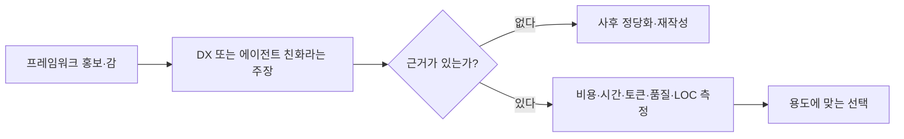
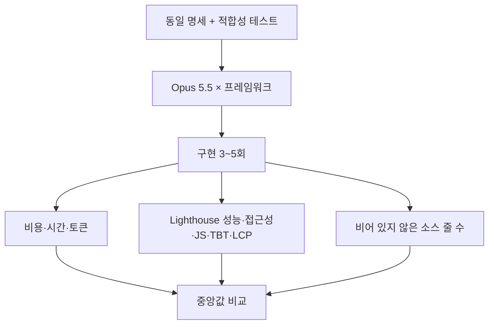
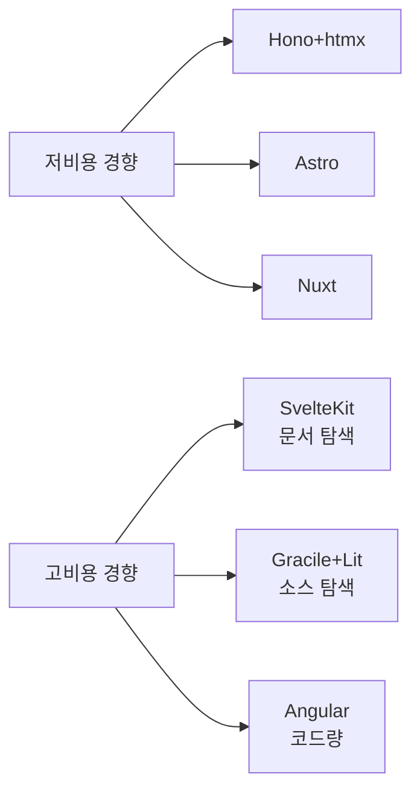
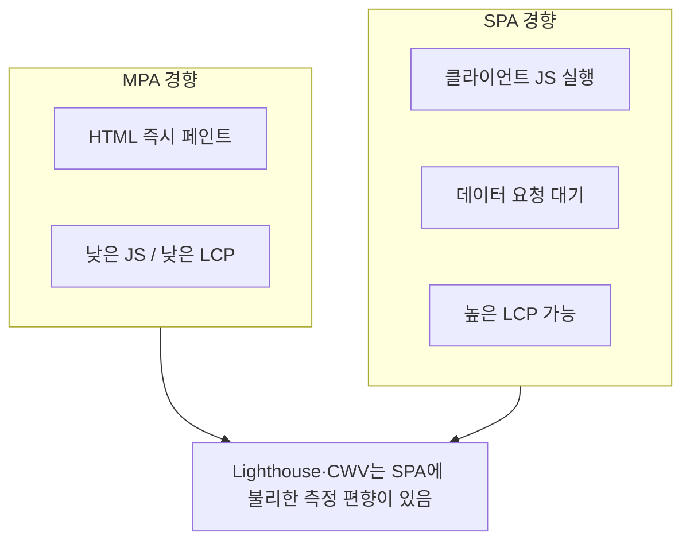
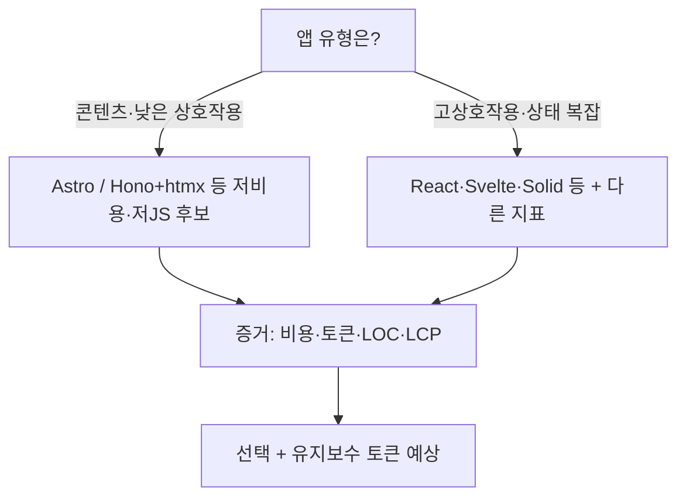

# AI 시대에도 프레임워크는 ‘감’으로 고르는가… 같은 포켓몬 앱을 12개 스택으로 구현한 비용 실험

### Opus 5.5로 동일 명세를 반복 구현한 결과… Hono+htmx·Astro는 저렴하고 빨랐고, Angular·SvelteKit·Gracile+Lit는 비용·토큰이 컸다. 다만 앱 유형이 콘텐츠 중심 MPA에 유리하다는 한계를 빼놓고 순위를 절대화하면 안 된다

웹 프레임워크 홍보는 오래전부터 ‘blazing fast’, ‘supercharge’, DX와 UX를 동시에 잡는다’는 문장으로 가득했다. 근거 없는 주장을 Alex Russell은 [프론트엔드의 잃어버린 10년](https://infrequently.org/) 맥락에서, Baldur Bjarnason은 프로그래밍이 대중문화처럼 유행을 따른다는 비판으로 지적해 왔다. Nolan Lawson 역시 자신의 블로그 [Read the Tea Leaves](https://nolanlawson.com/)에서 사실과 벤치마크로 그 흐름에 맞서 왔다.

에이전트가 코드를 직접 치는 시대가 와도 상황은 비슷하다. ‘에이전트에 더 맞다’, ‘실수가 적다’, ‘결과가 빠르다’는 이유로 프론트엔드를 갈아엎는 글이 늘었지만, Lawson은 묻는다. **에이전트에게 물어보기는 했는가? 벤치마크는 어디에 있는가?**

2026년 10월 28일 그는 [The AI cost of JavaScript frameworks](https://nolanlawson.com/2026/10/28/the-ai-cost-of-javascript-frameworks/)에서 그 질문에 답하려 했다. PokéAPI 기반의 작지만 단순하지 않은 포켓몬 앱을 **12개 프레임워크·메타프레임워크 조합**으로, Claude Opus 5.5(높은 노력 수준)에게 각각 **최대 5회** 구현하게 하고, 개발 비용·시간·토큰·코드량·Lighthouse 성능·접근성을 중앙값으로 비교했다. GeekNews([토픽 36393](https://news.hada.io/topic?id=36393))와 Hacker News 토론은 이 실험을 ‘최종 순위표’가 아니라 **감 대신 근거로 고를 수 있음을 보여 주는 시도**로 읽었다.

이 글은 그 원문과 토론을 기사 형태로 다시 정리한다. 숫자의 순서를 외우는 것보다, **무엇을 측정했고 무엇을 측정하지 않았는지**, 그리고 AI 코딩 시대에 프레임워크가 남기는 진짜 비용이 무엇인지를 분명히 하는 것이 목적이다.

## 1. 감각적인 선택을 측정으로 바꾸려는 이유

Lawson이 지적하는 오래된 패턴은 이렇다.

1. 개발자가 JSX를 치는 느낌 같은 **DX(개발자 경험)** 로 스택을 고른다.
2. 그다음 “가상 DOM이 빠르다” 같은 **성능 논리로 사후 정당화**한다.
3. Jonathan Haidt식 표현으로 보면, 직관이 먼저이고 이유는 나중에 붙는다.

에이전트 시대에는 키보드 DX의 제약이 약해진다. 그런데도 ‘에이전트 친화적’이라는 새 감이 같은 자리를 차지한다. Lawson의 벤치마크는 그 감에 **비용·시간·토큰·품질·코드량**이라는 축을 붙이려는 시도다.

중요한 선언이 글 후반에 있다. 목표는 “바이브 코더를 위한 최종 추천 랭킹”이 아니라, **AI 코딩 시대에도 감이 아닌 근거로 결정할 수 있음**을 보여 주는 것이다. Hacker News에서는 이 한계를 글 앞쪽에서 더 분명히 했어야 한다는 비판과 함께, 그 비판 자체가 더 나은 벤치마크를 만드는 재료가 된다는 평가도 나왔다.

## 2. 실험 설계: 무엇을 같고, 무엇을 열어 두었는가

### 앱과 에이전트

- **앱**: PokéAPI로 포켓몬 목록·타입·기술·게임별 정보, 검색·필터를 제공하는 사이트
- **성격**: 상호작용이 적은 **콘텐츠 중심**. Figma·Gmail보다 Wikipedia에 가깝다
- **에이전트**: Opus 5.5, high effort, 최신 프레임워크 버전 사용 지시
- **검증**: 명세 적합성 테스트 스위(에이전트 부정행위 방지). 접근성 트리 기준이라 Shadow DOM 웹 컴포넌트도 검사 가능
- **CSS**: Tailwind·Bootstrap 등 컴포넌트 프레임워크 금지, 디자인 토큰만 제공
- **미지정**: SSR/CSR, “최대 성능” 강제, Lighthouse 예고 없음
- **환경**: 샌드박스 실행. Lighthouse는 Ubuntu 24.04 Framework 13, CPU 4배 제한, Slow 4G, **모바일**만

### 비교 대상 12종

| 조합 | 대표 성격 |
|---|---|
| Hono+htmx | JS 서버 + HTML 부분 갱신 |
| Astro | 콘텐츠 중심 MPA |
| Nuxt | Vue 메타프레임워크 |
| Vanilla (Vite) | UI 프레임워크 없음 |
| Next.js | React 풀스택 |
| Qwik | 지연 실행·클라이언트 라우팅 |
| TanStack Start | React 스타트 |
| SolidStart | Solid 메타프레임워크 |
| React Router | React 라우팅/풀스택 |
| SvelteKit | Svelte 메타프레임워크 |
| Gracile+Lit | 웹 컴포넌트(Lit) |
| Angular | 풀 프레임워크 |

각 프레임워크당 **5회 중앙값**. Angular만 측정 가능한 앱을 두 번 만들지 못해, 코드량·성능 일부는 **성공 3회**만 썼다(비용·시간·토큰에는 5회가 반영된 지표도 있다. 원문 정정 참고).

### 의도적으로 넣지 않은 것

Service Worker 오프라인 캐시, 이미지 최적화, `fetchpriority`, Speculation Rules 등 **성능 핵**은 넣지 않았다. 일반 바이브 코딩을 흉내 내기 위해서다. 반대로 모든 포켓몬 HTML을 정적 파일로 미리 깔아 두는 편법은 명세와 하네스에서 **금지**했다. 목표가 순수 정적 사이트가 아니라, 대량의 잠재적 동적 데이터를 모사하는 것이기 때문이다.

## 3. 구현 비용: 중앙값은 Hono+htmx 2.67달러, Angular 4.97달러

비용은 Claude Code가 보고한 **API 환산가**의 중앙값이다. 실제 카드 청구액이 아니라 Max 요금제($100/월) 안에서 돌린 실험의 추정치다.

| 프레임워크 | 비용 중앙값 ($) | 대략적 위치 |
|---|---:|---|
| Hono+htmx | 2.67 | 최저 |
| Astro | 2.76 | 낮음 |
| Nuxt | 2.82 | 낮음 |
| Vanilla | 2.98 | 중하 |
| Next.js | 3.14 | 중간 |
| Qwik | 3.27 | 중간 |
| TanStack Start | 3.54 | 중상 |
| SolidStart | 3.79 | 중상 |
| React Router | 3.81 | 중상 |
| SvelteKit | 4.28 | 높음 |
| Gracile+Lit | 4.65 | 높음 |
| Angular | 4.97 | 최고 |

**범위가 겹친다.** React Router의 최저(2.82)는 Hono+htmx의 최고(3.19)보다 싸다. 중앙값만으로 “모든 실행에서 A가 B보다 싸다”고 말하면 안 된다. 그래도 SvelteKit·Gracile+Lit·Angular가 상대적으로 비싸다는 패턴은 반복된다.

원문이 제시하는 비싼 이유 후보:

- **SvelteKit**: 매 실행마다 v3 마이그레이션 가이드를 읽음. Opus 5.5 학습 데이터에 새 버전이 없었을 가능성
- **Gracile**: 저장소 클론 또는 `node_modules`의 컴파일된 소스 열람
- **Angular**: 생성 코드 규모 자체가 큼

## 4. 시간과 토큰: Astro 8.2분 vs Angular 17.2분

벽시계 시간(에이전트 관점) 중앙값:

| 프레임워크 | 시간 중앙값 |
|---|---:|
| Astro | 8.2분 |
| Hono+htmx | 8.6분 |
| Nuxt | 9.0분 |
| Vanilla | 10.1분 |
| TanStack Start | 10.3분 |
| Qwik | 10.7분 |
| SvelteKit | 10.8분 |
| Next.js | 10.9분 |
| SolidStart | 11.2분 |
| Gracile+Lit | 12.1분 |
| React Router | 12.5분 |
| Angular | 17.2분 |

토큰(캐시 읽기 + 비캐시 입력 + 출력, 백만 단위 중앙값):

| 프레임워크 | 토큰 중앙값 (M) |
|---|---:|
| Nuxt | 3.85 |
| Astro | 4.13 |
| Hono+htmx | 4.26 |
| Next.js | 4.99 |
| Vanilla | 5.00 |
| Qwik | 5.64 |
| TanStack Start | 7.07 |
| SolidStart | 7.13 |
| React Router | 7.58 |
| SvelteKit | 8.53 |
| Gracile+Lit | 9.04 |
| Angular | 9.76 |

비용·시간·토큰은 대체로 같은 방향으로 움직인다. **Vanilla가 여러 프레임워크보다 비싸거나 비슷했다**는 점도 눈에 띈다. “프레임워크를 안 쓰면 AI가 무조건 싸게 만든다”는 직관은 이번 실험에서 깨진다. Vite라는 표준 인프라만으로는 에이전트가 SPA를 다섯 번 모두 선택했고, 그 선택이 토큰·시간을 늘렸다.

## 5. MCP와 스킬: 준비해도 항상 쓰이지 않는다

공정성을 위해 공식 MCP·스킬이 있으면 설치해 두었지만, **사용을 강제하지 않았다**. 일반 바이브 코딩에서 도구를 소리쳐 강요하지 않거나 아예 빼먹는 사용자를 반영하려는 선택이다.

| 프레임워크 | 준비 | 실제 사용 |
|---|---|---|
| Angular | MCP + 스킬 | MCP 3/5, 스킬 도구 4/5, 스킬 파일 2/5 |
| Astro | MCP | 2/5 |
| Hono+htmx | Hono 스킬 | 5/5 |
| Next.js | next-devtools-mcp, next-dev-loop | 스킬 파일 1/5, AGENTS.md 2/5 |
| Nuxt | MCP | **0/5** |
| React Router | 스킬 | 도구·파일 모두 5/5 |
| SvelteKit | Claude 플러그인 MCP | 5/5 |
| TanStack Start | 별도 설치 없음 | `node_modules` 스킬 파일 2/5에서 발견 |
| Gracile+Lit, Qwik, SolidStart, Vanilla | N/A | N/A |

Lawson은 MCP·스킬이 **오히려 해로울 수 있다**는 의심도 남기지만, 이번 실험만으로 그것을 입증하지는 않았다. “도구를 깔아 두면 에이전트가 알아서 싸게·빠르게 만든다”는 가정도 데이터로 보면 흔들린다.

## 6. 품질: 접근성 100점 Saturation, 차이는 JS·LCP에

Lighthouse **접근성은 전원 100점**. 성능은 97~100점으로 상한에 붙었다. CLS는 Vanilla만 0.111, 나머지는 0.000. 홈페이지만 보고했다.

그래서 의미 있는 차이는 세부 지표에 있다.

### JavaScript 전송량 (중앙값)

| 프레임워크 | JS |
|---|---:|
| Astro | 0 KiB |
| Vanilla | 7 KiB |
| Gracile+Lit | 8 KiB |
| Hono+htmx | 18 KiB |
| SvelteKit | 36 KiB |
| SolidStart / Qwik | 40 KiB |
| Nuxt | 84 KiB |
| Angular | 93 KiB |
| React Router | 115 KiB |
| TanStack Start | 118 KiB |
| Next.js | 142 KiB |

### Total Blocking Time

Astro·Gracile+Lit·Hono+htmx·SvelteKit·Vanilla 중앙값 **0ms**. Nuxt 40ms, Next.js 71ms, Angular 103ms.

### Largest Contentful Paint

| 프레임워크 | LCP 중앙값 |
|---|---:|
| Astro | 810 ms |
| Gracile+Lit | 956 ms |
| Hono+htmx | 978 ms |
| Qwik | 979 ms |
| SvelteKit | 1130 ms |
| SolidStart | 1204 ms |
| Vanilla | 1667 ms |
| Nuxt | 1727 ms |
| React Router | 1729 ms |
| Angular | 1954 ms |
| TanStack Start | 2028 ms |
| Next.js | 2090 ms |

HTML로 먼저 그리는 **MPA**가 LCP에서 유리하고, SPA는 클라이언트 JS와 데이터 fetch를 기다릴 수 있다. Qwik은 클라이언트 라우팅 SPA인데도 MPA급 LCP를 냈다. Next.js의 큰 편차는 **이미지 지연 로딩**을 피한 구현 하나와, 그렇지 않은 네 구현의 차이로 설명된다.

원문도 GeekNews 요약도 같은 한계를 못 박는다. **콘텐츠 중심·작은 앱 + Lighthouse 지표**는 MPA에 유리한 실험이다. 복잡한 대시보드·게임·생산성 앱과 인앱 상호작용 지표로 바꾸면 SPA에 유리한 설계도 가능하다.

## 7. 코드량: 유지보수 토큰의 예고편

빈 줄을 뺀 소스 줄 수 중앙값:

| 프레임워크 | LOC |
|---|---:|
| Hono+htmx | 1,370 |
| Nuxt | 1,415 |
| Astro | 1,461 |
| Vanilla | 1,492 |
| Next.js | 1,539 |
| React Router | 1,564 |
| SvelteKit | 1,611 |
| SolidStart | 1,630 |
| TanStack Start | 1,697 |
| Gracile+Lit | 1,717 |
| Qwik | 1,744 |
| Angular | 2,009 |

Rich Harris의 말처럼 프레임워크는 코드를 정리하는 도구이기도 하고 **생각을 정리하는 도구**이기도 하다. 에이전트 시대에는 줄 수가 **다음 수정의 토큰 청구서**로 이어진다. Hono+htmx는 Angular 대비 대략 70% 코드로 비슷한 기능을, 더 싸게·빠르게 만들었다. 간결함이 유일한 가치는 아니지만, “에이전트가 쓸 코드베이스의 질량”은 이제 무시하기 어렵다.

## 8. 구현이 갈라진 지점, 실패가 알려 준 것

같은 프레임워크라도 구조가 달랐다.

- **Gracile**: 두 실행에서 Lit를 아예 쓰지 않음
- **Vanilla**: 자유도가 있었는데도 5회 모두 SPA
- **Angular 실패 2회**: SSR 앱이 localhost 외 요청을 거절. 명세에 리버스 프록시 뒤 실행이 명시되어 있어 **명세 위반**으로 처리하고 재실행하지 않음

확률성도 크다. LLM은 가끔 이상한 곁길로 토큰을 태우고, Lighthouse LCP는 실행마다 다른 이미지를 ‘가장 큰 요소’로 고른다. 반복 중앙값으로 완화했지만 **완전 공정·결정적 실험은 아니다**.

## 9. Hacker News가 덧붙인 논점

GeekNews에 정리된 토론은 숫자 바깥의 질문을 키웠다.

**프레임워크의 장기 가치**  
사람은 들어오고 나가는 장기 프로젝트에서 “무엇을 허용하느냐”보다 **무엇을 금지해 실수를 막느냐**로 프레임워크를 쓴다. 에이전트에게도 그 관례가 필요한가, 아니면 단순 앱에서는 불필요한가. 이번 앱이 상호 의존·i18n·재사용이 거의 없는 정적에 가깝다는 비판이 이어졌다.

**채용·교육 비용 vs 개발자 주도**  
프레임워크가 고용주의 교육 투자를 줄이고 교체 가능한 인력을 만든다는 주장과, 실제로는 **개발자가 React SPA를 밀어 넣는** 경우가 많다는 반론이 맞붙었다. 스택의 영향은 프로젝트가 커질수록 드러난다는 점도도 있었다.

**기존 스택 현대화**  
전부 갈아엎지 않고 Mithril에 시그널·SSR·타입·Bun 도구를 에이전트로 얹은 사례, Arrow.js 같은 최소 SPA, “2달러·2분을 더 써서 읽히는 코드베이스를 산다”는 실무 감각이 공유됐다.

**Astro 승리는 앱 유형의 승리일 수 있다**  
짧은 시간·낮은 비용·클라이언트 JS 0에 가까운 Astro는 **콘텐츠 사이트**에 맞춰진 도구다. 실시간·고상호작용 앱으로 바꾸면 순위가 흔들릴 수 있다. SvelteKit의 점진적 향상처럼 “JS 0이 항상 최선인가”에 대한 반문도 있다.

**브라우저·문자열 DOM 논쟁**  
HTML 문자열/`innerHTML`이 대량 행 렌더에서 빠르다는 경험담과, XSS·이벤트 처리·보안 취약 위험, “만점 Lighthouse만으로 UX를 논하지 말라”는 지적이 갈렸다. Lawson 실험의 본선은 이 논쟁이 아니라 **AI 구현 비용의 증거화**다.

## 10. 한계를 인정한 뒤에도 남는 실무 질문

Lawson의 결론을 한 줄로 줄이면 이렇다.

> 손으로 코드를 읽고 디버깅한다면 익숙한 스택을 고를 이유가 있다.  
> 구현을 거의 에이전트에 맡긴다면, `npm install` 뒤의 이름도 다시 물을 수 있다.

이번 데이터가 말해 주는 실무 체크리스트는 대략 다음과 같다.

1. **앱 유형을 먼저 적는다.** 콘텐츠 MPA인지, 고상호작용 SPA인지. 유형이 다르면 벤치마크도 달라야 한다.
2. **비용 = API 달러만이 아니다.** 문서 탐색, 마이그레이션 가이드, `node_modules` 읽기, 생성 LOC가 다음 수정의 토큰을 키운다.
3. **MCP를 깔았다고 이긴 것이 아니다.** 사용률이 프레임워크·실행마다 들쭉날쭉하다.
4. **Lighthouse 만점에 안심하지 않는다.** 이번 앱은 작아서 점수가 포화했다. JS 바이트·LCP·TBT를 같이 본다.
5. **Vanilla 신화를 검증한다.** 프레임워크 없음이 항상 싸지 않았다.
6. **재작성 대신 현대화**도 선택지에 둔다. 테스트 스위트가 있으면 에이전트로 점진 개선이 가능하다.
7. **벤치마크를 포크할 수 있다.** 원 실험은 GitHub에 공개되어 있으며, 대부분 바이브 코딩 후 사람이 검토한 하네스라 오류 가능성도 남아 있다.

## 11. 결론: 순위표가 아니라 ‘근거로 고르는 습관’

Opus 5.5로 같은 포켓몬 앱을 돌린 결과, **Hono+htmx와 Astro·Nuxt** 쪽이 구현 비용·시간에서 유리했고, **SvelteKit·Gracile+Lit·Angular**는 비쌌다. 전송 JS와 LCP는 MPA·저JS 스택이 앞섰으며, 접근성 점수는 모두가 만점에 가까워 변별력이 없었다. 코드량은 Hono+htmx가 가장 작고 Angular가 가장 컸다.

그러나 이 숫자는 **콘텐츠 중심 소형 앱 + Lighthouse**라는 조건 위의 중앙값이다. 복잡한 상용 제품, 다른 모델·노력 수준, MCP 강제 사용, 인앱 상호작용 지표로 바꾸면 이야기가 달라질 수 있다. Vanilla가 프레임워크보다 비쌀 수 있다는 결과, MCP를 안 쓰는 실행이 많다는 결과, 같은 스택 안에서도 구조가 갈린다는 결과는 “우승 프레임워크 이름”보다 더 오래 남을 교훈이다.

AI가 구현을 맡길수록 프레임워크 선택의 무게는 **오늘 찍는 비용**과 **내일 고칠 때 다시 읽는 토큰**으로 이동한다. 감으로 `npm create`를 누르던 습관을, 작은 명세라도 같은 에이전트에 두세 스택으로 돌려 보는 습관으로 바꾸는 것. Lawson이 이 실험으로 보여 주려 한 것은 그 가능성이다.

---

**원문 및 참고 자료**

- Nolan Lawson, *The AI cost of JavaScript frameworks*, 2026-10-28. https://nolanlawson.com/2026/10/28/the-ai-cost-of-javascript-frameworks/
- GeekNews 토픽 요약·HN 토론 정리: https://news.hada.io/topic?id=36393
- Alex Russell, frontend’s lost decade 관련 논의; Baldur Bjarnason, programming as pop culture
- Rich Harris, *Rethinking reactivity* (“Frameworks are not tools for organizing your code; they are tools for organizing your mind.”)
- 실험에 쓰인 버전: Angular 22.2.3, Astro 7.4.2, Hono 4.13.14 + htmx 2.0.11, Next.js 16.4.3, Nuxt 4.6.2, SvelteKit 3.1.0 + Svelte 5.57.2, Vite 8.3.5 등(원문 Addendum 표)

※ 본 기사는 Nolan Lawson의 원문과 GeekNews/Hacker News 토론을 바탕으로 재구성한 해설이다. 표의 달러·분·토큰·KiB·ms는 원문이 보고한 **중앙값**이며, 실행 범위가 겹친다. Claude Code API 환산가이지 실제 청구액이 아니다. 콘텐츠 중심 소형 앱과 Lighthouse 특성상 MPA에 유리하며, 복잡한 SPA·대시보드로 일반화할 수 없다.
