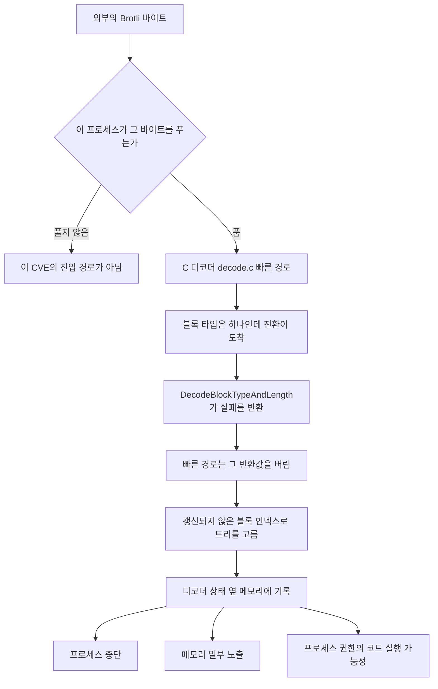
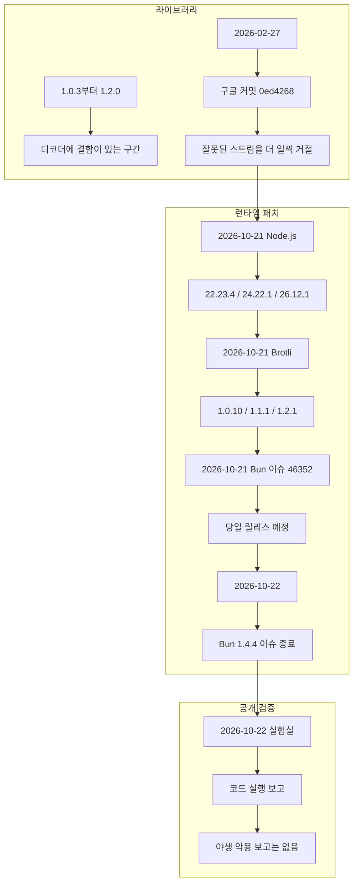
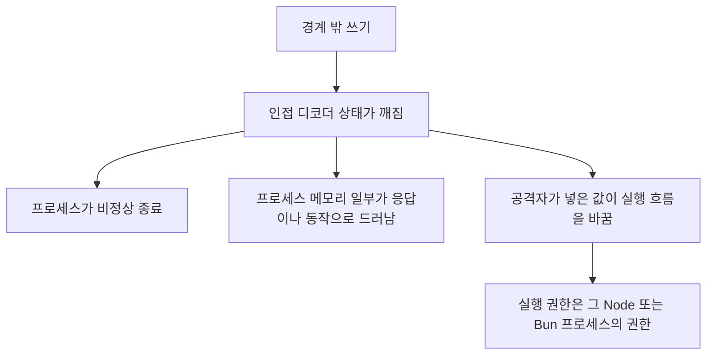
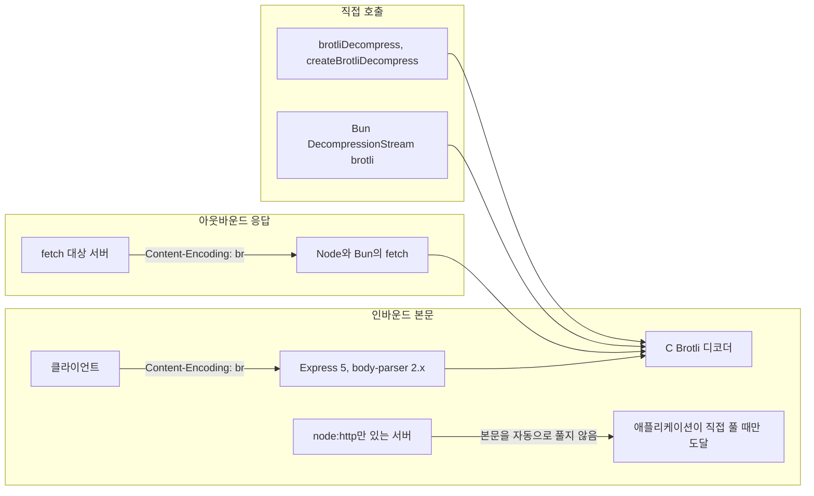
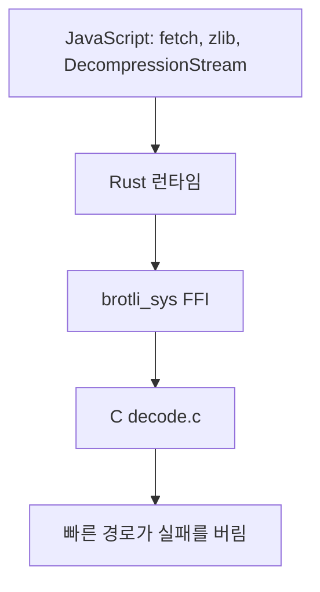

# Node.js and Bun Brotli Decoder Out-of-Bounds Write

CVE-2026-111497. 구글 Brotli 디코더 `c/dec/decode.c`의 경계 밖 쓰기.

확인 기준: 2026-10-23. 아래 버전, 날짜, 오류 코드는 Node.js 보안 공지, CVE 레코드, 구글 Brotli 커밋 `0ed4268`, Bun 이슈 `#46352`와 PR `#46351`, Bun v1.4.4 블로그를 대조한 것이다. 야생 악용 여부는 2026-10-22 공개 분석까지다. 그 다음날 이 문서를 쓰는 시점에 그 결론을 뒤집는 공식 업데이트는 확인하지 못했다.

이 문서는 원인과 영향, 패치 확인 방법을 설명한다. 공격용 바이트열, 재현 입력, 익스플로잇 절차는 적지 않는다.

## 1. 결론

이번 구멍은 Node.js나 Bun의 JavaScript가 메모리를 잘못 다뤄서 생긴 일이 아니다. 두 런타임이 압축을 풀 때 호출하는 **C 라이브러리 디코더**가, 형식에 안 맞는 Brotli 스트림의 실패를 빠른 경로에서 버리고 디코딩을 계속한 탓이다.

그 결과는 한 가지로 고정되지 않는다. 프로세스가 죽을 수 있고, 프로세스 메모리 일부가 새어 나갈 수 있고, 그 프로세스 권한으로 코드가 실행될 수 있다. Node.js는 이 항목을 **High**, 원격 코드 실행이 가능한 경계 밖 쓰기로 공지했다. CVE 레코드의 CVSS 4.0은 **9.2 Critical**이다. 두 숫자는 같은 결함을 다른 척도로 잰 값이라 둘 다 적는다.

노출 조건은 “Brotli를 쓴다”가 아니다. **신뢰할 수 없는 Brotli 바이트를 그 프로세스가 푸는가**이다. 응답을 Brotli로 압축해 브라우저에 보내는 인코더 경로는 이 CVE의 디코더 버그와 별개다.

Bun이 2026년 7월 기준으로 Zig에서 Rust로 옮겨진 뒤에도 이 결함은 남았다. Rust로 다시 쓴 부분은 Bun 자신의 코드이고, Brotli 디코더는 여전히 벤더링된 C 코드다. Rust의 소유권과 빌림 검사는 그 C 함수 안까지 들어가지 않는다. 패치가 새 오류 코드 `-17`을 반환하게 되면서, Bun은 Rust FFI 열거형에 그 값을 넣지 않으면 오히려 Rust 쪽에서 정의되지 않은 동작이 된다는 점까지 같이 고쳐야 했다.

PHP 쪽에서 같은 주에 공개된 PHP2Shell(CVE-2026-109618, CVE-2026-109619)은 다른 제품, 다른 원인이다. Brotli 디코더 결함으로 설명하지 않는다.

## 2. 한 장 그림




패치 이후의 같은 지점은 아래처럼 끊긴다.


## 3. 타임라인




날짜를 이렇게 나누는 이유가 있다. 수정 커밋은 2월에 이미 `google/brotli` 메인에 있었다. 제목은 “Detect and report invalid stream earlier.” 작성자는 eustas, 시각은 2026-02-27T13:10:32Z, 변경은 `c/dec/decode.c`와 `c/include/brotli/decode.h`다. Node.js가 10월 21일에 체리픽한 해시가 이 커밋 `0ed4268a4401abcb4472096340477cf4af7d1a2b`다.

Bun PR `#46351`을 연 시점에는 “v1.2.0 이후 41번째 커밋이라 아직 릴리스 태그에 없다”고 적혀 있다. 그 문장은 PR을 쓰던 시각에는 맞았고, 같은 날 Node 보안 릴리스와 Brotli 패치 릴리스 안내가 나오면서 금방 오래된 문장이 됐다. Aikido는 10월 21일에 Brotli 1.2.1, 1.1.1, 1.0.10이 같은 수정을 담았다고 적는다. CVE 레코드의 수정 버전과 일치한다.

즉 이 사건은 “2년 전 Node만의 낡은 버그”가 아니다. 라이브러리 결함은 1.0.3부터 오래 있었고, 수정은 2026년 2월에 소스에 들어왔으며, **런타임이 그 수정을 제품에 실은 날은 2026년 10월 21–22일**이다. 2026년에 설치한 Node.js 24.22.0과 Bun 1.4.3도 패치 전 버전이면 범위 안이다.

## 4. 영향받는 버전


### 4.1 구글 Brotli

CVE 레코드의 제품 상태:


| 줄   | 영향                  | 수정     |
| --- | ------------------- | ------ |
| 1.0 | 1.0.3 이상, 1.0.10 미만 | 1.0.10 |
| 1.1 | 1.1.0, 1.1.1 미만     | 1.1.1  |
| 1.2 | 1.2.0, 1.2.1 미만     | 1.2.1  |


플랫폼은 가리지 않는다. CWE는 두 개다.

- CWE-252, 검사하지 않은 반환값
- CWE-787, 경계 밖 쓰기

CVSS 4.0 벡터는 `CVSS:4.0/AV:N/AC:L/AT:P/PR:N/UI:N/VC:H/VI:H/VA:H/SC:N/SI:N/SA:N`, 점수 9.2다. `AT:P`는 공격에 추가 조건이 있다는 뜻이다. 네트워크에서 인증 없이 도달할 수 있지만, 디코더가 그 스트림을 실제로 풀어야 하고 형식도 특정 불변식을 깨야 한다. “Brotli 바이트이기만 하면 된다”는 읽기와 다르다.

### 4.2 Node.js

2026-10-21 보안 릴리스. 보고는 OpenAI Codex Security의 Khai Tran, Sylvie Mayer. 수정은 mcollina, aduh95. 릴리스 노트에 적힌 Brotli 커밋 메시지는 `deps: brotli: cherry-pick 0ed4268a4401abcb44720963`이다.


| 라인               | 상태      | 취약                  | 수정         |
| ---------------- | ------- | ------------------- | ---------- |
| 26.x             | Current | 26.12.1 미만          | 26.12.1    |
| 24.x             | LTS     | 24.22.1 미만          | 24.22.1    |
| 22.x             | LTS     | 22.23.4 미만          | 22.23.4    |
| 25, 23, 20과 그 이전 | 지원 종료   | 보안 릴리스 정책상 이번 수정 없음 | 지원 라인으로 이전 |


Node.js 공지의 심각도는 **High**다. 같은 릴리스에는 Brotli 말고도 TLS 호스트명 검사, DNS NUL, keep-alive 소켓, 스냅샷 엔트로피, ZIP 헤더, 권한 모델 항목이 함께 들어 있다. 런타임을 올리면 그 묶음이 같이 들어온다.

배포판 패키지의 Node가 시스템에 설치된 `libbrotli`를 쓰면, Node 버전 번호만 보고 끝이 아니다. 그 경우 수정은 배포판의 Brotli 패키지 권고를 같이 봐야 한다. 공식 바이너리와 공식 컨테이너 이미지는 Node가 들고 있는 복사본을 쓰므로 런타임 업그레이드가 수정이다. `node:24.22.0`처럼 태그를 고정한 이미지는 다시 빌드하기 전까지 패치 전이다.

### 4.3 Bun

Bun 이슈 `#46352`와 PR `#46351`에 적힌 빌드 구성:


| Bun            | 들어 있던 Brotli       | CVE 범위          |
| -------------- | ------------------ | --------------- |
| 1.4.2 이하       | 1.1.0              | 해당              |
| 1.4.3과 당시 main | 1.2.0 (`028fb5a2`) | 해당              |
| 1.4.4 이상       | 위 커밋을 반영한 수정       | 이 CVE에 대한 수정 버전 |


1.4.3으로 올린 사실은 이 결함을 닫지 않는다. 1.4.3 릴리스가 Brotli를 1.2.0으로 올렸고, 1.2.0은 CVE가 적은 영향 구간의 끝이다. 닫는 버전은 1.4.4이다.

1.4.4 블로그의 Security 절은 CVE 번호를 본문에 풀어 쓰지 않는다. 대신 보안 수정이 닿는 프로토콜 목록에 Brotli를 넣는다. 이슈는 2026-10-22에 닫혔고, 메인테이너는 전날 “오늘 릴리스에 수정을 넣겠다”고 답했다. 종료 메모의 랜딩 커밋은 `70c037dc4f70`이다. 이 문서는 그 연쇄를 근거로 1.4.4를 수정 버전으로 적는다.

PR이 적은 도달 경로는 세 곳이다.

- `fetch()`가 `Content-Encoding: br` 응답을 기본으로 품
- `node:zlib`의 Brotli API
- `DecompressionStream("brotli")`

그리고 Bun 쪽 `c/dec/decode.c`는 당시 Node의 패치 전 복사본과 바이트 단위로 같았다고 PR이 적는다. 1.1.0은 Node 22 쪽, 1.2.0은 Node 24·26 쪽이다. Bun이 Brotli에 자체 패치를 얹어 둔 상태가 아니었다.

## 5. 원인

Brotli 스트림은 메타블록 안에서 리터럴, 명령, 거리 데이터를 블록으로 나눈다. 헤더는 “이 종류는 블록 타입이 몇 개인가”를 선언한다. 타입이 하나뿐이면 중간에 다른 타입으로 넘어가는 전환은 형식 오류다.

패치 전 빠른 경로는 그 오류를 이렇게 흘렸다.

```text
스트림: 블록 타입 개수 <= 1 인데 블록 전환이 나타남
        |
        v
DecodeBlockTypeAndLength
        |
        실패를 반환함. 새 타입을 읽지 않고, 블록 길이도 갱신하지 않음
        |
        v
DecodeCommandBlockSwitch 와 같은 빠른 경로
        |
        반환 타입이 void. 실패가 호출부에서 사라짐
        |
        v
예전 block_type 인덱스로 허프만 트리 배열을 인덱싱
        |
        v
배열 길이는 1인데 인덱스는 0이 아닐 수 있음
```

PR `#46351`의 원인 문장을 풀어 쓰면 이렇다. 빠른 경로의 `DecodeLiteralBlockSwitch`, `DecodeCommandBlockSwitch`, `DecodeDistanceBlockSwitch`는 `static void`였다. 스트림이 블록 타입을 하나만 선언한 뒤 전환을 하면 `DecodeBlockTypeAndLength`는 실패한다. 그 실패가 버려지고, 디코더는 어긋난 블록 상태로 계속 간다. 패치는 그 지점에서 `BROTLI_DECODER_ERROR_FORMAT_BLOCK_SWITCH`(`-17`)로 멈춘다. `-17`은 그때까지 예약된 코드였다.

공개 회귀 테스트가 보는 것은 “이 입력을 `-17`로 일찍 거절하는가”이다. Bun PR의 단독 디코더 실험은, 그 검출용 입력에 대해 패치 전 결과가 `-9`(`FORMAT_BLOCK_LENGTH_1`)였고 주소 새니타이저 보고는 없었다고 적는다. 그래서 다음 둘을 같은 말로 두면 안 된다.

- 어떤 잘못된 스트림은 결국 다른 형식 오류로 끝난다.
- CVE가 말하는 조작된 스트림은 그 어긋난 상태로 디코더 상태 옆을 덮어 쓸 수 있다.

Node 공지와 CVE는 후자를 경계 밖 쓰기, 메모리 노출, 서비스 거부, 코드 실행 가능성으로 적는다. 10월 22일 분석은 실험실에서 수정하지 않은 Node.js 24.22.0 공식 이미지에 대한 코드 실행을 보고했다. 같은 분석은 그 실행이 시도마다 되지는 않았다고 적는다. 처음 나온 증명 코드는 일부러 약하게 만든 빌드에서만 코드 실행에 도달했다는 서술도 있다.

개념만 남긴 패치 전후다. 저장소의 함수 전체를 옮긴 코드가 아니다.

```c
/* 패치 전: 빠른 경로는 실패를 담을 곳이 없다. */
static void DecodeCommandBlockSwitch(State *s) {
  DecodeBlockTypeAndLength(s);          /* 실패여도 돌아옴 */
  s->command_tree = s->trees[s->block_index];
}

/* 패치 후: 실패가 디코더 오류 -17로 나간다. */
static int DecodeCommandBlockSwitch(State *s) {
  if (!DecodeBlockTypeAndLength(s))
    return BROTLI_DECODER_ERROR_FORMAT_BLOCK_SWITCH; /* -17 */
  s->command_tree = s->trees[s->block_index];
  return 0;
}
```

안전한 빠른 경로도 원래 실패를 살폈다. 구멍이 난 쪽은 실패를 무시하는 빠른 경로다. CWE 두 개의 순서도 이 모양과 같다. 반환값을 안 봐서(CWE-252), 그 다음 인덱싱이 경계 밖 쓰기(CWE-787)가 된다.

## 6. 메모리 그림

디코더 상태 안에는 “지금 블록 타입”과 “그 타입이 가리키는 허프만 트리 포인터 배열”이 같이 있다. 타입이 하나면 유효한 슬롯은 하나다.

```text
패치 전, 타입이 1개인데 예전 인덱스가 남아 있을 때

  block_index (낡음, 0이 아님)
        |
        v
  trees:  [ 0: 유효한 트리 ][ 1: 이 배열의 끝이 아님 ]
                              \
                               인접한 디코더 상태
                               길이, 트리 포인터, 출력 위치

  디코더는 1번 슬롯을 유효한 트리로 믿고
  그 믿음으로 출력 버퍼와 상태 구조체를 갱신한다.
```

```text
패치 후

  타입 개수 <= 1 인데 전환
        |
        v
  오류 -17
        |
        v
  인덱스도, 길이도, 트리 포인터도 갱신하지 않고 반환
```

물통 비유를 이어서 쓰면, 물통이 넘친 것이기보다 **목차를 잘못 읽고 옆칸 서랍을 연 것**에 가깝다. 할당된 트리 배열의 길이와, 디코더가 믿고 있는 인덱스가 어긋난다. 그 어긋남이 인접 상태를 덮어 쓰면 프로세스 장애, 정보 노출, 코드 실행으로 이어질 수 있다.

메모리 누수와는 다른 현상이다. 누수는 더 이상 쓰지 않는 메모리를 돌려주지 않는 일이다. 이번 결함은 잘못된 주소에 쓰는 메모리 안전성 문제다.

## 7. 결과

CVE 설명의 결과를 프로세스 기준으로 나누면 이렇다.




| 관찰                   | 의미                                             |
| -------------------- | ---------------------------------------------- |
| 프로세스가 죽거나 재시작 루프에 빠짐 | 가용성. 서비스 거부                                    |
| 힙이나 디코더 주변 값이 밖으로 나감 | 기밀성. 그 프로세스가 가진 비밀의 일부가 대상                     |
| 명령 실행                | 무결성. 권한은 런타임 프로세스의 사용자 권한                      |
| 압축 해제가 오류 코드로 끝남     | 그 입력은 거절됐을 수 있음. 오류 코드만으로 “메모리가 깨끗했다”고 말하지는 못함 |


실험실 보고와 야생 사고를 분리한다.

- 2026-10-22 분석: 수정하지 않은 공식 Node.js 24.22.0 리눅스 arm64 이미지에서 코드 실행을 재현했다는 연구 보고가 있다. 매 시도에 성공한 것은 아니다. 24.22.1은 같은 입력을 거절한다.
- 같은 날짜의 Aikido 정리와, Aikido가 전한 The Hacker News 서술: 야생 악용 보고는 없었다.
- 프랑스 CERT Santé 2026-10-22 안내: 적극적 악용은 아님, 공개 증명 코드는 있음, 우회 조치는 없음으로 표시. 이 안내의 CVSS 3.1은 8.1이다.

취약한 버전을 설치해 두었다는 사실만으로 이미 침해됐다는 뜻은 아니다. 그 프로세스가 공격자가 만든 Brotli를 풀어야 경로가 열린다.

## 8. 바이트가 들어오는 세 갈래




### 8.1 요청 본문

Aikido 정리에 따르면 Express 5와 body-parser 2.x는 `Content-Encoding: br` 요청 본문을 푼다. 아무 클라이언트나 그 헤더를 붙일 수 있다. `node:http`만으로 만든 서버는 들어오는 Brotli 본문을 알아서 풀지 않는다. 애플리케이션이나 그 위의 프레임워크가 풀어야 도달한다.

서버가 자기 응답을 `Content-Encoding: br`로 **압축만** 하는 구성은 디코더를 호출하지 않는다. 브라우저가 푼다. 이 CVE의 서버 측 진입점은 압축이 아니라 해제다.

### 8.2 나가는 fetch

`fetch()`는 Brotli로 압축된 응답을 자동으로 푼다. 공격자가 응답을 통제하는 서버, 또는 사용자가 넣은 URL로 웹훅과 프록시를 여는 코드가 전형적인 경로다. 리버스 프록시에서 들어오는 `Content-Encoding: br`을 버려도 이 경로는 그대로다. 프록시는 서버가 밖으로 나가 받은 응답을 보지 않기 때문이다.

### 8.3 직접 API

`node:zlib`의 `brotliDecompress`, `brotliDecompressSync`, `createBrotliDecompress`에 신뢰할 수 없는 버퍼를 넘기면 같은 디코더다. Bun은 여기에 `DecompressionStream("brotli")`가 더해진다.

## 9. 예시 코드

아래 코드는 정상적인 API 사용, 버전 판별, 인바운드 임시 차단이다. 취약점을 깨우는 입력이 아니다. 자기가 방금 압축한 버퍼를 다시 푸는 라운드트립이 성공해도, 패치가 들어 있다는 증거는 아니다. 그 입력은 형식에 맞는 스트림이다.

### 9.1 신뢰하는 데이터만 오고 가는 정상 경로

```js
import { brotliCompressSync, brotliDecompressSync } from "node:zlib";

const plain = Buffer.from("sensor-1,ok\n");
const packed = brotliCompressSync(plain);
const back = brotliDecompressSync(packed);

if (!back.equals(plain)) {
  throw new Error("roundtrip mismatch");
}
```

이 호출이 보여 주는 것은 “zlib의 Brotli API가 C 디코더로 내려간다”는 사실까지다. 외부에서 받은 `packed`를 그대로 `brotliDecompressSync`에 넣는 순간 입력이 신뢰 경계 밖으로 나간다.

### 9.2 런타임 버전이 패치 구간인지

2026-10-23에 공지된 라인만 판별한다. 그 이후 라인은 공지를 다시 본다. 지원 종료 라인은 이번 CVE의 공식 수정이 없다.

```js
const [major, minor, patch] = process.versions.node.split(".").map(Number);

const patched = (() => {
  if (major === 22) return minor > 23 || (minor === 23 && patch >= 4);
  if (major === 24) return minor > 22 || (minor === 22 && patch >= 1);
  if (major === 26) return minor > 12 || (minor === 12 && patch >= 1);
  return false;
})();

console.log(`${process.versions.node} ${patched ? "patched-line" : "check-advisory"}`);
```

Bun:

```js
const [major, minor, patch] = Bun.version.split(".").map(Number);
const patched =
  major > 1 ||
  (major === 1 && minor > 4) ||
  (major === 1 && minor === 4 && patch >= 4);

console.log(`${Bun.version} ${patched ? "patched-line" : "upgrade-to-1.4.4-or-newer"}`);
```

컨테이너를 쓰면 호스트의 `node --version`만으로는 부족하다. 이미지 태그, CI 러너, 서버리스가 고정한 패치 버전을 각각 본다. `node:22.23.3`에 애플리케이션만 다시 빌드하면 런타임 복사본은 그대로다.

### 9.3 인바운드만 임시로 거절

Node 공지는 Brotli 항목의 공식 우회를 제시하지 않는다. 프랑스 CERT 안내도 우회 없음을 표시한다. 아래는 업그레이드 전에 들어오는 요청만 줄이는 임시 조치다. `fetch()`가 받는 응답에는 적용되지 않는다.

```js
function rejectInboundBrotli(req, res) {
  const encoding = String(req.headers["content-encoding"] ?? "").toLowerCase();
  if (encoding.split(",").map((v) => v.trim()).includes("br")) {
    res.writeHead(415, { "content-type": "text/plain" });
    res.end("brotli request bodies are disabled");
    return true;
  }
  return false;
}
```

프록시에서 같은 헤더를 버리는 것도 인바운드에만 해당한다. Vercel은 10월 21일 인바운드 차단 규칙을 올렸다고 밝혔다. 그 규칙이 있어도 자기 서버, CI, 배치 잡의 런타임이 패치 전이면 `fetch` 경로는 남는다.

### 9.4 로그에서 볼 수 있는 오류 코드

패치된 디코더는 이 형식 오류에 `-17`을 쓴다. Node와 Bun은 그 상수를 `BROTLI_DECODER_ERROR_FORMAT_BLOCK_SWITCH`로 노출한다.


| 이름                                           | 값   | 읽는 법                          |
| -------------------------------------------- | --- | ----------------------------- |
| `BROTLI_DECODER_ERROR_FORMAT_BLOCK_SWITCH`   | -17 | 패치가 추가한 조기 거절                 |
| `BROTLI_DECODER_ERROR_FORMAT_BLOCK_LENGTH_1` | -9  | 패치 전 검출 입력이 여기로 끝난 사례가 PR에 있음 |


`-9`가 보인다는 사실만으로 패치 여부를 단정하지 않는다. 다른 잘못된 스트림도 길이 오류로 끝날 수 있다. 버전 판별이 먼저다.

## 10. Bun이 Rust인데도 같은 이유

2026-07-08 Bun 블로그 “Rewriting Bun in Rust”는 인수와 언어 전환을 이렇게 적는다. Anthropic이 2025년 12월 Bun을 인수했고, 작성자는 Rust 재작성의 상당 부분에 Claude Fable 5 프리릴리스를 썼다. 전환 이유는 use-after-free, double-free, 오류 경로에서 정리를 빠뜨리는 류의 안정성 문제였다. Rust의 소유권, 빌림 검사, `Drop`은 그 클래스의 많은 실수를 컴파일 단계에서 막는다.

그 문장은 Bun **자신의** Zig 코드에는 적용된다. 이번 디코더에는 적용되지 않는다. 호출 구조는 이렇다.




Rust 컴파일러는 `decode.c`를 컴파일하지 않는다. FFI로 넘어간 포인터와 C 함수의 내부 인덱싱은 unsafe 경계 밖, 즉 C 컴파일러의 규칙이다. Safe Rust로 Brotli를 다시 구현한 디코더를 썼다면 같은 인덱싱은 보통 패닉이나 `Result` 오류가 된다. 임의의 인접 메모리에 조용히 쓰는 형태는 그 구현에서는 나오지 않는다. Bun 1.4.4 이전이 쓴 것은 그 구현이 아니라 취약한 C 복사본이다.

패치가 Rust 쪽에 추가 작업을 만든 대목이 이 경계를 더 분명하게 보여 준다. C 디코더가 `-17`을 반환하는데 Rust의 `#[repr(i32)]` 오류 열거형에 그 판별 값이 없으면, FFI로 그 정수를 열거형으로 읽는 것 자체가 Rust에서 정의되지 않은 동작이다. PR은 그래서 `BrotliDecoderErrorCode2`에 `ERROR_FORMAT_BLOCK_SWITCH = -17`을 넣고, `node:zlib` 오류 매핑과 `zlib.constants` 노출을 같이 넣었다. C 쪽 한 줄 수정으로 끝나지 않았다.

압축 폭탄은 이 패치 뒤에도 남는다. 맞게 압축된 거대한 출력을 일부러 풀게 하면 메모리와 CPU를 소모한다. 그것은 경계 검사의 문제가 아니라 자원 한도의 문제다. 해제 크기 제한과 시간 제한은 패치와 별도로 둔다.

## 11. PHP2Shell은 다른 사건

같은 주 공개라 기사에서 묶여 보일 수 있다. 제품과 원인이 다르다.


|                   | Node2Shell로 불리는 쪽                                                          | PHP2Shell                          |
| ----------------- | -------------------------------------------------------------------------- | ---------------------------------- |
| CVE               | CVE-2026-111497                                                            | CVE-2026-109618, CVE-2026-109619   |
| 위치                | 구글 Brotli 디코더를 품은 Node.js, Bun                                             | PHP 런타임                            |
| 입력                | 조작된 Brotli 스트림                                                             | PHP의 HTTP 요청 처리, 메모리 부족과 해제 이후 상태  |
| 10월 23일 무렵의 악용 보도 | 실험실 재현. 야생 보고는 없다는 분석                                                      | 연구실에서 코드 실행이 확인됨. 허니팟과 고객망에서 시도가 관측됨. 인용 자료는 운영 침해 성공을 확정하지 않음 |
| 수정                | Node 22.23.4 / 24.22.1 / 26.12.1, Bun 1.4.4, Brotli 1.0.10 / 1.1.1 / 1.2.1 | PHP 8.2.35, 8.3.36, 8.4.27, 8.5.12 |


PHP를 Rust로 바꾼다고 이번 Brotli CVE가 자동으로 닫히지도 않고, Bun을 Rust로 바꾼 사실이 PHP 결함을 설명하지도 않는다.

## 12. 용어

대화에서 쓰기 쉬운 말과, 이번 건에 맞는 말을 나눠 둔다.


| 쓰기 쉬운 말                  | 이번 건에 맞는 말                                        |
| ------------------------ | ------------------------------------------------- |
| 메모리 누수 때문에 해킹됐다          | 검사하지 않은 반환값이 경계 밖 쓰기로 이어졌다                        |
| C는 사람에게 메모리 권한을 준다       | C는 인덱스와 수명을 컴파일러가 보장하지 않고, 잘못된 사용이 정의되지 않은 동작이 된다 |
| Rust로 컴파일되면 해킹이 안 된다     | Safe Rust는 이 클래스의 메모리 손상을 컴파일 또는 경계 검사로 막는 쪽이 많다  |
| Rust로 포팅했으니 Brotli도 안전하다 | 포팅된 코드가 Safe Rust일 때 그 코드에 해당한다. C 라이브러리 호출은 밖이다  |
| AI가 계속 공격하면 Rust도 결국 뚫린다 | 공격 횟수와, 그 공격이 기댈 메모리 손상이 코드에 존재하는지는 다른 문제다        |
| 취약한 버전이면 이미 해킹된 것이다      | 취약한 디코더로 신뢰할 수 없는 Brotli를 풀면 공격 경로가 열린다           |


AI로 탐색을 자동화하면 취약점을 찾는 속도는 올라갈 수 있다. Rust 컴파일러가 막는 것은 그 속도와 별개의 층이다. 메모리 손상이라는 종류의 버그가 바이너리에 없으면, 그 종류를 전제로 한 공격은 성립하지 않는다. 인증 실수, SSRF, 주입, 자원 고갈, `unsafe`와 FFI는 그 층 밖에 남는다.

## 13. 할 일

1. Node는 22.23.4, 24.22.1, 26.12.1 이상인지 확인한다. 20, 23, 25를 포함한 지원 종료 라인은 지원 라인으로 옮긴다.
2. Bun은 1.4.4 이상인지 확인한다. 1.4.3은 Brotli 1.2.0이라 이 CVE 범위 안이다.
3. 컨테이너, CI, 서버리스, 데스크톱에 깔린 런타임을 각각 본다.
4. 배포판 Node면 시스템 Brotli 권고를 같이 본다.
5. 인바운드 `Content-Encoding: br` 차단은 임시로만 쓴다. `fetch` 경로는 런타임 업그레이드만 닫는다.
6. 신뢰할 수 없는 압축 해제에는 출력 크기 한도와 시간 한도를 둔다. 패치가 압축 폭탄까지 없애지는 않는다.

우선순위는 “밖으로 `fetch`하는 서비스”와 “요청 본문의 Brotli를 푸는 서비스”가 앞이다. 나머지 프로세스도 같은 런타임 복사본을 쓰면 다음으로 올린다. 기능 호출이 없어 보여도 의존성이 풀고 있을 수 있다.

## 14. 노트와 대조한 정정

맞는 부분:

- CVE 번호 CVE-2026-111497, 위치는 구글 Brotli 디코더.
- Node 수정 버전 22.23.4, 24.22.1, 26.12.1.
- Bun 수정 버전 1.4.4. 1.4.3은 영향 범위.
- Brotli 1.0.3부터 1.2.0까지가 라이브러리 영향 구간.
- 2년 전 설치본만의 문제가 아니다.
- 취약한 버전이라고 항상 침해된 것은 아니다.
- Safe Rust 디코더와, Rust에서 C 디코더를 호출하는 경우를 나눠야 한다.
- PHP 기사를 이 CVE 하나로 단정하면 안 된다.
- 메모리 누수라는 단어보다 메모리 안전성이 맞다.

더 정확히 고친 부분:

- Node 프로젝트 심각도는 High다. 9.2는 CVE 레코드의 CVSS 4.0이고, 프랑스 CERT는 CVSS 3.1로 8.1을 적었다.
- 야생 침해 사고는 10월 22일 자료 기준으로 확인되지 않았다. 확인된 것은 실험실 재현이다.
- 원인 문장은 “경계 검사를 안 했다”에서 한 단계 더 구체적이다. 빠른 경로가 블록 전환의 실패 반환값을 버렸고, 그 결과 낡은 인덱스로 쓰기가 이어졌다.
- 서버가 Brotli로 응답을 압축하는 것만으로는 이 디코더 경로에 들어가지 않는다.
- Bun 1.4.4 블로그는 CVE 번호를 본문에 적지 않고 Brotli를 보안 수정 대상 목록에 넣는다. CVE와의 연결은 이슈 `#46352`와 PR `#46351`이 담당한다.
- 수정 커밋 자체는 2026-02-27에 이미 업스트림에 있었다. 10월은 그 커밋이 Node와 Bun 릴리스에 들어간 때다.


## 15. 출처

- Node.js, Wednesday, October 21, 2026 Security Releases. [https://nodejs.org/en/blog/vulnerability/october-2026-security-releases](https://nodejs.org/en/blog/vulnerability/october-2026-security-releases)
- Node.js 26.12.1, 22.23.4 릴리스 노트. Brotli 체리픽 `0ed4268a4401abcb44720963`
- CVE Record CVE-2026-111497. [https://www.cve.org/CVERecord?id=CVE-2026-111497](https://www.cve.org/CVERecord?id=CVE-2026-111497)
- google/brotli 커밋 `0ed4268a4401abcb4472096340477cf4af7d1a2b`, 2026-02-27, “Detect and report invalid stream earlier.”
- oven-sh/bun 이슈 46352, PR 46351
- Bun v1.4.4 블로그 Security 절. [https://bun.com/blog/bun-v1.4.4](https://bun.com/blog/bun-v1.4.4)
- Bun, Rewriting Bun in Rust, 2026-07-08. [https://bun.com/blog/bun-in-rust](https://bun.com/blog/bun-in-rust)
- Aikido, Node2Shell 정리, 2026-10-22. 진입 경로, 실험실 재현, 야생 악용 미보고, Brotli 패치 버전
- CERT Santé, Node.js CVE-2026-111497 안내, 2026-10-22
- PHP2Shell은 CVE-2026-109618, CVE-2026-109619. 연구실 재현, 야생 시도, 운영 침해 성공의 구분은 [PHP2Shell Critical Remote Code Execution in the PHP Engine](../cs/261023_1756_PHP2Shell%20Critical%20Remote%20Code%20Execution%20in%20the%20PHP%20Engine.md)를 본다. PHP와 Brotli CVE를 분리해서 볼 것

