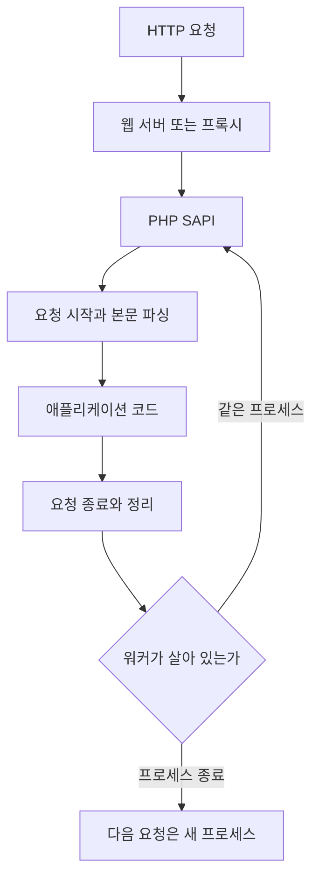
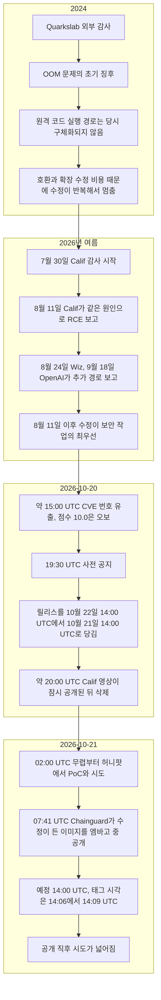
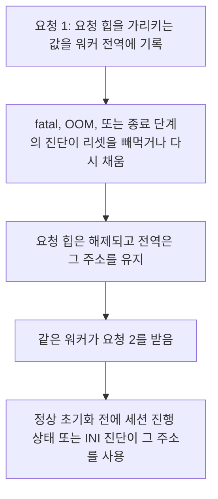
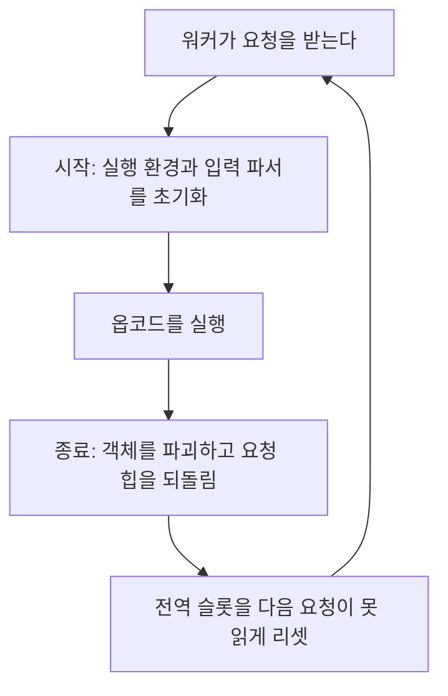

# PHP2Shell: PHP 엔진의 원격 코드 실행

CVE-2026-109618, CVE-2026-109619. PHP가 HTTP 요청을 다루는 동안 메모리 한도 이탈과 요청 경계의 전역 상태가 깨지는 결함.

확인 기준: 2026-10-23. 버전, 점수, 원인 문장, 임시 설정은 PHP 보안 권고, GHSA-w8hw-w9fx-j79w, GHSA-6wmf-4rv5-p3rp, PHP Foundation의 2026-10-21 글을 대조한 것이다. 야생 관측은 그 날짜까지의 CISA, Amazon Threat Intelligence, Sophos의 정정, mnemonic의 24시간 정리다. 그 뒤에 나온 침해 확정은 이 문서에 반영되어 있지 않다.

이 문서는 원인, 영향, 패치 확인, 임시 설정을 설명한다. 공격 요청의 본문 구성, 필드 배치, 재현 입력, 익스플로잇 절차는 적지 않는다. 권고가 “OOM strategies”로 부르는 세부 조건은 GHSA에 남겨 두고 여기에는 가져오지 않는다.

## 1. 결론

이번 구멍은 워드프레스 플러그인, 라라벨 컨트롤러, 업로드 폼의 검증 실수가 아니다. **PHP 엔진**이 웹 요청을 받고, 메모리 한도에 걸리고, 요청을 끝내고, 같은 워커가 다음 요청을 받는 길에 있다.

두 항목 모두 인증 없는 원격 코드 실행이 가능하다. PHP와 GitHub Advisory의 CVSS 4.0은 둘 다 **9.2 Critical**이다. 벡터는 같다.

```text
CVSS:4.0/AV:N/AC:H/AT:P/PR:N/UI:N/VC:H/VI:H/VA:H/SC:N/SI:N/SA:N
```

네트워크에서 도달하고(`AV:N`), 권한이 필요 없고(`PR:N`), 사용자 클릭이 필요 없다(`UI:N`). 성공하면 그 PHP 워커 권한으로 기밀·무결성·가용성이 깨진다(`VC/VI/VA:H`). 다른 시스템으로의 후속 점수는 None이다. 복잡도는 High이고 공격 요구사항이 있다(`AC:H`, `AT:P`). 10월 20일 온라인에 돈 10.0은 PHP Foundation이 틀린 점수라고 밝힌 값이다. 공식 점수는 9.2다.

공개 이름은 PHP2Shell이다. 같은 주에 나온 Node.js·Bun의 Brotli 결함(CVE-2026-111497)과 제품도 원인도 다르다. 그 구분은 [Node.js and Bun Brotli Decoder Out-of-Bounds Write](../bun/261022_1720_Node.js%20and%20Bun%20Brotli%20Decoder%20Out-of-Bounds%20Write.md)에 있다.

완전한 수정은 패치된 PHP로 올리고 **실행 중인 워커를 교체**하는 것이다. `memory_limit=-1`이나 `session.upload_progress.enabled=0`은 확인된 경로의 노출을 줄인다. PHP는 그 설정을 완전한 해결로 적지 않는다.

## 2. 요청이 엔진을 지나는 경로

웹 서버가 `.php`로 요청을 넘기면 PHP SAPI가 엔진을 깨운다. SAPI는 엔진과 HTTP 서버를 잇는 층이다. Apache `mod_php`, PHP-FPM, `php-cgi`, FrankenPHP, LiteSpeed(LSAPI)가 이번 권고의 대상이다.



애플리케이션 코드는 이 사슬의 한가운데다. PHP 권고는 `mod_php`에서 **애플리케이션 코드가 돌기 전**, 요청 시작 중 본문 파싱만으로 공격이 시연되었다고 적는다. 로그인, CSRF, 플러그인 권한 검사는 그 시점 뒤에 있다.

워커가 요청마다 죽고 다시 뜨면, 이전 요청의 전역 상태가 다음 요청으로 넘어갈 자리가 없다. PHP-FPM과 `mod_php`는 보통 한 프로세스가 여러 요청을 연달아 받는다. CVE-2026-109619는 그 생존에 기대고, CVE-2026-109618의 시작 실패 경로는 정리 함수를 호출하는 SAPI에서 더 직접적이다. SAPI별 차이는 8장에 둔다.

한 번 실행되고 끝나는 CLI, 예를 들어 `php bin/console`이나 cron의 `php script.php`는 권고가 말한 “웹 요청을 서빙하는 설치”에 들어가지 않는다. `php -S`로 붙인 내장 웹 서버는 웹 SAPI다.

## 3. 두 결함

| | CVE-2026-109618 | CVE-2026-109619 |
| --- | --- | --- |
| GHSA | GHSA-w8hw-w9fx-j79w | GHSA-6wmf-4rv5-p3rp |
| PHP가 붙인 이름 | RCE via OOM corruption | RCE via stale global state |
| 한 줄 | 메모리 한도에서 `longjmp()`로 요청을 중단하면, 초기화가 끝난 적 없는 요청 데이터를 정리가 유효한 데이터로 다룬다 | 요청이 소유한 상태가 그 메모리가 해제된 뒤에도 워커 전역에 남고, 다음 요청의 정상 초기화 전에 그 값을 읽는다 |
| CWE | CWE-416, CWE-755, CWE-824, CWE-1325, CWE-1419 | 같은 다섯 개 |
| CVSS 4.0 | 9.2 | 9.2 |
| 확인된 결과 | 워커 계정 권한의 원격 코드 실행. `mod_php` 기본 한도에서 HTTP로 검증 | 힙 use-after-free, 메모리 노출, 워커 권한의 원격 코드 실행 |
| 패치 | 8.5.12, 8.4.27, 8.3.36, 8.2.35에 함께 들어 있다 | 같은 릴리스 |

둘은 메모리 관리와 오류 처리라는 인접한 층을 건드리지만 발화 지점이 다르다. 하나만 막고 나머지를 패치로 간주하는 설정은 PHP 권고의 “only an update is a complete solution”과 맞지 않는다. GHSA도 서로 상대 권고의 조치를 같이 따르라고 적는다.

## 4. 시간



날짜를 이렇게 나누는 이유가 있다. 라이브러리 커밋이 2026년 2월에 이미 있던 Brotli와 달리, 이 OOM 문제는 2024년 감사 후속 작업에서 징후가 보였고 원격 코드 실행 경로가 2026년 8월에 보고된 뒤에야 수정이 최우선이 되었다. PHP Foundation은 그 지연을 보안팀의 합의 절차와 인력 부족에서 온 구조적 실패로 적었다. 10월 21일은 그 수정이 릴리스된 날이지, 버그가 생긴 날이 아니다.

10월 17일은 공개일이 아니다. Amazon Threat Intelligence는 MadPot 허니팟에서 그 날짜의 시도 하나를 적었다. 출발지는 상용 익명 네트워크의 주소였고, 엠바고 중인 정보를 어떻게 얻었는지는 밝히지 않았다. 그 시도가 실제 서버에서 성공했는지는 같은 글이 단정하지 않는다.

시각이 출처마다 한 칸씩 다르다. 사전 공지의 예정 시각과 Amazon이 적은 엠바고 해제는 **2026-10-21 14:00 UTC**다. GitHub 릴리스 시각은 PHP 8.5.12가 14:06, 8.4.27과 8.3.36이 14:07, 8.2.35가 14:09 UTC다. php.net 뉴스 아카이브도 이 릴리스를 10월 21일로 올린다. ChangeLog 페이지는 네 버전 모두 **22 Oct 2026**으로 찍혀 있다. CERT-EU 권고는 수정 시각을 13:30 UTC로 적는다. 이 문서는 예정 14:00 UTC와 GitHub 태그 시각을 릴리스 시각으로 두고, ChangeLog의 22일과 CERT-EU의 13:30은 그 출처의 기록으로 남긴다.

## 5. 버전

| 브랜치 | 패치된 최초 버전 | 그 아래 |
| --- | --- | --- |
| 8.5 | 8.5.12 | 8.5.11 이하 |
| 8.4 | 8.4.27 | 8.4.26 이하 |
| 8.3 | 8.3.36 | 8.3.35 이하 |
| 8.2 | 8.2.35 | 8.2.34 이하 |
| 8.1, 8.0, 7.4 | php.net 정식 릴리스 없음 | 소스로 빌드하는 경우를 위한 최소 백포트가 보안팀에서 제공됨 |
| 더 오래된 라인 | php.net 업데이트 없음 | 배포판·LTS 벤더 백포트 여부를 그 벤더에 확인 |

Google Cloud는 영향 구간을 **PHP 5.4부터 8.5.11까지**로 적었다. PHP 자신의 권고 문장은 하한을 5.4라고 찍지 않고, 웹 요청을 서빙하는 모든 설치를 대상으로 둔다. 5.4 미만은 이 문서에서 영향 있다고도 없다고도 단정하지 않는다.

PHP 8.2는 이 보안 릴리스 노트 기준으로 **2026-12-31**에 수명 종료다. 8.2.35는 이번 결함을 막지만, 그 날짜 이후의 다른 보안 수정은 이 브랜치에 오지 않는다.

PHP 8.6.0은 2026-10-08 기준 RC3였다. 운영 수정본이 아니다. 이번 보안 릴리스의 대상은 8.2, 8.3, 8.4, 8.5다.

배포판 패키지는 업스트림 버전 문자열과 다를 수 있다. 보안 패치가 `8.3.30-2+deb` 같은 자리로 들어갈 수 있으므로, 숫자만 보고 8.3.36 미만이면 무조건 미패치라고 자르기 전에 그 배포판의 권고를 본다. 반대로 업스트림 8.3.35를 그대로 담은 컨테이너는 범위 안이다.

`rpms.remirepo.net`은 자원봉사자 저장소다. PHP는 릴리스 당일 그 저장소에 업데이트가 없으니, 배포판 패키지나 소스 빌드로 옮기라고 했다.

Windows 바이너리와 소스는 PHP 다운로드 페이지에 같이 올라왔다. 운영체제만 다르고 엔진 결함은 같다.

## 6. CVE-2026-109618, 메모리 한도에서 요청이 중간 상태로 빠진다

PHP는 `memory_limit`를 넘기면 예전부터 `longjmp()`로 그 요청의 현재 문맥을 버리고 OOM 오류로 나갔다. `longjmp`는 함수 반환을 타지 않는다. 호출 스택에 쌓아 둔 정리, 즉 반쯤 만든 구조체를 무효로 표시하는 코드가 실행되지 않은 채 멀리 있는 오류 처리로 점프한다.

GHSA의 요약은 이렇다. 요청 메모리가 완전히 초기화되기 전에 일시적으로 도달 가능한 구간이 있다. 그 구간에서 아무 할당이나 실패하면 PHP는 그 조기 종료를 제대로 반영하지 못하고 요청 메모리를 잘못된 상태로 남긴다. 실패한 할당이 그 잘못된 메모리와 같은 할당일 필요는 없다. 요청 종료 절차가 그 값을 읽거나 그 값으로 분기한다.

```text
요청 구조체
  file 포인터 = 아직 없음
  메타데이터 = 일부만 기록
        |
        |  이 시점의 할당 실패
        v
  longjmp  --->  스택의 정리 코드를 건너뜀
        |
        v
  종료 절차가 file 포인터를 유효한 것으로 보고 해제
  그 자리에는 이전 할당의 바이트가 남아 있을 수 있음
```

개념만 적은 스케치다. php-src의 함수명도 아니고, 이 스케치를 호출한다고 결함이 재현되지도 않는다.

```c
/* 패치 전 동작의 개념. 엔진 발췌가 아니다. */
void begin_request(struct request *req) {
    req->file = NULL;
    parse_body(req);              /* 여기서 다른 할당이 실패할 수 있다 */
    if (out_of_memory)
        longjmp(bailout, 1);      /* 초기화 중간에서 요청 밖으로 나간다 */
}

void shutdown_request(struct request *req) {
    release_upload(req->file);    /* 초기화가 끝난 포인터로 보고 해제한다 */
}
```

패치 전 엔진은 메모리 한도에 닿는 순간 왼쪽 길을 탔다. 종료 함수는 “포인터가 초기화되었는가”를 이 조기 탈출과 맞춰 보지 못했다.

PHP Foundation은 `mod_php`에서 인증 없는 요청이 애플리케이션 코드 전에 이 조건을 만들고, 기본 설정에서 원격 코드 실행까지 시연되었다고 적는다. 워커가 여러 개이고 다른 트래픽이 있으면 시도 횟수는 늘고, 조건 자체가 사라지지는 않는다고 GHSA가 적는다. 빌드, 확장, 프런트엔드, 할당자 배치에 따라 이식성과 성공률이 달라진다.

GHSA가 적는 완화의 핵심은 `longjmp()`를 OOM 경로에서 빼는 것이다. 소프트 OOM은 다음 VM 안전 지점까지 미뤄 그 지점에서 정상적으로 끝내고, 더 높은 두 번째 문턱의 하드 OOM은 `_exit()`로 프로세스를 끝낸다. 종료 절차가 중간 상태를 보지 않게 하면서, PHP가 메모리 사용을 제한하는 능력은 남긴다. 커밋 제목은 “Avoid state corruption via bailout”이고, 설명은 bailout을 UnwindExit로 바꾸며 시작 단계에서 만질 수 있는 전역을 리셋한다는 것이다. 저자는 Arnaud Le Blanc, 공동 저자는 Ilija Tovilo, Jakub Zelenka, Nora Dossche, Nicolas Grekas다. 브랜치마다 해시는 다르다. 8.3.36 쪽은 `3c832b523ee13b1a010177d2ff84aea18be0015e`, 8.2.35 쪽은 `01a40e89fbfc499936e3b05888d8f00bfde886df`이고, 둘 다 2026-10-18이다. 8.4와 8.5의 해시는 이 문서에 적지 않는다.

```c
/* 패치 후 동작의 개념. GHSA 설명을 절차로 옮긴 것이다. */
void on_allocation_pressure(void) {
    if (soft_limit)
        defer_to_next_vm_safe_point(); /* 중간 상태를 정리할 수 있는 곳까지 */
    if (hard_limit)
        _exit(1);                       /* longjmp로 종료 루틴에 들어가지 않음 */
}
```

## 7. CVE-2026-109619, 요청이 죽은 뒤에도 워커가 그 주소를 쥐고 있다

PHP 워커는 프로세스 수명 동안 전역을 유지한다. 오류 상태, 세션, 객체, 확장 상태가 그 전역에 들어가는데, 그 전역이 가리키는 메모리는 요청 한 건의 힙인 경우가 있다. 힙을 풀기 전에 전역을 비워야 한다.

일부 입력 처리, 설정 적용, 세션, 오류 처리는 **다음 요청의 정상 초기화보다 먼저** 돈다. 앞 요청이 리셋하지 않은 값을 그 이른 코드가 읽으면 use-after-free다. GHSA는 힙 배치에 따라 원격 코드 실행까지 이어진다고 적는다.

성립 조건은 생산자와 소비자다.



생산자가 상태를 남기는 경로는 한 가지가 아니다.

- fatal이 리셋 전에 작업을 버린다. 파싱·컴파일 실패, 잡지 못한 오류, `require` 실패, `Maximum execution time exceeded`가 GHSA에 적힌 예다.
- OOM이 같은 종류의 중단이 된다. 오류, 예외, 객체, 확장 상태가 이미 공개된 뒤라면 그렇다.
- 종료의 나중 단계에서 확장이나 서버 정리가 경고를 내면, 이미 지운 오류 상태를 요청 소유의 새 값으로 다시 채운다.

확인된 소비자는 두 갈래다.

**세션 업로드 진행 상태.** `session.upload_progress.enabled`의 기본값은 켜짐이다. 애플리케이션이 `session_start()`를 호출하지 않아도, 업로드 진행 처리는 보통의 세션 초기화보다 먼저 세션 코드에 닿을 수 있다. 그래서 앞 요청이 남긴 세션 또는 디코더 상태를 정상 초기화 전에 읽는다. `mod_php`에서는 멀티파트 시작 중에 생산과 fatal이 날 수 있다. FPM은 그 시작 실패 때 자식을 종료하므로 그 정확한 순서는 남지 않는다. GHSA가 FPM에서 검증했다고 적은 경로는, 시작이 성공한 뒤 애플리케이션 실행 중에 상태를 공개하고 fatal에 도달한 다음, 이후 요청의 업로드 진행 처리가 소비자가 되는 쪽이다. 일반적인 동적 FPM 풀에서 동작했고, 맞는 애플리케이션 동작에 의존한다.

**초기화 전의 INI 진단.** 경고, 알림, 폐기 예고가 초기화 중에 나면 낡은 오류 상태를 소비할 수 있다. 화면에 나오거나 로그에 남을 필요가 없다. `error_reporting`을 낮추거나, `@`로 억제하거나, `display_errors`와 `log_errors`를 꺼도 전역을 읽는 시점 자체는 남는다. `mod_php`에서는 `.htaccess`와 Apache의 `php_value` / `php_flag` / `php_admin_*` 디렉터리 설정이 `php_request_startup()`보다 먼저 적용된다. 보통의 `php.ini`는 프로세스 시작 때 읽는 설정이라, 요청을 넘나드는 소비자가 되지 않는다. FPM은 nginx나 `mod_proxy_fcgi` 등이 요청마다 `PHP_VALUE` / `PHP_ADMIN_VALUE`를 보내고 그 값이 초기화 전에 진단을 낼 때 조건부로 노출된다. 풀 설정은 워커가 뜰 때 적용되고, `.user.ini`는 정상 초기화 뒤에 적용되므로 이 이른 소비자와 같은 자리가 아니다.

PHP 8.5에서 `fatal_error_backtraces`가 켜져 있으면 fatal 보고가 요청 소유의 백트레이스를 저장하고, 종료 때 이 전역의 리셋이 항상 빠진다. GHSA는 이 경로를 가장 강하게 시연된 경우로 적고, 확인된 `mod_php` 코드 실행의 근거로 둔다. 8.5에서 `fatal_error_backtraces=0`은 이 생산자만 끈다.

GHSA가 진단의 예로 든 설정이 있다. 공격 절차로 옮기지 말고, 요청마다 적용되는 낡은 지시어를 치우는 점검 목록으로 본다.

- `auto_detect_line_endings=1`
- 기본이 아닌 `filter.default`
- PHP 8.3 이상의 레거시 `assert.*`
- PHP 8.4 이상의 레거시 세션 설정
- PHP 8.5의 `report_memleaks=0`, 0이 아닌 `intl.error_level`
- `mbstring.http_input`, `mbstring.http_output`, `mbstring.internal_encoding`
- `iconv.input_encoding`, `iconv.output_encoding`, `iconv.internal_encoding`
- 값이 충돌하거나 잘못된 `zend.assertions`, `memory_limit`, `date.timezone`, DBA, EXIF, mail, OpenSSL, zlib, 로드된 확장
- PHP 8.2 이상에서 형식이 깨지거나 넘치는 수량. 잘못된 `memory_limit`, 본문 크기, 입력, 타임아웃, 스택, 확장 값
- `open_basedir` 때문에 거부되는 로그, mail, 세션, SOAP 캐시 경로

이 목록은 확인된 INI 소비자 쪽이다. 세션 업로드 진행 경로는 이 진단 없이도 동작한다고 GHSA가 적는다.

다른 오류, 예외, 객체, 확장 상태도 패치가 함께 리셋한다. 그 전부가 모든 앱에서 도달 가능하다는 뜻은 아니다. 콜백 안에서 fatal이 나면, 그 연산을 호출한 엔진 코드가 임시 상태를 아직 들고 있을 수 있다. 이 갈래를 설정 한 줄로 다 막는 방법은 GHSA에 없다.

생산 요청과 소비 요청은 같은 워커에 닿아야 한다. 워커가 많거나 자주 재시작되면 요청 한 건의 성공률은 줄고, 조건은 남는다.

## 8. SAPI마다 정리와 프로세스 수명이 다르다

엔진은 같고, 요청 시작이 실패했을 때 종료 함수를 호출하는지, 프로세스가 다음 요청을 받는지는 SAPI가 정한다.

| SAPI | CVE-2026-109618에서 권고·GHSA가 적은 내용 | CVE-2026-109619에서 권고·GHSA가 적은 내용 |
| --- | --- | --- |
| Apache `mod_php` | 시작이 실패해도 종료 절차를 호출한다. 애플리케이션 코드 전에 시연된 경로가 있고, 기본 한도에서 RCE가 검증되었다. PHP가 위험을 가장 높게 본 구성 | fatal 백트레이스 경로의 RCE가 확인되었다. 세션 수명주기 RCE도 `mod_php`에서 검증되었다 |
| PHP-FPM | 요청 시작이 실패하면 자식을 종료한다. 그 시작 실패 경로는 잘못된 상태를 소비하지 못한다. 시작이 성공한 뒤의 OOM은 여전히 종료 절차로 들어갈 수 있다. GHSA는 이 SAPI의 완전한 익스플로잇이 시연되지 않았다고 적고, PHP Foundation은 애플리케이션 코드 경로의 RCE가 FPM에서 확인되었다고 적는다 | 시작 실패로 자식이 죽으면 그 순서는 다음 요청에 남지 않는다. 검증된 FPM 경로는 애플리케이션 실행 중 상태를 남기고, 이후 업로드 진행 처리가 소비한다. 프론트가 요청마다 진단을 유발하는 `PHP_VALUE`를 주면 INI 소비자도 조건부로 열린다 |
| FrankenPHP | 소스 분석상 `mod_php`처럼 종료 절차를 무조건 호출해, 애플리케이션과 무관한 공격이 가능하다고 GHSA가 본다 | 기본 구성에서 `mod_php`와 같은 이른 설정 소비자는 확인되지 않았다. GHSA는 그래서 면역이 되는 것은 아니라고 적는다 |
| LiteSpeed LSAPI | FPM과 같은 모형이라 애플리케이션 쪽 악용이 가능성으로 남고, GHSA는 검증하지 않았다고 적는다 | 환경 변수로 이른 INI를 넣을 수 있어 조건부 후보다 |
| `php-cgi` | PHP 권고의 영향 목록에 있다. GHSA의 검증 문단은 이 SAPI를 따로 끝내지 않는다 | 권고의 영향 목록에 있다. 별도 검증 문단은 GHSA에서 확인하지 못했다 |

FPM이라는 이유만으로 범위 밖이 되지는 않는다. Foundation과 GHSA의 FPM 문장이 어긋나 보이면, 시작 실패 경로와 시작 성공 뒤의 애플리케이션 경로를 다른 줄로 읽는다. 운영 결론은 같다. FPM도 패치 대상이다.

`mod_php`가 높게 평가된 이유는 프로세스 계정이 넓은 경우가 많기 때문이기도 하다. Apache 자손 프로세스가 문서를 읽고 쓸 수 있으면, 워커 권한의 코드 실행은 그 계정으로 파일과 이웃 가상 호스트에 닿는다. FPM을 사이트마다 다른 유닉스 계정으로 나누면 그 반경이 풀 계정으로 줄어든다. 계정 분리는 이 CVE를 닫지 않는다.

## 9. 애플리케이션은 엔진 위에 있다

워드프레스, 드라팔, 라라벨, 마젠토, phpMyAdmin, 파일 하나짜리 `index.php`는 같은 엔진 경로를 탄다. Vercel 권고는 PHP 5.4 이후의 기본 구성에서 프레임워크와 CMS가 취약한 런타임 위에 있으면 영향받는다고 적었다. 앱을 최신으로 올려도 PHP 패키지가 8.3.35면 이 CVE는 그대로다. PHP를 8.3.36으로 올리면 이 두 CVE는 엔진에서 닫히고, 그 앱의 다른 결함은 별도다.

```text
워드프레스 최신  +  PHP 8.3.35     이 CVE의 범위
워드프레스 구버전 +  PHP 8.3.36     이 두 CVE는 엔진 패치로 닫힘
라라벨이 업로드를 받지 않음         앱에 폼이 없어도 엔진이 본문을 파싱하면 시작 경로가 남음
```

서드파티 장비와 패널, 컨테이너 이미지가 PHP를 품고 있으면 저장소 이름에 php가 없어도 대상이다. CERT-EU는 그 목록의 출발점으로 NCSC-NL의 [php2shell](https://github.com/NCSC-NL/php2shell) 저장소를 가리킨다. 이 문서는 그 저장소의 제품 목록을 베끼지 않는다. 자기 인프라에서 `php` 바이너리, `libphp`, php-fpm 소켓, FrankenPHP 이미지를 찾는 쪽이 먼저다.

## 10. 패치가 바꾸는 것

8.5.12, 8.4.27, 8.3.36, 8.2.35의 릴리스 문장은 같다. 두 CVE를 막고, 완전한 완화는 없으며, 업데이트가 유일한 안전한 선택이다.

패치의 사용자에게 보이는 동작은 GHSA 기준으로 두 줄이다.

- OOM이 `longjmp`로 중간 상태를 건너뛰지 않는다. 소프트 한도는 안전 지점까지 미루고, 하드 한도는 프로세스를 종료한다.
- 다음 요청의 정상 초기화보다 먼저 돌 수 있는 코드가 보는 전역을, 요청 힙을 풀기 전에 리셋한다.

메모리 한도 기능 자체가 사라진 것은 아니다. `memory_limit`를 둔 앱은 패치 뒤에도 한도에 닿으면 요청이 실패한다. 실패의 방식이 바뀌어, 그 실패가 힙을 오염시키지 않는 쪽이 패치의 목적이다.

확장 모듈을 직접 빌드해 쓰는 곳은 엔진 헤더와 함께 다시 컴파일한다. 배포판이 php-fpm과 `php8.3-mysql` 같은 확장을 한 세트로 갱신하면 그 패키지를 같이 올린다. 엔진만 바꾸고 확장은 옛 `.so`를 남기면 기동 실패가 날 수 있다. 그것은 이 CVE와 별개의 운영 문제이고, 패치 적용 확인에 포함된다.

## 11. 임시 설정

아래 값은 PHP 권고와 GHSA가 패치 전까지의 노출을 줄이려고 적은 것이다. 설치를 안전하게 만들지는 않는다. 두 CVE를 같이 적용한다. 값을 바꾼 뒤 워커를 모두 새로 띄운다.

`memory_limit=-1`은 애플리케이션이 `ini_set`으로 되돌리지 못하는 자리에 둔다. FPM이면 `php_admin_value`, Apache이면 서버 설정이다. 풀, 디렉터리, `.htaccess`, 앱 부트스트랩이 유한한 한도를 다시 넣는지 확인한다. 이 값은 PHP가 재는 한도에서 오는 예측 가능한 OOM을 치운다. `mmap` 같은 아래쪽 할당이 실패하면 여전히 취약한 `longjmp`에 닿을 수 있다고 GHSA가 적는다.

```ini
; /etc/php/8.3/fpm/pool.d/www.conf 안의 예시.
; 패치 전 임시 조치. 패치 후에도 업로드 진행 상태가 필요 없으면 그 한 줄은 남겨도 된다.
; fatal_error_backtraces 는 PHP 8.5 지시어다. 8.3 풀에 넣으면 없는 설정이 되어
; 초기화 진단이 날 수 있으므로 여기 넣지 않는다.
php_admin_value[memory_limit] = -1
php_admin_value[post_max_size] = 8M
php_admin_value[upload_max_filesize] = 2M
php_admin_value[session.upload_progress.enabled] = 0
pm.max_requests = 1
```

PHP 8.5 풀에만 다음 한 줄을 더한다.

```ini
php_admin_value[fatal_error_backtraces] = 0
```

항목마다 의미가 다르다.

- `post_max_size`는 업로드가 없는 앱에 PHP가 8M를 제안한다. 업로드가 필요하면 32M. `upload_max_filesize`는 `post_max_size`보다 작게 둔다. 위 예시의 2M는 “8M 한도 안에서 더 작게”의 예일 뿐, PHP가 2M를 지정한 것은 아니다.
- `session.upload_progress.enabled=0`은 확인된 세션 생산자·소비자를 막는다. 다른 전역 경로는 남는다. `php.ini`, FPM 풀, 서버 설정처럼 **요청 파싱 전**에 읽는 자리에 둔다. `ini_set()`과 FPM `.user.ini`는 그 시점 뒤라 이 목적에 쓰지 않는다. GHSA는 기능을 쓰지 않는다면 패치 뒤에도 꺼 두는 편이 낫다고 적는다. 거의 쓰이지 않고 검증도 적은 기능이라는 이유다.
- `fatal_error_backtraces=0`은 PHP 8.5의 확인된 백트레이스 생산자만 끈다. 8.4 이하에는 그 지시어의 이번 경로가 없다.
- `pm.max_requests=1`은 워커가 요청 한 건만 처리하고 죽게 한다. 성능이 받쳐 줄 때의 추가 감소책으로 GHSA가 적는다. CVE-2026-109618의 같은 요청 안 종료 경로는 이 한 줄로 사라지지 않는다.

Apache에서 풀 파일이 없으면 가상 호스트에 같은 의도를 둔다.

```apache
<VirtualHost *:443>
    ServerName example.internal
    # 앱이 덮어쓰지 못하는 자리
    php_admin_value memory_limit -1
    php_admin_value post_max_size 8M
    php_admin_value upload_max_filesize 2M
    php_admin_value session.upload_progress.enabled 0
</VirtualHost>
```

요청마다 `.htaccess`의 `php_value`로 이 값을 덮는 구성은 CVE-2026-109619의 INI 소비자와 맞닿아 있다. 임시 조치의 방향은 요청마다 바뀌는 지시어를 줄이고, 프로세스 시작 때의 `php.ini`와 관리자 값으로 모으는 쪽이다.

프록시나 웹 서버에서 디코드된 본문 크기, 입력 필드 수, 멀티파트 파트 수, 파트 안 헤더 수, 중첩 깊이를 제한하라는 문장도 PHP 권고에 있다. `Content-Length`가 없거나 쓸 수 없는 요청도 그 제한 안에 넣는다. 앱이 멀티파트를 쓰지 않으면 프론트에서 그 콘텐츠 타입을 PHP에 넘기지 않는 구성을 GHSA가 적는다. Amazon은 당장 패치하지 못하는 배포에서 멀티파트 업로드를 막는 선택을 검토하되, 앱이 깨지는지 먼저 보라고 했다.

컨테이너의 cgroup `memory.max`는 가용성 경계로 쓸 수 있다. 워커만 죽이는 정책이 낫다. 컨테이너 전체를 죽이면 마스터와 모든 워커가 함께 죽는다. FPM 자식 하나만 죽으면 그 요청만 실패하고 마스터가 자식을 다시 띄운다. `RLIMIT_AS`와 `RLIMIT_DATA`는 쓰지 않는다. 그 한도에 닿으면 `mmap`이 실패하고, 그게 취약한 `longjmp`를 호출한다고 GHSA가 적는다.

패치 뒤에도 `post_max_size`와 프론트의 본문 제한은 남긴다. GHSA는 그 제한이 하드 OOM과 서비스 거부를 줄인다고 적고, 업데이트를 대체하지는 않는다고 적는다.

## 12. 버전과 설정이 워커에 들어갔는지

디스크의 `php`와 요청을 받는 프로세스는 다른 바이너리일 수 있다. CLI로 확인한 `php.ini`와 FPM 풀이 읽는 ini도 다르다.

```bash
php -v
php-fpm -v
```

배포판은 바이너리 이름에 버전을 붙인다. `php8.3`, `php-fpm8.3`, `php8.4-fpm`처럼 실제로 서비스에 연결된 쪽을 본다.

```bash
systemctl status php8.3-fpm
ps -o lstart,pid,user,cmd -C php-fpm8.3
```

`php-fpm -v`는 디스크의 바이너리다. 패키지를 갱신하고 프로세스를 재시작하지 않으면 `lstart`는 패치 시각보다 이르다. 그 프로세스는 옛 코드를 실행한다. 재시작 뒤 마스터와 자식의 시작 시각이 패키지 갱신 이후인지 본다.

웹 워커가 읽는 한도는 CLI가 아니라 그 SAPI의 ini에서 본다.

```bash
php-fpm8.3 -i | grep -E '^(memory_limit|post_max_size|upload_max_filesize) '
php-fpm8.3 -i | grep -E 'session.upload_progress.enabled|fatal_error_backtraces'
```

웹 요청 안에서 확인하고 싶으면, 외부에 열리지 않는 경로에 잠시 두고 지운다. `phpinfo()`를 공개 경로에 두지 않는다.

```php
<?php
header("Content-Type: text/plain");
echo "version=", PHP_VERSION, "\n";
echo "sapi=", PHP_SAPI, "\n";
echo "memory_limit=", ini_get("memory_limit"), "\n";
echo "post_max_size=", ini_get("post_max_size"), "\n";
echo "upload_max_filesize=", ini_get("upload_max_filesize"), "\n";
echo "upload_progress=", ini_get("session.upload_progress.enabled"), "\n";
echo "fatal_backtraces=", ini_get("fatal_error_backtraces"), "\n";
```

기대하는 출력의 예는 이런 모양이다. 버전은 자기 브랜치의 패치 버전 이상이면 된다.

```text
version=8.3.36
sapi=fpm-fcgi
memory_limit=-1
post_max_size=8M
upload_max_filesize=2M
upload_progress=
fatal_backtraces=
```

`upload_progress`가 비어 보이는 것은 `0`이 빈 문자열로 나오는 ini의 흔한 표시다. 같은 값을 CLI에서 `var_export`하면 `""` 또는 `"0"`이다. `1` 또는 `"1"`이면 아직 켜져 있다. `sapi=cli`이면 FPM 풀이 아니라 CLI ini를 본 것이다.

컨테이너는 이미지 태그의 `8.3`이 날짜에 따라 8.3.35일 수도 있고 8.3.36일 수도 있다. 떠 있는 컨테이너 안에서 `php -v`를 본다.

```bash
docker compose exec app php -v
docker compose exec app php-fpm -v
```

이미지를 새로 받아도 기존 컨테이너가 옛 레이어로 살아 있으면 요청은 옛 PHP가 받는다. 이미지를 고정했다면 다이제스트를 패치된 빌드로 바꾸고 컨테이너를 다시 만든다.

여러 버전이 한 호스트에 있는 예:

```text
/usr/bin/php          8.3.36     운영자가 방금 올린 CLI
php-fpm 서비스        8.2.34     사이트가 실제로 붙어 있는 풀
컨테이너 web          8.1.29     배포판 미러가 아직 백포트를 안 받음
```

세 줄 모두 따로 확인한다. CLI만 올리고 끝내지 않는다.

## 13. 연구실에서 된 일과, 밖에서 보인 시도

연구실에서의 코드 실행은 확인되어 있다. PHP Foundation은 `mod_php` 기본 설정에서 CVE-2026-109618의 원격 코드 실행이 시연되었고, FPM에서는 애플리케이션 경로로 확인되었다고 적는다. CVE-2026-109619은 use-after-free와 워커 크래시가 확인되었고, 보고자가 `mod_php`의 실제 애플리케이션에서 원격 코드 실행을 시연했다. GHSA는 세션 수명주기 RCE를 `mod_php`와 FPM 양쪽에서 검증했다고 적는다.

밖에서의 기록은 “시도”와 “침해 성공”을 나눠 읽는다.

| 출처 | 시점 | 적은 내용 |
| --- | --- | --- |
| CISA | 2026-10-21 공개 당시 | 공개 시점까지 CISA는 악용을 관측하지 않았다. 패치하지 않으면 위험하다고 적었다 |
| Amazon Threat Intelligence | 2026-10-21 글, 관측은 10월 17일과 21일 | 10월 17일 MadPot 허니팟 시도 1건. 10월 21일 02:00–08:00 UTC에 서로 다른 인프라에서의 추가 시도. 실제 시스템에서 성공했는지는 분석 중이라고 적음. 엠바고 해제 뒤 시도가 넓어졌다고 적음 |
| Sophos | 2026-10-22 21:21 UTC 정정 | 고객 환경에서 성공한 악용이라는 앞선 평가를 철회. 스캔과 소수의 실패한 시도. 성공한 침해의 증거는 그 업데이트에 없음. Potassium으로 부른 Mirai 계열 다운로더는 대응으로 막혀 전달되지 않음 |
| mnemonic | 공개 후 약 24시간 | 고객망에서 시도는 확인. 그 시도에 묶인 침해 성공은 식별하지 못함. 시도, 기술적 성공, 침해 확정을 같은 말로 쓰지 말 것 |
| The Hacker News | 2026-10-23 | 성공하지 못한 시도가 Potassium 배치를 노렸고, 무기화가 예상보다 어렵다는 정리를 전함 |

Amazon이 조사 출발점으로 적힌 주소는 아래다. 상용 익명 네트워크와 공유 인프라가 섞여 있으므로, Amazon은 차단 목록으로 쓰기보다 그 주소가 보인 자기 로그를 조사하라고 했다.

| 주소 | Amazon이 적은 관측일 |
| --- | --- |
| 103.216.220.92 | 2026-10-17 |
| 31.223.184.166 | 2026-10-21 |
| 37.19.200.5 | 2026-10-21 |
| 134.209.159.64 | 2026-10-21 |
| 103.114.163.188 | 2026-10-21 |
| 95.217.98.37 | 2026-10-21 |

Sophos가 막힌 샘플의 통신 상대로 적은 주소는 `134.199.154.64`다. 위 표의 관측 주소와 다르다. 샘플이 전달되지 않았다는 정정 이후의 지표다.

탐지는 시그니처가 생기기 전의 시도까지 포함해, Amazon이 10월 17일을 조사 시작점으로 두라고 한 구간을 본다. CISA가 적은 운영 신호는 PHP 워커가 셸을 띄우거나 도구를 받는 경우다. Amazon은 웹 로그의 의심 활동, 예상 밖 프로세스 실행, 웹 서버의 파일 변경, 그리고 폼 업로드 안의 `PHP_SESSION_UPLOAD_PROGRESS` 문자열을 보라고 했다. 접근 로그가 본문을 남기지 않으면 그 문자열은 로그에 없다. WAF나 본문 로그가 있을 때의 검색이다.

```bash
grep -F 'PHP_SESSION_UPLOAD_PROGRESS' /var/log/waf/requests.log
```

이 문자열이 보인다는 사실만으로 침해가 확정되지는 않는다. 그 기능의 이름이고, 정상적인 업로드 진행 표시도 같은 필드를 쓴다. 패치 전 서버에서 이 필드가 대량으로 보이면 조사를 시작하는 신호로 둔다.

GHSA의 로그 감사는 다른 목적이다. 취약 구성을 줄이려고 시작 설정에서 `log_errors=On`, 동작하는 `error_log`, `error_reporting=E_ALL`로 잠시 돌리고, 대상 스크립트보다 앞선 경고·폐기 예고, 확장 정리 중의 진단, fatal, `Maximum execution time exceeded`를 찾는다. 로그에 줄이 없다는 것은 안전의 증거가 아니다. 예전 로그가 그 심각도를 빼고 모았을 수 있고, 메시지가 쓰이기 전에 실패할 수도 있다.

공개 직후 며칠의 자료를 한 문장으로 합치면 이렇게 된다. 연구실에서는 코드 실행이 됐다. 허니팟과 고객망에서는 시도가 보였다. 이 문서가 인용한 10월 23일까지의 자료는 운영 환경의 침해 성공을 확정하지 않는다. Amazon은 공개일이 최초 시도일이라고 가정하지 말라고 했고, Sophos는 시간이 지나면 더 안정된 공격이 나올 수 있으니 패치가 우선이라고 했다.

## 14. 같은 주의 Brotli 결함과 나란히 두면

| | PHP2Shell | Node.js·Bun의 Brotli |
| --- | --- | --- |
| CVE | CVE-2026-109618, CVE-2026-109619 | CVE-2026-111497 |
| 코드 | PHP 엔진의 메모리 한도와 요청 전역 | 구글 Brotli 디코더 `decode.c` |
| 입력 | PHP가 처리하는 HTTP 요청 | 그 프로세스가 푸는 Brotli 바이트 |
| 점수 | CVSS 4.0 9.2. 유출 당시의 10.0은 오보 | Node 프로젝트 등급 High. CVE 레코드의 CVSS 4.0은 9.2 |
| 10월 21–23일의 밖 | 허니팟과 고객망에서 시도. 인용 자료는 침해 성공을 확정하지 않음 | 10월 22일 분석 기준으로 연구실 재현, 야생 악용은 미보고 |
| 수정 | PHP 8.5.12, 8.4.27, 8.3.36, 8.2.35 | Node 22.23.4, 24.22.1, 26.12.1. Bun 1.4.4. Brotli 1.0.10, 1.1.1, 1.2.1 |

한 호스트에 PHP와 Node가 같이 있으면 둘 다 올린다. PHP를 패치해도 Node의 디코더가 바뀌지 않고, Bun 1.4.4가 PHP-FPM을 대신 고쳐 주지도 않는다.

## 15. 할 일

1. 인터넷에 붙은 PHP부터 올린다. 목표 버전은 8.5.12, 8.4.27, 8.3.36, 8.2.35 이상이다. 배포판 백포트면 그 권고의 패키지 버전을 기준으로 삼는다.
2. 패키지 갱신 뒤 FPM, Apache, FrankenPHP, LiteSpeed 워커를 재시작해 12장의 시작 시각과 `PHP_VERSION`이 새 바이너리를 가리키게 한다.
3. CLI, 풀, 컨테이너, 잡 이미지, 관리 패널, 장비 펌웨어 안의 PHP를 각각 본다.
4. 8.1 이하는 php.net 릴리스가 없다. 벤더 백포트, 7.4·8.0·8.1 소스 백포트, 또는 지원 브랜치로의 이관 중 하나를 고른다. 이관 전까지 인터넷에서 분리하는 선택이 CISA와 CERT-EU에 있다.
5. 당장 바이너리를 못 바꾸면 11장의 임시 값을 **두 CVE 모두**에 적용하고, 그 상태가 불완전하다는 전제로 노출 시간을 시간 단위로 잡는다. Amazon은 인터넷에 붙은 치명 결함의 기한을 7일이나 30일로 두면 늦다고 적었다.
6. 10월 17일 이후 로그에서 워커의 예상 밖 프로세스, 웹 루트의 새 파일, WAF에 남은 `PHP_SESSION_UPLOAD_PROGRESS` 대량을 조사한다. 공유 익명 주소는 차단만으로 끝내지 않고 자기 로그와 대조한다.
7. 패치 뒤 `session.upload_progress`를 쓰지 않으면 꺼 둔다. `post_max_size`와 프론트 본문 제한은 패치와 별개로 남긴다.

우선순위는 인터넷에서 PHP로 요청이 들어가는 시스템이다. 관리용으로만 열린 phpMyAdmin, 상태 페이지, 옛 가상 호스트가 본 서비스보다 먼저인 경우가 있다.

## 16. 용어

| 쓰기 쉬운 말 | 이번 건에 맞는 말 |
| --- | --- |
| 워드프레스가 해킹되는 버그다 | 워드프레스가 도는 PHP 엔진의 버그다. 앱 버전과 엔진 버전을 따로 본다 |
| 업로드 기능이 있는 사이트만 해당된다 | 엔진이 HTTP 본문을 파싱하는 웹 SAPI가 대상이다. 앱에 업로드 폼이 없어도 `mod_php`의 시작 경로는 남는다 |
| FPM이면 안전하다 | FPM은 시작 실패 때 자식을 죽여 그 한 경로는 끊긴다. Foundation은 애플리케이션 경로의 코드 실행을 FPM에서 확인했다고 적는다 |
| `memory_limit=-1`이면 패치한 것이다 | 예측 가능한 PHP 한도 OOM만 치운다. 아래쪽 할당 실패와 CVE-2026-109619의 다른 생산자는 남는다 |
| `ini_set`으로 업로드 진행 상태를 껐다 | 그 호출은 요청 파싱 뒤다. 풀의 `php_admin_value`나 시작 `php.ini`에서 끄고 워커를 재시작한다 |
| 점수가 10.0이다 | 유출 당시의 숫자다. 공식 CVSS 4.0은 9.2다 |
| 시도가 많으면 이미 침해된 것이다 | 10월 23일까지의 인용 자료는 시도와 연구실 재현을 적는다. 운영 침해 성공은 그 자료에서 확정되지 않았다 |
| 로그에 OOM이 없으면 안전하다 | 진단은 로그에 남기 전에 전역을 읽을 수 있다. 메시지가 없는 것이 안전의 증거는 아니다 |
| Brotli 패치가 PHP도 고친다 | 같은 주의 다른 CVE다 |

## 17. 이 문서가 단정하지 않는 것

- PHP 5.4 미만의 영향. Google Cloud의 하한은 5.4이고, PHP 권고는 그 숫자를 본문에 찍지 않았다.
- `php-cgi`에서 연구실 재현이 끝났는지. 영향 목록에는 있고, GHSA의 검증 문단은 `mod_php`, FPM, FrankenPHP, LSAPI를 다룬다.
- 10월 17일 허니팟 시도가 실제 서버에서 코드 실행으로 이어졌는지. Amazon은 그 성공 여부를 단정하지 않았다.
- 10월 23일 이후의 침해 확정. 이후 공개는 이 문서를 갱신해야 한다.
- CERT-EU의 13:30 UTC, GitHub 태그 14:06–14:09 UTC, ChangeLog의 22 Oct 2026이 서로 다른 이유. 예정 시각은 14:00 UTC다.
- 8.4.27과 8.5.12에 해당하는 커밋 해시. 8.2.35와 8.3.36만 위에 적었다.
- NCSC-NL 목록의 개별 제품이 오늘 패치되었는지.
- WAF 규칙이 모든 경로를 막는지. CISA는 패치 전 일부 보호가 될 수 있다고 했고, PHP는 업데이트만이 완전한 해결이라고 했다.

## 18. 출처

- PHP, Security advisory: Critical remote code execution vulnerabilities, update now. 2026-10-21. [https://www.php.net/archive/2026.php#2026-10-21-5](https://www.php.net/archive/2026.php#2026-10-21-5)
- PHP, Upcoming Critical PHP Security Release. 2026-10-20. 예정 시각 2026-10-21 14:00 UTC, CVSS 4.0 9.2
- PHP 8.5.12, 8.4.27, 8.3.36, 8.2.35 릴리스. GitHub 태그 시각 14:06–14:09 UTC. 8.2 수명 종료 2026-12-31
- GHSA-w8hw-w9fx-j79w. [https://github.com/php/php-src/security/advisories/GHSA-w8hw-w9fx-j79w](https://github.com/php/php-src/security/advisories/GHSA-w8hw-w9fx-j79w)
- GHSA-6wmf-4rv5-p3rp. [https://github.com/php/php-src/security/advisories/GHSA-6wmf-4rv5-p3rp](https://github.com/php/php-src/security/advisories/GHSA-6wmf-4rv5-p3rp)
- php-src 커밋 `3c832b523ee13b1a010177d2ff84aea18be0015e`(8.3.36), `01a40e89fbfc499936e3b05888d8f00bfde886df`(8.2.35). 2026-10-18, “Avoid state corruption via bailout.”
- PHP Foundation, Today's PHP Security Release, and How We're Strengthening PHP Security. 2026-10-21. [https://thephp.foundation/blog/2026/10/21/todays-php-security-release-and-how-were-strengthening-php-security/](https://thephp.foundation/blog/2026/10/21/todays-php-security-release-and-how-were-strengthening-php-security/)
- CERT-EU, Critical Vulnerabilities in PHP, 2026-018. 2026-10-21. [https://www.cert.europa.eu/publications/security-advisories/2026-018/](https://www.cert.europa.eu/publications/security-advisories/2026-018/)
- CISA, Critical Vulnerabilities in PHP Require Immediate Patching. 2026-10-21. [https://www.cisa.gov/news-events/alerts/2026/10/21/critical-vulnerabilities-php-require-immediate-patching](https://www.cisa.gov/news-events/alerts/2026/10/21/critical-vulnerabilities-php-require-immediate-patching)
- Canadian Centre for Cyber Security, AL26-026. 2026-10-21
- Google Cloud, Responding to core PHP vulnerabilities CVE-2026-109618 and CVE-2026-109619. 영향 구간을 5.4부터 8.5.11까지로 기술
- Amazon Threat Intelligence, PHP2Shell exploitation prior to public disclosure in MadPot. 2026-10-21. CJ Moses. [https://aws.amazon.com/blogs/security/amazon-threat-intelligence-identifies-php2shell-exploitation-prior-to-public-disclosure-in-madpot/](https://aws.amazon.com/blogs/security/amazon-threat-intelligence-identifies-php2shell-exploitation-prior-to-public-disclosure-in-madpot/)
- Sophos, Proof-of-concept exploit released for PHP vulnerabilities. 2026-10-22 21:21 UTC 정정. 성공한 고객 침해 평가를 철회
- mnemonic, PHP2Shell: What we know after 24 hours
- The Hacker News, PHP2Shell Exploit Attempts Hit Millions. 2026-10-23
- NCSC-NL, 내장 PHP 제품 목록의 출발점. [https://github.com/NCSC-NL/php2shell](https://github.com/NCSC-NL/php2shell)

## 19. 코드를 실행하는 주체는 요청이 아니라 프로세스다

출처 : https://www.youtube.com/watch?v=uZ2G4e81biA&t

웹 요청은 운영체제가 보는 실행 주체가 아니다. CPU를 쓰고, 파일을 열고, 소켓을 만드는 주체는 프로세스다. PHP-FPM 자식이든 Apache 자손이든, 그 프로세스가 이미 떠 있고 그 안에 요청이 들어온다. 요청이 끝날 때 프로세스가 반드시 같이 죽지는 않는다. 같은 주소 공간에서 다음 요청을 받는다.

프로세스가 할 수 있는 일의 범위는 그 프로세스의 계정이다. uid와 gid, 보충 그룹, 파일 시스템 권한, 열린 파일 디스크립터, 그 계정이 닿는 네트워크가 그 범위다. 원격 코드 실행이 성립하면 공격자가 얻는 것은 이 범위다. 풀이 `www-data`이면 `www-data`이고, 사이트마다 나눈 계정이면 그 계정이고, 실수로 root이면 root다. “웹 서버는 관리자 권한으로 돈다”는 설치의 기본값이 아니다. 계정은 설정을 읽어서 확인한다.

```bash
ps -o user,group,pid,lstart,cmd -C php-fpm8.3
```

가상 주소 공간은 그 프로세스 하나에게 주어진 연속된 주소처럼 보이는 표다. 물리 RAM과 1:1로 붙어 있지 않다. 그 표 안에 수명이 다른 구역이 있다.

| 구역 | 수명 | 이번 결함에서의 자리 |
| --- | --- | --- |
| 텍스트 | 프로세스 시작 때 적재된 엔진과 확장 | 공격이 고치는 대상이 아니다. 이미 있는 코드가 잘못된 포인터를 믿는다 |
| 스택 | 함수 호출과 함께 늘고 줄어든다 | `longjmp()`는 이 스택의 반환을 건너뛴다. 6장의 조기 탈출이 여기 해당한다 |
| 힙 | `malloc`에 해당하는 할당과 해제로 늘고 줄어든다 | 요청이 만든 구조체가 여기 있고, 요청이 끝나면 엔진이 이 구역을 되돌린다 |
| 프로세스 전역 | 워커가 살아있는 동안 유지된다 | 힙을 가리키는 슬롯이 여기 남으면 7장의 낡은 전역이 된다 |

C와 C++로 쓰인 엔진은 이 힙의 할당과 해제를 코드가 직접 맞춘다. 자바 프로그램은 그 맞추기를 JVM이 쓰레기 수집으로 대신한다. JVM도 결국 하나의 사용자 프로세스이고, 그 프로세스의 계정으로 파일을 연다. 자바 소스와 PHP 소스의 차이는 “메모리를 누가 되돌리는가”에 있지, 운영체제가 프로세스에게 권한을 주는 방식에 있지 않다.

PHP는 JVM이 아니다. 별도의 실행 엔진이 있다. 소스 텍스트는 옵코드 배열로 컴파일되고, 그 배열을 엔진이 돈다. OPcache는 그 배열을 워커 안에서 재사용한다. 공유 메모리를 쓰는 경우에도 요청이 만든 값은 요청의 힙에 있고, 워커가 다음 요청까지 들고 가는 슬롯은 따로 있다. `memory_limit`가 세는 것은 기계의 RAM 전체가 아니다. 그 요청에서 엔진 할당자가 센 양이다. 설명은 [memory_limit](https://www.php.net/manual/en/ini.core.php#ini.memory-limit)에 있다. 순환 참조를 걷는 수집기는 그 한도 안의 값들을 대상으로 하고, 프로세스 전역이 요청 힙을 가리키는 일을 대신 지워 주지는 않는다. 수집기의 범위는 [가비지 컬렉션](https://www.php.net/manual/en/features.gc.php) 문서가 다룬다.

그래서 “PHP는 메모리 관리가 자동이니 해제 후 사용이 없다”는 문장은 요청 안의 값에만 대략 맞다. 워커가 요청 너머로 들고 있는 포인터는 그 자동 관리의 밖이다. 이번 두 CVE는 그 밖에 있다.

## 20. 요청 한 건의 설계는 백지에서 시작해 백지로 끝난다

설계가 기대한 주기는 다섯 단계다.



한 바퀴가 끝나면 다음 요청은 이전 요청의 값 위에 올라타지 않아야 한다. 워커 프로세스는 남고, 요청이 만든 값은 사라진다. 이 지우기가 수천 요청 동안 반복된다. FPM의 `pm.max_requests`는 그 반복을 몇 바퀴 뒤에 프로세스 자체를 바꿈으로써 끊는 장치다. 11장에서 이 값을 1로 두는 임시 조치는, 바퀴와 바퀴 사이의 포인터를 프로세스 종료로 없앤다.

지우기가 빠지는 방식은 두 가지이고, 2장부터 8장까지 나눈 CVE와 그대로 대응한다.

첫 번째는 같은 요청 안에서 끝난다. 시작 도중 메모리 한도에 닿으면 예전 엔진은 `longjmp()`로 스택을 버린다. 초기화가 절반인 구조체가 종료 절차에 넘어간다. 종료 절차는 그 구조체를 유효한 것으로 보고 해제한다. 이것이 CVE-2026-109618이다. 다음 요청까지 가지 않아도 성립한다. `mod_php`는 시작이 실패해도 종료 절차를 호출하므로, 애플리케이션 옵코드 전에 이 경로가 돈다.

두 번째는 요청과 요청 사이다. 오류 상태, 세션, 객체, 확장 상태가 워커 전역에 들어가 있는데 그 전역이 가리키는 메모리는 요청 힙이다. fatal이나 OOM이 리셋 전에 작업을 버리거나, 종료 막판의 진단이 이미 지운 슬롯을 다시 채우면, 힙은 풀리고 슬롯만 남는다. 다음 요청의 정상 초기화보다 먼저 도는 코드가 그 슬롯을 읽는다. 이것이 CVE-2026-109619이다. 생산 요청과 소비 요청이 같은 워커에 닿아야 한다.

한 문장으로 합치면 둘 중 하나가 빠진다. “메모리 부족이 나면 항상 다음 요청이 해제된 힙을 읽는다”는 6장의 같은 요청 종료와 7장의 다음 요청 소비를 한 줄로 만든 말이다. 운영에서 둘 다 패치하는 결론은 같고, 어느 경로가 이 설치에서 더 가까운지는 SAPI가 가른다.

```text
워커 주소 공간
  전역 슬롯 ──▶ 요청 1의 힙
                    |
                    | 리셋이 빠지고 힙이 해제됨
                    v
  전역 슬롯 ──▶ 해제된 주소
                    |
                    | 같은 워커의 요청 2가 초기화 전에 읽음
                    v
               해제된 바이트를 세션, 오류, 객체로 해석
```

해제된 주소는 비어 있는 채로 남지 않는다. 할당자는 그 자리를 이후의 할당에 다시 준다. 전역 슬롯이 그 바이트를 예전 타입으로 믿으면, 그 자리에 새로 들어온 바이트가 길이, 포인터, 함수 주소로 읽힌다. 레이아웃이 맞으면 워커 권한의 코드 실행까지 간다. 레이아웃이 맞지 않으면 워커가 죽거나 아무 일도 없이 다음 요청으로 넘어간다. GHSA가 성공률을 빌드, 확장, 할당자 배치에 묶은 이유가 이 재사용이다. 이 문서는 그 배치를 맞추는 절차를 적지 않는다.

## 21. 해제 후 사용은 경계 밖 읽기와 다른 층이다

2014년 4월 7일 OpenSSL 권고는 TLS 심장박동 확장의 경계 검사 누락을 CVE-2014-0160으로 적었다. 빠진 검사는 상대가 선언한 길이와, 그 메시지에 실제로 담긴 페이로드의 길이를 비교하는 자리였다. 선언이 더 크면 구현은 자기 버퍼 뒤를 응답에 담았다. 권고의 문장은 “connected client or server에 최대 64k의 메모리를 드러낼 수 있다”이다. 영향 릴리스는 1.0.1과 1.0.2 베타이고, 1.0.1f와 1.0.2-beta1이 그 안에 든다. 수정은 OpenSSL 1.0.1g다. 당장 올리지 못하는 빌드는 `-DOPENSSL_NO_HEARTBEATS`로 확장을 빼고 다시 컴파일하는 선택이 권고에 있었다. 발견은 Google의 Neel Mehta, 수정 준비는 Adam Langley와 Bodo Moeller다. 권고 원문: [OpenSSL Security Advisory 07 Apr 2014](https://www.openssl.org/news/secadv/20140407.txt). 확장의 규격은 [RFC 6520](https://www.rfc-editor.org/rfc/rfc6520)이다.

공개 설명으로 자주 쓰인 그림은 심장박동을 “살아 있느냐”는 확인과, 그 확인에 얹는 메아리로 그린다. 다섯 글자 정도의 단어를 보내며 그 길이만 메아리하라고 하면 그 단어만 돌아온다. 같은 단어에 수백 글자의 길이를 선언하면, 검사를 빼먹은 구현은 단어 뒤의 프로세스 메모리까지 메아리에 싣는다. 그 뒤는 다른 연결의 세션 재료, 쿠키, 요청 조각이 할당자를 통해 다시 쓰인 자리일 수 있다.


연결은 케이블이 아니다. 양쪽이 기대한 조건을 만족하는 동안 유지되는 논리적 상태다. 심장박동은 그 상태가 아직 살아 있는지 확인하는 메시지였고, 결함은 확인 자체보다 길이 필드를 버퍼 크기와 맞추지 않은 데 있었다.

이번 PHP 결함과 나란히 두면 비슷한 점과 다른 점이 같이 보인다.

| | CVE-2014-0160 | CVE-2026-109618, CVE-2026-109619 |
| --- | --- | --- |
| 층 | TLS 라이브러리 | PHP 엔진 |
| 깨진 약속 | 선언된 길이만큼만 읽고, 그 길이는 받은 바이트를 넘지 않는다 | 요청 힙을 되돌리기 전에 그 힙을 가리키는 전역을 치우고, 초기화가 끝난 값만 해제한다 |
| 메모리 연산 | 아직 살아있는 버퍼의 뒤를 읽는다 | 이미 해제되었거나 초기화되지 않은 값을 산 것으로 본다 |
| 이름 | 경계 밖 읽기 | 해제 후 사용, 초기화되지 않은 포인터 |
| 권고가 적은 결과 | 최대 64KiB의 프로세스 메모리 노출 | 메모리 노출과 워커 권한의 원격 코드 실행 |
| 위의 애플리케이션 | 그 라이브러리로 TLS를 연 프로그램 전부 | 그 엔진으로 HTTP를 받는 PHP 전부 |
| 완전한 수정 | 라이브러리 업그레이드. 키가 노출될 수 있으므로 인증서 재발급이 뒤따랐다 | 엔진 업그레이드와 워커 교체 |

둘 다 애플리케이션 소스의 오타가 아니다. 아래에 깔린 엔진이나 라이브러리가 프로세스 메모리를 잘못 다루면, 그 위에서 로그인과 CSRF를 얼마나 꼼꼼히 검사해도 그 검사는 실행되지 않거나, 실행되기 전에 메모리가 이미 잘못되어 있다. 2014년의 결과가 정보 노출에서 멈춘 것과 달리, 이번 권고는 코드 실행까지 확인된 경우를 적는다. 정보가 나간 사고와 프로세스 권한으로 명령을 실행하는 사고는 뒤처리가 다르다. 전자는 유출된 비밀의 폐기와 재발급이 중심이고, 후자는 그 계정이 요청 이후에 만든 파일, 프로세스, 외부 연결까지 본다.

심장박동 결함은 당시 노출된 서버 수에 비해, 공개적으로 피해가 확정된 사건이 적게 남았다. 캐나다 국세청이 온라인 서비스를 멈추고 사회보험번호 유출을 말한 사례처럼 확인된 건은 있었다. 노출된 모든 서버의 피해 장부가 만들어진 것은 아니다. 읽힌 메모리는 애플리케이션 로그에 “심장박동으로 64KiB를 복사했다”는 줄을 남기지 않기 때문이다. 이번 PHP 건에서 10월 23일까지의 자료가 시도와 연구실 재현은 적고 운영 침해의 확정은 적지 않는 이유도 같은 층에 있다. 엔진이 스크립트보다 먼저 메모리를 잘못 다루면, 그 스크립트의 접근 로그는 평범한 POST 한 줄로 남을 수 있다.

## 22. 길이는 실제 버퍼를 넘어서 읽지 않는다

심장박동 결함의 검사는 한 줄로 환원된다. 상대가 선언한 길이와 버퍼에 실제로 있는 길이 중 작은 쪽만 복사한다. 아래는 TLS 구현이 아니다. 그 검사를 Bun 1.4.4에서 실행한 모형이다. `TextEncoder`와 `Uint8Array`만 쓴다.

```ts
function echoBounded(payload: Uint8Array, claimed: number): Uint8Array {
  const n = Math.min(Math.max(claimed, 0), payload.byteLength);
  return payload.subarray(0, n);
}

const payload = new TextEncoder().encode("potato");
console.log("claimed-6", echoBounded(payload, 6).byteLength);
console.log("claimed-500", echoBounded(payload, 500).byteLength);
```

이 머신에서의 출력은 다음과 같다.

```text
claimed-6 6
claimed-500 6
```

선언을 500으로 올려도 복사 길이는 6이다. `subarray`는 기존 버퍼의 창이라, 창의 끝이 `byteLength`를 넘지 않는다. 권고가 말한 64KiB 노출은 이 비교가 빠져서, 선언된 길이만큼 버퍼 뒤를 응답에 넣었기 때문이다. PHP 쪽 패치가 막는 것은 이 비교가 아니다. PHP 쪽은 예외 경로에서 힙과 전역의 수명을 다시 맞추는 일이다. 두 검사를 한 함수로 합치는 우회는 없다.

## 23. 한 프로세스가 요청을 연달아 받으면 값이 남는다

CVE-2026-109619의 전제는 워커가 요청 사이에 죽지 않는다는 사실이다. 그 사실만 떼어 보면, 한 프로세스 안의 변수는 다음 요청에서도 보인다. 아래는 PHP가 아니고, 그 수명만 Bun의 HTTP 서버로 보여 준다. [`Bun.serve`](https://bun.com/docs/runtime/http/server)는 프로세스 안에서 요청을 받는다.

```ts
let served = 0;

const server = Bun.serve({
  port: 0,
  fetch() {
    served += 1;
    return Response.json({ pid: process.pid, served });
  },
});

const first = await fetch(server.url);
const second = await fetch(server.url);
console.log(JSON.stringify(await first.json()));
console.log(JSON.stringify(await second.json()));
server.stop(true);
```

이 머신에서 Bun 1.4.4로 실행한 출력은 다음과 같다. pid는 그 실행의 프로세스 번호다.

```text
{"pid":945,"served":1}
{"pid":945,"served":2}
```

pid가 같고 `served`가 1에서 2로 늘었다. 요청이 끝나도 프로세스가 남고, 그 프로세스의 변수가 다음 요청에 보인다. PHP 워커의 전역 슬롯이 위험한 이유는 이 생존 자체다. 설계는 요청 힙만 지우고 슬롯은 비운 뒤 다음 요청을 받는다. 슬롯을 비우지 못한 채 힙만 지워지면, 위 예제의 `served`처럼 값이 남는데 그 값이 이제는 없는 힙을 가리킨다.

이 모형을 요청마다 프로세스를 끝내는 쪽으로 바꾸면 교차 요청 포인터는 사라진다. FPM의 `pm.max_requests=1`이 그 선택이다. 성능은 요청마다 프로세스를 띄우는 비용으로 떨어진다. CVE-2026-109618의 같은 요청 종료 경로는 이 종료만으로 닫히지 않는다. 시작 실패 뒤의 종료 절차는 그 한 요청 안에서 끝나기 때문이다. 프로세스를 자주 죽이는 조치와 엔진 패치는 다른 구멍을 닫는다.

자바 서비스와 비교하면 차이가 더 분명해진다. 스프링 애플리케이션도 한 JVM 프로세스가 요청을 연달아 받는다. 그 프로세스 안의 정적 필드도 다음 요청에 남는다. 차이는 요청이 만든 객체를 프로세스 전역이 해제한 뒤에도 쥐고 있을 때, JVM은 그 참조를 수집기가 보는 루트로 다루고 PHP 엔진의 C 전역은 그 루트 밖일 수 있다는 점이다. 자바로 다시 쓴 PHP가 이 CVE를 자동으로 없애지는 않는다. 지금 깔린 것은 Zend 엔진이고, 패치도 그 엔진에 들어 있다.

## 24. 엔진에서 난 일은 애플리케이션 로그에 한 줄로 안 남는다

스크립트는 엔진이 시작과 입력 파싱을 끝낸 뒤에 돈다. `mod_php`에서 시연된 CVE-2026-109618 경로는 그 스크립트 전에 종료 절차가 잘못된 상태를 본다. 애플리케이션이 남기는 접근 로그, 쿼리 로그, 예외 처리기의 메시지는 그 시점 이후에 만들어진다. 워커가 죽으면 프록시에는 502나 연결 끊김이 남고, 죽지 않고 코드가 실행되면 접근 로그는 상태 코드 200인 POST로 남을 수 있다.

그래서 탐지 문장은 세 층으로 나눈다.

1. 네트워크 층. 허니팟과 WAF가 본 시도. 13장의 주소와 `PHP_SESSION_UPLOAD_PROGRESS` 검색은 여기다. 시도는 취약한 서버에 도착하기 전에도 관측된다.
2. 프로세스 층. 워커 계정이 평소 만들지 않는 자식 프로세스, 웹 루트에 새로 생긴 실행 파일, 그 계정의 예상 밖 외부 연결. CISA가 적은 신호는 이 층이다.
3. 애플리케이션 층. 프레임워크 예외와 업무 로그. 엔진이 스크립트 전에 실패하면 이 층은 비어 있다. 비어 있다는 관측으로 1층과 2층을 지우면 안 된다.

피해 장부가 늦게 채워지는 두 번째 이유는 성공 조건이 할당자 배치에 달려 있다는 GHSA의 문장이다. 같은 바이트를 보내도 워커의 힙이 다르면 한 번은 죽고 한 번은 아무 일도 없다. 죽은 경우는 재시작 횟수로 세고, 아무 일도 없는 경우는 로그에 결함의 이름이 없다. 연구실에서 레이아웃을 맞춘 코드 실행과, 인터넷에서 관측된 대량 시도는 그래서 숫자가 따로 논다. 13장의 표가 그 숫자를 이미 갈라 두었다. 시간이 지나 더 안정된 공격이 나오면 2층의 신호가 먼저 늘고, 3층의 업무 로그는 그 다음일 수 있다.

공개 시점에 공격과 방어가 같이 출발하는 이유도 여기 있다. 패치 diff와 권고가 나오는 순간 결함의 위치가 공개된다. Amazon이 패치 이후 수 시간 안에 센서로 시도가 들어왔다고 적은 것은 그 출발이다. 10월 17일의 허니팟 시도는 공개보다 앞선 출발이 한 번 있었다는 기록이고, 그 시도의 성공 여부는 같은 글이 단정하지 않았다. 방어의 완료 시각은 권고를 읽은 시각이 아니라, 12장에서 실행 중인 워커의 시작 시각이 새 바이너리 이후로 바뀐 시각이다.

## 25. 이 추가 장이 다루는 범위

19장부터 24장까지는 프로세스, 요청 주기, 해제 후 사용, 2014년 경계 검사 실패와의 차이를 적었다. 버전 번호, CVSS, SAPI별 검증, 임시 설정의 불완전함은 1장부터 18장에 있고 여기서 바꾸지 않았다.

이 추가 장이 하지 않는 일이 있다.

- 심장박동 레코드의 필드 배치와 바이트열. 권고의 “최대 64k”와 길이 검사의 부재만 적었다.
- PHP 요청을 어떻게 만들면 메모리 한도와 전역 리셋이 동시에 깨지는지. 그 절차는 GHSA의 OOM strategies에 남겨 두었다.
- 해제된 힙을 특정 함수 포인터로 맞추는 방법.
- 워커 계정이 항상 관리자라는 가정. 계정은 `ps`로 확인한다.

추가 출처:

- OpenSSL Security Advisory, 7 April 2014. TLS heartbeat read overrun, CVE-2014-0160. [https://www.openssl.org/news/secadv/20140407.txt](https://www.openssl.org/news/secadv/20140407.txt)
- RFC 6520, Transport Layer Security (TLS) and Datagram Transport Layer Security (DTLS) Heartbeat Extension. [https://www.rfc-editor.org/rfc/rfc6520](https://www.rfc-editor.org/rfc/rfc6520)
- Randall Munroe, xkcd 1354, Heartbleed Explanation. [https://imgs.xkcd.com/comics/heartbleed_explanation.png](https://imgs.xkcd.com/comics/heartbleed_explanation.png)
- PHP manual, `memory_limit`. [https://www.php.net/manual/en/ini.core.php#ini.memory-limit](https://www.php.net/manual/en/ini.core.php#ini.memory-limit)
- PHP manual, Garbage Collection. [https://www.php.net/manual/en/features.gc.php](https://www.php.net/manual/en/features.gc.php)
- Bun, HTTP server. [https://bun.com/docs/runtime/http/server](https://bun.com/docs/runtime/http/server)
