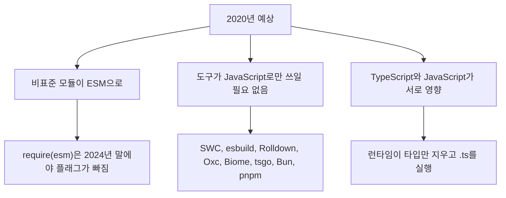

# 2026년 JavaScript 동향: 명세, 런타임, 설치 스크립트

네이버 D2의 2026년 10월 연재 1편·2편. 박재성, 네이버 n3r UX Dev.

확인 기준: 2026-10-25. 1편은 [2026년과 이후 JavaScript의 동향 - JavaScript(ECMAScript)](https://d2.naver.com/helloworld/2675915)이고, API의 `postPublishedAt`은 2026-10-20 무렵이다. 2편은 [브라우저 밖의 JavaScript](https://d2.naver.com/helloworld/1443473)이고, 그 다음 날 무렵이다. 두 글 본문은 모두 “2026년 10월 기준”이라고 적는다. [GeekNews 35745](https://news.hada.io/topic?id=35745)는 두 편을 한 요약으로 묶는다. 이 문서는 그 요약을 D2 본문과 맞춰, 요약이 지운 조건과 아직 없는 지원을 되돌린다. D2 사이트는 본문을 JSON API로 준다. 브라우저에 빈 껍데기만 보이는 주소와, `/api/v1/contents/{id}`의 `postHtml`은 같은 글이다.

3편 WebAssembly와 4편 라이브러리·프레임워크는 연재 목차에만 있다. 2026-10-25의 Hello world 목록 앞부분에는 1편과 2편만 올라 있다. 3편과 4편은 이 문서가 다루지 않는다.

## 1. 결론

이 연재가 말하는 2026년의 변화는 한 문장으로 줄지 않는다. 언어는 기능을 더하기 전에 테스트와 구현을 요구하는 쪽으로 기울었고, 서버 런타임은 Node.js 호환과 웹 API로 모였고, 패키지를 설치하는 순간 스크립트가 돌던 기본값은 꺼지는 중이다.

GeekNews 요약이 한 칸에 넣는 수들은 서로 다른 실험이다.

| 요약에 보이는 말 | 글이 실제로 가리키는 것 |
| --- | --- |
| TypeScript 7이 8~12배 | 2026-07-08 TypeScript 7.0 발표의 “보통 전체 빌드” 범위. 2025-03 VS Code 전체 빌드 77.8초→7.5초는 그 전의 Go 이식 발표 숫자다 |
| Temporal이 Stage 4라 곧 Date를 대체 | 2026-03 Stage 4, ES2027 포함 예정. 2026-09-24 MDN 데이터에서 Safari는 Technology Preview만, Node.js는 26.0부터 기본 활성 |
| npm 12가 설치 스크립트를 막는다 | npm 12 자체의 기본값. Node.js 22·24·26에 들어 있는 npm은 그 버전이 아니다. 워킹 그룹은 Node.js 27부터 넣기로 했다 |
| Bun이 Node 테스트의 80%를 통과 | Node Weekly가 Bun 1.4에 대해 전한 말. Deno 2.8의 76.4%(4,457개 중 3,405개)와 분모가 같은지는 두 글이 증명하지 않는다 |
| Deno 런타임이 끝났다 | 2026-10-09 발표는 1년 동안 버그·보안 월간 릴리스를 낸 뒤 팀의 개발을 끝낸다는 계획이다. 저장소는 오픈소스로 남는다 |

같은 주의 다른 보고서와 겹치는 수도 섞지 않는다. tsrs가 TypeScript 7.0보다 최대 8배라는 발표는 워커 수를 맞춘 Rust 포트의 측정이다. 그 구분과 조건은 [tsrs](../rust/261025_1814_tsrs.md)에 있다. 이 연재의 8~12배는 공식 Go 컴파일러(tsgo)가 JavaScript로 쓴 이전 컴파일러보다 빠르다는 문장이다.

## 2. 연재가 다시 선 자리

1편은 2016년부터 이어지다 2020년에 멈춘 “JavaScript의 동향”을 6년 만에 다시 연다. 2편은 브라우저 밖을 마지막으로 다룬 시점을 2019년으로 잡고, 그 사이 7년을 적는다. “6년 만의 재개”와 “7년의 브라우저 밖”은 같은 공백이 아니다. 1편이 2020년 글을, 2편이 2019년 글을 기준으로 삼기 때문이다.

2020년 글이 예상한 세 가지는 방향은 맞고 속도는 글마다 다르다.

ESM을 제공하는 인기 npm 패키지 비율은 wooorm/npm-esm-vs-cjs 기준으로 2021년 8월 7.8%, 2024년 11월 25.9%, 2026년 6월 38.0%다. 1편은 2025년 12월부터 집계 목록의 출처가 바뀌어 그 이전 수치와 바로 비교하기 어렵다고 적는다. 60% 이상이 아직 ESM을 제공하지 않는다는 문장은 그 38%의 나머지를 말한 것이다. “ESM이 기본이 되었다”와는 다른 문장이다.

2020년 글이 다루던 제안의 결말도 한 표로 끝내지 않는다. Top-level await와 클래스 필드는 ES2022에 들어갔다. KV Storage는 브라우저 벤더의 투자가 없어 비활성이다. Pipeline Operator는 2021년 Hack 스타일로 Stage 2에 올랐고, 2026년 10월에야 Stage 2.7 리뷰어가 붙었다. 토픽 토큰은 임시로 `%`다. Records & Tuples는 2025년 4월 철회되었고, 같은 문제를 객체 인터닝으로 푸는 Composites가 Stage 2다. Temporal만 Stage 4다.

## 3. 단계를 올린 뒤에도 구현이 없으면 되돌린다

TC39는 명세가 정리된 뒤의 테스트와 구현 검증을 Stage 2.7로 따로 뒀다. 이 단계에서는 테스트와 구현, 사용 경험에서 나온 피드백 외에는 위원회가 변경을 요구하지 않는다. Test262를 쓰고, 필요하면 프로토타입으로 구현 가능성을 본다. Stage 4는 호환되는 구현 두 개, 실제 출시 경험, ECMA-262 PR 승인이 있어야 한다.

조건부 진행은 그 검증이 얼마나 오래 걸리는지를 보여 준다. `using` 선언(Explicit Resource Management)은 Chrome, Firefox, XS에 구현된 상태로 2025년 5월 조건부 Stage 4를 받았고, 남은 Test262 리뷰가 끝나 조건이 충족된 것은 2026년 5월이다. 2026년 3월 회의의 결론은 “Test262에는 더 많은 리뷰어가 필요하다”였다.

반대 방향도 있다. Decorators는 2022년 Stage 3에 올랐고 TypeScript 5.0이 구현을 냈지만, 브라우저 엔진은 2026년 5월 회의 시점에도 출시하지 않았다. 테스트가 불완전하고 명세에 문제가 있으며 구현이 복잡하다는 이유로 Decorators와 Decorator Metadata는 Stage 2.7로 내려갔다. Stage 3에 있다는 사실이 브라우저에서 쓸 수 있다는 뜻은 아니다.

## 4. ECMAScript 2026은 승인됐고, 엔진 지원은 기능마다 다르다

ECMA-262 17판은 2026년 3월 TC39 승인을 거쳐 2026-06-30 Ecma 총회에서 승인됐다. 기능은 일곱이다. `Array.fromAsync`, `Error.isError`, `Math.sumPrecise`, `Uint8Array`의 base64·hex, `Iterator.concat`, `JSON.parse`의 원본 텍스트와 `JSON.rawJSON`, `Map`/`WeakMap`의 `getOrInsert`·`getOrInsertComputed`.

1편의 지원 표는 MDN browser-compat-data 8.1.3, 2026-09-24다. Stage 4의 연도와 브라우저에 들어간 연도는 다르다. `Array.fromAsync`는 2024년 1월 Chrome 121에 이미 있었고, 명세 PR이 2025년 12월에 병합되어 ES2025가 아니라 ES2026에 들어갔다.

그 표에서 바로 막히는 칸이 있다. `Math.sumPrecise`는 Chrome 147, Firefox 137, Safari 26.2이고 Node.js는 미지원이다. Safari의 `Error.isError`는 18.4 부분 지원이다. 표준에 포함됐다는 문장만으로 2026년 10월의 Node.js에서 일곱 기능이 모두 열린다고 읽지 않는다.

`Math.sumPrecise`는 중간 합의 정밀도 손실을 피하고 마지막에 한 번 반올림한다. `[1e20, 0.1, -1e20]`의 `reduce` 합은 0이고, `Math.sumPrecise`는 0.1이다. 입력 자체가 이미 잃는 이진 부동소수점까지 고치지는 않는다. `Math.sumPrecise([0.1, 0.2])`는 여전히 `0.30000000000000004`다.

`Error.isError`는 `instanceof Error`가 놓치는 다른 realm의 오류를 내부 슬롯로 가린다. `{ name: "Error", message: "fake" }`는 거짓이다.

## 5. Temporal과 using은 ES2027 쪽이고, Safari 안정판은 아직이다

ES2027은 2027년 6월 승인 예정이다. 2026년 10월 Finished Proposals에 2027년 발행으로 올라 있는 것은 Temporal, Explicit Resource Management, `Atomics.pause`, Joint Iteration(`Iterator.zip`, `zipKeyed`), Iterator Chunking(`chunks`, `windows`), `includes`, `join`이다. Chunking·Includes·Join은 2026년 9월 회의에서 Stage 4에 올랐고, 1편은 그 회의록이 글을 쓸 때 아직 공개되지 않았다고 적는다.

Temporal은 2017년 제안, 2020년 글의 Stage 2, 2026년 3월 Stage 4다. Bloomberg의 Jason Williams에 따르면 ES2015 이후 가장 큰 추가이고, Test262 테스트는 글 시점 기준 4,496개다. V8은 이 구현을 C++로 새로 쓰지 않고, Boa 팀이 Rust로 만든 `temporal_rs`를 쓴다. `PlainDate`, `PlainTime`, `PlainDateTime`, `ZonedDateTime`, `Instant`, `Duration`은 나뉘어 있고 객체는 불변이다.

같은 MDN 스냅샷의 지원은 이렇다.

| 환경 | 1편이 적은 지원 |
| --- | --- |
| Firefox | 139, 2025년 5월 |
| Chrome, Edge | 144 |
| Safari | Technology Preview |
| Node.js | 26.0, 기본 활성 |
| Deno | 2.7 |

GeekNews의 댓글이 묻는 “폴리필 없이 프로덕션에서 써도 되는가”에 대한 글의 답은 환경으로 갈라진다. Node.js 26과 그 표를 만족하는 Chromium·Firefox에서는 플래그 없이 쓸 수 있다. Safari 안정판은 Technology Preview 단계다. Samsung Internet처럼 Chromium 버전을 늦게 따라가는 브라우저는 이 표의 Chrome 144를 아직 안 태웠을 수 있다. 1편은 Samsung Internet의 Temporal 버전을 따로 적지 않는다. date-fns는 Temporal로 옮기는 글을 냈고, 그 사실이 기존 타임존 라이브러리가 이미 필요 없어졌다는 뜻은 아니다.

`using` / `await using`은 C#의 `using`, Python의 `with`, Java의 try-with-resources와 같은 역할이라고 1편이 적는다. C#만의 문법을 가져온 것은 아니다. 블록을 벗어날 때 `[Symbol.dispose]()` 또는 `[Symbol.asyncDispose]()`가 호출된다. `DisposableStack`, `AsyncDisposableStack`, `SuppressedError`가 같이 있다. Chrome 134, Firefox 141, Node.js 24에서 쓸 수 있고 Safari는 Technology Preview다. TypeScript는 5.2부터 이 문법을 받았다. 표준 연도(ES2027)보다 타입 검사기와 일부 런타임이 앞선다.

Stage 3 이하는 문법이 바뀔 수 있다고 1편이 못 박는다. `import defer`는 평가를 첫 접근까지 미루되 top-level await 의존성은 미루지 못한다. Import Text는 `with { type: "text" }`다. `Promise.allKeyed`는 2026년 7월 Stage 3다. AsyncContext는 Node의 `AsyncLocalStorage`를 언어로 올리려는 Stage 2이고, 웹 API로 컨텍스트를 어떻게 넘길지는 열려 있다. Signals는 2024년 4월 Stage 1 이후 단계가 바뀌지 않았다.

## 6. TypeScript 7의 8~12배는 공식 Go 컴파일러의 전체 빌드다

2025년 3월 Anders Hejlsberg의 발표는 VS Code 코드베이스 빌드가 77.8초에서 7.5초, 에디터 프로젝트 로딩이 9.6초에서 약 1.2초로 줄었다고 했다. 코드명은 기존 JavaScript 구현이 Strada, Go 구현이 Corsa다. Go를 고른 이유는 새로 설계하는 재작성이 아니라 같은 구조의 이식이고, 두 코드베이스를 함께 유지하기 쉽다는 점이었다.

그 다음 일정이 7.0의 8~12배와 다른 칸이다.

| 버전 | 날짜 | 1편이 적은 내용 |
| --- | --- | --- |
| 6.0 | 2026-03-23 | JavaScript 코드베이스의 마지막 버전. `strict` 기본 true, `module` 기본 `esnext`, `target`은 지원하는 최신(당시 es2025). `types` 기본 `[]`. `target: es5`, `baseUrl`, `moduleResolution: node`, AMD/UMD/SystemJS는 폐기 예정. `moduleResolution: classic`, `outFile`는 제거 |
| 7.0 | 2026-07-08 | Go 이식. 네이티브 코드와 공유 메모리 병렬 처리. 전체 빌드가 보통 8~12배. 6.0에서 폐기 예정이던 옵션은 오류 |

Slack CI 타입 검사는 약 7.5분에서 1.25분으로 줄었다고 7.0 발표를 1편이 인용한다. 7.0은 안정된 프로그래밍 API가 없어서 Vue, Svelte, Astro, MDX처럼 컴파일러 API에 기댄 언어 플러그인은 온전히 타기 어렵다. 7.1에서 다른 API를 낼 예정이라고 같은 발표가 적는다.

런타임이 `.ts`를 직접 실행하면서 문법은 둘로 나뉜다. 지워서 JavaScript가 되는 타입 표기와, `enum`, 런타임 `namespace`, 생성자 매개변수 속성처럼 코드를 새로 만들어야 하는 문법이다. TypeScript 5.8의 `--erasableSyntaxOnly`는 뒤의 문법을 오류로 만든다. Node.js 문서는 타입 스트리핑에 TypeScript 5.8 이상, `erasableSyntaxOnly`, `verbatimModuleSyntax`를 권한다. JavaScript에 타입 표기를 주석처럼 넣자는 Type Annotations는 2022년 Stage 1 이후 2025~2026년 회의록에 다시 오르지 않았다.

GitHub Octoverse 2025에서 TypeScript는 2025년 8월, 월간 기여자 수 기준 처음 1위다. 기여자 2,636,006명, 1년 사이 66.6% 증가, Python보다 약 4만 2천 명 많다. JavaScript 기여자는 약 215만 명이다. GitHub이 배경으로 든 것은 AI가 만든 코드의 오류를 타입이 앞에서 잡는다는 점과, 프레임워크가 TypeScript 프로젝트를 기본으로 만든다는 점이다. 인용된 2025년 연구는 LLM이 만든 코드의 컴파일 오류 중 94%가 타입 검사 실패였다고 1편이 적는다. State of JS 2025에서 TypeScript에 쓰는 시간 비중은 평균 77%다. “가장 많이 쓰인 언어”는 기여자 수 기준이지, 실행되는 바이트가 전부 TypeScript라는 뜻은 아니다.

## 7. 브라우저 엔진은 줄고, 넣어 쓰는 엔진은 늘었다

StatCounter 2026년 8월 전 세계 점유율은 Chrome 69.28%, Safari 15.92%, Edge 5.39%, Firefox 2.98%, Samsung Internet 2.02%, Opera 1.93%다. Chromium 계열만 합하면 80%에 가깝고, Gecko는 3% 아래다.

Ladybird는 Chromium·Gecko·WebKit 코드를 쓰지 않는 LibWeb과 LibJS다. 2026년 중 Linux·macOS 알파를 목표로 하고, 2026년 2월 Rust를 C++ 다음 언어로 삼아 LibJS부터 옮긴다고 했다. 그 이식은 8절이 아니라 1편의 AI 절에 숫자가 있다. 약 2만 5천 줄의 Rust를 2주 만에 옮겼고 Claude Code와 Codex를 썼다. Test262 52,898개와 Ladybird 회귀 12,461개에서 회귀가 없었고, AST와 바이트코드가 C++ 구현과 같았다고 한다. Andreas Kling은 순서와 코드의 모양은 자신이 정했고, 수백 개의 짧은 프롬프트로 방향을 잡았다고 적었다. 에이전트가 혼자 엔진을 만들었다는 문장과 다르다.

브라우저 밖에서는 QuickJS가 ES2025 Test262를 거의 100% 통과하고, 2026-06-04 릴리스에 Upsert, `Math.sumPrecise`, base64·hex를 넣었다. 원본이 2021년 3월 이후 2년 넘게 쉬던 사이 quickjs-ng 포크가 2023년 11월 시작됐고, 원본도 2023년 12월부터 릴리스를 재개했다. AWS LLRT는 Rust 런타임에 QuickJS를 넣는다. Hermes와 Boa(2026년 8월 v0.22)도 이 칸이다.

JavaScript 상표(미국 등록 2416017)는 Oracle이 갖고 있다. Ryan Dahl의 공개서한과 Deno Land의 2024-11-22 취소 심판(92086835) 이후, 2025-06-18 사기 주장은 기각됐다. 2026-08-28 합의 협상을 이유로 절차가 중지됐다. 상표가 풀렸는지는 1편이 단정하지 않는다.

## 8. Node.js는 일정을 줄이고, 타입 검사는 하지 않은 채 .ts를 실행한다

2편이 2019년과 비교하는 Node.js의 최신은 2026년 10월 기준 26.12다. 2019년의 12.13 이후 메이저가 열네 번 나왔다.

2026년 3월 발표는 Node.js 27부터 연 2회 메이저를 연 1회로 줄인다. 매년 4월 메이저, 10월 LTS 전환, 홀짝 없이 모든 버전이 LTS다. 메이저 전 6개월은 `27.0.0-alpha.1` 형식의 알파에서 semver-major를 허용한다. 27은 2027년, 28은 2028년이다. 이유는 홀수 버전 채택이 낮고, 자원봉사자 메인테이너가 여러 라인에 보안 패치를 동시에 내기 어렵다는 점이다.

2026년 10월 표는 이렇다. 22(Jod)는 Maintenance LTS, 2027년 4월 종료. 24(Krypton)는 Active LTS였고 10월 20일 Maintenance 전환. 26은 Current이고 10월 28일 LTS 전환 예정이며 Temporal이 여기서 기본이다. 27은 10월 28일 알파 시작 예정, 2027년 4월 출시. 25는 2026년 6월에 지원이 끝난 마지막 단기 버전이다.

`require(esm)`은 top-level await가 없는 ESM을 `require()`로 불러온다. 2024년 10월 23.0, 12월 22.12에서 플래그가 빠졌고 2025년 3월 20.19에 백포트됐다. 25.4와 24.15에서 실험 표시가 사라졌다. 1편의 ESM 38%와 맞물리는 지점이다. 장벽이 낮아진 것이지, 인기 패키지의 다수가 이미 ESM 전용인 것은 아니다.

타입 스트리핑은 타입 표기를 같은 길이의 공백으로 지우고 실행한다. 검사를 하지 않고 `tsconfig.json`을 읽지 않는다. 22.6.0에 실험으로 들어왔고, 23.6.0(2025년 1월)에서 기본, 25.2.0(2025년 11월)과 24.12.0(2025년 12월)에서 안정이다. `enum` 같은 문법은 지울 수 없다. 그 변환을 하던 `--experimental-transform-types`는 Node.js 26.0.0에서 제거됐다.

권한 모델은 20에서 실험, 23.5.0과 22.13.0에서 안정이다. `--permission`과 `--allow-fs-read` 등으로 실수에 의한 접근을 줄인다. 2편은 Node.js 문서가 이것을 안전벨트에 비유하고, 악성 코드로부터 보호하지 않는다고 밝힌 문장을 그대로 둔다. 심볼릭 링크로 경로 제한을 우회할 수 있고, 워커의 `execArgv`를 직접 주면 권한이 이어지지 않는다. 신뢰할 수 없는 코드를 가두는 장치로 읽지 않는다.

내장으로 대체 대상이 적힌 것은 `fetch`(21에서 안정, undici), `node:test`(20에서 안정), WebSocket 클라이언트(22.4에서 안정), `node:sqlite`(25.7.0에서 Release Candidate), 타입 스트리핑, 권한 모델이다. `async_hooks`는 여전히 실험이고 문서가 떠나라고 한다. 대신 `AsyncLocalStorage`가 16.4.0에서 안정이다. `node:quic`은 23.8.0에 들어왔으나 Early development다. 26.4.0에는 패키지 맵과 최소 `node:vfs`가 들어왔다. 이 `node:vfs`는 약 1만 9천 줄이던 AI 보조 PR이 아니라, 범위를 줄여 2026년 5월 병합된 최소 기능이다. 원래 PR은 2026년 9월 닫혔다.

Stack Overflow 2025에서 Node.js는 웹 프레임워크·기술 항목 1위다. 전체 48.7%, 전문 개발자 49.1%. Deno는 4%, Bun은 클라우드 개발 항목 5.5%다. 문항이 다르다. State of JS 2025 런타임 문항(응답 11,141)의 사용 응답 수는 Node.js 10,062, 브라우저 9,682, Bun 2,321, Service Workers 1,660, Cloudflare Workers 1,294, Deno 1,244다. Node.js 응답 수가 Bun이나 Deno 각각의 네 배를 넘는다. Bun·Deno가 Node.js 코드를 실행할 수 있게 되면서, “Node.js를 쓴다”는 응답이 어느 바이너리인지는 이 설문이 가리지 않는다.

## 9. Deno는 1년 유지 뒤 팀의 개발이 끝나고, Bun은 1.4에서 Rust다

Deno 2(2024년 10월)는 `package.json`과 `node_modules`, Node.js·npm 호환을 앞에 뒀다. Deno 2.8(2026년 5월)은 Node.js 자체 테스트 묶음 통과율이 2.7의 약 42%에서 76.4%(4,457개 중 3,405개)로 올랐고, `deno add`에서 `npm:` 접두사 없는 npm 우선 기본값이 됐다. Deno Deploy는 2026년 2월 GA였고, 같은 날 Deno Sandbox는 1초 안에 뜨는 microVM에서 신뢰할 수 없는 코드를 실행한다고 했다. API 키는 샌드박스 안에서 자리표시자로만 보인다고 발표문이 적는다.

2026-10-09 Ryan Dahl의 발표는 팀 전원이 Cloudflare에 합류한다는 내용이다.

| 대상 | 발표가 적은 계획 |
| --- | --- |
| Deno 런타임 | 1년간 버그·보안 월간 릴리스 후 팀의 개발 종료. 오픈소스로 남고 이어 갈 사람을 환영 |
| Deno Deploy | 6개월 운영 후 종료. 유료 고객의 Workers 이전 지원 |
| JSR | 계속 운영, 인프라는 Cloudflare로 |
| rusty_v8 | 지원을 이어 가고 workerd에 통합 |

2월에 GA된 Deno Deploy가 8개월 만에 종료 예고를 받았다. Deno Sandbox의 이후는 두 발표문 모두 언급하지 않는다고 2편이 적는다. “인수되어 런타임이 사라졌다”가 아니라, 팀을 옮기고 런타임 개발을 1년 뒤 멈추겠다는 계획이다. Hacker News에서는 Cloudflare 발표문에 런타임 개발 종료가 없다는 지적이 있었고, Kenton Varda는 workerd와 celld를 합쳐 자체 인프라에서 운영할 수 있는 오픈소스 런타임이 핵심이라고 댓글을 달았다고 2편이 정리한다.

Bun은 2019년 글 이후에 나왔다. JavaScriptCore 위에 런타임, 패키지 관리자, 번들러, 테스트 러너를 한 바이너리로 둔다. Bun 1.3(2025년 10월)은 HTML을 바로 여는 개발 서버, `Bun.SQL`, 설치 시점 Security Scanner API를 넣었다. 2025년 12월 Anthropic 인수 뒤에도 MIT 오픈소스로 남는다. Claude Code가 Bun으로 만든 단일 실행 파일로 배포되던 것이 배경이라고 2편이 적는다.

Bun 1.4(2026년 8월)는 Zig에서 Rust로 바꾼 첫 버전이다. Node.js 테스트 묶음에서 통과 테스트가 1,517개 늘었고, 릴리스 노트는 1.0 이후 가장 큰 Node.js 호환 향상이라고 했다. Node Weekly는 그 묶음의 80%를 통과한다고 전했다. 80%의 분모와 Deno 2.8의 4,457개는 이 글에서 같은 표로 맞춰져 있지 않다. `Bun.Image`, `Bun.WebView`, `Bun.cron()`이 내장으로 소개된다. 1.4의 나머지 변경은 이 저장소의 [Bun v1.4.4 가이드](261023_1736_bun-v1.4.4-release-guide.md)가 따로 다룬다. 1.4.4의 Brotli 수정은 [디코더 경계 밖 쓰기](261022_1720_Node.js%20and%20Bun%20Brotli%20Decoder%20Out-of-Bounds%20Write.md)에 있다. 2편은 그 CVE를 다루지 않는다.

Rust로 옮긴 과정의 숫자는 Jarred Sumner의 글이다. Zig 코드 535,496줄, Claude Code 워크플로 약 50개, 2026-05-03부터 05-14까지 11일, 구현자와 리뷰어 인스턴스를 분리, 병합된 변경은 100만 줄이 넘고 건너뛰거나 지운 테스트는 없었다. 1.4.0은 1.3.14에서 재현되던 버그 128개를 고쳤다. “53만 줄이 11일 만에 자동으로 안전한 Rust가 되었다”가 아니다. 테스트 묶음이 결과를 판정할 수 있는 이식이었고, 사람은 인수된 회사의 작성자로 그 과정을 공개했다.

세 런타임 모두 TypeScript를 직접 실행하고 ESM과 `fetch` 계열을 제공한다. 남은 차이는 기본값이다. Node.js는 호환과 안정, Deno는 권한 기본 차단과 통합 도구, Bun은 속도와 내장 기능의 폭이라고 2편이 요약한다. Deno의 권한 기본 차단은 팀의 개발 종료 계획 이후에도 1년의 유지 기간 동안 그 바이너리에 남아 있는 성질이다. 새 기능이 1년 뒤에도 Deno에 들어간다는 뜻은 아니다.

## 10. 설치 스크립트를 끄는 기본값은 npm 12이고, 지금 Node에 들어 있지 않다

2025~2026년 공급망 사건을 2편은 이렇게 적는다.

| 시기 | 사건 | 2편이 적은 규모와 경로 |
| --- | --- | --- |
| 2025-08-26 | Nx, s1ngularity | `pull_request_target` 워크플로의 PR 제목으로 npm 토큰 탈취, 약 4시간 |
| 2025-09-08 | chalk, debug 등 19개 | npm 지원 사칭 피싱. 주간 20~30억 다운로드 규모로 적힌 패키지들. 암호화폐 주소 바꿔치기 |
| 2025-09-14 | Shai-Hulud | `postinstall`로 퍼지는 웜, 500개 이상 |
| 2025-11-24 | Shai-Hulud 2.0 | `preinstall`이 Bun 런타임을 받아 실행, 796개 패키지, 주간 2천만 다운로드. Datadog은 Node.js 중심 감시를 피하려는 선택으로 추정 |
| 2026-03-31 | Axios | 메인테이너 PC 장악, `axios@1.14.1`과 `0.30.4`, 약 3시간 |
| 2026-05-11 | TanStack | Actions 캐시와 OIDC를 잇는 경로, 42개 패키지 84개 버전 |

2026년 8월 keyv 6.0.0으로 400개 이상이 감염됐고, 8월 말 Mini Shai-Hulud로 지목된 두 명이 호주에서 기소됐다는 보도를 2편이 인용한다. 이 문서가 그 기소의 판결을 확인하지는 않았다.

npm의 대응은 토큰을 짧게 하고, 게시 권한을 CI의 장기 토큰에서 떼는 쪽이다. 신뢰 게시(OIDC)는 2025년 7월 GA다. classic 토큰 생성은 2025-11-05에 멈췄고, 폐기가 끝난 날은 예고된 11월 19일이 아니라 12월 9일이다. 쓰기 granular 토큰은 2FA가 기본이고 수명 상한은 90일이다. `npm stage publish`는 2026년 5월, npm 11.15.0과 함께다. 게시 전 악성 코드 검사는 2026년 7월부터다. William Woodruff의 지적을 2편이 인용한다. 신뢰 게시는 인증 방식이지, 패키지가 안전하다는 표시가 아니다. TanStack처럼 CI가 뚫리면 OIDC 토큰도 나간다.

설치 쪽의 변경이 npm 12(2026년 7월)다. 의존성의 `preinstall`, `install`, `postinstall`과 암묵적 node-gyp를 기본으로 실행하지 않는다. Git 의존성과 원격 URL은 `--allow-git`, `--allow-remote`가 있어야 한다. Node.js 릴리스 워킹 그룹은 이 변화를 22·24·26에 넣기에는 너무 크다고 보고 27부터 포함하기로 했다. 24·26의 npm 11은 11.16부터 `allowScripts`와 `strict-allow-scripts`로 그 정책을 미리 켤 수 있다. 22의 npm 10은 `--ignore-scripts`인데, 이 설정은 의존성뿐 아니라 자기 `package.json`의 설치 스크립트도 건너뛴다.

pnpm 10(2025년 1월)이 의존성 설치 스크립트 기본 차단을 npm보다 먼저 했다. Bun은 처음부터 `trustedDependencies`에 적은 패키지만 라이프사이클 스크립트를 실행한다. pnpm 11(2026년 4월)은 `minimumReleaseAge` 기본 1,440분이다. 문서는 악성 릴리스가 대부분 한 시간 안에 내려진다는 설명을 근거로 든다. 한 시간을 넘긴 악성 버전은 이 기본값만으로 막히지 않는다. pnpm 12(2026-08-26)는 Rust 재작성이고, 기존 lockfile은 유지된다. 순환 의존이 많은 큰 워크스페이스에서 peer 해석이 2~3배 빨라지고 메모리를 약 25% 덜 쓴다고 릴리스가 적는다. Yarn 4의 2026년 10월 최신은 4.18.1이고, Rust 기반 Yarn 6은 `6.0.0-rc.23` 단계다. Corepack은 Node.js 25부터 함께 배포되지 않는다.

State of JS 2025 모노레포 도구에서 pnpm 사용 응답은 3,940명, npm Workspaces 2,129명, Yarn Workspaces 1,341명이다.

JSR은 ESM JavaScript와 TypeScript만 받고, Deno 팀의 Cloudflare 합류 뒤에도 남는다. vlt 1.0(2026년 8월)의 `vlt query ':malware'`는 선택자로 의존성 그래프를 본다. 호스팅 레지스트리는 npm API와 호환된다. 2019년에 거론된 Entropic과 Open-Registry는 2편 시점의 조사에서 사이트가 열리지 않았고, tink 저장소는 보관됐다.

## 11. AI가 낮춘 것은 작성 비용이고, 검증 비용은 남는다

State of JS 2025에서 자신이 쓰는 코드 중 AI가 만든 비중은 평균 29%다. 전년 20%에서 늘었다. MDN은 2026년 6월 MCP 서버를 내며, 지식 컷오프 때문에 오래된 웹 정보를 낼 수 있다고 했다. MCP 없이 Claude Code(Opus 4.7)에 물었을 때 브라우저 지원을 맞힌 경우는 네 번 중 한 번이었다고 MDN 팀의 비교를 1편이 인용한다.

학습 데이터가 놓치는 이름으로 패키지를 올리는 공격을 2편은 슬롭스쿼팅이라고 적는다. Socket이 소개한 2026년 연구는 다섯 최신 LLM의 약 20만 응답 중, 모델에 따라 4.62~6.10%에 존재하지 않는 패키지 이름이 있었고, 다섯 모델이 같이 지어낸 이름 127개 중 53개(npm 12, PyPI 41)는 당시 누구나 등록할 수 있었다고 한다.

Nx 공격의 악성 `postinstall`은 설치된 Claude, Gemini, Amazon Q CLI를 `--dangerously-skip-permissions`, `--yolo`, `--trust-all-tools`로 실행해 비밀을 찾게 했다고 Wiz 분석을 2편이 인용한다. 확인을 건너뛰는 플래그가 에이전트를 정찰 도구로 만든다. 이 문서는 그 플래그의 사용법을 적지 않는다.

표준 쪽의 대응은 글을 기계가 쓰지 못하게 하는 쪽과, 코드를 리뷰로 남기는 쪽으로 갈린다. TC39의 `AI_POLICY.md`는 아이디어와 코멘트는 사람이 직접 쓰고, LLM 번역·교정은 내용을 더하지 않을 때만 허용하며, 코드 기여는 그 정책의 대상이 아니라고 1편이 요약한다. Ladybird는 2026년 6월 외부 PR을 받지 않기로 했다. 큰 패치에 든 노력이 선의를 가늠하던 가정이 더 이상 통하지 않고, 브라우저는 그 코드를 사용자 컴퓨터에서 실행한다는 이유다. 같은 프로젝트가 LibJS 이식에는 에이전트를 쓰고 외부 PR은 막는다. 2편은 이것을 모순이 아니라 검증 책임이 메인테이너에게 있는지 기여자에게 넘어가는지의 차이라고 읽는다.

Node.js의 2026년 8월 AI 정책은 사용을 금지하지 않는다. 사용했다면 그 사실과 검증 방법을 밝혀야 하고, 이해·테스트·검증되지 않은 AI 코드는 리뷰 없이 닫힐 수 있다. 사전 승인 없는 자동 PR과, `good first issue`의 AI 자동 수정은 금지다. OpenJS Foundation CNA는 AI가 만든 저품질 보고 때문에 2026-09-17부터 10-06까지 CVE 발급을 쉬었다. 재단의 문장을 2편이 인용한다. AI는 보안 보고를 만드는 문턱은 낮췄지만, 처리 비용은 낮추지 않았다.

MCP TypeScript SDK의 2026-09-28부터 10-04 주간 npm 다운로드는 약 7,623만으로, 1년 전 같은 주 약 715만의 10배를 넘고, 같은 시기 PyPI의 Python SDK 약 5,979만보다 많다고 2편이 적는다. `@anthropic-ai/claude-code`는 약 1,479만, `@openai/codex`는 약 2,561만이다. Codex CLI의 주 언어는 Rust이고, Claude Code는 Bun 단일 실행 파일이다. npm이 JavaScript 라이브러리가 아닌 네이티브 바이너리의 배포 채널로 쓰인다.

## 12. 데스크톱과 모바일은 이 문서의 주변이다

Electron은 State of JS 2025에서 1,746명이 쓴다고 답해 React Native(2,212명) 다음이다. 2021년 9월 Electron 15부터 릴리스는 8주다. 2026년 10월 최신으로 2편이 적은 것은 Electron 44(8월 24일, 당시 Chromium 152, Node.js 24.18)다. Electron 43은 메인 프로세스가 내장 Node.js 스냅숏에서 부팅하고 프리로드를 V8 바이트코드로 캐시한다.

Tauri 2.0(2024년 10월)은 iOS·Android를 더하고, allowlist 대신 권한·범위·capability를 쓴다. 사용 응답은 978명이다. Electrobun 1.0(2026년 2월)은 런타임으로 Bun을, 화면으로 시스템 웹뷰를 쓴다.

React Native 0.76(2024년 10월)에서 새 아키텍처가 새 프로젝트의 기본이 됐고, 0.82(2025년 10월)는 그 아키텍처만 남는다. Hermes V1은 0.84(2026년 2월)에서 iOS·Android 기본 엔진이다. Expo SDK 55는 레거시 아키텍처 지원을 끝내고, Hermes 바이트코드 차이만 받는 OTA에서 다운로드 시간이 약 75% 줄 것으로 Expo가 추정했다. SDK 56부터 그 방식을 기본으로 켜기로 했다. 추정이지 이 문서가 재측정한 값이 아니다.

iOS 26은 홈 화면에 추가한 사이트를 매니페스트 없이도 웹 앱으로 연다. 사용자가 그 설정을 끌 수 있다. iOS 17.4 전후 EU에서 홈 화면 웹 앱을 없애려다 2024-03-01 철회한 일은, PWA가 플랫폼 정책에 여전히 걸려 있다는 기록이다.

## 13. 용어

| 쓰기 쉬운 말 | 이번 두 편에 맞는 말 |
| --- | --- |
| 2026년이니 Temporal을 그냥 쓴다 | Stage 4이고 ES2027 예정이다. Safari 안정판은 1편의 MDN 스냅샷에서 Technology Preview다 |
| TypeScript 7은 10배, 또는 8배다 | VS Code 77.8초→7.5초는 2025년 3월 발표다. 7.0 발표의 보통 전체 빌드는 8~12배다. tsrs의 8배와 다른 비교다 |
| Node가 .ts를 검사해 준다 | 타입 스트리핑은 표기를 지울 뿐 검사하지 않는다. `enum`은 거절한다 |
| npm을 쓰면 설치 스크립트가 이미 꺼져 있다 | npm 12와 pnpm 10 이후, Bun의 기본값이 그렇다. Node.js 22·24·26에 번들된 npm은 12가 아니다 |
| Deno는 Cloudflare에 인수되어 삭제됐다 | 팀이 합류하고, 런타임은 1년 유지 뒤 그 팀의 개발이 끝난다. 저장소는 남는다 |
| Bun이 Node의 80%와 같다 | Node Weekly가 테스트 묶음 통과율로 전한 말이다. 동작 호환 80%라는 측정이 이 글에 따로 있지는 않다 |
| AI가 53만 줄을 혼자 옮겼다 | 535,496줄을 11일 동안 워크플로로 옮겼고, 테스트는 지우지 않았으며, 방향은 작성자가 공개했다 |
| 권한 모델이 공급망 공격을 막는다 | Node.js 문서는 악성 코드로부터의 보호가 아니라고 적는다 |

## 14. 이 문서가 하지 않은 일

1절부터 13절은 D2 1·2편을 GeekNews 요약과 맞춰 읽은 결과다. 아래는 그 읽기가 대신하지 않는 확인이다. 여기에 없다고 적힌 측정은 하지 않은 것이지, 원문 숫자가 틀리다는 판정은 아니다.

### 14.1 연재의 3편과 4편

연재 목차는 네 편이다. 3편은 WebAssembly, 4편은 라이브러리와 프레임워크다. 2026-10-25에 Hello world 목록의 첫 페이지(20편)를 봤을 때 올라와 있는 것은 1편과 2편뿐이었다. 그 뒤 페이지와, 그 시각 이후의 게시는 보지 않았다. 2편이 “WASI와 엣지에서의 WebAssembly는 3편에서 다룬다”고 한 부분과, “빌드 도구는 4편에서 자세히 다룬다”고 한 부분은 그래서 이 문서에 없다. Vite 8의 Rolldown, Next.js의 Turbopack, Rspack은 2편이 결과만 한 줄로 적은 만큼만 받았다. 번들러 구조, WASI, 프레임워크별 채택은 3·4편이 나오기 전의 공백으로 둔다.

### 14.2 브라우저 지원 표를 2026-09-24에서 멈추게 둔 것

Temporal, `Math.sumPrecise`, `Error.isError`, `using`의 브라우저·Node 칸은 1편이 MDN browser-compat-data 8.1.3(2026-09-24)에서 옮긴 표다. 그 날짜 이후의 MDN, Safari 릴리스 노트, Samsung Internet의 Chromium 버전은 다시 받지 않았다. 이 환경의 Safari, Chrome, Firefox, Node.js에서 `Temporal.Now`나 `Math.sumPrecise`를 호출해 보지도 않았다.

그래서 5절의 “Safari 안정판은 Technology Preview”는 2026년 10월 글이 그 스냅샷을 인용한 문장이지, 2026-10-25의 안정판 Safari를 이 문서가 연 결과는 아니다. GeekNews 댓글이 말한 삼성 브라우저의 폴리필 필요도 같다. 1편은 Samsung Internet의 Temporal 버전을 적지 않았고, 이 문서도 그 브라우저의 버전을 조회하지 않았다. Chrome 144라는 칸을 Samsung Internet이 따라왔는지는 비어 있다.

ES2026 일곱 기능의 나머지 칸도 마찬가지다. `Array.fromAsync`가 Chrome 121부터였다는 문장, Node.js에서 `Math.sumPrecise`가 미지원이라는 칸, Safari `Error.isError`의 부분 지원은 모두 그 표의 값이다. 표를 다시 받지 않았으므로, 9월 24일 이후에 칸이 채워졌더라도 이 문서는 그 변경을 반영하지 못한다.

### 14.3 Node.js 테스트 묶음을 다시 세지 않은 것

Deno 2.8의 76.4%는 2편이 적은 분수다. 분모 4,457, 분자 3,405. Bun 1.4의 80%는 Node Weekly가 전한 말이고, 2편은 그 주간지의 문장과 “통과 테스트 1,517개 증가”를 같이 적는다. 1,517개가 어느 총합에 대한 증가인지는 80%의 분자·분모로 풀리지 않는다.

이 문서가 하지 않은 일은 그 둘을 한 표로 맞추는 것이다. Node.js 테스트 묶음을 클론하지 않았고, Deno 2.8과 Bun 1.4에 같은 리비전을 돌리지 않았고, 건너뛴 테스트와 실패한 테스트를 파일을 열어 분류하지 않았다. 9절이 둘을 순위 매기지 않는 이유가 이것이다. 80%와 76.4%는 서로 다른 글이 자기 분모로 말한 통과율이다. 어느 런타임이 Node.js에 더 가까운지는 이 숫자만으로 나오지 않는다.

이 머신에 깔린 Bun으로 `bun test`나 Node 호환 스위트를 다시 돌리지도 않았다. 1.4.4의 다른 변경은 별도 가이드가 다룬다고 경로만 적었다. 그 가이드의 측정과 2편의 80%를 하나의 실험으로 합치지 않았다.

### 14.4 공급망 사건을 재현하지 않은 것

10절의 표는 2편이 Nx, Socket, GitHub, Datadog, Axios, TanStack 사후 분석을 인용해 정리한 사건 목록이다. 이 문서는 그 패키지를 설치하지 않았고, 피싱 메일의 전문과 도메인을 옮기지 않았고, `postinstall`이 토큰을 찾는 절차를 적지 않았다. Shai-Hulud 2.0이 Bun 런타임을 받아 실행했다는 문장도 Datadog의 추정으로 2편에 적힌 만큼만 받았다. 그 바이너리가 어떤 인자를 받았는지는 없다.

하지 않은 확인이 더 있다. 악성 버전이 레지스트리에서 언제 제거됐는지 npm 메타데이터를 조회하지 않았다. keyv 6.0.0으로 400개 이상이 감염됐다는 보도와, Mini Shai-Hulud로 지목된 두 명이 호주에서 기소됐다는 보도는 2편의 인용이다. 판결문과 기소장을 이 문서가 읽지는 않았다. “기소됐다”를 “유죄가 확정됐다”로 바꾸지 않은 이유가 그것이다.

npm 12가 Node.js 22·24·26에 들어 있지 않다는 문장도 2편이 인용한 릴리스 워킹 그룹의 판단이다. 이 환경의 `npm -v`와 `node -v`를 찍어 그 판단을 다시 확인하지는 않았다. `allowScripts`가 11.16에서 실제로 어떻게 거절하는지도 실행하지 않았다. pnpm 11의 `minimumReleaseAge` 1,440분이 한 시간을 넘긴 악성 릴리스를 막지 못한다는 말은 그 설정의 정의에서 나온 한계다. 2026년의 악성 릴리스가 평균 몇 분 만에 내려갔는지를 이 문서가 세지는 않았다.

### 14.5 설문, 점유율, 데스크톱 숫자를 다시 재지 않은 것

State of JS 2025의 응답 수(Node.js 10,062, Bun 2,321, Deno 1,244, pnpm 3,940, Electron 1,746, React Native 2,212, Tauri 978)와 Stack Overflow 2025의 48.7%·49.1%·4%·5.5%는 2편이 설문 페이지를 인용한 값이다. 원 응답 CSV를 내려받지 않았다. “웹 프레임워크와 기술” 문항의 Deno 4%와 “클라우드 개발” 문항의 Bun 5.5%를 한 순위로 합치는 계산도 하지 않았다. 문항이 다르다는 말만 남긴다.

StatCounter 2026년 8월의 Chrome 69.28%부터 Opera 1.93%까지도 1편의 인용이다. 8월 이후의 월간 표를 다시 열지 않았다. Chromium 계열이 80%에 가깝다는 말은 1편이 Chrome, Edge, Samsung Internet, Opera를 더해 적은 어림이다. Brave를 그 합에 넣을지, StatCounter의 기타 항목을 어떻게 자를지는 이 문서가 원 표를 더해 보지 않았다.

Electron 44의 Chromium 152·Node.js 24.18, Electron 43의 스냅숏 부팅, Expo SDK 55의 OTA 다운로드 약 75%는 각각 Electron 릴리스 노트와 Expo의 추정이다. 앱을 빌드해 시작 시간을 재거나, OTA 페이로드 크기를 비교하지 않았다. 12절이 75%를 “Expo의 추정”이라고 부른 이유는 그 측정이 이 환경에 없기 때문이다. iOS 26의 홈 화면 웹 앱 기본값과 2024-03-01의 EU 철회도 2편이 인용한 WebKit·보도다. 기기를 확인해 보지 않았다.

TypeScript 쪽 시간도 같다. VS Code 77.8초와 7.5초, 에디터 로딩 9.6초와 1.2초, Slack CI 7.5분과 1.25분, 7.0의 “보통 8~12배”는 발표 인용이다. 이 저장소나 VS Code를 `tsc` 6과 7로 다시 빌드하지 않았다. Octoverse의 기여자 2,636,006명과 66.6%, State of JS의 TypeScript 시간 비중 77%, AI 생성 비중 29%도 원 설문 파일을 다시 집계하지 않았다.

### 14.6 예제 코드를 실행하지 않은 것

1편에 있는 `Array.fromAsync`, `Error.isError`, `Math.sumPrecise([1e20, 0.1, -1e20])`, `Uint8Array`의 base64, `Iterator.concat`, `JSON.rawJSON`, `getOrInsert`, `Temporal.PlainDate.from("2026-01-31").add({ months: 1 })`, `using` 클래스, `Iterator.zip`은 설명용으로 옮긴 형태만 이 문서의 앞 절에 반영했다. 코드 블록 자체를 여기에 다시 붙이지도, 이 머신의 런타임으로 돌려 출력과 맞추지도 않았다.

그래서 `Math.sumPrecise([0.1, 0.2])`가 `0.30000000000000004`라는 문장과, 1월 31일에 한 달을 더하면 `2026-02-28`이라는 문장은 1편과 MDN 인용의 결과다. 독자가 그 한 줄을 자기 Node 버전에서 실행하기 전까지, 이 문서는 그 버전에서의 출력을 보증하지 않는다. 2편의 `require("esm-only-package")`, `node app.ts`, `node --permission`, `node:sqlite`의 `SELECT 1 + 2`, `deno add express`, `npm stage approve`, `vlt query ':malware'`도 실행하지 않았다. 명령이 그 버전에 존재한다는 말은 2편의 문서 인용이다.

### 14.7 원 발표와 회의록을 다시 열지 않은 것

TC39 회의록, TTAB 사건 92086835, Node.js 릴리스 일정 글, Deno의 Cloudflare 합류 글, Bun 1.4와 “Rewriting Bun in Rust”, pnpm 12, Ladybird의 Rust 전환, WinterTC의 ECMA-429는 1·2편이 이미 읽고 요약한 출처다. 이 문서는 그 요약을 D2 본문에서 다시 읽었다. 회의록 원문에서 Stage 투표 문장을 찾아 1편의 요약과 한 줄씩 대조하지는 않았다. 상표 심판이 2026-08-28 중지 이후 재개됐는지도 TTAB 사이트를 다시 열지 않았다. ECMA-429 본문에서 `fetch`와 `crypto.subtle`의 필수 목록을 조항 번호로 확인하지 않았다. WinterTC 절은 “공통 API를 만들려는 위원회가 생기고 1판이 승인됐다”는 2편의 범위에서 멈춘다.

JavaScript 상표가 풀렸는지, Deno Deploy가 6개월 안에 실제로 닫히는지, 런타임 월간 릴리스가 1년을 채우는지는 2026-10-09 발표의 계획이다. 2026-10-25에 그 계획이 일정대로 진행 중인지를 릴리스 목록으로 확인하지 않았다. “끝났다”와 “1년 뒤 팀의 개발을 끝내겠다고 발표했다”를 13절에서 나눈 이유는 이 미확인이다.

wooorm/npm-esm-vs-cjs의 7.8%·25.9%·38.0%도 1편이 그 저장소를 읽고 적은 값이다. 2025년 12월에 집계 목록 출처가 바뀌어 이전 수치와 바로 비교하기 어렵다는 단서를 1편이 이미 달았다. 이 문서는 그 저장소의 월별 JSON을 다시 합산하지 않았다. 38%를 “ESM 전환이 끝났다”의 근거로 쓰지 않는 이유가 그 단서다.

### 14.8 이 저장소의 다른 보고서를 다시 쓰지 않은 것

tsrs의 8배, Bun 1.4.4의 변경 목록, CVE-2026-111497의 디코더 경로는 각각 별도 문서에 있다. 이 문서는 그 문서의 결론을 여기로 가져오지 않았다. 경로를 적어, 7.0의 8~12배와 tsrs의 8배가 다른 실험이라는 점과, 2편이 Brotli CVE를 다루지 않는다는 점만 가렸다. tsrs를 이 머신에 설치해 `--noEmit` 시간을 재지도 않았고, 1.4.4 가이드의 로컬 로그를 2편의 Node 테스트 80%와 맞춰 보지도 않았다.

## 15. 출처

- 박재성, 2026년과 이후 JavaScript의 동향 - JavaScript(ECMAScript). 네이버 D2, 2026년 10월 기준. [https://d2.naver.com/helloworld/2675915](https://d2.naver.com/helloworld/2675915)
- 박재성, 2026년과 이후 JavaScript의 동향 - 브라우저 밖의 JavaScript. 네이버 D2, 2026년 10월 기준. [https://d2.naver.com/helloworld/1443473](https://d2.naver.com/helloworld/1443473)
- GeekNews 35745. 두 편의 요약과 Temporal·`using` 댓글. [https://news.hada.io/topic?id=35745](https://news.hada.io/topic?id=35745)
- 1·2편이 성능과 지원의 근거로 가리키는 발표는 각 절에 적은 대로다. TypeScript 7.0, Node.js 릴리스 일정, Deno의 Cloudflare 합류, Bun 1.4, pnpm 12, Ladybird의 Rust 전환이 그 자리다.
- 이 저장소에서 겹치는 구분. [tsrs](../rust/261025_1814_tsrs.md), [Bun v1.4.4](261023_1736_bun-v1.4.4-release-guide.md), [Brotli 디코더](261022_1720_Node.js%20and%20Bun%20Brotli%20Decoder%20Out-of-Bounds%20Write.md)
