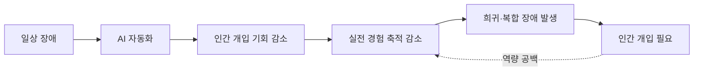
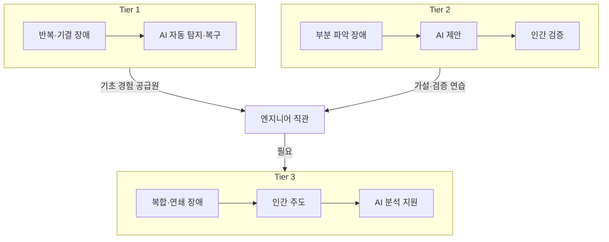
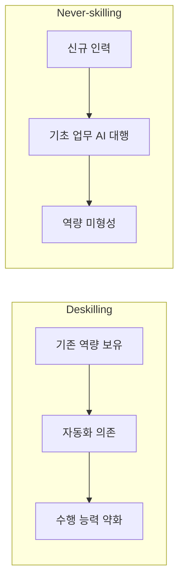
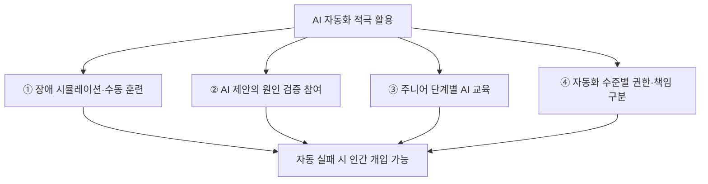

# AI는 SRE를 대체하는가, 아니면 엔지니어의 전문성을 약화시키는가?

### AI 기반 장애 대응 자동화의 역설… 생산성은 높아지지만, 인간의 문제 해결 능력은 오히려 약화될 수 있다는 우려

인공지능(AI)이 소프트웨어 개발과 시스템 운영 전반에 빠르게 도입되면서, 엔지니어의 역할에도 근본적인 변화가 나타나고 있다. 특히 시스템의 안정성과 가용성을 책임지는 SRE(Site Reliability Engineering, 사이트 신뢰성 엔지니어링) 분야에서는 AI가 로그 분석, 장애 탐지, 근본 원인 분석, 자동 복구 등 기존 엔지니어가 수행하던 업무를 점차 대신하고 있다.

AI 도입으로 장애 대응 속도가 빨라지고 운영 효율성이 향상되는 것은 분명한 이점이다. 그러나 이러한 자동화가 장기적으로 엔지니어의 전문성을 약화시킬 수 있다는 우려도 제기된다.

오픈소스 관측 가능성(Observability) 플랫폼 기업 SigNoz는 최근 발표한 **「AI Isn't Replacing SREs. It's Deskilling Them」**이라는 글에서 AI가 SRE를 직접 대체하는 것보다 더 중요한 문제는 엔지니어가 스스로 문제를 해결하는 능력을 잃어가는 현상이라고 지적했다.

핵심은 단순하다. AI가 일상적인 장애 대응의 대부분을 처리하게 되었을 때, 인간은 자동화가 해결하지 못하는 극히 복잡한 장애에 대응할 역량을 여전히 유지할 수 있는가?

## 1. 자동화의 역설: 인간이 가장 필요한 순간, 인간의 능력은 약해진다

AI 기반 운영 자동화의 위험성을 이해하기 위해서는 1983년 인지심리학자 리산 베인브리지(Lisanne Bainbridge)가 발표한 연구 「Ironies of Automation」을 살펴볼 필요가 있다.

베인브리지는 산업 시스템의 자동화가 확대될수록 인간 작업자에게 역설적인 상황이 발생한다고 설명했다.

자동화 시스템은 반복적이고 예측 가능한 작업을 대신하지만, 시스템이 예상하지 못한 상황에 직면하거나 자동화 자체가 실패하면 결국 인간의 개입이 필요하다.

문제는 자동화가 발전할수록 인간이 직접 문제를 해결할 기회가 감소한다는 점이다.

과거에는 엔지니어가 장애를 직접 분석하고 해결하면서 경험을 축적했다. 그러나 AI가 대부분의 장애를 처리하는 환경에서는 이러한 학습 과정이 줄어든다.

결과적으로 **인간의 개입이 가장 중요한 순간에, 정작 인간은 문제 해결에 필요한 실전 경험을 충분히 축적하지 못한 상태**가 될 수 있다.

이러한 현상은 항공기의 자동조종 시스템에서도 유사하게 논의되어 왔다. 자동조종 장치는 조종사의 업무 부담을 줄여주지만, 지나친 의존은 수동 비행 능력과 상황 인식 능력에 부정적인 영향을 줄 수 있다.

AI 기반 SRE 자동화 역시 동일한 문제에 직면할 가능성이 있다.

## 2. AI가 장애 대응을 자동화할수록 인간에게는 더 어려운 문제만 남는다

현재 SRE 업무에서는 이미 다양한 자동화 기술이 활용되고 있다.

대표적으로 시스템 알림의 이상 징후 분류, 로그 패턴 분석, 반복 장애의 자동 복구, 과거 장애 이력을 활용한 원인 추정 등이 있다.

예를 들어 Kubernetes 환경에서 특정 파드(Pod)가 비정상 종료되면 자동으로 재시작하거나, 서버 부하가 증가하면 자원을 확장하는 방식이다.

최근에는 대규모 언어모델(LLM)을 활용해 여러 시스템의 로그와 메트릭, 트레이스를 함께 분석하고 장애 원인을 추천하는 기술도 발전하고 있다.

장애 대응은 자동화 가능성과 복잡도에 따라 다음과 같이 구분할 수 있다.

| 구분 | 장애 유형 | AI와 인간의 역할 |
|---|---|---|
| Tier 1 | 원인과 해결 방법이 알려진 반복적 장애 | AI 중심 자동 탐지·복구 |
| Tier 2 | 원인이 부분적으로 파악된 장애 | AI가 해결책을 제안하고 인간이 검증 |
| Tier 3 | 새로운 유형의 복합·연쇄 장애 | 인간이 대응을 주도하고 AI가 분석 지원 |

이 구조에서는 단순하고 반복적인 장애일수록 AI의 역할이 커지고, 인간에게는 기존에 경험하지 못한 복잡한 장애가 집중된다.

하지만 여기에는 중요한 문제가 존재한다.

**엔지니어가 Tier 1과 Tier 2 장애를 직접 해결해 본 경험이 부족하다면, 더 복잡한 Tier 3 장애를 해결할 직관은 어디에서 형성되는가?**

복잡한 장애 대응 능력은 단순히 기술 문서를 읽거나 이론을 학습하는 것만으로 완성되지 않는다.

수많은 로그를 직접 분석하고, 잘못된 가설을 수정하며, 시스템의 내부 동작을 이해하는 반복적인 경험을 통해 형성된다.

AI가 이러한 과정을 대부분 수행한다면 인간 엔지니어는 높은 수준의 문제 해결을 요구받으면서도 정작 그에 필요한 기초 경험을 축적하기 어려워질 수 있다.

## 3. 생산성 향상이 실제 기술 역량의 향상을 의미하지는 않는다

AI 도입이 가져오는 가장 큰 변화 중 하나는 업무 수행 속도의 향상이다.

과거에는 장애 원인을 분석하기 위해 수많은 로그와 시스템 설정을 직접 확인해야 했다. 그러나 AI 기반 도구를 활용하면 대량의 로그를 요약하고 관련성이 높은 원인 후보를 빠르게 제시받을 수 있다.

문제는 이러한 생산성 향상이 엔지니어 개인의 기술 역량 향상과 반드시 일치하지 않는다는 점이다.

SigNoz는 AI 의존으로 인해 엔지니어가 세 가지 핵심적인 학습 기회를 잃을 수 있다고 지적한다.

**첫째, 원시 로그를 직접 해석하는 능력의 약화다.**

AI가 로그를 분석하고 요약해 주면서 엔지니어는 원본 로그를 직접 읽을 기회가 줄어든다. 이 과정에서 로그의 미세한 패턴이나 비정상적인 흐름을 발견하는 경험도 감소할 수 있다.

**둘째, 장애 원인에 대한 가설 수립 능력의 약화다.**

기존에는 엔지니어가 여러 가능성을 검토하고 실험을 통해 원인을 좁혀갔다. 하지만 AI가 초기 원인을 추천하는 환경에서는 엔지니어가 직접 가설을 세우기보다 제시된 결과를 검증하는 역할에 머물 위험이 있다.

**셋째, 시스템 전체 구조를 이해하는 능력의 약화다.**

AI가 서비스 간 의존성과 데이터 흐름을 자동으로 분석하면 엔지니어는 시스템 아키텍처를 스스로 파악하는 데 필요한 시간을 줄이게 된다.

각각의 자동화는 개별적으로 보면 효율적인 개선이다. 하지만 이러한 변화가 누적되면 엔지니어가 시스템을 깊이 이해하고 예측하지 못한 장애에 대응하는 능력이 약화될 가능성이 있다.

여기서 중요한 것은 AI를 통해 업무를 성공적으로 수행하는 능력과, AI의 도움 없이 문제의 원리를 이해하고 해결하는 능력이 서로 다르다는 사실이다.

## 4. 숙련도 저하보다 심각한 문제, 처음부터 기술을 배우지 못하는 엔지니어

AI 자동화가 가져올 수 있는 또 다른 문제는 신규 엔지니어의 역량 형성 과정이다.

기존 엔지니어가 이미 보유한 기술을 사용하지 않으면서 능력이 약화되는 현상을 '숙련도 저하(Deskilling)'라고 한다.

반면 AI가 대부분의 기초 업무를 대신하면서 신규 인력이 필요한 능력을 처음부터 형성하지 못하는 현상은 '역량 형성 실패(Never-skilling)'로 설명할 수 있다.

두 현상은 명확하게 구분된다.

- **Deskilling:** 과거에는 수행할 수 있었지만 자동화 의존으로 점차 수행 능력이 약해지는 현상
- **Never-skilling:** 자동화된 환경에서 성장하면서 해당 능력을 처음부터 충분히 습득하지 못하는 현상

특히 주니어 개발자와 SRE에게는 두 번째 문제가 더욱 중요할 수 있다.

과거 주니어 엔지니어는 간단한 오류 수정, 로그 분석, 테스트 실패 원인 조사, 서버 설정 등의 작업을 반복하면서 기술적 경험을 축적했다.

그러나 AI 코딩 에이전트가 이러한 업무를 몇 분 만에 완료하는 환경에서는 엔지니어가 직접 시행착오를 겪을 기회가 줄어든다.

실제로 Hacker News 토론에서는 AI 코딩 에이전트를 활용하는 인턴들이 과거에는 며칠에서 몇 주가 걸렸을 작업을 하루에도 여러 차례 완료했지만, 결과물이 어떻게 작동하는지 설명하지 못하는 사례가 소개됐다.

이는 결과물을 생성하는 능력과 해당 기술을 이해하는 능력이 서로 다를 수 있음을 보여준다.

다만 모든 시행착오가 학습에 반드시 필요한 것은 아니라는 반론도 존재한다. 단순한 문법 오류나 반복적인 환경 설정에 시간을 소비하는 대신, AI를 통해 보다 높은 수준의 문제 해결에 집중하는 것이 효과적인 학습 방법이 될 수도 있기 때문이다.

따라서 중요한 것은 AI 사용 자체보다 **AI가 수행한 작업을 인간이 얼마나 이해하고 검증할 수 있는가**에 있다.

## 5. 반론도 존재한다… AI는 숙련도를 떨어뜨리는 것이 아니라 새로운 역량을 만든다

AI 자동화에 따른 숙련도 저하 우려에 대해 개발자 커뮤니티에서는 다양한 반론도 제기되고 있다.

대표적인 주장은 기술 발전에 따라 기존 기술의 중요성이 감소하는 것은 자연스러운 현상이라는 것이다.

과거 Docker와 Terraform이 등장하면서 개발자는 운영체제와 서버 환경을 직접 설정하는 업무를 상당 부분 줄일 수 있었다.

그렇다고 이러한 기술이 엔지니어링의 발전을 저해했다고 보기는 어렵다.

오히려 개발자는 인프라의 개별 설정 작업에서 벗어나 서비스 구조, 배포 자동화, 운영 안정성과 같은 상위 수준의 문제에 집중할 수 있게 됐다.

AI 역시 이와 유사하게 엔지니어의 작업 수준을 높이는 도구로 볼 수 있다는 주장이다.

또한 AI가 인간의 능력을 완전히 대체하는 것이 아니라 새로운 종류의 전문성을 요구한다는 의견도 있다.

앞으로 엔지니어에게는 단순한 명령어 암기나 반복적인 코드 작성보다 다음과 같은 역량이 중요해질 수 있다.

- 복잡한 시스템의 문제를 정확하게 정의하는 능력
- AI가 제시한 결과의 타당성을 판단하는 능력
- 잘못된 가설과 환각을 식별하는 능력
- 여러 시스템과 기술의 상호작용을 이해하는 능력
- 시스템 변경에 따른 위험을 예측하고 최종 의사결정을 내리는 능력

특히 AI가 분석한 결과를 무조건 신뢰하지 않고, 실제 시스템의 동작 원리와 비교하여 검증하는 능력은 더욱 중요해질 것으로 예상된다.

결국 AI 도입으로 일부 기술의 활용 빈도가 감소할 수는 있지만, 동시에 새로운 형태의 엔지니어링 전문성이 형성될 가능성도 있다는 것이다.

## 6. AI의 분석 능력은 이미 상당한 수준… 인간보다 빠른 장애 대응 사례도 등장

Hacker News 토론에서는 AI의 실질적인 문제 해결 능력이 이미 높은 수준에 도달했다는 경험담도 공유됐다.

한 개발자는 PostgreSQL 데이터베이스에서 발생한 잠금 대기열 적체 문제를 AI의 도움으로 분석해, 혼자 해결했을 때보다 훨씬 빠르게 근본 원인을 파악했다고 설명했다.

또 다른 개발자는 AWS 인프라에 읽기 전용 접근 권한을 부여한 AI 에이전트를 활용하여 로그, 라우팅 테이블, 데이터베이스 상태 등을 종합적으로 분석하고 상세한 장애 보고서까지 생성한다고 소개했다.

CI 환경에서도 유사한 변화가 나타나고 있다.

과거에는 Jenkins 빌드 실패의 원인을 분석하기 위해 서버 로그와 테스트 결과를 수동으로 확인해야 했지만, AI가 API를 통해 관련 정보를 수집하고 분석하면서 조사 시간을 크게 단축할 수 있게 됐다는 것이다.

이러한 사례는 AI가 단순한 코드 자동완성을 넘어 실제 운영 환경에서 복잡한 문제를 해결하는 도구로 발전하고 있음을 보여준다.

다만 개별적인 성공 사례만으로 AI가 모든 환경에서 숙련된 엔지니어보다 우수하다고 일반화하기는 어렵다.

장애의 복잡도, 시스템에 대한 사전 지식, 데이터 접근 범위, 분석 결과의 검증 가능성에 따라 실제 성능에는 상당한 차이가 발생할 수 있다.

특히 기업 내부 시스템의 복잡한 의존성이나 문서화되지 않은 운영 정책은 AI가 정확하게 파악하기 어려운 영역으로 남아 있다.

## 7. 해결책은 AI 사용 제한이 아닌 의도적인 기술 역량 유지

SigNoz가 제시하는 해결 방향은 AI 도입을 중단하는 것이 아니다.

오히려 AI 자동화를 적극적으로 활용하면서도 인간 엔지니어가 문제 해결 과정에 실질적으로 참여하도록 업무 구조를 설계해야 한다는 것이다.

이를 위해 몇 가지 접근 방법을 고려할 수 있다.

### ① 장애 대응 시뮬레이션을 통한 수동 문제 해결 훈련

실제 운영 시스템의 안정성을 훼손하지 않는 별도의 실습 환경에서 장애를 의도적으로 발생시키고 엔지니어가 직접 원인을 분석하도록 하는 방식이다.

예를 들어 CPU 사용률 급증, 데이터베이스 연결 고갈, 네트워크 지연, 서비스 간 통신 장애 등을 재현할 수 있다.

초기에는 AI의 도움 없이 문제를 분석하도록 하고, 이후 AI의 분석 결과와 비교하여 문제 해결 접근 방식의 차이를 학습할 수 있다.

이는 실제 서비스 장애를 장시간 방치하지 않으면서도 엔지니어의 대응 능력을 유지할 수 있는 방법이다.

### ② AI 분석 결과를 승인하는 수준을 넘어 원인 검증에 직접 참여

AI가 장애의 원인을 추천했을 때 인간이 단순히 승인 버튼을 누르는 구조만으로는 충분하지 않다.

엔지니어가 원인에 대한 가설을 직접 수립하고, AI가 제시한 근거와 비교하며, 실제 로그나 시스템 지표를 통해 검증하는 과정이 필요하다.

예를 들어 AI가 메모리 누수를 장애 원인으로 제시했다면, 엔지니어는 메모리 사용량 변화, 객체 생명주기, GC 동작, 최근 배포 이력 등을 확인해야 한다.

이 과정은 AI의 잘못된 판단을 방지하는 동시에 인간의 분석 능력을 유지하는 데 도움이 된다.

### ③ 주니어 엔지니어를 위한 단계별 AI 활용 교육

주니어 엔지니어에게는 문제 해결 과정을 직접 경험할 기회를 제공할 필요가 있다.

초기에는 로그 분석, 디버깅, 네트워크 구조 파악과 같은 기초 과제를 수행하도록 하고, 이후 AI 도구를 활용해 분석 결과를 비교·검증하는 방식이다.

중요한 것은 AI 사용 여부가 아니라 결과를 설명할 수 있는 수준의 이해도를 확보하는 것이다.

AI가 작성한 코드나 시스템 설정에 대해 동작 원리, 예상되는 오류, 변경 시 발생할 수 있는 문제를 설명하도록 하는 교육 방식도 활용할 수 있다.

### ④ AI 자동화 수준에 따른 책임과 권한의 구분

모든 장애 대응에 동일한 수준의 AI 자율성을 부여할 필요는 없다.

일상적이고 복구 절차가 명확한 장애는 자동화를 확대하되, 데이터 손실이나 대규모 서비스 중단으로 이어질 수 있는 작업은 인간의 검증과 승인을 거치도록 설계할 수 있다.

이때 인간의 승인은 형식적인 절차가 아니라 시스템 상태와 변경 위험을 이해한 상태에서 이루어져야 한다.

결국 AI 자동화의 성공 여부는 얼마나 많은 작업을 자동화했는가뿐 아니라, 자동화가 실패했을 때 인간이 얼마나 효과적으로 개입할 수 있는가에 의해서도 결정된다.

## 8. SRE를 넘어 소프트웨어 엔지니어링 전체의 문제로 확산

이러한 논의는 SRE에만 국한되지 않는다.

AI 코딩 에이전트가 소프트웨어 설계, 코드 작성, 테스트, PR 검토, 디버깅까지 수행하면서 개발자 역시 유사한 변화에 직면하고 있다.

과거에는 코드를 직접 구현하는 과정에서 자연스럽게 형성되던 기술적 이해가 AI 기반 개발 환경에서는 의도적인 학습과 검증을 통해 확보해야 하는 역량으로 변화할 가능성이 있다.

이는 엔지니어의 역할이 단순 구현 중심에서 시스템 전체의 구조를 이해하고 기술적 판단을 내리는 방향으로 이동하고 있음을 의미한다.

하지만 AI가 코드를 작성했다고 해서 해당 소프트웨어의 안정성, 보안성, 유지보수성까지 자동으로 보장되는 것은 아니다.

실제 운영 환경에서는 예상하지 못한 입력, 복잡한 서비스 의존성, 자원 부족, 네트워크 장애, 보안 취약점 등 다양한 문제가 발생한다.

따라서 앞으로는 AI가 작성한 코드의 품질뿐 아니라 그 코드를 운영하고 유지보수할 인간 엔지니어의 이해 수준도 중요한 평가 요소가 될 것으로 보인다.

특히 대규모 인프라, 금융, 의료, 공공서비스 등 높은 안정성과 신뢰성이 요구되는 환경에서는 AI 자동화의 생산성과 인간의 기술적 판단 능력을 함께 확보하는 접근이 필요하다.

## 9. 결론: AI 시대의 핵심 경쟁력은 자동화 수준과 인간의 이해 능력을 함께 높이는 것

AI는 이미 소프트웨어 개발과 시스템 운영의 생산성을 변화시키고 있다.

반복적인 장애를 빠르게 해결하고, 방대한 로그를 분석하며, 복잡한 시스템의 문제 원인을 추적하는 과정에서 AI의 활용 가치는 더욱 커질 것으로 예상된다.

그러나 AI가 업무를 대신 수행하는 비율이 높아지는 것과 인간 엔지니어의 기술적 역량이 함께 발전하는 것은 별개의 문제다.

AI가 대부분의 문제를 해결할 수 있더라도 예측하지 못한 새로운 장애와 복합적인 시스템 오류는 계속 발생할 수 있다.

이러한 상황에서는 단순히 AI 도구를 능숙하게 사용하는 수준을 넘어, 시스템의 동작 원리를 이해하고 AI가 제시한 결과를 비판적으로 검증할 수 있는 전문성이 요구된다.

반대로 모든 업무를 수동으로 수행해야만 전문성이 유지된다고 보는 것 역시 기술 발전의 이점을 과소평가하는 접근이다.

중요한 것은 어떤 업무를 자동화하고, 어떤 능력을 인간이 지속적으로 유지해야 하는지 판단하는 것이다.

**AI 시대의 엔지니어링 경쟁력은 더 많은 코드를 직접 작성하거나 더 많은 장애를 수동으로 해결하는 데서만 결정되지 않는다. AI가 해결한 문제를 이해하고 검증하며, AI가 해결하지 못하는 문제에 대응할 수 있는 능력을 유지하는 데서도 결정될 것이다.**

AI의 발전이 엔지니어의 전문성을 약화시키는 방향으로 이어질지, 아니면 더 높은 수준의 문제 해결 역량을 형성하는 계기가 될지는 결국 AI를 어떻게 활용하고 엔지니어링 조직을 어떻게 설계하는가에 달려 있다.

---

**원문 및 참고 자료**

- SigNoz, *AI Isn't Replacing SREs. It's Deskilling Them.*, 2026. 2. 28. https://signoz.io/blog/ai-isnt-replacing-sres-its-deskilling-them/
- Lisanne Bainbridge, *Ironies of Automation*, Automatica, 1983.
- Hacker News 개발자 커뮤니티 관련 토론(사용자 제공 내용 기반).
- 이미지: SigNoz 원문 커버·도식; Wikimedia Commons (A320 cockpit, Kozloduy control room, Kubernetes logo).

※ 본 기사는 SigNoz의 원문과 개발자 커뮤니티의 의견을 바탕으로 재구성한 해설 기사다. 원문에서 제시한 장애 대응 자동화 95%와 인간 개입 5%는 실제 측정 통계가 아닌 가상의 상황이며, 다른 산업의 숙련도 저하 연구 결과를 SRE 전체에 직접 일반화할 수는 없다.