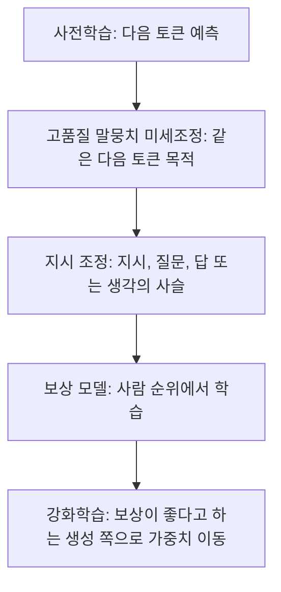
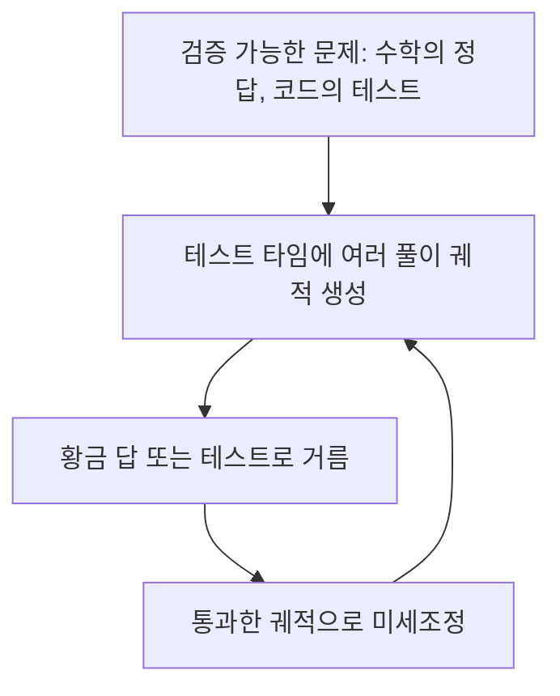
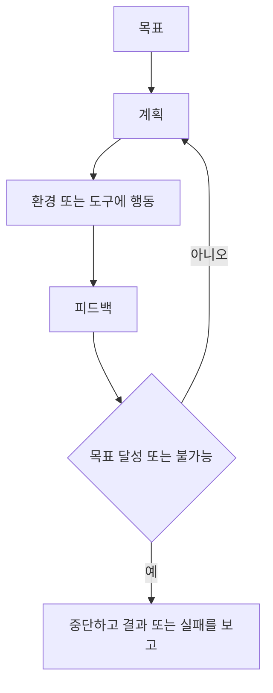
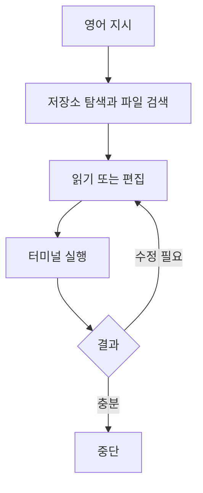
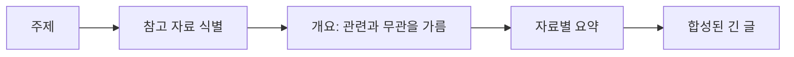

# 스케일링 법칙에서 검증 가능한 자기개선 루프까지

출처 : https://www.youtube.com/watch?v=6YnLB0XbTnI&list=PLangBM27OtEA

## 요약

언어 모델의 능력은 한 번의 확대에서 나오지 않았다. 계산량, 데이터 양, 파라미터 수를 키우면 다음 토큰 손실이 내려가고, 어느 규모를 넘으면 몇 샷 적응과 생각의 사슬처럼 작은 모델에는 없던 행동이 나타난다. 2022년 11월의 대화형 모델이 그 이전의 거대 사전학습 모델과 달라 보인 이유는 파라미터를 한 번 더 늘린 결과가 아니다. 고품질 말뭉치 위의 다음 토큰 미세조정, 지시 따르기, 사람 선호로 만든 보상 모델이 겹친 결과다.

그 다음 전선은 가중치를 고정한 채 추론 시간에 계산을 쓰는 쪽이다. 같은 문제를 여러 번 뽑고 검증기가 맞는 답을 고르면, 한 번만 뽑은 더 큰 모델보다 커버리지가 높아질 수 있다. 수학과 코드처럼 맞음을 검사할 수 있는 영역에서는 그 표본 중 정답에 닿는 궤적을 다시 학습 데이터로 넣는다. 커버리지가 올라가던 반복 표본과, 첫 표본의 정답률이 올라가는 추론 모델은 같은 로그-선형 모양을 다른 축에서 본다. 전자는 정답을 고를 외부 검증기가 있고, 후자는 모델이 어느 궤적이 맞는지를 학습한 상태다.

챗봇이 일을 끝내지 못하는 이유는 한 턴의 문장 생성이 목표, 계획, 환경에 대한 행동, 피드백, 중단 판단을 포함하지 않기 때문이다. 지금 쓰이는 대부분의 시스템은 그 열린 루프가 아니라, 사람이 미리 그린 호출 그래프다. 코딩과 조사는 그 그래프 바깥에서 목표를 향해 행동하는 조짐이 먼저 보인 영역이고, 둘 다 검증기가 있다. 창작처럼 피드백이 사람 평가에 기대는 영역은 그 사람이 병목이 된다. 자기개선이 계속되는 조건은 더 긴 사고 문장이 아니라, 생성된 결과가 유용한지 판정하는 신호가 학습 루프 안에 남는 것이다.

## 1. 세 축의 스케일링

사전학습 베이스 모델의 테스트 손실은 세 축에서 같이 내려간다. 가로축에 계산량을 두고 세로축에 손실을 두면, 계산을 더 넣을수록 손실이 낮다. 데이터 집합의 크기를 키워도 손실이 내려가고, 트랜스포머의 층 수와 파라미터 수를 키워도 손실이 내려간다. 이 관계는 한동안 베이스 모델을 키우는 설계의 기초였다. 2024년 무렵부터는 같은 곡선을 그냥 이어 가는 방식에 포화의 조짐이 보이기 시작했다. 그 관찰이 뒤의 추론 시간 계산과 자기개선을 전면으로 끌어올린다.

Kaplan 등의 2020년 스케일링 법칙 논문은 이 관계를 멱법칙으로 적었다. 아래 그림은 그중 계산 예산이 고정된 단면이다. 가로축은 임베딩을 뺀 파라미터 수, 세로축은 테스트 손실, 색은 페타플롭스-일 단위의 계산 예산이다. 예산마다 손실이 가장 낮은 골짜기가 있고, 예산을 키우면 그 골짜기가 아래와 오른쪽으로 움직인다. 파라미터가 너무 적어도, 주어진 계산으로 감당하기에 너무 많아도 테스트 손실은 다시 오른다. 계산, 데이터, 파라미터의 세 곡선은 이 골짜기를 세 방향에서 자른 것과 같다.


출처: [Scaling Laws for Neural Language Models](https://arxiv.org/abs/2001.08361), Kaplan et al., 2020.

2022년의 Chinchilla 결과는 같은 계산 예산 안에서 파라미터와 학습 토큰을 같이 키워야 한다는 쪽으로 균형을 고쳤다. 그 이전의 많은 모델은 파라미터에 비해 데이터를 덜 본 상태였다. [Training Compute-Optimal Large Language Models](https://arxiv.org/abs/2203.15556) (Hoffmann et al., 2022). 손실이 계산에 대해 매끄럽게 내려간다는 사실과, 그 계산을 크기와 데이터에 어떻게 나눌지는 별개의 설계다.

공개된 크기만 이어 보면 성장은 가파르다. BERT-large는 약 3억 4천만, GPT-2는 15억, GPT-3는 1,750억, PaLM은 5,400억 파라미터였다. 2018년에서 2024년으로 이어지는 그 크기 도표는 이미 오래된 스냅샷이다. GPT-4의 파라미터 수는 공개된 측정값이 아니다. 수조 개라는 말은 당시 돌던 추정이지, 확인할 수 있는 계수가 아니다. “대형”이 가리키는 것은 그 계수의 정확한 자릿수보다, 손실이 규모에 따라 예측 가능하게 내려가고 그 과정에서 새 행동이 나타난다는 점이다.

## 2. 몇 샷과 규모에서 나타나는 행동

손실이 내려가는 것과 별도로, 모델이 커지면 벤치마크 점수가 연속적으로 좋아지고, 과제마다 따로 미세조정하지 않아도 프롬프트 안의 형식만으로 따라가는 일이 생긴다. 과제 설명만 주고 답을 받으면 제로샷이고, 설명 뒤에 예시 몇 개를 더 주면 퓨샷이다. 영어를 프랑스어로 옮기라는 지시와 “cheese” 같은 단어만으로 번역이 나오면 제로샷이고, 그 앞에 번역 쌍을 몇 개 두면 퓨샷이다. GPT-3와 PaLM이 연 실용적인 변화는 이 프로토타이핑 비용이다. 도메인마다 학습을 돌리지 않고, 예시의 형식을 프롬프트에 넣는 것으로 같은 결의 답을 받을 수 있게 되었다.

예측 가능한 손실 곡선 옆에는, 규모를 키우기 전에는 보이지 않던 행동이 있다. 그중 이후 추론 모델까지 이어지는 것이 생각의 사슬이다. 보통의 프롬프트는 문제와 정답만 보여 준다. 생각의 사슬은 그 정답에 닿는 중간 계산을 같이 보여 준다. Wei 등의 2022년 논문에 실린 예는 이렇다. Roger가 테니스공 5개를 가지고 있고, 캔 2개를 더 사며, 캔마다 공이 3개다. 정답만 적으면 11이다. 과정을 적으면, 처음 5개에 캔 2개 분량인 6개를 더해 11이다. 그 형식을 본 모델은 비슷한 새 문제에서 중간 식을 먼저 쓰고 답을 낸다. 아래 그림의 오른쪽이 그 형식이고, 왼쪽의 정답만 있는 예시는 같은 계열의 다음 문제에서 틀린 수를 낸다.


출처: [Chain-of-Thought Prompting Elicits Reasoning in Large Language Models](https://arxiv.org/abs/2201.11903), Wei et al., 2022.

이 산수 자체는 지금 기준의 작은 모델도 예시 없이 푼다. 10억 파라미터 규모의 모델이 같은 문제를 생각의 사슬 없이 맞히는 일이 흔하다. 남아 있는 것은 예제 난이도가 아니라 형식이다. 중간 과정을 생성하는 성질은 이후의 추론 모델이 기대는 성질이고, 지난 1년의 진전도 그 위에 쌓였다.

규모 의존은 논문의 수학 과제에서 분명했다. LaMDA 약 80억, GPT 계열 약 70억처럼 작은 구간에서는 생각의 사슬을 넣어도 이득이 거의 없다. PaLM은 80억에서도 문맥에 주어진 과정을 따라 더 잘 풀고, 더 큰 모델에서 그 차이가 커진다. 모듈러 산술이나 뒤섞인 단어를 맞히는 과제에서도, 어느 크기를 지나면서 성능이 갑자기 나타나는 구간이 있다. 그래서 손실의 완만한 개선만이 아니라 그 불연속을 보기 위해, 프론티어 연구실에서는 스케일링을 아직 밀고 있다. 자연스러운 손실 감소와, 예측하지 못했던 행동의 등장은 같은 확대의 다른 산출이다.

생각의 사슬은 처음부터 학습 목표로 설계된 기능이 아니다. 어려운 문제에 중간 설명을 붙이면 더 잘 푼다는 관찰에서 나왔다. 그 조짐이 먼저 보인 자리가 GSM8K 같은 초등학교 수준 문장제 수학이고, 더 큰 모델인 PaLM에서 차이가 커지며 농담 설명처럼 수학 바깥의 과제까지 같은 형식이 통한다는 점이 드러났다. GSM8K 데이터 자체는 Cobbe 등의 2021년 논문이고, 생각의 사슬 프롬프트가 규모와 함께 성능을 올린다는 결과는 Wei 등 2022년이다. [Training Verifiers to Solve Math Word Problems](https://arxiv.org/abs/2110.14168).

이후의 추론 모델은 이야기가 다르다. 그쪽은 생각하도록 학습된다. 긴 추론이 필요한 문제와 그렇지 않은 문제를 모델이 가려 내게 만드는 쪽이 수렴 방향이다. 웹에는 이미 절차적인 글이 많아서, 베이스 모델이 방법적인 문장을 한 번도 본 적 없다고 말하긴 어렵다. 미세조정이 그 문체를 강화한다. 그래서 사고 전체를 순수하게 창발했다고 부르기는 어렵고, 처음의 생각의 사슬 이득은 설계 전에 발견된 현상에 가깝다.

## 3. 사전학습에서 선호 학습까지

2022년 11월에 공개된 대화형 모델은 사용자 100만 명에 5일이 걸렸다. 그 도약은 GPT-3 대비 파라미터 수의 차이가 아니라, 지시 조정과 사람 피드백 강화학습이다.

사전학습의 목적은 단순하다. 웹과 책을 포함한 다양한 텍스트에서 다음 토큰을 예측한다. 목적 함수만 비교하면 이후 단계보다 단순하다. 이렇게 나온 모델은 통계적으로 세상에 대한 분포를 가지고 있어도, 맞음과 틀림, 지시 따르기를 따로 갖고 있지 않다. 그 다음이 사람의 목표와 선호와 가치 쪽으로 모델을 돌리는 일이고, 이 정렬은 아직 풀렸다고 말할 단계가 아니다. 베이스 모델을 분별 있음과 안전에 대해 미세조정하면 그 축의 점수는 움직인다. 그 데이터는 안전과 비안전, 말이 되는 응답과 안 되는 응답을 사람이 고른 고품질 집합이다.

실무 파이프라인은 네 층으로 쌓인다.



첫째, 다음 토큰 예측을 유지한 채 책을 비롯한 비싼 고품질 텍스트로 미세조정한다. 분포의 평균이 아니라 문장 품질의 꼬리를 모델에 더 싣는 단계다.

둘째, 지시 조정이다. 최근 2년의 관행에서 그 데이터는 사람이 쓴 예시, 역할 템플릿, 합성 데이터가 섞인다. 형식은 지시와 질문-답 쌍이다. “다음 질문에 답하라. 질소의 끓는점은?” 뒤에 답이 붙는 식이다. 생각의 사슬 미세조정은 같은 쌍에 과정과 최종 라벨을 같이 넣는다. 이 집합의 품질과 일반성이 이 단계에서 나오는 모델의 품질을 크게 가른다. 여기까지 오면 모델은 질문을 받고, 과정을 밟아 답하는 대화에 가까워진다.

셋째, RLHF다. 지도 학습의 정답 라벨 대신, 사람이 모델 출력의 순위를 매긴 선호로 보상 모델을 만든다. 평가자는 전문가일 수도 있고 일반인일 수도 있다. 보상 모델은 그 다음부터 사람을 대신해, 생성이 좋은지 점수를 준다. 강화학습은 그 점수가 높아지는 쪽으로 LLM의 파라미터를 민다. 보상은 한 축이 아니다. 정확성, 도움 됨, 구체성, 무해함을 따로 두고, 제품이 무엇을 중시하는지에 따라 가중한다. 같은 RLHF라도 가중치가 다르면 다른 모델이 나온다.

이 네 층이 GPT-3까지의 대형 사전학습 모델과, 질문을 주고받을 수 있는 모델 사이의 차이다. 사전학습과 미세조정이 전선의 중심이던 시기는 대략 그로부터 1년에서 1년 반 뒤, 추론 자체가 능력을 올리는 축으로 취급되기 전까지다.

## 4. 가중치를 고정한 반복 표본

추론 스케일링은 파라미터를 바꾸지 않는다. 모델은 고정되고, 같은 입력에 대해 생성을 여러 방식으로 뽑아 더 어려운 문제의 답을 고른다. 반복 표본은 그 방법의 하나다. 이름은 무한 원숭이 비유에서 왔다. 비유는 유한한 타자기 입력이 셰익스피어에 닿을 수 있다는 이야기인데, 여기서 실제로 하는 일은 무한 반복이 아니다. 언어 모델의 출력 분포에서 유한 번 뽑고, 검증기가 맞는 것을 고른다.

생성은 결정적이지 않다. 온도는 그 분산을 키우는 손잡이다. 온도를 올리면 다음 토큰 분포가 평탄해져 서로 다른 답이 더 많이 나온다. 한없이 올리는 전략은 성립하지 않는다. 온도가 무한대로 가면 분포는 어휘 위의 균등에 가까워지고 출력은 읽을 수 없는 문자열이 된다. 그 반복 표본 실험에서 온도가 대략 1.2를 넘으면 생성이 무너지는 쪽이 보통이었다. 1.2는 보편 상수가 아니라 그 설정에서의 운용 범위다. 다양성을 온도 말고 다른 트릭으로 올리는 연구도 따로 있다.

검증기가 있을 때의 지표는 커버리지다. 문제마다 표본을 1개에서 1만 개까지 늘리며, 그 표본 중 하나라도 맞으면 그 문제를 푼 것으로 센다. 수학과 코딩 벤치마크에서, 표본 1개일 때 GPT-4o보다 못하던 더 작은 모델이 표본을 늘리면 커버리지에서 GPT-4o의 한 번 뽑기를 앞지른다. 모델이 한 번 물었을 때 내는 답보다 분포 안에 더 많은 풀이를 갖고 있다는 뜻이다. 일부 문제에서는 1만 개 중 서너 개만 맞다. 맞는 답이 분포의 꼬리에 있으므로, 추론 계산을 늘리지 않으면 그 꼬리에 닿지 않는다.

전체 답 공간을 트리 탐색이나 무작위 탐색으로 훑는 것과는 비용이 다르다. 가능한 문자열 전체는 모델이 실제로 내는 생성보다 훨씬 크고, 그 공간을 균등하게 뒤져서는 1만 번으로도 닿기 어렵다. 모델 표본은 학습된 분포를 따라가므로, 같은 횟수에서 훨씬 효율적이다. 1만 번은 그 공간에 비하면 적은 수다. 국제 수학 올림피아드에 가까운 어려운 문제에서도, 70억 파라미터 규모의 작은 모델이 이 방식으로 풀이에 닿는 경우가 보고된다.

병렬 표본은 지연 시간 문제를 완화한다. 1만 개를 직렬로 잇지 않고 동시에 뽑을 수 있다. 비용은 남는다. 얼마나 쓸지는 문제의 난이도에 따라 다르고, 그 트레이드오프는 아직 문제 유형별로 따로 재야 한다. 표본 수를 난이도에 따라 자동으로 정하는 공개된 표준 방법은 없다. 후속 방향은 보상 모델이 복잡도의 감을 갖고, 아직 풀리지 않았으면 추가 표본을 요청하는 쪽이다. 그 추가 표본은 반복일 수도 병렬일 수도 있다.

검증이 되는 영역과 안 되는 영역은 여기서 갈린다. 코드는 유닛 테스트를 돌리면 된다. 수학은 정답이나 검사 가능한 유도가 있다. 검증기가 없으면 선택 자체가 연구 문제가 되고, LLM을 심판으로 쓰거나, 보상 함수를 학습하거나, 도구를 붙여 판정하는 연구가 그 자리를 채운다.

아래 그림은 같은 논문이 보여 주는 다른 단면이다. Llama 3 8B와 70B 지시 모델에 대해 GSM8K와 MATH의 문제를 정답 표본 비율이 낮은 순으로 정렬했다. 초록은 다수결이 문제를 맞힌 경우, 빨강은 다수결이 틀린 경우다. GSM8K에서는 다수결이 거의 항상 맞고, MATH에서는 정답 비율이 낮은 문제 쪽에 빨강이 길게 남는다. 반복 표본의 커버리지는 “하나라도 맞으면 성공”이고, 다수결은 “많이 나온 답이 맞으면 성공”이다. 꼬리에 서너 개만 맞는 문제에서는 둘의 차이가 크다. 표본을 늘려 커버리지를 올려도, 선택 규칙이 다수결이면 그 이득을 못 가져간다.


출처: [Large Language Monkeys: Scaling Inference Compute with Repeated Sampling](https://arxiv.org/abs/2407.21787), Brown et al., 2024.

## 5. 테스트타임 계산을 학습으로 되돌리기

2024년 12월의 DeepSeek 공개와, 그 전후의 o 시리즈 및 Gemini의 thinking 계열은 미세조정과 테스트타임 스케일링을 한 고리로 묶었다. 가중치를 고정한 채 많이 뽑는 단계에서 끝나지 않고, 그 생성 중 검사에 통과한 것을 다음 학습 데이터로 쓴다.

수학처럼 정답이 알려진 문제에서는, 최종 황금 답에 닿는 여러 풀이 궤적을 모델이 만들게 한다. 코드에서는 테스트를 통과하는 풀이를 테스트 타임에 대량으로 만든다. 그 집합으로 미세조정하면, 다음 추론에서는 맞는 궤적을 더 자주 먼저 낸다. 데이터가 합성되고, 합성이 검증을 통과해야 학습에 들어가며, 학습된 모델이 다시 더 나은 합성을 만든다. 이 닫힌 고리가 자기개선이다.



고리의 한계는 정해져 있지 않다. 테스트타임 계산을 얼마나 쓸 수 있는지, 그 결과를 다시 학습에 얼마나 되돌릴 수 있는지에 상한이 공개된 법칙으로 주어져 있지 않다. 그래서 이 영역은 열려 있다. 날짜를 논문에 맞추면, 2024년 12월 26일에 나온 것은 DeepSeek-V3이고 추론 모델 DeepSeek-R1의 기술 보고는 2025년 1월이다. 자기개선 고리의 학습 레시피는 R1 쪽에 있다. [DeepSeek-V3 Technical Report](https://arxiv.org/abs/2412.19437), [DeepSeek-R1: Incentivizing Reasoning Capability in LLMs via Reinforcement Learning](https://arxiv.org/abs/2501.12948).

## 6. 커버리지와 pass@1

같은 로그-선형 모양이 두 번 나온다. 축이 다르다.

반복 표본에서 검증기가 있으면, 표본 수의 로그에 대해 커버리지가 선형에 가깝게 올라간다. 이것은 문제 집합 중 최소 한 번은 맞은 문제의 비율이다. 모델은 어느 표본이 맞는지 스스로 고르지 않는다. 고르는 일은 테스트, 정답, 또는 다른 선택기다.

2024년 9월에 공개된 o1은 같은 모양을 pass@1에서 보였다. 가로축은 테스트타임 계산의 로그, 세로축은 어려운 수학 벤치마크에서의 첫 답 정확도다. 벤치마크는 AIME로 읽히는 고난도 수학 문항 집합이다. 파라미터 수는 그대로 두고, 추론에 쓰는 계산만 늘려도 첫 답의 정확도가 올라간다. 훈련 계산에 대해 알려져 있던 스케일링이 추론 계산에도 비슷하게 보인 점이 새로웠다. 공개 설명은 [Learning to reason with LLMs](https://openai.com/index/learning-to-reason-with-llms/)에 있다.

둘을 같은 현상으로 부르면 설계가 꼬인다. pass@k 또는 커버리지는 “k번 안에 한 번이라도 맞음”이다. pass@1은 “이번에 낸 답이 맞음”이다. 사전학습 직후의 모델은 여러 추론 사슬을 낼 수 있어도 어느 사슬이 맞는지 모른다. 반복 표본은 맞는 사슬을 고르는 일을 검증기에 넘긴다. 추론 모델의 학습은 그 선택을 모델 안으로 들여와 pass@1을 올린다. 추론 모델이 GPT-4o를 앞서는 과제가 수학, 데이터 분석, 프로그래밍에 몰리고, 사적인 글쓰기와 문장 다듬기에서는 반드시 앞서지 않는 이유도 여기와 맞닿아 있다. 전자는 맞는 궤적을 학습할 신호가 있고, 후자는 그 신호가 약하다.

사람이 어려운 문제에서 더 오래 생각하고 여러 전략을 시도하듯, 추론 모델은 생각의 사슬을 포함해 더 긴 과정을 생성한다. 그 생성은 비싸다. 그럼에도 새 문제의 정답률을 올리므로 생성 자체를 학습 목표에 남긴다. 질문에 “단계별로 생각하라”고만 쓰고 과정 토큰을 실제로 내지 않는 설정은, 데이터가 만들어 둔 일반화된 사고 절차와 같지 않다. 분해, 역추적, 문제 분석은 사고 최적화 과정에서 배운 기술이고, 그 기술이 다른 문제로 퍼진다. 이득의 자리는 지시문 한 줄이 아니라, 맞는 사슬을 더 자주 내게 만든 데이터다.

## 7. 추론 궤적이 안에서 하는 일

한 번의 긴 생성 안에서도 역할이 나뉜다.

문제 분석은 입출력이 무엇인지부터 적는다. 작업 분해는 그 문제를 더 작은 단계로 쪼갠다. 자기평가는 시도 뒤에 피드백을 본다. 코드라면 테스트를 돌리고, 수라면 계산기를 쓰고, 아니면 답 자체를 판정한다. 자기수정은 그 피드백으로 중간에 고친다. 대안 제안은 막히면 되돌아가 다른 접근을 집는다. 이 조각 중 일부는 사람이 학습 데이터에 넣어 둔 것이고, 상당 부분은 합성 데이터 위의 미세조정과 강화학습에서 모델이 획득한다.

o1에 행렬의 전치를 내는 bash 스크립트를 시키면, 모델은 사용자가 bash를 요청했다는 사실, 행렬의 입력 형식과 출력 형식부터 적는다. 이어서 입력을 파싱하고 행렬을 배열의 배열로 두는 식으로 단계를 나눈다. 생각의 사슬과 다른 점은, 그 과정을 프롬프트의 예시로 넣어 주지 않아도 모델이 스스로 쓴다는 것이다. 공개된 사고 궤적에서는 중간에 “이건 틀렸다”에 해당하는 문장이 자주 나온다. 그 문장이 자기수정의 표면이다.

추론 궤적을 어떻게 가르치는지에 대한 단일한 공개 레시피는 없다. 양쪽이 같이 있다. 베이스 모델은 이미 어느 정도의 사고 문장을 낼 수 있다. 지시 조정에 들어간 생각의 사슬은 사고 방식의 부트스트랩이다. 템플릿으로 미세조정하는 구간도 있다. 임의의 질문에 모델이 내는 궤적은 그 템플릿을 넘는 일반화다. 학습에 쓴 문장과 지시만으로 설명되지 않는 구간이 있다.

결과 보상과 과정 보상은 그 피드백을 어디에 주는지의 차이다. 결과 보상은 최종 답이 맞는지로 점수를 주고, 과정 보상은 중간 단계에 점수를 준다. Lightman 등의 2023년 논문이 수학 풀이에서 두 신호를 비교한 공개 기준이다. [Let's Verify Step by Step](https://arxiv.org/abs/2305.20050). 어느 쪽을 쓰는지가 역추적과 자기수정이 학습되는 방식을 가른다. 최종 답만 맞으면 보상을 주면, 중간에 틀린 뒤 운으로 답을 맞힌 궤적도 양성 데이터가 될 수 있다. 단계 점수는 그 궤적을 거른다. 대신 단계 라벨은 비싸다.

큰 모델이 궤적을 쓰고 작은 모델이 최종 답만 요약하는 분리는 가능하다. 추론 능력은 대체로 크기와 같이 올라갔으므로, 궤적 자체는 큰 모델에서 뽑는 쪽이 자연스럽다. 다만 현재로서는 모델이 남의 궤적보다 자기 궤적을 더 잘 따른다. 더 강한 모델이 쓴 궤적이라도, 받는 모델은 자기가 쓴 궤적을 선호하는 경향이 있다. 다른 모델을 쓰는 자리가 더 분명한 곳은 궤적 작성이 아니라 평가와 피드백이다. 생성기와 판정기를 분리하는 이유가 여기 있다.

## 8. 챗봇과 에이전트

추론 모델까지 포함해, 한 턴 또는 대화창 안의 모델은 일을 끝내는 주체가 아니다. 대화는 가능해도, 목표가 달성됐는지 판단하고 환경을 바꾼 뒤 멈추는 루프가 없다.

에이전트는 목표를 받고, 환경과 상호작용할 단계를 계획하고, 피드백에 따라 단계를 고치고, 목표에 닿거나 불가능하다고 보고할 때 멈춘다. 도구는 모델 바깥에 있다. 검색, 날씨, 터미널, 파일 편집이 그 예다. 과제의 진행을 기억하지 않으면 궤적이 표류하므로, 어떤 형태로든 과제 메모리가 필요하다. 최근 몇 달 사이에 코딩 에이전트와 심층 조사가 이 정의를 끝에서 끝까지 수행하는 사례가 늘었다. 영어로 지시하면 파일을 고치고 테스트를 찾는다. 여러 해 살 집을 고르라는 질의에는 여러 페이지를 보고 장단을 요약한다. 이전에는 한 모델 호출로 끝나지 않던 일이다.

대부분은 아직 그 열린 루프가 아니다. 현장에 있는 것은 정적인 에이전트 워크플로에 가깝다. 사람이 호출 그래프를 그리고, 모델은 그 노드를 채운다. 열린 환경에서 행동과 피드백을 스스로 고르는 루프보다, 사람이 하던 절차를 그래프로 고정하는 편이 만들기 쉽다. 코딩과 조사는 그 고정 그래프 바깥의 조짐이 먼저 보인 두 영역이다.



만화에 가까운 두 패턴만 있어도 현장의 상당수가 설명된다.

하나는 생성과 심판이다. 한 호출이 풀이를 내고, 다른 호출이 수용 여부를 판정한다.

다른 하나는 병렬 호출 뒤 집계다. 심층 조사는 이쪽에 가깝다. 여러 입력으로 모델을 부르고, 결과를 모아 요약 하나로 만든다.

## 9. 손으로 조립하는 워크플로의 부품

워크플로를 이루는 부품은 반복된다.

- LLM 호출은 지시나 입력을 주고 출력을 받는다.
- 검증기는 출력이 규칙에 맞는지 검사한다.
- 비평 또는 심판은 그 검사를 다른 LLM에 맡긴다.
- 도구 호출은 웹 검색, 날씨, 그 밖의 외부 값을 가져온다.
- 오케스트레이션은 위 호출을 어떤 순서로 엮을지 정한다.

엮는 방식도 몇 개로 정리된다.

프롬프트 체이닝은 추론 모델의 작업 분해와 비슷하게, 부분 과제를 직렬로 이어 끝 목표에 닿게 한다. 라우팅은 난이도에 따라 호출 집합을 고른다. 복잡하면 긴 호출 열로, 단순하면 짧은 열로 보낸다. 병렬화는 키워드마다 동시에 조사하고 나중에 합치거나, 독립인 부분 과제를 나눈 뒤 해를 합친다. 오케스트레이터는 중앙 호출이 관리자처럼 계획을 세우고, 그 계획에 따라 이후 호출을 만든다. 코딩 에이전트가 먼저 계획을 보여 주고 이어서 도구를 부르는 형태가 이 자리다. 평가자는 사용자나 유닛 테스트 대신 LLM 심판으로 피드백을 만든다. 검증기는 코드를 실행해 유닛 테스트로 맞음을 확인한다. 수학, 코드, 그 밖의 규칙 기반 영역에서는 이 검증이 모델에게 되돌아가는 수정 신호가 된다.

이 부품을 돌리려면 추론 모델만으로는 부족하다. 계획, 다단계 추론, 실수 후의 자기수정이 추가로 필요하다. 추론 모델이 한 문제 안에서 길게 생각하는 것과, 환경의 피드백을 받아 다음 행동을 고르는 것은 다른 능력이다.

## 10. 코딩 루프

코딩 에이전트의 루프는 구조가 단순하다. 영어로 목표를 준다. 예를 들어 테스트를 구현하라고 한다. 에이전트는 저장소를 돌아다니고, 파일을 검색하고, 파일을 읽고, 줄을 고치고, 터미널에서 명령을 실행한다. 출력을 보고 다른 파일을 고치거나 다른 파일을 연다. 1년 전에는 이 루프가 안정적이지 않았다. 구조는 거의 그대로인데 지금은 안정적으로 보이기 시작했다.



안정성의 출처는 아키텍처의 교체가 아니다. 더 강한 모델, 더 나은 강화학습, 검증 가능한 보상을 쓰는 강화학습, 훈련 시간 스케일링이 겹친 결과다. 모델이 어느 수준을 넘으면 자기개선 루프가 켜진다. 모델이 만든 코드에 대해 모델이 유닛 테스트를 만들고, 그 테스트가 충분히 믿을 만해지면 검증 신호가 사람 없이 남는다. 작년에 공개된 code monkeys 계열의 작업이 이 질문, 즉 생성된 테스트가 생성된 코드를 실제로 더 좋게 만드는지의 질문을 다뤘다. 검증기가 좋으면 올바른 코드를 생성하게 만들 수 있다는 정황은 있다. 검증기를 견고하게 만드는 방법 자체는 열린 연구다. 여러 검증기를 결합하는 방법도 그중 하나다.

같은 루프를 과제 그래프로 다시 쓰면 네 칸이다. 사용자의 의도를 명확히 하고, 관련 파일을 찾고, 행동을 고르고, 검증한다. 사용자는 문제를 충분히 명세하지 않는 경우가 많다. 무엇을 찾을지와 무엇을 통과로 볼지가 지시문 밖에 있으므로, 의도 확인이 탐색과 검증의 전제가 된다. 검증은 종종 에이전트가 스스로 만든 테스트의 통과 여부다. o3 계열은 이런 끝에서 끝 궤적을 많이 본 상태로, 계획과 다단계 추론 뒤에 결론으로 돌아온다.

이 루프가 바로 효용이 큰 일은 반복이 큰 일이다. 코드 이전, 버전 업그레이드, 저장소 재구성, 데이터를 뽑아 정제하는 데이터 엔지니어링, 웨어하우스 이전, 유닛 테스트 작성이 그 예다. 한 번의 창의적 설계보다, 같은 판정이 수백 번 반복되는 변경에서 검증기의 값이 크다.

## 11. 생성기와 검증기의 간격

모델은 추론 궤적과 그럴듯한 문장을 많이 만든다. 그중 무엇이 유용한지는 생성 사실만으로 결정되지 않는다. 피드백 루프가 필요하다. 이 간격을 생성기-검증기 간격이라고 부른다.

창작에서는 피드백의 양이 적다. 맞는 문장과 좋은 문장이 다르고, 좋은 문장의 판정이 사람에게 남는다. 사람이 병목이 되면 합성 데이터 고리를 빨리 돌릴 수 없다. 피드백을 값싸게 얻을 수 있는 영역에서만 모델을 계속 개선하는 일이 가능하다. 견고한 검증을 넓히는 일이 이 분야의 병목으로 남아 있다.

사전학습과 강화학습 중 어느 쪽이 능력의 원천인지는 합의된 답이 없다. 둘 다 도움이 된다는 정도만 합의에 가깝다. 한 견해는 이렇다. 사전학습이 끝난 모델은 충분히 많이 뽑으면 맞는 풀이를 하나 포함한다. 그렇다면 피드백은 pass@1을 올릴 뿐, 모델이 가진 풀이 집합 자체는 넓히지 않는다. 그런데 실제 도약은 그 설명보다 커 보인다. 그 고리 전체는 아직 잘 이해되지 않았다. 강화학습을 계속하면 모델이 계속 나아진다는 조짐도 있고, 그 조짐이 상업화의 시작점이 되었다. 연구가 남은 자리다. “사전학습 말뭉치에 없던 행동을 보상이 끌어낸다”와 “사전학습 분포 안에 있던 행동을 보상이 앞으로 당긴다”는 둘 다 현재의 증거와 양립한다. 하나를 배제할 수 있는 실험이 아직 표준으로 자리 잡지 않았다.

## 12. 조사, 지원, 과학 쪽의 같은 루프

고객 지원은 같은 부품이 얕은 깊이로 쓰이는 예다. 실시간 전사는 통화를 기록으로 남긴다. 지식 보조는 상담원이 모든 문서를 외우지 않고, 데이터베이스에서 관련 글을 꺼내 검색 색인보다 정확히 표면화하게 한다. 스마트 리플라이는 채팅 응답 초안을 만든다. 통화 요약은 다음 응대에 넘길 상태를 줄인다. 이 네 가지는 대부분 한 번의 호출이거나 짧은 체인이다. 끝에서 끝까지 사례를 닫는 열린 루프는 이쪽에서도 이제 시작되는 층이다.

긴 보고서의 파이프라인은 병렬 조사의 구체적인 형태다. 예전에는 문헌을 찾고, 논문마다 요약하고, 요약을 합성하는 일이 사람의 순서였다. 지금은 그 순서를 모델 호출에 맡길 수 있고, 사람이 직접 읽을 양보다 많은 글을 경유하기도 한다. 예를 들어 2022년 동계 올림픽 개막식을 주제로 주면, 참고할 자료를 고르고, 관련 여부를 가려 개요를 만들고, 자료마다 관련 내용을 요약하고, 요약을 합쳐 긴 글을 만든다. 인상적인 결과와 별개로, 각 단계의 실패는 다음 단계의 입력이 된다. 관련 없는 자료를 개요에 넣으면 요약이 그 오류를 증폭한다. 그래서 이 파이프라인은 생성 한 번이 아니라, 단계마다 검증 또는 심판이 어디에 있는지의 문제다.



더 앞의 형태는 연구 보조를 과학자의 루프에 넣는 일이다. The AI Scientist는 아이디어 생성, 실험 반복, 논문 작성의 세 단계를 모델이 돕게 한다. [The AI Scientist: Towards Fully Automated Open-Ended Scientific Discovery](https://arxiv.org/abs/2408.06292), Lu et al., 2024. 환각은 그대로다. 그럼에도 웹을 폭넓게 읽은 모델이, 한 분야에 오래 있던 연구자의 레퍼토리 밖의 아이디어를 브레인스토밍으로 내는 경우가 있다. 가치는 자동으로 참인 논문을 쓰는 데 있지 않다. 가설의 후보 집합을 사람이 혼자 만들 때보다 넓히는 데 있다. 그 후보를 실험과 검증으로 거르는 고리가 없으면, 넓은 후보 집합은 잡음이다.

## 13. 실행으로 본 pass@1, 커버리지, 자기수정

언어 모델을 호출하지 않고도 두 지표와 자기수정의 기록 방식은 분리해 볼 수 있다. 아래는 문제 4개에 대해 후보 답을 3개씩 둔 결정적 예다. 정답은 각각 `"11"`, `"9"`, `"4"`, `"1"`이다. pass@1은 각 문제의 첫 후보만 보고, 커버리지는 세 후보 중 하나라도 맞으면 그 문제를 푼 것으로 센다. 기록은 `Bun.write`로 남기고 `Bun.file`로 다시 읽는다. 런타임은 Bun 1.4.4다.

```ts
type Turn = { step: string; output: string; ok: boolean };

const groups = [
  ["11", "6", "11"],
  ["27", "9", "9"],
  ["4", "4", "4"],
  ["nope", "nope", "nope"],
];
const gold = ["11", "9", "4", "1"];

let pass1 = 0;
let covered = 0;
for (let i = 0; i < groups.length; i++) {
  const ok = (answer: string) => answer === gold[i];
  if (ok(groups[i][0])) pass1 += 1;
  if (groups[i].some(ok)) covered += 1;
}
const n = groups.length;
console.log("pass-at-1", pass1 / n);
console.log("coverage", covered / n);

const turns: Turn[] = [];
function record(step: string, output: string, ok: boolean) {
  turns.push({ step, output, ok });
  console.log(step, output, ok ? "accept" : "reject");
}
const target = "11";
record("draft", "6", "6" === target);
record("revise", "11", "11" === target);
const accepted = [...turns].reverse().find((turn) => turn.ok);

await Bun.write(
  "/tmp/self-improve-trace.json",
  JSON.stringify({ turns, accepted: accepted?.output }, null, 2),
);
const saved = await Bun.file("/tmp/self-improve-trace.json").json();
console.log("saved-accepted", saved.accepted);
```

로컬 실행 출력은 다음과 같다.

```text
pass-at-1 0.5
coverage 0.75
draft 6 reject
revise 11 accept
saved-accepted 11
```

네 문제 중 첫 후보가 맞은 것은 두 개라 pass@1은 0.5다. 세 번째 문제는 후보가 모두 맞고, 두 번째 문제는 첫 후보는 틀리고 이후 후보가 맞으며, 네 번째 문제는 후보 안에 정답이 없다. 그래서 커버리지는 0.75다. 표본을 늘리면 커버리지만 오르고, 첫 답을 고르는 정책이 바뀌지 않으면 pass@1은 그대로다. 뒤의 두 줄은 자기수정이다. `"6"`은 목표 `"11"`에 대한 검증을 통과하지 못해 거절되고, 수정안 `"11"`이 수락된다. 수락은 생성 순서가 아니라 `ok`가 참인 마지막 기록에서 고른다. 파일에 다시 읽은 값도 `"11"`이다.

이 예는 언어 모델의 정확도를 측정한 것이 아니다. 지표 정의와 기록 규약만 고정한다. 검증 함수를 문자열 일치에서 유닛 테스트 실행으로 바꾸면 같은 골격이 코드 에이전트의 판정이 된다. 검증 함수를 다른 모델의 점수로 바꾸면 같은 골격이 LLM 심판이 되고, 그 순간 검증기의 오류가 학습 신호의 오류가 된다.

## 14. 실험이 성립하는 형태

자기개선을 다루는 실험은 시스템을 조립해 시연하는 것만으로는 질문이 되지 않는다. 성립하는 형태는 가설, 답하려는 질문, 보려는 개선 또는 분석하려는 성질이 먼저 있는 경우다. 새 평가 집합이나 벤치마크를 만드는 일, 이미 있는 에이전트 시스템의 신뢰성을 측정하는 일, 기존 벤치마크에서 한 아이디어로 점수를 올리는 일, 공개된 방법의 설계 선택을 하나 바꿔 그 선택의 효과를 재는 일이 그 예다. 문헌을 늘어놓기만 하는 조사나, 동작하는 앱을 보여 주는 일은 그 질문을 대체하지 못한다.

앞 절의 구분으로 옮기면 질문은 이런 모양이어야 한다. 표본 수를 늘릴 때 오르는 것이 커버리지인지 pass@1인지. 검증기를 결과 보상에서 과정 보상으로 바꿀 때 자기수정 궤적이 늘어나는지. 생성된 테스트가 생성기보다 먼저 신뢰할 수 있게 되는지, 아니면 생성기의 오류를 테스트가 따라가는지. 생성기와 판정기를 다른 모델로 둘 때 자기 궤적 선호가 줄어드는지. 이 질문들은 데모의 성패와 독립적으로 측정값이 있다.

## 15. 이 글이 단정하지 않는 것

온도 1.2는 한 반복 표본 연구에서 생성이 무너지기 시작한 운용 범위다. 모든 모델과 모든 샘플링 구현의 상한이 아니다.

GPT-4의 파라미터 수는 공개된 값이 아니다. 수조 개라는 추정은 크기 곡선의 이야기 안에 있던 말이지 측정이 아니다.

작은 모델이 표본을 늘리면 GPT-4o의 단일 표본보다 커버리지가 높아진다는 결과는 수학과 코드의 그 실험에 대한 것이다. 모델 제품명은 당시 도표의 두 곡선으로 제시되었고, 전사에서 이름이 깨져 있다. 이 글은 그 곡선을 “더 작은 모델”로만 적는다. 다수결 그림의 Llama 3 8B와 70B는 같은 논문의 다른 그림이며, 커버리지 곡선의 축 이름과 같지 않다.

2024년 12월에 자기개선 고리 전체가 한 번의 공개로 완성되었다는 뜻으로 DeepSeek을 적지 않는다. 12월의 공개와 2025년 1월의 추론 모델 보고는 문서가 다르다. 고리의 아이디어, 즉 테스트 타임에 검증을 통과한 궤적을 미세조정 데이터로 쓰는 일은 그 시기 추론 모델들의 공통 설계다.

사전학습만으로 풀이 집합이 결정되고 강화학습은 선택만 바꾼다는 견해와, 강화학습이 모델의 능력 자체를 계속 넓힌다는 견해는 둘 다 열려 있다. 이 글은 후자를 사실로 적지 않는다.

에이전트 워크플로의 도식은 현장 시스템을 압축한 만화다. 열린 목표-행동-피드백 루프가 코딩과 조사 밖에서 일반화되었다고 말하지 않는다. 고객 지원의 전사, 지식 보조, 스마트 리플라이, 통화 요약은 얕은 호출이지 그 열린 루프가 아니다.

생각의 사슬의 최초 관찰을 GSM8K 논문 한 편으로 귀속하지 않는다. 데이터셋 논문과, 규모에 따라 중간 추론의 이득이 커진다는 프롬프트 논문은 별개다.

## 16. 참고

- Kaplan, J. et al. [Scaling Laws for Neural Language Models](https://arxiv.org/abs/2001.08361). 2020. 계산 예산별 손실 곡선은 [Performance vs Compute Budget](https://arxiv.org/html/2001.08361v1/PerfVsParams-ComputeBudget.png).
- Hoffmann, J. et al. [Training Compute-Optimal Large Language Models](https://arxiv.org/abs/2203.15556). 2022.
- Wei, J. et al. [Chain-of-Thought Prompting Elicits Reasoning in Large Language Models](https://arxiv.org/abs/2201.11903). 2022. 테니스공 비교 그림은 [new-pull-figure-landscape.png](https://arxiv.org/html/2201.11903v6/new-pull-figure-landscape.png).
- Cobbe, K. et al. [Training Verifiers to Solve Math Word Problems](https://arxiv.org/abs/2110.14168). 2021.
- Brown, B. et al. [Large Language Monkeys: Scaling Inference Compute with Repeated Sampling](https://arxiv.org/abs/2407.21787). 2024. 다수결 단면은 [figures/hist2.png](https://arxiv.org/html/2407.21787v3/figures/hist2.png).
- OpenAI. [Learning to reason with LLMs](https://openai.com/index/learning-to-reason-with-llms/). 2024.
- DeepSeek-AI. [DeepSeek-V3 Technical Report](https://arxiv.org/abs/2412.19437). 2024.
- DeepSeek-AI. [DeepSeek-R1](https://arxiv.org/abs/2501.12948). 2025.
- Lightman, H. et al. [Let's Verify Step by Step](https://arxiv.org/abs/2305.20050). 2023.
- Lu, C. et al. [The AI Scientist](https://arxiv.org/abs/2408.06292). 2024.

로컬 지표 예제는 Bun 1.4.4에서 `Bun.write`와 `Bun.file`만 사용해 실행했다. pass@1 0.5, 커버리지 0.75, 수정 후 수락값 `"11"`은 그 실행의 출력이다.
