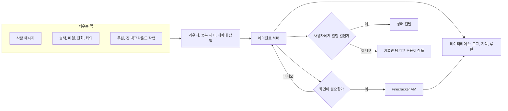
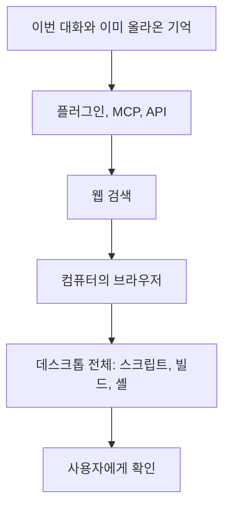

# **Stanford CS146S: How always-on agents work**

# 부재 : 항상 켜 있는 에이전트: 서버, 컴퓨터, 기억

출처 : [https://www.youtube.com/watch?v=L1OBRtfPS34](https://www.youtube.com/watch?v=L1OBRtfPS34)

모델이 도구를 반복 호출하는 고리는 이미 일을 한다. 그 고리가 노트북 프로세스 안에 있으면 노트북을 닫는 순간 일이 멈춘다. 항상 켜 있는 에이전트는 그 고리를 서버로 옮기고, 파일과 브라우저가 있는 컴퓨터를 따로 두고, 대화와 기억을 디스크에 남긴 뒤 프로세스를 재워도 다시 깨울 수 있게 만든 구조다.

이 문서는 그 구조의 층위를 적는다. 모델이 하루나 일주일 동안 지시를 따르는 능력, 보조 에이전트, 컴퓨터 사용, 파일로 된 기억, 내구성 있는 워크플로, 프롬프트 캐시, 손실 있는 압축, 그리고 한 달짜리 실행을 한 달마다 나오는 모델로 평가할 수 없는 문제가 한 설계 안에 있다.

## 1. 개발자가 AI와 일한 네 구간

같은 모델 가족도 묶는 방식이 바뀌면 병목이 바뀐다.


| 구간             | 사람이 하는 일          | 에이전트가 사는 곳        | 병목                          |
| -------------- | ----------------- | ----------------- | --------------------------- |
| 대화창에서 복사       | 답을 에디터에 붙여 넣는다    | 없음                | 사람이 모든 줄을 옮긴다               |
| 터미널 하네스        | 파일 수정과 셸을 도구로 맡긴다 | 개발자 노트북의 프로세스     | 노트북을 닫으면 멈춘다. 명령마다 승인을 기다린다 |
| 전용 앱, 병렬, 클라우드 | 여러 에이전트를 동시에 본다   | 로컬 또는 클라우드        | 사람이 여전히 명령과 결과를 하나씩 검토한다    |
| 상주 에이전트        | 중요한 갱신만 받는다       | 서버와 그 서버가 깨우는 컴퓨터 | 기억, 보안, 알림 시점, 평가           |


세 번째 구간까지는 사람이 루프 안에 있다. 셸 한 줄, diff 한 덩이를 눈으로 확인한다. 네 번째 구간은 그 확인을 매 호출마다 하지 않는다. 에이전트는 자기 컴퓨터, 자기 기억, 업무 중에 새로 적은 절차를 가지고, 사람이 다른 일을 하는 동안 계속 돈다.

인터페이스는 역설적으로 단순해졌다. 모델이 약할 때는 설정 화면과 승인 버튼이 많았고, 모델이 긴 지시를 더 안정적으로 따르게 되자 표면은 문자 메시지에 가까워졌다. 문자에 익숙한 표면으로, 동료에게 넘기던 길이의 일을 넘긴다. 질문 한 번에 답 한 번이 아니다.

조종의 방식도 바뀐다. 예전 루프는 프롬프트를 넣고 기다리고, 셸을 허용하거나 거절하고, 다시 넣는 큐였다. 지금은 실행 중에 방향을 고친다. “그 스레드를 봐” 직후에 “목요일에 해”라고 붙여도, 두 문장이 한 일의 수정이라는 것을 모델과 하네스가 같이 읽는다. 이전 세대는 끼어들기를 새 과제처럼 오해했다.

자동 검토는 그 승인 피로를 다른 모델에게 넘기는 장치다. 사람이 셸 수백 개를 눈으로 통과시키면 뒷부분이 느슨해진다. 별도의 모델이 명령의 목적과 부작용을 보는 편이, 지친 사람의 클릭보다 일정한 경우가 있다. 이것은 검토 모델의 정책이 맞을 때의 이야기다. 검토 모델이 비어 있으면 자동 검토는 이름만 남는다.

## 2. 모델을 오래 두게 만든 여섯 가지

상주 에이전트는 모델 카드의 문장만으로 생기지 않는다. 아래 여섯이 하네스와 같이 있다.

1. 긴 구간 지시 수행. 압축이 받쳐 주면 수 시간에서 수 일까지 같은 과제를 이어 간다. 압축이 없으면 문맥 한도가 먼저 온다.
2. 보조 에이전트. 본체의 작업 기억은 찬다. 도우미는 빈 문맥에서 비싼 도구 호출을 하고, 결과만 본체로 가져온다. 본체의 한도는 그대로고, 일이 그 한도 밖으로 나간다.
3. 도구 호출의 안정. 몇 년 전의 실패 형태는 없는 도구를 지어내는 것이었다. 그 실패가 줄어든 뒤에야 셸과 파일보다 강한 도구를 맡길 수 있다.
4. 컴퓨터 사용. 브라우저와 데스크톱을 사람처럼 누른다. API나 MCP가 없는 서비스도 화면으로 조작하는 경로가 생긴다. 그 경로를 컴퓨터 사용이라고 부른다.
5. 파일. 기억과 절차를 파일로 두면 모델이 셸의 검색으로 다시 찾는다. 검색이 잘되면 모든 과거를 매 호출의 프롬프트에 넣지 않아도 된다.
6. 보여 준 일이 재사용 단위가 된다. 한 번의 작업이 스킬, 기억, 루틴으로 남는다. 루틴은 cron이 프롬프트를 정해진 시각에 깨우는 형태다.

스킬은 그 일을 성공으로 보는 조건과 실패로 보는 조건을 적은 마크다운이다. 개인이 적은 절차와, 메일이나 API처럼 반복되는 일에 대해 바깥에서 배포되는 절차가 같은 자리에 놓인다. 플러그인은 그 절차 또는 MCP 서버를 설치 단위로 묶은 것이다.

## 3. 잠들었다가 깨는 두 기계

항상 켜 있다는 말은 프로세스가 24시간 CPU를 태운다는 뜻이 아니다. 서버도 컴퓨터도 잠들 수 있다. 메시지든 외부 이벤트든 깨울 조건이 오면 서버가 상태와 함께 올라온다. 브라우저나 화면이 필요하면 그때 컴퓨터를 켠다. 일이 끝나면 둘 다 다시 잠든다. 대화 기록, 기억, 루틴은 데이터베이스와 저장소에 남는다.

컴퓨터를 모두에게 항상 켜 두면 비용과 대수 둘 다 감당이 안 된다. 상주라는 제품 약속과, 유휴 시에는 꺼 둔다는 운영 약속이 같이 있어야 한다.

이 컴퓨터는 Firecracker 마이크로 VM으로 두는 구성이 잘 맞는다. 머신 상태를 스냅샷하고, 끄고, 그 스냅샷에서 다시 켜는 경로가 짧기 때문이다. 게스트 안에는 파일, 셸, Chrome이 있다. 봇이 다섯이든 열이면 각각 자기 화면을 갖게 할 수 있다. 인프라는 공유하고, 데스크톱은 나눈다. 사람이 그 화면에 붙어 직접 조작하는 통로도 둔다. 개인 노트북이 아니라 잠긴 환경에서 셸이 돌아야 하는 이유가 여기 있다.


그림의 왼쪽은 한 서버가 수천 개의 멀티테넌트 마이크로 VM으로 스케일한다는 주장이고, 오른쪽은 그 VM을 만들고 네트워크와 스토리지를 제한하는 제어 평면이다. 에이전트 제품은 이 그림의 게스트 하나를 “봇의 컴퓨터”로 빌린다. Firecracker 자체의 설명은 [공식 문서](https://firecracker-microvm.github.io/)에 있다.




깨우는 쪽은 터미널 입력만이 아니다. 슬랙에 살아 있는 봇, 회의에 들어가 노트만 하고 돌아오는 봇, 수 시간짜리 백그라운드 작업의 요약이 같은 라우터로 들어온다. 라우터는 중복을 걷고 대화 순서에 넣는다. 그 다음 휴리스틱이 “지금 사람을 깨울 일인가”를 정한다. 동료가 진행될 때마다 어깨를 두드리면 일이 아니라 소음이다. 주기에 따라 하루 한 번일 수도 있다. 이 휴리스틱은 아직 닫힌 문제가 아니다. 수업을 빠졌으니 녹음과 노트를 가져왔다는 알림은 도움일 수도 있고 방해일 수도 있다. 침묵과 먼저 말 걸기의 경계는 제품마다 다시 잰다.

## 4. 얇은 클라이언트, 두꺼운 서버

에이전트 루프를 폰이나 노트북에 두면 네 가지가 막힌다.

- 에이전트 코드를 고칠 때마다 앱 스토어 심사를 기다린다. 서버에 두면 서버 배포로 끝난다.
- 전사나 이미지 생성 같은 무거운 일은 기기보다 서버가 빠른 경우가 많다.
- 트래픽이 들쭉날쭉할 때의 스케일 방법은 서버 쪽에 이미 있다.
- 결정적인 이유: 루프를 VM 안에 넣으면 VM을 루프와 분리해서 끌 수 없다. 리눅스 제로데이로 게스트를 다시 만들어야 할 때, 루프까지 지우면 제품이 멈춘다. 상태는 서버에 두고 VM은 다시 만들 수 있어야 한다.

그래서 클라이언트는 얇다. 서버가 모델과 도구의 고리를 돈다. 컴퓨터는 그 서버가 필요할 때만 붙는 자원이다.

메시지를 보내는 경로는 분산 시스템의 보통 패턴을 탄다. 클라이언트는 보낸 즉시 낙관적으로 표시한다. 서버는 그 턴에서 모델과 도구를 반복하고 결과를 저장한다. 클라이언트는 서버들의 변경 신호를 구독하고, 신호가 오면 최신을 가져온다. 재시도가 같은 메시지를 두 번 그리지 않도록 중복을 제거한다. 보낸 직후의 화면과 저장된 진실이 잠시 다를 수 있다. 그게 강한 일관성과 결과적 일관성 사이의 자리다. 턴의 기록은 저장소가 진실이고, 화면의 즉시는 기다림을 숨기는 낙관이다.

## 5. 큐는 처음부터 다시 하고, 워크플로는 멈춘 단계에서 잇는다

복잡한 일을 1, 2, 3단계로 나누어 진행하다가 인프라가 죽으면, 일반 잡 큐는 1부터 다시 한다. 1단계가 메일을 보냈거나 파일을 지웠다면 재실행이 사고다.

내구성 있는 워크플로는 각 단계의 완료를 밖에 적는다. 실패 후 재시도는 끝나지 않은 단계부터 한다. 이 문제는 분산 시스템에서 이미 다루어져 있다. [Temporal 워크플로](https://docs.temporal.io/workflows)가 그 목적의 오픈소스 구현이다. 실행 인프라는 여전히 직접 돌려야 하고, 단계 저장과 재시도의 규약을 처음부터 짜지는 않는다.

보조 에이전트 하나도 각각 이런 워크플로로 둔다. 영상 도우미가 메모리를 소진해도 그 도우미의 진행만 복구하고, 본체의 대화는 그대로다.

아래는 그 규약만 Bun으로 돌린 것이다. 모델 호출은 없다. 저널에 끝난 단계가 있으면 건너뛰고, 죽기 전에 적히지 않은 단계부터 다시 한다. `Bun.file`과 `Bun.write`만 쓴다.

```ts
const journalPath = "/tmp/always-on-journal.json";

async function readJournal(): Promise<{ id: string }[]> {
  const file = Bun.file(journalPath);
  if (!(await file.exists())) return [];
  const text = await file.text();
  return text.trim() ? JSON.parse(text) : [];
}

async function workflow(steps: string[], crashBefore: string | null) {
  const done = await readJournal();
  const seen = new Set(done.map((step) => step.id));
  for (const id of steps) {
    if (seen.has(id)) {
      console.log("resume-skip", id);
      continue;
    }
    if (crashBefore === id) {
      console.log("crash-before", id);
      return;
    }
    done.push({ id });
    await Bun.write(journalPath, JSON.stringify(done));
    console.log("run", id);
  }
}

await Bun.write(journalPath, "[]");
console.log("pass-1");
await workflow(["load-state", "call-tool", "send-to-user"], "send-to-user");
console.log("pass-2");
await workflow(["load-state", "call-tool", "send-to-user"], null);
```

이 머신에서 Bun 1.4.4로 실행한 출력은 다음과 같다.

```text
pass-1
run load-state
run call-tool
crash-before send-to-user
pass-2
resume-skip load-state
resume-skip call-tool
run send-to-user
```

첫 패스는 `send-to-user` 직전에 죽었다. 두 번째 패스는 끝난 두 단계를 건너뛰고 마지막만 실행했다. 큐였다면 두 번째 패스가 `load-state`부터 다시 돌았을 것이다. 저널을 비우고 시작하면 다시 세 단계가 모두 `run`으로 찍힌다.

이 모형은 단계 함수가 멱등이라는 약속을 코드로 강제하지는 않는다. `call-tool`이 바깥에 메일을 보내고 저널을 쓰기 전에 죽으면, 재시도가 메일을 두 번 보낸다. Temporal이 요구하는 것도 그 약속이다. 저널은 완료를 기억할 뿐, 완료 전에 일어난 부작용을 지우지 않는다.

## 6. 사람 메시지는 줄을 새치기하고, 나머지는 뒤에서 묶인다

들어오는 일의 우선순위는 출처로 나뉜다.


| 출처                | 큐에서의 자리 | 이미 도는 턴            |
| ----------------- | ------- | ------------------ |
| 사람이 봇에게 직접 보낸 메시지 | 맨 앞     | 멈추고 이 메시지를 먼저 반영한다 |
| 그룹 대화, 슬랙 스레드     | 뒤       | 현재 턴이 끝난 뒤에 본다     |
| 백그라운드 루틴          | 뒤       | 현재 턴이 끝난 뒤에 본다     |


“이벤트 날짜를 바꿔”는 진행 중인 루프를 세울 이유가 있다. 사람이 보고 있는데 루틴이 옛 날짜로 일을 끝내면 그 결과가 폐기된다.

짧은 시간에 서너 통이 이어지면 턴을 네 번 열지 않고 한 턴으로 묶을 수 있다. 묶음의 시간 창은 휴리스틱이다. 너무 길면 첫 메시지에 대한 반응이 늦고, 너무 짧으면 수정 메시지가 별도 과제처럼 보인다.

## 7. 클라이언트가 서버에 가진 도구는 하나다

하네스를 터미널용 고리에서 상주 형태로 키울 때 가장 큰 차이는 경계다. 클라이언트와 서버 사이를 오가는 도구는 `send_to_user` 하나다. 셸, 파일 읽기, 클라우드 쪽 에이전트 호출, 화면 녹화, 데모 제작은 서버에 있다.

클라이언트가 어디서 뜨든 계약은 같다. 폰, 데스크톱, 메일, 슬랙이 같은 도구로 서버와 말한다. 서버가 돌려준 내용을 어떻게 그릴지는 클라이언트가 정한다.

- 로그인이 필요하면 그 서비스에 맞는 입력 화면을 연다. 비밀번호 관리자에 붙을 수 있다.
- 결제가 필요하면 결제 서비스의 확정 화면을 연다.
- 메일이나 슬랙처럼 되돌리기 어려운 일은 초안을 보여주고 고친 뒤 보내게 한다.
- 본문이 필요 없는 수신은 이모지 반응만 남긴다.

이 나눔이 없으면 슬랙 클라이언트 안에 셸을 두고, 폰 클라이언트 안에 또 셸을 둔다. 도구 설명과 권한 검사가 표면 수만큼 복제된다. `send_to_user` 하나는 그 복제를 막는다. 풍부한 UI는 도구의 개수가 아니라, 같은 페이로드를 표면마다 다르게 그리는 일에서 나온다.

## 8. 도구 전문은 부르고 나서 읽는다

모델의 작업 기억은 토큰 한도다. 도구를 모두 그 안에 넣으면 이름, 스키마, 설명이 대화보다 먼저 칸을 채운다. 드라이브, 메일, 영상 서비스처럼 MCP 서버를 여럿 설치하면 상단이 스키마로 가득 찬다. 모델이 대화로 쓸 자리가 줄어들고, 호출 비용은 그 스키마를 매번 다시 읽는 비용이 된다. MCP의 도구가 어떻게 노출되는지는 [MCP 문서](https://modelcontextprotocol.io/docs/getting-started/intro)가 다룬다.

동적 도구 발견은 매 메시지에 이름을 두고, 스키마는 파일이 가지게 한다. 모델이 그 이름을 쓰겠다고 하면 그때 파일을 읽는다. 파일 시스템이 도구 목록의 저장소다. 문맥이 줄면 비용이 줄고, 같은 한도 안에서 대화가 더 길어질 수 있다.

턴 도중에 도구를 넣거나 빼는 일은 피한다. 도구 목록은 프롬프트 앞부분이고, 앞부분이 바뀌면 11장의 캐시가 깨진다. 스키마 문장이 길면 이름만 넣는 이유 자체가 사라진다. 설명을 줄이는 작업은 모델 품질 작업이면서 가격 작업이다.

반대편 원칙도 있다. 도구를 셸 하나로 줄이면 많은 일을 `sh`로 흉내 낼 수 있다. 그런데 호출의 대부분이 같은 형태의 셸이라면, 그 형태는 전용 도구가 더 싸다. 전용 도구는 사람이 로그를 읽을 때도 문장이 짧다. 하나의 셸은 하한이고, 자주 쓰는 경로는 이름이 있는 도구로 올리는 편이 맞다.

오류 문장도 도구다. 사람에게 “실패했습니다”만 주면 다음 행동이 없다. 에이전트에게도 같다. 무엇이 실패했는지, 다음에 어떤 도구를 부르면 되는지를 오류에 적으면 재시도가 추측이 아니라 절차가 된다.

## 9. 아는 것부터 쓰고, 사람을 마지막에 부른다

정보를 구하는 순서는 싼 것에서 비싼 것으로 올라간다.




이미 대화에 있는 답을 웹에서 다시 찾지 않는다. API가 있으면 화면을 열지 않는다. 검색으로 끝나면 데스크톱을 켜지 않는다. 네 단계가 실패했을 때만 사람에게 묻는다. 동료에게 기대하는 것과 같다. 잔액을 볼 수 있는 API가 있는데 매번 사람에게 숫자를 물어 보면 그 동료는 일을 나누어 가진 것이 아니다.

컴퓨터 안에서 화면을 읽는 순서도 따로 있다.


| 수단     | 토큰                        | 맞는 때                          |
| ------ | ------------------------- | ----------------------------- |
| 접근성 트리 | 적다. 버튼, 링크, 입력의 역할만 남는다   | 표준 컨트롤을 누르는 탐색                |
| HTML   | 중간. 구조는 있으나 장식과 스크립트가 섞인다 | 접근성 트리가 비어 있는 페이지             |
| 스크린샷   | 많다. 픽셀 전체를 본다             | 모달처럼 트리가 못 잡는 겹침              |
| 픽셀 클릭  | 좌표 추정                     | 위 셋으로 누르는 지점을 특정할 수 없을 때      |
| 사용자    | 한 번의 인터럽트                 | 2단계 인증, CAPTCHA처럼 사람만 통과하는 관문 |


스크린샷을 기본으로 두면 매 클릭이 시각 토큰을 태운다. 접근성 트리가 버튼 이름을 주면 그 이름만으로 클릭을 고른다. 트리가 없는 캔버스나, 트리가 놓치는 모달에서만 픽셀로 내려간다.

## 10. 본체는 짧게, 도우미는 각자 워크플로로

본체는 조율자다. 대화는 일부러 희박하게 유지한다. 도우미는 서브에이전트다. 셸을 많이 치거나 도구를 많이 부르는 일은 도우미에게 넘긴다. 그 과정의 토큰은 본체 문맥에 쌓이지 않고, 답만 돌아온다.

무한 문맥은 없다. 모든 모델에는 한도가 있다. 무한하게 느껴지는 것은 한도 밖으로 일을 보내고, 한도 안은 요약과 포인터로 유지하기 때문이다. 모델을 그 패턴에 맞춰 학습하면, 한도에 가까워질수록 품질이 무너지는 체감이 줄어든다. 한도 자체가 사라진 것은 아니다.

도우미마다 스킬이 다르고, 도우미마다 5장의 내구성 있는 워크플로가 있다. 본체는 할 일 목록을 가진 동료처럼 보인다. 사람은 진행을 묻고, 메시지를 보내고, 도우미를 멈출 수 있다. 엔지니어 여럿이 한 문제를 나눌 때의 역할 나눔과 같은 모양이다.

추론도 이 나눔을 따라 튜닝한다. 본체는 지연이 낮아야 한다. 문자에 바로 답이 온다. 도우미가 긴 일을 할 때 10분과 12분의 차이는 그 일의 크기 옆에서 작다. 같은 모델을 같은 지연 목표로 몰 필요가 없다.

## 11. 프롬프트 캐시가 안 맞으면 버그다

에이전트 호출의 토큰은 대부분 다시 보내는 과거다. 대화를 보내고, 메시지 하나를 더하고, 대화 전체를 다시 보낸다. 앞부분이 이전 호출과 같으면 그 앞부분은 캐시된 토큰 가격으로 처리된다. 가격표에서 캐시 할인이 큰 이유가 이 패턴이다.

고정해야 하는 앞부분은 도구 정의와 시스템 프롬프트다. 바뀌는 것은 끝의 새 메시지다. 앞부분의 순서가 바뀌거나 문장 하나가 끼면 캐시 키가 달라지고, 그 호출은 전문을 다시 돈다. 상주 에이전트는 이 호출이 하루 종일 반복되므로, 캐시 미스는 품질 문제가 아니라 운영 장애에 가깝다.

2026년 1월, 상주형 에이전트가 구독형 모델 API 위에서 대규모로 돌기 시작했다. OpenClaw가 그 사용 형태의 초기 사례다. 제공자는 그 패턴을 아직 많이 보지 못했고, 하네스는 앞부분을 고정하는 쪽으로 최적화되어 있지 않았다. 캐시 미스가 쌓였고, 항상 켜 둔 실행에서는 그 미스가 바로 비용이 되었다. 이후의 수정은 캐시를 최대한 유지하는 쪽이었다. 같은 제품의 게이트웨이, 스킬, 기억은 [OpenClaw 2 노트](../cs/261002_2359_OpenClaw%202%20Personal%20Gateway%20Skills%20Memory%20and%20Paired%20Machines.md)에 따로 정리되어 있다.

앞부분을 구간으로 나누고 순서를 고정하면, 실험을 넣어도 다른 사용자의 키가 깨지지 않는다. A/B로 프롬프트 조각을 넣을 때 그 조각을 모두의 중간에 끼우면 실험군이 아닌 쪽의 캐시까지 무효가 된다. 구간 해시를 고정된 순서로 이어 붙이는 편이 안전하다.

사람이 입력을 시작하는 순간에 서버가 앞부분을 미리 만들어 캐시를 데울 수 있다. 웹에서 링크 위에 커서를 올리면 다음 문서를 미리 받는 것과 같은 자리다. 이런 최적화는 하나씩은 작고, 긴 실행에서는 토큰과 지연이 같이 쌓인다.

제공자마다 캐시가 살아있는 시간은 다르다. Anthropic 플랫폼의 프롬프트 캐시는 접두를 재사용하고, 수명은 5분 또는 1시간으로 문서화되어 있다. 자동 캐시는 요청 상단의 `cache_control`로 마지막 캐시 가능한 블록까지를 접두로 삼고, 대화가 늘면 그 경계를 앞으로 민다. 명시적 중단점은 블록마다 `cache_control`을 둔다. 설명은 [Prompt caching](https://platform.claude.com/docs/en/build-with-claude/prompt-caching)에 있다. 다른 제공자의 창은 이 숫자와 다르다. 압축을 “캐시가 아직 따뜻할 때” 하라는 12장의 판단은, 그 제공자의 창을 읽은 뒤에야 시각이 된다.

아래는 앞부분의 동일성과 순서 변경을 `Bun.hash`로 구분한 것이다. 해시 값은 이 실행의 입력에 대한 결과다.

```ts
const system = "You are the main agent. Keep the conversation sparse.";
const tools = "send_to_user\nread_file\nstart_helper";
const facts = "user prefers lowercase messages";
const prefix = [system, tools, facts].join("\n");
const prefixAndDelta = prefix + "\nuser: move it to Thursday";
const reordered = [tools, system, facts].join("\n");

console.log("prefix-hash", Bun.hash(prefix).toString());
console.log("same-prefix-hash", Bun.hash(prefix).toString());
console.log("delta-hash", Bun.hash(prefixAndDelta).toString());
console.log("reordered-hash", Bun.hash(reordered).toString());
```

```text
prefix-hash 13959624279674214673
same-prefix-hash 13959624279674214673
delta-hash 15192814946801056167
reordered-hash 9021991045155900009
```

같은 앞부분은 같은 해시다. 끝에 사용자 문장을 붙이면 전체 해시는 바뀌고, 앞부분만 다시 해시하면 첫 값과 같다. 캐시가 보는 것은 이 앞부분이다. 도구와 시스템 문장의 순서만 바꾸면 내용이 같아도 해시가 달라진다. 그게 캐시 미스다.

## 12. 압축은 정보를 버린다

문맥이 20만 토큰이면 그 전에 요약이 필요하다. 모든 압축은 손실이다. 무엇을 남길지의 알고리즘이 장기 실행의 품질을 정한다. 이 문제만으로 연구가 따로 성립할 만큼 어렵다.

실용적인 타이밍이 하나 있다. 대화가 10만 토큰을 넘은 채 사용자가 자리를 비우면, 캐시가 아직 따뜻한 동안에 압축을 끝낸다. 긴 대화를 캐시 가격으로 요약해 두고, 30분 뒤에 돌아온 사용자는 요약 위에서 이어서 보낸다. 창이 식은 뒤에 같은 요약을 하면 전문을 다시 읽는 가격을 낸다.

압축과 별도로, 긴 도구 출력은 문맥에 넣지 않고 파일에 둔다. 모델은 파일을 읽는 데 익숙하다. 스킬과 기억을 읽는 경로와 같다. 스크린샷처럼 무거운 입력은 도우미에게 넘겨 본체 문맥 밖에 둔다. 대화 중간의 불필요한 조각은 비용 때문이기도 하고, 나중 회상이 그 조각에 끌리지 않게 하려고 걷어 낸다.

```ts
const longToolOutput = "shell line\n".repeat(8);
await Bun.write("/tmp/always-on-mem/tool-output.txt", longToolOutput);
const inContext = `result: see /tmp/always-on-mem/tool-output.txt (${longToolOutput.length} bytes)`;
console.log(inContext);
```

```text
result: see /tmp/always-on-mem/tool-output.txt (88 bytes)
```

본체가 쥐는 것은 88바이트의 본문이 아니라 경로와 길이다. 필요하면 도우미나 다음 도구가 파일을 연다.

## 13. 기억은 네 층이다

압축 때 무엇을 남길지는 층의 문제다.


| 층         | 수명            | 매 호출에 넣는가           | 예                    |
| --------- | ------------- | ------------------- | -------------------- |
| 핵심 사실     | 사용자에 묶여 오래 간다 | 넣는다. 빠지면 말투가 바로 깨진다 | 메시지는 소문자로 쓴다         |
| 날짜가 있는 기록 | 지난 대화의 일지     | 넣지 않는다. 검색한다        | 지난주 목요일에 이벤트 날짜를 바꿨다 |
| 스크래치      | 수십 분에서 한 시간   | 지금 하는 일에만 넣는다       | 보내기 전의 슬랙 초안         |
| 그 밖의 파일   | 디스크가 허용하는 동안  | 넣지 않는다. 셸로 찾는다      | 절차, 로그, 도구 출력        |


핵심 사실은 매 메시지에 있어야 한다. 한 턴만 대문자가 되면 그 사실은 기억이 아니라 운이다. 무엇을 핵심으로 볼지는 알고리즘이 정하고, 쓰이지 않는 사실은 걷어 내는 수집이 필요하다. 지금 대화에 필요한 사실과, 나중에 찾아도 되는 사실을 가르는 일은 사람이 주의를 유지하는 방식과 비슷하다. 지금 축구 경기 결과를 작업 기억에 올려 두지 않는 것과 같다.

날짜 기록은 일지다. “지난주에 무엇을 했지”는 일지를 검색하면 된다. 스크래치는 일부러 사라지게 둔다. 나머지를 파일이 받는 것이, 모델이 명령을 잘 실행하게 된 뒤의 기억 설계다. 벡터 데이터베이스가 기본값일 필요는 없다. 파일이 검색보다 단순하고, 사람이 열어서 고칠 수 있다. 그래프가 더 맞을 수도 있다. 그 선택은 16장의 열린 문제다.

```ts
await Bun.write("/tmp/always-on-mem/facts.txt", "user prefers lowercase messages\n");
await Bun.write("/tmp/always-on-mem/log-2026-10-23.txt", "changed the event to Thursday\n");
await Bun.write("/tmp/always-on-mem/scratch.txt", "draft slack reply, discard after send\n");
```

세 경로는 세 수명이다. `facts.txt`만 매 호출의 앞부분에 들어간다. 일지와 스크래치를 앞부분에 붙이면 9장의 해시가 날마다 바뀐다.

## 14. 틀린 실행이 평가가 되고, 평가가 다음 모델을 가르친다

학습은 세 단계로 나누어 말할 수 있다.

- 사전학습은 대규모 텍스트에서 세계의 일반 패턴을 만든다.
- 지도학습 미세조정은 행동 방식을 가르친다. 대화 도우미로 답하는 방식, 또는 이 하네스의 도구 안에서 움직이는 방식이다. 상주 에이전트에서는 하네스 예시와 사용 가능한 도구를 이 단계에서 보여 주는 일이 직접적이다.
- 강화학습은 게임에서 점수를 올리듯 반복해서 나아지게 한다. 지시 수행, 수백 개의 스킬 중 맞는 스킬을 고르는 일, 브라우저에서 맞는 지점을 누르는 일이 여기 대상이 된다.

제품 안쪽 고리는 매일 돈다. 도구를 잘못 불렀다. 그 사례가 평가가 된다. 하네스, 프롬프트, 추론 설정을 고치고, 평가가 통과하면 배포한다.

바깥 고리는 모델 학습 주기다. 한 달이면 한 달, 분기가 더 길 수도 있다. 안쪽 고리의 실패가 다음 모델의 학습에 들어간다. 평가 점수가 올라간 모델을 제품에 넣으면, 그 모델이 연 능력으로 제품 사용법이 다시 바뀐다.

그룹 대화 안의 봇은 그 예다. 학습 데이터가 아직 얇다. 봇끼리 말하는 다중 에이전트는, 그 상황에 대한 학습이 없으면 공개된 사고처럼 엉킨다. 바깥 고리가 그 상황을 평가에 넣기 전에는 제품이 그 능력을 광고할 수 없다.

일하는 가정은 오늘의 모델이 앞으로 만날 모델 중 가장 약하다는 것이다. 6개월 뒤에 UI의 많은 부분을 버려야 할 수 있다. 그래서 지금 만드는 표면은 작게 둔다. 모델이 생각하고 행동할 통로만 남기고, 오늘의 약점을 가리기 위한 화면은 다음 모델이 그 약점을 지우면 같이 지운다. 하네스와 문맥 설계의 실무 지식은 6개월 전과 이미 다르다. 그 차이를 코드에 영구 기능으로 굳히면 다음 모델이 왔을 때 짐이 된다.

## 15. 보안은 기계, 입력, 되돌릴 수 없는 행동으로 나뉜다

오래 맡겨 둔다는 것은 그 프로세스가 정보와 권한을 가지고 있다는 뜻이다. 노트북과 분리된 기계는 첫 번째 경계다. 게스트가 더러워져도 호스트의 홈 디렉터리는 그 게스트의 경로가 아니다. Firecracker의 가상화 장벽과 jailer가 그 경계를 구현하는 한 방식이다.

두 번째는 명령 검토다. 셸이 실행되기 전에 다른 모델이 그 명령을 본다. 1장의 자동 검토다.

세 번째는 입력의 신분이다. 받은 메일, 웹훅, 웹 페이지는 사용자가 준 지시가 아니다. 그 텍스트를 시스템 지시와 같은 권한으로 모델에 넣으면, 외부 문장이 도구 호출을 시킨다. 프롬프트 인젝션을 막는 일은 업계에서 아직 닫히지 않았다. 하네스가 할 수 있는 최소는 출처를 표시하고, 그 출처의 문장으로 도구 권한이 올라가지 않게 하는 것이다.

네 번째는 되돌릴 수 없는 행동이다. 메일 발신, 슬랙 발신, 결제는 초안과 사람 확인을 거친다. 7장의 클라이언트가 그 확인을 그리는 이유다.

다섯 번째는 비밀의 위치다. 비밀번호와 토큰은 모델이 읽는 대화 밖에 둔다. 로그인 화면은 클라이언트가 비밀번호 관리자와 붙어서 처리하고, 모델에게는 연결되었다는 사실만 돌아온다.

## 16. 한 달 동안 도는 에이전트를 한 달마다 나오는 모델로 재지 못한다

6개월에서 12개월 안에 볼 법한 변화는 실행 시간이 시간 단위에서 주 단위로 늘어나는 것이다. 그 즉시 평가가 깨진다. 한 달짜리 과제의 성공을 보려면 한 달이 걸리는데, 모델은 한 달마다 바뀐다. 평가가 끝나기 전에 대상 모델이 사라진다. 평가를 더 짧은 대리 지표로 만들거나, 모델 출시 속도를 낮추거나, 둘 사이의 다른 방법을 찾아야 한다. 이 긴장은 앞으로 수 개월의 산업 문제다.

기억의 표현도 열려 있다. 파일, 그래프, 또 다른 구조. 회상이 나아지는 방향은 맞고, 어떤 구조가 본체의 매 호출에 실릴지는 층 설계와 같이 정해진다.

조직은 새 사람에게 주는 도구를 에이전트에게 그대로 주는 일에 아직 익숙하지 않다. 15장의 경계가 없이 그 도구를 주면 안 되고, 경계만 세우고 도구를 영영 안 주면 상주 에이전트는 대화창으로 돌아간다.

표면은 더 얇아질 수 있다. 음성으로만 말하는 사용, 하루 종일 들고 다니는 작은 단말이 그 얇아진 표면의 후보다. 모델은 일하면서 배운 절차를 파일과 스킬로 적고, 그 파일을 다음 일에 읽는다. 회사 쪽에서는 사람 머릿속에만 있던 절차를 에이전트가 읽을 수 있는 문장으로 적는 일이 선행한다.

토큰의 총량은 늘 것이다. 추론, 모델, 하네스를 더 적게 태우는 일이 기능 추가와 같은 우선순위가 된다. 8장, 11장, 12장이 그 우선순위의 현재 기술이다.

2005년에 새 앱이 서버, 데이터베이스, 생성과 수정과 삭제의 화면을 똑같이 가졌던 것과 같은 일이 다시 있다. 사이드바와 대화 입력이 닮아 보이는 것은 아직 원시 기능이 굳는 중이라는 뜻이다. 다음 제품은 에이전트를 품거나, 다른 에이전트가 부르는 헤드리스 데이터가 된다. 그 제품을 만드는 원시 기능은 내구성 있는 워크플로, 샌드박스, 클라우드의 컴퓨터, 기억, 스킬, 외부 서비스 연결, 음성, 결제, 신원, 평가, 관측이다. 각 칸이 하나의 시장이고, 칸들은 하네스 안에서 맞물려야 한다.

엔지니어에게 남는 판단은 세 가지다.

- 구조 결정이 복리로 남는다. 생성된 코드를 안 보는 선택이 늘어도, 내보내는 구조는 사람이 읽어야 한다. 어디가 서버이고 어디가 VM인지가 바뀌면 5장부터 15장까지가 같이 바뀐다.
- 작은 하네스를 직접 만들어 보는 일이 이 층을 가르친다. 샌드박스, VM, 얇은 화면을 한 세트로 붙여 보면 `send_to_user`와 저널의 경계가 문서보다 먼저 보인다.
- 웹 앱을 만들 때 데이터베이스의 트랜잭션을 알아야 하는 것과 같이, 사전학습과 미세조정과 강화학습이 제품의 어느 손잡이를 움직이는지 알면 하네스 결정이 덜 흔들린다. 머신러닝 연구 깊이가 아니라, 지연과 문맥과 평가가 어느 단계에서 생기는지의 직관이다.


## 17. 이 문서가 구현이라고 부르지 않는 것

5장과 11장의 Bun 코드는 저널, 해시, 파일 포인터다. 모델 호출, Firecracker 생성, Temporal 워커, 결제, 메일 발신은 들어 있지 않다. 해시 세 개와 저널 로그만 이 머신의 Bun 1.4.4에서 다시 확인한 것이다.

자동 검토가 사람보다 언제나 안전하다는 문장, 그룹 대화 봇이 이미 학습으로 닫혔다는 문장, 한 달짜리 실행이 지금 운영에서 일반적이라는 문장은 이 문서에 없다. 적힌 것은 그 구조가 왜 필요해졌는지와, 아직 열려 있는 평가와 알림과 인젝션이다.

## 18. 출처

- Firecracker, 마이크로 VM과 멀티테넌트 구성. [https://firecracker-microvm.github.io/](https://firecracker-microvm.github.io/)
- Firecracker 제어 평면과 게스트 분리 그림. [https://firecracker-microvm.github.io/img/diagram-desktop@3x.png](https://firecracker-microvm.github.io/img/diagram-desktop@3x.png)
- Temporal, Workflows. [https://docs.temporal.io/workflows](https://docs.temporal.io/workflows)
- Model Context Protocol, 소개. [https://modelcontextprotocol.io/docs/getting-started/intro](https://modelcontextprotocol.io/docs/getting-started/intro)
- Anthropic, Prompt caching. 5분과 1시간 TTL, 자동 캐시와 명시적 중단점. [https://platform.claude.com/docs/en/build-with-claude/prompt-caching](https://platform.claude.com/docs/en/build-with-claude/prompt-caching)
- Bun, HTTP server. 얇은 클라이언트가 붙는 서버 쪽 표면의 런타임 문서. [https://bun.com/docs/runtime/http/server](https://bun.com/docs/runtime/http/server)

