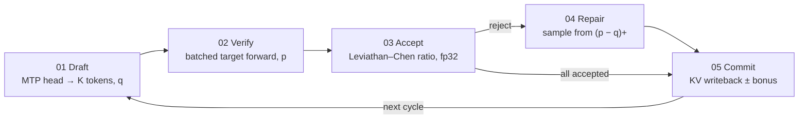
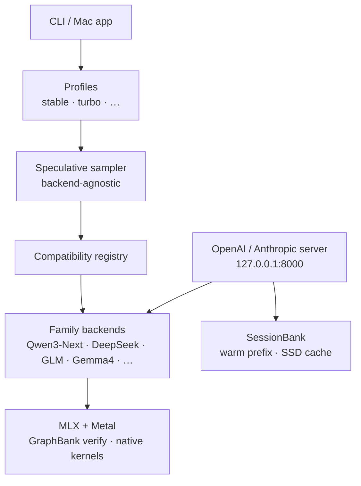

# MTPLX: 외부 드래프트가 아니라 모델 자신의 MTP 헤드로 검증하는 Apple Silicon 로컬 디코드

## 요약

로컬 LLM의 디코드는 대개 연산보다 메모리 대역폭에 묶인다. 한 토큰을 내려면 가중치를 다시 읽고, 그 비용이 매 스텝마다 반복된다. MTPLX는 Apple Silicon에서 그 비용을 줄이기 위해 **모델에 이미 들어 있는 multi-token prediction(MTP) 헤드**로 앞쪽 토큰을 제안하고, 한 번의 배치 forward로 검증한 뒤 Leviathan–Chen 거절 샘플링으로 커밋한다. 두 번째 드래프트 모델을 올리지 않고, greedy prefix 매칭으로 분포를 바꾸지도 않는다.

제품 형태는 Mac 네이티브 앱(`MTPLXApp`)과 CLI(`mtplx`)다. 엔진은 MLX/Metal 위에서 돌고, 로컬 OpenAI·Anthropic 호환 API를 `127.0.0.1:8000`에 연다. 지원 축은 Qwen 3.8 Flash Next(125B MoE), Qwen 3.8/3.6/3.5, Prism ML Ternary Bonsai 2 27B, Gemma 4 등이며, 팩마다 `mtplx_runtime.json` 계약이 MTP 깊이·프로파일·정확성 기준을 고정한다. README가 적은 측정 예는 M5 Max 128 GB에서 Qwen 3.6 27B Optimized Speed 81.74 tok/s(평문 대비 2.69×), 16 GB M4 mini에서 약 1.6×, M5 Max에서 약 2.24×다. 수치는 하드웨어·프롬프트·버전 조건이 붙은 벤치마크 영수증에 묶여 있다.

이 문서는 MTPLX의 **작동 원리**(스펙큘러티브 사이클), **프로젝트 구조**(CLI·백엔드·앱·대시보드·네이티브 확장), 그리고 공개 다이어그램·Mermaid로 한 장의 보고서로 적는다. 에이전트 오케스트레이션이나 클라우드 서빙 설계가 아니다. 로컬 디코드 가속과 그 코드가 나뉜 방식만 다룬다.


## 1. 디코드가 느린 이유와 MTP가 건드리는 지점

자기회귀(autoregressive, AR) 디코드는 토큰 하나마다 전체 가중치를 다시 읽는다. 행렬 곱 자체보다 unified memory에서 가중치를 끌어오는 비용이 먼저 찬다. Apple Silicon에서는 그 대역폭이 곧 상한이다.

스펙큘러티브 디코딩의 일반형은 이렇다. 값이 싼 드래프트가 `K`개 토큰을 제안하고, 타깃 모델이 한 번의 forward로 그 위치들을 검증한다. 수락되면 여러 토큰이 한 사이클에 나가므로, 가중치 읽기 한 번에 얻는 토큰 수가 늘어난다. 흔한 구현은 **별도 드래프트 모델**을 올린다. RAM을 두 벌 쓰고, 드래프트와 타깃의 분포가 어긋나면 수락률이 떨어진다.

MTPLX의 선택은 다르다. Qwen·DeepSeek 계열 등이 학습 때 붙인 **네이티브 MTP 헤드**를 드래프트로 쓴다. 헤드가 제안 분포 `q`를 만들고, 같은 모델의 타깃 경로가 검증 분포 `p`를 만든다. 별도 사이드카를 붙이지 않는다. README가 명시하는 경계는 이것이다. 임의의 MLX 트렁크에 따로 구한 MTP 헤드를 끼워 넣는 경로는 지원하지 않는다. 헤드가 그 가중치에 대해 학습됐다는 사실은 아키텍처 라벨만으로는 증명되지 않기 때문이다. 완전한 매칭 팩을 쓰거나, Forge로 원본 체크포인트에서 만들고 검증한다.


## 2. 스펙큘러티브 사이클: Draft → Verify → Accept → Repair → Commit

한 사이클은 다섯 단계다. 공개 다이어그램이 그 순서를 고정한다.


1. **Draft.** MTP 헤드가 `K`개 토큰을 제안하고, 각 위치의 제안 확률 `q`를 남긴다. `K`는 깊이(depth)다. 머신의 대역폭·발열에 따라 `mtplx tune`이 실측으로 고른다.
2. **Verify.** 타깃이 GraphBank에 컴파일된 verify shape로 `K` 위치를 **한 번의 배치 forward**에서 평가한다. 위치마다 따로 도는 AR이 아니다.
3. **Accept.** 위치별 수락은 Leviathan–Chen 거절 샘플링이다. 비율 경로는 fp32다. BF16만 쓰면 비율이 underflow 한다.
4. **Repair.** 거절된 위치에서는 `(p − q)+`에서 대체 토큰을 샘플한다. 잔차 보정이다. 드리프트를 남기지 않는 쪽이 목표다.
5. **Commit.** 확정된 토큰을 committed-history KV에 쓴다. `K`개 모두가 수락되면 `K+1`번째 bonus 토큰이 공짜로 따라온다. 사이클은 다시 Draft로 돌아간다.

같은 흐름을 Mermaid로 적으면 아래와 같다.



수락 규칙은 정리상 **임의의 temperature에서 타깃 분포와 같다**. greedy argmax로 접두를 맞추는 지름길이 아니다. MTPLX 2.11.3은 Flash Next와 27B Quality 팩에서 빠른 경로와 평문 경로의 네 토큰 샘플 천 개를 temperature 1, top-p 0.95, top-k 20에서 토큰 id로 비교했고, 평문 경로 자체의 잡음 안에서 맞았다고 적는다. 2.12.0부터 이미지 요청도 컴파일된 verifier를 쓰지만, 그 샘플 비교는 이미지에 대해 아직 반복하지 않았다고 README가 밝힌다. 수락 정리와 실행 경로의 수치 동치는 별개로 검사한다.


## 3. 런타임 층: CLI에서 Metal까지

공개 flow 그림은 사용자 표면에서 MLX 런타임까지의 층을 나란히 둔다.


`docs/architecture.md`가 적은 공개 구조는 더 짧다. CLI와 프로파일이 스펙큘러티브 샘플러로 들어가고, 호환성 레지스트리가 아키텍처별 백엔드를 고른다. 서버는 SessionBank와 백엔드를 같이 본다.



샘플러는 백엔드에 묶이지 않아야 한다. 백엔드는 모델 가족이 제안·검증을 어떻게 구현하는지만 소유한다. 문서가 나열하는 가족은 Qwen3-Next(기본으로 승격), DeepSeek MTP, DeepSeek-V4, GLM, Hy-V3, MiMo, Nemotron-H, Step3.5, Gemma4, 그리고 Laguna AR-only 경로다. 레지스트리는 거절 이유와 어떤 릴리스 트랙에서 열릴지를 말해야 한다. Llama-MTP와 generic MTP는 인식만 하고 아직 실행하지 않는 쪽이 현재 경계다.

검증된 팩은 `mtplx_runtime.json`을 든다. 예시 필드는 `arch_id`, `mtp_depth_max`, `recommended_profile`, `exactness_baseline`, `verified_on`이다. 계약이 없는 아키텍처 호환 가중치는 기본으로 받지 않는다. 팩은 선택적으로 `recommended_generation_mode`를 `mtp` 또는 `ar`로 찍을 수 있다. Bonsai 2처럼 depth 1이 코드·추론 실측에서 AR을 이기지 못하면 AR을 권고하고, 사용자는 `--generation-mode`로 덮어쓴다.


## 4. 프로젝트 구조

저장소 루트(GitHub `youssofal/MTPLX`)는 역할이 갈라진 트리로 읽힌다.

| 경로 | 역할 |
|---|---|
| `mtplx/` | Python 엔진·CLI. `cli.py`, `backends/`, `batching/`, `cache_bank/`, 어텐션·MTP 배치, OpenAI 서버 경로 |
| `apps/MTPLXApp/` | macOS 네이티브 앱. 하드웨어 검사, 모델 추천·다운로드, Python 엔진 부트스트랩, PATH·팬 제어, onboarding tune |
| `dashboard/` | Vite/Bun 대시보드. 실시간 tok/s, depth별 수락률, verify waterfall, 캐시·시스템 압력 |
| `native_extensions/` | Metal/네이티브 가속. `qsa_kernels`, `verify_mlp` 등 |
| `docs/` | 아키텍처, 동시성, 런타임 계약, 벤치, Forge 계약, `assets/readme/` 다이어그램 |
| `benchmarks/`, `tests/`, `scripts/` | 영수증·게이트·Forge/변환/감사 스크립트 |
| `vllm_metal/` | Metal 쪽 실험·연동 트리(엔진 본체와 분리) |
| `pyproject.toml`, `uv.lock` | 패키징. PyPI 이름 `mtplx`, Python 3.11+, Apache-2.0 |

엔진 안의 백엔드는 가족마다 proposal/verify geometry를 담는다. 서버 스케줄러 모드는 모델 실행과 분리된 계약이다. 기본은 `serial`이고, `cooperative`, `ar_batch`, `mtp_batch`, `mtp_cohort_experimental`, `hyper`가 있다. 모델 실행은 **owner thread 하나**에 남는다. 요청이 배치 forward를 공유해도 프롬프트 히스토리·샘플러·난수·stop·논리 KV 소유권은 요청마다 따로다. `hyper`는 외부 동시 입장 1로 고정하고, 배치 폭을 **한 요청의 스펙큘러티브 가지**에 쓴다. 두 번째 클라이언트를 태우지 않는다.


앱·CLI 표면의 주요 명령은 README 기준 대략 이렇다.

```bash
mtplx start                          # 앱/엔진 온보딩 경로
mtplx serve --model <id-or-path>     # 127.0.0.1:8000
mtplx tune --model <id> --retune     # depth 실측
mtplx forge --help                   # MTP 팩 빌드·검증·배포
mtplx config set scheduler_mode mtp_batch
```

OpenCode, Cursor, Claude Code 등 OpenAI/Anthropic 클라이언트를 `http://127.0.0.1:8000`에 붙인다. 세션은 warm-prefix SessionBank와 기본 켜진 SSD 세션 캐시로 재시작한다. 2.11.3에서 96,760토큰 대화를 앱에서 8 ms에 복원했다는 측정이 README에 있다.


## 5. 속도와 자동 튜닝이 말하는 것

MTP는 항상 이득이 아니다. depth가 커도 수락률이 낮거나 verify가 비싸면 AR보다 느려진다. 그래서 onboarding과 `mtplx tune`은 **그 Mac에서** 각 depth를 실모델로 돌리고, AR을 기준선으로 둔다. 이기는 depth만 저장한다. 아무것도 이기지 못하면 저장하지 않고 그렇게 말한다. 16 GB M4 mini에서 9B를 튜닝하면 depth 1이 남고, 14.4 tok/s → 23.0 tok/s라는 예시가 README에 있다.


대표 수치(모두 조건 포함, 원문은 [mtplx.com/benchmarks](https://mtplx.com/benchmarks/)):

| 조건 요약 | 결과 |
|---|---|
| M5 Max 128 GB, Qwen 3.6 27B Optimized Speed, 192토큰 벤치, thinking off, T=0.6, 2026-07-02 | 81.74 tok/s, AR 30.37 대비 2.69× |
| 16 GB M4 mini / M5 Max (README 총평) | 약 1.6× / 약 2.24× plain decode |
| Qwen 3.5 4B Optimized Speed, depth 3, MTPLX 2.2.0 | 227.8 tok/s, AR 133.6 대비 1.71× |
| Flash Next Optimized Speed, MTPLX 2.12.0, 65k 프롬프트 | 63.5 tok/s 생성, prefill 1,094 tok/s |
| Ternary Bonsai 2 27B Optimized Speed, depth 1, 4k 프롬프트 | 64.4 tok/s, peak 11.4 GB |

비교표(mlx-serve, oMLX, LM Studio, Ollama, llama.cpp, mlx-lm)는 버전·기계·날짜가 붙은 [mtplx.com/compare](https://mtplx.com/compare/)에 있다. 이 보고서는 그 표를 재측정하지 않았다.

메모리 추천 정책(앱·CLI 공통, M3/M4/M5): 16 GB 미만 Qwen 3.5 4B Optimized Speed, 16 GB부터 Bonsai 2 27B, 32 GB부터 Qwen 3.8 27B Optimized Speed, 256 GB부터 Flash Next Optimized Speed. M1/M2는 FP16 추천을 유지한다. Flash Next Optimized Speed 팩은 동적 4-bit + sparse attention 일부 8-bit, 다운로드 약 115.1 GB(32 GB n-gram 테이블 포함), 상주 약 83 GB. n-gram 테이블은 SSD 스트리밍이라 가중치만 메모리에 남긴다.

## 6. 이 시스템이 아닌 것, 남아 있는 경계

MTPLX README가 스스로 긋는 선은 짧다.

- 외부 드래프트 모델 시스템이 아니다. 드래프트는 타깃의 MTP 헤드다.
- greedy-argmax 접두 트릭이 아니다. 수락은 온도를 가리지 않는 거절 샘플링이다.
- 임의 MLX 트렁크에 MTP 사이드카를 붙이는 경로가 아니다. Forge 또는 매칭 팩만.
- 동시성 모드 이름이 배치 폭·커널·수치 정책을 정의하지 않는다. 그건 설치된 백엔드 구현의 속성이다.
- 이미지 경로의 컴파일 verifier와 평문 경로의 토큰 id 동치 비교는 2.12.0 시점에서 아직 반복되지 않았다.
- DeepSeek V3 MTP·DeepSeek-V4 등은 experimental 레지스트리 게이트 아래다. Llama-MTP는 인식만.
- Flash Next Optimized Quality(약 170 GB 다운로드)는 256 GB Mac에서의 실측 속도가 아직 없다고 적혀 있다.

초기 연구 노트(`docs/research/native-mtp-on-mlx.md`)는 v0.1 스냅샷으로, cold path는 강하고 sustained no-fan long-context는 커널·디스패치 일이 남는다고 적었다. 현재 제품 상태는 `docs/releases/`와 README 측정표를 본다.

수학적 뼈대는 Leviathan and Chen (2023)의 스펙큘러티브 샘플링이고, 실행 뼈대는 [MLX](https://github.com/ml-explore/mlx)와 Qwen·Gemma 가족 가중치다. 팬 고정 측정에는 ThermalForge가 붙는다. 가중치 라이선스는 업스트림을 따른다.

## 7. 한 줄로 읽기

MTPLX는 Apple Silicon 로컬 서버에서 **모델 자신의 MTP 헤드로 드래프트하고, 한 forward로 검증하며, Leviathan–Chen으로 정확히 커밋**하는 디코더다. 코드는 `mtplx` 엔진, `MTPLXApp`, `dashboard`, `native_extensions`로 갈라지고, 팩 계약과 tune이 깊이와 모드를 기계별로 고정한다. 에이전트 프레임워크가 아니라, 그 에이전트가 붙는 **로컬 토큰 파이프**다.


## 출처

- [MTPLX README](https://github.com/youssofal/MTPLX/blob/main/README.md)
- [docs/architecture.md](https://github.com/youssofal/MTPLX/blob/main/docs/architecture.md)
- [docs/architectures.md](https://github.com/youssofal/MTPLX/blob/main/docs/architectures.md)
- [docs/concurrency.md](https://github.com/youssofal/MTPLX/blob/main/docs/concurrency.md)
- [docs/runtime-contract.md](https://github.com/youssofal/MTPLX/blob/main/docs/runtime-contract.md)
- [docs/research/native-mtp-on-mlx.md](https://github.com/youssofal/MTPLX/blob/main/docs/research/native-mtp-on-mlx.md)
- 공개 다이어그램: [docs/assets/readme/](https://github.com/youssofal/MTPLX/tree/main/docs/assets/readme) (`cycle`, `flow`, `serving`, `mlx-runtime`, `single-model`, `speed-chart`, `hero`, 앱 스크린샷)
- 사이트 포스터: [og-dash.jpg](https://mtplx.com/assets/og-dash.jpg), [dash-decode-poster.jpg](https://mtplx.com/assets/dash-decode-poster.jpg)
- 벤치·비교: [mtplx.com/benchmarks](https://mtplx.com/benchmarks/), [mtplx.com/compare](https://mtplx.com/compare/)
- Leviathan, Y., & Chen, M. (2023). Fast Inference from Transformers via Speculative Decoding.
