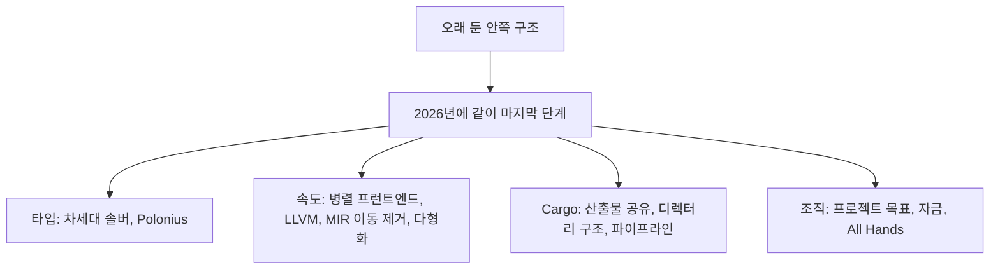
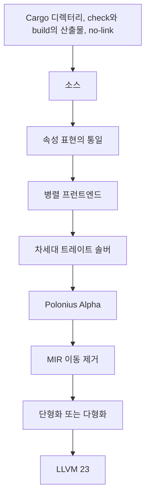

# 2026년 Rust 컴파일러: 오래 둔 작업이 같이 끝나는 해

Matyáš Racek, 2026-10-19. 컴파일러의 장기 투자와, 그 일을 본업으로 옮기려는 한 사람의 해.

확인 기준: 2026-10-25. 항목의 이름, 사람, 단서는 [Yoyo Code의 2026-10-19 글](https://yoyo-code.com/2026-is-exciting-year-for-rust-compiler-and-me/)이다. [GeekNews 35739](https://news.hada.io/topic?id=35739)는 그 글의 요약이고, 2026-10-25에 연 페이지는 글을 4일 전으로 표시한다. 댓글 하나는 Hacker News 의견을 한국어로 정리한 것이다. Polonius Alpha의 야간 활성화와 그림은 2026-08-04 Rust 블로그다. 차세대 솔버와 Polonius의 2026 목표 문장은 `goals.rust-lang.org`의 해당 페이지다. 이 문서는 rustc를 빌드해 시간을 재지 않았다.

이 문서는 2026년이 왜 “작업량이 많은 해”가 아닌지, 요약이 한 칸에 넣은 수와 기능이 어느 글의 문장인지, 글쓴이가 아직 확인하지 않았다고 적은 자리를 적는다.

## 1. 결론

글의 첫 구분은 이렇다. 2026년은 일이 갑자기 많아진 해가 아니다. 서로 다른 장기 프로젝트가 동시에 마지막 단계에 닿아, 넣어 둔 투자가 보이기 시작하는 해다. 큰 변화는 하루아침에 나타난 대형 과제가 아니라, 안쪽 구조를 오래 고친 결과라고 글이 반복한다.

GeekNews 서두가 한 줄로 줄인 말과, 글이 실제로 가리키는 조건은 다르다.

| 요약에 보이기 쉬운 말 | 글 또는 그 뒤 문서가 가리키는 것 |
| --- | --- |
| 차세대 트레이트 솔버가 거의 다 됐다 | 여러 형태로 거의 10년. 건전성 버그를 고치고, `async`와 `impl Trait`의 막힌 자리를 연다. 2026 목표 페이지의 현재 작업은 2022년 말부터이고, 아직 성능 동등·안정화 보고·옛 구현 제거가 항목으로 남아 있다 |
| Polonius가 빌림 검사를 대체한다 | 더 많은 코드가 컴파일되게 하는 새 구현. 내부 참조는 “언젠가 되기를 바란다”이지 올해의 성과가 아니다. 2026-08-04에 야간에 켜진 것은 Polonius Alpha다 |
| 병렬 프런트엔드가 안정화 직전이다 | `@petrochenkov`가 이끄는 프로젝트 목표가 안정화에 가깝다는 글쓴이의 판단. 설계에 만족하는 사람이 거의 없다는 느낌도 같이 적혀 있다 |
| LLVM 23이 컴파일을 빠르게 했다 | 글쓴이가 본 rustc 쪽 결과는 거의 전부 양수다. 이유는 “LLVM 개발을 면밀히 따라가지 않았다”고 전제를 단 이해다 |
| `target`이 5~30% 줄어든다 | 10월 글이 이미 발표된 `no-embed-metadata`에 붙인 범위다. 2026-08-18 Cargo 실험은 `-Zembed-metadata=no`를 야간 기본으로 켜는 일이고, 그때는 안정화로 향하지 않는다고 적었다. serde 측정은 약 4.7%에서 29.8%다. check와 build의 산출물 공유는 다른 목표이고 퍼센트가 없다 |
| 글쓴이가 Rust 개발을 본업으로 정했다 | All Hands 뒤에 그 일을 하겠다는 결정. 일자리는 “Rust inc.”가 없고, `target` 축소 목표는 자금이 있을 때 맡기로 했으며, Maintainers in Residence는 곧 되리라고 기대하지 않는다 |

같은 주의 다른 보고서와 섞지 않는다. TypeScript 컴파일러의 Rust 포트인 tsrs와, Google이 Rust 코드에 두는 스타일 규칙은 이 글의 대상이 아니다. 그 둘은 [tsrs](261025_1814_tsrs.md), [Google Rust 스타일 가이드](261024_1834_Google%20Rust%20스타일%20가이드.md)에 있다. GeekNews가 “함께 보면 좋은 글”로 그 제목들을 올렸을 뿐이다.

## 2. 글이 서 있는 자리

글쓴이는 컴파일러 성능이 자기 관심의 중심이라고 적는다. 성능 회귀를 분류하는 일에 들어와 있었고, 측정 결과를 오래 본 사람이 짧은 해석만 해도 원인 진단에 도움이 된다고 자기가 그 역할을 즐긴다고 쓴다. 그래서 이 글의 목록은 컴파일러 팀의 공식 연간이 아니다. “내가 개인적으로 흥미롭다고 보는 것”이고, “글을 쓰기 시작한 뒤에 이미 발표된 것도 있고, 아직 잘 보이지 않는 것도 있다”고 범위를 밝힌다. 결론에서는 흥미로운 작업을 많이 빠뜨렸다고 다시 말한다.



GeekNews 제목은 “2026년은 Rust 컴파일러에게도, 나에게도 흥미진진한 해”다. 원문 제목은 “2026 is an exciting year for the Rust compiler (and me)”이고 날짜는 2026-10-19다. Hacker News 댓글은 이 글이 올라올 때마다 제목이 잘못 붙고, 고치면 다시 바뀌었으며, 어제는 수정도 안 되다가 오늘에야 됐다고 한다. 그 댓글은 Hacker News에 제목 자동 교정이 있고, 오탐이 농담이나 복잡한 영어를 망가뜨리기도 한다고 설명한다. 제목 싸움은 컴파일러 항목의 내용이 아니다.

## 3. 차세대 트레이트 솔버

글이 가장 큰 항목으로 두는 것은 차세대 트레이트 솔버다. 타입 시스템의 큰 부분을 다시 구현한 것이고, 여러 형태로 거의 10년 동안 진행됐다. 여러 건전성 버그를 고치고, 오래된 문제의 수정과 새 기능을 막던 기술 부채를 푼다.

글이 크기를 낮춰 읽지 말라고 하는 이유는 둘이다. 컴파일러 개발자들이 몇 년 동안 바라 온 기술 부채의 큰 조각이 끝나, 타입 시스템을 새로 깊이 이해한 사람들이 다음 일로 갈 여유가 생긴다. 그 다음에 풀리는 줄에는 언어의 흔한 불편이 들어 있고, 겉으로는 솔버와 상관없어 보이는 것도 있다. `async` Rust의 큰 문제와 `impl Trait`의 여러 제약이 그 줄에 있다고 글은 적는다. 그 문제가 어느 문법 이름인지는 글이 적지 않는다.

2026 프로젝트 목표 페이지 “Stabilize the next-generation trait solver”는 이 항목의 올해 문장을 더 좁힌다. 상태는 Accepted다. 연락은 lcnr, 언어 쪽 챔피언은 Niko Matsakis, 자금 연락은 Hexcat이다. 팀이 언어와 타입이고, 추적 이슈로 `rust-lang/goals#113`과 `rust-lang/rust#107374`를 적는다. 요약 문장은 `-Znext-solver=globally`를 안정화해 기존 트레이트 솔버 구현을 통째로 바꾸라는 것이다. 하는 일은 트레이트 한도를 증명하고, 연관 타입을 정규화하고, 그 밖의 타입 시스템 조각을 맡는 구현을 교체하는 것이다. 오래 남은 건전성 버그를 고치고, 이후의 타입 시스템 개선을 가능하게 하며, 컴파일 시간도 나아지게 하려는 목적이다.

그 페이지가 “2022년 말부터 이 작업을 시작한 뒤” 이미 한 일로 적는 것은 셋이다. 일관성 검사에서의 사용을 Rust 1.84에서 안정화했다. `rust-analyzer`에서 `chalk`를 뺐다. crater를 돌렸고 큰 회귀는 고쳤거나 의도된 것으로 분류했다. 성능과 진단은 나아졌지만 아직 일이 남았다고 페이지가 적는다. 올해 항목은 남은 차단을 해결하고, 옛 솔버와 성능이 맞으며, 사이클 의미의 RFC를 쓰고, 안정화 보고를 끝내고, 안정화한 뒤 옛 구현을 제거하는 것이다.

거의 10년과 2022년 말은 같은 시계가 아니다. 글은 여러 형태를 합쳐 거의 10년이라고 하고, 목표 페이지는 지금의 구현 작업을 2022년 말부터라고 한다. 이 문서는 두 문장을 한 연도로 합치지 않는다.

막혀 있다고 목표 페이지가 이름을 다는 기능은 공귀납 트레이트 의미, 완벽한 derive, 바인더 위의 where 한도, 고차 한도와 타입의 처리다. 글의 “`async`와 `impl Trait`”와 이 목록은 겹쳐 읽히지만, 페이지가 글의 문장을 그대로 받은 것은 아니다.

Hacker News 댓글은 새 솔버를 적어도 5년 기다렸고, 이것과 Polonius가 특수화의 돌파구가 되기를 바란다고 한다. 답은 특수화에 진전이 있으며 주소로 `goals.rust-lang.org/2026/specialization.html`을 든다. 솔버가 특수화의 직접 장애물은 아니지만, 타입 시스템을 정비하면 건전성 문제를 따지기가 수월해진다는 말이다. 이 문서는 그 목표 페이지를 열지 않았다. 특수화의 올해 상태가 댓글의 “진전이 있음”을 넘는지는 그 페이지에 남아 있다.

다른 댓글은 새 솔버가 `async`의 무엇을 푸는지 묻는다. 답은 반환 타입 표기법(Return Type Notation, RTN)이다. 비동기 함수가 돌려주는 퓨처에 제약을 붙이는 기본 기능이고, 형태는 `where ::method(..): Send` 쪽이 될 것이라고 한다. 트레이트 안의 비동기 함수(AFIT)를 실용적으로 만드는 데 남은 둘 중 하나이고, 다른 하나인 동적 디스패치는 새 솔버를 기다릴 필요가 없다는 말이다. 이 RTN은 댓글의 지식이다. 10월 19일 글은 기능 이름을 적지 않는다.

### 3.1 솔버가 맡는 일과, 페이지가 올해 표에 남긴 일

목표 페이지의 “하는 일과 이유”는 한 문장이다. 지금의 트레이트 솔버를, 건전하고 유지할 수 있는 구현으로 바꿔 건전성 수정과 `async` 기능을 막지 않게 하라는 것이다. 그 구현이 바꿔 치우는 대상은 트레이트 한도를 증명하는 부분, 연관 타입을 정규화하는 부분, 그리고 “그 밖에도 많은” 타입 시스템 조각이다. 페이지는 그 조각의 목록을 이 문단에 풀지 않는다.

증명과 정규화가 사용자에게 어떻게 보이는지는 페이지가 예를 들지 않는다. 이 문서가 그 둘을 문장으로만 두면, `T: Clone` 같은 한도가 성립하는지를 컴파일러가 따지는 일과, `T::Item` 같은 연관 타입이 어느 구체 타입인지를 정하는 일이 그 자리에 있다는 정도다. 그 읽기는 페이지의 동사(“proving trait bounds”, “normalizing associated types”)를 푼 것이고, 페이지가 보여 준 코드 예는 아니다.

막혀 있는 건전성 버그는 “프로젝트 보드”라고만 적혀 있다. 이 문서는 그 보드의 이슈를 열지 않았다. 그래서 “여러 건전성 버그”는 10월 글과 목표 페이지가 공유하는 방향이고, 버그의 개수와 번호는 여기 없다.

페이지가 기존 구현의 부족 때문에 멈췄다고 이름을 다는 기능은 네 덩어리다. 공귀납 트레이트 의미, 완벽한 derive, 바인더 위의 where 한도, 고차 한도와 타입을 더 잘 다루는 일이다. 10월 글의 `async`와 `impl Trait`는 이 네 이름 안에 철자로 들어 있지 않다. 댓글의 RTN과 AFIT도 이 페이지의 목록에는 없다. 셋을 한 기능 목록으로 합치면, 글이 적지 않은 이름을 목표 페이지가 확정한 것처럼 된다.

페이지의 로드맵 칸은 둘이다. Project Zero와 Just add async. 10월 글은 그 로드맵 이름을 쓰지 않는다. 솔버가 `async`를 연다는 글의 문장과, Just add async라는 칸 이름이 같은 계획을 가리키는지는 이 페이지만으로 문장이 닫히지 않는다. 칸이 있다는 사실만 적는다.

올해 표의 주인은 모두 lcnr다. 사이클 의미 RFC만 Niko Matsakis가 같이 적혀 있다. 행은 남은 차단을 찾아 풀기, 옛 솔버와 성능 동등, 사이클 RFC, 안정화 보고를 끝내기, 안정화, 옛 구현 제거다. 언어 팀의 지원 수준은 Medium이고, 사용자가 보는 변경의 안정화 결정이라고 적는다. 타입 팀의 지원 수준은 Large이고, 안정화 결정과 진행 중인 리뷰다. 타입 챔피언도 lcnr이고, 언어 챔피언이 Niko Matsakis다. 위의 “연락은 lcnr, 언어 쪽 챔피언은 Niko”는 이 표의 두 칸이다. 타입 챔피언을 언어 챔피언과 한 사람으로 읽지 않는다.

자금 표는 두 행이다. Core contribution은 비용이 Ask, 자금 상태가 Full, 후원자가 Anon1과 Anon2다. Acceleration은 비용이 Ask, 자금 상태가 No이고 후원자가 비어 있다. 10월 글이 Hexcat의 지난 1년 고용을 말하는 자리와, 이 페이지가 자금 연락을 Hexcat으로 적고 후원자는 익명으로 적는 자리는 닿아 있으나 같은 계약이라는 문장은 어느 쪽에도 없다. Acceleration이 비어 있다는 것은, 솔버 목표 안에서 가속을 위한 돈이 이 표에 아직 없다는 뜻이다. 페이지가 그 금액의 숫자를 적지는 않는다. Ask는 숫자를 비워 둔 칸이다.

10월 글이 “타입 시스템을 새로 깊이 이해한 사람들이 다음 일로 갈 여유가 생긴다”고 한 것과, 이 표에서 옛 구현 제거가 아직 행으로 남아 있는 것은 같이 읽힌다. 여유는 솔버가 끝난 뒤의 사람이고, 제거는 그 끝이 표에서 아직 마지막 행이라는 뜻이다. 글은 그 행이 끝났다고 말하지 않는다.

## 4. Polonius

Polonius는 오래 만들어 온 새 빌림 검사기다. 글은 더 많은 코드가 컴파일되고, 관련 기능이 앞으로 갈 수 있게 한다고 적는다. 그 기능 중 하나로 내부 참조를 들고, “언젠가 되기를 바란다”고 적는다. 확정된 성과가 아니라고 범위가 문장 안에 있다. 컴파일러 전체에 미치는 영향은 차세대 솔버보다 작지만, 그래도 큰 변화다.

2026 목표 “Stabilize and model Polonius Alpha”는 올해의 대상을 Alpha로 한정한다. 연락은 Rémy Rakic, 타입 챔피언은 Jack Huey, 상태는 Accepted, 추적은 `rust-lang/goals#118`이다. 로드맵 이름은 The Borrow Checker Within이다. 요약은 조건부 빌림과 대여 이터레이터를 받아들이는 빌림 검사를 안정화하는 것이다. NLL 문제 사례 3과 `rust-lang/rust#92985`의 대여 이터레이터 패턴을 든다.

Alpha가 하지 않는 일도 페이지가 적는다. 완전한 흐름 민감도가 필요한 경우는 나중으로 남고, 오늘은 NLL과 같은 부정확함이 남는다. 예는 조건부 재빌림이 있는 어떤 연결 리스트 순회다. 그런 경우는 Alpha가 새로 받아들이는 경우보다 드물다고 페이지가 적는다.

올해 할 일로 페이지가 적는 순서는 이렇다. 불투명 타입이 잡은 영역의 생존에 남은 알려진 건전성 문제를 고친다. 기능 게이트 뒤의 야간 미리보기로 테스트를 요청한다. 열린 “Polonius면 고쳐지는” 이슈의 테스트를 더하고, CI에서 Polonius 테스트를 켜고, a-mir-formality를 오라클로 쓴다. 빌림 검사의 형식 모델을 a-mir-formality에 만들고 Rust 레퍼런스로 올린다. 실제 코드에서 성능을 확인한다. 안정화 보고, rustc 개발 가이드, 미리보기 블로그를 준비한다.

성능에 대해 그 페이지가 받아들이겠다고 적은 범위는 10~20%다. 더 큰 최악은 알고 있지만 실제로 나오는지는 모르고, 미리보기 기간이 그 답을 준다고 한다. 글의 10월 19일 본문에는 이 퍼센트가 없다.

The Borrow Checker Within 로드맵은 2026년 칸에 Polonius Alpha 안정화, Polonius Alpha의 형식화, 뷰 타입 실험을 둔다. 그 다음으로 미룬 칸에는 완전한 Polonius, 장소를 가리키는 수명 문법, 더 넓은 뷰 타입, 내부 참조가 있다. 내부 참조의 설명은 구조체가 자기 데이터에 대한 참조를 들고(`&'self.text str`), 인덱스로 우회하지 않아도 되며, `'static`인 자기 참조 타입을 가능하게 한다는 것이다. 글이 “언젠가”라고 한 내부 참조는 이 로드맵에서 2026년 칸 밖에 있다.

### 4.1 규칙이 아니라 검사기의 정밀도

로드맵의 현황은 빌림 검사를 “Rust를 Rust로 만드는 것”이라고 부른다. 핵심 규율은 “변경이거나 공유이거나”다. 메모리 안전과 데이터 경합이 없음을 보장하고, 서로 닿는 코드가 보이게도 한다. 배우는 데 시간이 걸려도 대부분의 프로그램에는 맞다고 페이지가 적는다. 더 유연한 구조가 필요한 프로그램에는 참조 횟수나 가비지 수집 같은 도구가 있다. 그 사이가 이 로드맵의 자리다. 개념으로는 그 규율 안에 있는데, 검사기가 너무 부정확해서 받아들이지 못하는 프로그램이다.

페이지가 그 거절의 비용으로 적는 것은 사용자의 자기 의심이다. 규율에 맞게 쓴 코드를 컴파일러가 거절하면, 사용자는 자기 이해를 의심한다. 특히 초보는 “내가 틀렸다”와 “도구가 부정확하다”를 가를 확신이 없다. 우회는 있을 때에도 비용이 있다. 자유 함수로 코드를 다시 짜거나, 참조 대신 인덱스를 넣거나, `RefCell`처럼 실행 때 검사로 컴파일 때 안전을 바꾸는 일이다. 우회가 없는 경우도 있다고 페이지가 적는다. 대여 이터레이터는 Polonius 없이는 표현할 수 없다. 10월 글은 `RefCell`과 인덱스 우회를 이름으로 적지 않는다. “더 많은 코드가 컴파일된다”의 반대편에 이 우회가 있다는 것은 로드맵의 문장이다.

설계 원칙은 둘이다. 규율을 바꾸지 말고 틈을 좁힌다. 명시적이고 구체적인 것부터 하고, 일반화와 추론은 나중이다. 내장 참조 타입과 구체 필드에 명시적 표기를 먼저 두고, 그 다음에 추론과 생략, 다른 포인터 타입으로의 일반화를 쌓는다. 그렇게 해야 능력을 먼저 실을 수 있고, 의미에 대한 실제 피드백을 모으며, “Beyond the `&`” 같은 작업과 설계가 만날 때 맞출 수 있다고 페이지가 적는다. 그 둘의 각도는 다르다. 필드 프로젝션은 포인터 타입을 일반화하고, 뷰 타입은 빌림 추적을 일반화한다. 뷰 타입은 내장 참조와 구체 필드에서 시작해 다른 포인터 타입으로 넓어지고, 거기서 두 로드맵이 만난다.

### 4.2 2026년 칸과 그 다음 칸이 쌓이는 순서

페이지가 기능을 쌓는 순서는 이렇다. Polonius Alpha가 토대다. 조건부 빌림과 대여 이터레이터를 검사기가 맞게 다루게 고치는 일이고, 그 뒤의 모든 일에 필요한 공학이라고 한다. 완전한 Polonius는 Alpha에 완전한 흐름 민감도를 더한다. 조건부 재빌림이 있는 연결 리스트 순회처럼 Alpha가 부정확하게 남기는 패턴이 그 자리다. 장소를 가리키는 수명 문법은 Polonius 위에서, 수명이 빌리는 장소의 이름을 프로그래머에게 준다. 뷰 타입은 그 문법으로 함수 시그니처에 필드 단위 접근을 적는다. `&mut self`를 받는 메서드를 부르면서 다른 필드를 빌리는, 오래 남은 문제를 푼다고 페이지가 적는다. 내부 참조는 장소를 가리키는 수명이 같은 구조체의 필드를 가리키게 해서 그림을 닫는다. 각 층은 따로 실을 수 있고, 앞의 층이 뒤의 설계에 정보를 준다.

그래서 10월 글이 내부 참조를 “관련 기능의 진전” 안에 넣고 “확정된 성과는 아니다”라고 한 것은, 이 순서에서 마지막 칸에 가깝다. Alpha가 올해 칸인 것과, 내부 참조가 이후 칸인 것은 한 로드맵의 다른 행이다. 글이 둘을 한 절에 둔 것은 Polonius가 여는 방향이고, 올해 표에 내부 참조 행이 있다는 뜻은 아니다.

2026년의 세 번째 칸인 뷰 타입 실험은 rustc에 뷰 타입 지원을 더하고, 프로젝트 구성원이 제안한 문법 몇 개를 실험용으로 둔다. 10월 글은 뷰 타입을 언급하지 않는다. 자금 표에서 이 칸만 따로 있다. 상태가 빨간 칸이고, 비용은 Ask, 자금 연락은 Hexcat, 후원자 칸은 비어 있다. Alpha 안정화 행에는 이 문서가 읽은 로드맵 조각에 별도의 후원 금액이 적혀 있지 않다. 솔버 목표의 Acceleration이 비어 있는 것과 같이, “돈이 붙었다”는 10월 글의 일반 문장과 칸마다의 빈 후원자를 한 상태로 합치지 않는다.

### 4.3 페이지가 시간표에 대해 스스로 답한 것

이후 작업의 시간표를 묻는 답은 이렇다. Polonius Alpha는 2026년에 안정화를 적극적으로 진행 중이다. 완전한 Polonius, 즉 Alpha에 완전한 흐름 민감도를 더하는 일은 이후 작업이다. 나머지인 장소 문법, 뷰 타입, 내부 참조는 설계를 탐색하는 단계가 서로 다르다. 장소 문법은 이미 있는 정식화를 두고 철자를 다듬을 일이 남았다. 뷰 타입은 모델이 필요하고, 강한 갱신에 대한 설계 질문이 열려 있다. 내부 참조는 단순화한 Rust에서 형식화돼 있고, 전체 Rust로 옮기는 일이 남았다. 10월 글의 “언젠가 되기를 바란다”는 이 마지막 문장과 강도가 같다. 희망이지, 올해의 구현 행이 아니다.

수명 문법을 더하면 배우기 더 어려워지지 않느냐는 질문에도 페이지가 답한다. 오늘은 검사기가 맞는 코드를 거절할 때 오류가 컴파일러 내부를 설명해야 한다. 장소를 가리키는 수명은 컴파일러와 프로그래머가 같이 쓰는 말이 된다. `'map`이 “12행에서 만든 빌림의 수명”보다 이해하기 쉽다고 페이지가 비교한다. 다른 Rust 기능처럼, 그 표기가 필요한 경우를 만났을 때 조금씩 배우면 된다고 한다. 이 답은 문법이 올해 안정화된다는 뜻이 아니다. 이후 칸의 문법이 학습 비용을 늘린다는 걱정을 페이지가 반박한 것이다.

더 읽을 글로 페이지가 이름을 다는 것은 로드맵의 원래 글, 수명 없이 빌림을 검사하는 글, Polonius를 다시 본 1부와 2부, 뷰 타입 제안과 그 개정, Dada 언어로 내부 참조를 살핀 글이다. 이 문서는 그 글들의 제목만 로드맵에서 읽었고 본문을 열지 않았다. 내부 참조의 예로 페이지가 시그니처에 적은 `'self.text`와 `&'self.text str`은 그 이후 칸의 표기 예다. 10월 19일 컴파일러에서 그 철자가 파싱되는지는 이 문서가 보지 않았다.

## 5. 2026-08-04에 야간에 켜진 Polonius Alpha

10월 19일 글은 Polonius를 장기 투자로만 적는다. 그 두 달 전, Jack Huey가 Polonius 작업 영역을 대표해 쓴 Rust 블로그는 상태를 더 닫는다. 2026-08-04 글의 한 줄은, 안정화를 몇 달 안에 준비하려고 Polonius Alpha를 야간에 켠다는 것이다. 추적 이슈 `#160456`은 상태를 “야간에 켜짐, nightly-2026-08-06부터”라고 적는다.

그 블로그가 빌림 검사의 세대를 나누는 문장은 이렇다. 첫 검사기인 AST borrowck는 제한이 컸고 2019년에 NLL로 넘어갔다. 더 나은 오류를 위한 migrate 모드는 2022년에 빠졌다. Polonius라는 이름은 2018년 NLL 작업에서 갈라져 나왔다. 처음 정식화는 NLL 테스트 묶음을 통과하고 NLL이 거절하던 건전한 코드도 받았지만, 성능이 한계였다. 어떤 프로그램은 NLL보다 상당히 느려 그 정식화를 쓸 수 없었다. 몇 년 동안 빠르게 구현하려는 시도는 핵심을 풀지 못했다.

2023년에 나온 정식화는 기존 NLL 구현을 조금만 다시 짜고, 더 많은 코드가 컴파일되도록 확장할 수 있었다. 2024년에 안정화하려 했으나 일이 끼어 미뤄졌다. 2026-08-04 시점에 블로그는, 안정화하려는 Alpha 부분집합에 알려진 남은 문제가 없고, 성능은 안정화를 논할 만큼 대체로 받아들일 만하다고 적는다. 야간에 켜는 이유는 모르는 큰 성능 회귀, 생각지 못한 비건전, 고쳐야 할 진단 이상을 찾기 위해서다. 진단이 바뀐 경우는 그때까지 보지 못했다고 적는다.

Alpha가 NLL에 더하는 것으로 블로그가 이름을 다는 것은, 수명 outlives 관계에 대한 흐름에 민감한 빌림 검사다. 가장 작은 예는 참인 분기에서 `b`를, 거짓 분기에서 `a`를 돌려주는 재빌림이다.

```rust
fn reborrow(a: &mut u8) -> &mut u8 {
    let b = &mut *a;
    if true { b } else { a }
}
```

더 자주 보이는 예는 맵에 키가 있으면 그 값을, 없으면 기본값을 넣은 뒤 다시 빌리는 함수다. `Some(value) => value`가 반환 타입 `&'r mut V` 때문에, NLL은 `map.get_mut`의 빌림이 함수 전체 동안 산다고 보고 `None` 갈래의 `insert`를 거절한다. NLL의 그 분석은 흐름에 민감하지 않다. Alpha는 `None` 갈래에서 그 빌림이 살아 있지 않다는 것을 안다.

```rust
fn get_mut_or_default<'r, K: Hash + Eq + Copy, V: Default>(
    map: &'r mut HashMap<K, V>,
    key: K,
) -> &'r mut V {
    match map.get_mut(&key) {
        Some(value) => value,
        None => {
            map.insert(key, V::default());
            map.get_mut(&key).unwrap()
        }
    }
}
```

Alpha가 완전하지 않은 이유도 블로그가 예로 든다. 예전 Polonius(느린 처음 구현)에서는 컴파일되던 프로그램 중 Alpha에서 안 되는 것이 있다. 그래서 Alpha라고 부른다. 예는 `Option<Box<X>>`로 이은 구조체를, 조건이 참일 때만 `next`로 포인터를 옮기며 도는 루프다. 블로그는 Alpha에서 되고 예전 Polonius에서는 안 되는 프로그램도 찾아서, Alpha가 예전 구현의 완전한 부분집합은 아니라고 적는다.

4절의 목표 페이지는 Alpha를 “위치에는 민감하고, 완전한 흐름 민감도는 아니다”라고 부른다. 8월 블로그는 “outlives의 흐름 민감”이라고 부른다. `get_mut_or_default`는 후자의 예이고, 연결 리스트의 조건부 재빌림은 전자가 나중으로 미룬 예다. 두 문장을 “Polonius는 이제 모든 빌림을 흐름까지 본다”로 합치지 않는다.

성능에 대해 8월 블로그는 Alpha가 NLL보다 일을 같거나 많이 하므로 회귀를 따로 봤다고 한다. crates.io 다운로드 상위 1만 크레이트에서 “유의미한” 회귀는 비교적 적고, 그 회귀도 대체로 작다고 한다. 그림의 점은 그 1만 개다. 검은 선은 임의로 둔 유의미 기준이고, 1% 회귀에 30초 미만은 이차로 스케일한 선이다. 빨간 점은 그 선을 넘는 크레이트다. 가로축은 의존성을 뺀 리프 크레이트의 NLL 컴파일 시간이고, 세로는 Polonius 시간을 NLL 시간으로 나눈 비다.


같은 글이 상위 다섯 크레이트를 표로 붙인다. 이 문서는 표의 칸 숫자를 다시 읽지 않았다. 그림이 그 칸이다.


상위 1만 밖에서는 빌림이 많은 크레이트를 주로 봤고, 본 최악은 2~3배 회귀다. 원인을 조금 분류하기 시작했고, 고치지 못해도 회귀가 드물고 상대적으로 작아 Alpha가 더하는 힘에 비하면 합리적이라고 블로그는 판단한다. 목표 페이지의 “10~20%를 받아들일 수 있다”와, 이 그림의 “1만 개 안에서는 유의미한 회귀가 적다”와, “1만 밖 최악 2~3배”는 한 실험의 세 문장이다. 2~3배가 10~20% 안에 들어 있다는 계산은 어느 글에도 없다.

야간에서 끄려면 `-Zpolonius=off`를 `rustc`에 주거나, `RUSTFLAGS`로 주거나, `.cargo/config.toml`의 `rustflags`에 넣는다. 블로그의 예는 `x86_64-unknown-linux-gnu` 타깃이다. 꺼야 했다면 이유를 GitHub나 Zulip에 말해 달라고 한다.

그 다음으로 블로그가 적은 계획은, 안정화 전에 GitHub와 Zulip의 보고를 보고, 알려진 성능 회귀를 다루고, 구현의 내부 문서를 쓰는 것이다. 안정화는 그 해의 끝 전을 목표로 한다. Alpha도 NLL도 받지 않는 프로그램이 남아 있지만, Alpha를 안정화한 뒤 Polonius 기능 작업을 이어서 활발히 할 구체적 계획은 지금 없다고 한다. 구현을 더 빠르게 하고 회귀를 다루는 시간은 잠시 두고, 자주 만나는 빌림 문제는 Alpha가 풀므로 가까운 시간의 우선순위는 다른 일로 옮긴다는 문장이다. 4절의 “완전한 Polonius와 내부 참조는 이후”와 이 문장은 같은 방향을 본다. 10월 19일 글이 그 포기를 적지는 않는다.

## 6. 병렬 프런트엔드

병렬 프런트엔드는 오래된 시도다. 불명확한 장애가 많아 몇 년 멈췄다가, 몇 년 전 `@SparrowLi`가 들어오면서 다시 시작됐고, 이후 다른 사람들이 더해졌다.

글쓴이의 느낌은 설계에 정말 만족하는 사람이 거의 없다는 것이다. 몇 년 동안 이것은 벌레 통이었다고 적는다. 그러나 보이는 미래에 더 나은 대안도 없고, 병렬 프런트엔드는 매우 필요하므로, 성가시고 엉킨 문제를 남은 것이 없을 때까지 갈아 내는 쪽이 해법이 됐다. 지금의 프로젝트 목표는 `@petrochenkov`가 이끌고, 안정화에 가까워지고 있다.

GeekNews가 “안정화에 근접”만 남기면 설계에 대한 불만과, 대안이 없어서 진행한다는 문장이 빠진다. 글은 병렬 프런트엔드가 몇 코어를 쓰는지, 어느 패스가 병렬인지는 적지 않는다. “가까워지고 있다”는 안정화 선언이 아니다.

### 6.1 목표 페이지는 안정화 보고 전에 할 일을 남긴다

2026 목표 “Promoting Parallel Front End”의 연락은 Vadim Petrochenkov다. 상태는 Accepted, 추적은 `rust-lang/goals#121`, 같이 보는 이슈는 `rust-lang/rust#113349`, 로드맵 칸은 Fast Builds다. 10월 글의 `@petrochenkov`와 이 이름이 같은 계정인지는 프로필을 열어 확인하지 않았다. 페이지가 그 일을 이끄는 사람으로 적은 이름과, 글이 그 목표를 이끈다고 적은 핸들이 같은 주제를 가리킨다.

페이지의 요약은 2025년 하반기 목표에 이어 안정화와 성능 개선을 계속하라는 것이다. 동기는 남은 문제, 특히 증분 컴파일과 관련된 것을 확인하고 풀고, 기능을 안정화하고, 여러 방법으로 병렬 컴파일 성능을 더 높이려는 것이다. “몇 개 남지 않았다”는 페이지의 표현이다. 10월 글의 “안정화에 가까워지고 있다”와 같은 방향이고, 페이지는 그 가까움을 만족도의 느낌이 아니라 남은 목록으로 적는다. 설계에 만족하는 사람이 거의 없다는 문장은 이 페이지에 없다. 그 문장은 10월 글쓴이의 느낌이다.

지난 한 해에 페이지가 이미 했다고 적는 것은 교착과 여러 ICE를 푼 것, 병렬 프런트엔드용 `rustc-rayon` 의존을 rustc 작업 트리에 넣은 것, 부트스트랩에서 병렬 프런트엔드를 켠 것이다. 최근에 `rust-lang/rust#151509`로, 증분 컴파일이 병렬로 돌 때의 경합을 크게 고쳤다고 한다. 아직 주의할 점으로 적는 것은 병렬 컴파일러와 직렬 컴파일러 사이에서 쿼리 사이클 오류가 일관되지 않은 것이다. 페이지의 철자는 inconstancy다. 올바름과 일관성을 보장할 튼튼한 테스트는 아직 없고, 그래서 병렬 프런트엔드용 테스트 묶음에 힘을 쓰겠다고 한다. rustc-perf와 Cargo처럼 주변 도구의 지원을 문서화하고 늘리는 일도 그 전에 있다. 그 다음에 기능 안정화 절차를 시작해 안정 채널로 넣겠다고 한다.

그래서 “안정화에 근접”을 “다음 릴리스에 들어간다”로 읽으면 페이지의 순서가 빠진다. 페이지가 제안하는 순서는 이슈 목록의 남은 문제를 풀고, 회귀를 막는 테스트 묶음을 만들고, Cargo에서 병렬 프런트엔드를 켜고, rustc-perf에 벤치마크를 더하고, 기능 안정화 보고를 써 컴파일러 FCP에 내는 것이다. 성능은 그 뒤의 장기 작업이라고 페이지가 분리한다. 데이터 경합을 줄이고, 더 잘게 병렬화하고, 이름 해석과 매크로 확장을 병렬로 도는 쪽을 검토한다고 한다. 10월 글이 적지 않은 “몇 코어인가”에 대해 페이지도 코어 수를 적지 않는다. Fast Builds 로드맵이 보태는 문장은, 지금도 rustc가 크레이트 여러 개를 병렬로 컴파일할 때조차 크레이트 안은 대체로 한 스레드로 처리한다는 것이다. 크레이트 안 병렬이 큰 크레이트 병목에 특히 중요하다고 그 로드맵이 적는다.

올해 표의 주인은 나뉘어 있다. 이슈 해결과 “논의와 도덕적 지지”는 `@wg-parallel-rustc`다. 테스트 묶음과 도구 지원은 `@ywxt`다. 안정화 보고는 Vadim Petrochenkov다. 팀 요청은 그 워킹 그룹이 Large, 컴파일러 팀이 Small이고 Small의 내용은 코드 리뷰다. 10월 글이 `@SparrowLi`를 재시작의 이름으로 적은 것과, 이 올해 표에 그 핸들이 없는 것은 같이 둔다. 페이지는 지난 한 해의 공로를 “모두에게 감사하다”로 적고 개인을 이 표에서 다시 부르지 않는다.

## 7. LLVM

LLVM 23은 모호하지 않고, 예상보다 큰 양의 성능 변화였다고 글이 적는다. 오랫동안 rustc에게 LLVM 업그레이드는 특별히 좋지 않았다. 바뀐 계기로 글이 드는 것은 LLVM 10 업그레이드다. 약 10%의 회귀가 났고, 지금의 LLVM 수석 개발자 `@nikic`이 “Make LLVM fast again”에서 그것을 짚었다. 그 글은 rustc의 성능 추적에서 착안한, 시간에 따른 LLVM 성능 추적도 도입했다.

그 글은 2020-05-10에 올라 있다. 추적을 시작한 뒤 CTMark의 기하평균 컴파일 시간이 8~9% 줄었다는 그림이 그 페이지에 있다. 대부분의 변화는 작고, 0.25%도 볼 만하며 1%는 크다고 그 글이 적는다. 이 그림은 LLVM 23의 측정이 아니다. 10% 회귀가 난 그 업그레이드 이후, 추적이 무엇을 보여 줬는지를 2020년에 적은 그래프다.


그 뒤 LLVM은 회귀를 더 이르게 잡았고, rustc의 업그레이드 결과는 “덜 나쁨”, “다소 섞임”, “단서가 있는 대체로 양수”로 움직였다고 10월 글이 요약한다. 그 마지막이 LLVM 22다. `icount` 벤치마크에서는 초록이었고, 실제 경과 시간은 거의 전부 빨강이었다. 명령어 수와 벽시계가 같은 방향이 아니었다.

LLVM 23은 거의 전부 양수다. 글쓴이는 LLVM 개발을 그리 따라가지 않는다고 전제를 두고, 자신의 이해로는 기능을 넣으면서 성능을 악화시키지 않으려는 일과 달리, 이제는 LLVM 자체를 빠르게 하는 일이 늘었기 때문이라고 한다. 개선은 두 갈래다. 새 최적화는 부트스트랩 동안 컴파일러 자신을 더 잘 최적화한다. LLVM 자신의 실행도 빨라진다. “확정적 분석은 아니다”라는 GeekNews의 단서는 이 전제와 같다.

## 8. 작은 최적화와 회귀를 누가 보는지

결과로 보면 1~2년 정도 정체였다가, 최근 몇 달 컴파일러 성능이 꾸준히 나아졌다. 글은 한 가지 이유를 주지 않는다. 새 기여자, 기존 기여자가 성능 일을 더 하게 된 것, 도구와 구조 정리가 새 기회를 연 것이 같이 작용한 것으로 본다. 사람이 늘면서 서로의 PR에서 아이디어를 가져와 옆의 것을 시도하는 교류가 보였다고 한다.

회귀를 다루는 일도 나아졌다고 느낀다. 도구 투자도 있고, 절차와 사람 구조도 있다. 큰 변화로 드는 것은 트리 운영과 성능 분류가 붙은 것이고, 그 연결을 `@JonathanBrouwer`가 대표한다. 병합을 관리하는 사람이 성능 영향을 직접 분류하면 대응 시간이 줄어든다. 성능 영향은 PR을 rollup으로 어떻게 묶을지에도 쓰인다. 글은 이것을 Conway의 법칙이 아직 법칙이라는 말로 닫는다. 조직을 나누는 방식이 그 조직이 만드는 시스템의 모양으로 나타난다는 그 법칙을, 여기서는 “분류하는 사람과 병합하는 사람이 같으면 회귀가 더 빨리 묶음 결정에 들어간다”는 관찰로 쓴다.

컴파일 시간에 대한 고려가 개발 과정에 이전보다 더 잘 들어왔다는 문장은, 회귀 분류에 참여한 글쓴이의 경험이다. 저장소 전체의 정책 문서로 인용할 측정은 글에 없다.

## 9. MIR에서 이동을 지우는 패스

올해 앞쪽에 `@Amanieu`가 MIR 최적화 패스를 제안했다. 글쓴이에게는 갑자기 나타난 것처럼 보였다고 한다. LLVM이 최적화하기 어려운 복사를 컴파일러가 지우고, 컴파일 시간과 실행 시간이 둘 다 줄어든다.

이 패스를 LLVM이 아니라 MIR에 두는 이유는 Rust 쪽 컴파일러가, 그 최적화를 Rust에 적용해도 되는지를 더 잘 알기 때문이다. 그에 더해 MIR의 의미를 조금 바꿔야 한다. Rust에게 특히 중요한 이유는, Rust가 LLVM의 주된 대상인 C와 C++보다 이동을 더 많이 만드는 경향이 있기 때문이다.

글은 이 패스가 어느 PR에서 병합됐는지, 벤치마크가 몇 퍼센트인지는 적지 않는다. “컴파일 시간과 실행 시간을 모두 줄인다”는 방향이지, 측정표가 아니다.

## 10. 다형화

다형화(polymorphization)는 글쓴이가 오래 따라온 주제다. 컴파일러 성능에 가장 큰 영향을 줄 수 있는 최적화 중 하나이지만, 구현이 매우 어렵다고 한다. 글쓴이가 아는 범위에서 이번은 세 번째 실험이다. 이번은 이전과 조금 다르고, Swift의 비슷한 장치에서 왔다.

두 방식은 목적이 다르다.

| | 원래의 다형화 | Swift식 |
| --- | --- | --- |
| 하는 일 | 중복되거나 필요 없는 단형화를 피한다 | 모든 것을 다형화하고, 제네릭 매개변수의 레이아웃을 인자로 넘긴다 |
| 실행 시간 | 없다. 컴파일 시간만의 최적화 | 비용이 있다 |
| 켜는 방법 | 글은 플래그를 적지 않는다 | 컴파일러 플래그로 조절할 수 있게 할 계획 |

글쓴이의 이해가 아직 유효하다면, 차세대 솔버는 예전에 의도한 방식의 다형화도 가능하게 한다. “이해가 최신인지는 확인하지 않았다”는 단서가 문장에 있다. 어느 쪽이든 같은 문제에 부딪히므로 지금 일은 양쪽에 쓸모가 있고, 한 작업에서 두 방식이 다 나올 수도 있다. 풀 문제가 많은 실험이므로 결과를 기다려야 한다고 글은 닫는다. 프로젝트 목표는 `@camelid`가 제안하고 이끈다.

Hacker News에서 “다형성”을 물은 댓글에 대한 답은, 일반적인 다형성이 아니라 이 최적화라고 범위를 다시 적는다. 그 답이 나누는 것도 글의 표와 같다. 중복 작업을 빼기만 하는 기본 형태는 실행 시간을 바꾸지 않으므로 모든 빌드에서 켜는 것이 타당하고, 서로 다른 `Vec`에 사실상 같은 코드를 지금 각각 만드는 경우가 그 예다. 더 일반화된 형태는 디버그 빌드나 크기 최적화처럼 특별한 상황에 맞고, 상호운용 실험에는 소스 표기가 유용할 수 있으나 최종 형태를 말하기에는 이르다는 말이다.

다른 답은 지금도 힌트를 소스에 직접 쓸 수 있다고 한다. `needs_string_like`가 `x.into()`로 `String`을 만든 뒤, `String`만 받는 `actual_logic`을 호출하면, 호출 타입마다 거의 빈 껍데기가 생기고 `actual_logic`은 하나만 생성된다. rustc가 자동으로 하려는 일을 사람이 먼저 쓴 형태라는 설명이다. `needs_string_like(String::new())` 같은 호출에서는 그 껍데기 인스턴스가 어떤 최적화에서 통째로 사라지기도 한다는 기억이고, 기억이 맞다는 단서가 있다. 이것은 컴파일러 기능의 사용법이 아니라, 단형화가 중복되는 모양을 사람이 줄이는 작성법이다.

### 10.1 목표 페이지는 레이아웃은 남기고 코드만 접으려 한다

2026 목표 “Polymorphic code generation experiment”의 연락은 Noah Lev다. 상태는 Accepted, 추적은 `rust-lang/goals#758`, 로드맵 칸은 Fast Builds와 Binary size reduction이다. 10월 글의 `@camelid`와 이 이름이 같은 계정인지는 프로필을 열어 확인하지 않았다. 글이 그 목표를 제안하고 이끈다고 한 핸들과, 페이지가 연락과 컴파일러 챔피언과 작업 주인으로 적은 이름은 이 문서에서 한 사람으로 합치지 않는다.

페이지의 요약은 단형화 대신, 타입에 묶이지 않은 인스턴스를 만들고 필요한 곳에 숨은 vtable 매개변수를 넣어 컴파일 시간과 바이너리 크기를 줄이는 실험 지원이다. 10월 글이 Swift식이라고 부른 쪽, 즉 실행 비용이 있고 플래그로 조절하는 쪽에 가깝다. 글은 “제네릭 매개변수의 레이아웃을 인자로 넘긴다”고 적는다. 페이지의 공리는 “데이터는 단형, 코드는 다형”이다. Haskell이나 OCaml처럼 모든 값을 박스로 싸 같은 ABI를 만들지 않는다. 데이터 레이아웃은 그대로 두고 함수 ABI만 바뀐다. 실행 때 레이아웃을 다시 계산하지 않으려고, 레이아웃을 기준으로는 여전히 단형화한다. 그래서 `foo::<&u32>`와 `foo::<&String>`은 둘 다 널이 틈새인 포인터라 한 인스턴스가 된다. 틈새가 없는 타입은 다른 인스턴스다. 본문이나 그 함수가 부르는 쪽이 `Option`처럼 그 틈새를 쓰는 타입을 만들 수 있기 때문이다. 페이지가 든 세 번째 타입의 철자는 가져오는 과정에서 빠졌다. 이 문서는 그 철자를 추측해 채우지 않는다. 다형화를 켤 때 틈새 최적화를 끄면 더 많은 인스턴스를 공유할 수 있을지도 모른다고 페이지가 적는다. “레이아웃을 인자로 넘긴다”와 “레이아웃이 같은 것끼리만 한 벌로 묶고, 메서드와 드롭은 숨은 vtable로 넘긴다”는 같은 실험의 다른 해상도다. 글의 문장을 페이지의 공리로 바꿔 쓰지 않는다.

숨은 인자가 담는 것으로 페이지가 적는 것은 타입 매개변수의 `TypeId`, 드롭 글루 함수 포인터, 트레이트 메서드 함수 포인터다. 연관 타입이 있는 한도면 연관 타입마다 vtable 인자가 더 생긴다. 이 정보는 호출 그래프의 어디선가 이미 정적으로 알려져 있어야 하고, 그래서 코드 생성 때 암묵적 인자로 꿰멜 수 있다고 한다. 다형화된 인스턴스와 단형화된 인스턴스는 같이 있을 수 있고, 함수 안에서도 매개변수 일부만 지우고 일부는 단형으로 남길 수 있다. 10월 글이 “모든 것을 다형화한다”고 한 Swift식 문장보다, 페이지는 함수와 매개변수 단위로 섞는 쪽을 적는다.

이전 실험으로 페이지가 이름을 다는 것은 David Wood가 이끈, 역시 polymorphization이라 불린 프로젝트다. 그 프로젝트는 코드 생성에 쓰이지 않는 매개변수만 지우려 했고, 어느 매개변수가 쓰이지 않는지를 보는 일에서 막혔다. `TypeId`가 매개변수성을 깨는 것과 클로저가 그 요인으로 적혀 있다. 이번 설계는 쓰이는 매개변수와 쓰이지 않는 매개변수를 같이 다루므로, 쓰이지 않는지를 판정하는 문제를 피한다고 페이지가 적는다. 10월 글의 “아는 범위에서 세 번째 실험”과, 페이지가 이전 것으로 이름을 하나만 드는 것은 개수가 다르다. 글쓴이가 본 실험의 수와, 페이지가 인용한 이전 프로젝트의 수를 한 숫자로 만들지 않는다.

기대 성과는 측정이 아니라 페이지 저자의 추정이다. 나아가려는 전체 버전이, 만들어지는 인스턴스를 많은 경우 절반까지 줄여, 단형화 뒤의 트레이트 해결·코드 생성·링크를 30%에서 2배까지 빠르게 할 수 있다는 것이다. 바이너리 크기도 링크 타임 최적화 없이 비슷한 정도로 줄고, 디버그 빌드의 산출물 디렉터리도 준다는 추정이다. 그 전에 더 작은 이득의 중간 지점이 있다고 한다. 30%와 2배를 10월 글의 성과로 옮기지 않는다. 글은 퍼센트를 적지 않고 실험이라고 닫는다.

올해 표는 모두 Noah Lev다. 기본 개념 증명은 이미 `std` 같은 실제 코드에서 부분적으로 돈다고 노트가 적는다. 그 다음 행은 `TypeId`와 드롭 글루, 단순한 dyn 호환 트레이트, 일부 dyn 비호환 트레이트다. 시간표는 1개월 차에 자금이 전부 있다는 가정이고, 자금이 없으면 더 느슨하며 팀의 여유 같은 바깥 요인에도 영향을 받는다고 페이지가 전제를 단다. 1–3개월에 초안에서 PR을 나누고, MIR 호출을 다시 써 “사이드카”를 호출에 붙이고, 드롭 글루와 `TypeId`처럼 안정 Rust에서 관찰되면서 한도에는 안 나타나는 것을 넘기기 시작하고, Rust ABI가 아닌 제네릭은 빼는 규칙을 정하고, `-Zpolymorphize`를 위한 컴파일러 MCP를 열고, 매우 실험적인 그 플래그를 착지시킨다. 페이지는 그 플래그가 비건전을 일으킬 수 있고, 끝나지 않은 기능처럼 조심해서 써야 한다고 적는다. 4–6개월에 사이드카가 감당할 한도의 최소 집합, `std`에서 오는 특수화가 안정 코드에 미치는 영향, 상수 매개변수를 살핀다. 7–9개월에 한도를 넓히고 다른 불안정 기능과의 궁합을 본다. 10–12개월에 다듬어 안정화 쪽으로 옮긴다. “12개월 안에 안정화된다”는 페이지의 문장이 아니다. 자금이 있을 때의 마지막 칸이 그 방향이다.

자금 표는 둘 다 비어 있다. 기여자 파트타임은 비용 Ask, 자금 상태 No. 리뷰는 비용 TBD, 자금 상태 No. 컴파일러 팀 지원은 medium이고, 리뷰어로 David Wood, bjorn3, Oli Scherer, Jubilee, Camille Gillot이 적혀 있다. 타입 팀 지원은 small이고, 지워진 타입과 어느 한도를 지원할지에 대한 감이다. 특수화와의 관계에 대해 페이지는, 특수화 자체가 다형화와 충돌하지는 않으나 특수화된 블랭킷 구현은 문제를 만든다고 한다. Niko Matsakis, Jack Huey와 길을 찾고 있고, 지금 탐색 중인 특수화 설계는 다형화가 가정하는 타입 시스템 매개변수성을 깨지 않는 쪽이어서 더 잘 맞을 가능성이 있다고 한다. Hacker News 댓글이 특수화의 돌파구로 솔버와 Polonius를 바라본 것과, 이 문단이 특수화를 다형화의 장애로 다루는 것은 다른 질문이다.

페이지가 디스크에 대해 적은 관찰도 10월 글의 5~30%나 댓글의 190G와 다른 자리다. `rust-lang/rust`의 빌드 디렉터리는 쉽게 100GB를 넘고, 여러 구성이나 재빌드 때문에 1TB까지 본 극단이 있다고 페이지 저자가 적는다. 그 문장은 단형화가 디버그 산출물을 키운다는 동기의 예다. 이 문서가 그 디렉터리를 재지 않았다.

Fast Builds 로드맵의 자금 표에서 이 목표는 빨간 칸이다. 비용 TBD, 자금 연락은 Funding team, 후원자 칸은 비어 있다. 10월 글이 다형화를 올해의 흥미로운 실험으로 둔 것과, 그 칸에 후원자가 아직 없다는 것은 같이 읽힌다.

## 11. Cargo가 나누는 네 개의 일

GeekNews 서두의 “`cargo check`와 `cargo build`의 산출물 공유, 워크스페이스 간 캐싱을 위한 구조 개편, 메타데이터 중복 제거 5~30%”는 글에서 네 절로 나뉘어 있다. 5~30%는 그중 하나에만 붙는다.

`@blyxyas`의 프로젝트 목표는 `cargo check`와 `cargo build`가 산출물을 공유하게 한다. 목표 자체는 더 넓고, 산출물 공유는 그중 알아보기 쉬운 결과다. 오래 원하던 일이라고 글은 적는다. 이 절에는 디렉터리 크기의 퍼센트가 없다.

`no-embed-metadata`를 기본으로 켜는 것은 이미 발표됐다. 작업에 따라 `target` 디렉터리 크기를 5~30% 줄인다. GeekNews가 “메타데이터 중복 제거”라고 부른 문장은 이 옵션이다. 글은 메타데이터가 어느 파일에 어떻게 중복되는지는 설명하지 않는다. “이미 발표됨”이지 “이 글에서 측정함”이 아니다. 그 중복이 `.rmeta`와 `.rlib`에 어떻게 생기는지, 8월 18일 실험이 어느 프로파일에서 몇 퍼센트였는지는 18절에 있다.

새 Cargo 빌드 디렉터리 구조도 이미 발표된, 오래 진행된 내부 개편이다. 그 개편이 여는 것은 `target` 디렉터리의 세분화된 잠금과, 워크스페이스 사이의 캐시다. 산출물 공유와 이 구조 개편은 둘 다 Cargo의 빌드 디렉터리를 다루지만, 글은 다른 절에 둔다.

`@bjorn3`는 `no-link`와 `link-only` 두 플래그의 지원을 고치고 있다. 그 플래그는 빌드 스크립트와 절차적 매크로의 파이프라인을 가능하게 한다. 제안서를 보면 내부 문제와 구조 문제를 목록으로 고쳐야 큰 일이 열린다는, 이 글의 다른 항목과 같은 모양이라고 글쓴이는 적는다. 플래그의 사용 예는 글에 없다.

Hacker News에서 `target` 용량이 줄면 도움이 된다는 댓글이 이어진다. 한 사람은 느린 컴파일보다 `target` 디렉터리가 더 성가시고, 보통 작업에서는 컴파일러 속도가 다른 도구보다 눈에 띄게 나쁘지 않다고 한다. 다른 사람은 pre-commit이 실행하는 컴파일러 옵션에 따라 `target/` 아래 하위 디렉터리가 갈리고, `du -hcs target/`로 본 용량이 190G라고 한다. 190G는 그 댓글의 한 저장소다. 글의 5~30%를 190G에 곱한 값은 이 문서가 만들지 않는다. 옵션이 다르면 산출물이 갈라진다는 댓글의 상황은, 11절의 “세분화된 잠금과 워크스페이스 간 캐시”가 겨누는 디렉터리 구조와 맞닿아 있으나, 글이 190G를 근거로 쓰지는 않았다.

## 12. 속성과 쿼리, 그리고 단계 순서

아키텍처 절은 다시 같은 주장을 확인하려고 몇 개를 고른다고 글이 밝힌다. 큰일이 무에서 나타난 대형 과제가 아니라, 건강한 시스템에 오래 투자한 결과라는 주장이다.

`@jdonszelmann`이 2년 전 시작한 일은 컴파일러가 속성을 표현하고 검사하는 방식을 하나로 모으는 것이다. 글을 쓰기 며칠 전, 마지막으로 남아 있던 속성이 새 시스템으로 옮겨졌다. 검사의 질이 나아졌고, 진단과 그 밖의 개선으로 가는 길이 열렸다고 한다. “며칠 전”은 2026-10-19를 기준으로 한 글쓴이의 시간이다. 이 문서는 그 커밋의 날짜를 저장소에서 확인하지 않았다.

올해 앞쪽에 `@Zalathar`와 `@nnethercote`는 rustc 쿼리 시스템 구현을 정리했다. 성능도 나아졌지만, 글이 더 중요하게 두는 것은 이해가 쉬워진 것이다. 이해가 어려워서 개선이 막히던 자리가 풀렸다. 그 코드는 여전히 다가가기 무섭지만 큰 걸음이라고 한다.

그 옆의 일로 글이 이름을 다는 것은 `@oli-obk`의 확장 시점 평가를 위한 구조, `@cjgilot`와 `@petrochenkov`와 글쓴이가 이름을 잊지 못했다고 적은 사람들의 쿼리와 증분, 상수 제네릭이 더 나가게 하는 작업이다. 공통점은 컴파일 단계의 순서가 엄격해서 쓸 수 없던 맥락에서도 컴파일러의 기능을 쓸 수 있게 한다는 것이다.

이 절의 사람들은 6절의 `@petrochenkov`와 겹친다. 병렬 프런트엔드의 목표를 이끄는 사람과, 쿼리와 증분을 고치는 사람으로 글은 같은 이름을 두 번 쓴다. 두 일이 한 PR이라는 문장은 없다.

## 13. 프로젝트 목표와 돈을 대는 자리

Rust 프로젝트가 실험해 온 조직 틀의 이름은 프로젝트 목표(project goals)다. 여러 번 고치고 실험한 뒤, 글쓴이가 보기에 안정적인 운영에 가까워졌고 위의 목록에서 그 이득이 보인다고 한다. Fast Builds 로드맵과 성능 관련 프로젝트 목표가 여러 개 있다.

### 13.1 Fast Builds가 2026년에 나란히 둔 것

그 로드맵의 연락은 Rémy Rakic이다. Polonius 목표의 연락과 같은 이름이다. 한 사람이 두 로드맵을 맡는다고 페이지가 문장으로 적지는 않는다. 하는 일은 Rust 컴파일을 빠르게 하는 것이고, 처음부터 짓는 빌드와 개발 중의 증분 재빌드를 둘 다 본다. 작업 주인으로 적힌 이름은 bjorn3, Noah Lev, Nicholas Nethercote, Vadim Petrochenkov, `@wg-parallel-rustc`, `@ywxt`다. 10월 글의 `@nnethercote`와 Nicholas Nethercote, `@bjorn3`와 bjorn3가 같은 계정인지는 프로필로 확인하지 않았다. 글이 쿼리를 정리한 사람으로 적은 핸들과, 로드맵이 작업 주인으로 적은 이름이 같은 철자의 축에 있다.

로드맵이 현황으로 적는 두 장면은 이렇다. 깨끗한 빌드에서는 중간 크기 프로젝트의 CI가 종종 30분을 넘어, 커밋을 자주 하기 어려워지고 분기를 바꾸거나 새로 받을 때의 흐름이 끊긴다. 증분 재빌드에서는 프로젝트가 커지면 IDE에서 오류를 보는 시간이 “거의 즉시”에서 눈에 띄는 지연이 되고, 테스트를 디버그할 때는 테스트 빌드와 실행까지 기다린다. 핫스팟은 여러 해 동안 줄었지만, 구조가 하드웨어를 다 쓰지 못하게 막는다고 페이지가 적는다. 프런트엔드는 CI 기계가 16코어 이상이어도 대체로 한 스레드다. 디버그 빌드는 최적화되지 않은 코드에 이득이 적은 LLVM 최적화 패스에 시간을 쓴다. 증분 시스템은 도움이 되지만 불필요한 작업을 건너뛸 기회를 놓친다. “30분”과 “16코어”는 이 페이지의 현황 문장이다. 10월 글의 측정이 아니다.

원칙은 셋이다. 한 가지로 되지 않는다. 특히 일괄 컴파일은 쉬운 이득을 지난 지점이고, 작은 개선을 여럿 더한다. 컴파일러만이 아니라 끝까지 본다. 링크나 Cargo가 조율하며 기다리는 시간도 사용자가 기다리는 시간이다. 시나리오가 중요하다. 개발 중 증분 재빌드처럼 한 장면을 보면 RDR 같은 특수한 이득이 있다.

2026년 칸과 그 다음 칸은 이렇다.

| 목표 | 기간 | 페이지가 한 줄로 적은 이유 |
| --- | --- | --- |
| 실험적 TPDE 컴파일 옵션 | 2026 | 디버그 빌드를 크게 빠르게 |
| 컴파일러 성능 최적화 | 2026–2027 | 프로파일에 따라 조금씩, 꾸준히 `rustc`를 빠르게 |
| `rustc_codegen_cranelift` 성능 | 2026 | 증분 코드 생성을 Cranelift로 빠르게 |
| 증분 시스템을 다시 생각하기 | 2026 | 인자가 다른 rustc 호출이 공통 기반을 공유하게 |
| 다형 코드 생성 실험 | 2026 | 10.1절의 실험 |
| 병렬 프런트엔드 추진 | 2026 | 6.1절의 안정화와 성능 |
| Relink-Don’t-Rebuild | 2026 | 함수 본문만 바뀔 때 하류 크레이트를 다시 짓지 않기. 흔한 변경에서 재빌드를 5–10배 줄인다고 페이지가 적는다 |
| Wild로 증분 링크 | 2026년과 그 이후 | 성능과 증분 링크에 맞춘 Rust 링커 |
| 더 나은 빌드 병렬화 | 이후 | Cargo가 크레이트 사이와 안에서 병렬을 조율 |
| 크레이트 자르기 | 이후 | 필요한 부분만 컴파일 |

10월 글이 이름을 붙인 항목과 이 표는 일부만 겹친다. 병렬 프런트엔드와 다형화는 양쪽 다 있다. `no-embed-metadata`와 MIR 이동 제거와 차세대 솔버는 이 표의 행이 아니다. 솔버는 Project Zero와 Just add async 칸에 있고, Polonius는 The Borrow Checker Within에 있다. Fast Builds는 시간을 줄이는 로드맵이지, 10월 글의 목록 전체의 상위 제목이 아니다.

페이지가 표 아래에서 푸는 것 중, 10월 글과 맞닿는 문장은 “컴파일 모드 사이의 산출물 공유”다. `cargo check`는 컴파일 오류를 보는 데 쓸모 있고 rust-analyzer의 오류 보고도 그것이 떠받치는데, 그 작업은 나중에 `cargo build`나 `cargo test`를 하면 다시 해야 한다. 오류를 보고, 린트를 돌리고, 테스트를 돌리는 사람은 같은 일을 워크플로마다 반복하게 된다고 페이지가 적는다. 10월 글은 이 공유를 `@blyxyas`의 목표로 적고, 목표 자체는 더 넓다고 한다. 로드맵의 “증분 시스템을 다시 생각하기” 행은 인자가 다른 rustc 호출이 공통 기반을 공유하게 하는 재설계다. 그 행의 연락이 `@blyxyas`인지는 이 문서를 쓴 확인에서 그 목표 페이지를 열지 않아 여기서 닫지 않는다. 사용자가 보는 틈은 두 글이 같이 가리킨다.

다른 행의 배수는 페이지의 문장으로만 둔다. RDR은 변경이 순전히 안쪽일 때 재컴파일 대신 링커만 부르려 하고, 흔한 변경의 재빌드를 5–10배 줄인다고 한다. Cranelift는 이미 동작하고 디버그 빌드를 빠르게 한다. TPDE는 LLVM `-O0`보다 10–20배 빠르게 컴파일하면서 코드 품질은 비슷하다고 페이지가 적는다. 크레이트 자르기는 실제로 쓰는 의존만 컴파일하는 실험이 1.4배에서 30배까지 빌드를 빠르게 할 수 있어 보이나, 잘하려면 컴파일러를 다시 짜야 한다고 한다. 이 배수들은 10월 19일 글에 없다. 글의 LLVM 23 개선이나 5~30% 디스크와 더하지 않는다.

최적화된 릴리스 빌드에 대해 페이지가 답하는 것은, 이 개선이 주로 디버그를 보고, 최적화된 빌드는 시간을 LLVM 최적화 패스에 가장 많이 써서 가속하기 어렵다는 것이다. 프런트엔드 개선과 병렬화는 릴리스에도 의미가 있다고 한다. rust-analyzer에는 프런트엔드 병렬과 더 나은 증분이 직접 도움이 된다고 한다. “얼마나 빨라지는가”에 대한 답은 코드베이스와 하드웨어에 달리고, 개발 흐름을 끊지 않을 만큼이라는 목표만 적는다. 하나의 배수를 로드맵 전체의 약속으로 읽지 않는다.

자금 표는 칸마다 다르다. 이 문서가 읽은 행은 다섯이다. TPDE는 노란 칸, 비용 TBD, 자금 연락은 Funding team이다. 컴파일러 성능 최적화는 노란 칸, 비용 Ask, 자금 연락 Hexcat, 후원으로 Google, OpenAI, Devolutions, Fulfil이 적혀 있다. Cranelift 성능은 체크된 칸, 비용 65,000달러, 자금 연락 Tweede golf, 후원으로 OpenAI와 AWS다. 증분 시스템을 다시 생각하기는 노란 칸, 비용 TBD, 자금 연락 Funding team, 후원으로 AWS가 적혀 있다. 다형 코드 생성은 빨간 칸이고 10.1절에서 적었다. 10월 글의 “프로젝트 목표에 직접 붙은 지원”은 이 표에서 칸마다 있거나 없거나 하다. Cranelift 행의 65,000달러는 그 칸의 숫자다. 글쓴이의 `target` 축소나 다형화 실험의 금액이 아니다.

2026 목표 색인은 “Target directory size reduction” 행의 담당 칸을 cargo의 Weihang Lo, compiler의 Vadim Petrochenkov, wg-compiler-performance의 Jakub Beránek, bootstrap은 해당 없음으로 적는다. 그 행의 맨 앞 담당 칸은 비어 있다. 10월 글에서 글쓴이가 자금이 충분하면 맡기로 한 목표가 이 행인지는, 글이 목표 페이지의 제목을 인용하지 않아 문장으로 확인되지는 않는다. 디스크를 줄이자는 방향은 같다. 8월 18일 글을 쓴 Jakub Beránek이 이 색인에서 컴파일러 성능 워킹 그룹 쪽에 적혀 있다는 것과, 그 사람이 글쓴이에게 그 목표를 맡긴다는 문장은 별개다. 색인은 맡긴다는 말을 하지 않는다.

자금도 바뀌었다. 프로젝트 목표에 직접 붙은 지원이 생겼다. Maintainers in Residence 프로그램이 생겼다. 새 자금 지원 팀이 생겼다. 지난 1년 Hexcat이 여러 사람을 고용한 데서 나온 결과가 많다고 글은 적는다. Hexcat이 고용한 사람의 수와 이름은 글에 없다.

Hacker News 댓글은 Hexcat 링크가 깨졌다고 한다. `https://hexcat.nl`이 아니라 `https://https//hexcat.nl`로 이어진다는 지적이다. 이 문서는 그 사이트를 열어 고용 규모를 확인하지 않았다. 3절의 차세대 솔버 목표 페이지가 자금 연락으로 Hexcat을 적은 것은, 그 페이지의 메타데이터다. 글의 “지난 1년의 고용”과 목표 페이지의 “자금 연락”을 한 계약으로 읽지는 않는다.

## 14. 글쓴이가 일을 옮기려는 조건

글의 뒤는 컴파일러 목록이 아니라 글쓴이다. 몇 년 옆에서 보다가 성능 회귀 분류에 들어왔고, Rust 프로젝트를 더 본격적으로 하겠다고 정했다.

올해 앞쪽에 다음 일을 정해야 한다는 것이 분명해졌다. 하던 일은 유지보수 쪽으로 줄어들고, 웹 기반 일에서 소진이 왔다. 더 기술적이고 어려운 일로 돌아가고 싶다는 마음이 꽤 오래 있었다. 선택지는 몇 개 있었으나 Marie Kondo의 말로 “기쁨을 주는” 것이 없었다. 지치는 일들이 있고 한 저녁에 기분이 내려가 있을 때 Rust All Hands 초대가 왔다. 올해 앞에 신청은 해 두었지만, 뽑힐 가능성을 몰라 기대를 크게 하지 않았다고 한다. 그 초대를 신호로 보고 여행을 예약했다.

경험은 매우 긍정적이었고, 오래도록 참석한 행사 중 가장 흥미로운 쪽에 속했다고 한다. 일상에서 거의 아무와도, 특히 실제로 만나서는 나누지 못하던 삶의 부분이 있다는 것을 다시 알았다. 친구에게 컴파일러의 호기심을 말하는 것과, 그 일을 하고 그 말을 깊이 이해하는 사람과 말하는 것은 다른 층이다. 작업으로만 알던 사람을 만나 언어 개발 논의에 들어갔다. 전에는 생각하고 있었으나, 의심을 멈추고 결정하게 한 것은 그 “기쁨의 불꽃”이었다고 글은 정리한다.

일자리는 그 결정의 다음 문제다. 이력서를 보낼 단일한 “Rust inc.”는 없다. 갈라진 여러 가능성 속에서 각자 길을 찾는다. 새 프로그램 때문에 다가가기는 나아졌지만, 관계와 신뢰는 시간이 걸리고 서두를 필요가 없어, 기여를 이어 가며 방법을 찾겠다고 한다.

이미 동의한 일은, 자금이 충분하면 `target` 디렉터리 크기 축소 프로젝트 목표를 맡는 것이다. Maintainers in Residence에도 지원했으나, 자금이 제한적이고 그 지원이 더 필요한 분야가 있어 빠른 기회는 기대하지 않는다. 컴파일러 성능 작업을 후원받으려고 GitHub Sponsors를 열었다고 적는다. 그 계정의 주소는 글에 없다.

그래서 “본업으로 삼기로 결심”은 All Hands 이후의 방향이다. 고용 계약이 성사됐다는 문장은 글에 없다. 자금이 있을 때의 `target` 목표와, 곧 되리라고 보지 않는 MiR 지원이 그 방향의 현재 상태다.

## 15. 연초의 자금 상실과 AI 정책

결론은 흥미로운 일이 많아 다 담기 어렵지만, 모든 일이 긍정적이었던 것은 아니라고 돌아선다. 연초를 가린 것은 여러 사람이 자금 지원을 잃은 일과, AI 정책을 둘러싼 격한 논의다. All Hands 며칠 전 정책 초안이 소셜 미디어에 올라왔고, 작은 운영팀과 다른 사람들이 피해를 줄이려고 힘든 주말을 보냈다고 한다. 초안의 조항과 올린 사람은 글이 적지 않는다.

그 다음에 All Hands가, 글을 쓴 사람에게는 다시 충전하고 초점을 되찾는 전환이었다고 한다. 다른 참여자도 그 에너지를 프로젝트로 가져갔기를 바란다는 말은 기대이지, 참석자 조사는 아니다.

Hacker News의 한 댓글은 리더십을 말하면서, Rust 지도부가 기여자의 작업으로 LLM을 학습시켜 그들을 대체하라는 명시적 목적으로 커뮤니티에 무료 오픈소스 코드를 더 쓰라고 요구하지는 않았을 것이라고 한다. 이 문장은 글의 AI 정책 일화를 요약한 것이 아니다. 글은 초안이 유출된 주말과 운영팀의 피해 제한만 적는다. 정책이 무엇을 허용하는지는 이 두 글만으로 닫히지 않는다.

다른 댓글은 컴파일러에 기여하고 오래 관여했으나 이제 Rust를 미래로 보지 않는다고 한다. 언어가 너무 커졌고 컴파일 시간에 미치는 영향도 너무 크며, Go의 단순함, Zig의 컴파일 속도와 어쩌면 컴파일 타임 실행, Rust의 안전성을 가진 새 언어가 나올 것 같고 Lisp 문법일 수도 있다는 말이다. 답들은 갈라진다. 사람들은 보통 Lisp 문법을 싫어하고 코드를 읽는 일은 계속 중요하다. Rust는 이미 Linux 커널과 Windows에 들어가 있어 미래가 아니라 현재다. 빠른 컴파일은 여전히 좋지만, 사람이 쓰기 편한 단순함은 더 이상 필요하지 않게 보인다는 말도 있다. AI가 쓴 코드 중 흥미로웠던 것은 Lean이었다는 말, Mojo가 그 언어가 아니겠느냐는 말이 따라온다. 이 스레드는 6절부터 12절의 성능 항목을 부정하거나 수치로 반박하지 않는다. 언어의 크기와 컴파일 시간에 대한 피로다.

Ruby gem 유지보수자의 좌절과 Rust의 들뜸이 비슷한 시기에 보였다는 댓글은, Rust와 Ruby를 비교하려는 것은 아니라고 스스로 적는다. 리더십 답은 그 댓글 아래에 붙어 있다.

Clippy의 미래를 묻는 댓글에는, 정리된 답으로 최근 소식을 모르겠다는 질문만 보인다. 이 글은 Clippy를 다루지 않는다.

## 16. 빌림이 거절되는 갈래를 따라가기

5절의 두 예는 짧다. NLL이 어디서 멈추고 Alpha가 어디서 통과하는지를 갈래로 풀면, “더 많은 코드가 컴파일된다”는 문장이 어느 종류의 코드인지 보인다. 아래는 2026-08-04 블로그의 예와, 목표 페이지가 같은 함수에 붙인 이름이다. 새 측정이 아니다.

### 16.1 반환 타입이 빌림의 끝을 함수 끝으로 늘린다

`get_mut_or_default`의 시그니처는 이렇게 읽힌다. 호출자가 맵을 `'r` 동안 가변으로 빌려 주고, 그 함수는 그 맵 안의 값에 대한 가변 참조를 `'r` 동안 돌려준다. `'r`은 호출자가 맵을 빌린 구간이지, `match`의 한 갈래가 아니다.

함수 안에서는 두 갈래가 있다.

`Some` 갈래는 `map.get_mut(&key)`가 돌려준 참조를 그대로 반환한다. 그 참조의 수명은 반환 타입 때문에 `'r`이어야 한다. 값을 읽는 동안 맵의 다른 곳을 바꾸면 그 참조가 무효가 되므로, 이 갈래에서 맵에 대한 가변 빌림은 반환과 함께 밖으로 나간다.

`None` 갈래는 그 참조를 반환하지 않는다. 키가 없으니 기본값을 `insert`하고, 그 다음에 `get_mut`를 다시 호출해 방금 넣은 값을 돌려준다. `insert`는 맵 전체에 대한 가변 빌림이 필요하다. 앞의 `get_mut`가 아직 살아 있으면, 같은 맵을 두 번 가변으로 빌리는 모양이 된다.

NLL은 이 두 갈래를 흐름으로 나누지 않는다고 8월 블로그가 적는다. `Some` 갈래가 빌림을 `'r`로 반환하므로, 그 빌림이 함수 전체 동안 산다고 보고 `None` 갈래의 `insert`까지 그 빌림이 남아 있다고 계산한다. 프로그래머가 읽기에는 `None`에서 그 참조를 쓰지 않는데, 검사기는 “한 갈래가 길게 쓰면 다른 갈래도 길다”에 가깝게 본다. 블로그의 말은 그 분석이 흐름에 민감하지 않다는 것이다.

Polonius Alpha는 `None` 갈래에서 그 빌림이 살아 있지 않다는 것을 안다고 같은 글이 적는다. 목표 페이지는 이 분석을 “위치에는 민감한 빌림 검사”라고 부르고, 대출이 살아 있는지를 부분집합 그래프와 제어 흐름 그래프를 합친 뒤의 도달 가능성으로 정한다고 적는다. 제어 흐름의 어느 지점에 서 있는지가 대출의 삶에 들어간다는 뜻이다. `Some`에서만 반환되는 대출은 `None`의 `insert` 시점까지 도달하지 않는다. 그래서 `insert`가 맵을 가변으로 빌릴 수 있다.

목표 페이지는 이 예를 “NLL 문제 사례 3”이라고 부른다. 같은 페이지는 대여 이터레이터도 Alpha가 연다고 한다. `next`가 루프마다 `self`를 다시 빌리는데, NLL은 이전 항목의 빌림이 다음 `next` 호출과 겹친다고 보아 그 패턴 전체를 거절한다. 불편을 넘어서, 그 패턴을 아예 쓸 수 없게 하는 표현력의 구멍이라고 페이지가 적는다. 10월 19일 글은 대여 이터레이터라는 이름을 쓰지 않는다. “더 많은 코드”의 안에 이 구멍이 들어 있다는 것은 목표 페이지의 문장이다.

### 16.2 가장 작은 재빌림

`reborrow`는 같은 현상을 맵 없이 보여 준다.

```rust
fn reborrow(a: &mut u8) -> &mut u8 {
    let b = &mut *a;
    if true { b } else { a }
}
```

`b`는 `a`가 가리키는 곳을 다시 빌린 것이다. 참인 갈래는 `b`를 돌려주고, 거짓인 갈래는 원래의 `a`를 돌려준다. 실행하면 조건이 참이라 항상 `b`가 나가지만, 검사기는 두 갈래를 모두 본다. NLL에서는 `b`를 반환하는 갈래 때문에 `a`에서 `b`로 간 빌림이 함수 끝까지 산다고 보고, 다른 갈래에서 `a`를 다시 쓰는 일과 겹친다. Alpha는 빌림이 어느 갈래에서 실제로 반환되는지를 본다. 8월 블로그는 이 함수가 Alpha에서는 통과하고 지금의 NLL에서는 통과하지 않는 가장 작은 예라고 한다.

`if true`는 사람을 속이려고 넣은 상수가 아니다. 두 갈래가 문법적으로 모두 있다는 것을 검사기에게 보여주는 장치다. 죽은 갈래를 지워 버리면 예가 사라진다.

### 16.3 Alpha가 여전히 거절하는 리스트

완전하지 않은 예는 자기 뒤를 박스로 가리키는 구조체다.

```rust
struct X { next: Option<Box<X>> }

fn conditional() {
    let mut b = Some(Box::new(X { next: None }));
    let mut p = &mut b;
    while let Some(now) = p {
        if true {
            p = &mut now.next;
        }
    }
}
```

`p`는 지금 보고 있는 노드의 자리다. 루프는 그 자리가 `Some`인 동안 돈다. 조건이 참일 때만 `p`를 다음 노드로 옮긴다. 거짓이면 `p`는 그대로다. 사람이 보기에는 다음으로 옮긴 뒤에 이전 노드의 빌림이 끝나야 한다. 조건이 매번 달라지면, “이전 빌림이 이 지점에서 끝났는가”를 경로마다 따로 기억해야 한다.

목표 페이지는 이런 경우를 완전한 흐름 민감도가 필요한 일로 분류하고, Alpha는 오늘 NLL과 같은 부정확함으로 남긴다고 한다. 8월 블로그는 예전 Polonius, 즉 느렸던 처음 구현에서는 이런 종류가 컴파일되기도 했으나 Alpha에서는 안 된다고 한다. Alpha라는 이름은 그 차이에서 온다. 동시에, Alpha에서만 되고 예전 구현에서는 안 되는 프로그램도 있어서 Alpha가 예전 구현의 부분집합은 아니라고 블로그가 덧붙인다.

그래서 “Polonius가 켜지면 빌림 검사가 느슨해져 예전에 되던 것이 더 된다”는 말은 두 구현을 한 이름으로 부른 것이다. 야간에 켜진 Alpha는 NLL보다 많은 것을 받는 부분집합이고, 2018년에 갈라진 데이터로그 구현이 받던 특이한 패턴의 전부는 아니다. 목표 페이지는 그 데이터로그 구현이 더 특이한 패턴은 다뤘으나 규모가 커지지 않았고 안정화로 가는 길이 없었다고 적는다. Alpha는 영향이 큰 경우를 챙기면서 실을 수 있는 쪽이다. 설계 원칙으로 페이지가 적는 문장은 “완벽한 것이 좋은 것의 적이 되게 두지 말라”이다.

### 16.4 안정화 전에 남아 있다고 페이지가 적은 것

목표 페이지의 알려진 건전성 문제는 하나다. 불투명 타입이 죽은 영역보다 오래 사는 경우의 생존이다. 고치는 일은 Rémy Rakic과 tiif이고, tiif의 `trait-system-refactor-initiative#159`가 빌림 검사 수정의 전제라고 적는다. 테스트는 열린 “Polonius면 고쳐지는” 이슈에서 가져오는 일을 이전 목표 기간에 시작했다고 하고, 예로 `rust-lang/rust#145053`을 든다. CI에서 Polonius 테스트를 켜는 일, 야간 미리보기, 성능 확인, 진단 피드백, 안정화 보고, rustc 개발 가이드는 같은 표의 다른 행이다. 형식 모델은 a-mir-formality에 만들고 구현과 맞춘 뒤 Rust 레퍼런스로 올린다. 그 일은 실험적인 언어 명세 목표와 묶인다고 페이지가 적는다.

성능이 미리보기에서 받아들일 수 없게 나오면, 페이지는 이미 적어 둔 최적화로 영향받은 블록만 전파하기, 불변 수명을 합치기, 활성화된 무효화만 보기를 든다. 그 일은 안정화 전에도 후에도 다른 사람이 할 수 있다고 한다. “비용에 상한이 있어야 한다”는 원칙과, “10~20%는 표현력을 위해 받아들일 수 있다”는 문장이 이 표의 위에 있다. 5절의 그림이 보여 주는 1만 크레이트의 분포와, 1만 밖 2~3배는 8월 블로그의 미리보기 결과다. 목표 페이지의 10~20%는 그 그림을 보기 전에 적어 둔 허용 범위인지, 그림을 본 뒤의 판단인지는 두 글의 날짜만으로 정하지 않는다. 블로그가 8월 4일, 목표 페이지는 이 확인에서 버전 날짜를 적지 않았다.

8월 블로그가 안정화 뒤에 기능 작업을 잠시 멈추겠다고 한 것과, 목표 페이지가 “Alpha 다음에 연결 리스트 같은 완전한 흐름 민감도를 단계로 쌓는다”고 한 것은 모순으로 읽을 필요가 없다. 블로그는 가까운 우선순위를 다른 일로 옮긴다고 하고, 페이지는 그 다음 단계가 Alpha라는 토대 위에 나중에 온다고 한다. 10월 19일 글의 “언젠가”인 내부 참조는 그 나중보다도 로드맵에서 더 뒤에 있다.

## 17. 단형화가 같은 본문을 여러 벌로 만드는 이유

10절의 다형화는 “중복된 단형화를 피한다”고만 하면 무엇이 중복인지가 빠진다. 댓글이 손으로 나눈 예가 그 중복의 모양이다. 컴파일러가 오늘 그렇게 나눈다는 뜻이 아니다. 사람이 먼저 쓰면 중복이 줄어든다는, 댓글의 작성법이다.

제네릭 함수는 호출에 쓰인 타입마다 따로 컴파일되는 쪽이 Rust의 기본이다. `Vec<i32>`의 `push`와 `Vec<String>`의 `push`는 이름만 같고, 원소를 넣고 길이를 늘리는 기계어가 타입마다 생긴다. 레이아웃이 달라 코드가 달라져야 할 때는 그 복제가 필요하다. `i32`를 넣는 코드와 `String`을 넣는 코드는 포인터를 옮기는 횟수와 드롭의 유무가 다르다. 레이아웃이 사실상 같은데 본문만 반복될 때는, 그 복제가 컴파일 시간을 먹고 바이너리를 키운다. 댓글이 “서로 다른 `Vec`에 사실상 같은 코드를 지금은 각각 생성한다”고 한 것이 그 자리다. 어느 `Vec` 쌍이 그렇게 겹치는지는 댓글이 타입을 찍지 않았다. “사실상 같다”는 그 댓글의 판단이다.

댓글이 보여 주는 손분리는 껍데기와 본문을 나누는 것이다. 껍데기는 여러 입력 타입을 받아 `into()`로 `String`을 만들고, `String`만 받는 본문을 한 번 호출한다. 호출 타입마다 껍데기는 생기지만 거의 비어 있고, 본문은 하나다. GeekNews 정리는 함수 이름만 적고 코드 블록은 붙이지 않았다. 아래는 그 문장을 이 문서가 시그니처로 다시 쓴 것이다. 댓글의 원문 철자도, 컴파일러가 오늘 이렇게 최적화한다는 실험도 아니다.

```rust
fn needs_string_like<T: Into<String>>(x: T) {
    actual_logic(x.into());
}

fn actual_logic(x: String) {
    // 호출 타입과 무관한 본문. 단형화는 이쪽에서 한 번이다.
}
```

`String`을 이미 들고 `needs_string_like(String::new())`처럼 부르면, 어떤 최적화 단계가 그 껍데기 인스턴스를 통째로 지우기도 한다는 기억이고, 댓글은 기억이 맞는지 단서를 달았다. 이 작성법은 컴파일러 플래그가 아니다. 단형화가 반복될 자리를 사람이 시그니처로 잘라 둔 것이다. `T: Into<String>`은 그 댓글의 “`x.into()`로 변환”을 한도로 받기 위해 이 문서가 고른 트레이트다. 댓글이 `Into`를 적었는지는 GeekNews 정리에 `into()`만 있어 확인되지 않는다.

글이 말하는 원래의 다형화는 이 자르기를 컴파일러가 스스로 하는 쪽에 가깝다. 중복되거나 필요 없는 단형화를 피하고, 실행 시간은 건드리지 않는다. 그래서 댓글은 그 기본 형태를 모든 빌드에서 켜는 것이 타당하다고 본다. 글은 그 판단까지 하지 않는다. 세 번째 실험이고, 문제가 많이 남았다고만 한다.

Swift식은 반대편이다. 타입마다 본문을 찍지 않고, 제네릭 매개변수의 레이아웃을 실행 때의 인자로 넘긴다. 본문은 하나에 가깝고, 그 대신 실행할 때마다 레이아웃을 읽는다. 글은 이 비용을 컴파일러 플래그로 조절할 수 있게 할 계획이라고 한다. 댓글은 그 일반화된 형태를 디버그 빌드나 크기 최적화, 그리고 상호운용 실험에 두고, 그때는 소스의 표기가 유용할 수 있다고 한다. 최종 문법을 말할 단계는 아니라고 댓글이 멈춘다.

차세대 솔버와의 연결은 글쓴이가 “이해가 아직 유효하다면”이라고 단서를 단 문장이다. 솔버가 예전에 의도한 다형화, 즉 실행 비용이 없는 쪽을 가능하게 할 것으로 이해한다는 말이다. 두 방식이 같은 문제에 부딪히므로 지금 일이 양쪽에 쓸모가 있고, 한 작업에서 둘 다 나올 수도 있다. `@camelid`가 그 프로젝트 목표를 제안하고 이끈다. 그 핸들과 목표 페이지의 연락 Noah Lev를 한 사람으로 확인하지는 않았다. 페이지가 이전 실험으로 이름을 다는 사람은 David Wood이고, 플래그로 적는 이름은 `-Zpolymorphize`다. 10.1절이 그 차이다.

9절의 이동 제거와 이 절은 둘 다 “LLVM에 맡기기 전에 Rust 쪽에서 반복을 줄인다”는 방향이다. 이동 제거는 복사를 지우고, 다형화는 타입마다 찍히는 함수 벌을 줄이거나 한 벌로 접는다. 글은 둘을 한 패스로 합치지 않는다. 이동 제거는 MIR의 의미를 조금 바꿔야 하고, 다형화는 아직 실험이다.

## 18. 메타데이터가 `.rmeta`와 `.rlib`에 두 번 있는 이유

10월 19일 글의 `no-embed-metadata`와 5~30%는 한 줄이다. 그 한 줄이 가리키는 측정은 2026-08-18 Inside Rust의 “Experiment in reducing target directory size on nightly”에 있다. Jakub Beránek이 Cargo 팀을 대표해 썼다. 글이 “이미 발표됨”이라고 한 발표가 이 글인지는 10월 글이 URL을 적지 않아 문장으로 확인되지는 않는다. 플래그가 메타데이터를 넣지 않게 하고, 줄어드는 폭이 작업에 따라 수 퍼센트에서 약 30%라는 점이 맞닿아 있다.

8월 18일 글은 이 변경을 안정화로 가는 기능이 아니라 야간 실험이라고 부른다. Cargo와 rustc가 둘 다 야간일 때 `-Zembed-metadata=no`를 기본으로 켜서, 사용자가 불편을 겪는지 보겠다는 것이다. 사용자는 이 기능에 맞춰 이전할 필요가 없고, 문제가 있으면 보고하고 그동안 끄면 된다고 한다. “지금은 안정화로 향하고 있지 않다”는 문장이 그 글에 있다. 10월 19일 글은 “크기를 5~30% 줄일 것”이라고 적고, 실험이라는 단어와 안정화 보류는 적지 않는다. 두 문장 사이의 두 달 동안 상태가 바뀌었는지는 이 문서가 Cargo 추적 이슈의 댓글을 따라가지 않았다.

### 18.1 왜 같은 메타데이터가 두 파일에 있는가

2025 State of Rust 설문에서 디스크 사용은 컴파일 속도 다음으로 자주 보고된 문제였다고 8월 글이 적는다. `target`이 커지는 이유로 그 글이 드는 것은 셋이다. Cargo는 기본적으로 크레이트 그래프 전체를 컴파일한다. 디버그 정보가 자리를 많이 차지한다. 증분 컴파일 산출물도 자리를 많이 차지한다. 디버그 정보나 증분을 끄면 디스크는 줄지만 컴파일 속도와 디버깅이 나빠진다. 그 둘을 끄지 않고도 줄일 수 있는 중복이 크레이트 메타데이터다.

몇 년 동안 Cargo는 파이프라인 컴파일을 써 왔다. 라이브러리를 컴파일할 때, 최종 기계어가 나오기 전에 `.rmeta`를 먼저 만든다. 그 파일에는 이 라이브러리를 쓰는 데 필요한 크레이트 메타데이터가 들어 있다. 의존하는 크레이트는 라이브러리가 끝날 때까지 기다리지 않고 컴파일을 시작한다. 라이브러리가 끝나면 `.rlib`에는 실행할 코드와 Rust 메타데이터가 같이 들어간다. 컴파일이 끝난 디스크에는 같은 메타데이터가 `.rmeta`와 `.rlib`에 두 번 있다. 8월 글은 이 중복이 `target`을 무시할 수 없게 키운다고 한다.

`-Zembed-metadata=no`는 그 메타데이터를 `.rlib`에 넣지 않는다. `.rlib`은 줄고, 메타데이터는 `.rmeta` 쪽에 남는다. 작년(그 글 기준)에 컴파일러 플래그와 Cargo 플래그가 같이 도입됐다고 8월 글이 적는다. 10월 글의 이름 `no-embed-metadata`는 이 플래그의 예전 표기에 가깝다. 베타 Cargo 변경 기록은 `-Zno-embed-metadata`를 `-Zembed-metadata=no`로 바꾼 항목을 야간 절로 적는다. 그 기록의 Cargo 1.100 머릿날짜는 2026-11-12다. 이 문서의 확인일인 2026-10-25보다 뒤의 버전 표기이므로, 1.100이 그날 이미 배포됐다는 뜻으로 읽지 않는다.

### 18.2 8월 15일 야간으로 잰 표

측정은 `x86_64-unknown-linux-gnu`에서 `rustc 1.100.0-nightly (67854e511 2026-08-15)`로 `serde`와 `cargo`를 여러 프로파일로 컴파일한 것이다. Before는 이전 기본인 `-Zembed-metadata=yes`이고, After는 `no`다. 숫자는 8월 글의 표다.

`serde`:

| 프로파일 | 증분 | 디버그 정보 | 이전 MiB | 이후 MiB | 감소 |
| --- | --- | --- | --- | --- | --- |
| `dev` | 켜짐 | 켜짐 | 179.70 | 171.29 | 4.7% |
| `dev` | 켜짐 | 꺼짐 | 96.84 | 88.44 | 8.7% |
| `dev` | 꺼짐 | 켜짐 | 81.12 | 72.68 | 10.4% |
| `dev` | 꺼짐 | 꺼짐 | 31.06 | 22.62 | 27.2% |
| `release` | 꺼짐 | 꺼짐 | 40.88 | 28.68 | 29.8% |

`cargo` 자신은 그 글이 “조금 더 낫다”고 한 표다. 가장 큰 행은 약 33%, 절대량으로 거의 300MiB라고 본문이 적는다.

| 프로파일 | 증분 | 디버그 정보 | 이전 MiB | 이후 MiB | 감소 |
| --- | --- | --- | --- | --- | --- |
| `dev` | 켜짐 | 켜짐 | 3151.16 | 2910.88 | 7.6% |
| `dev` | 켜짐 | 꺼짐 | 1476.00 | 1235.71 | 16.3% |
| `dev` | 꺼짐 | 켜짐 | 2065.75 | 1825.45 | 11.6% |
| `dev` | 꺼짐 | 꺼짐 | 999.71 | 759.41 | 24.0% |
| `release` | 꺼짐 | 켜짐 | 807.05 | 537.15 | 33.4% |

글이 해석하는 이유는 메타데이터가 `target`에서 차지하는 비다. 증분도 디버그 정보도 없는 `release` 기본에서는 메타데이터 비중이 커서 serde가 거의 30% 줄어든다. `dev` 기본은 증분과 디버그 정보가 메타데이터를 눌러, serde는 약 5%다. 10월 글의 “작업에 따라 5~30%”는 이 폭과 맞다. `cargo`의 `release`에 디버그 정보가 켜진 행은 33.4%로, 그 5~30% 문장 밖에 있다. 10월 글이 33%를 빼고 5~30%라고 적은 것인지, 다른 측정을 요약한 것인지는 URL이 없어 이 문서가 정하지 않는다. 8월 글의 마지막 문장은 이 기능이 큰 `target`을 끝내지 못하고, 조금은 돕는다는 것이다.

Hacker News의 190G는 이 표의 어느 행과도 다른 자리다. serde의 `dev` 기본은 180MiB 근처고, cargo 자신의 `dev` 기본은 약 3.1GiB에서 2.9GiB로 줄어든다. 190G는 댓글이 `du`로 본, 컴파일러 옵션마다 하위 디렉터리가 갈라진 한 저장소다. 4.7%를 그 190G에 적용하면 약 9G라는 계산은 이 문서가 하지 않는다. 옵션이 다르면 산출물이 공유되지 않는다는 댓글의 상황은, 메타데이터를 한 벌 빼는 일과 별도로, 11절의 디렉터리 구조와 check/build 공유가 겨누는 문제다.

### 18.3 누가 알아차리고, 어떻게 끄는가

대부분의 경우 달라지는 것은 `target`이 작아지는 것뿐이라고 8월 글이 적는다. `.rlib`을 사람이 직접 링크하면, 메타데이터를 얻으려고 대응하는 `.rmeta`를 `--extern`으로 넘겨야 할 수 있다. 빠뜨리면 오류는 “only metadata stub found for `rlib` dependency `foo`”이고, 전체 메타데이터가 있는 `.rmeta` 경로를 달라는 문장이 따른다.

Cargo는 `-Zembed-metadata=no`를 써도 `.rmeta`를 최종 산출물 옆으로 끌어올리지 않는다고 그 글이 적는다. `.rlib`은 리프 라이브러리 빌드가 끝난 뒤 `target`의 최종 자리에 나타나도, `.rmeta`는 중첩된 빌드 디렉터리에 남는다. 찾으려면 Cargo의 JSON 출력을 써야 한다. Cargo가 아닌 빌드 시스템을 쓰면 이 야간 기본값의 영향을 받지 않는다.

끄는 방법은 Cargo가 플래그를 알아야 해서 `RUSTFLAGS`가 아니다. Cargo 인자 `-Zembed-metadata=yes`, 환경 변수 `CARGO_UNSTABLE_EMBED_METADATA=true`, 또는 `.cargo/config.toml`의 `[unstable] embed-metadata = true`다. `embed-metadata = true`는 메타데이터를 다시 넣는 쪽, 즉 이전 기본이다.

8월 글의 이후 계획은 야간 피드백을 보고, 그대로 안정화할지, 고칠지, 문제가 크면 원점으로 돌릴지를 Cargo 팀이 정한다는 것이다. 문제는 Cargo 저장소의 이슈로 알려 달라고 한다. 10월 19일 글이 이 결정을 대신 내리지는 않는다. “줄일 예정”은 그 실험이 디스크에서 보여 준 방향이다.

### 18.4 같은 디렉터리를 다루는 다른 두 일

`@blyxyas`의 목표는 `cargo check`와 `cargo build`가 산출물을 공유하는 것이다. 목표는 더 넓고, 공유는 알아보기 쉬운 결과라고 10월 글이 적는다. check는 보통 타입과 빌림을 확인하고 코드를 끝까지 생성하지 않는 쪽이고, build는 생성까지 간다. 그래서 둘의 산출물이 갈라지면 같은 크레이트를 두 번 디스크에 두는 일이 생긴다. 어떤 파일을 공유할지는 10월 글이 적지 않는다. 메타데이터를 `.rlib`에서 빼는 18.1절의 일과, check와 build가 같은 파일을 재사용하는 일은 글에서 다른 절이다. 둘 다 `target`을 줄이는 방향이지만 5~30%는 후자에 붙어 있지 않다.

새 빌드 디렉터리 구조는 이미 발표된 내부 개편이고, 세분화된 잠금과 워크스페이스 사이의 캐시를 연다고 10월 글이 적는다. 베타 변경 기록의 Cargo 1.100 절은 중간 산출물의 새 디렉터리 배치를 안정 변경으로 적고, 그 배치가 산출물 가비지 수집과 워크스페이스 간 캐시 같은 기능 개발을 막지 않게 한다고 한다. 빌드 디렉터리를 들여다보는 도구는 배치에 의존하지 말고 Cargo의 JSON 메시지로 산출물 위치를 찾으라고 한다. 배치는 안정 인터페이스가 아니고 바뀔 수 있다. 이 문장은 2026-11-12로 적힌 변경 기록의 문장이다. 10월 19일 글의 “세분화된 잠금과 워크스페이스 간 캐시”와 같은 방향을 가리키고, 변경 기록은 잠금이라는 단어 대신 가비지 수집과 캐시를 막지 않는 배치라고 적는다.

`no-link`와 `link-only`는 또 다른 층이다. 빌드 스크립트와 절차적 매크로를 파이프라인으로 이으려고 `@bjorn3`가 플래그 지원을 고친다. 18.1절의 파이프라인은 라이브러리의 `.rmeta`를 의존 크레이트보다 먼저 내는 일이고, 이 플래그는 빌드 스크립트와 절차적 매크로를 그 파이프에 어떻게 넣을지의 일이다. 글은 둘을 한 기능으로 부르지 않는다.

## 19. 컴파일러 안에서의 자리

글이 이름을 붙인 작업을, 컴파일러가 소스를 받는 순서에 억지로 끼우면 아래와 같다. 이 그림은 글의 절 순서를 읽기 위한 것이고, rustc 개발 가이드의 단계 목록을 베낀 것은 아니다.



속성 통일과 쿼리 정리는 어느 한 단계의 산출물이 아니라, 그 단계들을 고칠 수 있게 하는 안쪽 구조다. 12절이 “단계 순서 때문에 쓸 수 없던 맥락”이라고 한 것이 그 자리다. 병렬 프런트엔드는 앞쪽을 여러 코어로 나누려는 일이고, 솔버와 Polonius는 타입이 맞는지와 빌림이 맞는지다. 이동 제거는 MIR이고, 다형화는 제네릭이 복제되는 자리고, LLVM은 그 뒤의 백엔드다. Cargo의 네 일은 컴파일러 패스가 아니라, 그 패스를 부르기 전과 산출물을 디스크에 두는 방식이다.

## 20. 용어

| 쓰기 쉬운 말 | 이 글들에 맞는 말 |
| --- | --- |
| 2026년은 컴파일러 일이 폭증한 해다 | 일의 양이 특별한 해가 아니라, 장기 투자가 동시에 마지막에 닿는 해다 |
| 차세대 솔버가 10년 만에 안정화됐다 | 여러 형태로 거의 10년이다. 올해 목표는 `-Znext-solver=globally`의 안정화와 옛 구현 제거이고, 성능 동등은 아직 항목이다 |
| Polonius를 켜면 내부 참조가 된다 | 내부 참조는 글의 “언젠가”이고, 로드맵의 2026년 칸 밖이다. 야간에 켜진 것은 Alpha다 |
| Alpha는 NLL이 거절하는 모든 건전한 코드를 받는다 | outlives의 흐름에 민감한 경우를 더 받는다. 조건부 재빌림이 있는 어떤 연결 리스트는 여전히 남는다 |
| 병렬 프런트엔드 설계가 합의됐다 | 10월 글은 안정화에 가까워졌다는 판단과, 설계에 만족하는 사람이 거의 없다는 느낌을 한 절에 둔다. 목표 페이지는 테스트와 Cargo 지원과 안정화 보고를 그 전에 둔다 |
| LLVM 23의 개선 원인은 최적화 인력이다 | 글쓴이가 LLVM을 면밀히 따라가지 않는다고 전제를 둔 이해다. LLVM 22는 명령어 수는 나아지고 벽시계는 나빠졌다 |
| `target`이 곧 5~30% 작아진다 | 10월 글의 범위다. 8월 18일 실험의 serde 표는 약 4.7%에서 29.8%이고, cargo 자신의 한 행은 33.4%다. 그때 글은 야간 실험이며 안정화로 향하지 않는다고 적었다. check와 build의 산출물 공유는 다른 일이고 퍼센트가 없다 |
| 다형화는 실행을 느리게 만드는 실험이다 | 10월 글에서 중복 단형화를 빼는 쪽은 실행 비용이 없다. 목표 페이지의 실험은 레이아웃이 같은 인스턴스를 묶고 메서드와 드롭은 숨은 vtable로 넘긴다. 후원 칸은 비어 있고, 30%에서 2배는 저자의 추정이다 |
| 글쓴이가 Rust 회사에 들어갔다 | “Rust inc.”는 없다. `target` 축소는 자금이 있을 때 맡고, MiR은 곧 되리라고 기대하지 않는다 |
| All Hands가 프로젝트의 갈등을 끝냈다 | 글쓴이에게는 충전과 결심의 자리였다. 연초의 자금 상실과 AI 정책 주말은 글이 긍정만은 아니라고 남긴 기록이다 |

## 21. 이 문서가 하지 않은 일

1절부터 20절은 2026-10-19 글, 2026-10-25의 GeekNews 35739, 2026-08-04 Polonius 블로그, 2026-08-18 Cargo 실험 글, 차세대 솔버와 Polonius Alpha 목표, The Borrow Checker Within과 Fast Builds 로드맵, 병렬 프런트엔드와 다형화 목표, 2026 목표 색인, 2020-05-10 LLVM 글, 베타 Cargo 변경 기록을 읽은 결과다. 아래는 그 읽기가 대신하지 않는 확인이다.

rustc를 빌드하지 않았다. LLVM 23과 22의 `icount`와 벽시계가 어느 벤치마크 파일에서 초록과 빨강인지는 글의 요약만 있다. perf.rust-lang.org의 그래프를 열어 그 문장과 맞추지 않았다. 2026-08-18 글의 serde와 cargo 표는 18절에 옮겼다. 그 표가 10월 글의 “5~30%”와 같은 측정인지는 10월 글에 URL이 없어 문장으로 확인하지 않았다. `-Zembed-metadata=no`를 이 환경에서 켜 디스크를 재지 않았다. 베타 변경 기록이 Cargo 1.100을 2026-11-12로 적는 것과, 그날 그 버전이 배포되는지는 릴리스 페이지를 보지 않았다.

병렬 프런트엔드 목표, 다형화 목표, Fast Builds 로드맵, 2026 목표 색인은 6.1절, 10.1절, 13.1절에서 읽었다. `@blyxyas`의 Cargo 목표 본문, `@Amanieu`의 MIR 패스 본문, `@bjorn3`의 `no-link` 제안, 속성 이전의 마지막 커밋은 열지 않았다. 사람이 그 일을 이끈다는 문장 가운데 10월 19일 글만 근거인 것은 그 네 자리다. 특수화 목표 페이지는 댓글이 주소만 적었고 이 문서가 열지 않았다. 다형화 페이지가 특수화와의 관계를 적은 문단은 그 페이지의 답이지, 특수화 목표의 올해 상태가 아니다. RTN의 `where ::method(..): Send`가 오늘 야간에서 어떤 철자로 쓰이는지도 확인하지 않았다. 댓글의 “이런 형태가 될 것”으로 남긴다. `@camelid`와 Noah Lev, `@petrochenkov`와 Vadim Petrochenkov, `@nnethercote`와 Nicholas Nethercote가 같은 계정인지는 프로필을 열지 않았다.

Polonius 그림의 상위 다섯 크레이트 표는 이미지로만 두었다. 칸의 크레이트 이름과 퍼센트를 표 밖으로 베끼지 않았다. 2~3배 최악이 어느 크레이트인지도 블로그가 이름을 적지 않았다. `-Zpolonius=off`를 이 환경의 야간 컴파일러에 넘겨 보지도 않았다. 2026-10-25에 그 야간 기본값이 아직 Alpha인지도 `rustc -vV`로 보지 않았다. 8월 글의 “해 끝나기 전 안정화”가 10월 19일 이후에 이뤄졌는지는 릴리스 노트를 보지 않아, 5절은 8월 4일의 목표로 적는다. 로드맵이 “더 읽을 글”로 이름을 단 블로그들은 제목만 읽었다. 17절의 `needs_string_like` 코드는 GeekNews 댓글 정리를 시그니처로 다시 쓴 것이고, 댓글의 원문 철자를 복원한 것이 아니다.

Hexcat의 고용 인원, GitHub Sponsors 주소, AI 정책 초안의 조항, All Hands의 날짜와 장소는 글이 비워 둔 그대로다. 댓글의 190G는 재측정하지 않았다. 영어 Hacker News 원문의 순서와 추천 수는 보지 않았다. GeekNews가 같이 올린 “2026년 9월 Rust 컴파일러 속도를 높이는 방법”, “Rust nightly의 차세대 트레이트 솔버 기본 활성화”, gccrs의 Linux 컴파일 진전은 이 문서의 출처가 아니다.

이 저장소의 tsrs 보고서와 Google Rust 스타일 가이드는 컴파일러 성능 목록과 다른 질문이다. 그 문서의 숫자를 여기 표에 넣지 않았다.

## 22. 출처

- Matyáš Racek, 2026 is an exciting year for the Rust compiler (and me). Yoyo Code, 2026-10-19. 장기 투자, 사람 이름, 단서, 글쓴이의 이직 조건. [https://yoyo-code.com/2026-is-exciting-year-for-rust-compiler-and-me/](https://yoyo-code.com/2026-is-exciting-year-for-rust-compiler-and-me/)
- GeekNews 35739. 2026-10-25에 연 페이지는 글을 4일 전으로 표시한다. 서두 요약과 Hacker News 정리. [https://news.hada.io/topic?id=35739](https://news.hada.io/topic?id=35739)
- Jakub Beránek, Experiment in reducing target directory size on nightly. Inside Rust Blog, 2026-08-18. `-Zembed-metadata=no`의 야간 실험, serde와 cargo의 디스크 표, 끄는 방법. [https://blog.rust-lang.org/inside-rust/2026/08/18/reducing-target-dir-size-on-nightly/](https://blog.rust-lang.org/inside-rust/2026/08/18/reducing-target-dir-size-on-nightly/)
- The Cargo Book, Changelog. 베타 문서가 Cargo 1.100을 2026-11-12로 적고, 새 빌드 디렉터리 배치와 야간의 `-Zembed-metadata`를 적는다. [https://doc.rust-lang.org/beta/cargo/CHANGELOG.html](https://doc.rust-lang.org/beta/cargo/CHANGELOG.html)
- Jack Huey, Enabling the next iteration of the borrow checker on nightly. Rust Blog, 2026-08-04. Alpha의 예, 성능 그림, `-Zpolonius=off`. [https://blog.rust-lang.org/2026/08/04/enabling-polonius-alpha-on-nightly/](https://blog.rust-lang.org/2026/08/04/enabling-polonius-alpha-on-nightly/)
- 같은 글의 리프 크레이트 산점도와 상위 다섯 표. [polonius_top10k_leaf.png](https://blog.rust-lang.org/2026/08/04/enabling-polonius-alpha-on-nightly/polonius_top10k_leaf.png), [polonius_top10k_leaf_table.png](https://blog.rust-lang.org/2026/08/04/enabling-polonius-alpha-on-nightly/polonius_top10k_leaf_table.png)
- 추적 이슈, Polonius Alpha on nightly. nightly-2026-08-06부터. [https://github.com/rust-lang/rust/issues/160456](https://github.com/rust-lang/rust/issues/160456)
- Rust project goals, Stabilize the next-generation trait solver. 2022년 말부터의 구현, 1.84의 일관성 검사, 성능 동등, 자금 표. [https://goals.rust-lang.org/2026/next-solver.html](https://goals.rust-lang.org/2026/next-solver.html)
- Rust project goals, Promoting Parallel Front End. 남은 이슈, 테스트, Cargo에서 켜기, 안정화 보고의 순서. [https://goals.rust-lang.org/2026/parallel-front-end.html](https://goals.rust-lang.org/2026/parallel-front-end.html)
- Rust project goals, Polymorphic code generation experiment. 레이아웃은 남기고 ABI와 vtable을 바꾸는 실험, `-Zpolymorphize`, 자금이 비어 있는 시간표. [https://goals.rust-lang.org/2026/polymorphization.html](https://goals.rust-lang.org/2026/polymorphization.html)
- Rust project goals, Fast Builds. 2026년 칸, check와 build의 반복, 칸마다의 자금. [https://goals.rust-lang.org/2026/roadmap-fast-builds.html](https://goals.rust-lang.org/2026/roadmap-fast-builds.html)
- Rust project goals, 2026 목표 색인. Target directory size reduction 행의 담당 칸. [https://goals.rust-lang.org/2026/goals.html](https://goals.rust-lang.org/2026/goals.html)
- Rust project goals, Stabilize and model Polonius Alpha. [https://goals.rust-lang.org/2026/polonius.html](https://goals.rust-lang.org/2026/polonius.html)
- Rust project goals, The Borrow Checker Within. 내부 참조는 이후 칸. [https://goals.rust-lang.org/2026/roadmap-borrow-checker-within.html](https://goals.rust-lang.org/2026/roadmap-borrow-checker-within.html)
- Nikita Popov, Make LLVM fast again. 2020-05-10. CTMark 기하평균 그림. [https://nikic.github.io/2020/05/10/Make-LLVM-fast-again.html](https://nikic.github.io/2020/05/10/Make-LLVM-fast-again.html), [llvm_geomean_instructions.png](https://nikic.github.io/images/llvm_geomean_instructions.png)
- 댓글이 가리키고 이 문서가 열지 않은 주소. 특수화 목표. [https://goals.rust-lang.org/2026/specialization.html](https://goals.rust-lang.org/2026/specialization.html)
- 이 저장소의 다른 보고서. [tsrs](261025_1814_tsrs.md), [Google Rust 스타일 가이드](261024_1834_Google%20Rust%20스타일%20가이드.md).
