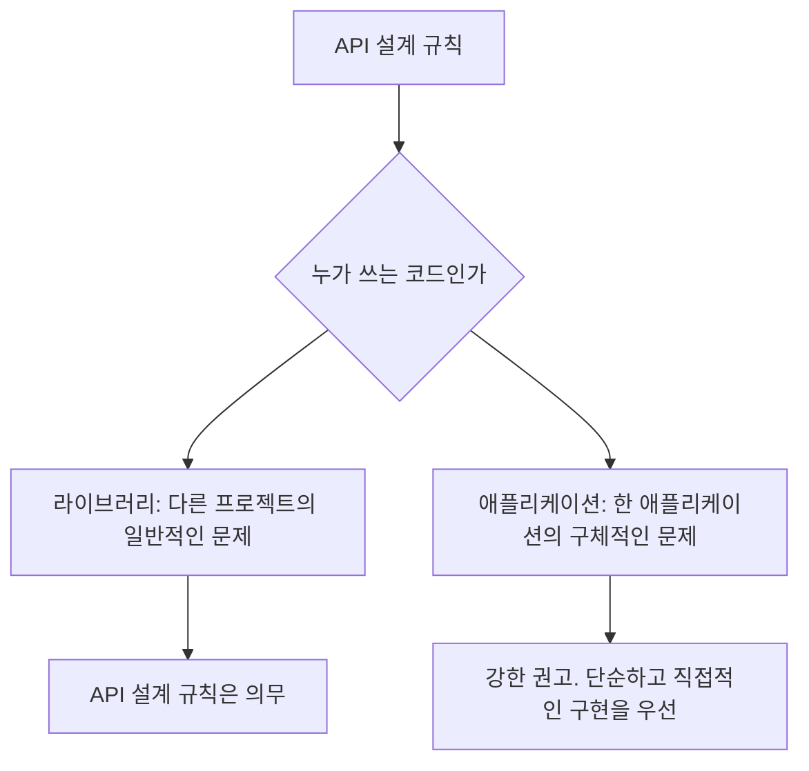
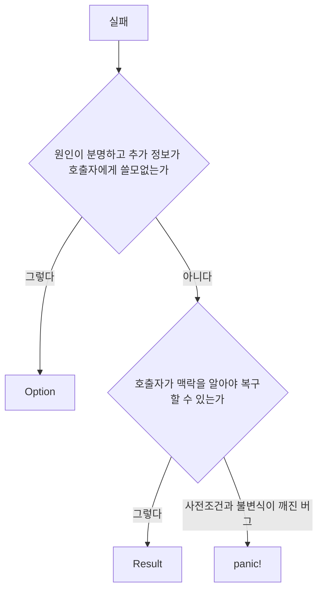
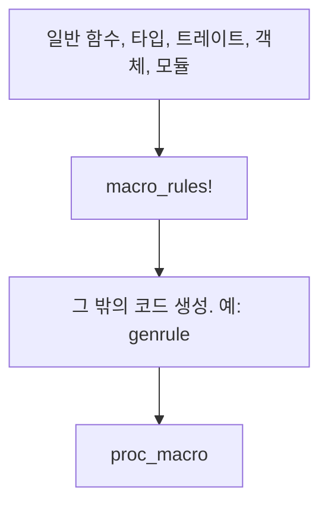
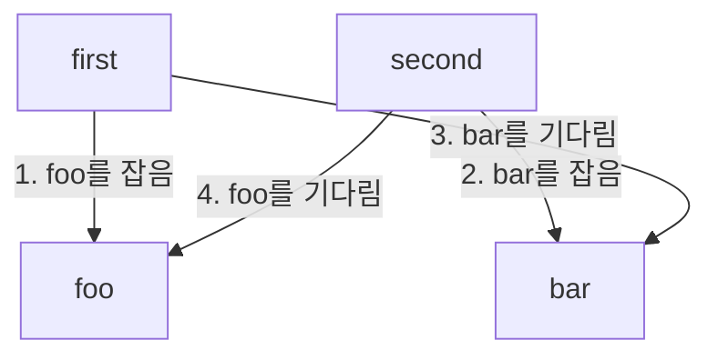

# Google의 Rust 스타일 가이드

`google.github.io/styleguide/rustguide.html`. Google이 자기 Rust 코드에 두는 가독성, API, 구현, 대규모 변경의 기준.

확인 기준: 2026-10-25. 규칙의 문장, 예외, 태그(`[chrome]`, `[Fuchsia]`)는 그날 그 페이지다. [GeekNews 35789](https://news.hada.io/topic?id=35789)는 같은 페이지의 요약이고, 페이지는 글을 3일 전으로 표시한다. 댓글 둘은 Lobste.rs와 Hacker News의 글을 GeekNews가 한국어로 정리한 것이다. 29절부터 33절은 같은 날, 페이지가 이름만 두었던 자리를 연 결과다. `chromium::import!`는 Comprehensive Rust의 해당 절, 시퀀스는 Chromium의 Threading and Tasks, Fuchsia의 뮤텍스·테스트·불안정 기능은 fuchsia.dev의 해당 페이지, rustfmt 옵션의 안정 여부는 rustfmt `Configurations.md`와 1.10.0 변경 기록, `Eq`와 `Ord`는 표준 라이브러리 문서, `as_`·`to_`·`into_`는 Rust API Guidelines의 명명 장과 Clippy `wrong_self_convention` 소스, `non_exhaustive_omitted_patterns`는 rustc의 기본 허용 린트 목록이다. 영어 원 스레드, Microsoft 가이드, Ed Page 가이드, 공식 Rust Style Guide 전문, Google C++ 스타일 가이드는 열지 않았다. Chromium 트리를 클론해 규칙이 지켜지는지 세지도 않았다.

이 문서는 그 페이지가 누구에게 무엇을 요구하는지, 요약이 지운 태그와 예외가 어디인지, 댓글이 규칙과 다른 층에서 무엇을 말하는지 적는다. 가이드 문장 전체를 여기로 옮기지는 않는다.

## 1. 결론

이 페이지는 rustfmt 설정 모음이 아니다. 첫 문장이 스타일의 범위를 포맷 밖으로 넓힌다. API 설계와 구현 설계가 포함된다. Rust가 쓰이는 곳으로 페이지가 이름을 다는 곳은 google3, Android, ChromeOS, Fuchsia, Chrome이다.

규칙을 한 문장으로 줄이면 태그가 사라진다. 태그가 없는 문장과, Chromium에만 붙는 문장과, Fuchsia에만 붙는 문장은 적용 대상이 다르다.

| 요약에 보이기 쉬운 말 | 페이지가 실제로 가리키는 것 |
| --- | --- |
| Google Rust는 작은 크레이트와 평평한 디렉터리를 쓴다 | 둘 다 `[chrome]`. `rust_static_library` / `rust_library`와 Chromium 빌드 그래프의 이야기다. `//third_party` 중 Cargo로도 빌드하는 코드는 Cargo 디렉터리 구조를 따른다 |
| `async` / `.await`를 쓰지 않는다 | `[chrome]`. 페이지의 다른 코드베이스로 일반화하는 문장은 없다 |
| 표준 라이브러리로 스레드를 만들지 않는다 | 제목은 `[chrome]`이고, 본문은 Chromium에서 스레드보다 시퀀스를 선호한다고 적는다 |
| 뮤텍스는 `fuchsia_sync::Mutex`다 | `[Fuchsia]`. `std::sync`와 `parking_lot`을 그 코드베이스에서 쓰지 말라는 문장이다 |
| 공개 enum에는 `#[non_exhaustive]`를 붙인다 | 다른 팀이 쓰는 공개 API. 바뀌지 않는 열거, 두 상태, 대규모 변경으로 깨짐을 고치겠다는 약속, 사용처가 매우 적은 경우는 예외다 |
| 반환은 이터레이터, 인자는 `impl IntoIterator` | 재사용이 큰 라이브러리에서 우선한다. 애플리케이션은 사용이 예측되고 이득이 뚜렷하지 않으면 슬라이스와 `Vec`으로 단순하게 둔다 |
| `Rc`와 `Arc`를 피한다 | 단독 소유와 빌림이 우선이다. 대안이 작성·이해·유지에 지나치게 복잡하면 리뷰에서 쓸 수 있다 |
| 줄은 100열이다 | rustfmt의 안정 옵션 `max_width` 기본값이 100이다. 16진 소문자(`hex_literal_case = Lower`)는 기본값 `Preserve`와 다르고, `format_macro_matchers = true`는 2026-10-25의 rustfmt 설정 문서에서 아직 불안정이다. 30절 |

라이브러리와 애플리케이션의 구분도 요약에서 한 칸으로 남기 쉽다. API 설계 규칙은 라이브러리에 의무이고, 애플리케이션에는 강한 권고다. 애플리케이션은 폭넓은 재사용보다 지금 필요한 직접적인 구현을 우선하고, 이른 일반화와 추상화를 피하라고 적는다.

댓글이 가장 길게 다툰 규칙은 `#[non_exhaustive]`다. 페이지의 이유는 다른 팀의 코드가 새 변형이 추가돼도 컴파일되게 하는 것이다. Hacker News 쪽 반론은, 열거형의 값이 새 변형을 컴파일러가 모든 `match`에 드러내는 데 있다는 것이다. 23절에서 그 둘을 가이드 문장과 댓글 문장으로 나눠 둔다. 어느 댓글이 이겼다는 판정은 페이지에 없다.

## 2. 이 페이지가 권위를 주장하는 범위

도입은 바람을 적는다. Google 안의 Rust가 코드베이스 안에서도, 코드베이스 사이에서도 일정하기를 바란다는 문장이다. 일관성은 품질의 기준을 세우는 일이기도 하다고 적는다.

그 다음 “Scope”는 그보다 좁다. 현재 이 규칙들의 권위가 미치는 범위를 이렇게 적는다.

- Android, Chromium, 그 밖의 코드베이스와 협의하며 가이드를 만들었고, 그 코드베이스들은 적용을 시작할 예정이다.
- 얼마나 엄격히 적용하는지는 코드베이스 자신의 규칙에 따른다.
- 적용이 진행되면 이 자리에 정보가 더 생길 것으로 기대한다.

그래서 “Google의 모든 Rust가 오늘부터 이 문서를 빌드 실패 조건으로 쓴다”는 문장은 페이지에 없다. google3, ChromeOS, Fuchsia는 도입에서 Rust가 쓰이는 곳으로 이름이 나오고, Scope 절의 “적용을 시작할 예정”이라는 문장에는 Android와 Chromium이 구체적으로 적힌다. Fuchsia는 뒤 절에서 자기 뮤텍스, 불안정 기능, 테스트 속성을 따로 가진다. 그 절들은 가이드가 Fuchsia를 모르는 척하는 문장이 아니다. 적용의 엄격함이 코드베이스마다 다르다는 Scope의 문장과 같이 읽는다.

페이지 맨 아래는 사이트가 오픈소스이고 이 페이지를 고칠 수 있다고 적는다. 내부 문서와 공개 문서가 같은 글인지에 대한 선언은 이 Rust 페이지에 없다. Go 스타일 가이드가 내부용과 공개용이 같도록 의도됐다는 말은 GeekNews에 옮겨진 댓글이다. 그 말을 이 Rust 가이드의 운영 방식으로 옮기지 않는다.

## 3. 규칙이 나와야 하는 이유

목표 절은 C++ 스타일 가이드를 만든 이유와 같다고 한 뒤, 규칙이 나와야 하는 이유를 다섯으로 적는다.

1. 가독성과 유지보수성이 작성 편의보다 앞선다. 코드는 오래 남고, 읽는 쪽을 나아지게 하는 규칙이라면 쓸 때 노력이 더 드는 쪽을 감수한다.
2. 자동화를 돕는다. Google에서는 대규모 변경(Large-Scale Change, LSC)이 흔하고, 일관성은 그 변경을 도구로 돌리기 쉽게 한다.
3. 더 넓은 Rust 생태계의 관례와 맞출 수 있으면 맞춘다. 이미 있는 일관성에 기대면, Google 스타일을 새로 배우는 일이 줄어든다.
4. 규칙은 자기 무게를 감당해야 한다. 개발자와 리뷰어가 기억해야 하므로, 손에 잡히는 이득이 있는 규칙만 둔다.
5. 사소한 스타일 불일치를 반복해서 논하지 않게 할 수 있다. 이 목적만 있는 규칙은 최소한으로 둔다.

다섯 번째가 약한 이유가 된다. 합리적인 사람이 갈리는 스타일은 CL(코드 리뷰)에서 자주 다시 나오고, 규칙이 있으면 그때마다 다시 논하지 않아도 된다. 그러나 그 효과만 있는 규칙은 줄이라고 적는다. 뒤의 임포트 규칙 두 개는 페이지가 스스로 “리뷰어 의견 충돌을 피하려는 규칙”이라고 이유를 밝힌다. 그 자기 설명은 5번에 가깝고, 페이지는 그 규칙을 그래도 본문에 남겨 두었다.

Hacker News에 옮겨진 댓글은 이 목표를 기업 규칙의 조건으로 읽는다. 한 상황의 최선보다, 취향을 다시 판정하지 않고 프로젝트·팀·숙련도가 다른 사람들에게 같이 적용할 수 있는 규칙을 골랐다는 읽기다. Rob Pike의 말로 댓글이 붙인 문장은 “gofmt의 스타일을 가장 좋아하는 사람은 없지만, gofmt는 모두가 가장 좋아한다”이다. 이 문장은 가이드 페이지에 없고 댓글에 있다.

## 4. 공개 Rust 스타일과의 관계

충돌하지 않는 범위에서 두 공개 문서를 따른다.

- 공식 Rust Style Guide. 포맷 관례의 대부분은 rustfmt가 강제한다고 이 페이지가 적는다.
- Rust API Guidelines.

충돌의 정의도 적혀 있다. 이 가이드가, 공식 스타일 가이드가 말리는 패턴을 권하거나, 공식 가이드가 주로 권하는 패턴과 반대로 가는 경우다.

공개 가이드와 달라지는 이유로 페이지가 드는 것은 세 가지 보통 목표(일관성, 가독성, 좋은 API)에 하나를 더하는 일이다. 대규모 변경이 도구로 지나가기 쉬운 패턴이다. 큰 코드베이스는 저장소 전체를 도구가 고치는 리팩터링을 가끔 돌린다. 그때 코드는 도구가 다루기 쉬워야 한다. 일관성도 도움이 되고, 리팩터링을 염두에 둔 패턴을 일부러 고르는 것도 도움이 된다고 적는다.

이 추가 목표가 뒤에 반복해서 나온다. 와일드카드 임포트는 대규모 변경을 하는 사람에게 일을 늘린다. 매크로는 대규모 변경을 더 비싸게 만든다. `#[non_exhaustive]`의 예외 중 하나는, 깨짐을 대규모 변경으로 고치겠다고 약속하는 경우다. 세 규칙은 같은 목표의 다른 적용이다. 하나를 “취향”으로만 읽으면 나머지 둘의 이유가 안 보인다.

## 5. 라이브러리 코드와 애플리케이션 코드

API 설계 규칙을 적용할 때 페이지는 코드를 둘로 나눈다.



| | 라이브러리 | 애플리케이션 |
| --- | --- | --- |
| 푸는 문제 | 비교적 일반적인 문제 | 한 애플리케이션의 구체적인 문제 |
| 쓰는 쪽 | 다른 프로젝트 | 그 애플리케이션 |
| API 설계 규칙 | 의무 | 강한 권고 |
| 우선하는 성질 | 재사용, 유연한 시그니처, 호출자가 할당을 고를 여지 | 단순함, 지금 필요한 것, 예측 가능한 사용 |

이 축이 뒤의 여러 규칙을 느슨하게 하거나 단단하게 한다.

- 반환을 이터레이터로 두는 우선순위는 라이브러리다. 애플리케이션은 코드가 단순해지고, 이터레이터의 유연함과 성능 이득이 뚜렷하지 않으면 `Vec<T>`를 반환해도 된다.
- 순회만 하는 입력도 같다. 라이브러리는 이터레이터나 `impl IntoIterator`를 받고, 애플리케이션은 그 이득이 뚜렷하지 않으면 `&[T]`로 충분하다.
- `impl Into<T>`는 라이브러리에서 호출 편의가 특히 중요할 때 검토한다. 애플리케이션은 거의 쓰지 않아야 한다고 적는다.
- 트레이트 구현은 저수준 라이브러리가 사용자의 필요를 미리 보고, 애플리케이션은 필요할 때 추가한다.

Hacker News 댓글 하나는 이 구분을 가이드에서 특히 마음에 드는 부분으로 고른다. Rust가 복잡한 제네릭 때문에 평가가 나빠진 면이 있지만, 대부분의 애플리케이션은 그 정도 일반화를 쓰지 않는다는 말이다. 페이지의 문장과 댓글의 평가가 같은 방향을 가리킨다. 댓글이 그 구분을 수치로 보여 주지는 않는다.

## 6. 어느 문장에 코드베이스 이름이 붙는가

제목에 대괄호가 있는 절과 없는 절을 한 표로 두면, GeekNews 서두의 다섯 불릿이 어디서 한 문장으로 합쳐졌는지 보인다.

| 절 | 태그 | 요구 |
| --- | --- | --- |
| 작은 크레이트 | `[chrome]` | 한 추상화에 집중하는 작은 크레이트. 가능하면 한 파일이어도 된다 |
| `rust_library` 소스는 한 디렉터리 | `[chrome]` | 한 크레이트의 `.rs`를 하위 디렉터리로 나누지 않는다 |
| 임포트 메커니즘 | `[chrome]` | `chromium::import!()`를 쓴다 |
| `async` / `.await` | `[chrome]` | Chromium에서 쓰지 않는다 |
| 표준 라이브러리로 새 스레드 | `[chrome]` | 제목은 시작하지 말 것. 본문은 시퀀스를 선호 |
| 뮤텍스 타입 | `[Fuchsia]` | `fuchsia_sync::Mutex`. `std::sync`와 `parking_lot`은 그 자리가 아니다 |
| 불안정 기능의 예외 | Android, Chrome, Fuchsia가 각각 | 원칙은 금지. 예외의 승인 경로가 코드베이스마다 다르다 |
| `panic::catch_unwind`의 예외 | Chrome, Android, Fuchsia에는 그 예외가 적용되지 않음 | 그 셋은 `panic=abort`를 요구한다고 페이지가 적는다 |
| 테스트 | Chrome, Fuchsia가 각각 | `#[test]` 대신 코드베이스 프레임워크 |

태그가 없는 절은 페이지가 Google Rust 일반으로 적는 규칙이다. 소유권, 함수 입출력, 오류, 타입, 트레이트, 매크로, 이름, 문서, `unsafe`, 접근자, `#[non_exhaustive]`, `#[must_use]`, 구현 가독성이 거기에 들어간다. “일반”이 “이미 모든 저장소의 린트”라는 뜻은 Scope 절이 막는다.

## 7. Chromium의 작은 크레이트와 평평한 파일

페이지는 용어를 먼저 고정한다. 크레이트는 컴파일 단위이고, 이름 없는 루트 모듈을 항상 가진다. 모듈은 크레이트 안에서 이름을 가리고 나누는 단위다. 중첩할 수 있고, 파일과 디렉터리로 코드를 나눌 수도 있다. 그 다음 문장이 Chromium에서는 그 가능성 중 파일과 디렉터리로 나누는 쪽을 다 쓰지 않는 편이 낫다고 한다.

### 7.1 작은 크레이트

Chromium에서는 작은 크레이트를 선호한다. 이상적으로는 한 파일이고, 한 추상화에 집중한다. 자를 수 있으면 자른다. 한 크레이트는 `rust_static_library` 규칙 하나에 대응하고, 그 규칙이 `.rs` 파일을 여럿 가질 수 있다.

순서가 있다. 먼저 그 API들이 같은 크레이트에 있어야 하는지를 보고, 그 다음에 하위 모듈이 정리를 돕는지 본다. 루트 모듈은 말단 모듈의 공개 API를 재노출할 수 있다. 쓰는 쪽은 하위 모듈을 몰라도 된다. 하위 모듈을 쓰기로 하면 페이지가 말하는 파일 구조를 따른다.

큰 크레이트를 허용하는 경우는 둘이다.

- 트레이트 구현의 일관성 규칙 때문에 여러 타입과 트레이트가 한 라이브러리에 있어야 할 때.
- 큰 기반 라이브러리를 만들 때.

이유는 Chromium 코드베이스의 크기, 의존성을 더할 때 빌드 그래프의 다른 곳으로 효과가 퍼지는 일, 병렬 컴파일과 빌드 캐시다.

### 7.2 한 디렉터리

한 `rust_library`(한 크레이트)의 `.rs`는 한 디렉터리에 있어야 한다. 한 크레이트의 파일을 하위 디렉터리로 나누지 않는다. 하위 디렉터리가 필요하다고 느껴지면, 크레이트가 너무 커졌다는 강한 신호로 보고 나누라고 한다.

이 배치는 오픈소스에서 흔한 Cargo 디렉터리 구조와 일부러 다르다. 예외는 `//third_party` 안에서 Cargo로도 빌드하는 코드다. 그 코드는 Cargo 구조를 따른다.

페이지가 드는 이유는 세 줄이다. 작은 크레이트를 선호하므로 대부분의 `rust_library`는 소스 파일이 하나다. 크레이트마다 디렉터리를 만들면 디렉터리 대부분이 파일 하나짜리가 된다. 파일이 여럿인 타깃도 하위 모듈용 디렉터리를 만들지 않아, 접근을 일정하게 유지한다.

### 7.3 댓글이 이 절을 읽는 방식

Lobste.rs 쪽 댓글은 크레이트 크기에 동의하지 않는다. Google 내부 빌드에서는 작은 크레이트가 편할 수 있지만, Cargo에서는 복잡도가 그 정도 필요하면 `.rs` 몇 개보다 많은 파일을 한 크레이트에 둔다는 말이다. 댓글 자신이 이 항목이 Chrome에만 적용되는 듯하다고 적고, Chromium 빌드 시스템은 모른다고 적는다.

같은 스레드의 다른 댓글은 증분 빌드를 든다. 크레이트 경계가 많으면 안 바뀐 크레이트는 다시 컴파일하지 않아도 되고, 큰 크레이트 하나는 통째로 다시 컴파일한다는 기억이다. 그 다음 댓글이 조건을 붙인다. Rust용 외부 빌드 시스템 중 상당수는 크레이트 안의 rustc 증분 캐시를 다음 빌드에 재사용하지 못한다. 그러면 증분이 가능한 단위가 크레이트뿐이라는 말이다. 이 문장은 댓글의 기억과 추론이다. 페이지가 Chromium 빌드의 캐시 구현을 그렇게 설명하지는 않는다. 페이지의 이유는 “병렬 컴파일과 빌드 캐시 성능”이라는 한 구절이다.

Hacker News 쪽은 “함수를 극단적으로 작게”와 이 규칙을 분리한다.

- Cargo로 크레이트를 나누면 디렉터리, `Cargo.toml`, `src/`가 따라와 분리 비용이 크다. 댓글이 써 본 Google 빌드 시스템은 한 디렉터리에 여러 언어 소스를 두고 더 작은 라이브러리를 만든다. Chromium도 비슷해 보인다는 인상이다.
- Rust에서 크레이트는 빌드 병렬화 단위다. 인지 부담만 작으면 크레이트를 늘릴 이유가 있다. 일반 Rust에서 모듈을 나누듯이 크레이트를 쓴다고 볼 수 있다는 말이다.
- 크레이트의 크기와 추상화의 크기는 다르다는 댓글이 페이지의 예외 문장과 맞다. 모듈, 타입, 큰 함수는 그대로 두고, 그 모듈을 큰 크레이트 하나 대신 여러 크레이트에 둔다는 뜻이다. 일관성 규칙 때문에 설계가 어색해지면 억지로 쪼개지 말고 라이브러리를 키워도 된다고 페이지가 이미 적었다.
- 한 공용 유틸리티 크레이트에 IP 주소 유틸리티와 무선 주파수 유틸리티가 같이 있으면, 한쪽만 필요해도 다른 쪽이 따라오고, 하위 모듈 하나의 변경이 모든 소비자에게 버전 변경으로 퍼진다는 경험담이 있다. `net-utils`와 `rf-utils`로 나뉘었으면 그 전파가 줄었을 것이라는 말이다.
- 모노레포와 Blaze라는 추정, 코딩 에이전트의 문맥 한도라는 추정은 댓글에 있다. 페이지는 Blaze와 에이전트를 이유로 적지 않는다.
- `source.chromium.org`의 한 경로에 Rust 파일이 약 네 개이고 각각 크레이트로 보인다는 관찰도 댓글이다. 그중 절차적 매크로는 Cargo에서도 별도 크레이트가 필요할 것이라는 추정이다. 이 문서는 그 경로의 파일 수를 다시 세지 않았다.

페이지가 “항상 극도로 작게”라고 쓰지 않았다는 댓글의 정정은 본문과 맞다. 선호이고, 큰 크레이트 예외가 뒤에 있다.

## 8. 모듈 이름과 비말단 모듈

말단 모듈에 중심이 되는 사용자 정의 항목이 있으면, 그 항목의 이름으로 모듈과 파일을 짓는다. 항목이 `Foo`이면 `mod foo`와 `foo.rs`다. 특정 추상화가 중심이 아닌 말단 모듈은 원하는 대로 이름 짓는다. 이유는 파일과 모듈의 내용을 한눈에 알게 하려는 것이다.

비말단 모듈에는 모듈 선언과 재노출만 둔다. API 구현을 거기에 두지 않는다. 말단의 정의는 `mod test`와 `#[cxx::bridge]` 같은 언어 간 바인딩 모듈을 말단 쪽에 두는 것을 허용한다고 페이지가 적는다. 예외로, 사이를 잇는 소량의 구현은 비말단 모듈에 있어도 된다. 목표는 그 모듈에 코드가 많이 있지 않게 하는 것이다. 이유는 찾기 쉽게 하고, 구조와 내용을 섞지 않으려는 것이다.

이 절에는 `[chrome]`이 없다. 바로 앞의 작은 크레이트·평평한 디렉터리와 이어 읽히지만, 태그는 앞의 두 절에만 있다.

## 9. 임포트

### 9.1 와일드카드

와일드카드 임포트는 원칙적으로 쓰지 않는다. 선택으로 허용하는 경우가 네 가지다.

- 인라인 모듈의 `use super::*`.
- 그 열거형을 주로 다루는 메서드 본문과 함수에서의 `use enum::*`.
- 비말단 모듈의 `pub use submodule::*`.
- C++ 네임스페이스를 합칠 때. C++에서는 하나의 네임스페이스인 것이 Rust에서는 서로 다른 크레이트의 하위 모듈이 된다. 비공개인 합친 모듈로 와일드카드를 모을 수 있다.

페이지의 가상 예는 이렇다.

```rust
mod absl {
    pub use status::absl::*;
    pub use strings::absl::*;
}
```

이 모듈 안에서 `absl::Status`와 `absl::StrCat`을 C++에서처럼 쓸 수 있고, `status::absl::Status`와 `strings::absl::StrCat`으로 풀어 쓰지 않아도 된다. 이 형태는 C++ 네임스페이스를 합칠 때만 쓰고, 합친 모듈은 공개하면 안 된다.

서드파티 크레이트가 prelude를 권하면 리뷰어가 허용 여부를 본다. prelude를 새로 정의하는 것은 피한다.

이유는 대규모 변경을 돌리는 사람의 수고가 늘고, 상호참조가 없는 자리에서 타입이 어디서 왔는지 알기 어려워진다는 것이다.

### 9.2 한 `use`는 한 모듈

이 규칙은 rustfmt의 `imports_granularity = Module`에 대응한다고 페이지가 적는다. `use`의 `{..}` 안에 `::`가 있으면 안 된다.

허용하는 형태는 모듈마다 문을 나누거나, 같은 모듈의 이름만 중괄호에 넣는 것이다.

```rust
use foo::Foo;
use foo::bar::{Bar, Baz};
```

페이지가 맞지 않다고 두는 형태는 중괄호 안에서 경로가 갈라지는 것이다.

```rust
use foo::{Foo, bar::Bar};
```

### 9.3 트레이트는 함수 안에서

트레이트의 메서드를 파일 전체에서 폭넓게 쓰지 않으면, 임포트는 함수 본문에 둔다. 페이지의 예는 `std::str::FromStr`을 `foo` 함수 안에서 임포트한 뒤 `u8::from_str`을 호출한다. 모듈 스코프의 `use`로 올리지 않는다.

### 9.4 최상위 함수는 모듈 이름으로

다른 모듈이나 크레이트의 최상위 함수는 모듈을 임포트하고 `modulename::functionname()`으로 호출한다. 페이지가 권하는 형태는 `use std::mem;` 다음 `mem::transmute(y)`다. `use std::mem::transmute;` 다음 `transmute(y)`는 그 대비로 나온다. 이 예는 임포트 형태를 보여 주는 자리다. `unsafe`를 언제 써도 되는지는 21절의 별도 규칙이다.

예외는 셋이다.

- 이름이 충분히 구분될 때. C++에서 온 함수처럼 최상위 함수를 직접 호출하는 관례가 있는 경우.
- Chromium에서, 작고 목적이 하나인 자체 크레이트의 함수.
- 모듈 이름 자체가 충돌하기 쉬울 때. 모듈 이름이 C++ 네임스페이스이고, 여러 크레이트가 같은 하위 모듈 이름을 정의하는 경우.

이유는 많은 Rust 코드베이스가 경로 없는 소문자 이름을 지역 이름으로 가정해서, `foo()`를 같은 모듈의 함수로 읽을 수 있게 한다는 것이다. 페이지는 이 규칙이 대체로 리뷰어 의견 충돌을 피하려고 존재하고, 이득은 일관성과, 상호참조 없이 읽을 때의 작은 가장자리라고 적는다.

### 9.5 타입은 임포트해서 경로 없이

타입과 트레이트는 기본적으로 임포트한 뒤 모듈 경로 없이 쓴다. `regex::Regex`가 아니라 `Regex`이고, `use regex::Regex`는 파일 위나 해당 함수에 둔다.

예외는 넷이다.

- 흔한 이름이 겹치면 `io::Error`처럼 경로를 남기거나, `use std::io::Error as IoError`처럼 별칭을 쓴다.
- rustc의 `hir` 모듈처럼 타입 묶음이 클 때.
- 매크로와 생성 코드. 거기에 `use`를 요구하면 역효과다.
- 의존성이 많아 임포트 블록만 커지고 이득이 작을 때.

이 규칙의 이유도 리뷰어 의견 충돌을 피하려는 것이라고 페이지가 적는다.

Hacker News 댓글은 이 규칙이 `IoError`처럼 타입 이름에 출신을 다시 적게 만든다고 본다. `HashMap`처럼 널리 알려진 이름이 아니면 경로를 붙여 문맥을 남기는 편이 낫고, `Source` 같은 이름을 이해하려고 임포트 블록이나 LSP로 돌아가고 싶지 않다는 말이다. 임포트를 줄이면 병합 충돌도 줄어든다는 말도 있다. 다른 댓글은 페이지의 예외를 가리킨다. 모호하면 `io::Error`처럼 경로를 유지하라고 적혀 있고, `regex::Regex` 대신 `Regex`를 쓰라는 취지라면 더 합리적으로 보인다는 것이다. “리뷰어 사이 의견 충돌을 피하려고 존재한다”는 문장은 페이지의 이유와 댓글이 같은 말을 한다. 일괄 규칙 자체가 나쁘고, 경로가 나을 때와 생략이 나을 때가 있다는 댓글도 있다. `NSString`이 `String`보다 검색에 낫다는 경험은 댓글의 다른 언어 이야기다.

### 9.6 Chrome의 임포트 매크로

`[chrome]` 절의 본문은 “`chromium::import!()`를 사용한다”이다. 매크로가 어떤 토큰을 받는지, 일반 `use`와 어디서 갈리는지, 생성 결과는 페이지의 이 절에 없다. 그 빈칸은 29.1절이 Comprehensive Rust의 설명으로 채운다.

## 10. 포맷

코드베이스에 맞는 포맷 도구를 쓴다. Chromium의 예로 `git cl format`이 나온다.

그 아래 설정은 “스타일 가이드 작성자용”이라고 제목이 붙는다. 안정 Rust로 빌드하는 것을 중시하고, 해당 `rustfmt` 옵션이 그 안정 버전에서 쓸 수 없으면, 코드베이스는 아래 옵션을 적용하지 않을 수 있다.

- 한 줄 최대 100열. `max_width = 100`.
- 16진 리터럴은 소문자. `0xAB123CDEF` 대신 `0xab123cdef`. `hex_literal_case = Lower`.
- 매크로 매처 포맷. `format_macro_matchers = true`.
- 리터럴 안의 보이지 않는 문자는 이스케이프. 폭이 없는 결합자는 `\u{200D}`로 쓴다.

`#[rustfmt::skip]`은 두 경우에만 허용한다. 상황 때문에 줄을 사람이 맞추는 경우(비슷한 줄의 정렬, 행렬을 만드는 함수)와, 생성 코드다. 생성 코드는 가능하면 `genrule`을 쓴다. 개인 취향으로 자동 포맷을 건너뛰지 말라고 페이지가 따로 적는다.

100열이 “Google Rust의 현재 강제 값”인지는 이 절로 확정되지 않는다. 작성자용 권장이고, 안정 채널에 옵션이 없으면 빼도 된다고 적혀 있다. 네 항목이 rustfmt 설정 문서에서 안정인지, 기본값과 같은지는 30절이다. 한 `use`를 한 모듈로 두는 9.2절이 가리키는 `imports_granularity = Module`도 그 문서에서는 아직 불안정 옵션이다.

## 11. 소유권과 복사

`Rc`와 `Arc`보다 단독 소유와 빌림을 우선한다. 예외는 대안이 되는 소유·빌림 구조가 작성, 이해, 유지에 불합리할 만큼 복잡할 때다. 그 판단은 코드 리뷰에서 논의한다. 이유는 Rust가 공유 소유 포인터 없이 객체 그래프를 표현할 수 있고, 그 포인터는 실행 시간 비용과 자기만의 복잡성을 더한다는 것이다. 다른 언어에서 온 사람이 `Rc`와 `Arc`를 너무 빨리 쓴다는 문장도 있다.

`.clone()`은 깊은 복사가 정말로 필요할 때 쓴다. 빌림을 피하려는 대용으로 남용하지 않는다. 빌림 관계가 지나치게 복잡해지면 실용적인 선택이 될 수 있고, 그 선택의 성능 요구도 같이 본다. 깊은 복사는 할당과 데이터 복사 때문에 비쌀 수 있다.

이 복사 지침은 `Rc`와 `Arc`의 복제에 적용되지 않는다고 페이지가 적는다. 참조 횟수 포인터를 복제하는 것은 깊은 복사가 아니고, 그 포인터를 쓰는 정상적인 방법이다. `Rc`를 피하라는 절과, 일단 쓰기로 했으면 그 핸들의 복제는 깊은 복사가 아니라는 절은 같이 읽는다.

## 12. 함수가 받고 돌려주는 형태

### 12.1 불변으로 빌릴 때

불변 데이터를 빌릴 때는 데이터가 들어 있는 상자나 컨테이너가 아니라, 데이터 자체에 대한 더 유연한 참조를 받는다.

| 받는 타입 | 그 대신 받지 않는 타입 | 페이지가 드는 이유 |
| --- | --- | --- |
| `&T` | `&Box<T>` | 상자 안의 데이터를 빌린다 |
| `&[T]` | `&Vec<T>` | 특정 컨테이너가 아니라 슬라이스를 받는다 |
| `&str` | `&String` | 소유 문자열에 대한 참조가 아니라 문자열 슬라이스를 받는다 |
| `Option<&T>` | `&Option<T>` | `Option` 안의 데이터를 빌린다 |

예외는 Rope나 Cord 같은 비선형 문자 데이터다. 관련 Clippy 린트로 `borrowed_box`와 `ptr_arg`를 가리킨다. 이유는 스마트 포인터·컨테이너·래퍼를 시그니처에 적지 않으면, 호출자가 데이터를 여러 저장 형태로 들고 있어도 먼저 복사하지 않고 넘길 수 있다는 것이다.

### 12.2 반환은 이터레이터를 먼저 본다

가능하면 `Vec<T>`보다 이터레이터(구체 타입이거나 `impl Iterator`)를 반환한다. 애플리케이션에서는 코드가 단순해지고, 이터레이터의 유연함과 성능 이득이 뚜렷이 필요하지 않으면 `Vec<T>`도 괜찮다고 주가 붙는다.

예외는 여섯이다.

- 대부분의 호출자가 소유한 벡터를 만들어야 한다.
- 구현이 자연스럽게 벡터를 만든다.
- 반환값을 임의 인덱스로 볼 가능성이 크다.
- 알고리듬이 `for` 루프로 더 잘 맞고, 강제된 할당이 그다지 중요하지 않다.
- 함수의 목적이 새 소유 컬렉션을 만드는 것이다.
- 이미 있는 벡터를 반환한다.

라이브러리에서 이터레이터를 돌려주면 호출자가 벡터로 모을지, 루프로 처리할지, 어댑터를 더 이을지 고른다. 그중 일부는 불필요한 할당을 피한다. 애플리케이션은 사용 패턴을 예측하기 쉬워서, 어차피 벡터로 모이거나 성능이 문제가 아니면 벡터가 더 단순한 API가 된다.

### 12.3 입력의 순회

재사용이 큰 라이브러리는 순회만 필요하면 이터레이터나 `impl IntoIterator`를 받는다. 어느 컬렉션에서나 올 수 있고, 연속 메모리로 복사하지 않아도 되며, 이터레이터 체인과 잘 맞는다. 애플리케이션은 그 이득이 뚜렷하지 않으면 `&[T]`가 더 단순한 API다.

### 12.4 `impl Into<T>`

라이브러리 API가 `T`를 받는데 호출자가 여러 타입을 들고 있을 가능성이 크고, 호출부의 편의가 특히 중요하면 `T` 대신 `impl Into<T>`를 검토한다. `impl Into<String>`이면 `String`과 `&str` 리터럴을 직접 넘길 수 있다. 코드가 커지는 문제와 저울질하라고 하고, `Into<T>`를 많이 쓰는 것이 요구 사항은 아니라고 한다. 애플리케이션은 거의 쓰지 않아야 한다. 비용으로 적힌 것은 더 복잡한 시그니처, 코드 크기, 때로는 타입 추론의 어려움이다. `.into()`를 호출부에서 한 번 쓰지 않는 편의와 그 비용을 비교한다.

### 12.5 `bool` 대신 열거형

인자의 목적이 분명하지 않으면 `bool` 대신 `enum`을 쓴다. `bool`을 쓸 때는 인자 목록의 인라인 주석으로 그 값의 목적을 밝히는 방법을 고려한다.

Hacker News 댓글은 이 규칙을 혼자 개발할 때도 지킬 만하다고 본다. 인증서 검증기에서 플래그를 반대로 쓰는 실수를 한 번 막아 줬다는 경험이다. 참과 거짓에 실을 수 있는 의미는 많고, 특정 열거형 변형은 하나의 의미를 가리킨다는 일반화는 댓글의 말이다.

## 13. 오류를 어디에 실을지

`Option`, `Result`, `panic!` 중 API 계약에 맞는 것을 고른다.



`Option`은 단순한 실패다. 값이 없음, 파싱이 안 맞음, 정수 오버플로처럼 원인이 분명하고 호출자가 더 자세한 설명에서 이득을 보지 못하는 경우다. 페이지의 예는 `checked_add(a: u32, b: u32) -> Option<u32>`다. 오버플로라는 원인 외에 합리적으로 더 줄 정보가 없다고 주석이 적는다.

`Result`는 호출자가 맥락을 알아야 복구할 수 있는 실패다. 파일이나 네트워크처럼, 앞에 검사를 두어도 올바른 코드가 막지 못하는 외부 요인이 흔하다. 호출자는 실패의 종류를 예상할 수 있다. 파일을 여는 함수는 입출력 오류로 실패할 수 있다. 그 세부 정보가 `NotFound`와 `PermissionDenied`를 가르게 한다. 페이지의 예는 `open_file(path: &Path) -> Result<File, io::Error>`다.

`panic!`은 버그와 깨진 불변식이다. 프로그램에 검사가 빠져 있고, 사전조건을 채우지 않은 채 연산을 호출한 것이다. 실행 중에 처리하기보다 코드에서 고쳐야 한다. 페이지는 거친 복구가 `catch_unwind`로 가능할 수 있다고 이 절에서 언급한다. 그 함수를 직접 호출하는 일의 금지는 25절에 따로 있다. 페이지의 예는 `MyVec::remove`가 인덱스가 길이를 넘으면 `panic!("index out of bounds")`를 호출하는 것이다. 호출자 논리의 버그라는 주석이 붙는다.

일부 코드베이스는 패닉을 전혀 피하고, 깨진 불변식도 `Result`로 보고하라고 요구할 수 있다. 예외로, 개발자용 바이너리는 치명적이지 않은 오류에 패닉을 쓸 수 있고, 테스트는 단언에 패닉을 쓸 수 있다.

## 14. 뉴타입과 이름 있는 필드

타입 별칭 대신 뉴타입을 쓰는 경우를 페이지는 넷으로 적는다.

- 의미 차이가 뚜렷할 때.
- 자체 API가 필요할 때.
- 내부 타입을 나중에 바꿀 여지를 남기고 싶을 때. 특히 사용처를 모두 통제하지 못할 때.
- 섞이기 쉬운 값의 타입 안전. `Date`의 내부 계산에서 `Day`, `Month`, `Year`를 뉴타입으로 나누는 예가 나온다.

필드가 여럿이면 튜플보다 이름 있는 필드를 선호한다. `.0`, `.1`은 금방 헷갈린다. 예외는 필드가 하나인 뉴타입 튜플 구조체와, 혼동 가능성이 낮은 매우 국소적인 사용이다.

## 15. 트레이트를 만드는 조건

저수준 라이브러리는 사용자의 필요를 미리 보고 트레이트 구현을 더하고, 애플리케이션은 필요할 때 더한다.

표준 라이브러리 트레이트와 목적과 동작이 같으면 자체 메서드 대신 그 트레이트를 구현한다. `Foo`에 `fn from_str(&str) -> Self`를 두기보다 `impl FromStr for Foo`를 둔다. 발견하기 쉽게 메서드와 트레이트 구현을 둘 다 두는 것은 허용한다. Clippy 린트 `should_implement_trait`를 가리킨다.

`#[derive()]`로 표현할 수 있으면 수동 구현을 피한다.

라이브러리의 함수 인자는 `dyn Trait`보다 `T: Trait` 또는 `impl Trait`를 선호한다. 예외는 코드 크기가 중요할 때다. 이유는 둘이다. `dyn Trait`는 팻 포인터와, 호출마다의 vtable 조회가 필요하고, 제네릭이면 가능한 인라이닝 같은 최적화가 막힌다. 일부 트레이트는 `dyn`과 맞지 않는다. 페이지가 드는 예는 제네릭 함수가 있는 트레이트, `self`가 없는 연관 함수, `Self`를 반환하는 함수다.

트레이트를 정의하는 목적은 셋으로 제한한다.

- 제네릭 프로그래밍. 제네릭 함수와 타입의 제약에 `T: Trait`를 쓰기 위해.
- `impl Trait`나 `dyn Trait`를 받거나 돌려주기 위해.
- 확장 트레이트를 정의하기 위해. 확장 트레이트 절의 단서가 같이 적용된다.

그 밖의 기능은 타입의 고유 구현에 둔다. 코드를 정리하려고 트레이트를 만들지 않는다.

### 15.1 확장 트레이트

확장 트레이트는 다른 크레이트의 타입에 메서드를 더하는 트레이트다. 다른 트레이트와 다른 점은, 목적이 메서드를 더하는 것뿐이고 제네릭 제약이나 `dyn Trait`에 쓰려고 만든 것이 아니라는 점이다. 이름에는 `Ext`로 끝나는 형태를 붙인다. 페이지의 문장은 접미사를 `` `~Ext` ``로 적고, 예는 `ForeignTypeExt`다. 코드에 나타나는 이름은 그 예처럼 `Ext`로 끝난다.

일반적으로 원래 타입을 소유한 팀이 확장 트레이트도 소유한다. 예외는 널리 알려지고 큰 값을 줄 것으로 기대되는 확장, 예를 들어 기반 라이브러리나 프레임워크다.

이 규칙은 확장 트레이트에 대한 것이다. `DateLike`처럼 입력 트레이트를 정의하고 여러 외부 타입에 구현하는 일은 흔하고, 페이지는 그것을 확장 트레이트 규칙과 별개로 적는다.

페이지의 첫 예는 `foreign_crate::ForeignType`에 `ForeignTypeExt::additional_method`를 구현하는 것이다. 두 번째 예는 외부 트레이트 `ForeignTrait`를 구현한 모든 `T`에 `ForeignTraitExt`를 일괄 구현하는 것이다. 외부 트레이트에 기본 메서드를 더하는 것과 같다고 페이지가 적는다.

이유는 확장 트레이트와 타입을 같은 팀이 소유하면, 기반 타입과 확장 사이, 또는 확장끼리의 메서드 이름 충돌을 피하는 데 도움이 된다는 것이다.

Hacker News 댓글 하나는 가이드에 없는 도구 팁을 적는다. 트레이트에 `#[rust_analyzer::prefer_underscore_import]`를 붙이면 rust-analyzer가 그 트레이트를 `as _`로 임포트하게 돕고, 확장 트레이트에 유용하다는 말이다. RustRover는 그 동작의 대상이 아니라고 댓글이 적는다. 이 속성은 Google 스타일 페이지의 규칙이 아니다.

## 16. 표준 트레이트와 생성자

공개 필드가 있는 타입은, 모든 필드가 구현하는 트레이트를 타입도 구현할지 검토한다.

`Copy`와 `Clone`은 타입의 앞날을 보고 정한다.

- 오류 타입은 가능하면 `Copy`를 구현한다. 소유권을 옮기지 않고 값으로 전달할 수 있어 전파가 단순하다. `String`처럼 `Copy`가 아닌 필드를 담아야 하면 불가능한 예로 페이지가 든다.
- 일반 타입도 앞으로도 `Copy`일 것이 합리적으로 분명하면 구현한다.
- 외부 자원을 나타내지 않는 대부분의 타입은 `Clone`을 구현하는 편이 좋다.

`new()`가 있거나 기본 상태가 있으면 `Default`를 구현한다. Clippy 린트 `new_without_default`를 가리킨다.

비교는 `Eq`보다 `PartialEq`를, `Ord`보다 `PartialOrd`를 먼저 본다. `==`를 쓰게 하려면 `PartialEq`를 선호한다. `Eq`를 구현할 때는 반사성이 추가로 필요하다. 페이지는 `std::cmp::Eq` 문서를 가리킨다. `<`와 `>`도 `PartialOrd`를 선호하고, `Ord`는 전순서를 요구한다. 페이지는 `std::cmp::Ord` 문서를 가리킨다. 그 두 문서가 반사성과 전순서를 어떤 문장으로 요구하는지는 31절이다.

맵 키나 캐시 키로 쓰일 가능성이 있으면 `Hash`와 `Eq`를 구현한다. 그에 더해 분명한 전순서가 있으면 `Ord`와 그것이 필요로 하는 트레이트도 구현한다.

중요한 `From` 구현이 그 타입을 만드는 주된 방법이면, 고유 메서드 `new()`, `new_from_foo()`, `from_foo()`를 같이 둔다.

필드가 모두 공개되고 함수에 넘기는 옵션 묶음으로 주로 쓰이는 구조체는 `Default`를 구현한다. 이유는 구조체 갱신 문법이다. `Struct { a: 0, ..Default::default() }`를 쓰기 쉽게 하려는 것이다. 이 문법은 23절의 `#[non_exhaustive]` 예외와 만난다.

## 17. 동시성

오염된 뮤텍스 안의 데이터에 손을 넣어 꺼내지 않는다. 사용 사례가 아무리 당겨도 그렇게 하지 말라고 페이지가 적는다. 이 절에는 예외 목록이 없다. `Rc` 절에 있는 “불합리할 만큼 복잡하면 리뷰” 같은 문이 여기에는 없다.

Chromium에서는 `async` / `.await`를 쓰지 않는다. 절 본문은 그 한 문장이다. 대체하는 실행 모델의 이름은 이 절에 없고, 다음 절이 스레드 대신 시퀀스를 말한다.

표준 라이브러리로 새 스레드를 시작하지 말라는 제목은 `[chrome]`이다. 본문은 “Chromium에서는 스레드보다 시퀀스를 선호한다”이다. 제목의 금지와 본문의 선호가 한 절에 같이 있다. 시퀀스가 Chromium에서 어떤 스케줄러 객체인지는 이 페이지가 정의하지 않는다. Chromium의 Threading and Tasks 문서가 시퀀스와 물리 스레드를 어떻게 나누는지는 29.2절이다. 그 정의는 스타일 페이지의 문장이 아니다.

Fuchsia에서는 `std::sync`나 `parking_lot`의 뮤텍스 대신 `fuchsia_sync::Mutex`를 쓴다. Fuchsia가 그 타입에 넣는 교착 검사와, 잠금 오염을 지원하지 않는다는 문장은 29.3절이다.

## 18. 매크로의 순서

API를 표현하는 수단의 선호 순서는 고정되어 있다.



일반 Rust로 풀 수 있으면 매크로, 코드 생성, 메타프로그래밍을 피한다. 매크로나 코드 생성을 쓰기로 하면 비용을 저울질한다. IDE, Code Search, 그 밖의 개발 도구가 덜 잘 동작한다. 매크로는 언어의 방언을 만들어 코드베이스를 가로질러 일하는 일을 어렵게 할 수 있다. 대규모 변경은 더 어렵고 비싸진다.

이유는 두 층이다. 매크로가 없는 코드보다, 매크로를 본 독자가 그 코드에 대해 가정할 수 있는 것이 적다. 매크로는 일반 Rust보다 바르게 쓰기 어렵다. 단순한 코드 생성이라면 `macro_rules!`가 텍스트 생성보다 덜 깨지기 쉽다. Rust 매크로가 AST를 다루기 때문이다.

이 순서는 4절의 대규모 변경 목표와 9절의 와일드카드 금지가 같은 방향을 본다. 도구가 코드를 구조로 읽을 수 있을수록 저장소 전체를 고치는 변경이 쉬워진다는 전제다.

## 19. 이름

메서드 이름은 표준 라이브러리 스타일을 따른다. Comprehensive Rust의 명명 관례도 보라고 페이지가 적는다. `as_`, `to_`, `into_`는 그에 맞는 `self` 규약과 함께 쓴다. Rust API Guidelines의 해당 절과 Clippy 린트 `wrong_self_convention`을 가리킨다.

수명 이름은 특히 타입 수준의 수명에서 의미를 드러낸다. 예외는 셋이다. `Cow`처럼 매우 일반적인 추상화. 동작하는 자리의 익명 수명 `'_`. 메서드의 입력과 출력 관계를 나타내거나, 지역 고차 수명 제약 `for<'a>`에 필요한 한 글자 이름. 그런 지역 수명은 두 개까지 괜찮고, 더 필요하면 의미 있는 이름을 강하게 권한다.

제네릭 매개변수는 짧고, 나타내는 대상이나 가장 중요한 트레이트 제약에서 온 글자여야 한다. 한 글자도 된다. `T`와 `U`는 `Vec<T>`처럼 대부분의 타입을 받는, 제약이 느슨한 API에 맞다.

확장 트레이트의 이름은 15절과 같이 `Ext`로 끝낸다. 페이지의 이름 절도 접미사를 `` `~Ext` ``로 적고 예로 `ForeignTypeExt`를 든다.

초기화 함수의 이름은 이렇다.

- 생성자는 `new()`. 생성자가 여럿이면 `new_with_foo()`. `Result`를 반환하면 `try_new()`.
- 값에서 값으로의 변환은 `from_foo()`와 그에 붙은 `From` 구현. 어떤 연산이 그 변환인지는 페이지가 다른 자리를 보라고 한다. 이 문서는 그 링크의 본문을 열지 않았다.

프로젝트 밖의 사람이 알기 어려운 약어와, 단어 중간의 글자를 지우는 축약을 피한다. Google C++ 스타일 가이드도 보라고 한다. 예외는 위키백과에 있는 흔한 약어와, `IpAddr`처럼 프로젝트 밖 사람에게 혼동 가능성이 낮은 약어다. 그 판단은 작성자와 리뷰어가 하고, 그래도 기본 선호는 축약하지 않는 쪽이다.

## 20. 문서 주석

공개 API에 문서 주석을 단다. `missing_docs` 린트가 도움이 될 수 있다고 페이지가 적는다.

관례는 이렇다.

- 예제는 크레이트가 어떻게 쓰이는지 감이 올 만큼, 어딘가에는 있다. 모든 함수에 예제가 있어야 하는 것은 아니다.
- 잘못된 입력 때문에 패닉할 수 있는 함수는 그 패닉 조건을 항상 적는다.
- `unsafe` 함수와 트레이트의 불변식을 분명히 적는다.
- 대문자와 문장부호를 쓴다.
- 언어의 기초를 설명하지 않는다. 페이지가 말리는 예는 `impl FileSystem for MockFileSystem` 위에 “단위 테스트용 `FileSystem`의 목 구현”이라고 구조체 설명을 구현 블록에 다시 붙이는 형태다.

주석은 코드가 이미 말하는 것 이상을 말해야 한다. 통찰이 없으면 주석을 생략하는 편이 함수 이름을 사소한 말로 반복하는 것보다 낫다. `remove_element` 위에 “요소를 제거한다”라고만 적는 예를 페이지가 들고, 그 경우 린트를 `allow`해도 된다고 한다. 개별 열거형 변형의 문서는, 특히 이름이 스스로 설명하면, 빼도 대체로 괜찮다.

형식은 공식 Rust 스타일 가이드의 문서 주석 규칙과 Markdown을 따른다.

- 함수, 구조체, 열거형, 트레이트, 타입 별칭처럼 뒤에 오는 항목은 `///`.
- 모듈이나 라이브러리 자체는 파일 맨 위의 `//!`.
- 구현 설명, 사용자에게 흥미롭지 않은 TODO, 주석 처리한 코드는 `//`.
- 매크로로 문서를 만들기보다, 소스를 보거나 고칠 때 바로 읽히는 `///`와 `//!`를 선호한다.

문서 주석과 일반 주석을 섞는 것은 허용되고, 장려된다. 공개할 말과 구현 메모가 둘 다 있으면 둘 다 쓴다. 페이지의 예는 `get_named`의 `///` 아래에 `// TODO: crbug.com/12345 - name should be &str, not String.`을 두는 것이다.

문서 주석이 별도 문법이어야 하는 이유로 페이지가 드는 것은 도구다. `rustdoc`, IDE, Kythe가 소비한다. Markdown이라는 구조가 있다. 문서화할 수 없는 자리에 붙이면 린트가 잡아서, 린트 오류가 없으면 문서 도구에 보인다는 보장이 선다. 문서 주석은 AST의 일부라 `macro_rules!`와 절차적 매크로가 만들고 소비할 수 있다. 소스에서 직접 읽히는 주석을 선호하라는 문장과, 매크로가 문서 주석을 다룰 수 있다는 문장은 한 절에 같이 있다. 능력과 선호가 다르다.

## 21. `unsafe`와 불안정 기능

같은 기능을 안전한 코드로 구현할 수 있으면 `unsafe`를 쓰지 않는다. 불가피하면 다음을 지킨다.

- 안전한 추상화 안에 넣고 비즈니스 논리와 가능한 한 분리한다. 이상적으로는 표준 라이브러리 외의 의존성이 적은 별도 크레이트에 둔다.
- `SAFETY:`로 시작하는 주석으로 그 코드가 올바른 이유를 설명한다.
- 기술적인 근거를 남긴다. 블록 하나의 근거일 수도 있고, 파일이나 빌드 타깃 전체의 근거일 수도 있다. 답해야 하는 질문은 둘이다. 동등한 안전한 방식으로 쓰지 않은 이유는 무엇인가. 이유가 성능이면 벤치마크가 있는가.

불안정 기능은 쓰지 않는다. 예외의 승인 경로가 코드베이스마다 다르다.

- Android 임베디드에서는 어떤 불안정 기능이 필요할 수 있다. 대안을 찾기 위한 리뷰가 필요하고, 산출물을 바르게 빌드하는 데 절대적으로 필요한 기능은 일반적으로 승인된다.
- Chrome에서는 스타일 중재자가 코드베이스 전체로 소수의 기능을 일괄 승인할 수 있다. 보통은 안정화 경로가 분명한 기능만 승인된다.
- Fuchsia는 별도 지침을 본다. 페이지는 그 지침으로의 링크를 둔다. 이 문서는 그 링크를 열지 않았다.

## 22. 접근자

이름과 동작은 한 쌍이다.

| 이름 | 동작 |
| --- | --- |
| `foo()` | `&T`를 돌려주거나, `T: Copy`이면 값으로 `T`를 돌려준다 |
| `foo_mut()` | `&mut T`를 돌려준다 |
| `take_foo()` | 값을 `None`이나 다른 기본 상태로 비우고, 이전 값을 돌려준다 |
| `set_foo()` | `T`를 값으로 받아 넣는다 |
| `replace_foo()` | 새 값을 넣고 이전 값을 돌려준다 |
| `with_foo()` / `with_mut_foo()` | 클로저로 접근한다. 호출 형태는 `object.with_foo(\|foo\| frob(foo))` |

페이지의 `Stuff` 구현 예는 위 이름들을 한 타입에 모아 둔다. `with_bar`는 `FnOnce(&Bar) -> R`을 받아 `R`을 그대로 돌려주고, `with_mut_bar`는 `&mut Bar`로 같은 형태다.

클로저 접근자가 맞는 자리로 페이지가 드는 것은 둘이다.

- 속성이 `Mutex`나 `RefCell` 안에 있을 때. 접근을 한 범위로 묶어야 하고, 클로저가 그 범위를 만든다. `MutexGuard<T>` 같은 RAII 객체를 직접 돌려주면 구현 세부 사항이 새므로, 클로저 쪽이 보통 낫다.
- 변경 뒤에 검증이나 후속 처리가 필요한데 `set_foo()`를 쓸 수 없을 때. 속성을 복제하는 비용이 크거나, 복제할 수 없는 경우가 그 예다.

`with_foo()`는 클로저의 반환값을 그대로 전달하는 일이 많다. 읽기용과 변경용이 둘 다 필요하면 `with_foo()`와 `with_mut_foo()`로 나누는 것이 흔하다. 둘로 나눌 필요가 없으면 변경 접근에도 `with_foo()`를 쓰는 일이 많다.

`len()`을 구현하면 `is_empty()`도 구현한다. Clippy 린트 `len_without_is_empty`를 가리킨다.

## 23. 공개 API의 호환 장치

### 23.1 숨긴 항목, `const`, 연산자, `main` 이전

자신이 소유하지 않은 `#[doc(hidden)]` 항목은 비공개로 취급하고 접근하지 않는다.

공개 함수를 `const`로 표시하는 것은, 앞으로도 `const`로 남기거나, 바뀔 때 사용자의 이전을 도울 수 있을 때만 한다. `const` 함수를 일반 함수로 바꾸는 것은 호환을 깨는 변경이다.

연산자 오버로드는 본래의 수학적·논리적 의미로 쓴다. 코드를 짧게 만드는 문법 설탕으로 쓰지 않는다.

`main()`보다 먼저 코드가 돌게 하지 않는다. 예로 ctor 크레이트가 나온다.

### 23.2 `#[must_use]`

함수에 `#[must_use]`를 붙이는 경우는 둘이다.

- 반환값을 무시하면 그 함수를 올바르게 쓸 수 없을 때. 부작용이 없는 순수 함수가 여기 들어간다. 페이지의 예는 `HashMap::get()`이다.
- 반환값이 오류이거나, 함수 동작에 대한 중요한 정보일 때. 반환 타입 자체가 이미 `#[must_use]`이면 함수에 다시 붙이지 않는다. `Result`가 그 예다.

타입에 `#[must_use]`를 붙이는 경우는, 위 기준이면 함수에 붙였을 반환 타입이다. 페이지의 예는 둘이다. `Result`나 `StatusOr`와 비슷한 오류 타입. 함수 호출만으로는 아무 일도 일어나지 않고, 반환값을 봐야 원하는 부작용이 일어나는 지연 계산 타입.

### 23.3 공개 열거형과 `#[non_exhaustive]`

다른 팀이 쓰는 공개 API의 열거형에는 `#[non_exhaustive]`를 붙인다. 예외는 둘이고, 사용 범위에 대한 완화도 있다.

- 열거형이 바뀌지 않을 때. 페이지의 예는 이미 있는 분류를 적는 `enum Color { Red, Green, Blue }`와, 불리언일 수도 있는 두 상태 `enum Visibility { Visible, Hidden }`이다.
- 앞으로 바뀔 수 있지만, 그 깨짐을 대규모 변경으로 고치겠다고 약속할 때.
- 사용처가 매우 적으면 깨짐의 규모가 크지 않으므로 이 규칙을 무시할 수 있다. 페이지는 이 문장을 팀 경계를 넘는 경우가 규칙의 중심이라는 이유 안에 둔다.

Clippy 린트 `exhaustive_enums`를 가리킨다.

효과는 `match`에 와일드카드 갈래가 필요해지고, 나중에 변형을 더해도 기존 코드가 컴파일된다는 것이다. 팀 경계를 넘으면 깨짐의 범위가 커질 수 있어서 이 규칙이 주로 중요하다.

`match`를 쓸 때의 추가 규칙은 25절에 있다. 속성을 붙이는 일과, 붙인 열거형을 어떻게 매칭하는지는 페이지에서 다른 절이다.

### 23.4 공개 필드 구조체

다른 팀이 쓰는, 필드가 공개된 구조체에도 `#[non_exhaustive]`를 붙인다. 예외는 셋이다.

- 필드가 바뀔 가능성이 낮을 때. 이미 있는 분류를 적는 경우(페이지의 예는 사각형 타입)이거나, 리뷰어가 바뀌지 않을 것이라고 확신할 수 있을 때.
- 바뀔 수 있지만 대규모 변경으로 깨짐을 고치겠다고 약속할 때.
- 사용자가 구조체 갱신 문법으로 만들게 하고 싶을 때. 페이지의 예는 `Person { name: "foo", ..Default::default() }`다.

필드가 모두 공개된 구조체에 필드를 하나 더하는 것은, 그 필드가 비공개여도, 호환을 깨는 변경이다. 호출자가 구조체 리터럴에서 모든 필드의 이름을 댈 수 없게 되기 때문이다. `#[non_exhaustive]` 구조체는 같은 크레이트 밖의 코드가 구조체 리터럴로 만들 수 없다. 그래서 새 비공개 필드를 사용자의 코드를 깨지 않고 더할 수 있다. 이 규칙도 팀 경계가 중심이고, 사용처가 매우 적으면 무시할 수 있다.

16절은 옵션 묶음 구조체에 `Default`를 구현해 `..Default::default()`를 쓰게 하라고 한다. 23절은 그 문법을 사용자에게 열어 주고 싶으면 `#[non_exhaustive]` 규칙의 예외로 둔다. 크레이트 밖에서의 구조체 갱신과, 크레이트 밖에서 리터럴 생성을 막는 속성은 한 타입에서 동시에 성립하지 않는다. 페이지는 그 자리를 예외로 적어 두었다. 같은 크레이트 안에서는 `#[non_exhaustive]`여도 구조체 리터럴을 쓸 수 있다고 페이지가 적는다. 막는 쪽은 크레이트 밖이다.

## 24. `#[non_exhaustive]`를 둘러싼 댓글

GeekNews에 옮겨진 Hacker News 의견은 이 규칙을 가이드에서 납득하기 어려운 부분으로 올린다. 열거형의 큰 장점은 변형을 더하면 컴파일러가 고칠 `match`를 모두 찾고, 각 경우를 보게 만든다는 것이다. 나머지를 한 갈래로 처리하면 개발 시간은 줄지만, 새 경우를 제대로 처리하지 못하는 오류가 컴파일 시점에서 실행 시점으로 옮겨질 수 있다는 말이다.

그 아래 답들은 한 입장이 아니다. 이 문서는 입장을 판정하지 않고, 댓글이 서로 다른 조건을 말하는지 적는다.

한 댓글은 대규모 분산 시스템의 공개 API에서 `#[non_exhaustive]`가 적절한 기본값이라고 본다. 완전 매칭이 필요한 열거형을 고를 수 있어야 하지만, 그 필요가 드물다는 말이다. 수천 엔드포인트, 여러 저장소, 서비스마다 API를 크레이트로 배포하는 자리에서 일했다는 전제가 붙는다. 완전 매칭 열거형을 직접 쓰던 때에는, 구버전 클라이언트가 새 서버의 새 변형을 받는 실행 시점 오류를 막지 못했다고 한다. 유의적 버전에서 주 버전을 올리면 Rust의 명목적 타입은 주 버전이 다른 타입을 다른 타입으로 보고, 공통 보조 함수나 확장 트레이트와 맞추기 어려워진다는 말이다. 부 버전으로 변형을 더했다가 중간 라이브러리의 컴파일이 깨지고 의존성 트리가 꼬였다는 경험도 있다. 2년 전 IDL로 API 코드를 생성하고 `non_exhaustive` 열거형을 내게 한 뒤 나아졌고, CI에서는 `non_exhaustive_omitted_patterns` 린트를 돌린다고 한다. 경고가 작업 중인 크레이트 안에 있어서, 의존성 전체의 컴파일 오류보다 조치하기 쉽다는 말이다. 분산 API뿐 아니라 일반 보조 라이브러리에서도 그 속성을 더 자주 쓴다고 하되, 앞으로 더해질 요소와의 호환은 항상 고민해야 한다고 덧붙인다.

다른 댓글은 오류 타입처럼 부 버전에서 변형이 늘어날 열거형과, `Option`이나 `SocketAddr`처럼 닫혀 있을 열거형을 나누자고 한다. 실제로 공개되는 열거형은 오류와 설정이 많고, 설정은 대개 만들기만 하고 매칭하지 않으므로 둘 다 `#[non_exhaustive]`가 타당하며, 비공개 열거형은 완전성 검사를 그대로 누린다는 말이다. 페이지의 예외(바뀌지 않는 `Color`, 두 상태 `Visibility`)는 이 “닫힌 열거형” 쪽과 겹친다. 댓글의 `Option`과 `SocketAddr`은 페이지의 예로 나온 이름은 아니다.

다른 댓글은 하위 호환을 지키려면 어떤 열거형을 공개 API에 넣을지 매우 신중해야 한다고 본다. `unknown`이나 `generic` 변형을 넣어도 비완전 열거형과 같이 실행 시점 버그로 갈 수 있어, 이름만 다른 문제가 된다는 말이다. 유연성, 안전성, 하위 호환 중 둘을 고르는 구도로 보자는 제안은 이 댓글에 있다.

다른 댓글은 열거형이 기능을 반영할 뿐이라고 본다. 비완전 열거형에 항목을 더한 뒤 중요한 메시지를 놓쳐 기능이 고장 나면, 그것도 호환을 깨는 변경이라는 말이다. 모든 경우를 처리할지, 새 항목이 치명적이지 않다고 보고 와일드카드로 둘지는 호출자가 정해야 하고, 같은 열거형도 용도마다 완전 매칭과 일부 매칭이 갈릴 수 있다고 한다.

다른 댓글은 TypeScript에서 원했던 기능이 Rust에도 해당한다고 본다. 알려진 값은 빠짐없이 검사하면서 알 수 없는 값의 처리도 강제하는 것이다. 그 댓글은 유틸리티를 만들었지만 기본 `switch`보다 쓰기 번거롭다고 한다.

페이지 자신의 `match` 규칙(25절)은 “알려진 변형을 적고, 무시할 변형만 와일드카드와 함께 둔다”이다. 댓글이 CI에서 돌린다고 한 `non_exhaustive_omitted_patterns`는, 알려진 변형을 `_`에만 넣어 빠뜨리면 경고하는 방향의 린트 이름으로 댓글에 등장한다. 그 린트가 rustc 문서에서 어떻게 동작하고, `deny`가 하위 호환과 어디서 부딪히는지는 33절이다. 스타일 페이지의 열거형 절이 가리키는 Clippy 이름은 `exhaustive_enums`다. `match` 절의 예외 문장에는 린트 이름이 없고, “관심 있는 변형만 다루는데 `match`가 `if let`보다 더 깔끔할 때”라고만 적혀 있다. GeekNews 요약이 `match` 예외 옆에 `non_exhaustive_omitted_patterns`를 적은 것은 요약의 문장이다. 페이지의 그 예외 문장에서 이 확인이 본 이름은 그 린트가 아니다.

## 25. 구현을 읽을 때

### 25.1 타입을 추론에만 맡기지 않는다

코드베이스를 아는 사람이 추론된 타입을 알 수 있을 만큼 타입을 적는다. 변수 선언에 타입을 다는 쪽을 터보피시보다 선호한다. 컴파일러가 터보피시를 요구하면 `_` 추론 표식을 써도 대체로 괜찮다. 타입을 달 자리로 페이지가 드는 것은 제네릭 반환을 가진 메서드(`.into()`, `.parse()`)와, 복잡한 이터레이터 체인의 결과다.

### 25.2 검사한 뒤 `unwrap`하지 않는다

입력이 패닉하지 않음을 보장하면, 패닉할 수 있는 연산을 피한다. `Option`이 `Some`임을 안다면 `unwrap` 대신 패턴 매칭으로 컴파일러에 그 사실을 보인다.

페이지가 권하는 형태는 `if let Some(value) = option`이다. 갈래가 `Some`임을 컴파일러에 보이고, 패닉이 가능하지 않다. 말리는 형태는 `option.is_some()`을 검사한 뒤 `option.unwrap()`을 호출하는 것이다. 올바름이 실행 시점의 검사에 기대 있다.

타입 시스템으로 표현할 수 없는 불변식 때문에 패닉이 필요하면 `unwrap`보다 `expect`를 써서 이유를 남긴다.

### 25.3 `non_exhaustive`를 매칭할 때 알려진 변형을 적는다

`non_exhaustive` 열거형을 `match`할 때는 알려진 변형을 나열하는 쪽을 선호한다. 관심 없는 변형은 와일드카드 갈래에 같이 적는다. 특정 변형만 관심 있으면 `if let`이나 `let … else`를 쓴다.

페이지의 `Shape`는 `Circle`, `Square`, `Triangle`이고 `#[non_exhaustive]`다. 권하는 `match`는 `Circle`과 `Square`를 각각 처리하고, `Triangle`과 앞으로의 변형은 `Shape::Triangle | _ => {}`에 둔다. 관심 있는 것이 `Circle`뿐이면 `if let Shape::Circle = shape`를 쓴다. `Circle`만 적고 나머지를 `_`로 보내는 `match`는 그 대비로 나온다. 예외는 특정 변형만 관심 있는데 `match`가 `if let`보다 더 깔끔할 때다.

23절의 속성이 컴파일이 깨지지 않게 하는 장치라면, 이 절은 오늘 알려진 변형을 독자가 `match` 본문에서 보게 하는 장치다. 와일드카드만 남기고 알려진 이름을 지우는 쪽을 페이지는 선호하지 않는다.

### 25.4 단언의 문자열

단언 중에는 그 자체로 분명한 것도 있지만, 많은 단언은 왜 성립해야 하는지, 무엇이 깨졌는지를 더해야 한다. `assert!`의 형식 문자열 인자로 그 맥락을 넣는다. 특히 다음일 때 고려한다.

- 단언 옆에 주석을 달까 생각할 때. 형식 문자열은 로그에 남는다.
- 실패한 단언을 사용자가 볼 때. 사람이 읽을 설명이 Rust 식보다 낫다.
- 값을 로그에 남기면 실패 이유가 이해될 때.
- 실패가 API를 잘못 쓴 것인지(사용을 바꿔야 함), 구현의 버그인지(버그 보고를 해야 함)를 구분할 때.

페이지의 예 셋은 이유, 값, 오용을 각각 보여 준다. `PriorityQueue`에서 채운 `values`라서 정렬되어 있을 것으로 기대한다는 문장. `refund`가 양수여야 하는데 실제 값이 `{refund:?}`라는 문장. `execute_query` 앞에서 `connect()`를 호출하라는 문장.

조건을 반복하기만 하는 문자열은 쓰지 않는다. 페이지가 말리는 예는 `assert!(values.is_sorted(), "values should always be sorted")`다.

### 25.5 이터레이터 체인과 `for`

가독성을 해치는 방식으로 조합자 체인을 쓰지 않는다. 길고 복잡한 체인을 피한다. `for`의 머리에서 체인을 만들지 말고, 의미 있는 이름의 변수에 담은 뒤 그 변수를 `for`에서 소비한다. `Iterator::for_each`는 충분한 이유가 있을 때만 쓴다. `for`가 보통 더 읽기 쉽다.

짧은 체인과, 조합자 자체가 많은 논리를 담고 있는 경우는 조합자가 낫다.

페이지가 읽기 어렵다고 드는 체인은 실패할 수 있는 변환, 오류 개수를 외부에서 증가시키는 `map`, `filter_map(Result::ok)`, `collect`가 이어진 것이다. 대응하는 `for`는 `match`로 `Ok`를 벡터에 넣고 `Err`에서 개수를 더한다.

`for` 머리에 체인을 둔 예는 `bug_descriptions`를 `filter_map`과 `filter`로 이은 뒤 `assign_bug`를 호출하는 것이다. 페이지가 권하는 형태는 그 체인을 `urgent_bugs`에 담고, `for bug in urgent_bugs`로 소비하는 것이다. 변수 이름이 체인이 하는 일을 문서화한다.

조합자가 더 나은 예는 `values.iter().any(|&v| v > threshold)`다. 같은 일을 `for`와 `break`로 쓰면 `any()` 안의 논리를 다시 짜게 되고 더 읽기 어렵다고 페이지가 적는다.

Lobste.rs에 옮겨진 댓글은 자기 코드가 꽤 깔끔하다고 생각하면서도, 이 권장만큼은 적용할 만하다고 고른다. `for`가 더 읽히는데도 복잡한 이터레이터 체인을 쓰고, 루프 머리에 조합을 넣는다는 말이다. 포인트프리 스타일을 좋아하는 Haskell 습관이라는 자기 설명은 댓글에 있다. 크레이트 크기에는 동의하지 않는다는 같은 댓글의 다른 절은 7절에 두었다.

### 25.6 `panic::catch_unwind`

자체 Rust 코드에서 `panic::catch_unwind` 호출은 금지다. 예외는 다층 방어로, 어떤 성질도 이 함수에 의존하지 않을 때다. 이미 패닉을 피하려고 할 만큼 하고 있는 코드베이스가, 패닉이 새어 나올 경우에 대비해 중요한 진입점을 `catch_unwind`로 감쌀 수 있다. 작성자는 리뷰어에게, 코드베이스가 패닉을 피하기 위해 할 수 있는 일의 대부분을 하고 있음을 납득시켜야 한다. 이 예외는 `panic=unwind`로 돌 가능성이 있는 코드에만 적용된다.

페이지는 Chrome, Android, Fuchsia가 `panic=abort`를 요구하므로 이 예외가 그 셋에는 적용되지 않는다고 적는다. 이유는 `catch_unwind`가 `panic=unwind`인 환경에서만 바르게 동작하고, Rust 코드가 여러 환경에서 쓰인다는 것이다. 같은 문단은 운영 바이너리의 최종 패닉 방식이 아직 정해지지 않았다고 적으면서, Chrome, Android, Fuchsia는 모두 `panic=abort`를 요구한다고 적는다. “아직 정해지지 않음”과 “그 셋은 abort”가 한 문단에 같이 있다. google3의 운영 바이너리가 어느 쪽인지는 이 문장이 확정하지 않는다.

13절이 불변식 패닉의 거친 복구로 `catch_unwind`를 언급하는 것과, 이 절이 호출을 금지하는 것은 페이지 안의 두 문장이다. 허용에 가까운 문장은 다층 방어 예외이고, 그 예외의 바깥에 Chrome, Android, Fuchsia가 있다.

### 25.7 문자열을 이을 때

문자열을 세 개 이상 잇거나, 리터럴에 값을 치환할 때는 `format!`이나 `write!`를 선호한다. `a + b + c` 대신 `format!("{a}{b}{c}")`를 든다. 리터럴 치환에서는 `str::replace` 대신 형식 문자열을 쓴다. 이유는 `+`로 잇는 것보다 할당이 적고, 자체 템플릿 문법 대신 표준 형식 문자열을 쓸 수 있다는 것이다. 두 문자열의 `+`를 금지하는 문장은 이 절에 없다. 조건은 “세 개 이상”이다.

## 26. 테스트

대부분의 코드베이스는 `#[test]` 대신 자기 테스트 프레임워크를 쓴다.

- Chrome은 `rust_gtest_interop`을 쓴다. Rust 테스트를 C++ 테스트 바이너리에 넣기 위해서다.
- Fuchsia는 `#[fuchsia::test]`를 쓴다. 페이지는 자세한 테스트 지침으로의 링크를 둔다. 이 문서는 그 링크를 열지 않았다.

페이지는 그 둘 외의 코드베이스가 어떤 프레임워크를 쓰는지는 적지 않는다. “대부분”이라는 문장만 있다. `#[gtest]`가 C++ 테스트 바이너리에 어떻게 들어가고, 그 등록이 `main`보다 앞에서 일어나는 이유는 29.4절이다. `#[fuchsia::test]`가 `#[test]`와 어디서 갈리는지는 29.5절이다.

## 27. 댓글이 가이드 밖에 둔 말

댓글 중에는 규칙을 정정하거나 범위를 좁히는 말이 있고, 가이드가 다루지 않는 주제로 새는 말이 있다. 새는 말은 규칙의 예외가 아니다.

Lobste.rs 정리에 있는 것:

- Microsoft의 Rust 가이드(`microsoft.github.io/rust-guidelines`)와 Ed Page의 가이드(`epage.github.io/dev/rust-style`)를 비슷한 자료로 가리킨다.
- Google Go 스타일 가이드가 있다는 말과, 그 주소로 보이는 `google.github.io/styleguide/go`가 있다. Python·C++ 가이드와 달리 줄 길이 제한이 없다는 관찰, 내부용과 공개용이 같도록 의도됐다는 말이 따라온다. 이 Rust 페이지의 100열은 10절의 조건부 설정이다. Go 가이드의 줄 길이 정책을 이 페이지가 인용하지는 않는다.

Hacker News 정리에 있는 것:

- 기업 규칙이 개인 취향과 다르다는 일반론, Pike의 gofmt 문장. 3절에 두었다.
- 작은 크레이트에 대한 빌드 시스템 설명. 7절에 두었다.
- 타입 경로에 대한 취향. 9절에 두었다.
- Google의 권위가 2010년대보다 줄었고, Microsoft나 IBM의 권고와 비슷한 무게로 본다는 평가. 다른 댓글은 어떤 기업을 높이 보는지 묻고, Google 재직 때의 인상으로 많은 기술이 2008년 무렵의 수준에 머문 채 자체 구현을 고집한다는 말이 있다. 스타일 페이지의 기술 근거로 쓸 수 있는 관찰은 이 평가 안에 없다.
- 지금도 새 C와 C++를 쓰는지에 대한 스레드. Windows, Linux, Chrome, gcc, LLVM, AAA 게임, 임베디드, HPC, 금융, AI, 게임, 데이터베이스, 하드웨어에서 새 C++가 계속 쓰인다는 주장과, LLM 이후 C의 단순함이 더 끌린다는 개인 선호, 2007년 TODO가 남은 C++ 코드베이스를 오늘 봤다는 말이 있다. Rust 스타일 규칙의 적용 범위를 바뀌게 하는 문장은 이 스레드에 없다.
- `#[rust_analyzer::prefer_underscore_import]`. 15절에서 가이드 밖의 팁으로 표시했다.
- 라이브러리와 애플리케이션의 구분에 대한 호평. 5절에 두었다.
- `bool` 대신 열거형. 12절에 두었다.
- Google과 Meta의 Rust를 보고 LLM에게 스타일을 추려 따라 썼고, fmt와 clippy 설정도 볼 만하지만 프로젝트마다 달라 이 가이드만큼 일관된 기준은 얻기 어려웠다는 경험. 이 페이지가 Meta의 규칙을 포함한다는 뜻은 아니다.

## 28. 용어

| 쓰기 쉬운 말 | 이 페이지에 맞는 말 |
| --- | --- |
| Google Rust 스타일은 포맷 규칙이다 | 페이지는 스타일에 API 설계와 구현 설계를 넣는다. 포맷은 rustfmt와 `#[rustfmt::skip]`의 예외에 있다 |
| 작은 크레이트와 `async` 금지는 Google Rust 전체의 규칙이다 | 둘 다 `[chrome]`이다 |
| 평평한 디렉터리는 Cargo 관례다 | Chromium이 Cargo 구조와 일부러 다르게 둔 규칙이다. Cargo로도 빌드하는 `//third_party`는 예외다 |
| 와일드카드 임포트는 예외 없이 금지다 | 인라인 모듈, 열거형 처리 함수, 비말단의 재노출, 비공개인 C++ 네임스페이스 병합은 선택으로 허용된다. prelude 정의는 피하고, 서드파티 prelude는 리뷰어 판단이다 |
| 타입은 항상 짧은 이름으로만 쓴다 | 기본은 임포트 후 경로 생략이다. `io::Error`처럼 겹치면 경로나 별칭이 예외다 |
| 이터레이터를 반환하지 않으면 가이드 위반이다 | 라이브러리의 우선순위다. 애플리케이션과, 12절의 여섯 예외는 `Vec`을 허용한다 |
| `clone()`은 항상 피한다 | 깊은 복사가 필요할 때의 도구다. 빌림이 지나치게 복잡하면 실용적 선택이다. `Rc`와 `Arc`의 복제는 이 지침의 대상이 아니다 |
| `panic!`은 금지다 | 사전조건과 불변식이 깨진 버그의 보고 수단이다. 일부 코드베이스는 그것마저 `Result`로 요구할 수 있다 |
| `#[non_exhaustive]`는 모든 공개 열거형의 의무다 | 다른 팀이 쓰는 공개 API가 중심이다. 닫힌 분류, 두 상태, 대규모 변경으로 고치겠다는 약속, 사용처가 매우 적은 경우는 예외다 |
| 비완전 열거형은 `_` 하나로 매칭한다 | 알려진 변형은 나열하고, 무시할 것과 미래 변형만 와일드카드와 함께 둔다 |
| `catch_unwind`로 패닉을 복구한다 | 자체 코드에서의 호출은 금지다. 다층 방어 예외는 `panic=unwind`가 가능한 코드에만 있고, Chrome·Android·Fuchsia에는 적용되지 않는다고 페이지가 적는다 |
| 줄 수는 100이 강제다 | 가이드 작성자용 설정이고, 안정 rustfmt에 없으면 코드베이스가 빼도 된다고 적는다 |
| 테스트를 `#[test]`로 쓴다 | 대부분은 코드베이스 프레임워크다. Chrome은 `rust_gtest_interop`, Fuchsia는 `#[fuchsia::test]`다 |

## 29. 페이지가 이름만 둔 장치

9절, 17절, 26절은 스타일 페이지가 한 줄로 끝낸 이름이다. 아래는 그 이름이 가리키는 문서의 문장이다. 스타일 페이지의 요구로 옮겨 적지 않는다.

### 29.1 `chromium::import!`

Chromium 문서의 Rust 안내와 Comprehensive Rust의 해당 절은 같은 이유를 적는다. 자체 Rust 라이브러리는 GN의 `rust_static_library`로 만들고, 그 크레이트의 이름은 GN 타깃의 전체 경로에서 계산된다. 이름이 전역에서 겹치지 않게 하려는 장치다. 계산된 이름을 소스에 직접 적으면, 경로가 바뀔 때마다 임포트가 깨지고, 그 계산된 이름에 코드가 묶인다.

매크로는 그 계산을 호출부에서 숨긴다. Comprehensive Rust의 예는 GN 의존성에 `:my_rust_lib`를 넣은 뒤, 테스트 파일에서 이렇게 부른다.

```rust
chromium::import! {
    "//ui/base:my_rust_lib";
}

use my_rust_lib::my_function_under_test;
```

같은 페이지가 “비슷한 전개”로 보여주는 형태는 `extern crate ui_sbase_cmy_urust_ulib as my_rust_lib;`다. `ui_sbase_cmy_urust_ulib`는 알고리즘의 출력이 아니라, 경로에서 나온 이름이 이런 꼴이라는 예다. 정확한 치환 규칙은 매크로의 문서 주석에 있다고만 적혀 있고, 이 문서는 그 주석의 구현 파일을 열지 않았다.

`rust_static_library`에는 `crate_name`으로 짧은 이름을 직접 주는 속성이 있다. Comprehensive Rust는 그 속성을 말린다. 크레이트 이름은 전역에서 유일해야 하는데, crates.io는 그 유일성을 레지스트리가 보장하고, `gnrt`가 만드는 `cargo_crate` 타깃은 그래서 짧은 이름을 쓴다. 자체 타깃은 그 보장이 없다. Chromium의 `build/config/rust.gni` 주석은 매크로를 chromium prelude가 제공하고, 표준 라이브러리와 `//third_party/rust`의 크레이트는 이름이 난독화되지 않으므로 이 매크로가 필요 없다고 적는다. prelude를 끄는 선택은 Chromium 코드에서는 지원하지 않는다고 같은 주석이 적는다. 끄면 하류 프로젝트는 전역으로 유일한 `crate_name`을 직접 줘야 한다.

스타일 페이지의 “Chrome에서는 `chromium::import!()`를 사용한다”는 이 장치다. 일반 `use some_crate::Item`과 다른 점은, 자체 크레이트의 공개 이름이 GN 경로라는 점이다.

### 29.2 시퀀스

스타일 페이지는 시퀀스를 정의하지 않는다. Chromium의 Threading and Tasks 문서가 정의한다. 그 문서의 용어를 스타일 규칙인 것처럼 합치지 않는다.

물리 스레드는 운영체제가 주는 스레드다. Chrome의 교차 플랫폼 이름은 `base::PlatformThread`이고, 문서는 이것을 직접 거의 쓰지 말라고 한다. `base::Thread`는 전용 큐를 처리하다 `Quit()`까지 도는 물리 스레드이고, 직접 만드는 일도 거의 하지 말라고 한다. 프로세스에는 스레드 풀이 하나 있다.

시퀀스, 또는 가상 스레드는 Chrome이 관리하는 실행의 줄이다. 한 시퀀스에서는 한 순간에 작업이 하나만 돌고, 뒤의 작업은 앞 작업의 부수 효과를 본다. 작업과 작업 사이에 물리 스레드는 바뀔 수 있다. `base::SequencedTaskRunner`는 올린 순서대로 그 보장을 하는 태스크 러너다. `base::SingleThreadTaskRunner`는 그 위의 더 강한 보장으로, 모든 작업이 같은 물리 스레드에서 돈다. 문서의 문장은 “가능할 때마다 스레드보다 시퀀스를 선호한다”이다. 스타일 페이지의 Rust 절 본문과 같은 방향이다.

Threading and Tasks가 시퀀스 소개로 거는 자료는 cfredric의 “Concurrency in Chromium”이다. 그 자료의 14번째는 한 시퀀스가 물리 스레드 사이를 어떻게 움직이는지 그린 장이다. 가로는 시간이고, 세로는 물리 스레드다. 주황 띠가 한 시퀀스다. 한 시각에는 워커 하나에서만 그 띠가 돈다. UI에서 올린 `History::GetHistory` 작업은 올린 순서로 실행된다. 장 아래의 그림 출처는 “Life of a Process, Chrome U 2019”다. 스타일 페이지에는 그림이 없다. 이 그림은 스타일 규칙이 아니라, 29.2가 읽는 Threading and Tasks가 소개로 가리키는 장의 PNG다.


같은 문서가 잠금에 대해 적는 문장은 따로 있다. 대부분의 타입은 설계상 스레드에 안전하지 않고, 그 상태에 닿는 작업은 같은 `base::SequencedTaskRunner`에 올린다. 디버그 빌드에서는 `SEQUENCE_CHECKER`로 그 약속을 확인한다. 잠금도 동기화의 방법이지만, Chrome에서는 잠금보다 시퀀스를 강하게 선호한다고 적는다. 스타일 페이지의 Rust 절은 `std::thread`로 스레드를 시작하지 말라는 제목과, 시퀀스를 선호한다는 본문만 있다. `std::sync::Mutex`를 Chromium Rust에서 금지한다는 문장은 그 절에 없다.

`async` / `.await`를 Chromium에서 쓰지 말라는 절은 이유가 한 줄도 없다. Threading and Tasks가 설명하는 실행 모델은, 호출자가 실행기를 띄우는 구조가 아니라 작업을 시퀀스에 올리는 구조다. 그 연결은 두 문서를 나란히 읽은 관찰이다. 스타일 페이지가 async 금지를 시퀀스 모델의 귀결이라고 적지는 않는다.

### 29.3 Fuchsia의 뮤텍스와 잠금 오염

스타일 페이지는 `fuchsia_sync::Mutex`를 쓰라고만 한다. Fuchsia의 잠금 의존 사이클 문서는 그 타입을 고르는 이유를 적는다. `fuchsia_sync`는 `tracing_mutex`로, 서로 다른 스레드의 잠금 획득 사이에 사이클이 생기면 감지한다. 디버그 빌드에서는 그 검사가 기본으로 켜진다. balanced나 release에서 켜려면 GN 인자 `fuchsia_sync_detect_lock_cycles=true`를 주고, 문서는 그 계측의 성능과 메모리 비용이 커서 기기 사용에 영향을 준다고 적는다. 사이클이 보이면 패닉 문구는 “Found cycle in mutex dependency graph”다. `RUST_BACKTRACE=1`이면 사이클에 들어간 다른 획득의 스택도 모은다. 컴포넌트 매니페스트에는 `//src/lib/fuchsia-sync/meta/enable_rust_backtrace.shard.cml`를 넣는 방법이 적혀 있다. `fuchsia_sync::suppress_lock_cycle_panics()`로 그 패닉을 잠재울 수 있다.

같은 문서의 예는 두 뮤텍스를 반대 순서로 잠글 때 사이클이 생기는 순서를 넷으로 적는다. `first`가 `foo`를 잡고, `second`가 `bar`를 잡고, `first`가 `bar`를 기다리고, `second`가 `foo`를 기다린다. 뒤의 둘은 서로를 깨울 스레드가 없어 막힌다. `tracing-mutex`는 그 자리에서 사이클 패닉을 낸다고 적는다. 아래는 그 네 단계를 이 문서가 다시 그린 것이다. Fuchsia 페이지에 그림 파일은 없다.



채택 절차로 문서가 적는 것은 네 줄이다. `//src/lib/fuchsia-sync`를 의존성에 넣는다. `std::sync::Mutex`를 `fuchsia_sync::Mutex`로 바꾼다. `std::sync::RwLock`도 `fuchsia_sync::RwLock`으로 바꾼다. 오염된 잠금의 오류 처리를 지운다. `fuchsia_sync`는 잠금 오염을 지원하지 않기 때문이다.

스타일 페이지의 “오염된 뮤텍스 안을 꺼내지 말라”와, Fuchsia의 “오염이 없다”는 다른 문서의 문장이다. 표준 라이브러리 뮤텍스는 잠금을 쥔 스레드가 패닉하면 그 뮤텍스를 오염된 것으로 표시하고, `into_inner`로 안의 값을 꺼내는 길이 있다. 스타일 페이지는 그 길을 쓰지 말라고 한다. Fuchsia 문서는 그 길을 타입에서 빼라고 한다. 두 문장을 한 규칙으로 합치면, Fuchsia 밖에서도 오염 API가 없다는 뜻이 된다. 그런 문장은 어느 쪽 문서에도 없다.

### 29.4 `rust_gtest_interop`과 `main` 앞의 등록

Chromium `testing/rust_gtest_interop`의 README는 Rust 테스트를 C++ gtest 바이너리에 넣는 도구라고 자신을 소개한다. `//testing/gtest`에 의존하는 테스트 타깃에는 이 타깃이 따라 들어온다고 적는다.

C++ `test` 타깃의 `sources`에 `.rs` 파일을 넣으면 그 파일이 테스트 묶음에 들어간다. 다른 Rust 크레이트와 달리 `crate_root`는 적지 않는다. 소스 목록에서 만들어지기 때문이다. `rust_static_library` 쪽에 테스트를 두려면 `testonly`, `is_gtest_unittests`, `//testing/rust_gtest_interop` 의존을 그 라이브러리가 직접 선언한다.

테스트 함수는 `#[gtest]`를 붙인다. 인자는 C++의 `TEST()`와 같이 스위트 이름과 테스트 이름이다. 매크로는 `rust_gtest_interop`의 `prelude`에 있다. README의 예는 `use rust_gtest_interop::prelude::*;` 다음 `#[gtest(MyTestSuite, MyTestOfThing)] fn test()`다.

헤더 주석은 등록 시점을 적는다. `rust_gtest_add_test`는 `main`보다 전에 호출되어야 한다. C++가 나중에 Rust로 들어와 테스트 목록을 거둬 가는 호출이 없기 때문이다. 이 함수에 넘긴 함수는 `RUN_ALL_TESTS()`가 도는 집합에 들어간다. Rust 쪽 `register_test`의 주석도 같다. 정적 초기화에서 호출되고, `main` 전의 주 스레드에서만 호출되며, 패닉하면 안 된다.

스타일 페이지 23.1절은 ctor 크레이트 같은 수단으로 `main`보다 먼저 코드가 돌게 하지 말라고 한다. gtest 등록은 그 시각에 돈다. 도는 주체는 테스트 프레임워크의 등록 함수이고, 페이지가 예로 든 것은 업무 코드가 ctor로 초기화를 끼워 넣는 일이다. README는 그 등록을 테스트 작성자가 `ctor`를 부르라고 적지 않는다. `#[gtest]`가 등록을 만든다.

### 29.5 Fuchsia의 테스트 속성과 불안정 기능

Fuchsia의 Rust 테스트 문서는 `fuchsia.git` 안의 개발자를 대상으로 하고, 그 절차가 IDK 소비자에게는 그대로 통하지 않을 가능성이 크다고 적는다. 단위 테스트의 속성은 `#[fuchsia::test]`다. 함수가 성공적으로 반환하면 통과다. 비동기 함수도 지원한다. 페이지의 예는 `async fn my_test()` 안에서 future를 `.await`하는 것이다. 보통의 `#[test]`도 동작하지만, 비동기 테스트와 로깅을 기본으로 제공하지 않는다고 적는다. 크레이트가 Fuchsia 코드베이스 밖에서 쓰일 수 있다고 보면 `#[test]`를 선호하라고 같은 페이지가 적는다.

스타일 페이지는 Fuchsia에서 `#[fuchsia::test]`를 쓰라고 한다. Fuchsia 자신의 테스트 문서는 밖으로 나갈 크레이트에 `#[test]`를 남기는 예외를 둔다. 스타일 페이지의 한 줄에는 그 예외가 없다.

불안정 기능 문서는 Fuchsia가 업스트림 Rust master의 고정된 리비전으로 빌드한다고 적는다. 저장소에 미러하고, `prebuilts` 매니페스트가 버전을 고른다. 올리는 이유는 표준 라이브러리가 쓰는 시스템 호출 변경을 따라가기 위해서이기도 하다. 목표로 적힌 것은 앞뒤로 버전을 옮길 수 있게 하는 일이다. 불안정 기능에 너무 기대면 그 이동이 아프고, 문서가 없거나 낡은 기능은 코드를 읽기 어렵게 만든다고 적는다. 동시에, Fuchsia의 사용을 위해 설계된 기능은 가독성이나 성능의 이득이 있고, 그 사용이 안정화의 증거가 되기도 한다고 적는다.

승인 절차는 이렇다. 요청은 rust-users@fuchsia.dev로 보내고, 본문은 댓글을 달 수 있게 docs.google.com에 둔다. 기능의 요약, Fuchsia에서 쓰는 곳, 안정화까지 남은 일, 추적 이슈를 따라갈 담당자가 들어가야 한다. 그 다음 일주일 동안 찬반을 그 문서에 적는다. Rust Working Group이 그 문서에 이미 있는 논거로 합의한다. 회의에서 새 논거가 나오면 문서에 더하고 시간을 더 준다. 승인되면 요약과 용도, 안정화 보고, 담당자를 “Currently Used Features”에 넣고, 그 문서가 들어간 뒤에야 기능을 쓸 수 있다. 페이지가 적은 마지막 갱신 시각은 2026-04-15 UTC다. 그 시각에 승인되어 있는 기능의 목록은 이 확인에서 옮기지 않았다. 페이지의 그 절 앞에서 가져오기가 끝났다.

스타일 페이지의 예외 문장 “Fuchsia는 별도 지침을 본다”는 이 절차를 가리킨다. Android 임베디드의 “리뷰 후, 빌드에 절대 필요한 기능은 일반적으로 승인”과, Chrome의 “안정화 경로가 분명한 소수만 일괄 승인”과 나란히 읽으면, 불안정 기능의 문이 코드베이스마다 다른 위원회라는 점이 남는다. Fuchsia는 그 위에 툴체인 자체가 master를 따라간다.

## 30. rustfmt 항목이 안정 채널의 어디에 있는지

10절의 네 항목을, 2026-10-25에 연 rustfmt `Configurations.md`(main)와 `CHANGELOG.md`의 1.10.0 절에 맞춰 두면 이렇다. 어느 rustc 안정 릴리스가 rustfmt 1.10.0을 포함하는지는 확인하지 않았다. 설정 문서가 “Stable: Yes”라고 적은 것과, 그 문서의 rustfmt가 특정 날짜의 `rustup` 안정 채널에 들어 있는 것은 다른 확인이다.

| 스타일 페이지의 항목 | rustfmt 이름 | 기본값 | 설정 문서의 안정 여부 | 페이지가 원하는 값 |
| --- | --- | --- | --- | --- |
| 한 줄 최대 100열 | `max_width` | `100` | 안정 | `100`. 기본값과 같다 |
| 16진 리터럴 소문자 | `hex_literal_case` | `Preserve` | 안정. 변경 기록은 1.10.0(2026-07-21)에서 #6935로 안정화했다고 적는다 | `Lower`. 기본값과 다르다. 켜지 않으면 적은 대소문자가 유지된다 |
| 매크로 매처 포맷 | `format_macro_matchers` | `false` | 불안정. 추적 이슈 #3354 | `true`. 불안정 옵션은 nightly와 `unstable_features = true`가 있어야 한다 |
| 보이지 않는 문자의 이스케이프 | 설정 문서에서 같은 설명의 옵션을 찾지 못했다 |  |  | 페이지의 예는 폭 없는 결합자를 `\u{200D}`로 적는 것이다. 도구가 소스의 문자를 바꾸라는 항목으로 이 확인에서 확인되지는 않았다 |

`format_macro_matchers = false`일 때 설정 문서의 예는 `($a: ident : $b: ty)`처럼 콜론 앞에 공백을 둔다. `true`이면 `($a:ident : $b:ty)`처럼 그 공백이 줄어든다. 페이지가 “매크로 매처 포맷”이라고만 한 자리의 실제 차이는 이 공백이다.

9.2절이 “한 `use`는 한 모듈”이라고 하며 대응시킨 `imports_granularity = Module`도 같은 문서에서 불안정이다. 추적 이슈는 #4991이고 기본값은 `Preserve`다. `Preserve`는 개발자가 적은 임포트 구조를 바꾸지 않는다. `Module`은 같은 모듈에서 온 임포트를 한 `use`로 모으고, 다른 모듈은 나누며, 최상위 모듈끼리는 합치지 않는다. 페이지가 맞지 않다고 한 `use foo::{Foo, bar::Bar}`는 `foo`와 `foo::bar`가 한 중괄호 안에 있다. `Module`이 겨누는 나누기와 같은 방향이다. 다만 그 옵션은 안정 rustfmt가 기본으로 켜 주는 규칙이 아니다. 페이지의 문장은 사람이 지키는 규칙으로 남아 있다. 주석이 있는 임포트는 주석을 잃거나 위치를 옮길 수 있으면 rustfmt가 입도를 바꾸지 않는다고 설정 문서가 적는다.

## 31. `Eq`와 `Ord`가 추가로 요구하는 것

16절은 `Eq`의 반사성과 `Ord`의 전순서를 표준 라이브러리 문서로 넘긴다. 2026-10-25의 그 두 페이지는 요구를 이렇게 적는다.

`PartialEq`는 대칭(`a == b`이면 `b == a`), 추이(`a == b`이고 `b == c`이면 `a == c`), 일관(`a != b`는 `!(a == b)`와 같다)을 보장한다고 적는다. `Eq`는 그 위에 반사성(`a == a`)을 더한다. 컴파일러가 이 성질을 검사하지는 못한다. `Eq`에는 메서드가 없다. 구현은 이 관계가 동치 관계라고 컴파일러에 알리는 표시다. 어기면 논리 오류이고, 그 동작은 명세되지 않는다. `unsafe`가 이 메서드의 올바름에 기대어 미정의 동작을 만들게 두어서는 안 된다고 페이지가 적는다. `f32`와 `f64`가 `PartialEq`만 구현하고 `Eq`는 구현하지 않는 이유로 페이지가 드는 것은 `NaN != NaN`이다.

`Ord`는 `Eq + PartialOrd`이고, `cmp`가 전순서를 만들어야 한다. `partial_cmp(a, b) == Some(cmp(a, b))`여야 한다. 따름정리로 페이지가 적는 것은, 모든 `a`, `b`에 대해 `a < b`, `a == b`, `a > b` 중 정확히 하나가 참이고, `<`가 추이적이라는 것이다. `==`가 수학적 같음이면 `<`는 엄밀한 전순서가 된다고 적는다. 구조체에서 derive하면 필드를 선언 순서의 사전순으로 비교한다. 열거형에서 derive하면 먼저 판별값, 그 다음 필드다. 판별값을 손으로 바꾸면 선언 순서와 다른 순서가 된다.

페이지가 틀린 `Ord`로 드는 예 하나는 `f32` 필드에 `<`와 `>`를 그대로 쓰는 것이다. `NaN`에서는 반사성이 깨진다. 전순서가 필요하면 `f32::total_cmp`를 쓰라고 적는다. 다른 예는 `health`가 50 미만이면 `health`로, 아니면 `experience`로 비교하는 것이다. 추이성이 깨진다.

스타일 페이지가 `Eq`와 `Ord`보다 `PartialEq`와 `PartialOrd`를 먼저 보라는 이유는 이 추가 약속이다. `==`만 필요하면 반사성까지 약속하지 않는 `PartialEq`로 충분하다. 맵 키로 쓸 가능성이 있으면 `Hash`와 `Eq`를 구현하라는 16절의 문장은, 그 반사성 약속을 그때 받아들이라는 뜻과 만난다. `NaN`처럼 `a == a`가 아닌 값을 키의 동치로 쓸 수 없다는 것이 `Eq` 문서의 `f32` 예다.

## 32. 이름 접두사가 소유와 비용을 나누는 방식

19절은 메서드 이름을 표준 라이브러리, Comprehensive Rust, Rust API Guidelines, Clippy `wrong_self_convention`에 맡긴다. API Guidelines의 명명 장에서 이 가이드와 직접 만나는 항목은 C-CONV와 C-GETTER다.

C-CONV는 임시 변환의 접두사를 비용과 소유로 나눈다.

| 접두사 | 비용 | 소유 |
| --- | --- | --- |
| `as_` | 비용이 없다 | 빌린 값에서 빌린 값 |
| `to_` | 비싸다 | 빌린 값에서 빌린 값, 빌린 값에서 소유한 값(`Copy`가 아닌 타입), 소유한 값에서 소유한 값(`Copy` 타입) |
| `into_` | 경우에 따라 다르다 | 소유한 값에서 소유한 값(`Copy`가 아닌 타입) |

페이지의 예는 이렇다. `str::as_bytes`는 UTF-8 바이트에 대한 뷰이고 비용이 없다. `Path::to_str`은 운영체제 경로의 UTF-8 검사가 있으므로 `as_str`이 아니다. `str::to_lowercase`는 문자를 돌며 할당이 생길 수 있고, `&str`에서 `String`을 만든다. `f64::to_radians`는 입력이 `Copy`라 참조를 받을 이유가 없고, 입력을 소비하지도 않으므로 `into_radians`도 아니다. `String::into_bytes`는 `String`을 소비해 안의 `Vec`을 꺼내고 비용이 없다. `as_`와 `into_`는 보통 추상 수준을 낮추고, `to_`는 같은 수준에서 표현을 바꾼다고 페이지가 적는다. 반환 타입의 `mut`는 이름에서도 타입에 나오는 자리에 둔다. `as_mut_slice`이지 `as_slice_mut`가 아니다.

C-GETTER는 게터에 `get_` 접두사를 붙이지 않는다. `first(&self) -> &First`이고 `get_first`가 아니다. `first_mut`이지 `get_first_mut`가 아니다. `get`이라는 이름은 가져올 것이 하나로 분명할 때 쓴다. 페이지의 예는 `Cell::get`이다. 스타일 페이지 22절의 `foo()`와 `foo_mut()`는 이 게터 이름과 같다. `take_foo`, `set_foo`, `replace_foo`, `with_foo`는 API Guidelines의 이 절에 없는 스타일 페이지의 추가 이름이다.

Clippy `wrong_self_convention`의 소스(`clippy_lints/src/methods/wrong_self_convention.rs`)는 검사 표를 API Guidelines의 C-CONV 주소에 기대어 적는다. 2026-10-25에 연 그 파일의 표는 이렇다. `new`는 `self`가 없다. `as_`로 시작하면 `&self` 또는 `&mut self`다. `from_`으로 시작하면 `self`가 없다. `into_`로 시작하면 `self`를 값으로 받는다. `is_`로 시작하면 `&mut self`, `&self`, 또는 `self`가 없는 형태다. `to_mut`와 `to_`로 시작해 `_mut`로 끝나는 이름은 `&mut self`다. `Copy`가 아닌 타입의 `to_`는 `&self`다. `Copy`인 타입의 `to_`는 `self`를 값으로 받는다. 뒤의 두 줄은 트레이트 항목이 아니고, 메서드가 트레이트를 구현하는 경우가 아닐 때에 붙는 조건이 소스에 같이 있다. 어긋나면 린트는 덜 모호한 이름을 고르라고 한다.

스타일 페이지가 “적절한 `self` 규약과 함께”라고만 한 문장의 내용은 이 표다.

## 33. `non_exhaustive_omitted_patterns`

rustc의 기본 허용 린트 목록은 `non_exhaustive_omitted_patterns`를 이렇게 설명한다. `#[non_exhaustive]`는 매칭에 와일드카드를 요구하므로, 완전성 검사만으로는 모든 필드와 변형을 명시했는지 알 수 없다. 이 린트는 그 와일드카드가 실제로 어떤 필드나 변형을 잡고 있을 때, 즉 와일드카드를 빼면 매칭이 완전하지 않을 때 경고한다. 새 필드나 변형이 더해졌다는 것을 사용자에게 알리려는 목적이다.

문서의 예는 크레이트 A의 `Bar`에 `B`가 나중에 더해지고, 크레이트 B가 `Bar::A`와 `_`만 매칭하는 것이다. 경고는 `Bar::B`가 패턴에 없다고 한다. 켜는 속성은 `#![feature(non_exhaustive_omitted_patterns_lint)]`와 `#[warn(non_exhaustive_omitted_patterns)]`다. 문서가 경고로 붙이는 문장은, 이 린트를 `deny`로 두면 상류의 비호환이 아닌 변경(필드나 변형의 추가)이 내 크레이트의 빌드를 깨뜨리고, 그것은 기대하는 semver 동작과 어긋난다는 것이다.

24절의 Hacker News 댓글이 CI에서 이 린트를 돌린다고 한 말과, 이 문서의 `deny` 경고는 같은 린트의 두 끝이다. 경고는 작업 중인 크레이트 안에서 알려진 변형의 누락을 보여 준다. `deny`는 상류가 변형을 더하는 부 버전을, 아래 크레이트의 컴파일 실패로 만든다. 스타일 페이지 25.3절이 `Shape::Triangle | _`처럼 오늘 알려진 이름을 와일드카드 옆에 적으라는 것은, 일부러 무시하는 변형은 와일드카드가 “몰래” 잡지 않게 하는 형태다. 그 형태가 이 린트의 경고를 피하는지 여부는 린트 문서의 예가 `Triangle | _`를 보여 주지는 않는다. 문서의 예는 알려진 `B`가 `_`에만 있을 때 경고가 난다는 것이다.

스타일 페이지가 열거형 속성 절에서 가리키는 Clippy 이름 `exhaustive_enums`의 본문은 이 확인에서 린트 색인이 이름으로 열리지 않아 옮기지 못했다. 열거형에 속성을 붙일지를 보는 린트와, 붙인 열거형을 매칭할 때 알려진 변형을 빠뜨렸는지를 보는 rustc 린트는 이름이 이미 다르다.

## 34. 이 문서가 하지 않은 일

1절부터 28절은 스타일 페이지와 GeekNews 35789다. 29절부터 33절은 그 페이지가 이름만 두었던 자리를, 2026-10-25에 그 이름의 문서에서 연 자리다. 아래는 그 이후에도 남은 확인이다.

공식 Rust Style Guide 전문과 이 페이지를 문장마다 대조하지 않았다. 4절의 충돌 정의는 스타일 페이지의 정의 그대로다. 어느 문장이 공식 가이드가 말리는 패턴인지는 표로 만들지 않았다. Google C++ 스타일 가이드와, `from_foo`가 값 변환인지를 설명한다는 링크의 본문도 열지 않았다. Comprehensive Rust는 `chromium::import!` 절만 읽었다. 명명 장은 API Guidelines로 대신했다.

Clippy 린트 색인에서 `borrowed_box`, `ptr_arg`, `should_implement_trait`, `new_without_default`, `len_without_is_empty`, `exhaustive_enums`의 설명 블록은 이번 가져오기에서 이름과 함께 열리지 않았다. `wrong_self_convention`은 소스 파일로 읽었다. 그래서 12절과 16절과 22절이 가리키는 린트의 “왜 나쁜가”는 스타일 페이지가 적은 이유까지만 있고, 린트 문서의 예외와 적용 범위는 비어 있다.

Fuchsia 불안정 기능 페이지의 “Currently Used Features” 목록은 가져오기가 그 제목 앞에서 끝났다. 2026-04-15 UTC 이후에 승인된 기능 이름은 이 문서에 없다. Android 임베디드가 실제로 승인한 기능 목록과, Chrome 스타일 중재자의 일괄 승인 목록도 스타일 페이지에 없고 따로 찾지 않았다.

댓글이 가리킨 Microsoft 가이드, Ed Page 가이드, Google Go 스타일 가이드는 열지 않았다. Go 가이드에 줄 길이 제한이 없다는 말과, 내부 문서와 공개 문서가 같다는 말은 댓글의 문장으로만 남긴다.

스타일 페이지와 Fuchsia 잠금 문서, rustfmt 설정 문서에는 그림 파일이 없다. 29.2의 PNG는 Threading and Tasks가 시퀀스 소개로 거는 슬라이드의 14번째 장이고, 그 자료의 나머지 장은 규칙으로 옮기지 않았다. 29.3의 잠금 순서 그림은 Fuchsia 문서의 네 단계를 이 문서가 다시 그린 것이다.

Chromium 트리를 클론하지 않았다. `rust_static_library` 타깃이 실제로 파일 몇 개인지, 댓글이 본 `source.chromium.org`의 파일 약 네 개는 다시 세지 않았다. `chromium::import!`의 치환 알고리즘은 29.1절의 “비슷한 전개” 예까지다. 매크로 구현 파일은 열지 않았다. `#[gtest]`의 등록이 `main` 전이라는 사실은 헤더 주석과 README까지이고, 그 등록이 Apple에서 Rust 정적 초기화를 피하려고 C++ 쪽으로 옮겨졌는지는 커밋 메시지를 이 문서의 근거로 쓰지 않았다.

rustfmt 1.10.0이 2026-10-25의 `rustup` 안정 채널에 들어 있는지는 확인하지 않았다. 30절이 `hex_literal_case`를 안정이라고 적은 근거는 설정 문서의 “Stable: Yes”와 변경 기록의 날짜다. 그 날짜의 도구가 모든 안정 툴체인에 배포됐다는 뜻은 아니다. 이 저장소의 Rust 소스에 가이드를 적용해 위반을 세지도 않았다. [tsrs](261025_1814_tsrs.md)의 크레이트 나누기와 `unsafe` 위치가 Chromium 규칙이나 `unsafe` 규칙과 맞는지도 보지 않았다.

GeekNews의 댓글은 Lobste.rs와 Hacker News의 한국어 정리다. 영어 원문의 문장 순서, 생략, 추천 수, 그 뒤에 달린 답은 보지 않았다.

Scope 절이 “적용이 진행되면 정보가 더 생길 것”이라고 한 자리는, 2026-10-25의 페이지에서 그 추가 정보로 채워져 있지 않았다. Android와 Chromium이 적용을 시작했는지, 엄격함의 문서가 어디 있는지는 이 페이지만으로 닫히지 않는다.

## 35. 출처

- Google Style Guides, Rust Style Guide. 규칙, 태그, 예외, rustfmt 항목 이름. [https://google.github.io/styleguide/rustguide.html](https://google.github.io/styleguide/rustguide.html)
- GeekNews 35789. 2026-10-25에 연 페이지는 글을 3일 전으로 표시한다. 서두 요약, Lobste.rs 정리, Hacker News 정리. [https://news.hada.io/topic?id=35789](https://news.hada.io/topic?id=35789)
- Comprehensive Rust, `chromium::import!` Macro. 매크로의 호출과 “비슷한 전개”. [https://google.github.io/comprehensive-rust/chromium/testing/chromium-import-macro.html](https://google.github.io/comprehensive-rust/chromium/testing/chromium-import-macro.html)
- Chromium, Rust in Chromium. 자체 크레이트 이름의 난독화와 `chromium::import!`. [https://chromium.googlesource.com/chromium/src/+/HEAD/docs/rust/](https://chromium.googlesource.com/chromium/src/+/HEAD/docs/rust/)
- Chromium, `build/config/rust.gni`. prelude와 `//third_party/rust`는 매크로가 필요 없다는 주석. [https://chromium.googlesource.com/chromium/src/+/main/build/config/rust.gni](https://chromium.googlesource.com/chromium/src/+/main/build/config/rust.gni)
- Chromium, Threading and Tasks in Chrome. 시퀀스, 물리 스레드, 잠금보다 시퀀스. [https://chromium.googlesource.com/chromium/src/+/HEAD/docs/threading_and_tasks.md](https://chromium.googlesource.com/chromium/src/+/HEAD/docs/threading_and_tasks.md)
- cfredric, Concurrency in Chromium. Threading and Tasks가 시퀀스 소개로 거는 자료. 14번째 장의 PNG는 한 시퀀스가 워커 사이를 오가는 그림이고, 장 안의 출처 표기는 Life of a Process, Chrome U 2019다. [슬라이드](https://docs.google.com/presentation/d/1ujV8LjIUyPBmULzdT2aT9Izte8PDwbJi), [14번째 장 PNG](https://docs.google.com/presentation/d/1ujV8LjIUyPBmULzdT2aT9Izte8PDwbJi/export/png?pageid=p14)
- Chromium, `testing/rust_gtest_interop/README.md`. `#[gtest]`와 C++ 테스트 타깃. [https://chromium.googlesource.com/chromium/src/+/main/testing/rust_gtest_interop/README.md](https://chromium.googlesource.com/chromium/src/+/main/testing/rust_gtest_interop/README.md)
- Fuchsia, Debugging lock dependency cycles. `fuchsia_sync`와 오염 없음. [https://fuchsia.dev/fuchsia-src/development/debugging/lock_cycles](https://fuchsia.dev/fuchsia-src/development/debugging/lock_cycles)
- Fuchsia, Testing Rust code. `#[fuchsia::test]`와 크레이트 밖의 `#[test]`. [https://fuchsia.dev/fuchsia-src/development/languages/rust/testing](https://fuchsia.dev/fuchsia-src/development/languages/rust/testing)
- Fuchsia, Unstable Rust Features. 승인 절차. 페이지의 마지막 갱신 표시는 2026-04-15 UTC. [https://fuchsia.dev/fuchsia-src/development/languages/rust/unstable](https://fuchsia.dev/fuchsia-src/development/languages/rust/unstable)
- rustfmt, Configurations.md. `max_width`, `hex_literal_case`, `format_macro_matchers`, `imports_granularity`의 기본값과 안정 여부. [https://github.com/rust-lang/rustfmt/blob/main/Configurations.md](https://github.com/rust-lang/rustfmt/blob/main/Configurations.md)
- rustfmt, CHANGELOG.md. 1.10.0(2026-07-21)의 `hex_literal_case` 안정화. [https://github.com/rust-lang/rustfmt/blob/main/CHANGELOG.md](https://github.com/rust-lang/rustfmt/blob/main/CHANGELOG.md)
- `std::cmp::Eq`, `std::cmp::Ord`. [https://doc.rust-lang.org/std/cmp/trait.Eq.html](https://doc.rust-lang.org/std/cmp/trait.Eq.html), [https://doc.rust-lang.org/std/cmp/trait.Ord.html](https://doc.rust-lang.org/std/cmp/trait.Ord.html)
- Rust API Guidelines, Naming. C-CONV, C-GETTER. [https://rust-lang.github.io/api-guidelines/naming.html](https://rust-lang.github.io/api-guidelines/naming.html)
- Clippy, `wrong_self_convention` 소스. [https://github.com/rust-lang/rust-clippy/blob/master/clippy_lints/src/methods/wrong_self_convention.rs](https://github.com/rust-lang/rust-clippy/blob/master/clippy_lints/src/methods/wrong_self_convention.rs)
- rustc, allowed-by-default lints. `non_exhaustive_omitted_patterns`. [https://doc.rust-lang.org/rustc/lints/listing/allowed-by-default.html](https://doc.rust-lang.org/rustc/lints/listing/allowed-by-default.html)
- 이 저장소에서 겹치지 않게 둔 보고서. [tsrs](261025_1814_tsrs.md). 스타일 규칙의 적용 결과가 아니다.
