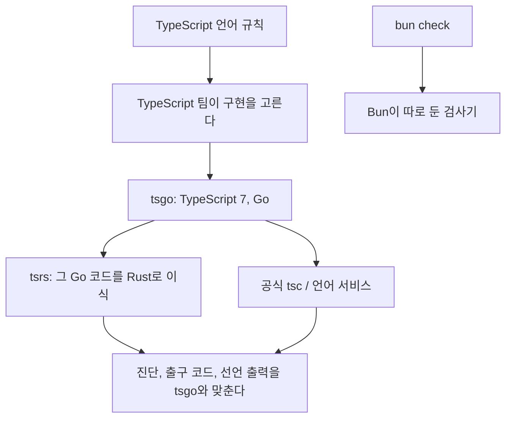
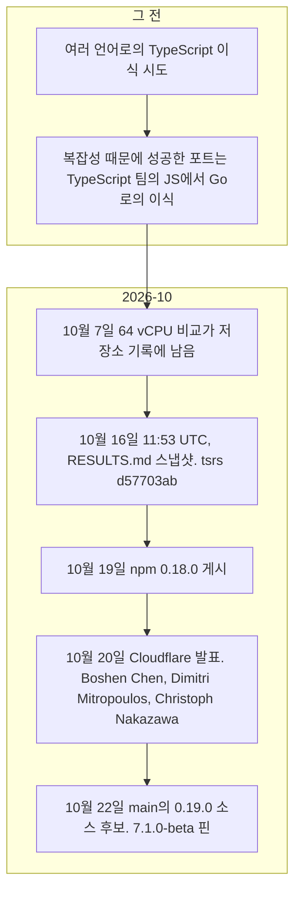
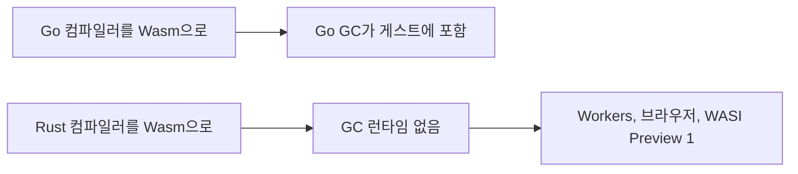
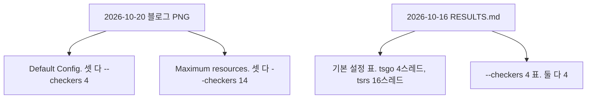

# tsrs: TypeScript 7 컴파일러의 Rust 포트

`oxc-project/tsrs`. TypeScript 7의 Go 구현(tsgo)을 Rust로 옮긴 컴파일러와 언어 서버.

확인 기준: 2026-10-25. 발표 문장과 날짜는 Cloudflare 블로그 2026-10-20이다. 설치 버전은 같은 날 이 환경에서 `npm view tsrs version`으로 본 npm `latest`다. 동작 범위, 메모리 모델, 측정 명령은 그날의 `main` 문서 `README.md`, `docs/PORTING.md`, `docs/COMPATIBILITY.md`, `docs/STATUS.md`, `bench/README.md`, `bench/RESULTS.md`다. 이 문서는 그 저장소를 클론해 벤치마크를 다시 재지 않았다.

이 문서는 tsrs가 어느 컴파일러의 포트인지, 8배라는 숫자가 어떤 조건의 측정인지, Rust를 고른 이유가 그 숫자와 어떻게 다른지, 아레나 포인터가 빌림 검사와 어떻게 다른지를 적는다. 저장소의 함수를 여기로 옮기지 않는다.

## 1. 결론

tsrs는 TypeScript라는 언어의 새 명세가 아니다. **TypeScript 7 Go 컴파일러의 함수 단위 포트**다. 언어의 문법과 타입 규칙을 바꾸는 권한은 TypeScript 팀에 둔다고 발표가 적는다. 저장소 안내도 “Go 코드와 같으면 맞고, 개선은 버그”라고 못 박는다.

2026-10-20 발표의 성능 문장은 이렇다. 타입 검사 워커 수를 같게 두면 tsrs가 TypeScript 7.0보다 **최대 8배 빠르고 메모리를 약 70% 적게** 쓴다. TypeScript 7.1 베타는 7.0보다 최대 2.5배 빠르고, 그 최적화의 일부는 tsrs에서 업스트림으로 올라갔다. 이 8배는 기본 설정으로 아무 프로젝트나 재면 나오는 상수가 아니다. 워커 수를 맞추고, 출력을 끄고, 증분 검사를 끈 타입 검사 시간의 상한이다. 저장소에 남아 있는 2026-10-16 표는 그 발표 숫자와 다른 실험도 포함한다. 기본 설정 표는 tsgo가 4스레드, tsrs가 16스레드다. 그 표의 16배는 8배라는 문장으로 인용하지 않는다.

Rust를 고른 이유로 발표가 앞에 두는 것은 그 8배가 아니다. Go를 Wasm으로 내면 Go 가비지 컬렉터도 같이 들어가고, Rust의 메모리 모델은 Wasm 게스트와 호스트 사이가 더 얇다는 문장이다. 속도는 그 선택의 결과로 같이 측정됐다. TypeScript 팀의 Dan Rosenwasser는 Hacker News에서, 속도의 상당 부분이 언어 선택만으로 설명되지 않으며 7.1의 개선 일부가 tsrs에서 찾은 최적화라고 적었다.

2026-10-25에 npm `latest`로 잡히는 버전은 `0.18.0-ts7.1.0-dev.20260929`다. 레지스트리 수정 시각은 2026-10-19T11:24:44Z다. `main`의 2026-10-22 릴리스 노트는 `0.19.0-ts7.1.0-beta`를 **소스 업그레이드 후보**로 적고, 0.18.0이 게시된 최신이라고 한다. `npm view`와 그 문장은 맞다. 안정 릴리스의 목표는 TypeScript 7.1 대비 100% 일치이고, 그 릴리스는 아직 이 문서의 확인 범위 밖에 있다.

풀 리퀘스트는 닫혀 있다. 이슈는 최소 재현과 함께 열린다. 라이선스는 Apache-2.0이고, TypeScript의 파생 저작물이다. 저장소는 Microsoft와 무관하고 Microsoft의 보증이 아니라고 적는다.

## 2. 컴파일러가 서 있는 자리

타입을 검사하는 구현이 하나였던 시절이 아니다. 같은 언어를 서로 다른 코드가 검사한다.



| 이름 | 자리 | 이 문서에서 비교할 때 |
| --- | --- | --- |
| tsc 6 이전 | TypeScript로 쓴 컴파일러 | 발표가 “예전 구현보다 Go 포트가 10배”라고 할 때의 기준. tsrs의 직접 기준이 아니다 |
| tsgo | `microsoft/TypeScript`의 Go 컴파일러. npm 패키지 `typescript` 7 | tsrs가 베끼는 명세. 포트 가이드는 `checker.ts`가 아니라 이 Go 소스를 읽으라고 한다 |
| tsrs | `oxc-project/tsrs`. npm 패키지 `tsrs` | 이 문서의 대상 |
| tsc-rs | Theo Browne 쪽 Rust 포트 | 발표는 이것을 tsrs와 한 패키지로 합치는 중이라고 적는다. 합쳐진 완료를 이 문서가 확인하지는 않았다 |
| `bun check` | Bun의 타입 검사 | 2026-10-16 저장소 표에 같이 찍혀 있다. tsrs의 모드가 아니다 |

언어 서버와 편집기 확장은 또 다르다. tsrs는 `--lsp` 서버를 포팅한다. TypeScript의 VS Code 확장 런타임은 포팅하지 않는다. `js/ts.tsdk.path`로 프로젝트의 `node_modules/tsrs/tsdk`를 가리키면, 0.19.0 패키지가 만들려는 실행 파일이 그 자리의 런처로 npm 바이너리에 위임한다. 호환 표는 이 SDK 경로를 macOS와 Linux로 적고, Windows용 네이티브 `.exe`가 아니면 그 런처가 Windows SDK가 되지 않는다고 적는다.

## 3. 시간



발표는 Cloudflare와 VoidZero가 Owner.com의 Max Schwenk와 함께 작업한다고 적는다. 초기 작업의 후원은 Owner.com, 포트는 Max Schwenk, npm 이름 `tsrs`의 이전은 @JiangWeixian, CI 후원은 Depot이라고 README가 적는다. Oxc 도구 체계 안에서 키운다. Oxc 쪽 이름은 VoidZero의 JavaScript 컴파일러 도구이고, Oxlint의 타입 정보 린트에 tsrs를 넣는 것은 발표가 **실험**이라고 부른 다음 단계다. 그 실험이 이미 린트 규칙으로 나왔는지는 이 문서의 확인 범위가 아니다.

GeekNews가 옮긴 “최첨단 모델이 며칠 만에 대규모 이식을 거의 독립적으로 한다”는 발표의 문장이다. 그 문장은 여러 포트가 쏟아졌다는 배경이다. tsrs의 커밋이 전부 에이전트 출력이며 사람이 한 줄도 쓰지 않았다는 문장은 발표에 없다. README는 Max Schwenk를 포트의 저자로 적는다.

## 4. 포크가 아니라는 말

발표의 문장은 “we are not forking TypeScript”다. 의미는 세 갈래다.

1. 언어 설계의 결정권은 TypeScript 팀에 남긴다. 어떤 기능은 빨리 들어가고, 어떤 기능은 수년 동안 선택지를 보다가 구현이 정해진다. Rust 포트가 그 결정을 건너뛰면 나중 버전과 어긋난다.
2. 구현의 기준은 그 팀이 고른 원본이다. 포트 가이드는 Go 함수를 읽고 Rust 함수를 쓰라고 한다. 예전 `checker.ts`를 기억으로 옮기지 말라고 한다. Go 포트는 그 파일과 세부에서 다르다.
3. 동작이 달라 보이면 tsrs 쪽이 버그다. 진단 코드, 위치, 메시지, 순서, 출구 코드가 그렇다. 출력이 더 나아 보여도 기준과 다르면 버그다.

이 구분이 좁아지는 지점이 있다. 저장소는 “Microsoft와 무관하고 보증받지 않았다”고 적는다. 협업과 상표·보증은 다른 문장이다. 진단 출력 순서는 발표가 아직 남은 차이라고 인정한다. 안정 릴리스 전에 그 차이를 줄이는 것이 목표이고, 2026-10-25의 npm 0.18.0이 그 안정 릴리스는 아니다.

풀 리퀘스트를 닫아 둔 것도 운영 정책이다. 외부 패치가 언어 의미를 한 칸 밀 대역폭이 없다고 README가 적는다. 버그 보고는 이슈로 받는다.

## 5. 왜 Rust인가

Go 포트는 이미 예전 TypeScript 구현보다 10배 빠르고 메모리를 훨씬 덜 쓴다고 발표가 적는다. 그 다음에 “그런데 왜 Rust인가”가 온다. 답이 또 한 번의 10배는 아니다.

Wasm으로 낼 때 Go는 가비지 컬렉터를 게스트에 넣어야 한다. Rust는 그 런타임이 없고, 게스트와 호스트가 메모리를 주고받는 경로가 짧다. Cloudflare Workers는 Wasm을 오래 지원해 왔고, 발표는 wasm-bindgen의 Emscripten 타깃으로 Workers에서 네이티브 Rust를 지원한다고 며칠 전 발표를 가리킨다. 빌드와 배포를 Workers 안에서 반복하면 메모리 한 칸이 격리된 개발 환경을 둘 수 있는 자리와 못 두는 자리를 가른다. 브라우저는 `@tsrs/wasm`과 [플레이그라운드](https://tsrs-playground.void.app)가 그 자리의 일부다. 호환 표는 Wasm 빌드를 단일 스레드로 적고, 2,000개 일치 표본에서 네이티브 `--singleThreaded`와 바이트가 같다고 적는다. 플레이그라운드의 편집은 기본 편집이다. 의미 자동완성, 호버, AST 검사, 인레이 힌트, 패키지 타입 자동 설치는 없다고 같은 표가 적는다.



Hacker News에서 이 구조를 먼저 읽은 댓글은, 목표가 더 빠른 컴파일러가 아니라 **Wasm 샌드박스 안의 컴파일러**였고 속도는 그 실험의 결과라고 본다. 발표의 절 순서는 반대다. 성능 그래프가 먼저 오고, Wasm은 “Why Rust?”에 있다. 두 읽기를 같이 두면 이렇다. 글을 연 독자에게 먼저 보이는 수는 8배다. Rust를 Go 대신 고른 이유로 글이 적은 문장은 Wasm 메모리다. 그래프가 틀렸다는 뜻이 아니다. 8배가 Rust를 고른 이유의 전부라는 뜻이 아니다.

같은 스레드에서 TypeScript 팀의 Dan Rosenwasser는 유지보수자와 어떤 최적화가 안전한지 보고 있으며, 팀도 Rust 이식을 직접 해봤고, **속도의 상당 부분은 언어만으로 설명되지 않는다**고 적었다. 7.1이 더 빠르고 메모리를 덜 쓰게 된 일부는 tsrs에서 찾은 최적화다. 다른 댓글은 같은 구현을 그대로 Rust로 옮기면 차이가 몇 퍼센트이거나 오히려 느려지고, 큰 이득은 원본에도 올릴 수 있는 알고리즘 쪽이라고 적는다. 그 “몇 퍼센트”는 댓글의 경험이지 이 저장소의 측정 표가 아니다. 발표의 2.5배(7.1 베타 대 7.0)는 그 댓글과 방향이 같다. 언어를 바꿔서 8배가 나온 것이 아니라, 포트를 하면서 찾은 구조 개선이 공식 컴파일러에도 들어간다는 방향이다.

그래서 “처음부터 Go가 아니라 Rust였어야 한다”는 한 줄은 두 시점을 섞는다. Go를 고른 당시의 이유는 가비지 컬렉터 때문에 기존 객체 그래프를 옮기기 쉬웠다는 점이고, 그 전제는 포트를 **사람이 읽고 유지하는 동안** 유효하다. 테스트만 있으면 모델이 어떤 언어로든 옮길 수 있다는 주장은 이식 비용에 해당한다. 이식 뒤에 타입 규칙이 바뀌는 코드를 어느 언어로 읽고 고칠지는 그 주장 밖에 있다. 발표는 그 읽기를 TypeScript 팀에게 남긴다.

## 6. 8배라는 수의 조건

발표가 본문에 적은 조건은 하나다. **타입 검사 워커 수가 같다.** 다른 포트의 최근 숫자가 더 큰 머신과 TypeScript 기본값과 다른 옵션에서 나왔다고 적고, 이번 비교는 TypeScript 팀과 맞춰 같은 설정이라고 적한다. 본문은 워커 개수로 4를 찍지 않는다. 그 4는 본문 바로 아래 첫 번째 그림의 바닥글에 있다.


그림의 제목은 “TypeScript Default Config”다. 막대는 셋이다. 주황은 tsrs `0.18.0-ts7.1.0-dev.20260929`, 진한 파랑은 TypeScript nightly `7.1.0-dev.20261019.1`, 옅은 파랑은 TypeScript `7.0.2`다. 바닥글은 세 컴파일러가 같은 명령을 쓴다고 적는다. `-p <project> --noEmit --incremental false --pretty false --checkers 4`다. 발표 문장의 “워커 수가 같다”가 이 그림에서는 4로 찍혀 있다. 프로젝트는 VS Code, MUI docs, webpack, t3code server다. 칸의 초와 GiB는 그림 안에 있고, 이 문서는 그 칸을 표로 다시 베끼지 않는다. 블로그가 “7.1 베타가 7.0보다 최대 2.5배”라고 적은 문장과, 그림 범례의 nightly `7.1.0-dev.20261019.1`은 글이 나란히 둔 이름이다. 범례가 beta라는 철자를 쓰지는 않는다.

기본 설정이 더 빠르다는 문장 다음에 글이 붙인 두 번째 그림의 제목은 “Maximum resources”다.


바닥글은 세 컴파일러 모두 `--checkers 14`다. 나머지 플래그는 첫 그림과 같다. 글의 산문은 이 자리를 “기계에 맞춘 적응 설정이 메모리를 더 쓰고 더 빠르다”고 소개한다. 그림이 자기 제목에 적은 말은 Maximum resources이고, 체커 수는 14로 고정돼 있다. 포트 가이드의 `max(코어/2, min(코어, 16))` 공식과 이 14를 같은 식으로 합치지 않는다. 14가 어느 기계의 적응 결과인지는 그림이 적지 않는다.



두 PNG와 아래 저장소 표는 한 실행의 세 그림이 아니다. 블로그 그림의 tsrs 버전 문자열은 `0.18.0-ts7.1.0-dev.20260929`이고, nightly는 `7.1.0-dev.20261019.1`이다. RESULTS.md는 2026-10-16 11:53 UTC, tsrs 커밋 `d57703ab5f07`, tsgo는 `typescript@7.0.2`다. 그림 뒤의 CSV는 받지 않았다.

[GeekNews 35724](https://news.hada.io/topic?id=35724)의 요약은 그 비교를 **워커 4개, 파일 출력과 증분 검사를 끈 조건**으로 옮긴다. 저장소 `bench/README.md`의 측정 명령은 그 요약과 맞닿아 있다. 시간을 재는 호출은 `-p --noEmit --incremental false --pretty false --checkers N`이다. CI 설명은 프로젝트마다 체커 4개, 워커 CPU 8개, 워밍업 3번, 측정 10번이다. `--extendedDiagnostics`는 시간을 재는 명령에 넣지 않는다. 넣으면 종료 때 하는 일이 달라진다.

`bench/RESULTS.md`는 그 방법 이전의 **역사적 스냅샷**이라고 README가 적는다. 날짜는 2026-10-16 11:53 UTC, tsrs 커밋 `d57703ab5f07`, 기계는 Depot `depot-ubuntu-24.04-16`(16 vCPU, 63GB, AMD EPYC 9R45)이다. tsgo는 npm `typescript@7.0.2`다. 그 스냅샷의 tsrs는 7.1-dev 커밋 `b85298b6`을 포팅한 빌드이고, 오류 개수가 어긋난 8개 프로젝트는 `typescript@7.1.0-dev.20260930.4`로 다시 빌드하면 tsrs와 개수가 같다고 표가 적는다. 7.0.2와 7.1-dev를 같은 컴파일러의 두 바이너리처럼 읽으면 안 된다.

같은 파일 안의 두 표는 실험이 다르다.

| 표 | 스레드 | 읽는 법 |
| --- | --- | --- |
| 기본 설정 | tsgo 4, tsrs 16, bun check는 코어당 하나 | tsrs가 더 많은 체커를 쓴다. mui-docs 16.87배는 이 표다. 발표의 “워커 수가 같다”에 들어가지 않는다 |
| `--checkers 4` | 둘 다 4. bun check는 `--threads 4` | 발표 조건에 가깝다. 이 표의 tsgo 대비 배수는 4.37배에서 11.81배다 |

워커 4개로 맞춘 표에서 큰 프로젝트만 옮기면 이렇다. 시간은 벽시계, 메모리는 최대 RSS다.

| 프로젝트 | tsgo 7.0.2 | tsrs | 시간 | 메모리 |
| --- | ---: | ---: | --- | --- |
| mui-docs | 12.69초, 7.61GiB | 1.07초, 1.05GiB | 11.81배 | 7.24배 작음 |
| vscode | 10.94초, 7.49GiB | 2.21초, 1.80GiB | 4.95배 | 4.16배 작음 |
| webpack | 1.46초, 1.19GiB | 0.29초, 405MiB | 5.10배 | 3.00배 작음 |

vscode의 4.16배는 메모리가 약 76% 준 것이다. 7.49GiB에서 1.80GiB로 줄어들면 남은 비율이 약 0.24다. 발표의 “약 70% 적게”는 이 표의 최댓값이 아니라, 프로젝트마다 다른 감소를 한 문장으로 둔 것이다. mui-docs의 11.81배는 발표의 “최대 8배”보다 크다. 스냅샷의 빌드, 기계, 커밋이 10월 20일 블로그 그림과 같은지는 README가 보장하지 않는다. 블로그가 공개한 PNG 두 장은 위에 있다. 그 그림의 칸을 만든 원자료 파일은 따로 받지 못했다. 그래서 인용은 이렇게 가른다. **공개 문장의 상한은 8배와 약 70%다. 저장소 스냅샷의 4체커 표는 그 문장과 같은 종류의 비교이고, 프로젝트별로는 8배를 넘기도 하고 5배 아래이기도 하다.**

기본 설정이 더 빠른 이유는 발표가 따로 적는다. 기계에 맞춘 적응 설정이 메모리를 더 쓰고 더 빠르다. 포트 가이드가 2026-10-25의 `main`에 적은 기본 체커 수는 `max(코어/2, min(코어, 16))`을 4에서 32 사이로 두고, 타입 검사 파일 32개당 체커 하나로 줄이되 4 아래로는 내리지 않고, 파일 수를 넘기지 않는다. 빌드 모드는 4다. 10월 16일 표의 각주는 기본을 “코어 전부, 상한 16”으로 설명한다. 두 문장은 같은 공식이 아니다. 기본 스레드로 재기 전에 그 버전의 `default_checker_count`를 본다.

`bun check`는 같은 스냅샷에서 세 번째 열이다. 4체커 vscode는 Bun이 4.48초, 1.50GiB이고 tsrs가 2.21초, 1.80GiB다. 그 열의 Bun은 `1.4.4-canary.1`이다. 표는 bun check가 TypeScript 7.0 쪽을 따른다고 적고, webpack 오류 개수가 tsgo 848과 bun check 837로 어긋난다고 적는다. tsrs와 bun check 중 어느 쪽이 이 작업 공간의 검사기인지는 이 표가 정하지 않는다. 배수가 크다고 오류 집합이 같지는 않다.

증분과 감시 모드는 꺼 둔 8배와 다른 경로다. 같은 스냅샷의 vscode `--watch -p src --noEmit`은 8 vCPU에서 첫 빌드가 tsgo 12.41초, tsrs 1.86초다. 잎 파일의 주석을 다시 고치면 1.18초와 31밀리초다. bun check에는 감시 모드가 없다고 그 표가 적는다. 감시 배수를 배치 `--noEmit` 8배와 한 칸에 넣지 않는다.

재현은 `bench/README.md`의 `node bench/bench.mjs`다. Node 24가 필요하다. 과거 SVG 일부는 `publication.json`이 없어서 차트 데이터만으로 다시 그릴 수 없다고 README가 적는다. 이 문서의 표는 그 RESULTS.md를 옮긴 것이다.

## 7. 메모리 모델

Go에서 포인터로 오래 살고, 서로를 순환 참조하고, 값이 아니라 식별으로 비교하는 객체는 AST 노드, 심볼, 타입, 시그니처, 플로 노드다. Rust 포트는 이것을 수명 매개변수로 표현하지 않는다. `tsrs_core::P<T>`에 넣고, `P::new`로 만들고, `p.get()`이 `&'static T`를 돌려준다. 같음과 해시는 식별이다. Go 포인터와 같은 약속이다.

```text
Go:  *Type  ──식별 비교──▶  힙 객체
Rust: P<Type> ──식별 비교──▶  아레나 안의 객체
      p.get() == &'static Type
```

수명 매개변수가 코드베이스에 없다는 문장에는 예외가 있다. 이슈 #646의 `DefaultResolver<'h>`와 설정 파싱의 `&dyn ParseConfigHost`는 호출자 스택의 호스트를 빌린다.

배치 할당은 보통 프로세스가 끝날 때까지 산다. 언어 서버는 오래된 프로그램과 파일 버전을 놓기 위해 소유 영역을 쓴다. emit은 파일을 쓴 뒤 그 파일의 스크래치 영역을 푼다. `--maxMemory`는 한도를 넘으면 가장 큰 체커를 바꿔 CPU와 메모리를 교환한다고 호환 표가 적고, 대상은 `--noEmit` 검사의 옵트인이다.

회수는 “절대 해제하지 않음”이 아니다. 포트 가이드는 명시적 재활용 지점에서 객체가 죽었음을 입증하면 회수한다고 적는다. 롤백된 파스, 버려진 플로 레이블, 이스케이프 비트가 꺼진 스크래치 매퍼와 추론 맥락이 그 예다. 매퍼를 필드에 남기면 `MapperCell`이어야 한다. 체커와 진단처럼 파일 밖으로 나가는 할당은 스크래치에서 탈출시켜야 한다.

Hacker News의 지적은 이 설계의 경계와 같다. `P::get()`의 `'static`은 컴파일러가 그 객체가 그 참조보다 오래 산다고 증명해서 나온 수명이 아니다. 아레나 계약이다. 회수 지점의 “더는 안 쓴다”를 사람이나 모델이 입증하면, 그 입증이 틀릴 때 남는 것은 빌림 검사 실패가 아니라 해제된 아레나 슬롯을 산 참조로 보는 일이다. 절대 해제하지 않으면 그 클래스의 실수는 없어지고, 프로세스가 끝날 때까지 메모리는 돌아가지 않는다. 언어 서버와 emit이 영역을 푸는 이유는 그 반환이 필요해서다. 포트 가이드는 `unsafe`를 `tsrs_core`와 생성된 AST 밖으로 두지 말라고 한다. 위험한 연산을 그 크레이트로 모은 것이고, 모았다고 그 연산이 안전한 연산이 되지는 않는다.

스레드 계약도 수명이 아니라 소유 규칙이다. 파스와 바인딩은 파일마다 병렬로 끝나고, 그 다음에 검사가 시작된다. 체커는 `--checkers N`개고 `--singleThreaded`는 1이다. 각 체커는 OS 스레드이고 스택은 512MB다. 파일은 디렉터리 지역성으로 나뉘고, 일이 떨어진 체커는 가장 바쁜 체커의 아직 시작하지 않은 파일을 가져간다. 출력이 어느 체커가 검사했는지에 의존하지 않을 때 그 훔치기가 안전하다고 노트는 적는다. 공유이면서 바인딩 이후 얼어 있는 것은 AST와 바인더 심볼이다. 체커가 만드는 타입과 진단은 그 체커만 만진다. `P<T>`는 `Send + Sync`로 선언돼 있어서 컴파일러가 공유를 단속하지 않는다. 단속은 `TSRS_CHECK_SHARED=1` 같은 검사 빌드와 작성 규칙이다.

이 계약이 깨지는 증상이 진단의 순서다. README는 같은 코드와 옵션이 실행마다 같은 오류와 출구 코드를 내야 한다고 적고, 알려진 체커 순서 문제가 오류를 나타났다 사라졌다 하게 할 수 있다고 이슈 #725를 가리킨다. Go와 같은 배정을 쓰려면 `--checkerAssignment go`다. README는 그 플래그가 **모든 프로그램의 결정성을 보장하지 않는다**고 적는다. 호환 표는 이 플래그에 `--noLazyMembers`를 더하면 인스턴스화 깊이 한도에 닿는 경우까지 tsgo와 맞는다고 적는다. 결정성이 필요한 비교는 기본 체커 수가 아니라 이 플래그로 돌린 뒤의 진단 집합이다.

```sh
pnpm exec tsrs --noEmit --checkerAssignment go
```

## 8. 무엇을 하고, 무엇을 아직 하지 않는가

기준 핀이 두 개다. 게시된 0.18.0은 `b85298b6a81f`이고, 바이너리가 보고하는 TypeScript 버전은 `7.1.0-dev.20260930.4`라고 STATUS가 적는다. `main`의 0.19.0 후보는 `3e9236361fa9`, TypeScript `7.1.0-beta`다. 아래 일치 개수는 그 후보 문서가 새 핀에 대해 적은 수다. 0.18.0 npm 바이너리가 그 개수를 그대로 통과한다는 뜻으로 읽지 않는다.

| 맞춘 것 | 0.19.0 후보 문서의 근거 |
| --- | --- |
| 오류 베이스라인 | 13,700 |
| `.types`와 `.symbols` | 각 12,998 |
| JS와 선언 출력 | 13,626 |
| JS 소스맵 | 149 |
| 소스맵 기록 | 156 |
| Fourslash | 4,092그룹 이상 실행, 실패 그룹은 거절. 전체 4,562그룹 중 통과는 호환 표가 4,092로 적는다 |

검사만 하는 하네스에는 전체 emit 순서로 돌리면 사라지는 진단 산출이 네 개 남는다고 같은 문서가 적는다. 상위 1,000개 저장소 비교는 알려진 불일치와 tsrs 실패를 아직 보고한다고 호환 표의 타입 검사 칸이 적는다. “베이스라인이 전부 맞다”와 “아무 저장소에서나 tsgo와 바이트가 같다”는 다른 문장이다.

없는 것과, 있어도 범위가 잘린 것은 호환 표가 이렇게 적는다.

| 기능 | 상태 |
| --- | --- |
| `--noEmit`, JS emit, `.d.ts`, 소스맵, 증분 `.tsbuildinfo` | 지원. 벤치마크가 emit을 끈 것은 측정 조건이지 기능 부재가 아니다 |
| `--build` | 지원. 실패로 적힌 시나리오의 일부는 `--help`, `--init`처럼 포팅하지 않은 CLI다 |
| `--watch`, `-b --watch` | Linux와 macOS. Windows는 “not supported”로 끝난다. Linux에서 사이클 시작이 다르다. tsgo는 첫 쓰기(종종 잘라내기)에서 반쯤 쓴 파일을 검사하고, tsrs는 쓰기가 파일을 닫은 뒤에 시작한다 |
| `--lsp` | 지원. 콘텐츠 매퍼의 실행은 언어 서버에서 아직이다. CLI와 `-b`의 매퍼는 지원으로 적혀 있다 |
| `--init`, `--showConfig` | “not supported”로 종료 |
| `--locale` | 무시. 메시지는 영어만 로드한다. 다른 로케일 카탈로그 파일은 저장소에 있어도 컴파일러가 읽지 않는다 |
| `--generateTrace` | “Failed to start tracing” 경고 후, 플래그 없이 검사한 것과 같이 검사 |
| 자동 타입 획득, 언어 서버의 성능·프로젝트 텔레메트리 | 포팅하지 않음. 요청 실패 이벤트만 켤 수 있다 |
| VS Code 확장 본체 | 없음. tsrs가 실어 나르는 것은 LSP 서버다 |
| 미리 빌드된 바이너리 0.14.0–0.18.0 | macOS arm64, Linux x64/arm64의 glibc와 musl. Intel macOS와 Windows x64는 다음 릴리스용으로 워크플로가 준비되고, 그 구간의 릴리스에는 패키지가 없다 |

0.19.0 후보 STATUS는 “LSP API 세션 초기화 훅이 포팅되지 않았다”고 적는다. 호환 표는 `--lsp`와 `custom/initializeAPISession`을 지원으로 적는다. 두 문장이 같은 훅을 가리키는지는 이 문서가 코드를 대조하지 않았다. 편집기에 넣기 전에 그 버전의 LSP 절을 본다.

네트워크 경로의 거부와, TypeScript 7이 없앤 옵션(ES5 타깃, AMD/UMD/System, `baseUrl`)의 거부는 tsgo와 같이 거부한다고 표가 적는다. 그 거부는 포트가 못 해서가 아니라 원본이 거부하는 것을 따라간 것이다.

## 9. 업스트림을 따라가는 방법

발표는 Vinext가 Next.js를 따라가는 절차를 TypeScript에도 쓴다고 한다. 아침에 에이전트가 변경과 diff를 보고, 영향을 줄 항목에 추적 이슈를 연다. 밤에 테스트 모음으로 호환 행렬을 다시 만든다. 차이가 나면 재현을 만들고, 관련 테스트를 옮기고, 수정을 제안한다. 성능 개선은 TypeScript Go 코드베이스로 되돌리려고 한다고 적는다. 7.1 베타의 일부 최적화가 그 방향의 첫 결과로 발표에 나온다.

이 절차가 보장하는 것은 “에이전트가 매일 본다”까지다. 보장이 아닌 것은 진단 순서, 체커 배정, 아직 포팅하지 않은 플래그가 이미 같다는 것이다. 4절의 규칙이 여기에도 적용된다. 업스트림과 다르면 tsrs의 버그로 본다.

PR을 닫아 둔 상태와 에이전트가 수정을 제안하는 상태는 공존한다. 외부 기여자가 의미 변경을 넣는 문은 닫혀 있고, 업스트림 diff를 따라가는 작업은 유지보수자 쪽에서 돈다.

## 10. 용어

| 쓰기 쉬운 말 | 이번 건에 맞는 말 |
| --- | --- |
| TypeScript를 Rust로 다시 만들었다 | TypeScript 7의 Go 컴파일러를 Rust로 이식했다. 언어 규칙은 원본을 따른다 |
| Rust라서 8배 빠르다 | 워커 수를 맞춘 타입 검사에서 최대 8배라는 발표가 있다. 팀 쪽 설명은 그 이득의 상당 부분이 언어가 아니라 원본에도 올릴 수 있는 최적화라는 쪽이다 |
| 메모리를 70% 덜 쓰니 항상 3분의 1이다 | 약 70%는 발표의 요약이다. 10월 16일 4체커 vscode는 약 76% 줄었고, 프로젝트마다 배수가 다르다 |
| 기본으로 실행하면 그 8배가 나온다 | 기본 체커 수는 기계와 파일 수에 따라 달라지고, 그 모드는 메모리를 더 쓰고 더 빠르다. 8배 문장과 다른 설정이다 |
| 포팅했으니 빌림 검사가 타입 객체를 지킨다 | 타입 객체는 `'static` 아레나 핸들이다. 회수 시점의 입증이 그 안전을 만든다 |
| tsrs를 쓰면 TypeScript 팀이 필요 없다 | 다음 언어 변경의 기준은 여전히 그 팀의 구현이다. 포팅이 늦으면 호환이 깨진다 |
| `bun check`와 같은 것이다 | 둘 다 타입을 검사한다. 10월 16일 표에서 bun check는 7.0 쪽, 그 스냅샷의 tsrs는 7.1-dev 쪽이다 |
| npm에 있으니 안정 버전이다 | 2026-10-25의 latest는 0.18.0 실험 릴리스다. 100% 일치의 안정 목표는 7.1 기준이고 아직 그 릴리스가 아니다 |

## 11. 이 문서가 하지 않은 일

- `cargo build`로 tsrs를 만들어 vscode나 이 저장소를 다시 재지 않았다. 6절의 초와 GiB는 RESULTS.md의 역사적 스냅샷이다.
- 블로그 PNG 두 장의 제목, 버전 문자열, 바닥글 명령은 6절에 적었다. 칸의 초와 GiB는 표로 다시 베끼지 않았고, 그림 뒤의 CSV도 받지 않았다. 그 그림과 10월 16일 RESULTS.md가 같은 실행인지는 버전 문자열이 달라 한 실행으로 합치지 않았다.
- `P::new`의 `unsafe` 블록을 감사하지 않았다. 7절은 포트 가이드가 적은 계약과, 그 계약이 빌림 검사와 다르다는 점까지다.
- 0.19.0 후보가 npm에 올라갔는지는 2026-10-25의 `npm view`가 `0.18.0-ts7.1.0-dev.20260929`를 latest로 준 시점까지다.
- Oxlint 타입 린트, tsc-rs 병합, Workers 위의 전체 도구 체계는 발표의 계획으로 남긴다.

## 12. 출처

- Cloudflare Blog, 2026-10-20. Boshen Chen, Dimitri Mitropoulos, Christoph Nakazawa. Introducing tsrs: A port of TypeScript to Rust. [https://blog.cloudflare.com/typescript-rust-port/](https://blog.cloudflare.com/typescript-rust-port/)
- 같은 글의 차트 PNG. [TypeScript Default Config](https://blog.cloudflare.com/_emdash/api/media/file/01M5C82YQFJQ7JY8JZPCKSP6EG.png), [Maximum resources](https://blog.cloudflare.com/_emdash/api/media/file/01M5C8302F3MQTH2SKC6MMGDTV.png). 글 맨 위의 일러스트는 측정 그림이 아니라 넣지 않았다.
- oxc-project/tsrs README, PORTING, COMPATIBILITY, STATUS, bench/README, bench/RESULTS. [https://github.com/oxc-project/tsrs](https://github.com/oxc-project/tsrs)
- npm `tsrs` latest `0.18.0-ts7.1.0-dev.20260929`. 2026-10-25 조회. [https://www.npmjs.com/package/tsrs](https://www.npmjs.com/package/tsrs)
- GeekNews 35724. 발표 요약과 Hacker News 의견. [https://news.hada.io/topic?id=35724](https://news.hada.io/topic?id=35724)
- Hacker News, Tsrs: A Port of TypeScript to Rust. Dan Rosenwasser의 7.1 업스트림 최적화 코멘트 포함. [https://news.ycombinator.com/item?id=50165953](https://news.ycombinator.com/item?id=50165953)
- 체커 순서 이슈. [https://github.com/oxc-project/tsrs/issues/725](https://github.com/oxc-project/tsrs/issues/725)
- 브라우저 플레이그라운드. [https://tsrs-playground.void.app](https://tsrs-playground.void.app)
