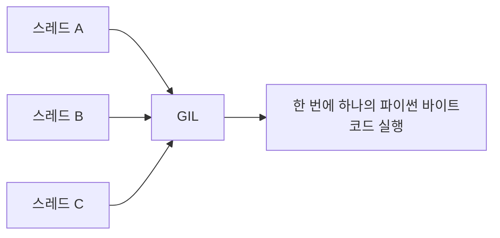
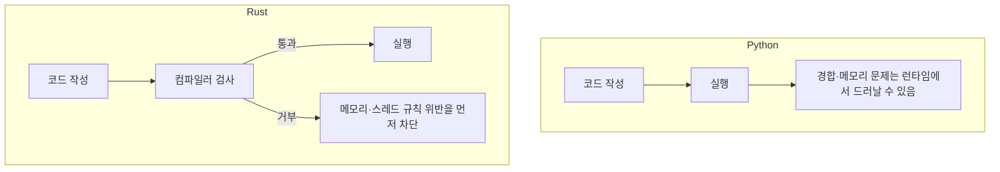
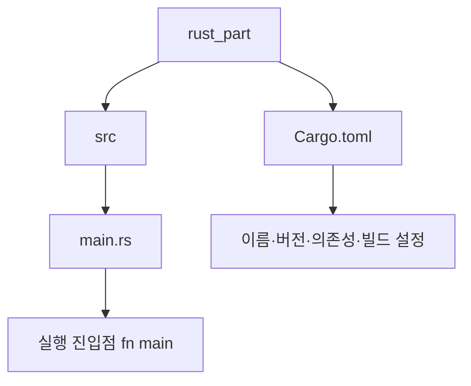
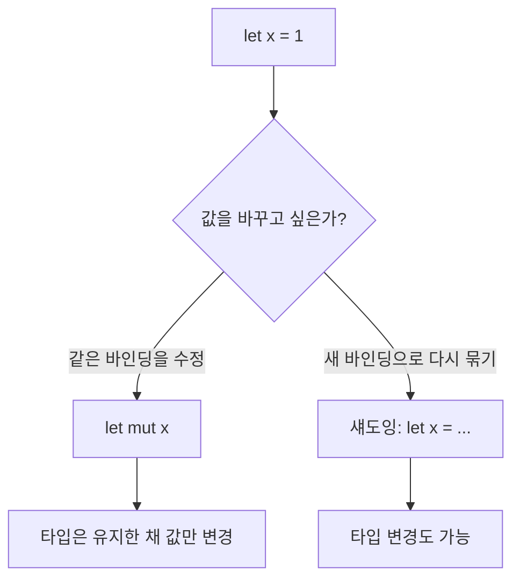
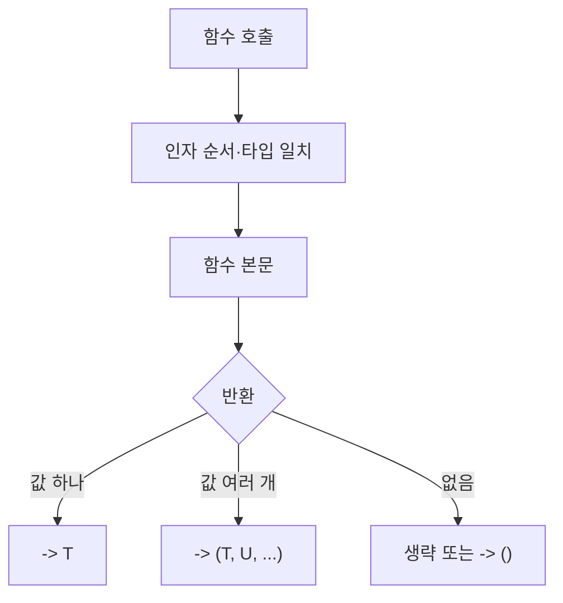
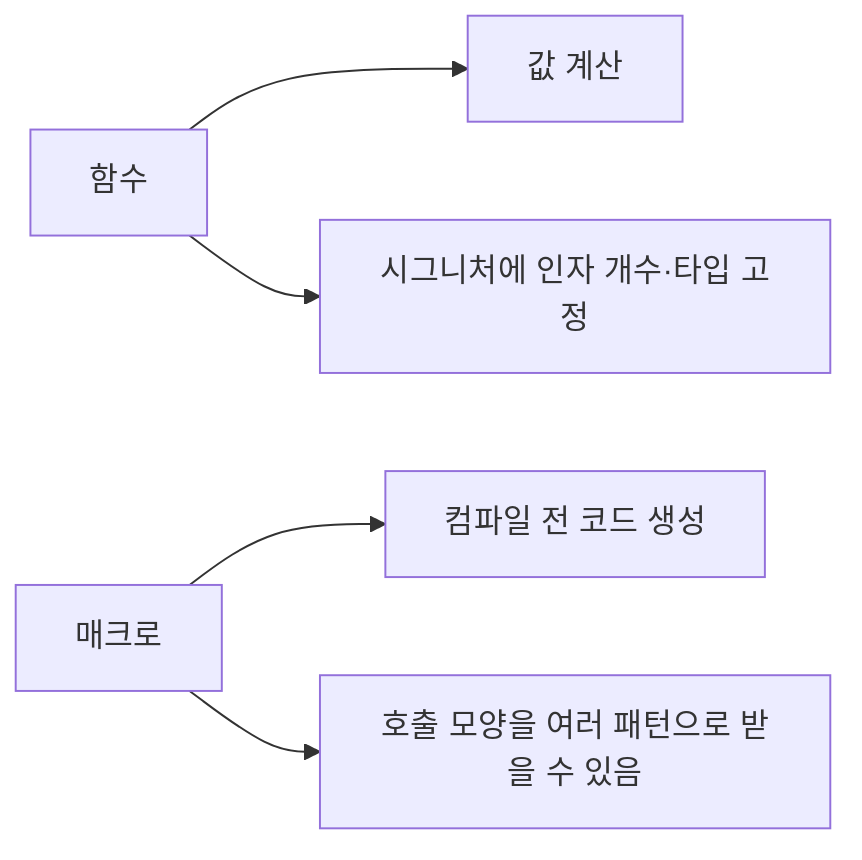

# An Introduction to Rust

### Hello World는 비슷해 보이지만, 멀티스레드와 메모리 모델에서는 두 언어의 출발점이 다르다

파이썬과 러스트는 둘 다 “화면에 한 줄을 출력하는” 첫 프로그램을 매우 짧게 쓸 수 있다. 그러나 그 짧은 예제가 가리는 차이는 크다. 파이썬은 실행 시점에 유연하고, 러스트는 컴파일 시점에 메모리와 스레드 규칙을 강제한다. 특히 여러 코어를 쓰는 프로그램을 만들 때 이 차이는 언어 선택 자체가 된다.

파이썬으로 Hello World를 쓰면 보통 다음과 같다.

```python
print("hello, glory")
```

같은 메시지를 러스트로 쓰려면 함수 진입점이 필요하다.

```rust
fn main() {
    println!("hello, glory");
}
```

겉보기에는 출력문 하나 차이다. 하지만 이 두 줄이 올라타는 런타임과 컴파일러의 약속은 서로 다르다. 파이썬은 인터프리터가 객체를 관리하고, 러스트는 소유권과 빌림 규칙으로 메모리 수명을 컴파일 시점에 검사한다.

## 1. 파이썬의 GIL: 스레드는 여러 개인데, 파이썬 바이트코드는 한 번에 하나

파이썬의 멀티스레딩을 이야기할 때 빠질 수 없는 개념이 GIL(Global Interpreter Lock, 전역 인터프리터 락)이다.

GIL은 여러 스레드가 동시에 파이썬 바이트코드를 실행하지 못하도록, 파이썬 객체에 대한 접근을 직렬화하는 일종의 뮤텍스다. 덕분에 CPython 구현에서는 객체 참조 카운트 같은 내부 상태를 단순하게 유지할 수 있다. 대신 CPU를 많이 쓰는 연산이나 “진짜 병렬” 멀티스레딩 프로그램에서는 한계가 분명해진다.

핵심을 한 문장으로 말하면 이렇다. **파이썬에서 스레드를 여러 개 만들어도, GIL 때문에 파이썬 코드를 실행하는 구간에서는 사실상 한 번에 하나의 코어만 쓰는 것과 비슷한 제약이 따른다.**

I/O 대기처럼 GIL을 잠시 놓는 구간에서는 스레드가 여전히 유용하다. 네트워크 요청을 기다리거나 파일을 읽는 동안 다른 스레드가 일을 이어갈 수 있기 때문이다. 그러나 CPU 바운드 계산을 스레드만으로 가속하려는 순간, GIL은 기대한 속도 향상을 가로막는다. 이때 파이썬 쪽에서는 멀티프로세싱, 네이티브 확장, 다른 런타임 같은 우회가 자주 거론된다.



## 2. 스레드를 쓰면 생기는 또 다른 문제: 경합 조건

GIL이 있어도 파이썬 멀티스레딩이 자동으로 안전해지지는 않는다.

여러 스레드가 공유 상태를 건드리면 경합 조건(race condition)이 생길 수 있다. 누가 먼저 값을 읽고 쓰는지에 따라 결과가 달라지고, 재현도 어렵다. GIL은 인터프리터 내부의 동시 실행을 제한할 뿐, 애플리케이션 수준의 공유 상태 설계까지 대신해주지는 않는다.

락을 직접 걸고, 공유 자료를 줄이고, 큐로 메시지를 넘기는 식의 설계가 여전히 필요하다. 즉 파이썬에서 스레드를 쓰는 일은 “병렬로 빨라지는가”와 “공유 상태를 어떻게 안전하게 다루는가”라는 두 질문을 한꺼번에 받는 작업이다.

## 3. 러스트는 컴파일 시점에 메모리와 스레드 문제를 먼저 본다

러스트가 강조하는 지점은 여기서 갈린다.

러스트는 컴파일이 끝나는 시점에, 발생할 수 있는 많은 메모리 오류와 데이터 레이스 계열 문제를 미리 걸러낸다. 소유권(ownership), 빌림(borrowing), `Send`/`Sync` 같은 타입 체계가 “이 값을 누가, 언제, 어떤 방식으로 만져도 되는가”를 컴파일러가 검사하게 만든다.

그래서 같은 멀티스레드 프로그램을 쓰더라도, 파이썬처럼 실행해 보고 간헐적으로 깨지는 경합을 추적하기보다, **컴파일이 통과하지 않으면 그 프로그램은 일단 시작조차 하지 못하는** 쪽에 가깝다. 학습 곡선은 가파를 수 있지만, 그 대가로 런타임에 터지는 클래스의 버그를 앞단에서 줄인다.



물론 러스트가 모든 버그를 없애는 것은 아니다. 논리 오류, 잘못된 알고리즘, `unsafe`로 우회한 구간은 여전히 개발자 책임이다. 다만 “여러 스레드가 같은 가변 상태를 제멋대로 건드리는” 유형의 실수를, 언어가 기본값으로 막으려 한다는 점이 파이썬과의 대비다.

## 4. Cargo: 크레이트를 다루는 러스트의 기본 도구

러스트 생태계에서 패키지는 크레이트(crate)라고 부른다. 그 크레이트를 만들고, 의존성을 받고, 빌드하고, 검사하는 중심 도구가 Cargo다.

Cargo에는 포매터, 린트, 테스트, 문서화, 벤치마크처럼 일상 개발에 필요한 기능이 묶여 있다. 자주 쓰는 명령만 정리하면 다음과 같다.

| 명령 | 역할 |
|---|---|
| `cargo new` | 새 패키지 디렉터리를 만든다 |
| `cargo init` | 현재 디렉터리를 Cargo 프로젝트로 초기화한다 |
| `cargo fmt` | 코드 스타일을 기준에 맞춰 고친다 |
| `cargo clippy` | 문법적으로는 맞아도 위험하거나 어색한 패턴을 린트로 잡는다 |
| `cargo test` | 테스트를 실행한다 |
| `cargo doc` | 문서를 생성한다 |
| `cargo bench` | 벤치마크를 실행한다 |

여기서 포매터와 린터의 역할은 다르다.

**포매터(**`fmt`**)는 코드의 모양을 팀 또는 생태계의 스타일 기준에 맞춘다.** 들여쓰기, 줄바꿈, 공백처럼 “읽는 방식”을 통일한다.

**린터(**`clippy`**)는 코드가 문법 규칙을 넘어서, 권장 패턴과 안전·가독성 관점에서 괜찮은지를 검사한다.** 컴파일이 되는 코드라도 “더 명확하게, 덜 위험하게” 쓸 수 있는 지점을 지적한다.

## 5. 설치부터 첫 폴더까지

macOS와 Linux에서는 rustup 설치 스크립트로 툴체인을 받는 방식이 흔하다.

```bash
curl --proto '=https' --tlsv1.2 https://sh.rustup.rs -sSf | sh
```

설치가 끝나면 새 프로젝트를 만드는 가장 단순한 방법은 `cargo new`다.

```bash
cargo new rust_part
```

이미 있는 폴더에서 시작하려면 `cargo init`을 쓴다. 둘 다 Cargo 프로젝트의 뼈대를 만들어 주지만, `new`는 새 디렉터리를 만들고 `init`은 현재 위치를 프로젝트로 바꾼다.

생성되는 기본 구조는 대략 다음과 같다.

```text
rust_part/
├── Cargo.toml
└── src/
    └── main.rs
```



`src/main.rs`에는 실행 파일 크레이트의 진입점이 들어간다. 바이너리 패키지라면 여기서 `fn main()`이 프로그램의 시작이다.

## 6. Cargo.toml: 프로젝트의 설정이 모이는 곳

`Cargo.toml`은 프로젝트의 이름, 버전, 에디션, 의존성, 기능 플래그처럼 **패키지를 어떻게 빌드할지에 대한 설정값을 모아 둔 파일**이다. 파이썬의 `pyproject.toml`이나 Node의 `package.json`에 해당하는 자리에 가깝다.

아주 단순한 바이너리 패키지라면 다음과 같은 형태에서 시작한다.

```toml
[package]
name = "rust_part"
version = "0.1.0"
edition = "2024"

[dependencies]
```

`[package]`에는 크레이트 메타데이터가 들어가고, `[dependencies]`에는 crates.io 등에서 가져올 외부 크레이트를 적는다. 이후 테스트 전용 의존성은 `[dev-dependencies]`, 빌드 스크립트용은 `[build-dependencies]`처럼 구역을 나눈다.

즉 러스트 프로젝트를 연다는 것은 `main.rs`만 여는 일이 아니다. **소스와 설정을** `src`**와** `Cargo.toml`**로 나눠 두고, Cargo가 그 설정을 읽어 빌드·테스트·문서·벤치까지 한 줄기로 돌리는 구조**를 받아들이는 일이다.

## 7. 빌드와 실행: `cargo build`, `target`, `cargo run`

프로젝트를 만들었다면 다음은 코드를 돌리는 일이다.

컴파일만 하려면 `cargo build`를 쓴다. 이 명령을 실행하면 프로젝트 아래에 `target` 폴더가 생기고, 기본(디버그) 빌드 결과물은 `target/debug/` 아래에 놓인다. 패키지 이름이 `rust_part`라면 보통 `target/debug/rust_part` 같은 바이너리가 생긴다. 그 파일을 직접 실행하면 프로그램의 출력값을 볼 수 있다.

```bash
cargo build
./target/debug/rust_part
```

배포용으로 최적화된 바이너리가 필요하면 `--release`를 붙인다. 결과물은 `target/release/` 쪽으로 간다.

```bash
cargo build --release
./target/release/rust_part
```

다만 매번 `target` 폴더를 찾아 바이너리를 실행하는 일은 번거롭다. 그래서 일상 개발에서는 `cargo run`을 더 자주 쓴다. 이 명령은 필요한 컴파일과 바이너리 실행을 한 번에 처리한다.

```bash
cargo run
cargo run --release
```

주의할 점이 있다. `cargo run`**의 기본값도 디버그 모드다.** 로컬에서 빠르게 확인하는 데는 충분하지만, 성능을 보거나 배포에 가까운 결과를 보려면 `--release`를 명시해야 한다.


정리하면 `build`는 산출물을 만들고, `run`은 그 산출물을 바로 실행까지 이어 준다. 둘 다 기본은 디버그이고, 배포 경로에서는 `--release`가 한 쌍으로 따라온다.

## 8. rustfmt: 공백과 줄바꿈을 기준에 맞추는 내장 포매터

러스트에는 내장 코드 포매터인 rustfmt가 있다. Cargo에서는 보통 `cargo fmt`로 호출한다.

rustfmt는 공백 간격, 줄바꿈, 들여쓰기처럼 **사람이 읽는 형태**를 생태계의 관례에 맞춘다. 앞 절에서 말한 포매터의 역할이 바로 이것이다. 문법 오류를 찾아 주는 컴파일러나, 위험 패턴을 지적하는 Clippy와는 담당 구역이 다르다.

팀 프로젝트에서는 “누가 저장했느냐”에 따라 스타일이 갈리지 않도록 `cargo fmt`를 습관처럼 두는 경우가 많다. 코드의 의미가 아니라 겉모습만 바꾸기 때문에, 리뷰에서 들여쓰기 논쟁을 줄이는 데도 도움이 된다.

## 9. `let`, 불변성, `mut`, 그리고 섀도잉

러스트에서 변수는 `let`으로 선언한다. 타입은 `:` 뒤에 명시할 수도 있고, 컴파일러가 추론하게 둘 수도 있다.

```rust
let x: i32 = 10;
let x = 10;
```

두 줄의 결과는 비슷해 보이지만, 위는 타입을 직접 밝힌 것이고 아래는 추론에 맡긴 것이다.

더 중요한 기본값은 **변수가 기본적으로 불변(immutable)** 이라는 점이다. 한 번 묶인 이름을 그대로 다시 대입하려 하면 컴파일이 거부한다.

```rust
fn main() {
    let x = 1;
    x = 2; // 컴파일 오류: 불변 변수에 재할당
    println!("{}", x);
}
```

값을 바꾸려면 선언 시점에 `mut`를 붙여 가변 변수로 만들어야 한다.

```rust
fn main() {
    let mut x = 1;
    x = 2;
    println!("{}", x);
}
```

불변 변수의 “값”을 직접 고칠 수는 없지만, **같은 이름으로 변수를 새로 선언하는 것**은 가능하다. 이를 섀도잉(shadowing)이라고 한다.

섀도잉을 쓰면 `mut` 없이도 새 값을 같은 이름에 묶을 수 있다. 또한 새로 선언한 변수이므로 타입까지 바꿀 수 있다. 예를 들어 문자열로 읽은 값을 숫자로 다시 묶는 식이다.

```rust
fn main() {
    let x = "5";
    let x = 6; // 같은 이름 x를 새로 선언(섀도잉)
    println!("The value of x is: {}", x); // 6
}
```

`mut`와 섀도잉은 비슷해 보여도 의도가 다르다. `mut`는 **같은 바인딩의 내용을 바꾼다.** 섀도잉은 **새 바인딩으로 이름을 다시 붙인다.** 변환 파이프라인처럼 “단계는 달라졌지만 이름은 그대로 쓰고 싶을 때” 섀도잉이 자주 등장한다.



## 10. 원시 타입: 크기가 이름에 적힌 정수와 실수

러스트는 C++, Java, Go처럼 정적 타입 언어다. 그중에서도 정수·실수 원시 타입은 **비트 폭이 타입 이름에 드러난다.** `i32`는 부호 있는 32비트 정수이고, `u16`은 부호 없는 16비트 정수다.

부호 있는 정수는 `i`, 부호 없는 정수는 `u`로 시작한다.

| 비트 폭 | 부호 있음 | 부호 없음 |
|---|---|---|
| 8비트 | `i8` | `u8` |
| 16비트 | `i16` | `u16` |
| 32비트 | `i32` | `u32` |
| 64비트 | `i64` | `u64` |
| 128비트 | `i128` | `u128` |
| 아키텍처 의존 | `isize` | `usize` |

`isize`와 `usize`는 현재 플랫폼의 포인터 크기를 따른다. 64비트 머신에서는 보통 64비트고, 인덱싱·포인터 크기와 맞출 때 자주 쓴다.

실수는 두 가지가 기본이다.

| 타입 | 의미 |
|---|---|
| `f32` | 32비트 부동소수점 |
| `f64` | 64비트 부동소수점 |

그 밖의 자주 쓰는 원시 타입으로는 참/거짓을 나타내는 `bool`, 유니코드 스칼라 값 하나를 담는 `char`(Rust의 `char`는 4바이트), 값이 없음을 나타내는 유닛 타입 `()`가 있다.

```rust
let a: i32 = -20;
let b: u8 = 255;
let c: f64 = 3.14;
let ok: bool = true;
let ch: char = '가';
```

정수 리터럴에는 타입 접미사를 붙일 수도 있다. `42u32`, `1_000_i64`처럼 쓰면 가독성과 타입을 함께 고정하기 쉽다.

## 11. 타입 추론, rust-analyzer, 그리고 `as` 변환

모든 곳에 타입을 쓸 필요는 없다. 컴파일러가 주변 문맥으로 타입을 추론할 수 있으면 `let x = 10;`처럼 생략해도 된다.

에디터에서 rust-analyzer를 쓰면 이 추론 결과가 인레이 힌트로 화면에 보이기도 한다. 코드에 타입이 안 적혀 있어도 “지금 이 변수가 무엇으로 잡혔는지”를 바로 확인할 수 있어, 학습과 리팩터링에 도움이 된다.

타입이 서로 다를 때는 `as`로 명시적 변환(casting)을 할 수 있다. 암묵 변환에 기대기보다, **크기가 바뀌거나 부호가 바뀌는 지점을 코드에 드러내는** 쪽에 가깝다.

```rust
fn main() {
    let n: i32 = 1_000;
    let narrowed = n as i16; // 범위가 더 좁은 타입으로 변환
    let as_float = n as f64;
    let flag = 1u8 != 0; // 정수→bool은 `as`가 아니라 비교로 쓴다
    println!("{narrowed}, {as_float}, {flag}");
}
```

`as`는 편리하지만 만능은 아니다. 범위를 벗어나는 정수 축소는 값을 잘라 낼 수 있고, 부동소수와 정수 사이 변환도 의도를 잃을 수 있다. 특히 **정수에서 `bool`로의 `as` 캐스팅은 허용되지 않는다.** (`E0054`) “된다”와 “항상 안전하다”는 다르다.


## 12. 상수 `const`: 컴파일 타임에 고정되는 이름

변수(`let`)와 달리 상수는 `const`로 선언한다. 보통 모듈의 가장 위, 함수 밖에도 둘 수 있고, **타입을 반드시 적어야 하며 값은 컴파일 타임에 정해져야 한다.**

```rust
const MAX_POINTS: u32 = 100_000;
const PI: f64 = 3.1415926535;

fn main() {
    println!("limit={MAX_POINTS}, pi={PI}");
}
```

이름을 대문자 스네이크 케이스로 두는 관례가 흔하다. `let`처럼 나중에 바꾸거나, 런타임에만 알 수 있는 값을 `const`에 넣으려 하면 컴파일이 막힌다.

```rust
fn main() {
    let n = 10;
    // const BAD: i32 = n; // 오류: const에는 컴파일 타임 상수만 올 수 있다
}
```

`let`이 “이 스코프의 바인딩”이라면, `const`는 “프로그램 전역에서 반복해 쓸 불변 값에 이름 붙이기”에 가깝다. 나중에 배우는 `static`과도 자리가 다르지만, 입문 단계에서는 **바뀌면 안 되는 설정값·한계값**을 `const`로 빼 두는 습관만으로도 충분하다.

## 13. 함수: 타입을 밝히고, 여러 값은 튜플로 돌려준다

함수와 매크로는 코드 중복을 줄이고 관리를 쉽게 만든다. 러스트 함수는 `fn`으로 정의한다.

```rust
fn add(num1: i32, num2: i32) -> i32 {
    return num1 + num2;
}
```

일부 언어는 파라미터나 반환 타입을 생략할 수 있지만, **러스트 함수에서는 파라미터 타입과(반환이 있을 때) 반환 타입을 명시하는 것이 기본**이다. 본문 마지막 표현식에 세미콜론을 붙이지 않으면 그것이 반환값이 된다.

```rust
fn add(num1: i32, num2: i32) -> i32 {
    num1 + num2
}

fn main() {
    println!("{}", add(1, 2));
}
```

러스트 함수는 키워드 인자(`add(num2=2, num1=1)` 같은 형태)를 지원하지 않는다. 파라미터 기본값 문법도 없다. 기본값이 필요하면 오버로드 대신 별도 함수, 빌더, `Option` 같은 패턴으로 표현한다.

여러 값을 한꺼번에 돌려줄 때는 파이썬의 다중 반환과 비슷하게 튜플을 쓴다.

```rust
fn swap(a: i32, b: i32) -> (i32, i32) {
    (b, a)
}

fn main() {
    let (x, y) = swap(1, 2);
    println!("{x}, {y}"); // 2, 1
}
```

반환할 값이 없으면 반환 타입을 생략하거나, 유닛 타입 `()`를 적을 수 있다. 파이썬에서 `-> None`에 가까운 자리다.

```rust
fn do_nothing() -> () {
    ()
}

fn me_too() {}

fn main() {
    println!("{:?}", do_nothing());
    println!("{:?}", me_too());
}
```



## 14. 주석과 스코프: 중괄호가 가시 범위를 가른다

주석은 코드를 설명하는 메모다. 러스트에서 흔한 형태는 다음 세 가지다.

| 형태 | 용도 |
|---|---|
| `//` | 한 줄 주석 |
| `/* ... */` | 여러 줄 주석 |
| `///` | 바로 아래 항목을 위한 문서 주석(doc comment) |

강의에서 “여러 줄이 `///`”로 기억하기 쉽지만, 실제로는 `///`**는 문서화용**이고 여러 줄을 묶는 일반 주석은 `/* */`다. `///`로 쓴 내용은 `cargo doc`이 HTML 문서로 모아 주기도 한다.

스코프(scope)는 이름에 접근할 수 있는 범위다. 파이썬에는 LEGB(Local, Enclosing, Global, Built-in)처럼 더 세분된 규칙이 있지만, 여기서는 함수와 블록을 기준으로 단순화해도 충분하다. 러스트는 **중괄호** `{ ... }`**가 스코프의 경계**가 된다.

```rust
fn main() {
    let outer = 1;
    {
        let inner = 2;
        println!("{outer}, {inner}"); // 둘 다 보임
    }
    // println!("{inner}"); // 오류: inner는 안쪽 블록이 끝나며 사라짐
    println!("{outer}");
}
```

안쪽 블록에서 선언한 이름은 블록이 끝나는 순간 더 이상 쓸 수 없다. 소유권 이야기와도 맞닿아 있지만, 입문 단계에서는 “중괄호 밖에서는 그 안의 `let`을 모른다” 정도로 이해해도 된다.

## 15. 클로저: 이름이 없는 짧은 함수

이름이 없는 함수를 파이썬에서는 흔히 람다라고 부른다. 러스트에서 이에 해당하는 장치가 클로저(closure)다.

```rust
fn main() {
    let my_func = |x| x + 1;
    println!("{}", my_func(3)); // 4
}
```

위 예제에서 컴파일러는 `my_func(3)` 호출을 보고 파라미터와 반환을 `i32`로 추론한다. 타입을 직접 적을 수도 있다. 그때는 본문을 중괄호로 감싸는 형태가 흔하다.

```rust
fn main() {
    let my_func = |x: i32| -> i32 { x + 1 };
    println!("{}", my_func(3));
}
```

클로저는 주변 스코프의 변수를 캡처할 수 있다는 점에서 단순 익명 함수보다 역할이 넓다. 당장은 “짧은 동작을 이름 없이 `let`에 담아 호출한다”는 감각만 잡아도, 이터레이터 조합이나 콜백을 읽을 때 도움이 된다.

## 16. 매크로: 코드를 만들어 내는 코드

매크로는 함수처럼 호출하지만, 동작 방식은 다르다. 함수가 값을 계산한다면 매크로는 **다른 코드를 생성**한다. 이런 방식을 메타프로그래밍이라고 부른다.

함수는 파라미터 개수와 타입을 시그니처에 미리 고정한다. 그래서 `println!`처럼 인자가 하나일 때도, 둘일 때도, 서식 문자열과 여러 값이 함께일 때도 같은 “이름”으로 쓰려면 함수만으로는 까다롭다. 러스트 함수는 가변 길이 파라미터를 일반적인 문법으로 열어 두지 않기 때문에, 이런 패턴은 매크로로 구현하는 경우가 많다.

이미 계속 써 온 `println!`이 대표 예시다. 이름 끝의 `!`가 “매크로 호출” 표시다.

```rust
fn main() {
    println!("hello");
    println!("{} + {} = {}", 1, 2, 1 + 2);
}
```

간단한 선언적 매크로(`macro_rules!`)는 반복되는 패턴을 줄이는 데도 쓰인다.

```rust
macro_rules! say_hello {
    () => {
        println!("hello, glory");
    };
    ($name:expr) => {
        println!("hello, {}", $name);
    };
}

fn main() {
    say_hello!();
    say_hello!("glory");
}
```

함수가 “미리 정해진 입력으로 값을 계산하는 상자”라면, 매크로는 “호출 모양에 맞춰 코드를 펼쳐 주는 템플릿”에 가깝다. `vec!`, `format!`, `assert_eq!`처럼 표준 라이브러리에도 매크로가 많다. 처음에는 쓰는 쪽(`println!`)에 익숙해지고, 만드는 쪽(`macro_rules!`)은 패턴이 반복될 때 천천히 보면 된다.

